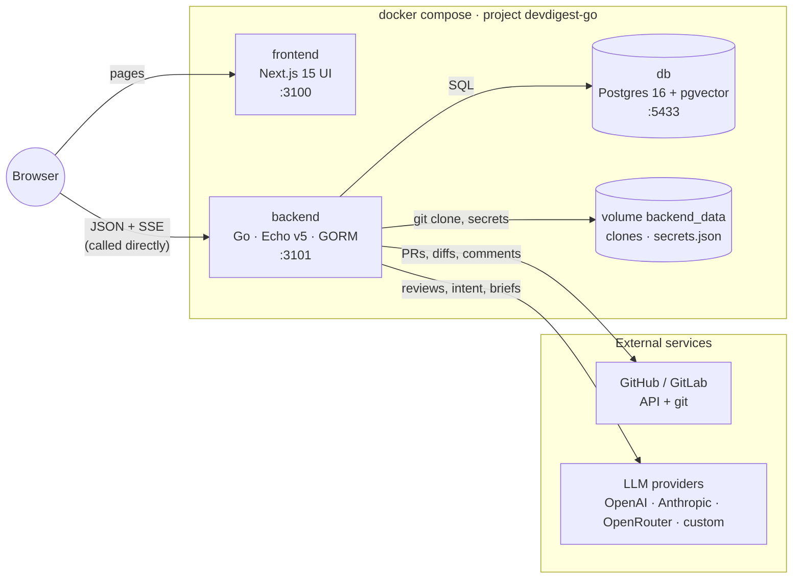

# DevDigest (Go)

Local-first AI review of pull requests and GitLab merge requests: import repositories, run reviewer
agents on a PR, triage their findings, post them back as comments, and follow team health on the PR
Leaderboard.

The tool runs on your machine for one user: the API has **no authentication**, so every port binds to
`127.0.0.1` only.

## Architecture



| Part | Path | Stack | What it does |
|---|---|---|---|
| UI | `frontend/` | Next.js 15, React 19, TanStack Query, next-intl | All screens. The browser calls the API itself at `NEXT_PUBLIC_API_BASE`, which is baked into the image at build time. |
| API | `backend/` | Go 1.27, Echo v5, GORM on pgx | The HTTP API, the review engine, background jobs (repo indexing, PR polling, automatic reviews, trace pruning) and the CI runner it exports. |
| Database | `db` service | pgvector/pgvector:pg16 | All state. The schema is owned by versioned SQL migrations in `backend/migrations/` (each with an up and a down), applied when the backend starts. |
| Data volume | `/data` in the backend | named volume `devdigest_go_backend_data` | Repository clones (`/data/workspace`) and keys saved in Settings (`/data/secrets.json`). |

**Backend layout.** One package per bounded context under `backend/internal/<context>` (`pulls`,
`reviews`, `reviewer`, `leaderboard`, `repointel`, `evals`, `ci`, …). Each context has its own
layers, and dependencies only point inward:

- `domain`: pure rules, standard library only.
- `app`: use cases, plus the interfaces they need.
- `adapters/<tech>`: Postgres, GitHub, GitLab and LLM clients.
- `transport/http`: routes and DTOs.

Shared plumbing lives in `backend/internal/platform/*`. `backend/cmd/server` is the composition root
(config, wiring, migrate → seed → jobs → listen, graceful shutdown).

**Wire contract.** The UI's Zod schemas in `frontend/src/vendor/shared/contracts/` are the API
contract. The Go API must match them exactly: paths, status codes, snake_case JSON fields, the error
envelope `{"error":{"code","message","details?"}}` and SSE frames. Change a contract only together
with the backend.

**Browser hardening (no auth by design).**
- JSON bodies are accepted only as `application/json`.
- State-changing requests with a foreign `Origin` get 403.
- The `Host` header must be listed in `ALLOWED_HOSTS` (DNS rebinding guard).

More detail: `backend/AGENTS.md`, `frontend/AGENTS.md`, `frontend/README.md` (UI route map),
`docs/migration/README.md` (decisions and phases) and `specs/` (feature specs).

## Run it

**Prerequisites:** Docker with Compose v2, plus `make`. You only need Go 1.27 or Node 22 + pnpm to work
on the code outside the containers.

```bash
cp .env.example .env    # optional: every value has a default
make up                 # build and start db, backend, frontend  (= docker compose up -d --build)
make ps                 # wait until all three are "healthy"
make health             # GET /health, /health/ready and the UI
```

Open **http://localhost:3100**. On the first visit the app sends you to **Settings › First-run
setup**:

1. Add a model key (OpenAI, Anthropic, OpenRouter or a custom gateway).
2. Add a GitHub token or a GitLab connection.
3. Add a repository.

Keys saved there go to `/data/secrets.json` and override the ones in `.env`.

| What | Default | Change in `.env` |
|---|---|---|
| UI | http://localhost:3100 | `WEB_PORT` |
| API | http://localhost:3101 | `API_PORT` (rebuild the frontend afterwards) |
| Postgres | `localhost:5433`, user/password/db `devdigest` | `DB_PORT` |

The defaults do not collide with the Node DevDigest stack (3000/3001/5432), so both can run at
once.

To try it without any API key, set `LLM_PROVIDER_OVERRIDE=mock` in `.env` and run `make up`. Every
LLM call then gets a deterministic mock answer.

### Everyday commands

`make help` lists every target. The usual ones:

| Command | Does |
|---|---|
| `make up` / `make up SERVICE=frontend` | build and (re)start everything / one service |
| `make logs SERVICE=backend` | follow the backend log |
| `make down` | stop and remove the containers; **the volumes stay** |
| `make db-shell` | `psql` in the database |
| `make migrate-status` · `make migrate-up` · `make migrate-down` | migrations, run inside the stack |
| `make backend-test-short` | fast Go tests (no Docker needed) |
| `make backend-check` | gofmt + build + vet + the full Go test gate (needs Docker for testcontainers) |
| `make frontend-check` | vitest + `tsc` + Biome (needs Node 22 + pnpm on the host) |
| `make check` | every gate of both packages |

For running the packages outside Docker (`go test`, `pnpm dev`), see `backend/AGENTS.md` and
`frontend/AGENTS.md`.

### Configuration

Everything is optional and documented in `.env.example`. The settings people change most:

- **LLM and GitHub keys:** `OPENAI_API_KEY`, `ANTHROPIC_API_KEY`, `OPENROUTER_API_KEY`,
  `GITHUB_TOKEN`.
- **`PR_POLL_ENABLED`:** the background PR poll that feeds the leaderboard. Its interval is the
  Settings value `polling_interval_min`.
- **`REVIEW_INTENT_ENABLED`:** derive the PR intent before each review. This adds one extra LLM call
  per review.
- **Review parallelism:** `REVIEW_AGENT_CONCURRENCY` and `REVIEW_MAP_CONCURRENCY`.
- **`DB_MAX_OPEN_CONNS`:** size of the backend's connection pool (1–90; Postgres allows 100).
- **`DEVDIGEST_EXTRA_CA_FILE`:** an extra trusted CA for self-hosted GitLab or custom gateways
  behind a private CA.

Boolean switches turn off only on the literal value `false`.

## Troubleshooting

Start with `make ps` and `make logs SERVICE=backend`. On a bad configuration the backend logs one
ERROR line naming the variable and stops.

| Symptom | Cause | Fix |
|---|---|---|
| Image build fails with "certificate not trusted" / "x509: certificate signed by unknown authority" (apk, `go mod`, pnpm) | A TLS-inspecting proxy (Zscaler, …) | Put the proxy's `*.crt` files in `certs/`, or point `BUILD_CA_DIR` at a directory that has them (e.g. `/usr/local/share/ca-certificates`). Then `make up`. See `certs/README.md`. |
| `go mod download` gets 403 "unscannable file formats" (e.g. `klauspost/compress`) | The proxy blocks some module zips | `BUILD_GOPROXY=https://proxy.golang.org\|direct` in `.env` (the pipe falls back to git on any error). |
| Downloads during the build are reset (WSL2) | Parallel downloads on Docker's default bridge network | The compose file already builds with `network: host`; keep it. |
| `port is already allocated` | Another service holds 3100/3101/5433 | Change `WEB_PORT` / `API_PORT` / `DB_PORT` in `.env`. |
| UI loads but shows no data or network errors after changing `API_PORT` | `NEXT_PUBLIC_API_BASE` is baked in at build time | `make up SERVICE=frontend`, so the frontend is rebuilt. |
| UI served from another port or host gets CORS errors | The backend only allows `http://localhost:<WEB_PORT>` and `127.0.0.1` | Use the compose UI. For `next dev` on another port, see `frontend/INSIGHTS.md`. |
| API answers 403 to a request | The `Host` is not in `ALLOWED_HOSTS`, or a state-changing request came with a foreign `Origin` | Add the host name to `ALLOWED_HOSTS`. Send writes from the UI's origin or without `Origin`. |
| API answers 415 / 422 to a request with a body | The body is not sent as `application/json` | Set `Content-Type: application/json`. |
| Backend does not start: ERROR naming `LLM_PROVIDER_OVERRIDE`, `REVIEW_*_CONCURRENCY`, `LLM_MOCK_DELAY_MS` or `DEVDIGEST_EXTRA_CA_FILE` | Invalid value, or the CA file is missing or has no certificate | Fix the value in `.env` (allowed ranges are in `.env.example`) and run `make up SERVICE=backend`. |
| A review, brief or export fails with `provider_not_configured` | No key for the agent's model provider | Add one in Settings or `.env`, or use `LLM_PROVIDER_OVERRIDE=mock`. |
| Reviews answer 402 `spend_cap_reached` | The monthly spend cap in Settings is reached | Raise or clear the cap in Settings. |
| Postgres "too many clients already" | Pool too large next to other clients | Lower `DB_MAX_OPEN_CONNS`. |
| PR Leaderboard is empty or stale | No reviews in the window, the poller is off, or there is no GitHub token / GitLab connection | Check `PR_POLL_ENABLED`, the token in Settings, and the "synced … ago" line per repository under the page title. |
| Host `go` commands fail with `go: no such tool "compile"` | An IDE-inherited `GOROOT`, or `/usr/bin/go` is older than 1.27 | Prefix with `env -u GOROOT PATH="$HOME/.local/go/bin:$PATH"`. The `make backend-*` targets already do this. |
| Go golden/contract tests fail with `\r` in the diff (Windows/WSL) | `core.autocrlf=true` checks the repo out with CRLF | Run the gate in a `git -c core.autocrlf=false worktree add` copy. Details in `backend/INSIGHTS.md`. |
| Need a clean database | — | `docker compose down -v` deletes **both volumes**: all repositories, clones and saved keys. Only run it on purpose. |

## Repository map

| Path | Content |
|---|---|
| `backend/` | Go API (`cmd/server`, `internal/<context>`, `migrations/`). Start with `AGENTS.md`. |
| `frontend/` | Next.js UI (`src/app` routes, `src/lib/hooks` data hooks, `messages/en` copy). Start with `AGENTS.md` and `README.md`. |
| `specs/` · `docs/plans/` | Feature specs and their implementation plans. |
| `docs/migration/` | Node → Go migration: decisions, research, status. |
| `certs/` | Optional proxy CA certificates for the image builds (git-ignored). |
| `*/INSIGHTS.md` | Lessons learned per package (append-only). Read before changing a package. |
