# `@devdigest/web` — the studio (Next.js 15)

The DevDigest UI: import repos, browse pull requests, run and read AI reviews,
and author agents. App Router + React Server/Client components, data via
**TanStack Query** hooks over the Fastify API. (This is the starter surface;
course lessons add the Memory, Eval, Blast/Brief, multi-agent, CI, and
dashboard screens.)

- **Stack:** Next.js 15 (App Router), React 19, TanStack Query, `next-intl`
  (messages in `messages/<locale>/*.json`), `recharts`, `mermaid`,
  `react-markdown`. UI primitives are vendored under `src/vendor/ui`
  (`@devdigest/ui`) and shared Zod contracts under `src/vendor/shared`
  (`@devdigest/shared`).
- **API base:** `NEXT_PUBLIC_API_BASE` (default `http://localhost:3001`), used by
  `src/lib/api.ts`. Every data hook lives in `src/lib/hooks/*`.
- **Run:** `pnpm dev` (`:3000`). **Test:** `pnpm test` (vitest + jsdom, fetch
  mocked — no API needed). **Typecheck:** `pnpm typecheck`. **Lint:** `pnpm lint`
  (Biome, config in `../biome.jsonc`).

## UI route map

Routes (`src/app/**/page.tsx`) and the API surface each leans on (via
`src/lib/hooks/*` → `src/lib/api.ts`):

```mermaid
flowchart TD
  ROOT["/<br/>first-run gate"] -->|"GET /settings/secrets-status · GET /repos<br/>all set → first repo"| PULLS["/repos/:repoId/pulls<br/>PR list"]
  ROOT -->|"no model key → ?step=model<br/>no GitHub token → ?step=github<br/>no repo → ?step=repo"| SETUP["/settings/setup<br/>first-run setup, inline in Settings · ?step=model, code-host, repo"]
  ONB["/onboarding<br/>old add-repo link"] -->|"server redirect"| SETUP
  OLDSETUP["/setup<br/>old link"] -->|"server redirect (keeps ?step)"| SETUP
  SETUP -->|"POST /settings/test-connection · POST /repos"| API[("Fastify API")]
  SETUP -->|"Finish"| PULLS
  PULLS --> PR["/pulls/:number<br/>review detail<br/>(overview · diff · findings)"]

  AGENTS["/agents"] --> AGENT["/agents/:id<br/>editor (config · skills · context · evals · stats · CI)"]
  CIRUNS["/ci-runs<br/>CI runs + Refresh"]
  PERF["/agent-performance<br/>agents compared for a period · ?period= · ?sort="]
  SKILLS["/skills<br/>grid"] --> SKILL["/skills/:id<br/>list sidebar + editor (config · preview · versions · stats · evals)"]
  CONV["/repos/:repoId/conventions<br/>rules + create-skill modal"]
  CTX["/repos/:repoId/context<br/>spec / doc / insight markdown, view-only"]
  TOUR["/repos/:repoId/onboarding<br/>five-part onboarding tour: generate, TOC, share"]
  LB["/leaderboard<br/>PR leaderboard · ?period=week|last_week|30d · ?repo=all|id"]
  EVAL["/eval<br/>agents overview · ?agent=id runs, trend, compare"]
  MA["/multi-agent<br/>recent runs per repo"] --> MANEW["/multi-agent/new<br/>pick PR + 2+ agents, estimates"]
  MA --> MARUN["/multi-agent/:id<br/>agent columns, grouped findings, Learn"]
  SETTINGS["/settings/:section<br/>API keys · models"]

  PULLS -->|"GET /repos/:id/pulls · /repos/:id/index-state"| API
  PR -->|"GET /pulls/:id · /reviews · /pulls/:id/comments<br/>POST /pulls/:id/review · /findings/:id/(accept|dismiss)"| API
  AGENTS -->|"/agents · /agents/:id · /agents/:id/skills"| API
  SKILLS -->|"/skills · /skills/stats · /skills/community · /skills/import/preview"| API
  SKILL -->|"/skills/:id · /versions · /versions/:v/restore · /agents · /stats · /eval-cases · /eval-runs"| API
  CONV -->|"/repos/:id/conventions · /extract · /skill · /conventions/:id"| API
  CTX -->|"/repos/:id/context · /repos/:id/context/doc?path="| API
  TOUR -->|"GET · POST /repos/:id/onboarding · /repos/:id/index-state"| API
  LB -->|"GET /leaderboard?period=&tz=&repo= · /repos"| API
  LB -.->|"PR links"| PR
  EVAL -->|"GET /eval/dashboard · /agents/:id/eval/dashboard · /agents/:id/eval-runs · /eval-runs/:id · /eval-runs/compare<br/>POST /agents/:id/eval-runs · /eval-runs/run-all"| API
  AGENT -->|"CI tab: /agents/:id/ci-installations · /ci/runs · POST /ci/refresh · POST /agents/:id/export-ci<br/>Stats tab: GET /agents/:id/stats?period="| API
  CIRUNS -->|"GET /ci/runs · POST /ci/refresh"| API
  PERF -->|"GET /agents/performance?period="| API
  MA -->|"GET /repos/:id/multi-agent-runs"| API
  MANEW -->|"GET /runs/estimates<br/>POST /pulls/:id/review {agentIds}"| API
  MARUN -->|"GET /multi-agent-runs/:id<br/>POST /findings/:id/(accept|dismiss|learn)"| API
  SETTINGS -->|"/settings · /providers"| API
```

**First run.** `/` is the only gated route (`src/app/_components/HomeView`): once
`GET /settings/secrets-status` and `GET /repos` have loaded it replaces the URL with
`/settings/setup?step=model` (no key for openai, anthropic or openrouter), else `/settings/setup?step=code-host`
(no GitHub token), else `/settings/setup?step=repo` (no repository), else the first repo's PR list.
It shows a skeleton while loading and an error with Retry when either request fails
(no redirect). `/onboarding` is a server redirect to `/settings/setup?step=repo` and `/setup` one to `/settings/setup`
(step kept); Settings › First-run setup moves to an earlier step when a prerequisite is missing. There is no "Skip setup" link.

The agent editor's **CI** tab and the Export wizard, and the `/ci-runs` page, are described in
[`../docs/export-to-ci.md`](../docs/export-to-ci.md) (hooks: `src/lib/hooks/ci.ts`).

The PR page's **Run Review** control is `RunReviewPicker`
(`src/app/repos/[repoId]/pulls/[number]/_components/RunReviewPicker/`, replaces
`RunReviewDropdown`): a multi-select over agents with estimated time. One agent
runs in place with live SSE status; 2+ start a multi-agent run and navigate to
`/multi-agent/:id`. `/multi-agent/new` accepts `?pr=<prId>&agents=<id>,<id>`
(default: every enabled agent). The sidebar has a "Multi-Agent Review" entry
(`src/vendor/ui/nav.ts`). `RunTraceDrawer` and `EvalCaseButton` were promoted from
the PR page to `src/components/run-trace-drawer` and `src/components/eval-case-button`
because the multi-agent results page reuses them. Data hooks:
`src/lib/hooks/multi-agent.ts`.

Cross-cutting chrome lives in `src/components/app-shell` (nav, breadcrumbs,
`g`-then-key shortcuts). Pages are thin; feature logic sits in colocated
`_components/<Name>/` folders, each with its own `*.test.tsx`.

## Testing

Component/interaction tests (`*.test.tsx`) run under vitest + jsdom with `fetch`
mocked, so they need neither the API nor a browser. The real browser journeys
(client + API + seeded DB) are covered by the deterministic agent-browser suite
in [`../e2e`](../e2e/README.md) and the `e2e-web.yml` workflow. See
[`../TESTING.md`](../TESTING.md).
