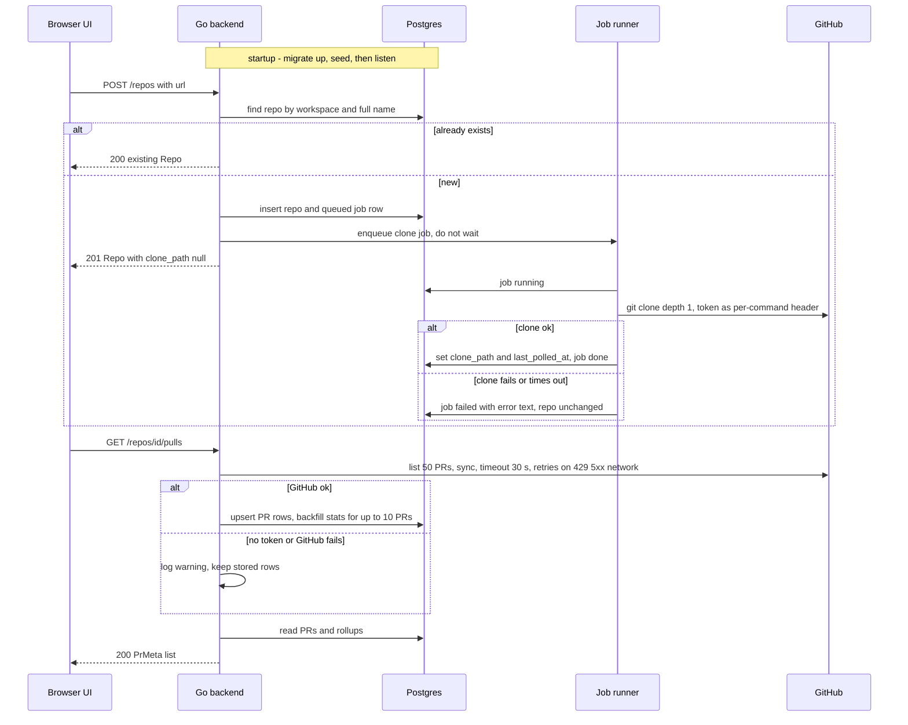

# Go backend migration — Phase 1: platform and core data
Spec: Go backend Phase 1 (platform + settings, repos, pulls, polling, workspace) · Status: implemented (2026-10-22, gate r2 PASS; open: AC97 user walkthrough with a GitHub token) · Date: 2026-10-21
Areas: http, db, seed, settings, repos, jobs, pulls, ops
Design sources: task brief (user decisions, 2026-10-21); `CLAUDE.md`; `docs/migration/README.md`; `docs/migration/research/01-http-api.md`, `02-data-layer.md`, `03-engine-integrations.md`; contracts `frontend/src/vendor/shared/contracts/platform.ts`; UI `frontend/src/lib/api.ts`, `frontend/src/lib/hooks/core.ts` and the Settings, PR list and PR detail screens; Node reference `<dev-digest>` = `/home/ypodop/IdeaProjects/dev-digest` (commit d1c9093), read through six research reports made for this spec (R-settings, R-repos, R-pulls, R-http, R-seed, R-ui). No design frames.
Related: none (first spec of the migration; `docs/migration/README.md` phases 2–6 get their own specs)

## 1. Goal
The Next.js UI in `frontend/` must run against a Go backend instead of the Node/Fastify server. Phase 1 delivers the platform and the core data: the shared HTTP behaviour, the database schema and seed, background repository cloning, graceful shutdown, and the 16 routes of settings, repos, pulls, polling, workspace and health. A developer who runs `docker compose up -d --build` on fresh volumes can then configure API keys, add, list, refresh and delete GitHub repositories, browse their pull requests, view a PR diff and read and post inline PR comments. Every response is wire-compatible with what the Node server returns.

## 2. Context
- Node serves 102 flat routes with no `/api` prefix. Phase 1 covers 16 of them: settings 4, repos 4, pulls 4, polling 1, workspace 1, health 2 (research 01 §2, §6; `docs/migration/README.md` phase table).
- Errors use one envelope `{"error":{"code","message","details?"}}`. Validation failures are 422 `validation_error`. Errors from the framework layer (400, 413, 415, 429) keep their status but use code `internal_error`. Unknown routes are 404 `not_found` `Route <METHOD> <path> not found` (research 01 §1; R-http §2, §6).
- The Node server registers helmet with defaults, CORS for one web origin with credentials, a 1 MiB body limit, and a global limit of 120 requests per minute per IP. `POST /settings/test-connection` has its own limit of 20 per minute. `/health*` is exempt (R-http §3–§5).
- Node has no auth. `LocalNoAuthProvider` finds the workspace by name `default` and the user by email `you@local` (`server/src/adapters/auth/local.ts:20-37`, R-settings §6).
- The schema is 44 tables from Drizzle migrations 0000–0020 plus `CREATE EXTENSION vector` (research 02 §1–§2). The Node server never migrates or seeds at boot; both are manual scripts (R-seed §9).
- Secrets live in a JSON file (`~/.devdigest/secrets.json`, mode 0600), with environment variables as fallback. The file value wins, and `GITHUB_TOKEN` falls back to `GITHUB_PAT` (`server/src/adapters/secrets/local.ts:12-50`, R-settings §5).
- `POST /repos` makes no GitHub call. It inserts the repo row and enqueues a background `clone` job. The job uses a shallow clone and sends the token as a per-command header (R-repos §2–§4; research 03 §4).
- Pull reads are local-first. GitHub failures on the list, detail and comment reads are swallowed and stored data is served. Only `POST /pulls/:id/comments` surfaces GitHub failures, as 400 `github_unavailable` / `github_comment_failed`. `POST /repos/:id/poll` surfaces them as 500. Node returns 502 `external_service` on no Phase-1 route (R-pulls §2, §5, §6; R-repos §9).
- The Go skeleton in `backend/` already has config (`API_ADDR`, `DATABASE_URL`, `CORS_ORIGINS`, `LOG_LEVEL`; `backend/internal/config/config.go:21-28`), an error-envelope handler, CORS, `/health` and `/health/ready`, and a GORM connection. The compose file mounts volume `/data` (`DEVDIGEST_DATA_DIR=/data`, `backend/Dockerfile`) and sets `CORS_ORIGINS` to two origins (`docker-compose.yml`).
- The UI reads only status and the JSON body, never response headers. Query errors with status 4xx are silent (no toast). Each failed query is retried once (`frontend/src/lib/providers.tsx:102-115`, R-ui §0). The PR detail page resolves the URL's PR number to the row `id` from `GET /repos/:id/pulls` (R-ui §d).

## 3. Scope
### In scope
- Cross-cutting HTTP behaviour: envelope, 404, 422, body limits, rate limits, security headers, CORS, HEAD, health.
- Single-tenant context.
- Versioned migrations with a consolidated baseline.
- Seed.
- Background job runner with the clone and refresh jobs.
- Secrets store.
- Graceful shutdown.
- The 16 routes listed in section 7.
- The backend container on the `/data` volume.
### Out of scope
- No route of the modules agents, skills, conventions, project-context, repo-intel, reviews (including SSE `GET /runs/:id/events`), intent, smart-diff, blast, brief, onboarding, performance, evals or ci is registered. Each of these paths returns the standard 404 envelope.
- No LLM call is made by any route except `POST /settings/test-connection`, which only lists provider models.
- No indexing, embedding, review or eval job kind exists, and none is enqueued (the Node clone job enqueues `repo-intel-index`; Phase 1 does not).
- The backend does not detect, adopt or convert an existing Node database (D5).
- No timer polls GitHub. PR sync happens only inside a request (`GET /repos/:id/pulls`, `GET /pulls/:id`, `POST /repos/:id/poll`).
- The seed writes no agents, skills, agent-skill links, reviews, findings, agent runs or PR #483 (D7).
- No authentication, login or second workspace exists.
- Responses are not required to carry `x-ratelimit-*` headers (Q4).
- Requests that arrive after shutdown has begun are not required to get the error envelope.
- `DELETE /repos/:id` does not delete the clone directory on disk (Node parity, `simple-git.ts:152` is the only removal).
- The CI runner question (D8) is not decided or built.
- No CI pipeline for the backend is added.

## 4. User scenarios
- US1 — As a developer, I start the stack with `docker compose up -d --build` on fresh volumes, so that the UI opens with the seeded demo repository and no manual database step.
- US2 — As a developer, I save and test my GitHub and LLM keys on the Settings page, so that later features can use them. Afterwards I see which keys are configured, never their values.
- US3 — As a developer, I change workspace preferences (feature models) on the Settings page, so that they persist.
- US4 — As a developer, I add a GitHub repository by URL, so that it is cloned in the background and appears in the sidebar.
- US5 — As a developer, I refresh or delete a repository.
- US6 — As a developer, I open a repository's PR list and see the PRs synced from GitHub, with diff stats.
- US7 — As a developer, I open a PR and see its description, files with diffs, commits and linked issue.
- US8 — As a developer, I read the PR's inline review comments and post a new comment or a reply.
- US9 — As an operator, I check liveness and readiness, migrate the schema up or down, re-run the seed, and stop the backend without losing data.

## 5. Functional requirements
Cross-cutting HTTP
- FR1 [http] — Every error response shall be JSON `{"error":{"code":string,"message":string,"details"?:any}}`. `details` shall be omitted when there are none. HEAD error responses have the same status and no body.
- FR2 [http] — A request matching no registered route, or an existing path with an unregistered method, shall get 404 `{"error":{"code":"not_found","message":"Route <METHOD> <path> not found"}}`, where `<path>` is the raw request path without the query string. This includes every out-of-scope module route (US1).
- FR3 [http] — Request validation (path params, then body, then query) shall reject invalid input with 422 `validation_error`, message `Request validation failed`, and `details` as defined in section 7.1. Only the first failing part is reported. A `:id` that is not a UUID (any version, case-insensitive) is a validation failure.
- FR4 [http] — Domain errors shall map to statuses as follows: `invalid_input` 400, `not_found` 404, `conflict` 409, `payload_too_large` 413, `validation` 422, `internal` 500, `config` 500, `external_service` 502. The response carries the error's own code, message and details.
- FR5 [http] — Any other failure shall return 500 `{"error":{"code":"internal_error","message":"Internal error"}}`. The internal message is never echoed. It is logged server-side.
- FR6 [http] — Request bodies shall be handled as in section 7.1 (body rules). The limit is 1 MiB (1,048,576 bytes accepted). The framework-level 400, 413 and 415 errors use code `internal_error` with the exact messages listed there. A POST, PUT or DELETE without a body and without `Content-Type` is accepted.
- FR7 [http] — Rate limiting shall use fixed 60-second windows per client IP, starting at the client's first request. The global limit is 120 requests per window. `POST /settings/test-connection` uses its own bucket of 20 per window instead of the global one. `/health`, `/health/ready`, CORS preflights and unmatched routes are not counted. Request N+1 in a window gets 429 as in section 7.1. A configuration switch (`RATE_LIMIT_ENABLED`, default `true`) turns all limiting off.
- FR8 [http] — Every response, including errors, 404s, 429s and preflights, shall carry the security headers listed in section 7.1 and no `X-Powered-By`.
- FR9 [http] — CORS shall allow exactly the origins in `CORS_ORIGINS` (comma-separated), with credentials. Behaviour per section 7.1.
- FR10 [http] — Every GET route shall also answer HEAD with the same status and headers and no body.
- FR11 [http] — `GET /health` shall return 200 `{"status":"ok"}` without touching the database. `GET /health/ready` shall return 200 `{"ready":true}` when a trivial database query succeeds within 2 s, otherwise 503 `{"ready":false}` (not the error envelope) (US9).
- FR12 [http] — JSON responses shall use exactly the field names of section 7, including the camelCase exceptions `workspaceId`, `cloneDir`, `reviewTriggered`. Timestamps shall be ISO-8601 UTC with exactly 3 fractional digits and `Z` (`2026-10-21T09:15:00.000Z`). Ids are UUID strings. Nullable fields follow the null/absent rules stated per field in section 7.
- FR13 [http] — Every request shall run as the system user (email `you@local`) in the workspace named `default`. No auth header or cookie is read. A resource of another workspace behaves exactly like an unknown id. If the workspace or user does not exist, the routes that need them return 500 `internal_error` `Internal error`.

Database and seed
- FR14 [db] — The schema shall be owned by versioned SQL migrations. Each version has an up and a down step. Version 1 (baseline) shall create the `vector` extension and the final schema of Node migrations 0000–0020 (44 tables with identical columns, types, nullability, defaults, CHECK, UNIQUE (including `NULLS NOT DISTINCT`), partial and HNSW indexes, and foreign keys with their ON DELETE actions). Later versions are new up/down pairs (D3, D4).
- FR15 [db] — Applied versions shall be recorded in the database. Applying already-applied versions is a no-op. Each version is applied atomically: all or nothing.
- FR16 [db] — The baseline down step shall remove every object the baseline created, including the `vector` extension, so that after it no application table remains.
- FR17 [db] — The backend binary shall offer the operator commands `migrate up` (apply all pending), `migrate down` (revert the latest applied version), `migrate status` (list versions and whether each is applied) and `seed`. Each exits 0 on success and non-zero on failure (US9).
- FR18 [db] — On startup, before listening, the backend shall apply pending migrations and then run the seed, unless `DB_AUTO_MIGRATE=false` or `DB_AUTO_SEED=false` respectively (D8). If a migration or the seed fails, the process shall log the failing step and exit non-zero without listening.
- FR19 [seed] — The seed shall write the following (D7; values in section 8):
  - the workspace `default`, the user `you@local`/`You` and an `owner` membership;
  - 4 per-user settings;
  - the demo repo `acme/payments-api`;
  - PR #482 with its 4 files (byte-identical patches) and 1 commit.
- FR20 [seed] — The seed shall be idempotent.
  - Rows are matched by natural key: workspace name, user email, (workspace, repo full name), (repo, PR number), (PR, file path), (PR, commit sha).
  - Existing rows and user-changed settings are never overwritten.
  - A file patch is filled only where it is null.
  - A second run changes no row.
  - The whole seed runs in one transaction.

Settings and secrets
- FR21 [settings] — `GET /settings` shall return every stored setting of the workspace as a flat JSON object `{key: value}`. No defaults are injected. An empty store gives `{}` (US3).
- FR22 [settings] — `PUT /settings` shall validate the body as in section 7.2 and upsert each posted key for the system user. It shall respond with the full stored object after the write, not the patch. All keys are written or none (US3).
- FR23 [settings] — `GET /settings/secrets-status` shall return `{openai, anthropic, openrouter, github}` booleans. Each is true iff a non-empty value exists for its secret name (section 7.2) in the secrets file or the environment (US2).
- FR24 [settings] — `POST /settings/test-connection` shall work in this order:
  1. If `key` is given, save it to the secrets file under the provider's secret name, before the test. The key stays saved even if the test fails.
  2. Make the provider check listed in section 7.2.
  3. Always answer 200 `{provider, ok, message}`, with the exact messages listed there.
  A saved key shall be used by every later GitHub or provider call without a restart (US2).
- FR25 [settings] — The secrets store shall be a JSON object file at `<DEVDIGEST_DATA_DIR>/secrets.json`, keyed by secret name.
  - The file value wins over the environment. `GITHUB_TOKEN` falls back to env `GITHUB_PAT`. An empty string counts as unset.
  - A missing, unreadable or malformed file counts as empty.
  - Writing creates the directory if missing and leaves the file with mode 0600.

Repos, workspace, polling, jobs
- FR26 [repos] — `POST /repos` shall work as follows (US4):
  - Accept only the GitHub URL forms of section 7.3.
  - If (workspace, `owner/name`) already exists (case-sensitive), return 200 with the existing repo and enqueue nothing.
  - Otherwise insert the repo with `default_branch` `main`, `clone_path` null, `last_polled_at` null and `created_by` = the system user, enqueue a `clone` job, and return 201 with the repo.
  - Make no GitHub API call.
- FR27 [repos] — `GET /repos` shall return all repos of the workspace, ordered by creation time ascending (default of Q6).
- FR28 [repos] — `POST /repos/:id/refresh` shall respond 200 `{"status":"refreshing"}` right after enqueuing, without waiting (US5):
  - a `clone` job if the repo has no `clone_path`;
  - a `refresh` job otherwise (D9).
- FR29 [repos] — `DELETE /repos/:id` shall delete the repo and, through the database cascade, its pull requests, files and commits. It responds 200 `{"deleted":"<id>"}` (US5).
- FR30 [repos] — `GET /workspace` shall return `{workspaceId, cloneDir, repos:[{id, full_name, clone_path, last_polled_at, cloned}]}`. `cloneDir` is the absolute clone root. `cloned` is true iff `clone_path` is non-null.
- FR31 [repos] — `POST /repos/:id/poll` shall sync the PR list exactly as the sync step of FR36 does, then set the repo's `last_polled_at` to now. It responds `{"synced":<number of PRs GitHub returned>,"reviewTriggered":false}`. Errors are listed in section 7.3.
- FR32 [jobs] — Background jobs shall work as follows:
  - Each job is mirrored in the `jobs` table: `queued` on enqueue, `running` when started, then `done` or `failed` with the error text.
  - At most 3 jobs run at once.
  - Each attempt is limited to 120 s.
  - A transient failure (network error, HTTP 429 or 5xx) is retried up to 2 times. A git command failure is not transient.
  - Enqueuing returns immediately.
- FR33 [jobs] — The `clone` job shall work as follows (US4):
  - If `<cloneRoot>/<owner>/<name>/.git` exists, fetch instead of cloning.
  - Else remove any partial directory at that path and clone with depth 1 from `https://github.com/<owner>/<name>.git` (default of Q7).
  - On success, set `clone_path` to the absolute directory and `last_polled_at` to now.
  - On failure, leave the repo row unchanged.
  - If the repo was deleted meanwhile, finish without error and without recreating anything.
- FR34 [jobs] — The `refresh` job shall update the existing clone to the latest commit of the remote's default branch (fetch with depth 50, then hard reset) and set `last_polled_at` to now on success (D9).
- FR35 [jobs] — Git commands shall work as follows:
  - They run non-interactively (they never prompt for credentials).
  - When a GitHub token is configured, it is sent only as a per-command HTTP authorization header for `https://github.com/`. Without a token they run anonymously.
  - Clone paths are exactly `<cloneRoot>/<owner>/<name>`. Both segments match `^[A-Za-z0-9_.-]+$`, are not `.`, `..` or `.git` (any case), and do not start with `-`.
  - The clone root defaults to `<DEVDIGEST_DATA_DIR>/workspace` (override `DEVDIGEST_CLONE_DIR`).

Pulls
- FR36 [pulls] — `GET /repos/:id/pulls` shall work in three steps (US6):
  1. Sync, when a GitHub token is configured: fetch one page of up to 50 PRs of any state, most recently updated first. Upsert each by (repo, number), inserting all list fields. For an existing row, only `title`, `head_sha`, `status` and `updated_at` are updated. Rows are never deleted.
  2. Backfill: fill diff stats for at most 10 stored PRs whose additions, deletions and files_count are all 0, at most 4 in parallel, using the detail fetch of FR38.
  3. Respond with every stored PR of the repo as `PrMeta` (section 7.4), ordered by `updated_at` descending, nulls last, then `number` descending (default of Q6).
  Any GitHub failure in steps 1–2, or a missing token, is logged and the stored rows are served with 200.
- FR37 [pulls] — `PrMeta.status` in the list shall be derived on read:
  - Stored `merged` or `closed` is returned as is.
  - Otherwise it is `needs_review` if `last_reviewed_sha` is null or differs from `head_sha`.
  - Otherwise it is `stale` if `updated_at` is more than 7 days before now.
  - Otherwise it is `reviewed`.
- FR38 [pulls] — `GET /pulls/:id` shall first fetch the PR from GitHub: the PR, up to 3000 files (pages of 100) and up to 250 commits (US7).
  - Files with the same path are merged into one entry: additions and deletions are summed, and the non-empty patches are joined with a newline.
  - On success, in one transaction: replace the stored files and commits, and update `body`, `additions`, `deletions` and `files_count`. Then respond with the fresh detail. Its `status` is the GitHub state (`open`, `closed`, `merged`).
  - On any failure, or with no token, respond with the stored detail. Its `status` is the raw stored value.
  - Rollup fields are absent in both cases (section 7.4).
- FR39 [pulls] — `linked_issue` shall be resolved from the first `#<digits>` in the PR body. An optional leading `closes`, `fixes` or `resolves` is allowed, case-insensitive. The issue is fetched from GitHub. On no match or any failure the field is omitted. It is never stored (US7).
- FR40 [pulls] — `PrMeta` list rollups shall be computed on read from stored reviews, findings and agent runs, as defined in section 7.4. A PR with no reviews gets `score`, `latest_review_id`, `last_reviewed_at` and `findings_counts` null, and `latest_review_ids` `[]`. A PR with no run of known cost gets `cost_usd` null.
- FR41 [pulls] — `GET /pulls/:id/comments` shall proxy one page (up to 100) of the PR's GitHub review comments, mapped as in section 7.4. Nothing is stored. With no token or on any GitHub failure the response is 200 `[]` (US8).
- FR42 [pulls] — `POST /pulls/:id/comments` shall work as follows (US8):
  - With `in_reply_to`, post a reply to that comment.
  - Otherwise, create a comment on the stored `head_sha`, with the given `path` and `line`, and `side` defaulting to `RIGHT`.
  - Respond 200 with the created comment mapped as in section 7.4.
  - Errors are listed in section 7.4.

Operations
- FR43 [ops] — On SIGTERM or SIGINT the backend shall:
  - stop accepting connections;
  - let in-flight requests finish within a 20 s grace period;
  - abort running jobs and wait up to 10 s for them (their rows become `failed` if they settle in time);
  - leave queued, not-started jobs as `queued`;
  - close the database pool;
  - exit 0. If the grace period is exceeded, it exits non-zero (US9).
- FR44 [ops] — The backend shall run as the `backend` compose service. Its secrets file and clone root are inside the `/data` volume, so they survive container restarts and rebuilds. The container health check uses `GET /health` (US1, US9).

## 6. Workflow and communication

| Caller → callee | Mode | Trigger | On failure |
|---|---|---|---|
| UI → API | sync HTTP | every UI action | UI shows the envelope message (R-ui §0) |
| API → Postgres | sync | every route except `/health` | 500 `internal_error`. `/health/ready` gives 503 |
| API → job runner | async, in-process | POST /repos (new), refresh | enqueue failure gives 500 `internal_error`; the repo row stays |
| Job runner → git/GitHub | async subprocess | clone, refresh jobs | job row `failed` with error text; no retry for git failures |
| API → GitHub REST | sync, 30 s timeout per call (90 s for PR detail), up to 3 retries on 429/5xx/network | pulls list/detail/comments, poll, test-connection (github) | reads: serve stored data or `[]`; comment POST: 400; poll: 502 (D6) |
| API → OpenAI / Anthropic / OpenRouter | sync | test-connection only | 200 `ok:false` with the error message |

## 7. Contracts
### 7.1 Cross-cutting
**Error envelope.** `{"error":{"code":string,"message":string,"details"?:any}}`. Codes used in Phase 1: `not_found`, `validation_error`, `internal_error`, `config_error`, `external_service`, `github_unavailable`, `github_comment_failed`.

**422 `details`.** An array with one item per issue of the first failing part (params, body, query). Each item has:
- `keyword`: string issue kind, e.g. `invalid_type`, `invalid_string`;
- `instancePath`: string JSON pointer, `/` for the whole body, `/id` for a path param;
- `schemaPath`: string;
- `message`: string;
- `params`: `{issue:{code:string, path:(string|number)[], message:string}}`.
Message texts need not be byte-identical to Zod (Q5).

**Body rules.** Error codes are `internal_error` unless stated.

| Case | Status | message |
|---|---|---|
| Body > 1,048,576 bytes | 413 | `Request body is too large` |
| `Content-Type: application/json`, invalid JSON | 400 | `Body is not valid JSON but content-type is set to 'application/json'` |
| `Content-Type: application/json`, empty body | 400 | `Body cannot be empty when content-type is set to 'application/json'` |
| Media type other than `application/json` / `text/plain`, or non-empty body without Content-Type | 415 | `Unsupported Media Type` |
| No body and no Content-Type (POST/PUT/DELETE) | — | accepted; route sees no body |
| Body on a route without a body schema | — | parsed (errors above apply), then ignored |

**Rate limit (429).**
- Status 429, body `{"error":{"code":"internal_error","message":"Rate limit exceeded, retry in <d>"}}`.
- `<d>` is `1 minute` when the remaining window is 60 s, otherwise `<n> seconds` (`1 second` for 1).
- Header `Retry-After: <remaining seconds, integer, rounded up>`.
- Limits: global 120 per 60 s per IP. `POST /settings/test-connection` has its own bucket of 20 per 60 s per IP. `/health`, `/health/ready`, preflights and unmatched routes are not counted.

**Security headers** (every response):
- `Content-Security-Policy: default-src 'self';base-uri 'self';font-src 'self' https: data:;form-action 'self';frame-ancestors 'self';img-src 'self' data:;object-src 'none';script-src 'self';script-src-attr 'none';style-src 'self' https: 'unsafe-inline';upgrade-insecure-requests`
- `Cross-Origin-Opener-Policy: same-origin`
- `Cross-Origin-Resource-Policy: same-origin`
- `Origin-Agent-Cluster: ?1`
- `Referrer-Policy: no-referrer`
- `Strict-Transport-Security: max-age=31536000; includeSubDomains`
- `X-Content-Type-Options: nosniff`
- `X-DNS-Prefetch-Control: off`
- `X-Download-Options: noopen`
- `X-Frame-Options: SAMEORIGIN`
- `X-Permitted-Cross-Domain-Policies: none`
- `X-XSS-Protection: 0`
- `X-Powered-By` is never sent.

**CORS.**
- `Vary: Origin` on every response.
- `Access-Control-Allow-Origin: <Origin>` and `Access-Control-Allow-Credentials: true` when the Origin exactly equals an allowed origin.
- A disallowed or absent Origin gets no `Access-Control-Allow-Origin`, and the request is still served.
- Preflight (`OPTIONS` with `Origin` and `Access-Control-Request-Method`, any path) gives 204 with an empty body:
  - `Access-Control-Allow-Methods: GET,HEAD,PUT,PATCH,POST,DELETE`;
  - `Access-Control-Allow-Headers` echoing the request's `Access-Control-Request-Headers`.

**Health.**

| Route | Response |
|---|---|
| `GET /health` | 200 `{"status":"ok"}` |
| `GET /health/ready` | 200 `{"ready":true}` or 503 `{"ready":false}` |

**Operator CLI.** The commands are `server migrate up|down|status` and `server seed`; the existing `server healthcheck` stays. Configuration (environment variables):
- `API_ADDR` (`:3001`);
- `DATABASE_URL` (required);
- `CORS_ORIGINS` (default `http://localhost:3000`);
- `LOG_LEVEL`;
- `DEVDIGEST_DATA_DIR` (`/data` in the image);
- `DEVDIGEST_CLONE_DIR` (default `<data>/workspace`);
- `RATE_LIMIT_ENABLED` (`true`);
- `DB_AUTO_MIGRATE` (`true`);
- `DB_AUTO_SEED` (`true`);
- secrets env `OPENAI_API_KEY`, `ANTHROPIC_API_KEY`, `OPENROUTER_API_KEY`, `GITHUB_TOKEN`, `GITHUB_PAT`.

### 7.2 Settings
| Route | Request | Success | Errors |
|---|---|---|---|
| `GET /settings` | — | 200 object `{<key>: <any JSON>}` (raw stored bag, `{}` if empty) | 500 if context missing |
| `PUT /settings` | body object; known keys validated: `polling_interval_min` int ≥ 1; `theme` `dark`\|`light`; `density` `regular`\|`compact`; `sync_to_folder` bool; `automatic_reviews` bool; `feature_models` object keyed by `onboarding`\|`review_intent`\|`risk_brief`\|`conformance`\|`conventions` (any subset) with values `{provider: openai\|anthropic\|openrouter, model: non-empty string}`. A known key may not be `null`. Unknown keys are accepted with any JSON value, including `null` | 200 full stored bag after the write | 422 `validation_error` |
| `GET /settings/secrets-status` | — | 200 `{"openai":bool,"anthropic":bool,"openrouter":bool,"github":bool}` | 500 if context missing |
| `POST /settings/test-connection` | `{provider: openai\|anthropic\|openrouter\|github, key?: non-empty string}` | always 200 `{provider, ok:bool, message:string}` (`detail` never sent) | 422 `validation_error`; 429 (20 per 60 s) |

Secret names: `openai`→`OPENAI_API_KEY`, `anthropic`→`ANTHROPIC_API_KEY`, `openrouter`→`OPENROUTER_API_KEY`, `github`→`GITHUB_TOKEN`.

Provider checks and messages:

| provider | Check | `ok:true` message |
|---|---|---|
| github | GitHub `GET /user` (30 s, retries per NFR5) | `Connected as @<login>` |
| openai | list models | `OK — <n> models available` (U+2014), where n counts ids starting with `gpt` or containing `o1` or `o3` |
| anthropic | list models | `OK — <n> models available` |
| openrouter | `GET https://openrouter.ai/api/v1/models` with bearer key, 15 s, no retry | `OK — <n> models available` |

- No key configured: `ok:false`, message `<SECRET_NAME> is not configured`, e.g. `GITHUB_TOKEN is not configured`.
- Any other failure: `ok:false`, message = the error's message with every occurrence of the key value replaced by `[REDACTED]` (Q9). For openrouter non-2xx the message is `OpenRouter /models returned <status>`.

### 7.3 Repos, workspace, polling
`Repo` = `{id, workspace_id, owner, name, full_name, default_branch, clone_path: string|null, last_polled_at: string|null, created_by: string|null}` (all keys always present).

Accepted URL forms (after trimming whitespace):
- `https://github.com/<owner>/<repo>` with an optional `.git` and an optional trailing `/`;
- `git@github.com:<owner>/<repo>` with an optional `.git`.

The segments `<owner>` and `<repo>` follow the FR35 segment rule.

| Route | Request | Success | Errors |
|---|---|---|---|
| `POST /repos` | `{url: string}` | 201 `Repo` (created) or 200 `Repo` (existing) | 422 `validation_error` (bad URL; the issue message is `Must be a GitHub repository URL, e.g. https://github.com/owner/repo`) |
| `GET /repos` | — | 200 `Repo[]`, by creation time ascending | — |
| `POST /repos/:id/refresh` | no body | 200 `{"status":"refreshing"}` | 422 non-uuid id; 404 `not_found` `Repo not found` |
| `DELETE /repos/:id` | — | 200 `{"deleted":"<id>"}` | 422; 404 `not_found` `Repo not found` |
| `GET /workspace` | — | 200 `{"workspaceId":uuid,"cloneDir":string,"repos":[{"id","full_name","clone_path":string\|null,"last_polled_at":string\|null,"cloned":bool}]}` | — |
| `POST /repos/:id/poll` | no body | 200 `{"synced":int,"reviewTriggered":false}` | 422; 404 `Repo not found`; 500 `config_error` `GITHUB_TOKEN is not configured`; 502 `external_service` `GitHub request failed` after retries (D6) |

Job kinds in Phase 1: `clone` (payload `{repoId, owner, name}`) and `refresh` (payload `{repoId}`).

### 7.4 Pulls
`PrMeta` (list item). All keys are always present:
- `id` (uuid, never null);
- `number`, `title`, `author`, `branch`, `base`, `head_sha`;
- `additions`, `deletions`, `files_count` (int);
- `status` (FR37);
- `opened_at`, `updated_at` (string|null);
- rollups:
  - `score`: int|null — the newest review's score;
  - `cost_usd`: number|null — the sum of known `cost_usd` over all agent runs of the PR, null if none known;
  - `latest_review_id`: string|null;
  - `last_reviewed_at`: string|null;
  - `latest_review_ids`: string[] — the newest `kind=review` review per agent, newest first, `[]` if none;
  - `findings_counts`: `{"CRITICAL":int,"WARNING":int,"SUGGESTION":int}`|null — summed over those reviews, null if none.

`PrDetail` = the `PrMeta` scalars without rollups, plus:
- `body`: string|null;
- `files`: `[{path, additions, deletions, patch}]`. `patch` is a string, or omitted (fresh) or null (stored) when GitHub gives none;
- `commits`: `[{sha, message, author, committed_at: string|null}]`;
- `linked_issue`: `{number, title, body: string|null, state}`, omitted when unresolved.

`PrReviewComment` = `{id:int, path, line:int|null, original_line:int|null, side: "LEFT"|"RIGHT", body, user, created_at, html_url, in_reply_to_id:int|null, is_outdated:bool}`:
- `side` is `LEFT` only if GitHub says `LEFT`;
- `user` is the GitHub login, or `unknown`;
- `is_outdated` = `line == null`.

`PrCommentInput` = `{path: non-empty string, line: positive int, side?: "LEFT"|"RIGHT", body: non-empty string, in_reply_to?: int}`.

| Route | Success | Errors |
|---|---|---|
| `GET /repos/:id/pulls` | 200 `PrMeta[]` (FR36 order) | 422; 404 `not_found` `Repo not found` |
| `GET /pulls/:id` | 200 `PrDetail` | 422; 404 `not_found` `Pull request not found` (or `Repo not found` if its repo row is missing) |
| `GET /pulls/:id/comments` | 200 `PrReviewComment[]` (GitHub order, ≤ 100) | 422; 404 `Pull request not found` |
| `POST /pulls/:id/comments` | 200 `PrReviewComment` | 422 `validation_error`; 404 `Pull request not found`; 400 `github_unavailable` `Connect a GitHub token to post comments.` (no token); 400 `github_comment_failed` with message = GitHub's error message and `details: {"cause": string}` (any GitHub failure) |

Shared-contract changes: none. The vendored contracts in `frontend/src/vendor/shared/contracts/*` are the source and stay unchanged.

## 8. Data model (logical)
- **Workspace** (1, name `default`) has **Members** (the system **User** `you@local`, role `owner`). Every other entity belongs to the workspace.
- **Setting**: (workspace, user, key) → JSON value; unique on the triple with nulls not distinct. Seed (per user): `polling_interval_min`=5, `theme`="dark", `density`="regular", `sync_to_folder`=true.
- **Repo**: unique (workspace, full_name). It owns **PullRequests** (unique (repo, number)), which own **PrFiles** (unique (pr, path)) and **PrCommits** (unique (pr, sha)). Deleting a repo cascades to them.
- **Job**: kind, payload, status `queued|running|done|failed`, attempts, timestamps, error. Kept after completion. Rows left `queued`/`running` by a stopped process are not changed at boot (Q8).
- **Read-only in Phase 1**: Review, Finding, AgentRun. They feed the list rollups and stay empty unless later phases or tests write them.
- **Derived, never stored**: the list `status` (FR37), rollups (FR40), `linked_issue`, PR comments.
- **Not in the database**: secrets (file at `<data>/secrets.json`) and clones (directory tree at `<data>/workspace/<owner>/<name>`).
- The other baseline tables exist, unused by Phase 1.
- **Seeded demo data**:
  - Repo `acme/payments-api`: `default_branch` `main`, `clone_path` null, `last_polled_at` null.
  - PR #482:
    - `title` `Add rate limiting to public API endpoints`, `author` `marisa.koch`, `branch` `feat/rate-limit-public`, `base` `main`, `head_sha` `a1b2c3d4e5f6`;
    - `additions` 247, `deletions` 38, `files_count` 9, `status` `needs_review`;
    - `body` `Add rate limiting to public API endpoints to prevent abuse from unauthenticated clients.`;
    - `opened_at` and `updated_at` null.
  - Files, with patches byte-identical to `SEED_PR_482_PATCHES` in `<dev-digest>/server/src/db/seed-diff.ts:12-64`:
    - `src/middleware/ratelimit.ts` +84/−0;
    - `src/api/public/webhooks.ts` +31/−6;
    - `src/config.ts` +4/−0;
    - `src/api/users.ts` +7/−2.
  - Commit: `a1b2c3d4e5f6` `Add token-bucket rate limiter` by `marisa.koch`, `committed_at` null.
  - Source: R-seed §1–§4.

## 9. States and UX
The backend has no own screens. This table states what the existing UI shows in Phase 1 (R-ui).

| Screen / element | Loading | Empty | Error | Degraded | Success | Notes |
|---|---|---|---|---|---|---|
| Home `/` | skeleton | no repos → onboarding CTA | treated as empty | — | redirect to first repo's PRs | needs `GET /repos` |
| Settings › API keys | badges hidden | all `Not set` | badge hidden | — | per-row `ok`/`message` inline | `test-connection` always 200 |
| Settings › Models | — | — | — | `GET /providers/openrouter/models` is 404 (Phase 2): each picker lists only its current value | PUT stores `feature_models` | accepted until Phase 2 (D10) |
| Add repo | button busy | — | inline message + toast (422) | — | navigate to `/repos/<id>/pulls` | needs `id` in the response |
| PR list | skeleton | no PRs | `ErrorState` + retry | stored rows when GitHub fails or no token | rows with stats | refetched every 60 s; seeded PR #482 has null rollups, so no findings hover |
| PR detail header + files | skeleton | — | inline `ErrorState` if the PR number is not in the list or the detail fails | stored detail when GitHub fails | diff from `files[].patch` | `+` comment buttons only when `status` is `open` (fresh GitHub detail) |
| PR detail overview cards (brief, intent, blast) | — | — | inline `ErrorState` "Route GET … not found" + retry | — | — | Phases 4–5 |
| Findings tab, run picker, smart order | — | empty states | silent 404 | every file in one group, collapsed | — | Phases 2, 4, 5 |
| Inline comments | — | no threads | toast; draft kept | `[]` when GitHub fails | thread list refetched after post | |

## 10. Edge cases
- EC1 [pulls] — No GitHub token:
  - `GET /repos/:id/pulls` returns 200 with the stored rows, with no sync and no backfill;
  - `GET /pulls/:id` returns the stored detail;
  - comments GET returns `[]`;
  - comments POST returns 400 `github_unavailable`;
  - poll returns 500 `config_error`.
  (FR36, FR38, FR41, FR42, FR31)
- EC2 [jobs] — No token, public repo: the clone runs anonymously and succeeds (FR35).
- EC3 [jobs] — Private repo without access, non-existent repo, or GitHub down: `POST /repos` still returns 201. The clone job ends `failed` within 120 s per attempt, without prompting. `clone_path` stays null (FR26, FR33, FR35).
- EC4 [repos] — An invalid URL gives 422 `validation_error`. Examples: `http://`, `ssh://`, `/tree/main`, a non-GitHub host, segments `.`, `..`, `.git`, `-x` (FR26).
- EC5 [repos] — A duplicate URL in any accepted form, e.g. `.git` or trailing `/`, returns 200 with the existing repo and enqueues no job. Case matters: `Acme/X` and `acme/x` are two repos. Two concurrent POSTs of the same new URL give one 201 and one 200 (Q3) (FR26).
- EC6 [pulls] — GitHub fails with 5xx or a network error after retries, or with a timeout or 401/403/404 (no retry):
  - list, detail and comments GET serve stored data or `[]` with 200;
  - comments POST gives 400 `github_comment_failed`;
  - poll gives 502 `external_service` (D6).
  (FR36, FR38, FR41, FR42, FR31)
- EC7 [http] — Rate limit hit:
  - The 21st `POST /settings/test-connection` from one IP within 60 s gets 429 with `Retry-After`.
  - Other routes still answer, because their bucket is separate.
  - The 121st request to other routes within 60 s gets 429.
  (FR7)
- EC8 [http] — A non-uuid `:id` gives 422. A well-formed unknown id gives 404 with the route's message (FR3, FR13).
- EC9 [pulls] — The seeded demo repo with a token: GitHub answers 404 for `acme/payments-api`. The error is swallowed, and PR #482 is served from the database with status `needs_review` (FR36, FR38).
- EC10 [jobs] — A repo deleted while its clone job runs: the job finishes without error and creates no repo row. The directory stays and is reused (fetched) if the repo is added again (FR29, FR33).
- EC11 [jobs] — An SSH-form URL is cloned over HTTPS from `https://github.com/<owner>/<name>.git` (Q7) (FR33).
- EC12 [http] — Database unreachable at runtime: `/health` returns 200, `/health/ready` returns 503 `{"ready":false}`, and other routes return 500 `internal_error` (FR11, FR5).
- EC13 [settings] — Secrets file missing or malformed: it counts as empty, so status flags come from env only. The next save writes a valid file containing the new key (FR25).
- EC14 [settings] — A test-connection with a wrong key returns 200 `ok:false`. The key stays saved, and secrets-status reports it `true` (FR24).
- EC15 [http] — Workspace or user missing (seed disabled on an empty database): settings and repo routes return 500 `internal_error`. Test-connection still works (FR13).
- EC16 [pulls] — A repo with more than 50 PRs: only the 50 most recently updated are synced per call. Older stored rows are still returned unchanged (FR36).
- EC17 [pulls] — A PR with more than 3000 files or 250 commits is truncated at the caps. A binary file has no patch (FR38).
- EC18 [http] — A body of exactly 1,048,576 bytes is accepted. One more byte gives 413 (FR6).
- EC19 [settings] — `PUT /settings` with `{"theme":null}` gives 422. `{"x_custom":null}` is stored, and GET returns `"x_custom":null` (FR22).
- EC20 [http] — `HEAD` on an unknown route gives 404 with no body. `OPTIONS` without preflight headers is not a preflight (FR2, FR9, FR10).
- EC21 [jobs] — Shutdown during a clone: the git process is killed and the job row becomes `failed` (or stays `running` if the process exits first). A partial directory is removed by the next clone of that repo (FR43, FR33).
- EC22 [db] — Backend started against a database that already has the tables (e.g. a Node database): the baseline fails, its transaction rolls back, the database is unchanged, and the process exits non-zero (FR15, FR18).
- EC23 [pulls] — The linked-issue fetch fails, or the body has no `#n`: the detail is 200 without `linked_issue` (FR39).
- EC24 [pulls] — A comment on a line outside the diff, or on a stale head: GitHub rejects it, and the response is 400 `github_comment_failed` with GitHub's message (FR42).

## 11. Non-functional requirements
- NFR1 [settings] — Secret values shall never appear in:
  - logs;
  - any HTTP response (secrets-status is booleans only, and test-connection messages are scrubbed, Q9);
  - `jobs.error`;
  - `.git/config`;
  - git remote URLs.
- NFR2 [settings] — The secrets file shall have mode 0600 and live under `DEVDIGEST_DATA_DIR`.
- NFR3 [ops] — Logs shall be structured JSON on stdout.
  - One line per request: method, path, status, duration in ms. No request or response bodies.
  - `Authorization`, `Cookie` and `X-Api-Key` header values, and fields named `key`, `token`, `secret`, `password`, `apiKey` or `api_key`, shall be logged as `[REDACTED]`.
- NFR4 [jobs] — The backend shall never execute code from a cloned repository. Git never prompts. Every path it writes stays inside the clone root, at depth exactly 2.
- NFR5 [pulls] — Each GitHub REST call shall time out after 30 s (PR detail: 90 s for the whole fetch).
  - Calls are retried up to 3 times on 429, 5xx or a network error, with exponential backoff (250 ms base, 8 s cap, up to 250 ms jitter).
  - Other 4xx and timeouts are not retried (Node parity, `resilience.ts` `isTransient`).
  - Comment creation is not retried (Q10).
- NFR6 [ops] — On fresh volumes, `docker compose up -d --build` shall bring `backend` to `healthy` and `GET /health/ready` to 200 within 60 s after `db` is healthy. Shutdown on SIGTERM shall complete within 20 s.
- NFR7 [http] — Every Phase-1 success response body shall parse with the matching vendored Zod contract: `Repo`, `PrMeta`, `PrDetail`, `PrReviewComment`, `SecretsStatus` and `ConnTestResult` (`platform.ts`), and `ApiErrorBody` for errors.
- NFR8 [ops] — Constraints with their reasons:
  - Go with Echo v5 and GORM on pgx (D2).
  - Schema changes only through versioned SQL migrations, never generated from models (D3).
  - Postgres 16 with pgvector (D1).
  - Runtime image Alpine with `git` and `ca-certificates`, because git is invoked as a subprocess (D7).
  - Single backend instance (in-memory rate-limit buckets and job queue).
- NFR9 [ops] — Observability:
  - each migration version applied or reverted is logged with its version and duration;
  - the seed logs one line with the rows inserted per entity;
  - each job logs kind, id, final status, attempts and duration.

## 12. Dependencies and rollout
- **Shared contract change:** none. The UI and its vendored contracts are unchanged.
- **Persisted data:** a new database, created from the baseline (fresh volume `devdigest_go_pgdata`). No Node data is migrated (D5).
- **Feature flag:** none. Switches `RATE_LIMIT_ENABLED`, `DB_AUTO_MIGRATE`, `DB_AUTO_SEED`.
- **Order at release:**
  1. `db` healthy.
  2. `backend` migrates, seeds and turns healthy.
  3. `frontend` starts (`depends_on: service_healthy`, `docker-compose.yml`).
- **Backwards compatibility:**
  - Out-of-scope routes return 404 until their phase.
  - Later phases add migrations as new versions on top of the baseline.
  - Later phases extend the seed with their own idempotent guards, e.g. agents in Phase 2, the demo review in Phase 4.

## 13. Acceptance criteria
HTTP platform
- AC1 [http] — Given the backend is running, when `GET /agents` is requested, then the response is 404 `{"error":{"code":"not_found","message":"Route GET /agents not found"}}`.
  Traces: FR2, FR1 · Verify: integration
- AC2 [http] — Given the backend is running, when `POST /health?x=1` is requested, then the response is 404 with message `Route POST /health not found` (no 405, no query string).
  Traces: FR2, EC20 · Verify: integration
- AC3 [http] — Given the backend is running, when `GET /pulls/abc` is requested, then the response is 422 with `code` `validation_error`, `message` `Request validation failed`, and `details[0].instancePath` `/id`.
  Traces: FR3, EC8 · Verify: integration
- AC4 [http] — Given a test route that throws a domain error of each kind (`invalid_input`, `not_found`, `conflict`, `payload_too_large`, `validation`, `internal`, `config`, `external_service`) with no details, when it is called, then the status is 400, 404, 409, 413, 422, 500, 500 and 502 respectively, the body carries the error's code and message, and it has no `details` key.
  Traces: FR4, FR1 · Verify: unit
- AC5 [http] — Given a handler that fails with an unexpected error whose text is `boom-secret`, when it is called, then the response is 500 `{"error":{"code":"internal_error","message":"Internal error"}}`, the body does not contain `boom-secret`, and one error log line contains it.
  Traces: FR5 · Verify: unit
- AC6 [http] — Given `PUT /settings`, when the body is 1,048,577 bytes, then the response is 413 with `code` `internal_error` and `message` `Request body is too large`.
  Traces: FR6, EC18 · Verify: integration
- AC7 [http] — Given `PUT /settings` with `Content-Type: application/json`, when the body is a valid JSON object of exactly 1,048,576 bytes (one unknown key holding a long string), then the response is 200.
  Traces: FR6, EC18 · Verify: integration
- AC8 [http] — Given `PUT /settings` with `Content-Type: application/json`, when the body is `{bad`, then the response is 400 with `code` `internal_error` and `message` `Body is not valid JSON but content-type is set to 'application/json'`.
  Traces: FR6 · Verify: integration
- AC9 [http] — Given `POST /repos/:id/refresh` for an existing repo, when it is sent with no body and no `Content-Type`, then the response is 200 `{"status":"refreshing"}`.
  Traces: FR6, FR28 · Verify: integration
- AC10 [http] — Given `PUT /settings`, when the body is sent with `Content-Type: application/x-www-form-urlencoded`, then the response is 415 with `code` `internal_error` and `message` `Unsupported Media Type`.
  Traces: FR6 · Verify: integration
- AC11 [http] — Given `PUT /settings` with `Content-Type: application/json` and an empty body, then the response is 400 with `message` `Body cannot be empty when content-type is set to 'application/json'`.
  Traces: FR6 · Verify: integration
- AC12 [http] — Given rate limiting is enabled, when one IP sends 21 `POST /settings/test-connection` requests within 60 s, then responses 1–20 are not 429, and response 21 is 429 with body `{"error":{"code":"internal_error","message":"Rate limit exceeded, retry in <d>"}}` and an integer `Retry-After` header between 1 and 60.
  Traces: FR7, EC7 · Verify: integration
- AC13 [http] — Given one IP has just been limited on `POST /settings/test-connection`, when it calls `GET /settings`, then the response is 200.
  Traces: FR7, EC7 · Verify: integration
- AC14 [http] — Given rate limiting is enabled, when one IP sends 121 `GET /settings` requests within 60 s, then request 121 is 429, and `GET /health` and `GET /health/ready` from that IP are still 200.
  Traces: FR7, EC7 · Verify: integration
- AC15 [http] — Given `RATE_LIMIT_ENABLED=false`, when one IP sends 200 `GET /settings` requests within 60 s, then none is 429.
  Traces: FR7 · Verify: integration
- AC16 [http] — Given the backend is running, when `GET /settings`, a 404 route and a 422 request are made, then each response carries every header of section 7.1 "Security headers" with the exact values, and no `X-Powered-By`.
  Traces: FR8 · Verify: integration
- AC17 [http] — Given `CORS_ORIGINS=http://localhost:3100`, when `GET /repos` is sent with `Origin: http://localhost:3100`, then the response has `Access-Control-Allow-Origin: http://localhost:3100`, `Access-Control-Allow-Credentials: true` and `Vary: Origin`.
  Traces: FR9 · Verify: integration
- AC18 [http] — Given the same config, when `GET /repos` is sent with `Origin: http://evil.example`, then the response is 200 and has no `Access-Control-Allow-Origin` header.
  Traces: FR9 · Verify: integration
- AC19 [http] — Given the same config, when `OPTIONS /repos/x/refresh` is sent with `Origin: http://localhost:3100`, `Access-Control-Request-Method: POST` and `Access-Control-Request-Headers: content-type`, then the response is 204 with an empty body, `Access-Control-Allow-Methods: GET,HEAD,PUT,PATCH,POST,DELETE` and `Access-Control-Allow-Headers: content-type`.
  Traces: FR9, EC20 · Verify: integration
- AC20 [http] — Given the backend is running, when `HEAD /repos` and `HEAD /nope` are requested, then they return 200 and 404 respectively, both with empty bodies.
  Traces: FR10, EC20 · Verify: integration
- AC21 [http] — Given the database is stopped, when `GET /health` and `GET /health/ready` are requested, then they return 200 `{"status":"ok"}` and 503 `{"ready":false}`, and `GET /repos` returns 500 `internal_error`.
  Traces: FR11, EC12, FR5 · Verify: integration
- AC22 [http] — Given a seeded database, when `GET /repos` is called, then each repo's `last_polled_at` is null or matches `^\d{4}-\d{2}-\d{2}T\d{2}:\d{2}:\d{2}\.\d{3}Z$`, and every key of `Repo` is present.
  Traces: FR12 · Verify: integration
- AC23 [http] — Given a request with an `Authorization` header and a cookie, when `GET /repos` is called, then the result equals the result without them (the system context is used).
  Traces: FR13 · Verify: integration
- AC24 [http] — Given a repo row inserted into a second workspace, when `DELETE /repos/<its id>` is called, then the response is 404 `Repo not found` and the row still exists.
  Traces: FR13, EC8 · Verify: integration
- AC25 [http] — Given an empty migrated database with `DB_AUTO_SEED=false`, when `GET /settings` and `POST /settings/test-connection {"provider":"github"}` are called, then the first returns 500 `internal_error` `Internal error` and the second returns 200.
  Traces: FR13, EC15 · Verify: integration
- AC26 [http] — Given a seeded database with one cloned test repo and one PR fixture, when each Phase-1 route is called on its success path, then every response body parses with its vendored Zod contract (section 7, NFR7).
  Traces: NFR7, FR12 · Verify: integration

Database and seed
- AC27 [db] — Given an empty Postgres 16 with pgvector, when `server migrate up` runs, then it exits 0, and a schema-only comparison against a reference database migrated by Node migrations 0000–0020 shows no difference in tables, columns, types, nullability, defaults, constraints, indexes or foreign-key actions (migration bookkeeping tables excluded).
  Traces: FR14, FR17 · Verify: integration
- AC28 [db] — Given a migrated database, when `server migrate up` runs again, then it exits 0 and the schema and the recorded versions are unchanged.
  Traces: FR15 · Verify: integration
- AC29 [db] — Given a migrated database, when `server migrate down` runs, then it exits 0, no application table and no `vector` extension remain, and a following `migrate up` recreates a schema identical to AC27.
  Traces: FR16, FR14, FR17 · Verify: integration
- AC30 [db] — Given a migrated database, when `server migrate status` runs, then it exits 0 and lists version 1 as applied.
  Traces: FR17 · Verify: integration
- AC31 [db] — Given a database that already contains a `repos` table, when the backend starts, then the baseline fails, no object is created or changed, the log names the failing version, and the process exits non-zero without listening.
  Traces: FR15, FR18, EC22 · Verify: integration
- AC32 [db] — Given an empty database and default settings, when the backend starts, then migrations and the seed run before the port accepts connections, and `GET /repos` returns `acme/payments-api`.
  Traces: FR18, FR19 · Verify: integration
- AC33 [db] — Given `DB_AUTO_MIGRATE=false` on an empty database, when the backend starts, then no application table is created.
  Traces: FR18 · Verify: integration
- AC34 [seed] — Given a migrated database, when `server seed` runs, then the database holds the following, and no agent, skill, review, finding, agent run or PR #483:
  - exactly 1 workspace `default`, 1 user `you@local` named `You` with role `owner`;
  - the 4 settings of section 8 for that user;
  - repo `acme/payments-api`;
  - PR #482 with the section 8 values;
  - 4 files whose patches equal `SEED_PR_482_PATCHES` byte for byte;
  - 1 commit.
  Traces: FR19 · Verify: integration
- AC35 [seed] — Given a seeded database where `theme` was changed to `light` via `PUT /settings` and one file patch was set to null, when `server seed` runs again, then `theme` is still `light`, that patch is restored, and the row count of every table is unchanged.
  Traces: FR20 · Verify: integration
- AC36 [seed] — Given a seed run that fails midway (simulated by a constraint violation in the last insert), when it ends, then no seed row exists in the database.
  Traces: FR20 · Verify: integration

Settings and secrets
- AC37 [settings] — Given a freshly seeded database, when `GET /settings` is called, then the response is exactly `{"polling_interval_min":5,"theme":"dark","density":"regular","sync_to_folder":true}`, with keys in any order.
  Traces: FR21 · Verify: integration
- AC38 [settings] — Given the seeded settings, when `PUT /settings {"feature_models":{"risk_brief":{"provider":"openai","model":"gpt-4.1"}}}` is sent, then the response is 200 and contains the 4 seeded keys plus that `feature_models` value.
  Traces: FR22 · Verify: integration
- AC39 [settings] — Given the seeded settings, when the PUT bodies `{"polling_interval_min":0}`, `{"theme":null}`, `{"feature_models":{"nope":{"provider":"openai","model":"m"}}}` and `[]` are sent, then each response is 422 `validation_error` and `GET /settings` is unchanged.
  Traces: FR22, EC19 · Verify: integration
- AC40 [settings] — Given the seeded settings, when `PUT /settings {"x_custom":null}` is sent, then the response is 200, and `GET /settings` includes `"x_custom":null`.
  Traces: FR22, EC19 · Verify: integration
- AC41 [settings] — Given no secrets file and env `OPENAI_API_KEY=sk-a`, `GITHUB_PAT=ghp-b`, `ANTHROPIC_API_KEY=""`, when `GET /settings/secrets-status` is called, then the response is exactly `{"openai":true,"anthropic":false,"openrouter":false,"github":true}`.
  Traces: FR23, FR25 · Verify: integration
- AC42 [settings] — Given a stubbed GitHub that answers `GET /user` with login `octo`, when `POST /settings/test-connection {"provider":"github","key":"ghp_test"}` is sent, then the response is 200 `{"provider":"github","ok":true,"message":"Connected as @octo"}`, the secrets file contains `"GITHUB_TOKEN":"ghp_test"`, and the file mode is 0600.
  Traces: FR24, FR25, NFR2 · Verify: integration
- AC43 [settings] — Given a stubbed GitHub that answers 401, when `POST /settings/test-connection {"provider":"github","key":"ghp_bad"}` is sent, then the response is 200 with `ok:false` and a `message` that does not contain `ghp_bad`, and `GET /settings/secrets-status` then reports `github:true`.
  Traces: FR24, EC14, NFR1 · Verify: integration
- AC44 [settings] — Given no OpenRouter key anywhere, when `POST /settings/test-connection {"provider":"openrouter"}` is sent, then the response is 200 `{"provider":"openrouter","ok":false,"message":"OPENROUTER_API_KEY is not configured"}`.
  Traces: FR24 · Verify: integration
- AC45 [settings] — Given a stubbed OpenRouter `/models` returning 3 models, when test-connection is called for `openrouter` with a key, then the message is `OK — 3 models available`.
  Traces: FR24 · Verify: integration
- AC46 [settings] — Given `POST /settings/test-connection` saved `GITHUB_TOKEN` and a stubbed GitHub, when `GET /repos/:id/pulls` is called next (no restart), then the stub receives the saved token.
  Traces: FR24, FR25 · Verify: integration
- AC47 [settings] — Given a secrets file containing `{not json`, when `GET /settings/secrets-status` is called and then a key is saved via test-connection, then the status is all `false` (no env), and afterwards the file is valid JSON containing only the new key.
  Traces: FR25, EC13 · Verify: integration
- AC48 [settings] — Given env `GITHUB_TOKEN=env-tok` and a secrets file value `file-tok`, when a GitHub call is made, then the stub receives `file-tok`.
  Traces: FR25 · Verify: integration

Repos, workspace, polling, jobs
- AC49 [repos] — Given no repo `o/r`, when `POST /repos {"url":" https://github.com/o/r.git "}` is sent, then the response is 201 `Repo` with `owner` `o`, `name` `r`, `full_name` `o/r`, `default_branch` `main`, `clone_path` null, and one `jobs` row of kind `clone`, and the GitHub stub receives no API call.
  Traces: FR26 · Verify: integration
- AC50 [repos] — Given repo `o/r` exists, when `POST /repos {"url":"git@github.com:o/r"}` is sent, then the response is 200 with the same `id`, and no new `jobs` row exists.
  Traces: FR26, EC5 · Verify: integration
- AC51 [repos] — Given repo `o/r` exists, when `POST /repos {"url":"https://github.com/O/r"}` is sent, then the response is 201 with a new `id`.
  Traces: FR26, EC5 · Verify: integration
- AC52 [repos] — Given no repo `o/c`, when two `POST /repos` for `https://github.com/o/c` run concurrently, then one response is 201, the other is 200 with the same `id`, and exactly one repo row exists.
  Traces: FR26, EC5 · Verify: integration
- AC53 [repos] — Given the URLs `http://github.com/o/r`, `ssh://git@github.com/o/r`, `https://github.com/o/r/tree/main`, `https://gitlab.com/o/r`, `https://github.com/../r`, `https://github.com/o/.git` and `https://github.com/-x/r`, when each is posted, then each response is 422 `validation_error` and no repo row is created.
  Traces: FR26, EC4, FR35 · Verify: integration
- AC54 [repos] — Given repos created in the order A, B, C, when `GET /repos` is called, then the response lists A, B, C in that order.
  Traces: FR27 · Verify: integration
- AC55 [repos] — Given a repo with `clone_path` null, when `POST /repos/:id/refresh` is called, then the response is 200 `{"status":"refreshing"}` and a `clone` job row exists. For a repo with `clone_path` set, a `refresh` job row exists instead.
  Traces: FR28 · Verify: integration
- AC56 [repos] — Given a random UUID, when `POST /repos/<uuid>/refresh`, `DELETE /repos/<uuid>`, `POST /repos/<uuid>/poll` and `GET /repos/<uuid>/pulls` are called, then each is 404 `{"error":{"code":"not_found","message":"Repo not found"}}`.
  Traces: FR28, FR29, FR31, FR36, EC8 · Verify: integration
- AC57 [repos] — Given a cloned repo with 2 PRs, 3 files and 1 commit stored, when `DELETE /repos/:id` is called, then the response is 200 `{"deleted":"<id>"}`, the repo, PR, file and commit rows are gone, and the clone directory still exists.
  Traces: FR29 · Verify: integration
- AC58 [repos] — Given the seeded repo and one cloned repo, when `GET /workspace` is called, then `workspaceId` is the `default` workspace id, `cloneDir` is the absolute clone root, and the repos show `cloned:false` (seeded) and `cloned:true` with their `clone_path`.
  Traces: FR30, FR12 · Verify: integration
- AC59 [repos] — Given a token and a GitHub stub listing 3 PRs, when `POST /repos/:id/poll` is called, then the response is 200 `{"synced":3,"reviewTriggered":false}`, 3 PR rows exist, and `last_polled_at` is set.
  Traces: FR31 · Verify: integration
- AC60 [repos] — Given no token, when `POST /repos/:id/poll` is called, then the response is 500 `{"error":{"code":"config_error","message":"GITHUB_TOKEN is not configured"}}` and `last_polled_at` is unchanged.
  Traces: FR31, EC1 · Verify: integration
- AC61 [repos] — Given a token and a GitHub stub answering 503 on every call, when `POST /repos/:id/poll` is called, then the stub receives 4 list requests, the response is 502 `{"error":{"code":"external_service","message":"GitHub request failed"}}`, and `last_polled_at` is unchanged.
  Traces: FR31, EC6, NFR5 · Verify: integration
- AC62 [jobs] — Given a local bare git repository served as the clone source, when a `clone` job runs, then the `jobs` row goes `queued`, `running`, `done`, `clone_path` is `<cloneRoot>/<owner>/<name>`, the clone has depth 1, and `last_polled_at` is set.
  Traces: FR32, FR33 · Verify: integration
- AC63 [jobs] — Given a clone source that does not exist and no token, when a `clone` job runs, then the job row ends `failed` with a non-empty `error`, `attempts` is 0, `clone_path` stays null, and the job finished in under 120 s without waiting for input.
  Traces: FR32, FR33, EC3, FR35, NFR4 · Verify: integration
- AC64 [jobs] — Given 5 clone jobs enqueued at once against a slow source, when they run, then at most 3 rows are `running` at any time.
  Traces: FR32 · Verify: integration
- AC65 [jobs] — Given a job handler that exceeds 120 s, when it runs, then its row is `failed` with a timeout error.
  Traces: FR32 · Verify: unit
- AC66 [jobs] — Given a directory `<cloneRoot>/o/r` without `.git` (partial clone), when a `clone` job for `o/r` runs, then the directory is replaced by a complete clone. Given an existing full clone, a fetch is done instead and its files are kept.
  Traces: FR33, EC21 · Verify: integration
- AC67 [jobs] — Given a repo deleted after its clone job started, when the job finishes, then the job row is `done` and no repo row with that id exists.
  Traces: FR33, EC10 · Verify: integration
- AC68 [jobs] — Given repo `o/r` added with `git@github.com:o/r.git`, when its clone job runs, then git is invoked with `https://github.com/o/r.git`.
  Traces: FR33, EC11 · Verify: integration
- AC69 [jobs] — Given a cloned repo whose source has a new commit on its default branch, when a `refresh` job runs, then the clone's `HEAD` equals the new commit, and `last_polled_at` is later than before.
  Traces: FR34 · Verify: integration
- AC70 [jobs] — Given a configured token `ghp_secret_x`, when a clone and a refresh run, then `.git/config` and `git remote -v` of the clone do not contain `ghp_secret_x`, the git process received the token only as a per-command header for `https://github.com/`, and no log line or `jobs.error` contains it.
  Traces: FR35, NFR1 · Verify: integration
- AC71 [jobs] — Given no token and a public source, when a clone job runs, then git runs with no authorization header and the job is `done`.
  Traces: FR35, EC2 · Verify: integration

Pulls
- AC72 [pulls] — Given a token and a GitHub stub listing PR #7 (open, updated 2026-10-20) for a repo, when `GET /repos/:id/pulls` is called, then the stub list request asks for state `all`, 50 per page, sorted by updated descending, and the response contains #7 with a uuid `id` and status `needs_review`.
  Traces: FR36, FR37 · Verify: integration
- AC73 [pulls] — Given #7 stored with author `a` and the stub now returning #7 with a new title, a new head sha, state closed and author `b`, when the list is fetched, then #7 has the new title, the new `head_sha` and status `closed`, and its author is still `a`.
  Traces: FR36, FR37 · Verify: integration
- AC74 [pulls] — Given stored PRs #1 (updated 10:00), #2 (updated 11:00) and #3 (updated null), when the list is fetched with no token, then the order is #2, #1, #3, and no GitHub call is made.
  Traces: FR36, EC1 · Verify: integration
- AC75 [pulls] — Given 12 stored PRs with 0/0/0 stats and a token, when the list is fetched, then exactly 10 detail fetches happen, at most 4 at a time, and those PRs show the fetched stats.
  Traces: FR36 · Verify: integration
- AC76 [pulls] — Given a GitHub stub returning 500 on list, when the list is fetched, then the response is 200 with the stored rows.
  Traces: FR36, EC6 · Verify: integration
- AC77 [pulls] — Given a repo with 60 PRs on the stub and 5 older PRs already stored, when the list is fetched, then exactly 50 are upserted, and the response contains the 5 older stored PRs unchanged.
  Traces: FR36, EC16 · Verify: integration
- AC78 [pulls] — Given stored open PRs with (a) `last_reviewed_sha` = `head_sha` and `updated_at` 3 days ago, (b) the same with 8 days ago, and (c) a stored `merged` PR, when the list is fetched, then the statuses are `reviewed`, `stale` and `merged`.
  Traces: FR37 · Verify: unit
- AC79 [pulls] — Given the seeded database with any token, when `GET /repos/<acme id>/pulls` is called, then the response is 200 with PR #482 having `status` `needs_review`, `additions` 247, `score` null, `cost_usd` null, `latest_review_id` null, `last_reviewed_at` null, `latest_review_ids` `[]` and `findings_counts` null.
  Traces: FR40, EC9, FR36 · Verify: integration
- AC80 [pulls] — Given a PR with two reviews by agent A (scores 50 then 70, with 1 CRITICAL and 2 WARNING findings on the newer), one review by agent B (score 90, 1 SUGGESTION, the newest overall), and runs with costs 0.5, null and 0.25, when the list is fetched, then:
  - `score` is 90;
  - `latest_review_ids` lists B's then A's newer review;
  - `findings_counts` is `{"CRITICAL":1,"WARNING":2,"SUGGESTION":1}`;
  - `cost_usd` is 0.75.
  Traces: FR40 · Verify: integration
- AC81 [pulls] — Given a token and a stub with PR #7 (open, 2 files of which one appears twice by path, 3 commits, body `Fixes #12`, issue #12 existing), when `GET /pulls/:id` is called, then:
  - the response has `status` `open`;
  - `files` has 2 entries, the duplicate summed and its patches joined with a newline;
  - `commits` has 3 entries;
  - `linked_issue.number` is 12;
  - there are no rollup keys;
  - the stored files, commits, body and stats equal the fresh values.
  Traces: FR38, FR39 · Verify: integration
- AC82 [pulls] — Given no token, when `GET /pulls/<PR #482 id>` is called on the seeded database, then the response is 200 with `status` `needs_review`, the 4 seeded files with their patches, 1 commit, and no `linked_issue` key.
  Traces: FR38, EC1, EC9 · Verify: integration
- AC83 [pulls] — Given a stub PR with 3100 files and 300 commits, when the detail is fetched, then `files` has 3000 entries and `commits` has 250.
  Traces: FR38, EC17 · Verify: integration
- AC84 [pulls] — Given a stub PR whose body contains `#99` and whose issue fetch returns 404, when the detail is fetched, then the response is 200 without `linked_issue`.
  Traces: FR39, EC23 · Verify: integration
- AC85 [pulls] — Given a random UUID, when `GET /pulls/<uuid>`, `GET /pulls/<uuid>/comments` and `POST /pulls/<uuid>/comments` (valid body) are called, then each is 404 `Pull request not found`.
  Traces: FR38, FR41, FR42, EC8 · Verify: integration
- AC86 [pulls] — Given a stub returning 2 review comments (one with `line` null and `side` null, one replying to the other), when `GET /pulls/:id/comments` is called, then the first is mapped with `is_outdated:true` and `side` `RIGHT`, and the second has `in_reply_to_id` set.
  Traces: FR41 · Verify: integration
- AC87 [pulls] — Given no token or a stub failing with 500, when `GET /pulls/:id/comments` is called, then the response is 200 `[]`.
  Traces: FR41, EC1, EC6 · Verify: integration
- AC88 [pulls] — Given a token and a stub, when `POST /pulls/:id/comments {"path":"a.ts","line":3,"body":"x"}` is sent, then the stub receives a create request with `commit_id` = the stored `head_sha`, `side` `RIGHT`, and the response is 200 `PrReviewComment`. With `in_reply_to: 5`, the stub receives a reply to comment 5 instead.
  Traces: FR42 · Verify: integration
- AC89 [pulls] — Given no token, when a valid comment is posted, then the response is 400 `{"error":{"code":"github_unavailable","message":"Connect a GitHub token to post comments."}}`.
  Traces: FR42, EC1 · Verify: integration
- AC90 [pulls] — Given a stub answering 422 `{"message":"Validation Failed"}` to the comment creation, when a valid comment is posted, then the response is 400 with `code` `github_comment_failed`, a non-empty `message`, and `details.cause` a string, and the stub received exactly one create request.
  Traces: FR42, EC24, EC6, NFR5 · Verify: integration
- AC91 [pulls] — Given the bodies `{"path":"","line":1,"body":"x"}`, `{"path":"a","line":0,"body":"x"}` and `{"path":"a","line":1}`, when each is posted, then each is 422 `validation_error`.
  Traces: FR42, FR3 · Verify: integration
- AC92 [pulls] — Given a GitHub stub that answers 503 twice and then 200 on the PR list, when the list is fetched, then the stub receives 3 requests, the response reflects the synced data, and a stub that answers 404 receives exactly 1 request.
  Traces: NFR5 · Verify: integration
- AC93 [pulls] — Given a stub list endpoint that never answers, when the list is fetched, then the stub receives exactly 1 request and the response is 200 with the stored rows within 35 s.
  Traces: NFR5, FR36 · Verify: integration

Operations, security, constraints
- AC94 [ops] — Given a running clone job against a slow source and an in-flight request, when SIGTERM is sent, then the in-flight request completes, the job row becomes `failed` (or stays `running` if not settled within 10 s), a second queued job stays `queued`, and the process exits 0 within 20 s.
  Traces: FR43, EC21, NFR6 · Verify: integration
- AC95 [ops] — Given fresh volumes, when `docker compose up -d --build` runs, then within 60 s of `db` being healthy `docker compose ps` shows `backend` healthy, `curl localhost:3101/health/ready` returns 200, and the UI home redirects to the `acme/payments-api` PR list.
  Traces: FR44, NFR6, FR18 · Verify: manual
- AC96 [ops] — Given a key saved via Settings and a cloned repo, when `docker compose up -d --build backend` recreates the container, then secrets-status still reports the key, and `GET /workspace` shows the repo `cloned:true` with its directory present under `/data/workspace`.
  Traces: FR44, NFR2 · Verify: manual
- AC97 [ops] — Given the stack from AC95 with a GitHub token, when a tester walks through the five UI flows, then each completes without an error page, and the deviations shown are only those listed in section 9:
  - save a GitHub key on Settings › API keys;
  - add a public repo;
  - open its PR list;
  - open a PR and its Files changed tab;
  - post an inline comment and see it in the thread.
  Traces: FR24, FR26, FR36, FR38, FR41, FR42 · Verify: e2e
- AC98 [ops] — Given requests with `Authorization: Bearer abc`, a test-connection with key `sk-zzz`, and a failing clone with a token, when the logs are collected, then no line contains `abc`, `sk-zzz` or the token, and each request has one line with method, path, status and duration.
  Traces: NFR1, NFR3 · Verify: integration
- AC99 [ops] — Given a symlink or `..` crafted repo name (rejected at POST) and a clone job payload with segment `..`, when the job runs, then it fails without creating or removing anything outside `<cloneRoot>/<owner>/<name>`.
  Traces: NFR4, FR35 · Verify: unit
- AC100 [ops] — Given the backend source, when it is reviewed, then:
  - HTTP is served by Echo v5;
  - persistence uses GORM on pgx;
  - no schema is created from models at runtime;
  - every migration version has an up and a down file;
  - the runtime image is Alpine with `git` and `ca-certificates`.
  Traces: NFR8, FR14 · Verify: manual
- AC101 [ops] — Given a startup on an empty database, when the logs are read, then they show one line per applied migration version with its duration and one seed line with rows inserted per entity. After a clone job, one line shows the job kind, id, status, attempts and duration.
  Traces: NFR9 · Verify: integration

## 14. Traceability
| Source | Area | FR | EC / NFR | AC |
|---|---|---|---|---|
| Brief: envelope, 404 | http | FR1, FR2, FR4, FR5 | EC20 | AC1, AC2, AC4, AC5 |
| Brief: validation → 422 | http | FR3 | EC8 | AC3, AC91 |
| Brief: body limits | http | FR6 | EC18 | AC6–AC11 |
| Brief: rate limits, 429 shape | http | FR7 | EC7 | AC12–AC15 |
| Brief: security headers, CORS | http | FR8, FR9, FR10 | EC20 | AC16–AC20 |
| Brief: health | http | FR11 | EC12 | AC21 |
| Brief: wire compatibility | http | FR12 | NFR7 | AC22, AC26 |
| Brief: single-tenant context | http | FR13 | EC15 | AC23–AC25 |
| Brief: migrations, baseline, up/down, fresh DB | db | FR14–FR18 | EC22 | AC27–AC33 |
| Brief: seed, idempotent | seed | FR19, FR20 | — | AC32, AC34–AC36 |
| US2, US3, brief: secrets | settings | FR21–FR25 | EC13, EC14, EC19, NFR1, NFR2 | AC37–AC48 |
| US4, US5, brief: duplicate 200/201, invalid URL | repos | FR26–FR31 | EC1, EC4, EC5, EC6 | AC49–AC61 |
| Brief: job runner, clone safety, token use | jobs | FR32–FR35 | EC2, EC3, EC10, EC11, EC21, NFR4 | AC62–AC71, AC99 |
| US6–US8 | pulls | FR36–FR42 | EC1, EC6, EC9, EC16, EC17, EC23, EC24, NFR5 | AC72–AC93 |
| US1, US9, brief: shutdown, container | ops | FR43, FR44 | NFR6, NFR8, NFR9 | AC94–AC96, AC100, AC101 |
| Brief: UI screens end to end | ops | FR24, FR26, FR36, FR38, FR41, FR42 | NFR3 | AC97, AC98 |

## 15. Design review
| # | Gap / proposal | Source | Area | Decision |
|---|---|---|---|---|
| 1 | The brief expects "GitHub unavailable → 502 external_service". Node never returns 502 in Phase 1: reads swallow errors, comment POST gives 400, poll gives 500 `internal_error`. Proposal: Node parity on UI-called routes; poll (no UI caller) gives 502 `external_service` | R-pulls §6, R-repos §9 | repos, pulls | accepted (D6) |
| 2 | Seed scope: agents, skills, the demo review/run and PR #483 depend on Phase 2/4/6 routes. Seeding review data makes the PR list show a findings hover that calls a 404 route | R-seed §5–§7, R-ui §c | seed | accepted: core only (D7) |
| 3 | Migrate + seed automatically at startup (Node: manual scripts only) | R-seed §9 | db | accepted (D8) |
| 4 | The Node refresh of a cloned repo enqueues `repo-intel-resync` (Phase 3). Phase 1 needs its own `refresh` job | R-repos §5 | jobs | accepted (D9) |
| 5 | Settings › Models calls `GET /providers/openrouter/models` (agents module, Phase 2), so the pickers only show the current value | R-ui §b | settings | accepted until Phase 2 (D10) |
| 6 | An SSH URL is cloned over SSH in Node; the container has no SSH keys. Clone over HTTPS instead | R-repos §4 | jobs | open (Q7) |
| 7 | A concurrent duplicate POST /repos gives 500 in Node. Return 200 with the existing row instead | R-repos §3 | repos | open (Q3) |
| 8 | Job rows left `queued`/`running` after a restart are never reaped (Node parity kept) | R-repos §11 | jobs | open (Q8) |
| 9 | A POST comment retried after a 5xx can create a duplicate comment. Do not retry comment creation | R-pulls §5.3 | pulls | open (Q10) |
| 10 | A provider error message can echo part of the key. Scrub it from test-connection messages | R-settings §5.6 | settings | open (Q9) |
| 11 | `x-ratelimit-*` headers are unused by the UI. Not required | R-http §3, R-ui §0 | http | open (Q4) |
| 12 | 422 `details` mirrors the structure, not Zod's exact texts | R-http §1 | http | open (Q5) |
| 13 | Node list orders are unspecified. Define deterministic orders | R-pulls §1.7, R-repos §7 | repos, pulls | open (Q6) |
| 14 | DELETE leaves the clone directory on disk (Node parity) | R-repos §6 | repos | accepted (parity), listed in Out of scope |
| 15 | PR detail overview cards show inline "Route … not found" errors until Phases 4–5 | R-ui §d | ops | accepted as the defined Phase-1 behaviour (brief) |
| 16 | `/health/ready` with a 2 s DB check timeout (Node: no explicit timeout) | skeleton | http | open (Q11) |
| 17 | The whole seed in one transaction (Node: partial transactions, can leave PR #482 without files) | R-seed §4, §8 | seed | open (Q12) |

## 16. Decisions
- D1 — Phase 1 scope: platform + settings 4, repos 4, pulls 4, polling 1, workspace 1, health 2 → as listed (user, 2026-10-21, brief).
- D2 — Wire compatibility with the existing UI is mandatory → paths, statuses, field names, envelope, null/omit, ISO-8601 UTC (user, 2026-10-21).
- D3 — Stack: Go, Echo v5, GORM; versioned SQL migrations with up and down; consolidated baseline = Node 0000–0020 + `vector`; fresh database only; Alpine + git container with `/data` volume → constraints FR14, NFR8 (user, 2026-10-21).
- D4 — Out-of-scope modules return the standard 404. The UI screens that must work end to end are Settings, add/list/refresh/delete repo, PR list, PR detail with diff, and PR comments (user, 2026-10-21).
- D5 — CI runner decision is deferred (user, 2026-10-21; migration README D8).
- D6 — Which status does a GitHub failure return? → Match Node on every route the UI calls: list, detail and comment reads serve stored data or `[]`, and comment POST returns 400 `github_comment_failed` / `github_unavailable`. Only `POST /repos/:id/poll` (no UI caller) returns 502 `external_service` `GitHub request failed` after retries (lead with the recommended default, user informed, 2026-10-21; FR31, EC6, AC61).
- D7 — Seed scope? → Core only: workspace, user, 4 settings, demo repo `acme/payments-api`, PR #482 with its 4 files, exact patches and 1 commit. Agents, skills, the demo review/run and PR #483 are seeded by the phases that own them (user, 2026-10-21; FR19, AC34).
- D8 — When do migrations and seed run? → Automatically at startup before listening, switched off by `DB_AUTO_MIGRATE=false` / `DB_AUTO_SEED=false`, plus the commands `server migrate up|down|status` and `server seed` (user, 2026-10-21; FR17, FR18).
- D9 — What does refresh do for a cloned repo? → A Phase-1 `refresh` job: fetch with depth 50, hard reset to the remote default branch, set `last_polled_at`; no indexing (user, 2026-10-21; FR28, FR34, AC69).
- D10 — Is the reduced Settings › Models picker acceptable? → Yes, until Phase 2. `GET /providers/:id/models` stays out of Phase 1 and returns 404, so each picker lists only its current value (user, 2026-10-21; section 9).
- D11 (post-implementation, security review r1) — Browser-attack hardening beyond Node parity, see `docs/migration/README.md` decision D9: request bodies are parsed as JSON only for `application/json` (`text/plain` → 422 "Expected object, received string", as in Node); POST/PUT/PATCH/DELETE with an `Origin` not in `CORS_ORIGINS` → 403 `forbidden` "Origin not allowed" (this overrides the §7.1 CORS sentence "the request is still served" for state-changing methods; GET/OPTIONS unchanged, AC17–AC19 hold); `Host` must be in `ALLOWED_HOSTS` (default `localhost,127.0.0.1,[::1],backend`) → else 403 "Host not allowed". New error kind `forbidden` → 403 (user, 2026-10-21).
- D12 (post-implementation correction) — The final Node schema has **46** tables, not 44 as written in FR15/AC29 and §8; the baseline and its test follow the real schema (verified by `TestUp_MatchesNodeSchema`).

## 17. Open questions
No blocking question is open. Q1 and Q2 are not used (the former blocking questions became D6–D10). Each question below has the default this spec uses:
- Q3 — Concurrent duplicate `POST /repos`? Default: one 201 and one 200 with the same repo (AC52).
- Q4 — `x-ratelimit-*` headers? Default: not required; `Retry-After` on 429 is required.
- Q5 — 422 `details` fidelity? Default: the item structure of section 7.1; message texts may differ from Zod.
- Q6 — Orders? Default: repos by creation ascending; PRs by `updated_at` descending (nulls last), then number descending; comments in GitHub order.
- Q7 — SSH-form URL clone transport? Default: HTTPS `https://github.com/<owner>/<name>.git`.
- Q8 — Stale job rows at boot? Default: left unchanged (Node parity).
- Q9 — Scrub keys from test-connection messages? Default: yes, replaced by `[REDACTED]`.
- Q10 — Retry comment creation? Default: no retry.
- Q11 — Readiness DB check timeout? Default: 2 s.
- Q12 — Seed atomicity? Default: one transaction.
- Q13 — Secrets file location? Default: `<DEVDIGEST_DATA_DIR>/secrets.json`, no separate override.

## Glossary
- **Baseline** — migration version 1, equal to the final Node schema plus the `vector` extension.
- **Stored detail** — the PR row with its stored files and commits, served when GitHub cannot be reached.
- **Rollups** — the review-derived fields of `PrMeta`.
