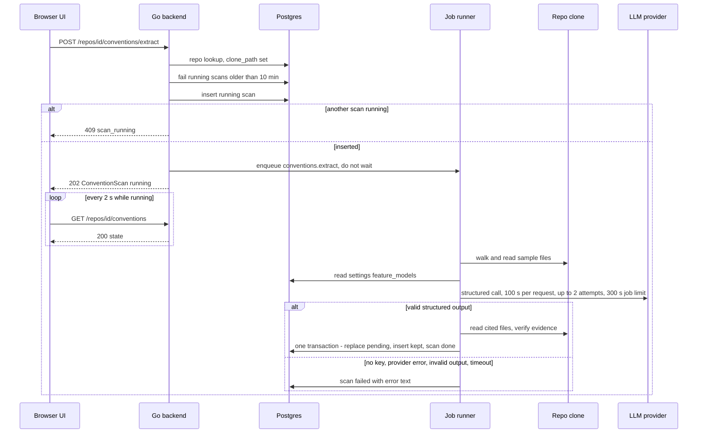
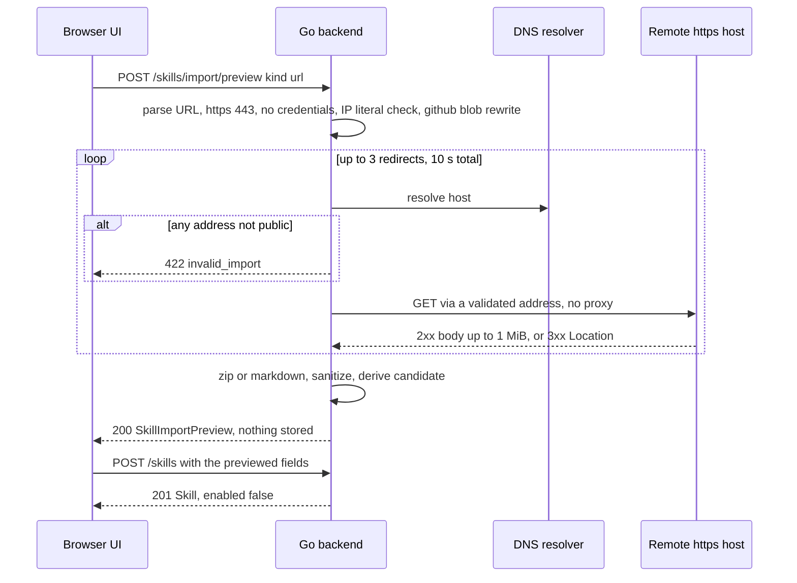

# Go backend migration — Phase 2: agents, skills, conventions, project context and the minimal LLM layer
Spec: Go backend Phase 2 (agents, skills, conventions, project-context + minimal LLM layer) · Status: ready-for-planning · Date: 2026-10-22
Areas: http, llm, agents, skills, conventions, context, seed
Design sources: task brief of 2026-10-22 (decision D11 of `docs/migration/README.md`); `CLAUDE.md`, `AGENTS.md`, `backend/AGENTS.md`, `backend/INSIGHTS.md`; `docs/migration/README.md`, `docs/migration/STATUS.md`; research `docs/migration/research/01-http-api.md` §2 (agents, skills, conventions, project-context), §4, §5, `02-data-layer.md`, `03-engine-integrations.md` §2, §7; contracts `frontend/src/vendor/shared/contracts/{knowledge,project-context,platform}.ts`, `frontend/src/vendor/shared/adapters.ts` (`ModelInfo`), `frontend/src/vendor/shared/constants/{skills,project-context,feature-models}.ts`; the UI hooks and screens under `frontend/src/lib/hooks/` and `frontend/src/app/{agents,skills,repos/[repoId]/conventions,repos/[repoId]/context}`; Node reference `<dev-digest>` = `/home/ypodop/IdeaProjects/dev-digest` (commit `d1c9093`), read through six research reports made for this spec: R-agents, R-skills, R-conv, R-ctx, R-llm, R-ui. Go code of Phase 1 under `backend/internal/`. No design frames.
Related: `specs/2026-10-21-go-backend-phase-1.md` (Phase 1). This spec builds on its platform rules and replaces these Phase 1 statements: the Out-of-scope lines on the agents, skills, conventions and project-context routes, on LLM calls and on the seed (Phase 1 D7: "agents and skills are seeded by the phases that own them"); Phase 1 D10 (Settings › Models picker); Phase 1 AC1 (`GET /agents` is 404) and the "no agent, skill" clause of Phase 1 AC34.

**ID convention.** Phase 2 IDs use the 200 range so they never collide with Phase 1: FR201…, EC201…, NFR201…, AC201…, US201…, D201…, Q201…. A Phase 1 item is always written with the words "Phase 1" in front (e.g. "Phase 1 FR6"). Phase 1 IDs never appear in a `Traces:` line of this spec.

## 1. Goal
The UI's Agents, Skills, Conventions and Project-context screens, and the Settings › Models picker, must work against the Go backend. Phase 2 ports the 38 routes of the Node modules agents (11), skills (13), conventions (4) and project-context (10), wire-compatible with the unchanged UI. It also adds a minimal LLM layer pulled forward from Phase 4 (D11): structured completion and model listing for OpenAI, Anthropic and OpenRouter, a price book, a content-free prompt log, and Node's timeouts and retries. With it, `POST /repos/:id/conventions/extract` works end to end. A developer can then manage review agents and their skills, import skills from a file, a URL or the shipped catalog, extract house conventions from a cloned repo with an LLM, turn accepted conventions into a skill, and attach repo documents to agents and skills.

## 2. Context
- Node serves the 38 routes in `modules/agents/routes.ts:61-172`, `modules/skills/http/routes.ts:62-169`, `modules/conventions/http/routes.ts:26-62` and `modules/project-context/http/routes.ts:35-127` (research 01 §2; R-agents, R-skills, R-conv, R-ctx).
- The UI calls 34 of them. It never calls `GET /agents/:id/versions`, `GET /agents/:id/versions/:version`, `GET /agents/:id/models` or `GET /skills/:id/versions/:version` (R-ui §4; research 01 §4 is wrong on the last one).
- The UI sends `content-type: application/json` only with a body. The body-less POSTs in scope are `POST /repos/:id/conventions/extract` and `POST /skills/:id/versions/:v/restore` (`frontend/src/lib/api.ts:30,66-73`, R-ui §0).
- Query errors with status 4xx are silent; mutations toast the envelope `message` verbatim unless the code is listed as quiet. The UI branches on the codes `stale_version`, `scan_running`, `conflict`, `path_exists`, `invalid_path`, `doc_not_found`, and on the statuses 400/404/413 of the document preview. It never reads `error.details` on these screens (R-ui §0, §2).
- The conventions state is polled every 2000 ms while `scan.status` is `running` (`frontend/src/lib/hooks/conventions.ts:19-29`).
- Settings › Models calls `GET /providers/openrouter/models`. The agent model field calls `GET /providers/<openai|anthropic|openrouter>/models`. An empty array is the UI's "key missing" signal (R-ui §5). Node returns `200 []` on every listing failure (`modules/agents/service.ts:144-151`).
- Node's LLM layer is a port (`vendor/shared/adapters.ts:107-113`) with an OpenAI adapter (`adapters/llm/openai.ts`), an Anthropic adapter (`adapters/llm/anthropic.ts`) and an OpenRouter adapter (`reviewer-core/src/llm/openrouter.ts`). Cost comes from a static table (`adapters/llm/pricing.ts:16-59`) plus a 6-hour OpenRouter price cache (`platform/price-book.ts`). The prompt log is one content-free log line `prompt_assembled` (`platform/prompt-log.ts:125-191`); no table exists for it (R-llm §4–§5).
- Conventions extraction runs as job `conventions.extract` on the job runner: 120 s per attempt, 2 retries for transient errors, 3 concurrent (`platform/jobs.ts:55-57`). The scan handler never throws, so it is never retried (`modules/conventions/application/conventions-service.ts:93-158`, R-conv §2).
- Repo-intel (file ranking) is Phase 3. The conventions sampler asks the ranker first and falls back to a directory walk when the ranker returns nothing (`conventions-service.ts:222-239`, R-conv §3a).
- Node seeds 4 agents, 9 skills and their agent-skill links (`db/seed.ts:191-300`, `db/seed-skills.ts:20-229`). It writes no `agent_versions` row for the seeded agents (R-agents S7). The Node seed is a manual script; the Go seed runs at every startup (Phase 1 D8).
- Phase 1 built the reusable parts: the error envelope, validation, `ReadJSONBody`, the Origin and Host guards, the rate limit (`backend/internal/platform/httpx`), the job runner (`backend/internal/jobs/runner.go:24-28`: 3 concurrent, 120 s, 2 retries), the secrets store (re-read on every lookup, `backend/internal/platform/secrets`), the retry policy (`backend/internal/platform/retry/retry.go:15-21`) and a model counter for the connection test (`backend/internal/settings/adapters/providers/providers.go`).
- Every table Phase 2 needs exists in the baseline migration: `agents` (`backend/migrations/0001_baseline.up.sql:90`), `agent_versions` (:79), `agent_skills` (:69), `skills` (:696), `skill_versions` (:683), `convention_scans` (:207, partial unique index `convention_scans_one_running_uq` :1207), `conventions` (:230), `context_files` (:191), `agent_context_docs` (:17), `skill_context_docs` (:670), `eval_cases` (:265), `jobs` (:423).
- Research gaps found by this spec's research are listed in section 15, rows 1–8.

## 3. Scope
### In scope
- The 38 routes of section 7 (agents 11, skills 13, conventions 4, project-context 10), including the 4 routes the UI does not call.
- The minimal LLM layer: structured completion and model listing for 3 providers, key lookup, usage and cost, price book, prompt log, mock provider.
- The conventions extraction job on the Phase 1 job runner.
- Skill import: file (`.md`, `.markdown`, `.txt`, `.zip` as base64 in JSON), URL (SSRF-guarded fetch) and the shipped community catalog; preview, then confirm through `POST /skills`.
- Skills statistics over the existing review tables.
- Project-context reads of the repo clone and the DB-backed store files.
- Seed of the 4 agents, 9 skills and their links.
- The configuration switches `LLM_PROVIDER_OVERRIDE`, `LLM_MOCK_DELAY_MS`, `PROJECT_CONTEXT_GLOBS`.
### Out of scope
- No route of the modules repo-intel, reviews (including SSE `GET /runs/:id/events`), intent, smart-diff, blast, brief, onboarding, performance, evals or ci is registered; each such path returns the standard 404 envelope, except `GET /agents/performance`, which matches `GET /agents/:id` and returns 422 `validation_error`.
- No LLM call is made except by the `conventions.extract` job, the two model-listing routes, the price-book refresh and the Phase 1 `POST /settings/test-connection`.
- No streaming LLM call, plain-text completion, embedding call, run bus, SSE stream, multi-agent run or review budget exists.
- The conventions sampler reads no `file_rank` row and calls no repo-intel code; it uses only the directory walk.
- No route writes, creates or deletes a file inside a repo clone.
- No route resolves project context for a review run (Node `resolveForRun`); that is Phase 4.
- The community catalog route and the community import make no network call.
- Skill import writes nothing to disk and persists nothing until `POST /skills`.
- No prompt text, repository sample or skill body is written to any log.
- No new migration version is added.
- The seed writes no agent run, review, finding, eval case or PR #483.
- Model lists are not cached by the backend.
- The mock provider has no fixture for the schemas `Review`, `IntentClassification` or `PrBriefLlm`.
- No route of this phase has its own rate-limit bucket; only the Phase 1 global limit applies.

## 4. User scenarios
- US201 — As a developer, I list, create, edit, enable/disable and delete review agents, so that I control which reviewers exist.
- US202 — As a developer, I pick an agent's model from the provider's live model list, and on Settings › Models I pick the OpenRouter model per feature.
- US203 — As a developer, I attach, reorder and detach skills on an agent.
- US204 — As a developer, I create, edit, version, restore and delete skills, and see which agents use them and their usage statistics.
- US205 — As a developer, I import a skill from a `.md`/`.zip` file, a URL or the community catalog: I see a preview first and save it disabled.
- US206 — As a developer, I run a conventions scan on a cloned repo, review the proposed rules with their verified evidence, accept, reject or edit them, and merge the accepted ones into a skill linked to agents.
- US207 — As a developer, I browse a repo's spec, doc and insight documents, preview one, and attach documents to agents and skills.
- US208 — As a developer, I create, edit, rename and delete DevDigest store files under `.devdigest/specs/`, protected against lost updates.
- US209 — As a developer starting on a fresh database, I get the 4 built-in agents and 9 built-in skills without a manual step.

## 5. Functional requirements
Cross-cutting HTTP
- FR201 [http] — The backend shall register exactly the 38 routes of section 7 in addition to the Phase 1 routes. A static segment (`/skills/stats`, `/skills/community`, `/skills/import/preview`) wins over `/skills/:id`. Every other unregistered path keeps the Phase 1 404 envelope (US201–US208).
- FR202 [http] — The Phase 1 platform rules apply unchanged to every new route: error envelope, 422 `details` format, body rules, `ReadJSONBody` (JSON only for `application/json`), the foreign-Origin 403 for POST/PUT/PATCH/DELETE, the `ALLOWED_HOSTS` check, the global rate limit, HEAD for every GET, security headers and CORS (which already allows PATCH). The body limit is 2,162,688 bytes for `POST /skills/import/preview`, 2,097,152 bytes for `POST` and `PUT /repos/:id/context/files`, and the Phase 1 1,048,576 bytes for every other route. Over the limit the response is 413 `internal_error` `Request body is too large`.
- FR203 [http] — Request validation shall follow these rules (section 7.1 lists the details):
  - every `:id` is a UUID (any version, case-insensitive), else 422 `validation_error`;
  - `:version` is a decimal positive integer up to 2,147,483,647, else 422 (D204);
  - `GET /providers/:id/models` takes `:id` from `openai|anthropic|openrouter`, else 422;
  - unknown body and query keys are ignored;
  - string length limits count UTF-16 code units, as the UI's Zod schemas do (D205);
  - a cross-field rule failure (a "refine") is one issue with `instancePath` `/` and the message given in section 7.
- FR204 [http] — JSON responses shall use exactly the field names, key presence and null/absent rules of section 7. Timestamps are ISO-8601 UTC with 3 fractional digits and `Z`. Every resource is scoped to the `default` workspace; a resource of another workspace behaves exactly like an unknown id.

Minimal LLM layer
- FR205 [llm] — The backend shall offer one reusable structured-completion port. A request carries: provider, model, the ordered messages (`system`/`user`/`assistant` with text), a response schema with a name, and optionally temperature, maximum output tokens, a per-request timeout, the number of reprompts (default 2) and a cancellation signal. A result carries: the parsed object, the requested model, input and output tokens summed over all attempts, the cost in USD or null, the last raw output and the number of attempts. Phase 4 extends this port; Phase 2 uses it only for conventions (D11).
- FR206 [llm] — An OpenAI request shall be a chat completion with a strict JSON-schema response format (section 7.2). For a reasoning model (name matching `^(gpt-5|o1|o3|o4)`) no temperature is sent and the output cap is sent as `max_completion_tokens`. For other models `temperature` is sent (the requested value, default 0) and the cap as `max_tokens`. A cap is sent only when set.
- FR207 [llm] — An Anthropic request shall use forced tool use: one tool whose input schema is the response schema, and a tool choice naming it (section 7.2). All system messages are joined with a blank line into the system prompt. `max_tokens` defaults to 4096 and `temperature` to 0. The raw output is the JSON text of the tool input, or empty when the response has no tool call.
- FR208 [llm] — An OpenRouter request shall be an OpenAI-compatible chat completion at `https://openrouter.ai/api/v1` with the strict JSON-schema response format and `usage:{include:true}`. `temperature` is sent only when the caller set it and the model supports it (section 7.2). The cap is always sent as `max_tokens`. A 200 response with no choices is a failure that is not reprompted: `OpenRouter returned no choices for <schemaName>[: <error message>]`.
- FR209 [llm] — Each attempt's raw output shall be parsed and checked as follows:
  1. parse the trimmed text as JSON; if that fails, parse the first fenced ```` ```json ```` block or else the first balanced `{…}`/`[…]`;
  2. validate it against the response schema;
  3. on failure, append the raw output as an `assistant` message and a `user` reprompt (exact texts in section 7.2) and try again, up to the reprompt count;
  4. after the last failed attempt, fail with the exact failure text of section 7.2 (kind `external_service`).
- FR210 [llm] — Transport rules (D206):
  - each HTTP request has a timeout: the caller's value, else 120 s (OpenAI, Anthropic) or 180 s (OpenRouter);
  - a transient failure (HTTP 429, 5xx, connection reset or refused, DNS failure, network timeout) is retried up to 3 times (OpenAI, Anthropic) or 2 times (OpenRouter) with the Phase 1 backoff (250 ms base, 8 s cap, up to 250 ms jitter); other 4xx, a request timeout and a cancellation are not retried;
  - all requests, retries and reprompts of one structured call share a 360 s budget; when it runs out the call fails with `<Provider> structured call for <schemaName> exceeded its total budget of 360000ms`;
  - a cancelled call stops at once and is not retried.
- FR211 [llm] — Each LLM call shall read the provider key from the Phase 1 secrets store at call time (`OPENAI_API_KEY`, `ANTHROPIC_API_KEY`, `OPENROUTER_API_KEY`), so a key saved through Settings is used without a restart. A missing key fails with kind `config` and message `<NAME> is not configured`.
- FR212 [llm] — Usage and cost per attempt:
  - tokens come from the provider's usage fields;
  - when a response has no usage, tokens are estimated as ceil(characters / 4) of the sent messages and of the output, and a warning line `<what> returned no usage; estimated <in> in / <out> out tokens` is logged;
  - for OpenRouter, a numeric `usage.cost` is the attempt's cost; otherwise the price book is used;
  - the call's cost is the sum over attempts; one unknown cost makes the sum null. For OpenAI and Anthropic the cost is computed once from the summed tokens.
- FR213 [llm] — The price book shall price a model as (tokens_in × in + tokens_out × out) / 1,000,000 USD, using exact model-name match:
  - first a live OpenRouter price, when cached;
  - else the static table of section 8;
  - else null.
  Live prices come from the OpenRouter model list (only entries with known pricing). They are fetched in the background with the stored OpenRouter key and kept 6 hours. A lookup never waits for the fetch; a cold or failed cache answers from the static table, and a failed fetch is retried on the next lookup. Without an OpenRouter key no live price exists.
- FR214 [llm] — Model listing per provider (section 7.2 `ModelInfo` mapping) (US202):
  - OpenAI: `GET /v1/models`, keep ids that start with `gpt` or contain `o1` or `o3`, upstream order;
  - Anthropic: `GET /v1/models`, first page only, upstream order;
  - OpenRouter: `GET https://openrouter.ai/api/v1/models` with a 15 s timeout and no retry, sorted ascending by completion price per 1M, unknown prices last, ties in upstream order;
  - OpenAI and Anthropic listing requests have a 30 s timeout and the FR210 retries (D207).
- FR215 [llm] — Before each structured model call, after the provider and model are resolved, one `info` log line `prompt_assembled` shall be written with the record of section 7.2. It carries only identifiers and sizes, never prompt text. It is written even if the call fails later.
- FR216 [llm] — With `LLM_PROVIDER_OVERRIDE=mock` every provider shall be replaced by a deterministic mock (section 7.2) that needs no key and makes no network call. `LLM_MOCK_DELAY_MS` (0–60,000, default 0) delays each structured call. Startup logs one warning line that the mock is active (D214).
- FR217 [llm] — A feature's model shall be resolved at the time of the call: the stored setting `feature_models.<feature>` when it is a valid `{provider, model}` choice, else the registry default of `constants/feature-models.ts` (`conventions`: provider `openai`, model `gpt-5.4`).

Agents
- FR218 [agents] — `GET /agents` shall return every agent of the workspace, enabled or not, ordered by creation time ascending, then name (byte order), then id (D203) (US201).
- FR219 [agents] — `GET /agents/:id` shall return the agent or 404 `not_found` `Agent not found`.
- FR220 [agents] — `POST /agents` shall create an agent and respond 201. Defaults: `description` `""`, `enabled` true, `strategy` `single-pass`, `ci_fail_on` `critical`, `repo_intel` true, `output_schema` null, `version` 1, created by the system user. In the same transaction it writes version snapshot 1 (section 8). Names are not unique (US201).
- FR221 [agents] — `PUT /agents/:id` shall apply a partial patch under a row lock. A patch is a config change when it provides `name`, `description`, `provider`, `model`, `system_prompt`, `strategy`, `ci_fail_on` or `repo_intel` with a value different from the stored one, or provides `output_schema` at all (also `null`, also equal). A config change sets `version` to the stored version + 1 and writes a snapshot of the new config with the current skill ids. An `enabled`-only patch, an all-equal patch or `{}` keeps the version and writes no snapshot. The response is the stored agent after the write.
- FR222 [agents] — `DELETE /agents/:id` shall, in one transaction, delete the workspace's eval cases owned by the agent and the agent row, and respond `{"ok":true}`. Versions, skill links, context attachments, eval suite runs and CI installations go with it by cascade; reviews and agent runs keep their rows with `agent_id` null. Seeded agents can be deleted.
- FR223 [agents] — `GET /agents/:id/versions` shall list the snapshots newest first; `GET /agents/:id/versions/:version` shall return one snapshot or 404 `Agent version not found` (for an unknown agent as well).
- FR224 [agents] — `GET /agents/:id/skills` shall return the agent's links `{agent_id, skill_id, order}` ordered by `order` ascending, disabled skills included (US203).
- FR225 [agents] — `POST /agents/:id/skills` shall work as follows under a row lock on the agent (US203):
  1. unknown agent → 404 `Agent not found`, checked before any skill;
  2. with `skill_ids` (set mode, may be empty): the wanted list is that list; `skill_id` and `order` are ignored;
  3. otherwise (link mode): the skill is removed from the current list if present and inserted at index `order`, clamped to the list length, appended when `order` is absent;
  4. every wanted id must be a skill of the workspace, else 422 `unknown_skill` (section 7.3) with the links unchanged;
  5. a wanted list equal to the current one (same ids, same order) changes nothing and keeps the version;
  6. otherwise the links are replaced with `order` 0…n-1, the version is incremented and a snapshot is written;
  7. the response is 200 with the resulting link list.
- FR226 [agents] — `GET /providers/:id/models` shall return the provider's model list (FR214), and `GET /agents/:id/models` the list of the agent's provider (404 `Agent not found` for an unknown agent). A missing key, a provider error or a timeout gives 200 `[]`, logged at `warn` without the key (US202).

Skills
- FR227 [skills] — `GET /skills` shall return every skill of the workspace ordered by name in byte order, each with `used_by` = the number of agents linking it (US204).
- FR228 [skills] — `GET /skills/:id` shall return the skill or 404 `Skill not found`. `POST /skills` shall create a skill and respond 201 (US204, US205):
  - `source` defaults to `manual`; `source_ref` is stored only for non-manual sources;
  - `description` defaults to `""`;
  - a non-manual skill is always stored with `enabled` false, whatever the body says; a manual skill takes `enabled`, default true;
  - version 1 and its snapshot are written in the same transaction, with message `Created` (manual, or no `source_ref`) or `Imported from <source_ref>`;
  - a duplicate name in the workspace gives 409 `conflict`.
- FR229 [skills] — `PUT /skills/:id` shall, under a row lock, check in this order: unknown skill → 404; `base_version` given and different from the stored version → 409 `stale_version` (also for an empty patch); write; duplicate name → 409 `conflict`. A change of `body` and/or `description` to a different value increments the version and writes a snapshot with message `Edited body and description`, `Edited body` or `Edited description`. `name`, `type` and `enabled` change in place without a version. `updated_at` is set on every successful PUT. The response is the re-read skill with its `used_by`.
- FR230 [skills] — `DELETE /skills/:id` shall, in one transaction, delete the workspace's eval cases owned by the skill and the skill row, and respond `{"ok":true}`. Versions, agent links, run-skill rows, context attachments and skill eval suite runs go by cascade; findings and conventions keep their rows with `skill_id` null. The linking agents keep their version and the `order` values of their other links.
- FR231 [skills] — `GET /skills/:id/versions` shall list snapshots newest first (404 `Skill not found`). `GET /skills/:id/versions/:version` shall return one snapshot or 404 `Skill version not found` (also for an unknown skill). `POST /skills/:id/versions/:version/restore` (no body) shall, under a row lock, write the snapshot's body, and its description when not null, as version current + 1 with snapshot message `Restored from v<K>`, also when K is the current version; 404 `Skill not found` / `Skill version not found` with no change.
- FR232 [skills] — `GET /skills/:id/agents` shall return the linking agents `{id, name, enabled}` ordered by name in the database's default collation, then id (D222).
- FR233 [skills] — `GET /skills/stats?days=` and `GET /skills/:id/stats?days=` shall compute the counters of section 7.4 over a window starting `days` × 24 h before now (`days` 1–365, default 30). The summary has one entry per skill in `GET /skills` order. With no review data every count is 0, every rate null and every breakdown `[]` (US204).
- FR234 [skills] — `GET /skills/community?q=&tag=&lang=` shall return the cards of the shipped catalog (section 8) in catalog order, filtered case-insensitively after trimming: `tag` equals one of the tags, `lang` equals the language, `q` is a substring of the name, the short description or a tag; empty filters are ignored; all filters combine with AND (US205).
- FR235 [skills] — `POST /skills/import/preview` shall return a `SkillImportPreview` and store nothing. Every import failure is 422 `invalid_import` with a message of section 7.4. Confirming is a plain `POST /skills` with the previewed fields; the server does not link it to the preview (US205).
- FR236 [skills] — A markdown candidate shall be derived as follows (exact rules in section 7.4):
  1. sanitize: normalize line ends, remove HTML comments, zero-width and bidi control characters, each removal adding a warning;
  2. read a simple front-matter block (`name`, `description`, `type`);
  3. the body is the rest, trimmed; empty or longer than 20,000 characters fails;
  4. the name is the slug of the front-matter name or the fallback name; a changed name adds a warning;
  5. the description is the front-matter description or the first paragraph, whitespace-collapsed, cut at 300 characters with a warning;
  6. the type is the front-matter type when valid, else `custom` (with a warning when one was given).
- FR237 [skills] — A file import (`kind:"file"`) shall accept `.md`, `.markdown`, `.txt` and `.zip` file names. The base64 text is at most 2,097,152 characters; a decoded markdown file is at most 262,144 bytes and valid UTF-8 (a leading byte-order mark is dropped). The preview has `source` `imported_file`, `source_ref` = the file name, `included_files` = `[file name]` for markdown.
- FR238 [skills] — A zip import shall read only the central directory and then at most one entry:
  - at most 500 entries; `__MACOSX/…`, `.DS_Store` and directory entries are ignored silently;
  - when all remaining entries share one top folder, that folder is the root;
  - the chosen entry is the root `SKILL.md` (case-insensitive), else the only root markdown file; none or several fail;
  - the chosen entry may declare and contain at most 262,144 bytes and must be valid UTF-8;
  - every other entry is listed in `ignored_files` with reason `executable`, `reference_doc` or `not_markdown` (section 7.4).
- FR239 [skills] — A URL import shall:
  1. accept only `https` URLs on port 443 without credentials, with a host that is not an IP literal of a non-public address (literal forms normalized as browsers do, section 7.4);
  2. rewrite `https://github.com/<o>/<r>/blob/<path>` (also `www.github.com`) to `https://raw.githubusercontent.com/<o>/<r>/<path>`, dropping query and fragment;
  3. before each request, resolve the host and require that every address is public, then connect only to a validated address and never through a proxy;
  4. follow at most 3 redirects, validating each target as in steps 1–3;
  5. stop after 10 s in total and after 1,048,576 body bytes;
  6. treat the document as a zip when the final path ends in `.zip`, the body starts with `PK\x03\x04` or the content type contains `zip`, else as UTF-8 markdown;
  7. return `source` `imported_url` with `source_ref` = the URL as the user typed it (trimmed).
- FR240 [skills] — A community import (`kind:"community"`) shall build the candidate from the catalog entry's body and then use the entry's name, description and type; `source` `community`, `source_ref` `community:<id>`, `included_files` `["<name>.md"]`. An unknown id fails with `Unknown community skill "<id>"`.

Conventions
- FR241 [conventions] — `GET /repos/:id/conventions` shall return `{scan, conventions}`: `scan` is the repo's latest scan by start time (null if none); `conventions` lists every rule of the repo ordered by status (`accepted`, `pending`, `rejected`), then confidence descending with nulls last, then creation time ascending (US206).
- FR242 [conventions] — `POST /repos/:id/conventions/extract` (any body ignored) shall:
  1. unknown repo → 404 `Repo not found`;
  2. repo without `clone_path` → 422 `not_cloned`;
  3. fail every `running` scan of the repo older than 10 minutes with error `The scan was interrupted`;
  4. insert a `running` scan; when one is already running → 409 `scan_running`;
  5. enqueue job `conventions.extract` with payload `{scanId, workspaceId, repoId}`; if the enqueue fails, fail the scan with the error text and answer 500 `internal_error`;
  6. respond 202 with the running scan, without waiting.
- FR243 [conventions] — The job shall build the sample from the clone (exact limits in section 7.5):
  - walk the clone breadth-first to depth 8 and at most 5,000 regular files, skipping symlinks, the listed build/vendor directories and every directory whose name starts with `.`;
  - pick up to 8 config files at depth 0 or 1 by name, shallowest first;
  - pick up to 12 source files with the fallback rule (source extensions, no tests, no generated or tool-config files, round-robin over directories, shallow first);
  - render each readable, non-blank file (≤ 524,288 bytes, no NUL) with numbered lines, capped at 3,000 (config) or 6,000 (source) characters, stopping before the total passes 90,000 characters;
  - `sampled_files` are the rendered paths in order;
  - an empty sample fails with `No source or config files to sample in the clone`; a missing clone directory fails with `The repo is not cloned`.
- FR244 [conventions] — The job shall make one structured call (FR205) with the feature model `conventions` (FR217), the system prompt and user message of section 7.5, schema `ConventionExtraction`, temperature 0.1, at most 6,000 output tokens, a per-request timeout of 100 s and 1 reprompt (2 attempts at most), cancelled when the job's context ends.
- FR245 [conventions] — Each cited evidence item shall be verified against the clone file (exact algorithm in section 7.5). A verified item is relocated to the real lines (at most 12) and stores the real, dedented file text as its snippet; the model's snippet is never stored. Failures are `file_not_found`, `line_out_of_range`, `snippet_mismatch` or `invalid`.
- FR246 [conventions] — The gate shall consider the first 15 candidates and the first 3 evidence items of each:
  - the rule text is whitespace-collapsed and cut at 500 characters;
  - a rule whose normalized key is empty is dropped as `invalid`; a key equal to an accepted, rejected or edited rule of the repo, or to a rule kept earlier in this scan, is dropped as `duplicate`;
  - a candidate is kept when at least one evidence item verifies; otherwise it is dropped with the first failure reason (`invalid` when it has no evidence);
  - confidence is clamped to 0–1 (non-numbers become 0); there is no confidence threshold.
- FR247 [conventions] — On success the job shall, in one transaction: delete the repo's `pending`, unedited conventions; insert the kept ones as `pending`; set the scan `done` with `finished_at`, `sampled_files`, `proposed` (the model's candidate count, uncapped), `kept`, `dropped`, `model` (the requested model), tokens and `cost_usd`. Any failure sets the scan `failed` with `finished_at`, the sampled files known so far and `error` = the failure text cut to 500 characters, with provider keys replaced by `[REDACTED]`, and logs `conventions scan failed` at `warn` with the scan and repo ids. The job itself always ends `done`, so the runner never retries it. A job timeout fails the scan with `The scan timed out after <n> s` (n = the job limit, 300 for `conventions.extract`, D208); a shutdown with `The scan was interrupted` (D210).
- FR248 [conventions] — At startup, before listening, every scan left `running` shall be set `failed` with error `The scan was interrupted` and `finished_at` now (D209).
- FR249 [conventions] — `PATCH /conventions/:id` shall update the given `status`, `rule` (trimmed) and `category` of a convention of the workspace and set `updated_at`. A `rule` or `category` different from the stored value sets `edited` true for good; a status change alone keeps `edited`. Any status transition is allowed. 404 `Convention not found`; `{}` → 422 `Nothing to update`.
- FR250 [conventions] — `POST /repos/:id/conventions/skill` shall, in one transaction (D212), check and write in this order:
  1. unknown repo → 404 `Repo not found`;
  2. every de-duplicated `convention_ids` entry must be an `accepted` convention of this repo, else 422 `validation_error` with `details.ids`;
  3. every de-duplicated `agent_ids` entry must be an agent of the workspace, else 422 `unknown_agent` with `details.id` (first unknown);
  4. create the skill with `source` `extracted`, `source_ref` `conventions:<owner>/<name>`, `type` default `convention`, `enabled` as sent (default true), snapshot message `Extracted from conventions of <owner>/<name>`; duplicate name → 409 `conflict`;
  5. append the skill to each agent's links (FR225 link mode, which bumps the agent's version);
  6. set `skill_id` on those conventions and bump their `updated_at`;
  7. respond 201 `{skill, linked_agents}` with `used_by` = the number of linked agents.
  Any failure leaves no skill, link or convention change.

Project context
- FR251 [context] — Path rules (exact in section 7.6):
  - a repo document path is listable when its shape is valid, no directory segment is an excluded directory, and it matches one configured glob;
  - a store path starts with `.devdigest/specs/`, ends with `.md`, has at most 5 folder levels below the root and only segments of `[A-Za-z0-9._-]`;
  - the doc type is the last directory segment equal to `specs`, `docs` or `insights`, else `docs`;
  - globs come from `PROJECT_CONTEXT_GLOBS`, default `**/{specs,docs,insights}/**/*.md` (US207).
- FR252 [context] — `GET /repos/:id/context` shall return store files first (by path, byte order, all of them) and then listable clone documents (by path, at most 500 matches taken before unreadable ones are dropped), dropping a clone document whose path is a store file. `clone_status` is `ready` when the clone root is a readable directory, else `not_cloned` (store files are still listed). `truncated` is present and true only when the clone matches were cut. `tokens_total` sums all documents.
- FR253 [context] — `GET /repos/:id/context/doc?path=` shall return a store file with that exact path; else a listable clone document; a non-listable, non-store path → 400 `invalid_path`; missing or no clone → 404 `doc_not_found`; larger than 262,144 bytes → 413 `doc_too_large`.
- FR254 [context] — `GET /agents/:id/context?repoId=` and `GET /skills/:id/context?repoId=` shall return `{repo_id, paths}` with the attached paths ordered by position (`[]` when none); 404 `agent_not_found` / `skill_not_found`, then `repo_not_found`.
- FR255 [context] — `PUT /agents/:id/context` and `PUT /skills/:id/context` shall, after the owner and repo checks, reject more than 50 paths (422 `too_many_paths`), then check each path in order (422 `invalid_path` when neither listable nor store-shaped, 422 `duplicate_path` on a repeat), then replace the owner's attachments for that repo with positions 0…n-1 under a row lock on the owner. Existence is not checked. The response echoes `{repo_id, paths}`. No agent or skill version changes.
- FR256 [context] — `POST /repos/:id/context/files` (absent or `null` body = `{}`) shall create a store file with version 1 (US208):
  - path default `.devdigest/specs/untitled.md`; `on_conflict` default `suffix` when no path is given, else `fail`; content default `""`;
  - checks in order: repo 404; store-path shape 422 `invalid_path`; NUL in content 422 `invalid_content`; content over 262,144 UTF-8 bytes 413 `doc_too_large`; 500 store files already 422 `too_many_files`;
  - the path is taken when a store file or a clone file exists there; then `fail` → 409 `path_exists`, `suffix` → try `<stem>-2.md` … `<stem>-1000.md`, then 409 `path_exists`;
  - respond 201 with the store preview and log one `info` line `{repo_id, operation, path, size, version}`.
- FR257 [context] — `PUT /repos/:id/context/files?path=` with `{content, base_version}` shall: repo 404; a path that is not a store file → 403 `read_only` when a clone file exists there and the path is listable or store-shaped, else 404 `doc_not_found`; content checks as FR256; then save only when the stored version equals `base_version`, setting version + 1 and `updated_at`; otherwise 404 `doc_not_found` (gone) or 409 `stale_version` with `details.current_version`. Equal content still increments the version.
- FR258 [context] — `POST /repos/:id/context/files/rename` with `{path, new_path, base_version}` shall: repo 404; source checks as FR257; `new_path` not store-shaped → 422 `invalid_path`; `new_path` equal to `path` → 200 with the current preview and no change; a clone file at `new_path` → 409 `path_exists`; then in one transaction: a store file at `new_path` → 409 `path_exists`; rename only when the version equals `base_version` (version + 1), else 404/409 as FR257; repoint every agent and skill attachment of the repo from the old to the new path, removing an owner's existing attachment of the new path first.
- FR259 [context] — `DELETE /repos/:id/context/files?path=` shall delete a store file and respond 204 with no body; a non-store path → 403 `read_only` / 404 `doc_not_found` as FR257. Attachments of the path stay.
- FR260 [context] — Reading the clone shall never leave the clone root: the listing skips symlinks and never enters excluded directories; a single read rejects a symlinked file, resolves the real path and requires it inside the real clone root, opens without following links and reads only regular files; any failure counts as not found. Nothing is ever written to the clone.

Seed
- FR261 [seed] — The seed shall write, in the Phase 1 seed transaction, the 4 agents, the 9 skills with their version-1 snapshots and the agent-skill links of section 8, with values byte-identical to the Node seed. Seeded agents get no version snapshot (Node parity) (US209).
- FR262 [seed] — Agents, skills and links shall be seeded only when the workspace is created in this seed run, or when the workspace has no agent and no skill at all (D213). Within such a run, an agent or skill whose name exists is skipped, and links are written only for an agent without any link. A second seed run changes no row.

## 6. Workflow and communication




| Caller → callee | Mode | Trigger | On failure |
|---|---|---|---|
| UI → API | sync HTTP | every UI action; conventions state polled every 2 s while running | envelope message per R-ui §2 |
| API → Postgres | sync | every route | 500 `internal_error` |
| API → job runner | async, in-process | conventions extract | scan `failed` with the error text, 500 `internal_error` |
| Job → repo clone (read) | sync file reads | conventions sampling and evidence | file skipped; empty sample or missing clone → scan `failed` |
| Job → LLM provider | sync HTTPS, 100 s per request, transient retries, 2 attempts, 300 s job limit | conventions extract | scan `failed`; job ends `done` (no job retry) |
| API → LLM provider (listing) | sync HTTPS, 30 s (15 s OpenRouter) | `GET /providers/:id/models`, `GET /agents/:id/models` | 200 `[]` |
| Price book → OpenRouter `/models` | async background, 15 s | a price lookup with a stale cache | static table; retried on the next lookup |
| API → remote host (URL import) | sync HTTPS, 10 s total, ≤ 3 redirects | skill URL import | 422 `invalid_import` with the reason |
| API → repo clone (project context) | sync file reads, read-only | context list, preview, write collision checks | not found / `not_cloned` |

## 7. Contracts
### 7.1 Cross-cutting
- Error envelope, 422 `details` items (`keyword`, `instancePath`, `schemaPath`, `message`, `params.issue`), body rules, guards, CORS, HEAD and security headers: as Phase 1 section 7.1 and Phase 1 D11.
- Body limits: section FR202. The 413 body is `{"error":{"code":"internal_error","message":"Request body is too large"}}`.
- Validation: `:id` UUID; `:version` `^[0-9]+$`, value 1–2,147,483,647; provider `openai|anthropic|openrouter`. Refine issues use `instancePath` `/`.
- String limits are UTF-16 code units: skill name 1–64 matching `^[a-z0-9]+(?:-[a-z0-9]+)*$` (message `Use a kebab-case slug: lowercase letters, digits and single dashes`), skill description ≤ 300, skill body 1–20,000, `source_ref` ≤ 500, import file name 1–255, import URL 1–2,000, community id 1–100, convention rule 1–500 after trimming, community query `q` ≤ 200, `tag` ≤ 50, `lang` ≤ 50, context `path` query ≤ 4,096.
- Error codes new in Phase 2: `unknown_skill`, `stale_version`, `conflict`, `invalid_import`, `not_cloned`, `scan_running`, `unknown_agent`, `repo_not_found`, `doc_not_found`, `agent_not_found`, `skill_not_found`, `invalid_path`, `duplicate_path`, `too_many_paths`, `invalid_content`, `doc_too_large`, `too_many_files`, `path_exists`, `read_only`.
- Configuration (environment):
  - `LLM_PROVIDER_OVERRIDE`: empty or `mock` (default empty); any other value fails startup;
  - `LLM_MOCK_DELAY_MS`: integer 0–60,000 (default 0); else startup fails;
  - `PROJECT_CONTEXT_GLOBS`: comma-separated globs, commas inside `{…}` kept, blank entries dropped; unset or empty = `**/{specs,docs,insights}/**/*.md`.
- Job kind `conventions.extract`, payload `{scanId, workspaceId, repoId}`.

### 7.2 LLM layer (port and provider contracts)
Structured request and result: FR205.

| Provider | Endpoint | Auth | Structured request | Output read |
|---|---|---|---|---|
| OpenAI | `POST https://api.openai.com/v1/chat/completions` | `Authorization: Bearer <key>` | `{model, messages, response_format:{type:"json_schema", json_schema:{name, schema, strict:true}}, temperature?, max_tokens? / max_completion_tokens?}` | `choices[0].message.content` (missing → `""`), `usage.prompt_tokens`, `usage.completion_tokens` |
| Anthropic | `POST https://api.anthropic.com/v1/messages` | `x-api-key: <key>`, `anthropic-version: 2023-06-01` | `{model, system?, messages, max_tokens, temperature, tools:[{name, description:"Return the result as <schemaName>.", input_schema}], tool_choice:{type:"tool", name}}`; `name` = schema name with every char outside `[A-Za-z0-9_-]` replaced by `_` | the `tool_use` block's `input` as JSON text, `usage.input_tokens`, `usage.output_tokens` |
| OpenRouter | `POST https://openrouter.ai/api/v1/chat/completions` | `Authorization: Bearer <key>` | as OpenAI plus `usage:{include:true}`; `max_tokens` only | as OpenAI plus numeric `usage.cost` |

- The JSON schema is the strict form of the response schema: every object lists all its properties as required and has `additionalProperties:false`; property descriptions are included; array length limits are not sent.
- OpenRouter temperature is not sent when the model name after its last `/`, lowercased, matches `^o\d(?:$|[-.])`, `^gpt-5(?:$|[-.])` or `^deepseek-(?:reasoner|r1)(?:$|[-:.])`.
- Reprompt texts (user message after the assistant's raw output):
  - not JSON: `<parse error message>\nReturn ONLY a single valid JSON object matching the schema, no prose.`
  - schema mismatch: `Your JSON did not match the required schema. Fix these and return ONLY valid JSON:\n<issues>`, one line per issue `- <path joined with . or (root)>: <message>`.
- Final failure text: `<Provider> structured output failed schema validation for <schemaName> after <N> attempt(s). Last issues:\n<issues, cut at 600 chars with …>\nLast raw output (<length> chars): <raw, cut at 400 chars with …>`, where `<Provider>` is `OpenAI`, `Anthropic` or `OpenRouter`.
- Missing key: kind `config`, `OPENAI_API_KEY is not configured` / `ANTHROPIC_API_KEY is not configured` / `OPENROUTER_API_KEY is not configured`.

`ModelInfo` (`adapters.ts:16-28`), per provider; absent keys are not sent:

| Provider | Item |
|---|---|
| openai | `{"id","provider":"openai","created":int}` |
| anthropic | `{"id","provider":"anthropic","label":<display_name>}` |
| openrouter | `{"id","provider":"openrouter","label":<name>\|null,"pricing":{"promptPerM":number,"completionPerM":number}\|null,"contextLength":int\|null}`; `pricing` = per-token prompt and completion prices × 1,000,000 when both are finite and ≥ 0, else null |
| mock (any id) | `{"id":"mock/reviewer","provider":<requested id>,"label":"Mock reviewer (LLM_PROVIDER_OVERRIDE=mock)"}` |

Prompt log record (one `info` line, message `prompt_assembled`): `{evt:"prompt_assembled", feature, correlationId, provider, model, sections:[{name, source, role, trust, chars, tokens, items?}], totalChars, totalTokens}`. `role` is `system` for the section `system`, else `user`; `tokens` = ceil(chars / 4). For conventions: `feature` `conventions`, `correlationId` = the scan id, sections `system` (source `engine`, trusted, the system prompt), `task` (`engine`, trusted, the user message without the sample), `repository_sample` (`repo`, untrusted, the wrapped sample, `items` = sampled file count).

Mock provider: every structured call reports 1,200 input tokens, 180 output tokens and cost 0.00042, after `LLM_MOCK_DELAY_MS` (cancellable). For schema `ConventionExtraction` it returns, for each of the first 3 `=== FILE: <path> (source) ===` blocks of the prompt, a candidate citing that file's first numbered line with at least 12 characters (categories `structure`, `imports`, `naming`; confidence 0.9, 0.78, 0.66; rule `[mock LLM] Follow the pattern used at the top of <path>`), plus one candidate `other`, 0.5, rule `[mock LLM] A rule whose evidence does not exist (dropped by the evidence gate)`, evidence `src/__mock__/does-not-exist.ts` line 1 snippet `export {}` (Node `adapters/llm/mock.ts:174-201`). Any other schema fails with `Mock LLM provider has no fixture for structured output '<schemaName>'`.

### 7.3 Agents
`Agent` = `{id, name, description, provider, model, system_prompt, output_schema (any JSON or null, always present), enabled, version, strategy, ci_fail_on, repo_intel}`. `AgentVersion` = `{agent_id, version, config:{provider, model, system_prompt, output_schema, strategy, ci_fail_on, repo_intel, skills:[skill id…]}, created_at}`. `AgentSkillLink` = `{agent_id, skill_id, order}`.

`CreateAgentInput`: `name` string ≥ 1, `description?` string, `provider` enum, `model` string ≥ 1, `system_prompt` string ≥ 1, `output_schema?` any JSON, `strategy?` `single-pass|map-reduce|auto`, `ci_fail_on?` `never|critical|warning|any`, `repo_intel?` bool, `enabled?` bool. PUT takes the same fields, all optional (`null` is invalid except for `output_schema`).

| Route | Request | Success | Errors |
|---|---|---|---|
| `GET /agents` | — | 200 `Agent[]` (FR218 order) | — |
| `GET /agents/:id` | — | 200 `Agent` | 422; 404 `not_found` `Agent not found` |
| `POST /agents` | `CreateAgentInput` | 201 `Agent` | 422 `validation_error` |
| `PUT /agents/:id` | partial `CreateAgentInput` | 200 `Agent` | 422; 404 `Agent not found` |
| `DELETE /agents/:id` | — | 200 `{"ok":true}` | 422; 404 `Agent not found` |
| `GET /agents/:id/versions` | — | 200 `AgentVersion[]`, newest first | 422; 404 `Agent not found` |
| `GET /agents/:id/versions/:version` | — | 200 `AgentVersion` | 422; 404 `not_found` `Agent version not found` |
| `GET /agents/:id/skills` | — | 200 `AgentSkillLink[]` by `order` | 422; 404 `Agent not found` |
| `POST /agents/:id/skills` | `{skill_ids?: uuid[] (no duplicates), skill_id?: uuid, order?: int ≥ 0}` | 200 `AgentSkillLink[]` | 422 `validation_error` (refines: `Provide skill_ids (set/reorder) or skill_id (link one)`, `skill_ids must not contain duplicates`); 422 `unknown_skill` `Unknown skill id(s) for this workspace: <ids joined with ", ">`, `details:{"skill_ids":[unknown ids in request order]}`; 404 `Agent not found` |
| `GET /agents/:id/models` | — | 200 `ModelInfo[]` | 422; 404 `Agent not found` |
| `GET /providers/:id/models` | `:id` provider | 200 `ModelInfo[]` (`[]` on any failure) | 422 `validation_error` |

### 7.4 Skills
`Skill` = `{id, name, description, type, source, source_ref (string|null), body, enabled, version, evidence_files (always null), created_at, updated_at, used_by}`. `SkillVersion` = `{skill_id, version, body, description|null, message|null, created_at}`. `SkillAgentRef` = `{id, name, enabled}`. `type` ∈ `rubric|convention|security|custom`; `source` ∈ `manual|imported_file|imported_url|extracted|community`; a client may send every source except `extracted`.

| Route | Request | Success | Errors |
|---|---|---|---|
| `GET /skills` | — | 200 `Skill[]` by name | — |
| `GET /skills/stats` | `days?` 1–365 (default 30) | 200 `[{skill_id, pull_rate, accept_rate, findings}]` (rates number or null) | 422 |
| `GET /skills/community` | `q?`, `tag?`, `lang?` | 200 `[{id, name, repo, stars, lang, desc, type, tags}]` | 422 |
| `POST /skills/import/preview` | `{kind:"file", filename, content_base64}` \| `{kind:"url", url}` \| `{kind:"community", id}` | 200 `{name, description, type, body, source, source_ref, included_files, ignored_files:[{path, reason}], warnings}` | 422 `validation_error`; 422 `invalid_import` (messages below); 413 over 2,162,688 bytes |
| `GET /skills/:id` | — | 200 `Skill` | 422; 404 `not_found` `Skill not found` |
| `POST /skills` | `{name, type, body, description?, enabled?, source?, source_ref?}` | 201 `Skill` (`used_by` 0) | 422; 409 `conflict` `A skill named "<name>" already exists in this workspace` |
| `PUT /skills/:id` | `{name?, description?, type?, body?, enabled?, base_version?: int ≥ 1}` | 200 `Skill` | 422; 404 `Skill not found`; 409 `stale_version` `The skill changed since you opened it (you edited v<base>, current is v<current>)` `details:{"current_version":<n>}`; 409 `conflict` |
| `DELETE /skills/:id` | — | 200 `{"ok":true}` | 422; 404 `Skill not found` |
| `GET /skills/:id/versions` | — | 200 `SkillVersion[]` newest first | 422; 404 `Skill not found` |
| `GET /skills/:id/versions/:version` | — | 200 `SkillVersion` | 422; 404 `Skill version not found` |
| `POST /skills/:id/versions/:version/restore` | no body | 200 `Skill` | 422; 404 `Skill not found` / `Skill version not found` |
| `GET /skills/:id/agents` | — | 200 `SkillAgentRef[]` | 422; 404 `Skill not found` |
| `GET /skills/:id/stats` | `days?` | 200 `{skill_id, window_days, runs_attached, runs_cited, pull_rate, findings, accepted, dismissed, accept_rate, by_category:[{key,count}], by_severity:[{key,count}], used_by:SkillAgentRef[]}` | 422; 404 `Skill not found` |

Statistics, over the window start `since`:
- `runs_attached`: distinct `done` agent runs of the workspace with `ran_at ≥ since` that had the skill in their prompt (run-skill rows);
- `runs_cited`: of those runs, the distinct ones whose review has ≥ 1 finding attributed to the skill;
- `findings`, `accepted`, `dismissed`: findings attributed to the skill in reviews of the workspace created `≥ since`, all / with an accept time / with a dismiss time;
- `pull_rate` = runs_cited / runs_attached; `accept_rate` = accepted / (accepted + dismissed); null when the divisor is 0; unrounded;
- `by_category`, `by_severity`: counts of those findings per category / severity, ordered by count descending, then key ascending;
- `used_by`: as `GET /skills/:id/agents`.

Import messages (all 422 `invalid_import`, no details):
- file: `The upload is larger than 2097152 base64 chars`; `Upload a .md, .markdown, .txt or .zip file`; `The file is <n> bytes; the limit is 262144`; `The file is not valid UTF-8 text`;
- markdown: `The skill has no body`; `The skill body is <length> chars; the limit is 20000`;
- zip: `The archive could not be read (not a valid .zip)`; `The archive has <n> entries; the limit is 500`; `The archive is empty`; `The archive has no SKILL.md and no markdown file at its root`; `The archive has <n> candidate markdown files at its root; add a SKILL.md to choose one`; `<path> is <size> bytes; the limit is 262144`; `<path> could not be read: <reason>` with reason `entry is larger than 262144 bytes`, `The encoded data was not valid for encoding utf-8` or the archive reader's error text (D216);
- URL: `Not a valid URL`; `Only https:// URLs can be imported`; `Only the default https port (443) is allowed`; `URLs with credentials are not allowed`; `The URL has no host`; `<host> is not a public address`; `Could not resolve <host>`; `<host> resolves to a non-public address (<ip>)`; `Redirect (<status>) without a location`; `More than 3 redirects`; `The server answered HTTP <status>`; `The document is larger than 1048576 bytes`; `The download timed out`; `Fetching <host> timed out`; `Could not fetch <host>: <reason>`;
- community: `Unknown community skill "<id>"`.

Import rules:
- File extension = the text after the last `.` of the base name when that dot is not the first character, lowercased. The fallback name is the base name without its last extension. Base64 decoding ignores characters outside the base64 alphabet and accepts the URL-safe alphabet and missing padding (D217).
- Front matter: a block `---\n…\n---` at the very start (spaces/tabs allowed after the dashes); each line `key: value` with a key `^[A-Za-z][\w-]*$` (lowercased); the value trimmed with one pair of matching quotes removed; empty values and other lines ignored.
- Sanitizer warnings: `Removed <n> HTML comment(s) (hidden text)` (an unterminated comment runs to the end), `Removed <n> zero-width character(s)` (U+200B–U+200D, U+2060, U+FEFF), `Removed <n> bidi control character(s)` (U+061C, U+200E, U+200F, U+202A–U+202E, U+2066–U+2069).
- Slug: Unicode NFKD, remove combining marks U+0300–U+036F, lowercase, strip a trailing `.md|.markdown|.txt|.zip`, replace each run of other than `[a-z0-9]` with `-`, trim dashes, cut at 64, trim trailing dashes; empty → `imported-skill`. A front-matter name that changes gives the warning `Name normalized to "<name>"`.
- First paragraph: split on blank lines; in each paragraph drop empty lines and lines starting with `#` or a code fence; the first paragraph with a line left, lines joined with a space. Description over 300 → first 299 characters, trailing spaces trimmed, plus `…`, warning `Description shortened to 300 chars`. Unknown type → warning `Unknown type "<v>" — using "custom"`.
- Zip `ignored_files` reasons: `executable` when a directory segment is `scripts`, `bin` or `hooks` (any case) or the extension is one of `.sh .bash .zsh .fish .py .js .mjs .cjs .ts .tsx .jsx .rb .pl .php .go .rs .java .jar .exe .bat .cmd .ps1 .bin .so .dylib .dll .wasm .lua .swift .kt`; else `reference_doc` for `.md/.markdown/.txt`; else `not_markdown`. Fallback name for a chosen `SKILL.md`: the top folder, else the archive stem; otherwise the chosen file's stem. URL zips use the stem of the URL path, or `archive.zip`.
- Preview fields per kind: file markdown `included_files:[filename]`, `ignored_files:[]`; zip `included_files:[chosen path]`; URL markdown `included_files:[path of the final URL]`, fallback name = path stem or the host; community `included_files:["<name>.md"]`.
- URL host rules: the host is normalized as a browser does (lowercase, IDN to ASCII, IPv4 written in decimal, hex, octal or with fewer than 4 parts converted to dotted decimal, IPv6 compressed). Non-public IPv4: `0/8`, `10/8`, `127/8`, `100.64/10`, `169.254/16`, `172.16/12`, `192.168/16`, `192.0.0/24`, `192.0.2/24`, `198.18/15`, `198.51.100/24`, `203.0.113/24`, `224.0.0.0` and above. IPv6: IPv4-mapped, `64:ff9b::/96` and `2002::/16` are judged by their IPv4; outside `2000::/3`, `2001:db8::/32` and `2001::/32` are non-public; everything else is public. Request headers: `user-agent: DevDigest-skill-import`, `accept: text/markdown, text/plain, application/zip, */*`. Redirect statuses: 301, 302, 303, 307, 308.

### 7.5 Conventions
`ConventionScan` = `{id, repo_id, status: running|done|failed, sampled_files, proposed, kept, dropped:[{rule, path, reason}], model|null, cost_usd|null, error|null, started_at, finished_at|null}` (tokens are not sent). `Convention` = `{id, repo_id, scan_id|null, category, rule, evidence:[{path, start_line, end_line, snippet}], confidence (stored null is sent as 0), status, edited, skill_id|null, created_at, updated_at}`. Categories: `naming, structure, error-handling, async, types, imports, testing, api, data-access, style, other`. Drop reasons: `file_not_found, line_out_of_range, snippet_mismatch, duplicate, invalid`.

| Route | Request | Success | Errors |
|---|---|---|---|
| `GET /repos/:id/conventions` | — | 200 `{scan: ConventionScan\|null, conventions: Convention[]}` | 422; 404 `not_found` `Repo not found` |
| `POST /repos/:id/conventions/extract` | none (ignored) | 202 `ConventionScan` (running) | 422; 404 `Repo not found`; 422 `not_cloned` `The repo is not cloned yet — wait for the clone to finish`; 409 `scan_running` `A conventions scan is already running for this repo`; 500 `internal_error` |
| `PATCH /conventions/:id` | `{status?, rule?, category?}`, at least one | 200 `Convention` | 422 `validation_error` (refine `Nothing to update`); 404 `not_found` `Convention not found` |
| `POST /repos/:id/conventions/skill` | `{convention_ids: uuid[1..100], name, description?, type? (default convention), body (1..20000), enabled? (default true), agent_ids?: uuid[0..50]}` | 201 `{skill: Skill, linked_agents: SkillAgentRef[]}` | 422; 404 `Repo not found`; 422 `validation_error` `Only accepted conventions of this repo can be merged into a skill` `details:{"ids":[…]}`; 422 `unknown_agent` `Unknown agent` `details:{"id":…}`; 409 `conflict` |

Sampling constants: walk depth 8, 5,000 files; skipped directories `node_modules .git dist build out coverage vendor .next target __pycache__ .venv venv migrations fixtures __snapshots__` and every name starting with `.`; config names `package.json biome.json biome.jsonc .editorconfig pyproject.toml ruff.toml setup.cfg .golangci.yml .golangci.yaml rustfmt.toml .rubocop.yml CONTRIBUTING.md AGENTS.md CLAUDE.md STYLEGUIDE.md` or name prefixes `tsconfig .eslintrc eslint.config. .prettierrc prettier.config.`; source extensions `.ts .tsx .js .jsx .mjs .py .go .rs .java .kt .rb .php .cs .swift`; excluded as tests `(^|/)(__tests__|tests?|spec|e2e)/|\.(test|spec)\.[a-z]+$|_test\.(go|py)$`, as generated `\.(min|d|generated)\.[a-z]+$|(^|/)generated/`, as tool config `(^|/)[^/]+\.config\.[a-z]+$`. Name ordering where Node uses locale order: case-insensitive, ties in byte order (D211). File block: `=== FILE: <path> (<config|source>) ===` then lines `<number right-aligned to the width of the line count>| <line>`; CR/CRLF become LF; a truncated file ends with `… (truncated, <n> more lines)`; blocks are joined with a blank line.

Prompt: the system prompt is byte-identical to `EXTRACTION_SYSTEM_PROMPT` (`<dev-digest>/server/src/modules/conventions/domain/extraction.ts:45-63`). The user message is these 4 parts joined with a blank line: `Repository: <owner>/<name>`, `Sampled files (config first, then the most central source files):`, the wrapped sample `<untrusted source="repository-sample">\n<sample>\n</untrusted>` (every `<` that opens or closes an `untrusted` tag inside the sample, any case and spacing, becomes `<\`), `Return the house conventions as structured output.`. Schema `ConventionExtraction` = `{candidates:[{category, rule, confidence (0..1), evidence:[{path, start_line:int, end_line:int, snippet}]}]}` with the field descriptions of `extraction.ts:14-42` verbatim.

Evidence verification:
- path: trimmed, `\` → `/`, leading `./` removed; empty, NUL, leading `/`, a drive letter or a segment `''`, `.`, `..` → `file_not_found`; unreadable or missing file → `file_not_found`;
- snippet lines: CRLF normalized, a leading `<digits>|` prefix removed per line, whitespace collapsed, blank lines dropped; none left → `invalid`;
- a match is a run of consecutive non-blank file lines (whitespace collapsed) where each snippet line equals the file line, or is a substring of it when it has ≥ 12 characters; the whole file is searched; the match whose first line is nearest to `start_line` wins, the earlier one on a tie;
- no match → `line_out_of_range` when `start_line` is past the end of the file, else `snippet_mismatch`;
- a match stores `start_line` = its first line, `end_line` = min(its last line, first + 11), and the real lines in between (blank lines kept), dedented by their common indent, trailing spaces trimmed; duplicate (path, start_line) items collapse.

Rule key for duplicates: lowercase, every run of other than `[a-z0-9]` → one space, trimmed.

### 7.6 Project context
`ContextDoc` = `{path, name (base name), doc_type, size_bytes, tokens, updated_at, used_by, source: repo|store, editable, version?}`; `version` only on store documents. `ContextList` = `{clone_status: ready|not_cloned, globs, docs, tokens_total, truncated?}`. `ContextDocPreview` = `{path, name, doc_type, content, tokens, size_bytes, used_by, used_by_agents:[{id, name, via: direct|skill, skill_name?}], source, editable, version?}`. `ContextAttachments` = `{repo_id, paths}`.
- Store documents: `doc_type` `specs`, `editable` true, `size_bytes` = UTF-8 byte length, `tokens` = ceil(Unicode code points / 4), `updated_at` = last save or rename.
- Clone documents: `editable` false, `size_bytes` = file size, `tokens` = ceil(UTF-16 code units / 4) (a file over 262,144 bytes is not read and gets ceil(size / 4)), `updated_at` = file modification time (D218).
- `used_by` = distinct agents linking the path for this repo directly or through any linked skill (enabled or not); `used_by_agents` sorted by name, then id; a direct link wins over a skill link; `skill_name` only for `via:"skill"`.
- Repo path shape: 1–512 characters, no NUL, no `\`, not starting with `/`, ending in `.md` (case-sensitive), no segment `''`, `.` or `..`. Excluded directory names: `node_modules .git dist build coverage .next out vendor` (directory segments only). Globs: `**/` = zero or more directories, `**` elsewhere = anything, `*` = any run without `/`, `?` = one char other than `/`, `{a,b}` = alternation (not nested); case-sensitive, anchored; dotfiles match.

| Route | Request | Success | Errors |
|---|---|---|---|
| `GET /repos/:id/context` | — | 200 `ContextList` | 422; 404 `repo_not_found` `Repository not found` |
| `GET /repos/:id/context/doc` | `?path=` (required, ≤ 4096) | 200 `ContextDocPreview` | 422 `validation_error`; 404 `repo_not_found`; 400 `invalid_path` `Not a listable document path`; 404 `doc_not_found` `Document not found`; 413 `doc_too_large` `Document is too large to preview` |
| `GET /agents/:id/context` | `?repoId=` uuid | 200 `ContextAttachments` | 422; 404 `agent_not_found` `Agent not found`; 404 `repo_not_found` |
| `PUT /agents/:id/context` | `{repo_id: uuid, paths: string[]}` | 200 `ContextAttachments` (echo) | 422 `validation_error`; 404 `agent_not_found` / `repo_not_found` (also `Owner or repository no longer exists` when deleted meanwhile); 422 `too_many_paths` `Too many paths`; 422 `invalid_path` `A path is not a listable document path`; 422 `duplicate_path` `A path is attached more than once` |
| `GET /skills/:id/context` | `?repoId=` uuid | 200 `ContextAttachments` | 422; 404 `skill_not_found` `Skill not found`; 404 `repo_not_found` |
| `PUT /skills/:id/context` | as agents | 200 | as agents with `skill_not_found` |
| `POST /repos/:id/context/files` | optional `{path?, content?, on_conflict?: fail\|suffix}`; limit 2 MiB | 201 `ContextDocPreview` (store) | 422; 404 `repo_not_found`; 422 `invalid_path` `Not a valid store file path`; 422 `invalid_content` `The content holds a NUL character`; 413 `doc_too_large` `The file is larger than 256 KB`; 422 `too_many_files` `A repository holds at most 500 files`; 409 `path_exists` `A file already exists at this path` |
| `PUT /repos/:id/context/files` | `?path=`; `{content: string, base_version: int}`; limit 2 MiB | 200 `ContextDocPreview` | 422; 404 `repo_not_found`; 403 `read_only` `Repository files are read-only`; 404 `doc_not_found`; 422 `invalid_content`; 413 `doc_too_large`; 409 `stale_version` `The file changed since you opened it (current is v<n>)` `details:{"current_version":<n>}` |
| `POST /repos/:id/context/files/rename` | `{path, new_path, base_version: int}` | 200 `ContextDocPreview` | 422; 404; 403 `read_only`; 422 `invalid_path` `Not a valid store file path`; 409 `path_exists`; 409 `stale_version` |
| `DELETE /repos/:id/context/files` | `?path=` | 204, empty body | 422; 404 `repo_not_found`; 403 `read_only`; 404 `doc_not_found` |

Shared-contract changes: none. The vendored contracts stay unchanged.

## 8. Data model (logical)
- **Agent** (workspace) has ordered **skill links** (agent, skill, order; unique pair) and immutable **agent versions** (agent, version) holding a config snapshot `{provider, model, system_prompt, output_schema, strategy, ci_fail_on, repo_intel, skills}`. `name`, `description` and `enabled` are not in the snapshot.
- **Skill** (workspace; name unique per workspace) has immutable **skill versions** (skill, version) holding `{body, description, message}`.
- **ConventionScan** (repo; at most one `running` per repo, enforced by the database) and **Convention** (repo; optional scan and skill; evidence list). Scans and conventions are kept until the repo is deleted.
- **Store file** (repo, path unique; content, size, version) and **attachments** of agents and skills (owner, repo, path, position). Attachments refer to paths, not files, and may dangle.
- **Job** rows of kind `conventions.extract` follow the Phase 1 job lifecycle.
- **Read only in Phase 2**: agent runs, run-skill rows, reviews, findings (statistics); eval cases are only deleted with their owner.
- **Not stored**: model lists, import previews, prompt log (log stream), live OpenRouter prices (memory, 6 h).

Static price table (USD per 1M tokens, in / out), exact copy of `<dev-digest>/server/src/adapters/llm/pricing.ts:16-53`:

| Model | in | out | Model | in | out |
|---|---|---|---|---|---|
| gpt-5.5 | 5.0 | 30.0 | claude-opus-4-7 | 5.0 | 25.0 |
| gpt-5.4 | 2.5 | 15.0 | claude-opus-4-6 | 5.0 | 25.0 |
| gpt-5.4-mini | 0.75 | 4.5 | claude-sonnet-5 | 2.0 | 10.0 |
| gpt-5.4-nano | 0.2 | 1.25 | claude-sonnet-4-6 | 3.0 | 15.0 |
| gpt-5.1 | 1.25 | 10.0 | claude-haiku-4-5 | 1.0 | 5.0 |
| gpt-5 | 1.25 | 10.0 | claude-haiku-4-5-20251001 | 1.0 | 5.0 |
| gpt-4.1 | 2.0 | 8.0 | claude-3-5-sonnet-latest | 3.0 | 15.0 |
| gpt-4.1-mini | 0.4 | 1.6 | claude-3-5-haiku-latest | 0.8 | 4.0 |
| gpt-4o | 2.5 | 10.0 | claude-3-opus-latest | 15.0 | 75.0 |
| gpt-4o-mini | 0.15 | 0.6 | z-ai/glm-4.7-flash | 0 | 0 |
| text-embedding-3-small | 0.02 | 0 | deepseek/deepseek-v4-flash | 0.14 | 0.28 |
| claude-fable-5-1 | 10.0 | 50.0 | z-ai/glm-4.7-flashx | 0.15 | 0.4 |
| claude-fable-5 | 10.0 | 50.0 | minimax/minimax-m2.5 | 0.3 | 1.2 |
| claude-opus-5 | 5.0 | 25.0 | z-ai/glm-5.1 | 0.6 | 2.2 |
| claude-opus-4-8 | 5.0 | 25.0 | | | |

Seeded data (byte-identical to `<dev-digest>/server/src/db/seed.ts`, `seed-prompts.ts`, `seed-skills.ts`):
- Agents (all `provider` `openrouter`, `model` `deepseek/deepseek-v4-flash`, enabled, version 1, `strategy` `single-pass`, `ci_fail_on` `critical`, `repo_intel` true, `output_schema` null, created by the system user):

| Name | Description | System prompt (`seed-prompts.ts`) | Prompt length |
|---|---|---|---|
| General Reviewer | `Reviews a PR diff for bugs, correctness, and clarity.` | `GENERAL_REVIEWER_PROMPT`, lines 11-91 | 4,343 bytes |
| Security Reviewer | `Flags secrets, injection, SSRF and the lethal trifecta before merge.` | `SECURITY_REVIEWER_PROMPT`, lines 93-187 | 5,304 bytes |
| Performance Reviewer | `Catches N+1 queries, missing indexes, and hot-path allocations.` | `PERFORMANCE_REVIEWER_PROMPT`, lines 189-292 | 6,034 bytes |
| Test Quality Reviewer | `Checks tests for uncovered branches, missing corner cases, over-mocking and flakiness.` | `TEST_QUALITY_REVIEWER_PROMPT`, lines 294-390 | 5,202 bytes |

  The prompts are template literals: `` \` `` is a literal backtick; they have no trailing newline.
- Skills (`seed-skills.ts:20-218`; all `source` `manual`, version 1 with snapshot message `Created`; name, type, enabled, description and body from the file): `pr-quality-rubric` rubric, `no-then-chains` convention, `secret-leakage-gate` security, `lethal-trifecta` security, `phantom-api-gate` security (**disabled**), `n-plus-one-gate` rubric, `test-coverage-nudge` rubric, `mock-discipline` convention, `corner-case-hunter` rubric.
- Links (`seed-skills.ts:224-229`, `order` = position): General Reviewer → pr-quality-rubric, no-then-chains; Security Reviewer → secret-leakage-gate, lethal-trifecta, phantom-api-gate; Performance Reviewer → n-plus-one-gate; Test Quality Reviewer → test-coverage-nudge, mock-discipline, corner-case-hunter.

Community catalog (in the binary, exact copy of `<dev-digest>/server/src/modules/skills/infrastructure/community-catalog.ts:16-268`; `repo` `devdigest/community-skills`, `stars` 0; `id` = `name`; each entry also has a `description` and a markdown `body` copied verbatim, `` \` `` = backtick, `\${` = `${`):

| id | lang | type | tags | desc |
|---|---|---|---|---|
| owasp-top-10-review | any | security | security, owasp, web | Checks changed server code against the OWASP Top 10 web risks. |
| sql-injection-gate | sql | security | security, sql, database | Blocks SQL built from untrusted input instead of bound parameters. |
| react-hooks-rules | typescript | convention | react, frontend, hooks | Enforces the Rules of Hooks and effect-dependency hygiene. |
| a11y-jsx-audit | typescript | rubric | accessibility, a11y, react, frontend | Catches accessibility regressions in changed JSX. |
| error-handling-discipline | typescript | convention | reliability, errors, node | Finds swallowed errors, floating promises and lost causes. |
| input-validation-boundaries | typescript | security | security, validation, api | Requires schema validation where untrusted data enters the system. |
| test-assertion-quality | any | rubric | testing, quality | Flags tests that cannot fail or assert nothing meaningful. |
| async-test-hygiene | typescript | rubric | testing, flaky, async | Catches timing-dependent async tests before they turn flaky. |

Feature model defaults (`constants/feature-models.ts`): `onboarding` and `review_intent` openrouter `deepseek/deepseek-v4-flash`; `risk_brief` and `conformance` openai `gpt-4.1`; `conventions` openai `gpt-5.4`. Phase 2 resolves only `conventions`.

## 9. States and UX
The backend has no own screens. This table states what the existing UI shows in Phase 2 (R-ui §3, §6).

| Screen / element | Loading | Empty | Error | Degraded | Success | Notes |
|---|---|---|---|---|---|---|
| `/agents` list | 3 skeletons | "Create your first agent" CTA | `ErrorState` + retry | no stats footer (`GET /agents/performance` is 422, silent) | cards with skill count | `GET /agents/:id/skills` per card |
| Agent editor › Config | skeletons | — | full-screen `ErrorState` on 404 | model field lists only the current value when listing returns `[]`, with the "set the API key" hint | toast "Saved vN" | enabled toggle keeps the version |
| Agent editor › Skills | skeleton | "No skills yet…" | `ErrorState` | — | ordered list | full `skill_ids` list on each change |
| Agent editor › Stats, Evals, CI | — | — | per-section `ErrorState` (404 routes) | "Fail CI on" select works | — | Phases 5–6 |
| Settings › Models | — | "Add an OpenRouter API key" note when `[]` | — | — | picker lists models with prices | needs `GET /providers/openrouter/models` |
| `/skills` grid | skeletons | "No skills yet" | `ErrorState` | rates "—" (no review data until Phase 4) | cards | stats with no `days` = 30 |
| Skill import (file, URL, community) | busy button / "Fetching…" | "No matching skills" | inline or toast with the `invalid_import` message | — | preview modal, saved disabled | client limit 1.5 MB |
| Skill editor › Versions, Stats | skeleton | "No versions yet." / "No stats yet" (lists `used_by`) | `ErrorState` | — | — | restore is a body-less POST |
| `/repos/:id/conventions` | 2 skeletons | empty state; "no convention with verified evidence" after a scan with none kept | `ErrorState`; "Extraction failed — <error>" alert | — | rules with evidence | polls every 2 s while running; a stuck scan is failed at startup (FR248) or after 10 min on the next extract |
| `/repos/:id/context` | 3 skeletons | `not_cloned` empty state; "No documents match <globs>" | `ErrorState`; preview by status 404/413/400 | store files listed when not cloned | list + preview + editor | stale/gone/exists banners keyed on codes |

## 10. Edge cases
- EC201 [conventions] — No key for the resolved provider: extract still returns 202; the scan ends `failed` with error `OPENAI_API_KEY is not configured` (or the provider's name) (FR242, FR211, FR247).
- EC202 [conventions] — Repo not cloned (`clone_path` null): 422 `not_cloned`, no scan row. `clone_path` set but the directory is gone: 202, then `failed` `The repo is not cloned` (FR242, FR243).
- EC203 [conventions] — Extract while a scan runs: 409 `scan_running`, no new row. A `running` scan older than 10 minutes is failed first, so a new one starts (FR242).
- EC204 [conventions] — Backend restarted during a scan: at startup the scan becomes `failed` `The scan was interrupted`, so the UI stops polling (FR248).
- EC205 [conventions] — The job hits its 300 s limit, or the process shuts down: the scan becomes `failed` (`The scan timed out after 300 s` / `The scan was interrupted`) and the job row is not retried (FR247).
- EC206 [conventions] — The model returns invalid output twice: the scan is `failed` with the FR209 failure text cut at 500 characters (FR209, FR247).
- EC207 [conventions] — Every candidate fails its evidence: the scan is `done` with `kept` 0, `dropped` listing each with its reason, and existing decided rules unchanged (FR245, FR246, FR247).
- EC208 [conventions] — Re-scan: accepted, rejected and edited rules stay; pending unedited rules are replaced; a candidate equal (by rule key) to a decided rule is dropped as `duplicate` (FR246, FR247).
- EC209 [conventions] — The sample is empty (no readable config or source file): `failed` `No source or config files to sample in the clone` (FR243).
- EC210 [llm] — A provider answers 429 or 5xx: the request is retried with backoff; a timeout or 401 is not retried (FR210).
- EC211 [llm] — A provider response has no usage: tokens are estimated and a warning is logged; the cost is computed from the estimate (FR212).
- EC212 [llm] — A model missing from the price book: `cost_usd` null (FR213).
- EC213 [agents] — No key, a wrong key, a timeout or a provider error on model listing: 200 `[]`; an unknown provider name: 422 (FR226, FR203).
- EC214 [http] — `GET /agents/performance` and `GET /agents/performance?period=30d` (Phase 5 route): 422 `validation_error`, never 500 (FR201, FR203).
- EC215 [agents] — `POST /agents/:id/skills` with an unknown or foreign skill id: 422 `unknown_skill`, links and version unchanged. The same list in the same order: 200, version unchanged. An empty list clears all links and increments the version (FR225).
- EC216 [agents] — Deleting an agent that has reviews and runs: those rows remain with `agent_id` null; its eval cases are removed (FR222).
- EC217 [skills] — Duplicate skill name on POST or PUT: 409 `conflict`. PUT with an old `base_version`: 409 `stale_version` with `details.current_version`, nothing written (FR228, FR229).
- EC218 [skills] — An imported skill confirmed with `enabled:true`: stored with `enabled` false (FR228).
- EC219 [skills] — URL import to `https://localhost/…`, `https://127.0.0.1/…`, `https://0x7f.1/…`, `https://[::1]/…`, a host resolving to any private address, or a redirect to one: 422 `invalid_import`, no connection to that address (FR239, NFR203).
- EC220 [skills] — URL import that is too big, too slow or redirects 4 times: `The document is larger than 1048576 bytes` / `The download timed out` or `Fetching <host> timed out` / `More than 3 redirects` (FR239).
- EC221 [skills] — Zip with two root markdown files and no `SKILL.md`, with no markdown, with 501 entries, or whose chosen entry inflates beyond 262,144 bytes although it declares less: 422 `invalid_import` with the matching message; at most 262,145 bytes are inflated (FR238, NFR204).
- EC222 [skills] — A GitHub `blob` URL is fetched from `raw.githubusercontent.com` (FR239).
- EC223 [skills] — Deleting a skill linked to agents and referenced by conventions and findings: links are removed, agents keep their version and the order of other links, conventions and findings keep their rows with `skill_id` null (FR230).
- EC224 [skills] — Statistics on a database with no runs or reviews: zeros, null rates, empty breakdowns (FR233).
- EC225 [context] — Paths with `..`, a leading `/`, `\`, NUL, a non-`.md` ending, or an excluded directory: preview 400 `invalid_path`, attach 422 `invalid_path`. A clone file that is a symlink, or under a symlinked directory pointing outside the clone: listed never, preview 404 `doc_not_found` (FR251, FR253, FR260).
- EC226 [context] — A clone document of 300 KB: listed with `tokens` ceil(size / 4); preview 413 `doc_too_large` (FR252, FR253).
- EC227 [context] — Save, rename or delete of a clone document: 403 `read_only`; the same on a repo without a clone: 404 `doc_not_found` (FR257, FR258, FR259).
- EC228 [context] — Creating a store file where one exists: `fail` → 409 `path_exists`; `suffix` → `…-2.md`; with 500 store files: 422 `too_many_files` (FR256).
- EC229 [context] — Two editors save the same store file: the second gets 409 `stale_version` with `details.current_version` (FR257).
- EC230 [context] — A store file with the same path as a clone document hides the clone document in the list and the preview (FR252, FR253).
- EC231 [context] — Renaming a store file moves its agent and skill attachments; renaming to the same path changes nothing (FR258).
- EC232 [http] — A body over the route's limit gives 413 `internal_error`; a `text/plain` body gives 422; a state-changing request with a foreign `Origin` gives 403 (FR202).
- EC233 [seed] — Restart after the user deleted a seeded agent or skill: it is not re-created while any agent or skill exists. A Phase 1 database (workspace exists, no agents, no skills) gets the seed on the first Phase 2 start (FR262).
- EC234 [conventions] — Merging conventions into a skill with a non-accepted id, an unknown agent or a duplicate name: the error of section 7.5 and no skill, link or convention change (FR250).
- EC235 [llm] — OpenRouter answers 200 without choices: the call fails at once with `OpenRouter returned no choices for <schema>`; no reprompt (FR208).
- EC236 [agents] — `PUT /agents/:id` with `{}`, `{"enabled":false}` or all-equal values: 200, version unchanged, no snapshot (FR221).

## 11. Non-functional requirements
- NFR201 [llm] — Provider keys shall never appear in logs, HTTP responses, `convention_scans.error`, `jobs.error` or the prompt log; any key value inside a provider error text is replaced by `[REDACTED]` before it is stored or logged.
- NFR202 [llm] — No prompt text, repository sample, skill body or document content shall be written to any log; the prompt log carries only names, sources, sizes and token estimates.
- NFR203 [skills] — The URL import shall never open a connection to a non-public address (section 7.4 ranges), including through DNS answers, redirects, IPv4-mapped or translated IPv6 forms, numeric IPv4 notations or a configured HTTP proxy; the connected address is one of the addresses validated for that request.
- NFR204 [skills] — Skill import resource limits: at most 2,162,688 request bytes, 1,048,576 downloaded bytes, 500 zip entries, one inflated entry of at most 262,145 bytes, 10 s per URL import; nothing is written to disk.
- NFR205 [context] — Project context and conventions shall never read a path outside the real clone root, never follow a symlink, never write to the clone and never execute repository content.
- NFR206 [llm] — Untrusted content stays marked: repository samples are wrapped in `untrusted` tags with inner tags neutralized; imported skills (file, URL, community) are stored disabled.
- NFR207 [conventions] — Time and cost bounds: a scan leaves `running` within its job limit + 10 s of its job start (310 s with the 300 s limit of D208; a provider that never answers ends the scan after the 100 s request timeout, which is not retried, see AC299); each scan makes at most 2 model attempts and the job is never retried, so a scan is never billed twice.
- NFR208 [context] — `GET /repos/:id/context` on a clone with 5,000 files of which 500 match (each ≤ 20 KB) shall respond within 3 s on the development stack.
- NFR209 [ops] — Observability:
  - the Phase 1 job log line for each `conventions.extract` job;
  - one `prompt_assembled` line per structured call;
  - one `warn` line `conventions scan failed` with scan and repo id per failed scan;
  - one `info` line per store-file write `{repo_id, operation, path, size, version}`;
  - one `warn` line per model-listing failure with provider and error kind;
  - one `warn` line per missing usage;
  - one startup `warn` line when the mock provider is active.
- NFR210 [http] — Every Phase 2 success response body shall parse with its vendored Zod contract: `Agent`, `AgentVersion`, `AgentSkillLink`, `ModelInfo`, `Skill`, `SkillVersion`, `SkillAgentRef`, `SkillStats`, `SkillStatsSummary`, `CommunitySkill`, `SkillImportPreview`, `ConventionsState`, `ConventionScan`, `Convention`, `CreateConventionSkillResult`, `ContextList`, `ContextDocPreview`, `ContextAttachments`; error bodies parse with `ApiErrorBody`.
- NFR211 [ops] — Constraints with their reasons: Echo v5 and GORM on pgx (Phase 1 D3); no schema change and no GORM AutoMigrate (the baseline holds every table); bodies only through `ReadJSONBody`; the Origin and Host guards on every new route (Phase 1 D11, README D9); single backend instance (in-memory job queue, price cache).
- NFR212 [http] — Text limits count UTF-16 code units, so a name, description, body or rule accepted by the UI's Zod schema is accepted by the backend and vice versa.

## 12. Dependencies and rollout
- **Shared contract change:** none. The UI and its vendored contracts are unchanged.
- **Persisted data:** no schema change. New rows in existing tables (agents, skills, conventions, store files, attachments, jobs). The seed adds agents, skills and links (FR261, FR262).
- **Feature flags / switches:** `LLM_PROVIDER_OVERRIDE`, `LLM_MOCK_DELAY_MS`, `PROJECT_CONTEXT_GLOBS`.
- **Phase 1 changes:** Phase 1 AC1 (`GET /agents` 404) and the "no agent, skill" clause of Phase 1 AC34 no longer hold and their tests change. The Phase 1 connection test keeps its behaviour (Phase 1 FR24); it may use the new model listing.
- **Order at release:** unchanged (db → backend migrates, seeds, reaps running scans, listens → frontend). No frontend rebuild is needed.
- **Backwards compatibility:** a Phase 1 database gets the agents and skills on the first Phase 2 start (FR262). Phase 4 extends the LLM port (streaming, run bus, budgets) and the mock fixtures; Phase 3 plugs the file ranker into conventions sampling.

## 13. Acceptance criteria
HTTP
- AC201 [http] — Given the backend is running, when each of the 38 routes of section 7 is called with a valid request, then none returns the 404 `Route … not found` envelope; and `GET /runs/x/events`, `GET /eval/dashboard` and `POST /pulls/<uuid>/review` still return it.
  Traces: FR201 · Verify: integration
- AC202 [http] — Given the backend is running, when `GET /skills/stats`, `GET /skills/community` and `POST /skills/import/preview` (valid community body) are called, then they answer with their own contracts, not with a `/skills/:id` validation error.
  Traces: FR201 · Verify: integration
- AC203 [http] — Given the backend is running, when `GET /agents/performance?period=30d` is called, then the response is 422 `validation_error` with `details[0].instancePath` `/id`.
  Traces: FR201, FR203, EC214 · Verify: integration
- AC204 [http] — Given `POST /skills/import/preview`, when the body is 2,162,688 bytes, then it is not rejected for size; with 2,162,689 bytes the response is 413 `{"error":{"code":"internal_error","message":"Request body is too large"}}`. The same holds at 2,097,152 / 2,097,153 bytes for `PUT /repos/:id/context/files`, and at 1,048,576 / 1,048,577 bytes for `PUT /agents/:id`.
  Traces: FR202, EC232 · Verify: integration
- AC205 [http] — Given `POST /agents`, when it is sent as `text/plain` with a JSON text, then the response is 422; when it is sent as `application/json` with `Origin: http://evil.example`, then the response is 403 `forbidden`; when `PATCH /conventions/:id` is sent with that Origin, then it is 403.
  Traces: FR202, EC232, NFR211 · Verify: integration
- AC206 [http] — Given the backend is running, when `GET /agents/abc`, `GET /skills/<uuid>/versions/0`, `GET /skills/<uuid>/versions/1.5`, `GET /agents/<uuid>/versions/2147483648` and `GET /providers/foo/models` are called, then each is 422 `validation_error`.
  Traces: FR203 · Verify: integration
- AC207 [http] — Given `POST /skills` with a name of 64 characters and a description of 300 UTF-16 code units containing 10 emoji, then the response is 201; with 301 code units it is 422.
  Traces: FR203, NFR212 · Verify: integration
- AC208 [http] — Given `POST /agents/:id/skills` with `{}` and `PATCH /conventions/:id` with `{}`, then each is 422 with one issue whose `instancePath` is `/` and whose message is `Provide skill_ids (set/reorder) or skill_id (link one)` / `Nothing to update`.
  Traces: FR203 · Verify: integration
- AC209 [http] — Given an agent, a skill and a repo inserted into a second workspace, when `GET /agents/<id>`, `GET /skills/<id>` and `GET /repos/<id>/conventions` are called, then each is 404 with its route's message.
  Traces: FR204 · Verify: integration
- AC210 [http] — Given a seeded database with one cloned test repo, one scan and one store file, when each route of section 7 is called on its success path, then every body parses with its vendored Zod contract, every timestamp matches `^\d{4}-\d{2}-\d{2}T\d{2}:\d{2}:\d{2}\.\d{3}Z$`, and each `HEAD` of a GET route returns the same status with no body.
  Traces: FR204, NFR210 · Verify: integration

LLM layer
- AC211 [llm] — Given a stubbed OpenAI returning valid JSON for a test schema, when a structured call with model `gpt-4.1`, temperature 0.1 and 500 max tokens runs, then the stub receives `response_format.type` `json_schema` with `strict:true` and the schema name, `temperature` 0.1 and `max_tokens` 500, and the result holds the parsed object, the usage tokens, the cost from the price book and `attempts` 1.
  Traces: FR205, FR206, FR212 · Verify: integration
- AC212 [llm] — Given the same stub, when the model is `gpt-5.4` and `o3-mini`, then the request has no `temperature` and has `max_completion_tokens`.
  Traces: FR206 · Verify: unit
- AC213 [llm] — Given a stubbed Anthropic, when a structured call with two system messages runs, then the stub receives `system` = both joined with a blank line, `max_tokens` 4096, `temperature` 0, one tool named after the schema (invalid characters replaced by `_`) with description `Return the result as <schemaName>.`, and `tool_choice` naming it; the tool input is parsed as the result.
  Traces: FR207 · Verify: integration
- AC214 [llm] — Given a stubbed OpenRouter, when a structured call for `deepseek/deepseek-r1` with temperature 0.1 runs, then the request has no `temperature`, has `usage:{include:true}`, and a `usage.cost` of 0.0123 in the response becomes the cost; for `openai/gpt-4.1` the temperature is sent.
  Traces: FR208, FR212 · Verify: integration
- AC215 [llm] — Given a stubbed OpenRouter answering 200 with `choices:[]`, when a structured call runs with 2 reprompts, then the call fails after 1 request with `OpenRouter returned no choices for <schema>`.
  Traces: FR208, EC235 · Verify: integration
- AC216 [llm] — Given a stub returning fenced ```` ```json {…}``` ```` text, then the call succeeds on attempt 1. Given a stub returning `not json` and then valid JSON, then the second request ends with the assistant output and a user message ending `Return ONLY a single valid JSON object matching the schema, no prose.`, and `attempts` is 2. Given a stub always returning `{"x":1}` for a schema needing `candidates`, with 1 reprompt, then the call fails with a text starting `OpenAI structured output failed schema validation for <schema> after 2 attempt(s). Last issues:`.
  Traces: FR209 · Verify: integration
- AC217 [llm] — Given a stub answering 503 twice and then 200, then the call succeeds after 3 requests; given a stub answering 401, then exactly 1 request is made; given a stub that never answers and a 1 s request timeout, then exactly 1 request is made and the call fails.
  Traces: FR210, EC210 · Verify: integration
- AC218 [llm] — Given a stub that answers 503 forever and a 2 s total budget, when a call runs, then it fails within 3 s with `OpenAI structured call for <schema> exceeded its total budget of …`; given a cancelled context, then no further request is made.
  Traces: FR210 · Verify: unit
- AC219 [llm] — Given no OpenAI key, when a structured call for provider openai runs, then it fails with kind `config` and message `OPENAI_API_KEY is not configured`, and no request is made; after the key is saved via `POST /settings/test-connection`, the next call sends it without a restart.
  Traces: FR211 · Verify: integration
- AC220 [llm] — Given a stub response without `usage` for a 400-character prompt and an 80-character output, then the tokens are 100 in and 20 out, and one warning line contains `returned no usage; estimated 100 in / 20 out tokens`.
  Traces: FR212, EC211, NFR209 · Verify: unit
- AC221 [llm] — Given the price book, when costs are computed for (`gpt-5.4`, 1,000,000 in, 100,000 out), (`claude-haiku-4-5`, 2,000, 1,000) and (`unknown-model`, 10, 10), then they are 4.0, 0.007 and null; an OpenRouter call with one attempt of unknown cost and one of 0.01 has cost null.
  Traces: FR213, FR212, EC212 · Verify: unit
- AC222 [llm] — Given a stubbed OpenRouter `/models` listing `vendor/m` at 0.000001 / 0.000002 per token, when its price is looked up twice, then the first lookup returns the static or null price without waiting, the second returns the live price (1 and 2 per 1M), and the stub is called once within 6 hours; when the stub fails, the next lookup triggers a new fetch.
  Traces: FR213 · Verify: unit
- AC223 [llm] — Given stubs, when the models are listed: OpenAI `[gpt-4.1, o3-mini, dall-e-3, text-embedding-3-small]` gives `gpt-4.1` and `o3-mini` with `created`; Anthropic gives each id with `label` = `display_name` and only the first page; OpenRouter `[a (completion 0.000003), b (no pricing), c (completion 0.000001), d (prompt -1)]` gives `c, a, b, d` with `pricing` null for b and d and `contextLength`.
  Traces: FR214 · Verify: integration
- AC224 [llm] — Given a stubbed OpenRouter `/models` that never answers, when it is listed, then exactly 1 request is made and the listing fails within 16 s.
  Traces: FR214 · Verify: integration
- AC225 [llm] — Given a conventions scan with the mock provider, when it runs, then exactly one `prompt_assembled` line is logged before the model call with `feature` `conventions`, `correlationId` = scan id, sections `system`, `task`, `repository_sample` (with `items`), `totalChars` = the sum of section chars, and no line contains any line of the sample or of the system prompt.
  Traces: FR215, NFR202, NFR209 · Verify: integration
- AC226 [llm] — Given `LLM_PROVIDER_OVERRIDE=mock` and no keys, when `GET /providers/anthropic/models` is called, then it returns `[{"id":"mock/reviewer","provider":"anthropic","label":"Mock reviewer (LLM_PROVIDER_OVERRIDE=mock)"}]`, no network call is made, and startup logged one mock warning; with `LLM_PROVIDER_OVERRIDE=other` startup fails.
  Traces: FR216, NFR209 · Verify: integration
- AC227 [llm] — Given settings `feature_models.conventions = {provider:"anthropic", model:"claude-haiku-4-5"}`, when a scan runs, then the Anthropic stub is called with that model; with the setting absent or `{provider:"bad"}`, the OpenAI stub is called with `gpt-5.4`.
  Traces: FR217 · Verify: integration

Agents
- AC228 [agents] — Given a freshly seeded database, when `GET /agents` is called, then it returns the 4 seeded agents (same `created_at`) in the order General Reviewer, Performance Reviewer, Security Reviewer, Test Quality Reviewer; an agent created afterwards is listed last.
  Traces: FR218, FR261 · Verify: integration
- AC229 [agents] — Given `POST /agents {"name":"A","provider":"openai","model":"gpt-4.1","system_prompt":"p"}`, then the response is 201 with `description` `""`, `enabled` true, `version` 1, `strategy` `single-pass`, `ci_fail_on` `critical`, `repo_intel` true, `output_schema` null; `GET /agents/:id/versions` lists one version 1 with `config.skills` `[]`; a second POST with the same name is 201.
  Traces: FR220, FR219, FR223 · Verify: integration
- AC230 [agents] — Given an agent at version 1, when `PUT {"model":"gpt-5.4"}` is sent, then `version` is 2 and versions lists 2 then 1; when `PUT {"enabled":false}`, `PUT {}` and `PUT {"model":"gpt-5.4"}` are sent next, then `version` stays 2; when `PUT {"output_schema":null}` is sent, then `version` is 3.
  Traces: FR221, EC236 · Verify: integration
- AC231 [agents] — Given `PUT /agents/:id {"name":""}` or `{"name":null}`, then 422; given an unknown id, then 404 `Agent not found`.
  Traces: FR221, FR219 · Verify: integration
- AC232 [agents] — Given an agent with 2 skill links, a context attachment, an eval case and a review and agent run referencing it, when `DELETE /agents/:id` is called, then the response is `{"ok":true}`, the agent, its versions, links, attachment and eval case are gone, and the review and run remain with `agent_id` null.
  Traces: FR222, EC216 · Verify: integration
- AC233 [agents] — Given a seeded agent, when `GET /agents/:id/versions` and `GET /agents/:id/versions/1` are called, then they return `[]` and 404 `{"error":{"code":"not_found","message":"Agent version not found"}}`; for a random uuid agent the single-version GET gives the same 404.
  Traces: FR223, FR261 · Verify: integration
- AC234 [agents] — Given agent X linked to skills [A, B], when `POST /agents/X/skills {"skill_ids":[B,A]}` is sent, then the response is `[{B,0},{A,1}]` and the version is incremented; sending `[B,A]` again leaves the version unchanged; `{"skill_id":C,"order":0}` gives `[C,B,A]`; `{"skill_id":A}` gives `[C,B,A]` (A moved to the end, where it already is) with the version unchanged; `{"skill_ids":[]}` gives `[]` and increments the version.
  Traces: FR225, FR224, EC215 · Verify: integration
- AC235 [agents] — Given a skill of another workspace S and a random uuid R, when `POST /agents/X/skills {"skill_ids":[A,S,R]}` is sent, then the response is 422 `unknown_skill` with message `Unknown skill id(s) for this workspace: <S>, <R>` and `details.skill_ids` `[S,R]`, and the links and version are unchanged; `{"skill_ids":[A,A]}` gives 422 `skill_ids must not contain duplicates`.
  Traces: FR225, EC215 · Verify: integration
- AC236 [agents] — Given no OpenRouter key, when `GET /providers/openrouter/models` is called, then the response is 200 `[]`; given a stub answering 500 for OpenAI, `GET /providers/openai/models` is 200 `[]`; given an agent with provider anthropic and a stub, `GET /agents/:id/models` returns the Anthropic list.
  Traces: FR226, EC213 · Verify: integration

Skills
- AC237 [skills] — Given skills `b`, `a-2`, `a` and agents linking `a` twice (two agents), when `GET /skills` is called, then the order is `a`, `a-2`, `b` and `a.used_by` is 2.
  Traces: FR227 · Verify: integration
- AC238 [skills] — Given `POST /skills {"name":"x","type":"custom","body":"b","source":"imported_url","source_ref":"https://h/x.md","enabled":true}`, then the response is 201 with `enabled` false, `source_ref` `https://h/x.md`, `version` 1, and its version 1 has message `Imported from https://h/x.md`; a manual POST with `source_ref` stores `source_ref` null and message `Created`.
  Traces: FR228, EC218, NFR206 · Verify: integration
- AC239 [skills] — Given skill `x` exists, when `POST /skills` with name `x` is sent, then 409 `{"error":{"code":"conflict","message":"A skill named \"x\" already exists in this workspace"}}`.
  Traces: FR228, EC217 · Verify: integration
- AC240 [skills] — Given a skill at version 3, when `PUT {"body":"new","base_version":2}` is sent, then 409 `stale_version` with message `The skill changed since you opened it (you edited v2, current is v3)` and `details` `{"current_version":3}`, and nothing changes; `PUT {"base_version":2}` gives the same 409.
  Traces: FR229, EC217 · Verify: integration
- AC241 [skills] — Given a skill at version 1, when `PUT {"body":"b2","description":"d2"}` is sent, then version 2 with message `Edited body and description`; `PUT {"name":"y","type":"rubric","enabled":false}` keeps version 2 and changes `updated_at`; `PUT {"body":"b2"}` keeps version 2.
  Traces: FR229 · Verify: integration
- AC242 [skills] — Given skill S linked to agents X (links [S, T]) and Y, a convention and a finding referencing S, and an eval case owned by S, when `DELETE /skills/S` is called, then `{"ok":true}`, X's links are `[T]` with T's order unchanged, X's and Y's versions unchanged, the convention and finding remain with `skill_id` null, and the eval case is gone.
  Traces: FR230, EC223 · Verify: integration
- AC243 [skills] — Given a skill at version 3, when `POST /skills/:id/versions/1/restore` is sent with no body and no content type, then the response is 200 with `version` 4, body and description of version 1, and versions lists 4 (`Restored from v1`), 3, 2, 1; `GET …/versions/9` and restore of 9 give 404 `Skill version not found` and no change.
  Traces: FR231 · Verify: integration
- AC244 [skills] — Given a skill linked by agents `beta` (disabled) and `alpha`, when `GET /skills/:id/agents` is called, then `[{alpha…,enabled:true},{beta…,enabled:false}]`.
  Traces: FR232 · Verify: integration
- AC245 [skills] — Given a seeded database without runs or reviews, when `GET /skills/stats` and `GET /skills/<id>/stats?days=7` are called, then the summary has 9 entries in `GET /skills` order with `pull_rate` null, `accept_rate` null, `findings` 0, and the detail is `{skill_id, window_days:7, runs_attached:0, runs_cited:0, pull_rate:null, findings:0, accepted:0, dismissed:0, accept_rate:null, by_category:[], by_severity:[], used_by:[…]}`.
  Traces: FR233, EC224 · Verify: integration
- AC246 [skills] — Given 2 `done` runs and 1 `failed` run within 30 days with skill S attached, one review of a done run with 3 findings for S (bug accepted, bug dismissed, security open), and one run 40 days old with S, when `GET /skills/S/stats` is called, then `runs_attached` 2, `runs_cited` 1, `pull_rate` 0.5, `findings` 3, `accepted` 1, `dismissed` 1, `accept_rate` 0.5, `by_category` `[{bug,2},{security,1}]`.
  Traces: FR233 · Verify: integration
- AC247 [skills] — Given `days=0`, `days=366` or `days=abc`, then 422.
  Traces: FR233, FR203 · Verify: integration
- AC248 [skills] — Given the catalog, when `GET /skills/community` is called, then 8 cards in section 8 order with exactly the keys `id, name, repo, stars, lang, desc, type, tags`; `?tag=REACT` gives `react-hooks-rules` and `a11y-jsx-audit`; `?q=owasp` gives `owasp-top-10-review`; `?lang=sql&q=xyz` gives `[]`; no outbound network connection is opened.
  Traces: FR234 · Verify: integration
- AC249 [skills] — Given `{"kind":"community","id":"sql-injection-gate"}`, when previewed, then the preview has the entry's name, description, type and body (containing `${req.params.id}`), `source` `community`, `source_ref` `community:sql-injection-gate`, `included_files` `["sql-injection-gate.md"]`, `ignored_files` `[]`, `warnings` `[]`, and no skill row is created; `{"kind":"community","id":"nope"}` gives 422 `invalid_import` `Unknown community skill "nope"`.
  Traces: FR240, FR235 · Verify: integration
- AC250 [skills] — Given a `.md` file `My Skill.md` with front matter `name: "My Skill"`, `type: Rubric`, an HTML comment, a zero-width space and a body, when previewed, then `name` `my-skill`, `type` `custom`, `description` = the first paragraph, warnings `Removed 1 HTML comment(s) (hidden text)`, `Removed 1 zero-width character(s)`, `Name normalized to "my-skill"`, `Unknown type "Rubric" — using "custom"`, `source` `imported_file`, `source_ref` `My Skill.md`.
  Traces: FR236, FR237 · Verify: unit
- AC251 [skills] — Given a markdown body of 20,001 characters, a body that is empty after the front matter, and a 400-character description, then the errors are `The skill body is 20001 chars; the limit is 20000` and `The skill has no body`, and the description becomes 299 characters plus `…` with warning `Description shortened to 300 chars`.
  Traces: FR236 · Verify: unit
- AC252 [skills] — Given file imports `a.pdf`, a 262,145-byte `a.md`, an `a.md` with invalid UTF-8, and a base64 text of 2,097,153 characters, then the messages are `Upload a .md, .markdown, .txt or .zip file`, `The file is 262145 bytes; the limit is 262144`, `The file is not valid UTF-8 text` and `The upload is larger than 2097152 base64 chars`.
  Traces: FR237 · Verify: integration
- AC253 [skills] — Given a zip with `pack/SKILL.md`, `pack/README.md`, `pack/scripts/run.sh`, `pack/logo.png`, `__MACOSX/x` and `pack/.DS_Store`, when previewed, then `included_files` `["pack/SKILL.md"]`, the name fallback is `pack`, and `ignored_files` `[{pack/README.md, reference_doc}, {pack/scripts/run.sh, executable}, {pack/logo.png, not_markdown}]` in archive order.
  Traces: FR238 · Verify: unit
- AC254 [skills] — Given zips with two root `.md` files and no `SKILL.md`, with only a `.png`, with 501 entries, with bytes that are not a zip, and with a `SKILL.md` declaring 100 bytes but inflating to 300,000, then the messages are `The archive has 2 candidate markdown files at its root; add a SKILL.md to choose one`, `The archive has no SKILL.md and no markdown file at its root`, `The archive has 501 entries; the limit is 500`, `The archive could not be read (not a valid .zip)` and `SKILL.md could not be read: entry is larger than 262144 bytes`, and no more than 262,145 bytes are inflated.
  Traces: FR238, EC221, NFR204 · Verify: unit
- AC255 [skills] — Given the URLs `http://h/a.md`, `https://h:8443/a.md`, `https://u:p@h/a.md`, `https://127.0.0.1/a.md`, `https://0x7f.1/a.md`, `https://[::ffff:10.0.0.1]/a.md` and `https://10.1.2.3/a.md`, then the messages are `Only https:// URLs can be imported`, `Only the default https port (443) is allowed`, `URLs with credentials are not allowed`, `127.0.0.1 is not a public address` (twice), `::ffff:a00:1 is not a public address` and `10.1.2.3 is not a public address`; no connection is attempted.
  Traces: FR239, EC219, NFR203 · Verify: unit
- AC256 [skills] — Given a resolver mapping `a.test` to `[93.184.216.34, 10.0.0.5]` and `b.test` to `[127.0.0.1]`, then `https://a.test/x.md` gives `a.test resolves to a non-public address (10.0.0.5)` and `https://b.test/x.md` gives `b.test resolves to a non-public address (127.0.0.1)`; given `HTTPS_PROXY` set, a public URL is still fetched directly.
  Traces: FR239, EC219, NFR203 · Verify: unit
- AC257 [skills] — Given a local test HTTPS server reachable as public in the test resolver, then: a 302 to `https://127.0.0.1/x` gives `127.0.0.1 is not a public address`; 4 chained redirects give `More than 3 redirects`; 3 give success; a 1,048,577-byte body gives `The document is larger than 1048576 bytes`; a server that stalls gives a timeout message within 11 s; a 404 gives `The server answered HTTP 404`; the request carries `user-agent: DevDigest-skill-import`.
  Traces: FR239, EC220, NFR204 · Verify: integration
- AC258 [skills] — Given `https://github.com/o/r/blob/main/skills/x.md?plain=1`, when previewed against a stub, then the fetched URL is `https://raw.githubusercontent.com/o/r/main/skills/x.md`, `source` `imported_url`, `source_ref` the typed URL, `included_files` `["/o/r/main/skills/x.md"]`; a URL ending `.zip` or a body starting `PK\x03\x04` is read as an archive.
  Traces: FR239, EC222 · Verify: integration
- AC259 [skills] — Given a preview of each kind, when the preview is confirmed through `POST /skills` with its fields, then the skill is created disabled with the preview's `source` and `source_ref`, and no row existed between preview and confirm.
  Traces: FR235, FR228 · Verify: integration

Conventions
- AC260 [conventions] — Given a repo with 3 conventions (pending 0.9, accepted 0.5, rejected 0.8) and two scans, when `GET /repos/:id/conventions` is called, then `scan` is the newer scan and the conventions are ordered accepted, pending, rejected; a repo with nothing gives `{"scan":null,"conventions":[]}`.
  Traces: FR241 · Verify: integration
- AC261 [conventions] — Given a cloned repo, when `POST /repos/:id/conventions/extract` is sent with no body and no content type, then the response is 202 with `status` `running`, `sampled_files` `[]`, `proposed` 0, `kept` 0, `dropped` `[]`, `finished_at` null within 1 s, and a `jobs` row of kind `conventions.extract` with payload `{scanId, workspaceId, repoId}` exists.
  Traces: FR242 · Verify: integration
- AC262 [conventions] — Given a repo with `clone_path` null, then extract gives 422 `{"error":{"code":"not_cloned","message":"The repo is not cloned yet — wait for the clone to finish"}}` and no scan row; given a random uuid, 404 `Repo not found`.
  Traces: FR242, EC202 · Verify: integration
- AC263 [conventions] — Given a running scan started 1 minute ago, then extract gives 409 `scan_running`; given one started 11 minutes ago, then extract gives 202 and the old scan is `failed` with `The scan was interrupted`.
  Traces: FR242, EC203 · Verify: integration
- AC264 [conventions] — Given a scan row `running` in the database when the backend starts, then before the port accepts connections the scan is `failed` with error `The scan was interrupted` and `finished_at` set.
  Traces: FR248, EC204 · Verify: integration
- AC265 [conventions] — Given a fixture clone with `package.json`, `tsconfig.base.json`, `server/AGENTS.md`, `a/b/c/tsconfig.json`, `.github/x.ts`, `node_modules/y.js`, `src/a.ts`, `src/a.test.ts`, `src/b.min.js`, `lib/c.go`, `vite.config.ts`, a symlink `src/l.ts` and a 600 KB `src/big.ts`, when the sample is built, then `sampled_files` starts with the config files `package.json`, `tsconfig.base.json`, `server/AGENTS.md` and continues with the sources `lib/c.go`, `src/a.ts` (no test, minified, tool-config, hidden, vendored, symlinked or oversized file), and each block has the `=== FILE: <path> (<kind>) ===` header with right-aligned line numbers.
  Traces: FR243, NFR205 · Verify: integration
- AC266 [conventions] — Given a source file of 10,000 characters and 40 source files of 5,000 characters, then that file's block ends with `… (truncated, <n> more lines)` within 6,000 characters, and the sample stops before 90,000 characters with `sampled_files` listing only the rendered files.
  Traces: FR243 · Verify: unit
- AC267 [conventions] — Given a clone with only `README.md` and images, then the scan is `failed` with `No source or config files to sample in the clone`; given `clone_path` pointing to a deleted directory, then `failed` with `The repo is not cloned`.
  Traces: FR243, EC209, EC202 · Verify: integration
- AC268 [conventions] — Given a stubbed OpenAI and the default feature model, when a scan runs, then the stub receives model `gpt-5.4`, no `temperature`, `max_completion_tokens` 6000, schema name `ConventionExtraction`, a system message byte-identical to the Node prompt, and a user message of the 4 parts; a sample line `</untrusted>` arrives as `<\/untrusted>`.
  Traces: FR244, NFR206 · Verify: integration
- AC269 [conventions] — Given a file whose line 10 is `  export function getUser(id: string) {` and candidates citing (a) lines 9–9 with snippet `export function getUser(id: string) {`, (b) `src/missing.ts`, (c) line 500 of a 20-line file with a wrong snippet, (d) line 3 with a wrong snippet, (e) `../etc/passwd`, (f) no evidence, then (a) is kept with `start_line` 10, `end_line` 10 and snippet `export function getUser(id: string) {` (the real line, dedented), and the drop reasons are `file_not_found`, `line_out_of_range`, `snippet_mismatch`, `file_not_found`, `invalid`.
  Traces: FR245, FR246, NFR205 · Verify: unit
- AC270 [conventions] — Given 20 candidates with valid evidence, two of them with the same rule up to case and punctuation, and an existing accepted rule equal to a third, then at most 15 are considered, the repeat and the third are dropped as `duplicate`, `proposed` is 20, and a confidence of 1.7 is stored as 1.
  Traces: FR246, EC208 · Verify: unit
- AC271 [conventions] — Given a repo with conventions accepted A, rejected R, edited pending E and unedited pending P, when a scan keeps 2 new rules, then A, R and E remain unchanged, P is gone, 2 new `pending` rules exist with the scan id, and the scan is `done` with `kept` 2, `model` `gpt-5.4`, `cost_usd` from the price book and `finished_at` set, all written in one transaction.
  Traces: FR247, EC208 · Verify: integration
- AC272 [conventions] — Given no OpenAI key, when a scan runs, then the extract response was 202, and the scan ends `failed` with error `OPENAI_API_KEY is not configured`, the job row is `done` with `attempts` 1, and no convention changed.
  Traces: FR247, EC201, FR211 · Verify: integration
- AC273 [conventions] — Given a stub always returning `{"candidates":"x"}`, then the scan is `failed` with an error of at most 500 characters starting `OpenAI structured output failed schema validation for ConventionExtraction after 2 attempt(s)`, and the stub got exactly 2 requests.
  Traces: FR247, EC206, NFR207 · Verify: integration
- AC274 [conventions] — Given a stub that never answers and a job limit set to 2 s for the test, then the scan becomes `failed` with error `The scan timed out after 2 s` within 12 s of the job start, the stub got at most 2 requests, and the job is not retried.
  Traces: FR247, EC205, NFR207 · Verify: integration
- AC303 [conventions] — Given the composition root's job registrations, then `conventions.extract` runs with a 300 s per-attempt limit while `clone` and `refresh` keep the runner's 120 s default; a runner test shows a kind registered with its own timeout is cut at that timeout and a kind without one at the default.
  Traces: FR247 · Verify: unit
- AC275 [conventions] — Given a stub whose error message contains the configured key `sk-secret-xyz`, then the scan's `error`, the job row and every log line contain `[REDACTED]` and not `sk-secret-xyz`.
  Traces: FR247, NFR201 · Verify: integration
- AC276 [conventions] — Given `LLM_PROVIDER_OVERRIDE=mock` and a cloned fixture repo with 3 source files, when extract runs, then the scan is `done` with 3 kept `[mock LLM]` rules, 1 dropped rule with reason `file_not_found` and path `src/__mock__/does-not-exist.ts`, and `cost_usd` 0.00042.
  Traces: FR216, FR245, FR247 · Verify: e2e
- AC277 [conventions] — Given a pending convention, when `PATCH {"status":"accepted"}` is sent, then `status` accepted and `edited` false; `PATCH {"rule":"  New rule  "}` stores `New rule` with `edited` true; a later `PATCH {"status":"pending"}` keeps `edited` true; `PATCH {"rule":""}` gives 422; a random uuid gives 404 `Convention not found`.
  Traces: FR249 · Verify: integration
- AC278 [conventions] — Given accepted conventions C1, C2 of repo `o/r` and agents X (links [T]) and Y, when `POST /repos/:id/conventions/skill {"convention_ids":[C1,C2,C1],"name":"house-rules","body":"…","agent_ids":[X,Y]}` is sent, then 201 with `skill.source` `extracted`, `skill.source_ref` `conventions:o/r`, `skill.type` `convention`, `skill.enabled` true, `skill.used_by` 2, `linked_agents` X and Y; X's links are `[T, house-rules]` with a new version; C1 and C2 have `skill_id` set; the skill's version 1 message is `Extracted from conventions of o/r`.
  Traces: FR250 · Verify: integration
- AC279 [conventions] — Given a pending convention P, an unknown agent U, and an existing skill name `taken`, then `convention_ids:[P]` gives 422 `validation_error` with `details.ids` `[P]`; `agent_ids:[U]` gives 422 `unknown_agent` `Unknown agent` with `details.id` U; name `taken` gives 409 `conflict`; in all three cases no skill, link or convention changed.
  Traces: FR250, EC234 · Verify: integration
- AC302 [conventions] — Given a stub whose candidates all cite a missing file, when a scan runs on a repo with one accepted rule, then the scan is `done` with `kept` 0, `proposed` = the candidate count, every candidate in `dropped` with reason `file_not_found`, and the accepted rule unchanged.
  Traces: EC207, FR246, FR247 · Verify: integration

Project context
- AC280 [context] — Given `PROJECT_CONTEXT_GLOBS` unset, then `docs/a.md`, `x/specs/y/b.md` and `.devdigest/specs/s.md` are listable, `node_modules/docs/a.md`, `docs/a.MD`, `docs/../a.md` and `readme.md` are not, and the doc types of `a/specs/docs/x.md` and `insights/x.md` are `docs` and `insights`; given `PROJECT_CONTEXT_GLOBS=docs/*.md,{a,b}/**/*.md`, then the list has those 2 globs.
  Traces: FR251 · Verify: unit
- AC281 [context] — Given a cloned repo with `docs/b.md`, `docs/a.md`, a 300 KB `specs/big.md`, a symlink `docs/link.md`, `node_modules/docs/x.md`, and a store file `.devdigest/specs/s.md`, when `GET /repos/:id/context` is called, then `clone_status` `ready`, `docs` = the store file first (`source` store, `editable` true, `version` 1), then `docs/a.md`, `docs/b.md`, `specs/big.md` (`tokens` = ceil(size/4)), no `version` key on clone documents, no `truncated` key, and `tokens_total` = the sum.
  Traces: FR252, EC226, FR260 · Verify: integration
- AC282 [context] — Given a repo without clone and one store file, then the list is `clone_status` `not_cloned` with that store file; given a clone with 501 matching documents, then 500 clone documents and `truncated` true.
  Traces: FR252 · Verify: integration
- AC283 [context] — Given a store file and a clone document both at `.devdigest/specs/s.md`, then the list has one entry with `source` store and the preview returns the store content.
  Traces: FR252, FR253, EC230 · Verify: integration
- AC284 [context] — Given the cloned repo of AC281, when previewing `docs/a.md`, `specs/big.md`, `docs/missing.md`, `../x.md`, `` (empty) and `docs/link.md`, then 200 (`source` repo, `editable` false, `used_by_agents` listed), 413 `doc_too_large`, 404 `doc_not_found`, 400 `invalid_path`, 400 `invalid_path` and 404 `doc_not_found`; a missing `path` query gives 422.
  Traces: FR253, EC225, EC226, FR260 · Verify: integration
- AC285 [context] — Given a directory symlink `docs/out` → `/etc` in the clone, when `docs/out/passwd.md` is previewed, then 404 `doc_not_found`, and the listing never includes a path under `docs/out`.
  Traces: FR260, EC225, NFR205 · Verify: integration
- AC286 [context] — Given agent X with `docs/a.md` attached directly and skill S (disabled) attached to `docs/a.md` and linked to agent Y, then the preview of `docs/a.md` has `used_by` 2 and `used_by_agents` `[{X, via:"direct"}, {Y, via:"skill", skill_name:S}]` sorted by name.
  Traces: FR252, FR253 · Verify: integration
- AC287 [context] — Given `PUT /agents/X/context {"repo_id":R,"paths":["docs/b.md","docs/a.md"]}`, then 200 echo, and `GET /agents/X/context?repoId=R` returns the same order; the agent's version is unchanged; `paths` of 51 entries gives 422 `too_many_paths`; `["docs/a.md","docs/a.md"]` gives 422 `duplicate_path`; `["../a.md"]` gives 422 `invalid_path`; `["docs/never.md"]` is accepted.
  Traces: FR254, FR255, EC225 · Verify: integration
- AC288 [context] — Given an unknown agent, skill or repo, then the attachment GET/PUT give 404 `agent_not_found` / `skill_not_found` / `repo_not_found` in that check order; a missing `repoId` gives 422.
  Traces: FR254, FR255 · Verify: integration
- AC289 [context] — Given `POST /repos/:id/context/files` with no body and no content type twice, then the paths are `.devdigest/specs/untitled.md` and `.devdigest/specs/untitled-2.md`, both 201 with `version` 1; `{"path":".devdigest/specs/untitled.md"}` gives 409 `path_exists`; `{"path":"docs/x.md"}` gives 422 `invalid_path`; content with NUL gives 422 `invalid_content`; content of 262,145 UTF-8 bytes gives 413 `doc_too_large`; one `info` log line per create has `repo_id`, `operation`, `path`, `size`, `version`.
  Traces: FR256, EC228, NFR209 · Verify: integration
- AC290 [context] — Given a repo with 500 store files, then a create gives 422 `too_many_files`; given a clone file `.devdigest/specs/c.md`, then a create at that path with `fail` gives 409 `path_exists`.
  Traces: FR256, EC228 · Verify: integration
- AC291 [context] — Given a store file at version 1, when saved with `base_version` 1, then version 2; saving again with `base_version` 1 gives 409 `{"code":"stale_version","message":"The file changed since you opened it (current is v2)","details":{"current_version":2}}`; saving identical content with `base_version` 2 gives version 3.
  Traces: FR257, EC229 · Verify: integration
- AC292 [context] — Given a cloned repo with `docs/a.md`, then PUT, rename and DELETE of `docs/a.md` give 403 `read_only` and the clone file is unchanged; on a repo without clone the same calls give 404 `doc_not_found`.
  Traces: FR257, FR258, FR259, EC227, NFR205 · Verify: integration
- AC293 [context] — Given store file `.devdigest/specs/a.md` attached to agent X and skill S, and agent Y attached to both `a.md` and `b.md` paths, when it is renamed to `.devdigest/specs/b.md` with the right `base_version`, then 200 with version + 1, X and S now attach `b.md`, Y has one `b.md` attachment at the old `a.md` position; renaming to the same path gives 200 with no version change; renaming to `docs/b.md` gives 422 `invalid_path`.
  Traces: FR258, EC231 · Verify: integration
- AC294 [context] — Given a store file attached to an agent, when it is deleted, then the response is 204 with an empty body, the attachment remains, and a second DELETE gives 404 `doc_not_found`.
  Traces: FR259 · Verify: integration
- AC295 [context] — Given a cloned fixture with 5,000 files of which 500 match the globs (each ≤ 20 KB), when `GET /repos/:id/context` is called on the development stack, then it responds within 3 s.
  Traces: NFR208 · Verify: manual

Seed
- AC296 [seed] — Given an empty migrated database, when the seed runs, then the database holds the 4 agents of section 8 with their exact descriptions and system prompts (byte lengths 4,343, 5,304, 6,034, 5,202 and byte-equal to the Node constants), no `agent_versions` row, the 9 skills with version-1 snapshots (`phantom-api-gate` disabled), and the 9 links with their orders.
  Traces: FR261 · Verify: integration
- AC297 [seed] — Given a seeded database, when the seed runs again, then no row changes; given a seeded database where `General Reviewer` and `no-then-chains` were deleted, when the backend restarts, then neither is re-created; given a Phase 1 database (workspace, no agents, no skills), when the Phase 2 backend starts, then the 4 agents, 9 skills and 9 links are written.
  Traces: FR262, EC233 · Verify: integration

Security, operations, constraints
- AC298 [ops] — Given requests that save a key via test-connection, list models with a failing stub, run a failing scan and import a URL, when the logs, the `jobs` and `convention_scans` rows and all responses are collected, then no key value, prompt line, sample line or skill body appears in logs, and no key appears in rows or responses.
  Traces: NFR201, NFR202 · Verify: integration
- AC299 [ops] — Given a stub provider that responds after 150 s, when a scan runs with the default limits, then the scan row is no longer `running` 130 s after its job started, and the stub got at most 2 structured requests.
  Traces: NFR207 · Verify: integration
- AC300 [ops] — Given the backend source and the migrations folder, when reviewed, then HTTP routes are Echo v5 handlers, persistence uses GORM, no migration was added after version 1, no AutoMigrate call exists, every new handler reads bodies through `ReadJSONBody`, and the new routes are registered through `httpx.New` (guards on).
  Traces: NFR211 · Verify: manual
- AC301 [ops] — Given the stack with a real OpenAI or OpenRouter key and a cloned public repo, when a tester walks through the UI, then each step completes without an error page: create an agent and pick a model from the live list; attach skills; import a skill from the catalog and from a GitHub blob URL; run a conventions scan, accept two rules and merge them into a skill linked to the agent; attach a repo doc to the agent; create, edit, rename and delete a store file; pick an OpenRouter model on Settings › Models.
  Traces: FR201, FR214, FR225, FR239, FR242, FR250, FR255, FR256 · Verify: e2e

## 14. Traceability
| Source | Area | FR | EC / NFR | AC |
|---|---|---|---|---|
| Brief: 38 routes, wire compatibility, guards | http | FR201–FR204 | EC214, EC232, NFR210–NFR212 | AC201–AC210, AC300 |
| D11: structured completion, 3 providers | llm | FR205–FR211 | EC210, EC235 | AC211–AC219 |
| D11: usage, price book | llm | FR212, FR213 | EC211, EC212 | AC220–AC222 |
| D11 + US202: model listing | llm, agents | FR214, FR226 | EC213 | AC223, AC224, AC236 |
| D11: prompt log, mock, feature model | llm | FR215–FR217 | NFR202, NFR209 | AC225–AC227 |
| US201, US203 | agents | FR218–FR225 | EC215, EC216, EC236 | AC228–AC235 |
| US204 | skills | FR227–FR233 | EC217, EC223, EC224 | AC237–AC247 |
| US205 import, catalog | skills | FR234–FR240 | EC218–EC222, NFR203, NFR204, NFR206 | AC248–AC259 |
| US206 conventions | conventions | FR241–FR250 | EC201–EC209, EC234, NFR205–NFR207 | AC260–AC279, AC299, AC302 |
| US207, US208 | context | FR251–FR260 | EC225–EC231, NFR205, NFR208 | AC280–AC295 |
| US209 | seed | FR261, FR262 | EC233 | AC296, AC297 |
| Brief: secrets, privacy, end to end | ops | FR201, FR239, FR242, FR250 | NFR201, NFR202 | AC298, AC301 |

## 15. Design review
| # | Gap / proposal | Source | Area | Decision |
|---|---|---|---|---|
| 1 | Research 01 omits most error codes, messages and check orders of the 38 routes (e.g. `unknown_skill`, `Agent version not found`, `Skill version not found`, `unknown_agent`, `invalid_content`, 2 MiB limit only on context file POST/PUT) | R-agents D1, R-skills §8, R-conv §6, R-ctx §6 | http | accepted: section 7 is the source |
| 2 | Research 01 §4 says the UI calls all 13 skills routes; it never calls `GET /skills/:id/versions/:version` | R-ui §4 | skills | accepted: the 4 uncalled routes are still ported (D221) |
| 3 | Research 02 cites `onConflictDoNothing` for skill links; Node replaces links by delete + insert; research 02 seed line references and missing `created_at` columns | R-agents D3–D6, R-skills §8 | db | accepted (doc gaps only) |
| 4 | Research 03 gives 180 s per request for all providers; it is OpenRouter only (OpenAI/Anthropic 120 s); retries are stacked in Node; regexes and listing details differ | R-llm §9 | llm | accepted: FR210, FR214 |
| 5 | No prompt-log or price-book table exists in Node; research 03 line references are stale | R-llm §9 | llm | accepted |
| 6 | Node conventions sampling asks repo-intel first; repo-intel is Phase 3 | R-conv §3a | conventions | accepted: fallback only (D211) |
| 7 | `GET /agents` has no order in Node | R-agents route 1 | agents | proposed default (agent): D203 |
| 8 | Seeded agents have no `agent_versions` row in Node | R-agents S7 | seed | proposed default (agent): parity (D213) |
| 9 | The Go seed runs at every start; Node's per-name insert would resurrect deleted seeded agents and skills after each restart | R-agents S4, Phase 1 D8 | seed | proposed default (agent): seed only on a new workspace or one with no agents and no skills (D213) |
| 10 | The 120 s job limit caps the whole scan although one model request may take 100 s; a reprompt then has about 20 s | R-llm §7 | conventions | user, 2026-10-22: raise the conventions job limit to 300 s (D208, Q201) |
| 11 | A scan left `running` by a restart polls forever in the UI until the next extract | R-ui §3, R-conv §2 | conventions | proposed default (agent): fail it at startup (D209) |
| 12 | `POST /repos/:id/conventions/skill` is not atomic in Node | R-conv §5 | conventions | proposed default (agent): one transaction (D212) |
| 13 | Node stacks SDK retries with its own retries (up to 12 tries per request) | R-llm §2 | llm | proposed default (agent): single retry layer (D206) |
| 14 | WHATWG IPv4 notations (`0x7f.1`) are rejected in Node only by URL normalization; Go URL parsing does not normalize them; Go's default HTTP client honours proxy variables | R-skills §4 | skills | proposed default (agent): normalize and ignore proxies (D215) |
| 15 | Node's zip reader trusts the declared entry size before inflating | R-skills §4 | skills | proposed default (agent): cap the real inflated bytes (D216) |
| 16 | Node counts lengths in UTF-16 units and token sizes in code points or UTF-16 units depending on the path | R-skills §8, R-ctx §6 | http, context | proposed default (agent): parity (D205, D218) |
| 17 | `:version` uses `Number()` coercion in Node (`1e2`, `0x10` accepted; values beyond int32 give a 500) | R-agents route 7 | http | proposed default (agent): decimal only, int32 range (D204) |
| 18 | The mock provider is refused in production by `NODE_ENV` in Node; Go has no such mode | R-llm §6 | llm | proposed default (agent): accepted, with a startup warning (D214) |
| 19 | Provider error texts may echo the key into `scan.error` | R-conv §4 | conventions | proposed default (agent): scrub (D219) |
| 20 | Node orders some names with locale compare (ICU) | R-conv §3a | conventions | proposed default (agent): case-insensitive then byte order (D211) |
| 21 | Node's timeout text for an aborted scan is undefined | R-conv unverified | conventions | proposed default (agent): fixed texts (D210) |

## 16. Decisions
- D201 — ID scheme: Phase 2 uses the 200 range for FR, EC, NFR, AC, US, D and Q (agent; the lint only accepts plain `FR<n>` ids, so a `P2-` prefix is not possible).
- D202 — A minimal LLM layer is pulled forward from Phase 4 for conventions extraction and model listing (user, 2026-10-22; README D11).
- D203 — `GET /agents` order: creation time, then name (byte order), then id. Decision: proposed default (agent).
- D204 — `:version` accepts decimal digits only, 1–2,147,483,647; anything else is 422. Decision: proposed default (agent).
- D205 — Text limits count UTF-16 code units (Zod parity). Decision: proposed default (agent).
- D206 — One retry layer: up to 3 retries for OpenAI and Anthropic, 2 for OpenRouter, Phase 1 backoff, 360 s budget per structured call. Decision: proposed default (agent).
- D207 — OpenAI and Anthropic model listing keeps the Phase 1 30 s timeout. Decision: proposed default (agent).
- D208 — The `conventions.extract` job gets a **300 s** per-attempt limit (deviation from Node's 120 s, so a reprompt after a slow first request can finish); the 100 s request timeout stays. The Phase 1 job runner gains a per-kind timeout: kinds registered without one keep the 120 s default (repo clone/refresh unchanged). Decision: user, 2026-10-22 (Q201).
- D209 — Scans left `running` are failed at startup with `The scan was interrupted`. Decision: proposed default (agent).
- D210 — Scan error texts: `The scan timed out after <n> s`, n = the job limit in seconds (job timeout) and `The scan was interrupted` (shutdown, restart, stale). Decision: proposed default (agent).
- D211 — Phase 2 sampling uses only the fallback walk; where Node uses locale order, names are compared case-insensitively with byte order as tie-break. Decision: proposed default (agent).
- D212 — `POST /repos/:id/conventions/skill` runs in one transaction. Decision: proposed default (agent).
- D213 — Seed: 4 agents, 9 skills, 9 links as Node; no `agent_versions` rows for seeded agents; seeded only on a new workspace or a workspace with no agents and no skills. Decision: proposed default (agent).
- D214 — `LLM_PROVIDER_OVERRIDE=mock` is accepted in any environment and logged as a warning at startup. Decision: proposed default (agent).
- D215 — URL import normalizes host names and IPv4 notations as browsers do, validates every resolved address and never uses a proxy. Decision: proposed default (agent).
- D216 — Zip entries are read with a cap on the real inflated size (262,145 bytes); the archive reader's own error texts may differ from Node; invalid UTF-8 uses `The encoded data was not valid for encoding utf-8`. Decision: proposed default (agent).
- D217 — Base64 uploads are decoded leniently (non-alphabet characters ignored, URL-safe alphabet and missing padding accepted), as Node's `Buffer.from`. Decision: proposed default (agent).
- D218 — Context token counts follow Node: store text in code points, clone text in UTF-16 code units. Decision: proposed default (agent).
- D219 — Key values are replaced by `[REDACTED]` in scan errors, job errors and logs. Decision: proposed default (agent).
- D220 — Model lists are not cached; live OpenRouter prices are cached 6 hours in memory. Decision: proposed default (agent; Node parity).
- D221 — The 4 routes without a UI caller are ported with their Node contracts. Decision: proposed default (agent).
- D222 — `GET /skills/:id/agents` orders by the database's default collation, then id (Node parity plus a tie-break). Decision: proposed default (agent).
- D223 — No migration: every table, index and constraint needed exists in the baseline (section 2). Decision: proposed default (agent).

## 17. Open questions
No question is blocking. Each has the default this spec uses:
- Q201 — Should the conventions job get a longer limit than 120 s so a reprompt after a slow first request can finish? Answered (user, 2026-10-22): yes, 300 s (D208).
- Q202 — Is "seed agents and skills only on a new or empty workspace" the wanted rule, rather than Node's per-name insert at every start? Default: yes (D213).
- Q203 — Should seeded agents get a version-1 snapshot so `GET /agents/:id/versions` is never empty? Default: no, Node parity (D213).
- Q204 — Should a scan stuck in `running` be failed at startup? Default: yes (D209).
- Q205 — Should merging conventions into a skill be atomic? Default: yes (D212).
- Q206 — Should the mock provider be refused in some production mode? Default: no such mode; warning only (D214).
- Q207 — Should `GET /agents` keep a defined order? Default: creation time, name, id (D203).

## Glossary
- **Store file** — a DevDigest-owned markdown document under `.devdigest/specs/`, kept in the database, editable, versioned.
- **Clone document** — a listable markdown file of the repo clone; read-only.
- **Attachment** — an ordered link from an agent or skill to a document path of one repo.
- **Scan** — one conventions extraction run of a repo.
- **Price book** — the static per-model price table plus the live OpenRouter price cache.
- **Prompt log** — the content-free `prompt_assembled` log line written before each structured model call.
