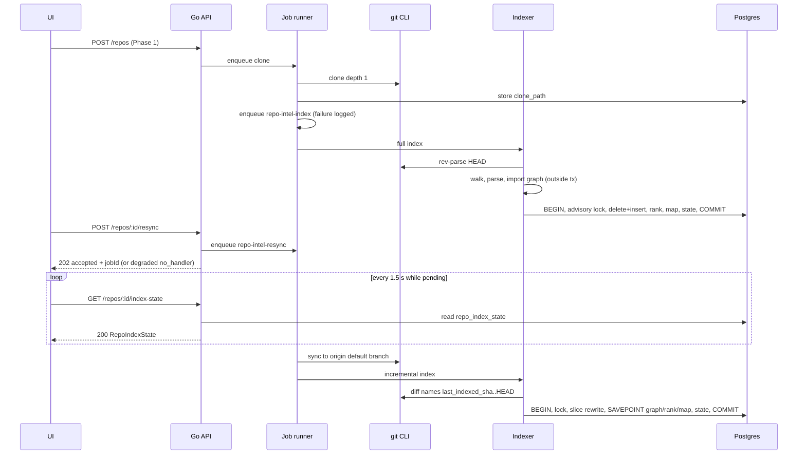
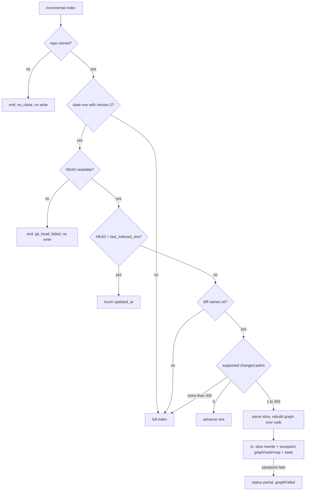

# Go backend migration — Phase 3: repo-intel (indexing, file rank, repo map)
Spec: Go backend Phase 3 (repo-intel: indexing, rank, repo map — 2 routes) · Status: ready-for-planning · Date: 2026-10-22
Areas: http, jobs, index, extract, graph, rank, map, db, port, conv, config
Design sources: task brief of 2026-10-22; `CLAUDE.md`, `backend/AGENTS.md`, `backend/INSIGHTS.md`; `docs/migration/README.md` (D1–D11), `docs/migration/STATUS.md`; research `docs/migration/research/01-http-api.md` (repo-intel rows, §4 client map, §5 wire conventions), `02-data-layer.md` (repo-intel tables, access patterns, GORM mapping), `03-engine-integrations.md` §5, §7, §8; contract `frontend/src/vendor/shared/contracts/platform.ts:230-252` (`RepoIndexState`); UI callers `frontend/src/lib/hooks/repo-intel.ts`, `frontend/src/lib/hooks/blast.ts:33-43`, `frontend/src/app/repos/[repoId]/onboarding/_components/TourView/TourView.tsx:35-40`; Node reference `<dev-digest>` = `/home/ypodop/IdeaProjects/dev-digest` (commit `d1c9093`): `server/src/modules/repo-intel/**`, `server/src/adapters/{astgrep,depgraph,tokenizer,codeindex}/`, `server/src/domain/source-scope.ts`, `server/src/modules/repos/service.ts`, `server/src/modules/conventions/application/conventions-service.ts:221-239`, the Node tests `server/test/{astgrep,repo-intel-*}.test.ts`, and installed packages `graphology-metrics@2.4.0`, `js-tiktoken@1.0.21`, `dependency-cruiser@17.4.3`, `@ast-grep/napi@0.43.0`, `fastify-type-provider-zod@4.0.2`; four research reports made for this spec: R-rank (PageRank and tokenizer), R-node (job producers, consumers, flags), R-go (Go integration points), R-graph (dependency-cruiser resolution). Go code of Phases 1–2 under `backend/`. No design frames.
Related: `specs/2026-10-21-go-backend-phase-1.md` (Phase 1), `specs/2026-10-22-go-backend-phase-2.md` (Phase 2). This spec replaces: the Phase 1 statement that the `refresh` job does no indexing (Phase 1 D9 stays otherwise valid); the Phase 2 Out-of-scope line "The conventions sampler reads no `file_rank` row and calls no repo-intel code" and Phase 2 D211's first clause ("Phase 2 sampling uses only the fallback walk"); the Phase 1/2 Out-of-scope lines that list repo-intel routes as unregistered.

**ID convention.** Phase 3 IDs use the 3000 range so they never collide with Phase 1 (1–999) or Phase 2 (200–303): FR3001…, EC3001…, NFR3001…, AC3001…, US3001…, D3001…, Q3001…. Rule for later phases: Phase N uses the N000 range. A Phase 1 or Phase 2 item is always written with "Phase 1" / "Phase 2" in front; such IDs never appear in a `Traces:` line of this spec.

## 1. Goal
Reviews, blast radius, onboarding and conventions need to know which files of a repository matter and what they declare. Phase 3 ports Node's repo-intel module to the Go backend: after a clone or refresh, the backend indexes the repository's TypeScript/JavaScript sources (symbols, references, import graph), ranks files with PageRank, renders a token-budgeted repo map, and persists everything in Postgres in one transaction. The UI gets the two repo-intel routes, `GET /repos/:id/index-state` and `POST /repos/:id/resync`, wire-compatible with the unchanged frontend. Later phases (reviews, blast, onboarding) and the Phase 2 conventions sampler read the index through one in-process port, so no feature re-parses the clone at request time.

## 2. Context
- Node serves `GET /repos/:id/index-state` and `POST /repos/:id/resync` (`<dev-digest>/server/src/modules/repo-intel/routes.ts:28-53`). Neither route checks that the repo exists; GET returns a synthesised `degraded`/`no_data` state when no row exists (`service.ts:102-118`); POST always answers 202, with `{status:"accepted", degraded:true, reason:"no_handler"}` when the enqueue fails (`service.ts:92-99`).
- The GET response passes through a Zod `safeParse` serializer (`fastify-type-provider-zod@4.0.2`, `dist/src/core.js:85-91`): keys come out in contract order, unknown keys (the facade's `bounded`) are stripped, `undefined` fields are omitted, and the `Date` is written by `toISOString()`.
- The UI calls GET from the onboarding tour (index not ready when `filesIndexed === 0`, `TourView.tsx:35-40`) and polls it every 1,500 ms while a resync is pending (`lib/hooks/repo-intel.ts:19-26`); completion is seen when `lastIndexedSha`/`updatedAt` change (`contracts/platform.ts:230-235`). POST is called by `useResyncRepoIntel` and by the blast card's resync button (`lib/hooks/blast.ts:33-43`); the UI reads only `status` from the reply.
- Job producers in Node (R-node §1–§3): the clone job enqueues `repo-intel-index` `{repoId, owner, name}` after the clone path is stored (`repos/service.ts:63-70`, enqueue errors swallowed); `POST /repos/:id/refresh` on a cloned repo and `POST /repos/:id/resync` enqueue `repo-intel-resync` `{repoId}` (`repos/service.ts:106-111`, `repo-intel/service.ts:92-98`); `repo-intel-refresh` has a handler but no producer.
- Job semantics in Node: 120 s per attempt, 2 retries for transient errors only, 3 concurrent (`platform/jobs.ts:55-57`, `resilience.ts:84-93`). The index handlers ignore the abort signal, so after a hard timeout the work continues while the job row is `failed` (R-node §5). No boot step reaps jobs or index rows (R-node §12).
- `REPO_INTEL_ENABLED` is ON unless the string is `false` (`platform/config.ts:187`). It gates only the read facade; indexing and `getIndexState` ignore it (R-node §4).
- Pipeline (`application/full-index.ts`, `incremental-index.ts`, `parse-sources.ts`): walk → parse (bounded parallel, CPU−1) → import graph (outside the transaction) → one transaction: advisory lock `pg_advisory_xact_lock(hashtextextended('repo-intel:<id>',0))`, delete-then-insert of symbols and references, edges, `decl_file` resolution, `file_rank`, repo map, `file_facts`, `repo_index_state` upsert (`infrastructure/repository.ts:33-203`). Inserts are chunked by 500 rows (`repository.ts:24,205-208`). The incremental graph/rank/map step runs in a savepoint (`incremental-index.ts:117-131`).
- Limits (`constants.ts:26-62`): 5,000 files, 400 KB per file, 2,000 ms per file, soft budget 110 s, excluded directories `node_modules dist build coverage .next out vendor .git`, extensions `.ts .tsx .js .jsx .mjs .cjs` (`domain/source-scope.ts:8`), signature 120 characters, token budget 1,500, `INDEXER_VERSION = 2`, incremental threshold 300 changed files.
- Extraction is ast-grep over tree-sitter TypeScript, TSX and JavaScript grammars (`adapters/astgrep/index.ts`, 639 lines; `@ast-grep/napi@0.43.0`). The Node per-file 2,000 ms watchdog never fires, because the parser is synchronous (`parse-sources.ts:57-63`).
- The import graph is `dependency-cruiser@17.4.3` with the clone's `tsconfig.json` (`adapters/depgraph/index.ts:55-106`); any failure returns no edges and the status stays `full` (the adapter swallows the error, so research 03 §5 "stamped partial" is wrong).
- PageRank is `graphology-metrics@2.4.0` `centrality.pagerank` with defaults: α 0.85, at most 100 iterations, tolerance 1e-6 with the L1 test `Σ|Δ| < N·tolerance`, start 1/N, dangling mass spread uniformly, edge weight 1; non-convergence throws, and `rank.ts` then falls back to a uniform score (R-rank §2; `node_modules/graphology-metrics/centrality/pagerank.js:19-132`).
- The repo-map tokenizer is `js-tiktoken@1.0.21` `cl100k_base`; a special-token literal in the text makes `encode` throw, after which the adapter counts `ceil(UTF-16 length / 4)` for the rest of the process (`adapters/tokenizer/index.ts:14-37`, R-rank §4).
- Facade consumers in Node (R-node §6): reviews (`getRepoMap` default budget, `getFileRank`, `getCallerSignatures` limit 10), blast (`getBlastRadius`), onboarding (`getIndexState`, `getRepoMap`, `getTopFilesByRank` n 200, `getCriticalPaths`, `listIndexedFiles`), conventions (`getConventionSamples` n 12, errors → `[]`, `conventions-service.ts:221-239`). `getUnresolvedReferences` and `getSymbolsInFiles` have no consumer. No module reads the repo-intel tables directly (R-node §7). Status `failed` has no writer in Node (R-node §9).
- Go today (R-go): job runner `backend/internal/jobs/runner.go` (3 concurrent, 120 s default, per-kind `WithTimeout`, 2 retries for transient errors, handler context cancelled on timeout and shutdown, no reaper of `jobs` rows); job kinds `clone`, `refresh` (`internal/repos/app/service.go:16-17`), `conventions.extract`. The `refresh` job syncs the clone and does no indexing (`internal/repos/app/jobs.go:108-146`). `platform/gitcli` has `Head` and `Sync` but no diff-names operation; its stdout is capped at 1 MiB (`gitcli.go:38`). `platform/clonefs` reads without following symlinks. The conventions sampler calls only the fallback walk (`internal/conventions/app/job.go:176-207`). `REPO_INTEL_ENABLED` is not parsed (`internal/config/config.go`). The backend image builds with `CGO_ENABLED=0` (`backend/Dockerfile`).
- Every table exists in the baseline migration: `repo_index_state` (`backend/migrations/0001_baseline.up.sql:584`, status CHECK), `file_edges` (:347), `file_facts` (:357), `file_rank` (:368), `repo_map_cache` (:600), `symbols` (:719, `UNIQUE NULLS NOT DISTINCT (repo_id, path, name, kind, line)` :1125), `"references"` (:570). No length constraint guards `symbols.name` / `references.to_symbol`; Node clamps them to 255 UTF-16 units in code (`db/schema/context.ts:20-30`).

## 3. Scope
### In scope
- The two routes of section 7.2.
- The job kinds `repo-intel-index`, `repo-intel-refresh`, `repo-intel-resync` and their producers (clone job, Phase 1 refresh job, resync route, startup backfill).
- Full and incremental indexing: walk, symbol/reference extraction for `.ts .tsx .js .jsx .mjs .cjs`, endpoint/cron facts, import graph, reference resolution, PageRank file rank, repo map with `cl100k_base` token budget, one-transaction persistence.
- The in-process read port with the operations of section 7.3 marked "Phase 3".
- The conventions sampler switch to ranked files.
- The configuration switch `REPO_INTEL_ENABLED`.
- Parity fixtures generated from the Node implementation (section 11, NFR3008).
### Out of scope
- No route other than the two of section 7.2 is added; `GET /pulls/:id/blast`, `/runs/*`, `/onboarding*`, `/brief*`, `/intent*`, `/smart-diff*`, `/eval*`, `/ci*` still return the standard 404 envelope.
- The port operations `BlastRadius`, `CallerSignatures` and `UnresolvedReferences` are not implemented in Phase 3; no regex code index (Node `RipgrepCodeIndex`) is built.
- No language other than TypeScript and JavaScript (the six extensions) is indexed.
- No file of a clone is written, created, deleted or executed by the indexer; no package manager or build tool is run.
- The indexer makes no network call; only the resync job's git sync contacts the remote.
- `.gitignore` is not applied by the walk.
- `file_rank.hotness` is always 0; no git history is read for ranking.
- No embeddings are computed or stored (`code_chunks` stays empty).
- No new migration version is added.
- No change is made to `frontend/` or to `frontend/src/vendor/shared`, except new contract-golden entries in `frontend/src/test/go-backend-contracts.test.ts`.
- `POST /repos/:id/refresh` keeps its Phase 1 response (200 `{"status":"refreshing"}`) and job kind `refresh`.
- No job row left `queued`/`running` is reaped at startup (Phase 1 parity).
- No per-agent `repo_intel` flag is evaluated in Phase 3 (reviews are Phase 4).
- Source text, signatures and repo-map text are never written to a log.

## 4. User scenarios
- US3001 — As a developer, I add a repo; after the clone finishes the backend indexes it in the background, so that review, blast and onboarding features have ranked context without parsing at request time.
- US3002 — As a developer, I see whether a repo is indexed (full, partial, degraded, failed) and when it was last indexed, so that I know whether repo context is available.
- US3003 — As a developer, I trigger a resync, which fetches the latest default branch and reindexes incrementally, and the UI notices when it is done.
- US3004 — As a developer, I refresh a repo and its index follows the new commit.
- US3005 — As a developer, I run a conventions scan and the sampler picks the repo's most central source files instead of a directory spread.
- US3006 — As a later-phase feature (reviews, blast, onboarding), I read the repo map, file ranks, symbols, top files and critical paths through one port that never fails for a missing or degraded index.

## 5. Functional requirements
HTTP
- FR3001 [http] — The system shall serve `GET /repos/:id/index-state` (section 7.2). `:id` shall be a UUID, else 422 `validation_error` as Phase 1 path validation. The route shall not check that the repo exists and shall ignore `REPO_INTEL_ENABLED`. (US3002)
- FR3002 [http] — For a persisted `repo_index_state` row the body shall be built as in section 7.2 (field mapping, key order, omission rules); `bounded` and every other `stats` key except `durationMs`, `reason` and `degradedReason` shall not appear. (US3002)
- FR3003 [http] — When no row exists, or reading it fails, the body shall be the synthesised state of section 7.2 with `repoId` equal to the path value as sent; a read failure is logged as a warning and is not an error response. (US3002)
- FR3004 [http] — The system shall serve `POST /repos/:id/resync`: validate `:id` as a UUID (422 otherwise), ignore any request body without parsing it, enqueue job `repo-intel-resync` with payload `{"repoId":"<id>"}` in the request's workspace and answer 202 `{"status":"accepted","jobId":"<job id>"}`; when the enqueue fails for any reason the answer shall be 202 `{"status":"accepted","degraded":true,"reason":"no_handler"}`. It shall not check that the repo exists. The Phase 1 foreign-`Origin` 403 and `Host` guards apply. (US3003)

Jobs and triggers
- FR3005 [jobs] — The job kinds `repo-intel-index`, `repo-intel-refresh` and `repo-intel-resync` shall be registered with a 120 s per-attempt limit and the runner's default retry policy (2 retries, transient errors only). Each handler reads `repoId` from its payload; other payload fields are ignored. A handler returns success for every outcome of FR3009–FR3021 (including degraded and partial outcomes); it returns an error only in the cases of FR3037. (US3001)
- FR3006 [jobs] — After the clone job has stored the clone path, it shall enqueue `repo-intel-index` with `{"repoId","owner","name"}`. An enqueue failure is logged and does not fail the clone job. (US3001)
- FR3007 [jobs] — After the Phase 1 `refresh` job has synced the clone and stored `last_polled_at`, it shall enqueue `repo-intel-refresh` with `{"repoId"}`. An enqueue failure is logged and does not fail the refresh job. (US3004)
- FR3008 [jobs] — At startup, after the job handlers are registered and before the HTTP listener starts, the system shall enqueue one `repo-intel-index` job for every repo that has a clone path and either no `repo_index_state` row or a row whose `indexer_version` differs from the current version (FR3036). A failure of this step is logged and does not stop the startup (it must also pass on an empty database with `DB_AUTO_MIGRATE=false`). (US3001)
- FR3009 [jobs] — The `repo-intel-resync` handler shall: end without writing when the repo does not exist or has no clone path; otherwise sync the clone to the remote default branch with the Phase 1 refresh branch rule (ask the remote, fall back to the stored `default_branch`); when the sync fails, end without writing and log the reason (`sync_failed:<message>`); otherwise run the incremental index (FR3016). The handler's cancellation stops the git process. (US3003)
- FR3010 [jobs] — `repo-intel-index` runs the full index (FR3011); `repo-intel-refresh` runs the incremental index (FR3016). Indexing runs whatever the value of `REPO_INTEL_ENABLED`. (US3001, US3004)

Full index
- FR3011 [index] — The full index shall: end without writing when the repo does not exist (`repo_not_found`); when the repo has no clone path, upsert the state `degraded`, `last_indexed_sha` `""`, counters 0, `stats` `{reason:"no_clone", degradedReason:"no_data", durationMs}`, ignoring a failure of this write; otherwise read the clone's HEAD SHA (a failure gives `""`) and walk the clone (FR3013). (US3001)
- FR3012 [index] — When the walk finds no file, the full index shall upsert the state `partial` with `files_indexed` 0, `files_skipped` = `skippedTooLarge`, `stats` = walk stats + `{reason:"no_files", durationMs}`, ignoring a failure of this write, and change no other table. (US3001)
- FR3013 [index] — Walk: recursive from the clone root; symbolic links (files and directories) are never followed or listed; directories named `node_modules`, `dist`, `build`, `coverage`, `.next`, `out`, `vendor`, `.git` are skipped at any depth; unreadable directories are skipped; a regular file qualifies when its extension, compared case-insensitively, is one of the six supported; each qualifying file counts in `totalCandidates`; a file larger than 409,600 bytes counts in `skippedTooLarge` and is left out; paths are relative to the root with `/` separators; the list is sorted ascending by byte order; when longer than 5,000 entries only the first 5,000 are kept and `bounded` = the number dropped. (US3001)
- FR3014 [index] — Parse phase of the full index: files are parsed with at most max(1, CPU count − 1) in parallel. Once 110,000 ms have passed since the index started, no new file is started and `softBudgetReached` is true. Each file is processed by FR3017; `filesIndexed` counts indexed files; `filesSkipped` = `skippedTooLarge` + unsupported + failed files; each failed file adds `{file, reason}` to `parseDegraded` until it holds 50 entries. (US3001)
- FR3015 [index] — Unless the soft budget was reached, the full index builds the import graph over the walked files (FR3023) before the transaction; an internal failure of the graph builder sets `graphFailed` to its message and yields no edges. Status = `full` when the soft budget was not reached, `graphFailed` is unset and `parseDegraded` is empty; otherwise `partial`. Then in ONE transaction: take the repo lock (FR3028); delete every `symbols` and `"references"` row of the repo; insert the new symbols and references; unless the soft budget was reached: replace `file_edges`, resolve references without reset (FR3030), compute and replace `file_rank` over the walked files (FR3024), render the repo map (FR3026), delete every `repo_map_cache` row of the repo and insert the map for (HEAD SHA, 1500) when the SHA is not empty, replace `file_facts`; finally upsert `repo_index_state` with the HEAD SHA, version, status, counters and `stats` = walk stats + `{filesSeen, symbolsWritten, referencesWritten, edgesWritten, ranked, factsWritten, hotnessAvailable:false, graphFailed?, softBudgetReached, parseDegraded, durationMs}`. (US3001)

Incremental index
- FR3016 [index] — The incremental index shall: end without writing (`no_clone`) when the repo does not exist or has no clone path; run the full index when no state row exists or its `indexer_version` differs from the current version; end without writing (`git_head_failed:<message>`) when HEAD cannot be read; when HEAD equals `last_indexed_sha`, only set `updated_at` to now; otherwise list the paths changed between `last_indexed_sha` and HEAD — a failure of that listing (including a base commit missing from the shallow clone, or output above the git output cap) runs the full index. (US3003, US3004)
- FR3017 [index] — Per file (full and incremental): read the file from the clone (a read failure → outcome failed with the error text as reason); decode it as UTF-8 with each invalid sequence replaced by U+FFFD; `content_hash` = lowercase hex SHA-1 of the decoded text encoded as UTF-8; extract symbols (FR3019) and references (FR3020) within 2,000 ms of parse time, else outcome failed with reason `parse timed out after 2000 ms`; extract endpoint and cron facts (FR3022). Rows of a file are kept only when the whole file succeeded; a facts row is kept only when the file has at least one endpoint or cron. (US3001)
- FR3018 [index] — Incremental slice: of the changed paths, keep those with a supported extension (case-insensitive). None → set `last_indexed_sha` to HEAD and `updated_at` to now, nothing else. More than 300 → run the full index. Otherwise walk the clone (FR3013); a changed path that is not in the walk result (deleted, renamed away, excluded directory, too large, symlink, beyond the 5,000 bound) is "removed": its rows are deleted, it counts as skipped and does not enter `parseDegraded`; every other changed path is parsed by FR3017. The import graph is rebuilt over the whole walk result before the transaction. (US3003, US3004)
- FR3021 [index] — Incremental transaction: take the repo lock; delete `symbols` with `path` in the changed set and `"references"` with `from_path` in the changed set; insert the new rows; delete `file_facts` of the changed set and insert the new facts; then, unless the graph build failed, in a savepoint: replace `file_edges`, resolve references with reset (FR3030), replace `file_rank` over the whole walk result, render the repo map, delete every `repo_map_cache` row of the repo and insert the map for (HEAD SHA, 1500). A savepoint failure rolls back only the savepoint and sets `graphFailed`. Status = `full` only when the previous status was `full`, `parseDegraded` is empty and `graphFailed` is unset; else `partial`. Upsert the state with HEAD, version, status, `files_indexed` = previous + indexed in this slice, `files_skipped` = previous + skipped in this slice, `stats` = `{incremental:true, changedFiles, symbolsWritten, referencesWritten, edgesWritten, hotnessAvailable:false, graphFailed?, parseDegraded, durationMs}`. (US3003, US3004)
- FR3036 [index] — The indexer version shall be 2 and is written to every state row the indexer creates or replaces. (US3001)
- FR3037 [index] — When a full or incremental index attempt ends with an error (a database error, or cancellation by the 120 s attempt limit) the transaction is rolled back and the previous index stays intact. If no state row exists, or the row's status is `degraded` or `failed`, the system shall upsert the state `failed` with `last_indexed_sha` of the previous row (or `""`), counters 0 and `stats` `{reason:"index_failed", degradedReason:"index_failed", error:<message, keys redacted, at most 500 characters>, durationMs}`; a `full` or `partial` row is left unchanged. Nothing is written when the cancellation comes from shutdown, or when the repo no longer exists. The handler then returns the error to the runner. (US3002)

Extraction
- FR3019 [extract] — Symbols shall be extracted as Node's `parseSymbols` does (`<dev-digest>/server/src/adapters/astgrep/index.ts:173-386`), over the tree-sitter grammar per extension (`.ts` TypeScript; `.tsx` and `.jsx` TSX; `.js`, `.mjs`, `.cjs` JavaScript), with the rules of section 7.4: top-level statements only, export unwrapping, kinds `function`, `class`, `method` (dual-emitted `Class.method` and `method`), `interface`, `type`, `enum`, the keyword deny-list, 1-based `line`/`endLine`, the signature rule, the `export { … }` back-patch and the (name, kind, line) de-duplication. (US3001, US3006)
- FR3020 [extract] — References shall be extracted as Node's `parseReferences` does (`astgrep/index.ts:402-462`) with the rules of section 7.4: call expressions, `new` expressions, capitalised JSX element names (TSX grammar only), nothing inside import statements, no keyword, no (name, line) pair of a declaration of the same file, de-duplicated by (name, line). (US3001, US3006)
- FR3022 [extract] — Endpoint and cron facts shall be extracted per line as Node's `extractEndpoints` and `extractCrons` do (`<dev-digest>/server/src/adapters/codeindex/extract.ts:294-326`), case-insensitively, each list de-duplicated in first-seen order. (US3006)
- FR3031 [db] — Before insert, `symbols.name` and `"references".to_symbol` shall be cut to at most 255 UTF-16 code units without splitting a surrogate pair. (US3001)

Import graph
- FR3023 [graph] — The import graph shall contain an edge (importer → imported) for each walked file and each of its import specifiers that resolves, under the rules of section 7.5, to another file of the walk result; self-edges and duplicates are dropped; edge paths are repo-relative. A malformed or missing `tsconfig.json` is not a failure: resolution continues without its aliases. (US3001)

Rank and repo map
- FR3024 [rank] — `file_rank` shall hold one row per walked file (including skipped and failed files) with `pagerank` computed by the algorithm of section 7.6 over the graph (nodes in walk order, edges of FR3023 after dropping self-edges and unknown endpoints), `hotness` 0 and `rank` = `pagerank`. Non-convergence after 100 iterations gives every file 1/N. (US3001, US3006)
- FR3025 [rank] — `percentile` shall be computed per section 7.6: ascending order by rank, tie groups of exactly equal values, round(100 · last position / N) with halves rounded up. (US3006)
- FR3026 [map] — The repo map shall be rendered from the candidates and with the exact binary search, header and layout of section 7.7, against a budget of 1,500 tokens counted by FR3027, and stored with its token count. (US3006)
- FR3027 [map] — Token counts shall be the number of `cl100k_base` tokens of the text; special-token literals (`<|endoftext|>` and the other cl100k specials) are counted as ordinary text. Only when the encoder cannot be used, the count is ceil(UTF-16 length / 4) and a warning is logged. (US3006)

Persistence
- FR3028 [db] — Every index transaction shall take the transaction-scoped advisory lock on `hashtextextended('repo-intel:<repoId>', 0)` as its first statement. (US3001)
- FR3029 [db] — Bulk writes shall use multi-row inserts where no statement carries more than 65,535 bind parameters; an empty row set issues no insert. (US3001)
- FR3030 [db] — Reference resolution: with reset, every `decl_file` of the repo is first set to NULL; then a reference R gets `decl_file` = F when exactly one distinct file F has an edge (R.from_path → F) and an exported symbol named R.to_symbol; with zero or several such files `decl_file` stays NULL. (US3006)
- FR3032 [db] — Every write of `repo_index_state` (upsert, touch, SHA advance) shall set `updated_at` to the current time. `file_facts.endpoints` and `.crons` are JSON arrays of strings. (US3002)

Read port
- FR3033 [port] — The backend shall offer an in-process read port with the operations of section 7.3 marked "Phase 3", with the semantics given there, including the `REPO_INTEL_ENABLED`-off results and the never-fail behaviour for missing or degraded indexes. (US3006)
- FR3034 [port] — The operations `BlastRadius`, `CallerSignatures` and `UnresolvedReferences` shall be specified in section 7.3 as contracts only; Phase 3 implements none of them. (US3006)

Conventions and configuration
- FR3035 [conv] — The conventions sampler shall ask the port for `ConventionSamples(repoId, 12)` (an error counts as no result), keep the returned paths that are in the sampler's own file list and are not picked config files, in the returned order, and use them as the source picks; when none remain it uses the Phase 2 fallback walk unchanged. (US3005)
- FR3038 [config] — `REPO_INTEL_ENABLED` shall be off only when its value, trimmed, is exactly `false` (Phase 1 flag rule); unset or any other value is on. It is documented with the other switches in the example environment file. (US3006)
- FR3039 [jobs] — Each index job attempt shall write one structured log line `repo_intel_index` with `repo_id`, `kind`, `status`, `files_indexed`, `files_skipped`, `duration_ms`, `reason`, and `error` when it failed. (US3002)

## 6. Workflow and communication

Interactions and failure behaviour:
- UI → API `GET /repos/:id/index-state` (sync). DB read failure → synthesised state, 200 (FR3003).
- UI → API `POST /repos/:id/resync` (sync) → runner enqueue (sync insert of the `jobs` row). Enqueue failure → 202 degraded (FR3004).
- Clone job → runner enqueue `repo-intel-index` (async). Failure → log only (FR3006).
- Phase 1 refresh job → runner enqueue `repo-intel-refresh` (async). Failure → log only (FR3007).
- Startup → runner enqueue backfill jobs (sync inserts). Failure → log, startup continues (FR3008).
- Resync job → git sync (sync, cancellable). Failure → no write, job done (FR3009).
- Indexer → git `rev-parse` / diff names (sync). HEAD failure: full index uses `""`, incremental ends; diff failure → full index (FR3011, FR3016).
- Indexer → Postgres transaction (sync). Error → rollback, failed-state rule, error to runner → retry if transient (FR3037).
- Conventions job → port `ConventionSamples` (in-process, sync). Error → treated as empty → fallback walk (FR3035).
- Later phases → port operations (in-process, sync). Missing/degraded index → empty or `degraded` results, never an error (section 7.3).

## 7. Contracts
### 7.1 Cross-cutting
- Error envelope, 422 `details`, `Origin`/`Host` guards, CORS, security headers, global rate limit (120/min): as Phase 1 section 7.1. Neither route has its own rate-limit bucket.
- Timestamps: ISO-8601 UTC with milliseconds (`2026-10-22T10:00:00.000Z`).
- Configuration: `REPO_INTEL_ENABLED` (FR3038), default on.
- Job kinds (rows in the `jobs` table; not on the wire): `repo-intel-index` payload `{"repoId","owner","name"}`; `repo-intel-refresh` payload `{"repoId"}`; `repo-intel-resync` payload `{"repoId"}`. Limit 120 s per attempt, 2 retries for transient errors.
- Constants: extensions `.ts .tsx .js .jsx .mjs .cjs`; excluded directories `node_modules dist build coverage .next out vendor .git`; 5,000 files; 409,600 bytes per file; 2,000 ms parse time per file; soft budget 110,000 ms (full index only); 300 changed files; signature 120 UTF-16 units; name clamp 255 UTF-16 units; token budget 1,500; indexer version 2; `parseDegraded` at most 50 entries; error text at most 500 characters.

### 7.2 HTTP routes
`RepoIndexState` (`frontend/src/vendor/shared/contracts/platform.ts:236-251`), keys in this order:

| Key | Type | Value for a persisted row |
|---|---|---|
| `repoId` | string | `repo_id` |
| `status` | `full`\|`partial`\|`degraded`\|`failed` | `status` |
| `filesIndexed` | int | `files_indexed` |
| `filesSkipped` | int | `files_skipped` |
| `durationMs` | int | `stats.durationMs` when it is a JSON number, else 0 |
| `reason` | string, optional | `stats.reason` when it is a string, else omitted |
| `lastIndexedSha` | string | `last_indexed_sha` |
| `indexerVersion` | int | `indexer_version` |
| `updatedAt` | string | `updated_at`, ISO-8601 UTC ms |
| `degraded` | boolean, optional | `true` when status is `degraded` or `failed`, else omitted |
| `degradedReason` | `flag_off`\|`index_failed`\|`index_partial`\|`repo_too_large`\|`no_data`, optional | when status is `degraded` or `failed`: `stats.degradedReason` if it is one of the five values, else `index_failed`; otherwise omitted |

Synthesised state (no row, or the read failed): `{"repoId":"<path id as sent>","status":"degraded","filesIndexed":0,"filesSkipped":0,"durationMs":0,"reason":"no_data","lastIndexedSha":"","indexerVersion":2,"updatedAt":"1970-01-01T00:00:00.000Z","degraded":true,"degradedReason":"no_data"}`.

| Route | Request | Success | Errors |
|---|---|---|---|
| `GET /repos/:id/index-state` | — | 200 `RepoIndexState` (persisted or synthesised) | 422 `validation_error` (`:id` not a UUID, `details[0].instancePath` `/id`) |
| `POST /repos/:id/resync` | no body; any body is ignored | 202 `{"status":"accepted","jobId":"<uuid>"}`; enqueue failure: 202 `{"status":"accepted","degraded":true,"reason":"no_handler"}` | 422 `validation_error` (`:id`); 403 `forbidden` (foreign `Origin`, Phase 1) |

Unknown repo ids are not errors: GET answers the synthesised state; POST answers 202 and the job ends without writing.

### 7.3 In-process read port
Consumers: the conventions sampler (Phase 3), reviews (Phase 4), blast and onboarding (Phase 5). Names are contract names, not code identifiers. "Flag off" = `REPO_INTEL_ENABLED` off. Database errors are returned to the caller as errors unless stated otherwise; missing or degraded indexes are never errors.

| Operation | Phase | Input | Output | Flag off | No / degraded index |
|---|---|---|---|---|---|
| `IndexState` | 3 | repoId | the `RepoIndexState` of 7.2 (persisted or synthesised); never an error | same as on | synthesised |
| `RepoMap` | 3 | repoId, tokenBudget (default 1,500) | `{text, tokens, cached:true}` from `repo_map_cache` for (repoId, `last_indexed_sha`, budget) | `{text:"", tokens:0, cached:false, degraded:true, reason:"flag_off"}` | no row, empty SHA or cache miss (any other budget): `{text:"", tokens:0, cached:false, degraded:true, reason:"no_data"}` |
| `FileRank` | 3 | repoId, paths | `[{path, percentile}]` for the paths that have a `file_rank` row; empty input → `[]` | `[]` | `[]` |
| `SymbolsInFiles` | 3 | repoId, paths | `[{file, name, kind, exported, startLine (line or 0), endLine (end_line, else line, else 0), signature or null}]`; empty input → `[]` | `[]` | `[]` |
| `TopFilesByRank` | 3 | repoId, n, exclude (substrings) | read the top max(10·n, 100) `file_rank` rows by rank DESC, then path ASC (byte order); drop junk paths (lower-cased path contains `.test.`, `.spec.`, `.d.ts`, `__tests__/`, `__mocks__/`, `/test/`, `/tests/`, `/migrations/`, `/__fixtures__/`, `.config.`, `vitest.`, `jest.`, `eslint` or `prettier`) and paths containing any `exclude` substring (case-sensitive); return the first n; n ≤ 0 → `[]` | `[]` | `[]` |
| `ConventionSamples` | 3 | repoId, n | `TopFilesByRank(repoId, n, [])` | `[]` | `[]` |
| `CriticalPaths` | 3 | repoId | chains of paths: for each of the 5 top-ranked files (all ranked rows, rank DESC, path ASC), follow up to 2 hops, each time to the not-yet-visited import target with the highest rank (missing rank = 0; ties by path ASC); chains shorter than 2 and duplicate chains are dropped; no edges → `[]` | `[]` | `[]` |
| `ListIndexedFiles` | 3 | repoId | every `file_rank` path, rank DESC then path ASC, at most 100,000 | `[]` | `[]` |
| `BlastRadius` | 5 | repoId, changedFiles | Node `BlastResult` (`<dev-digest>/server/src/modules/repo-intel/types.ts:58-90`): changed symbols, resolved callers (≤ 20 per changed symbol, rank DESC), impacted endpoints, facts per caller file, `degraded`/`reason` | — | — |
| `CallerSignatures` | 4 | repoId, changedFiles, limit (default 20) | Node `SignatureRow[]` (`types.ts:107-113`) | — | — |
| `UnresolvedReferences` | later | repoId, files | Node `RefRow[]` (`types.ts:115-121`) | — | — |

The Phase 4/5 rows fix the operation names and result shapes so those phases extend the same port; their behaviour is specified by the phase that implements them.

### 7.4 Extraction rules (symbols and references)
Behaviour source: `<dev-digest>/server/src/adapters/astgrep/index.ts`; node kinds are those of the tree-sitter TypeScript, TSX and JavaScript grammars.
- Keyword deny-list (names never emitted as symbol or reference): `if for while switch catch return function await typeof new delete void do else in of instanceof yield super constructor get set import export as from class extends`.
- Top level: only direct children of the program node. An `export_statement` is unwrapped to its first child that is not `export`, `default`, `*`, `from`, `;`, a string or an export clause; such a declaration is `exported: true`.
- `function_declaration`, `generator_function_declaration` → kind `function`. `class_declaration` → kind `class`, plus for each `method_definition` that is a direct child of the class body two symbols of kind `method`, `Class.method` and `method`, with the class's `exported` value and the method's lines and signature. `interface_declaration` → `interface`; `type_alias_declaration` → `type`; `enum_declaration` → `enum`. `lexical_declaration` / `variable_declaration`: each `variable_declarator` whose value is an `arrow_function`, `function_expression` or `generator_function` → kind `function`, line of the declarator. Any other statement yields no symbol.
- `line` and `endLine` are the 1-based first and last lines of the declaration node (of the declarator for variables, of the method for methods).
- Signature: the node text up to the start of its `body` field (whole text when there is no body); for a variable function, the enclosing declaration text (including `const`/`let`/`var`) up to the start of the function value's body. Runs of whitespace (ECMAScript `\s` set) become one space; the result is trimmed; one trailing `=>`, `{` or `=` (with the whitespace before it) is removed and the result trimmed again; when longer than 120 UTF-16 units it is cut to 119 units plus `…`.
- Back-patch: for every `export { a, b as c }` clause anywhere in the file, each symbol named by an export specifier's `name` whose `line` equals the last recorded declaration line of that name becomes `exported: true`.
- De-duplication by (name, kind, line): the first symbol is kept, unless a later one is exported and the kept one is not.
- References: `call_expression` whose `function` is an identifier → that name; whose `function` is a member expression → its property name. `new_expression` → the rightmost name of its `constructor` (identifier, type identifier, property identifier or member-expression property). TSX grammar only (`.tsx`, `.jsx`): `jsx_opening_element` and `jsx_self_closing_element` → the leftmost identifier of the element name, skipped when it starts with `a`–`z`. Any node inside an `import_statement` is skipped. A reference whose (name, line) equals a symbol's (name, line) of the same file is dropped. De-duplicated by (name, line), first kept. `line` = first line of the expression or element.
- Facts: endpoints from each line matching `\b(app|router|fastify|server|api)\.(get|post|put|patch|delete|options|head)\s*(<[^>]*>)?\s*\(\s*(['"`])([^'"`]+)\4` → `"<METHOD upper-cased> <path>"` (the closing quote must equal the opening one), and from `method\s*:\s*['"`](GET|POST|PUT|PATCH|DELETE)['"`][\s\S]*?url\s*:\s*['"`]([^'"`]+)['"`]` within the same line → `"<METHOD> <url>"`; crons from `\b(cron|schedule|CronJob)\s*[.(]?\s*\(?\s*['"`]([^'"`]*(\*|\d+\s+\d+)[^'"`]*)['"`]` → the trimmed expression, and from `\b(register|enqueue)\s*\(\s*([A-Za-z0-9_$.]+\s*,\s*)?['"`]([a-z][a-z0-9_]*)['"`]` on a line that also matches `poll|index|clone|digest|cron|sync|schedule|job` → `job:<kind>`. All patterns case-insensitive.

### 7.5 Import resolution
Behaviour source: Node `DepCruiseGraph` with `dependency-cruiser@17.4.3`, TypeScript 5.9.3 `transpileModule` and `enhanced-resolve@5.22.1` as the adapter calls them (R-graph). Deliberate deviations are marked **(D3019)**.

Import specifiers per file:
- JavaScript files (`.js .jsx .mjs .cjs`): every `import … from 'x'`, `import 'x'`, `export … from 'x'`, `export * from 'x'`, `import('x')` and `require('x')` whose argument is a string literal or a template literal without `${}`, and AMD `define([...])` / `require([...], …)` string elements. No usage check.
- TypeScript files (`.ts .tsx`): Node keeps only what `transpileModule` keeps, so:
  - `import 'x'` (side effect) → specifier;
  - `import type …`, `export type … from`, `import {} from 'x'`, `import x = require('x')`, `/// <reference …>` → no specifier;
  - an `import` with bindings → specifier only when at least one non-type binding is referenced in a value position of the file (expressions, `export { name }`, `export default name`, decorators; in `.tsx` also a JSX element name); references only in type positions (annotations, `typeof` in a type, generic arguments, `implements`, interface/type bodies) or no reference at all → no specifier;
  - `export { … } from 'x'` with at least one non-type specifier, `export * from 'x'`, `export * as ns from 'x'` → specifier;
  - `import('x')` and `require('x')` with a literal as for JavaScript.
- Specifiers inside comments or strings are never taken. Empty specifiers are ignored.
- A file with syntax errors contributes the specifiers found in its error-recovered tree **(D3019; Node's acorn/transpile path may give none for a broken `.ts` file)**.

Resolution of one specifier from importer directory `dir`:
1. Drop a `?query` suffix. A specifier that starts with `node:` or names a Node builtin module is ignored.
2. Relative (`./`, `../`, `.`, `..`): base = `dir` joined with the specifier. Try, in order: base as an existing file; base + each of `.js .cjs .mjs .jsx .ts .tsx .d.ts .cts .d.cts .mts .d.mts`; base as a directory: its `package.json` `main` resolved by the same file rules (then its index), then `base/index` + each extension in the same order.
3. Unresolved and the specifier ends in `.js`, `.jsx`, `.mjs` or `.cjs`: strip that extension and repeat step 2; accept the result only when it ends in `.ts`, `.tsx`, `.cts`, `.mts` (including `.d.ts`). (So `./x.js` → `x.ts`/`x.tsx`; `./x.jsx` with only `x.tsx` and an `x.js` present stays unresolved, as in Node.)
4. Non-relative: matched against the `compilerOptions.paths` patterns of the clone's root `tsconfig.json` (with `extends` chains inside the clone, JSON5 syntax accepted, at most 10 levels; a later file overrides an earlier one). Base = `compilerOptions.baseUrl` resolved against the directory of the file that declares it, else the directory of the file that declares `paths`. The most specific pattern wins (longest prefix before `*`); each substitution is tried in order with step 2 rules. **(D3019: Node anchors this base at the server process's working directory, so in practice it resolves no alias; Go resolves aliases the way TypeScript does.)** Package.json `imports` (`#…`) and `node_modules` packages are not resolved; they never yield an edge.
5. The edge is kept only when the resolved path is a walked file other than the importer. Symbolic links are never followed **(D3019: Node resolves to the real path)**.

Failures: a malformed or unreadable `tsconfig.json` (or a file in its `extends` chain) only disables alias resolution and is logged **(D3019: Node drops the whole graph)**; a walked file that cannot be read contributes no specifier **(D3019: Node drops the whole graph)**; resolution failures are per specifier.

Graph fixtures (AC3049): relative imports with and without extension, `index` files, `package.json` `main` directories, the `.js`→`.ts` rule and the `.jsx` quirk, the extension order (`both.js` beats `both.ts`), type-only and unused TS imports, value-used imports, JSX-only use in `.tsx`, `export * as ns`, dynamic import and `require` with literal and non-literal arguments, a query suffix, builtins and bare packages, an alias with `baseUrl` `.` (Node goldens generated with the working directory set to the fixture root, where Node resolves it), and the deviation cases with hand-written expected edges listed in the fixture.

### 7.6 PageRank and percentile
- Nodes: the walked files in walk order (index 0…N−1). Edges: FR3023 edges, without self-edges, without edges whose endpoint is not a node, without duplicates. Out-degree d(i) = number of distinct out-edges of node i.
- p = 1/N; x⁰ᵢ = p. For k = 1…100: D = α · Σ x^{k−1}ⱼ over nodes j with d(j) = 0 (summed in node order); x^k starts at 0; for each node i in node order: for each out-edge i→j, x^k_j += α · x^{k−1}ᵢ · (1/d(i)); then x^k_i += D · p + (1 − α) · p. Error = Σᵢ |x^kᵢ − x^{k−1}ᵢ| (node order). If error < N · 10⁻⁶ the result is x^k; otherwise continue. α = 0.85. After 100 iterations without convergence every file gets 1/N.
- Percentile: sort files ascending by rank; a tie group is a maximal run of exactly equal values; every file of a group whose last position (1-based) is j gets round(100 · j / N), halves rounded up.
- Parity tolerance against Node on the golden graphs: |pagerank_go − pagerank_node| ≤ 1·10⁻¹² for every file, and percentiles identical (NFR3008).

### 7.7 Repo map
- Candidates: every symbol of the repo with a non-null signature joined with the `file_rank` row of its file, ordered by rank DESC, exported DESC, line ASC, name ASC, path ASC (byte order for text).
- Items: in candidate order, skip an empty signature and every (path, signature) pair already taken.
- Render(k items): `# Repo skeleton (top-ranked by import graph only, partial view)\n`, then for each file in first-appearance order among the k items: `<path>:\n`, its signatures each prefixed by two spaces and joined by `\n`, then `\n`.
- Search: best = header line with its token count; lo = 0, hi = number of items; while lo ≤ hi: mid = ⌊(lo + hi) / 2⌋, t = tokens(Render(mid)); if t ≤ budget then best = Render(mid), lo = mid + 1, else hi = mid − 1. No items → the header line.
- Stored: `repo_map_cache` row (repo_id, HEAD SHA, 1500, map text, token count of best), `created_at` now.

## 8. Data model (logical)
- **Index state** (one per repo, key repo): last indexed commit, indexer version, status (`full` = complete; `partial` = usable but incomplete; `degraded` = no usable index, e.g. not cloned; `failed` = the last attempt failed and no usable index exists), files indexed/skipped, stats document (walk stats, write counts, reasons, durations, parse failures ≤ 50). Updated on every index attempt that reaches a write; deleted with the repo.
- **Symbol** (many per file): repo, path, name (≤ 255 UTF-16 units), kind, line, end line, exported, signature, content hash. Unique per (repo, path, name, kind, line). Replaced per file on reindex.
- **Reference** (many per file): repo, from path, symbol name, line, resolved declaring file (nullable), content hash. Replaced per file.
- **File edge**: repo, importer path, imported path. Replaced per index (unless the soft budget was hit).
- **File rank**: repo, path, pagerank, hotness (0), rank, percentile 1–100. One per walked file. Replaced per index.
- **File facts**: repo, path, endpoints, crons. Only files with at least one fact.
- **Repo map**: repo, commit, token budget, text, token count. Only the current commit's 1,500-token map exists after an index.
- All rows cascade-delete with their repo. Everything is derived from the clone and can be rebuilt by a full index; nothing user-authored is stored. No schema change.

## 9. States and UX
No new screen; the unchanged UI reads the index state.

| Screen / element | Loading | Empty | Error | Degraded | Success | Notes |
|---|---|---|---|---|---|---|
| Onboarding tour — index readiness (`TourView`) | query pending (existing UI) | `filesIndexed` 0 → "index not ready" | 4xx silent (existing UI) | synthesised `no_data` or `degraded` row → `filesIndexed` 0 → not ready | `filesIndexed` > 0 | generation itself is Phase 5 |
| Resync (blast card button, repo-intel hook) | mutation pending | — | 422 toast (bad id only) | 202 `degraded:true` reply still counts as success; state unchanged | 202 → index state refetched, polled every 1.5 s | the blast read is Phase 5 (404 until then) |
| Index state poll | — | — | — | — | completion when `lastIndexedSha` or `updatedAt` changes | `status` is terminal-only; a running index is not visible |

## 10. Edge cases
- EC3001 [index] — Repo with no supported file → state `partial`, reason `no_files`, other tables unchanged (FR3012).
- EC3002 [index] — More than 5,000 supported files → the first 5,000 in byte order are indexed, `stats.bounded` = rest; GET does not show `bounded` (FR3013, FR3002).
- EC3003 [index] — File larger than 409,600 bytes → not parsed, counted in `skippedTooLarge` and `files_skipped`, still absent from `file_rank` (FR3013).
- EC3004 [extract] — Supported file with invalid UTF-8 or NUL bytes → decoded with U+FFFD, parsed, never stops the index (FR3017).
- EC3005 [extract] — File with syntax errors → symbols and references of the parsable parts are extracted; the file counts as indexed (FR3019).
- EC3006 [extract] — Parse exceeds 2,000 ms → file failed with `parse timed out after 2000 ms`, status `partial` (FR3017, FR3015).
- EC3007 [db] — Two index jobs of one repo overlap (e.g. clone index and refresh) → their transactions run one after the other; no unique violation; the final rows are the complete output of the later committer (FR3028).
- EC3008 [http] — Resync clicked twice → two 202 replies with different `jobId`s; both jobs run; the final state is consistent (FR3004, FR3028).
- EC3009 [jobs] — Backend restarted or killed during an index → the transaction never committed, the previous index is intact; the `jobs` row may stay `running` (Phase 1 parity); the startup backfill enqueues an index when the repo has no state row or an old version (FR3008).
- EC3010 [jobs] — Shutdown during an index → the handler is cancelled, the transaction rolls back, no `failed` state is written (FR3037).
- EC3011 [jobs] — Index attempt hits the 120 s limit → rollback; `failed` written only when no usable index exists (FR3037).
- EC3012 [index] — Repo deleted before the job runs → no write, job done; deleted during the transaction → the insert fails, rollback, rows cascade-deleted, no `failed` row is created (FR3011, FR3037).
- EC3013 [index] — Index job runs before the clone path is stored → state `degraded`, reason `no_clone` (FR3011).
- EC3014 [jobs] — Resync on an uncloned or unknown repo → 202, job ends without writing (FR3004, FR3009).
- EC3015 [jobs] — Resync git sync fails (network, auth) → no write; the previous state stays (FR3009).
- EC3016 [http] — GET for an unknown repo UUID → 200 synthesised state with that id (FR3003).
- EC3017 [http] — Non-UUID id on either route → 422 `validation_error` (FR3001, FR3004).
- EC3018 [index] — The previous indexed commit is missing from the shallow clone, or the diff output exceeds the git output cap → full index (FR3016).
- EC3019 [index] — More than 300 supported paths changed → full index (FR3018).
- EC3020 [index] — Only unsupported files changed → `last_indexed_sha` advances, nothing else changes (FR3018).
- EC3021 [index] — State row from another indexer version → full index (FR3016).
- EC3022 [index] — A changed file was deleted → its rows are removed, it counts as skipped, the status does not become `partial` because of it (FR3018).
- EC3023 [index] — A changed file lies in an excluded directory (e.g. a committed `dist/`) or exceeds the size limit → treated as removed, never indexed (FR3018).
- EC3024 [db] — Identifier or callee name longer than 255 UTF-16 units → stored cut to 255 units; the insert succeeds (FR3031).
- EC3025 [graph] — `tsconfig.json` malformed, missing, or its `extends` points outside the clone or to a missing file → resolution without (that part of) the aliases; relative imports still give edges; not a failure (FR3023).
- EC3026 [rank] — Import cycle → edges kept, PageRank converges as usual (FR3024).
- EC3027 [rank] — PageRank does not converge within 100 iterations → every file gets 1/N and the same percentile 100 (FR3024).
- EC3028 [rank] — No edges at all → every file gets the same score and percentile 100 (FR3024).
- EC3029 [map] — A signature contains `<|endoftext|>` → counted as ordinary text; later maps are unaffected (FR3027).
- EC3030 [map] — No candidate with a signature → the map is the header line (FR3026).
- EC3031 [index] — HEAD unreadable during a full index → `last_indexed_sha` `""`, no repo-map row; `RepoMap` returns `no_data` (FR3011, FR3015).
- EC3032 [port] — `REPO_INTEL_ENABLED=false` → port reads empty/`flag_off`; GET and indexing unchanged; conventions use the fallback walk (FR3033, FR3035, FR3038).
- EC3033 [index] — A refresh resets the worktree while an index reads it → files may be read mid-reset; the next refresh or resync corrects the index (Node parity).
- EC3034 [http] — GET while an index runs → the last committed state (or the synthesised one) until the commit (FR3015).
- EC3035 [index] — Full index hits the 110 s soft budget → status `partial`, `softBudgetReached` true; edges, ranks, map and facts of the previous index stay (FR3014, FR3015).
- EC3036 [index] — Symlinked file or directory in the clone → not listed, not read (FR3013).
- EC3037 [http] — Reading the state row fails (database down) → 200 synthesised state, warning logged (FR3003).
- EC3038 [conv] — Ranked samples exist but none is in the sampler's file list (e.g. deeper than its depth limit) → fallback walk (FR3035).
- EC3039 [rank] — Files with exactly equal PageRank (e.g. all isolated leaves) share one percentile (FR3024).

## 11. Non-functional requirements
- NFR3001 [index] — A full index of a clone with ≥ 5,000 supported files (walk bounded to 5,000) shall finish in ≤ 60 s wall time inside the compose stack on the development machine, with status `full`.
- NFR3002 [index] — During that index the backend container's peak memory shall stay ≤ 1 GiB (`docker stats`).
- NFR3003 [http] — `GET /repos/:id/index-state` shall answer in ≤ 50 ms at p95 over 100 sequential calls on an indexed repo in the stack.
- NFR3004 [index] — Security: repository code is never executed; every read stays inside the clone root and never follows a symlink; `tsconfig` `extends` is followed only to files inside the clone, at most 10 levels; the indexer opens no network connection.
- NFR3005 [index] — Privacy: logs carry no source text, signature, repo-map text or tsconfig content; error texts in state rows and logs are at most 500 characters with provider keys redacted (Phase 2 D219).
- NFR3006 [index] — Determinism: two full indexes of the same commit produce identical `symbols`, `"references"`, `file_edges`, `file_rank` and `file_facts` row sets and a byte-identical repo map.
- NFR3007 [http] — Wire compatibility: the GET body (persisted and synthesised) and both POST bodies match `RepoIndexState` / the resync union with no extra key, recorded as contract goldens checked by the frontend contract test with strict schemas.
- NFR3008 [index] — Parity with Node `d1c9093`: on a committed fixture corpus whose expected outputs were generated by running the Node implementation (`parseSymbols`, `parseReferences`, `extractEndpoints`/`extractCrons`, `DepCruiseGraph.buildEdges`, `computeFileRank`, `renderRepoMap` with the js-tiktoken counter, the walk): symbols and references are equal as sets of all fields; edges are equal as sets (except the D3019 deviation fixtures, whose expected edges are hand-written); pagerank within 1·10⁻¹² and percentiles identical; repo-map text byte-identical and token counts equal. The corpus covers every rule of sections 7.4–7.7 and the edge cases EC3005, EC3024–EC3030, EC3039.
- NFR3009 [index] — Graceful shutdown: a running index job stops within the runner's 10 s shutdown wait.
- NFR3010 [db] — No statement issued by the indexer carries more than 65,535 bind parameters (FR3029), checked with a repo of ≥ 50,000 references.
- NFR3011 [config] — The backend image builds with the repository's `docker compose up -d --build backend` and runs on the Alpine runtime with `git`; any native toolchain needed by the parser exists only in the build stage (D3002).

## 12. Dependencies and rollout
- **Shared contract change:** none. Two contract goldens are added on both sides (Go component test recordings and `frontend/src/test/go-backend-contracts.test.ts` entries with strict schemas).
- **Persisted data:** no schema change, no migration (D3013). New rows in the seven existing repo-intel tables and in `jobs`.
- **Build and dependencies:** the parser needs the tree-sitter TypeScript/TSX/JavaScript grammars through a native binding (D3002), so the build stage gains a C toolchain and CGO; the runtime image stays Alpine + git. A `cl100k_base` tokenizer with embedded vocabulary is added (D3006).
- **Feature flag:** `REPO_INTEL_ENABLED` (default on) gates only port reads.
- **Phase 1 change:** the `refresh` job enqueues `repo-intel-refresh` after a successful sync (FR3007); the clone job enqueues `repo-intel-index` (FR3006). Phase 1 response bodies are unchanged.
- **Phase 2 change:** the conventions sampler uses ranked files when available (FR3035); its existing tests for the fallback walk keep passing with an empty ranker.
- **Order at release:** db → backend (migrate, seed, fail interrupted scans, register jobs, startup backfill, listen) → frontend. No frontend rebuild.
- **First start after upgrade:** every already-cloned repo gets one `repo-intel-index` job (FR3008); with 3 concurrent jobs, repos are indexed in the background while the API serves.
- **Backwards compatibility:** the Go database never contains Node index rows (README D5), so indexer version 2 is used from the start; a later change of extraction output bumps the version, and the backfill/incremental rules reindex automatically.

## 13. Acceptance criteria
HTTP
- AC3001 [http] — Given a repo with a persisted `full` state whose stats contain `durationMs` 1234, `bounded` 7 and `softBudgetReached` false, when `GET /repos/:id/index-state` is called, then the response is 200 with exactly the keys `repoId, status, filesIndexed, filesSkipped, durationMs, lastIndexedSha, indexerVersion, updatedAt` in this order, `durationMs` 1234, `updatedAt` matching `^\d{4}-\d\d-\d\dT\d\d:\d\d:\d\d\.\d{3}Z$`, and no `bounded`, `degraded`, `degradedReason` or `reason` key.
  Traces: FR3001, FR3002, EC3002 · Verify: integration
- AC3002 [http] — Given a persisted `degraded` state with `stats` `{reason:"no_clone", degradedReason:"no_data"}` and a `failed` state with `stats` `{reason:"index_failed"}` (no `degradedReason`), when GET is called for each, then the first body has `reason` `no_clone`, `degraded` true, `degradedReason` `no_data`, and the second has `degraded` true, `degradedReason` `index_failed`.
  Traces: FR3002 · Verify: integration
- AC3003 [http] — Given no state row for a UUID `5F0C…` written in upper case, when GET is called with it, then the body is exactly the synthesised state of section 7.2 with `repoId` equal to the upper-case value.
  Traces: FR3003, EC3016 · Verify: integration
- AC3004 [http] — Given the state read fails (the store returns an error), when GET is called, then the response is 200 with the synthesised state and one warning log line is written.
  Traces: FR3003, EC3037 · Verify: component
- AC3005 [http] — Given `REPO_INTEL_ENABLED=false` and a persisted `full` state, when GET is called, then the body equals the one with the flag on.
  Traces: FR3001, EC3032 · Verify: integration
- AC3006 [http] — Given the backend is running, when either route is called with id `abc`, then the response is 422 `validation_error` with `details[0].instancePath` `/id`.
  Traces: FR3001, FR3004, EC3017 · Verify: integration
- AC3007 [http] — Given a cloned repo, when `POST /repos/:id/resync` is sent without a body, with a `text/plain` body and with a JSON body, then each response is 202 `{"status":"accepted","jobId":"<uuid>"}` with distinct job ids, and a `jobs` row of kind `repo-intel-resync` with payload `{"repoId":"<id>"}` exists for each id.
  Traces: FR3004, EC3008 · Verify: integration
- AC3008 [http] — Given the runner refuses the enqueue (shutting down, or the kind is not registered), when `POST /repos/:id/resync` is called, then the response is 202 with exactly `{"status":"accepted","degraded":true,"reason":"no_handler"}`.
  Traces: FR3004 · Verify: component
- AC3009 [http] — Given an unknown repo UUID, when `POST /repos/:id/resync` is called, then the response is 202 with a `jobId`, the job ends `done`, and no `repo_index_state` row exists for that id.
  Traces: FR3004, FR3009, EC3014 · Verify: integration
- AC3010 [http] — Given `POST /repos/:id/resync` with `Origin: http://evil.example`, then the response is 403 `forbidden` and no job is enqueued.
  Traces: FR3004 · Verify: integration
- AC3011 [http] — Given the stack, when contract goldens are recorded for GET (persisted `full`, persisted `degraded`, synthesised) and POST (accepted, degraded), then the frontend contract test validates each against `RepoIndexState.strict()` and the strict resync union, and fails on any extra key.
  Traces: NFR3007 · Verify: component
- AC3012 [http] — Given an indexed repo in the stack, when GET is called 100 times in sequence, then the p95 latency is ≤ 50 ms.
  Traces: NFR3003 · Verify: manual

Jobs and triggers
- AC3013 [jobs] — Given the runner, when its registered kinds are listed, then `repo-intel-index`, `repo-intel-refresh` and `repo-intel-resync` are present with a 120 s per-attempt limit.
  Traces: FR3005 · Verify: component
- AC3014 [jobs] — Given `POST /repos` for a new repo with a fake git client, when the clone job finishes, then a `repo-intel-index` job with payload `{"repoId","owner","name"}` is enqueued; and when that enqueue fails, the clone job still ends `done`.
  Traces: FR3006 · Verify: integration
- AC3015 [jobs] — Given a cloned repo, when `POST /repos/:id/refresh` is called, then the response is 200 `{"status":"refreshing"}`, and after the `refresh` job's successful sync a `repo-intel-refresh` job with `{"repoId"}` is enqueued; when the sync fails, no `repo-intel-refresh` job is enqueued.
  Traces: FR3007 · Verify: integration
- AC3016 [jobs] — Given three repos — cloned without state, cloned with state version 1, cloned with state version 2 — and one uncloned repo, when the backend starts, then exactly two `repo-intel-index` jobs are enqueued (for the first two) before the listener accepts requests.
  Traces: FR3008, EC3009 · Verify: integration
- AC3017 [jobs] — Given `DB_AUTO_MIGRATE=false` and an empty database, when the backend starts, then `GET /health` answers 200 and the backfill failure is logged once.
  Traces: FR3008 · Verify: integration
- AC3018 [jobs] — Given a cloned repo whose fake git sync fails, when the resync job runs, then the job ends `done`, `repo_index_state` is unchanged, and a log line contains `sync_failed:`.
  Traces: FR3009, EC3015 · Verify: component
- AC3019 [jobs] — Given a cloned repo with a `full` state at commit A and the remote at commit B (one changed `.ts` file), when the resync job runs, then the clone is at B and the state has `last_indexed_sha` B, `stats.incremental` true, `stats.changedFiles` 1.
  Traces: FR3009, FR3010, FR3016, FR3021 · Verify: integration
- AC3020 [jobs] — Given `REPO_INTEL_ENABLED=false`, when a `repo-intel-index` job runs on a cloned fixture repo, then a `full` state and `symbols` rows are written.
  Traces: FR3010, EC3032 · Verify: integration
- AC3021 [jobs] — Given index jobs that end `full`, `degraded` and `failed`, then each attempt writes exactly one `repo_intel_index` log line with the fields of FR3039, and no log line of the run contains a fixture signature or source line.
  Traces: FR3039, NFR3005 · Verify: component

Full index
- AC3022 [index] — Given a repo row without clone path, when the full index runs, then the state is `degraded`, `last_indexed_sha` `""`, counters 0, `stats.reason` `no_clone`, `stats.degradedReason` `no_data`; given a deleted repo, nothing is written.
  Traces: FR3011, EC3012, EC3013 · Verify: integration
- AC3023 [index] — Given a clone with only `.md` and `.py` files and existing `symbols` rows from an earlier index, when the full index runs, then the state is `partial` with `stats.reason` `no_files` and the earlier `symbols` rows are unchanged.
  Traces: FR3012, EC3001 · Verify: integration
- AC3024 [index] — Given a fixture clone containing `node_modules/a.ts`, `dist/b.js`, `src/.next/c.ts`, a symlink `src/link.ts`, a symlinked directory, `src/Big.TS` of 409,601 bytes, `src/ok.TSX` and `src/x.d.ts`, when the walk runs, then the result is `src/ok.TSX`, `src/x.d.ts` (byte order), `totalCandidates` 3, `skippedTooLarge` 1, `bounded` 0.
  Traces: FR3013, EC3003, EC3036 · Verify: unit
- AC3025 [index] — Given a fixture clone with 5,003 supported files, when the full index runs, then exactly the first 5,000 paths in byte order have `file_rank` rows and `stats.bounded` is 3.
  Traces: FR3013, EC3002 · Verify: integration
- AC3026 [index] — Given a fake clock that passes 110,000 ms after the 10th of 20 files, when the full index runs, then no file after the cut is parsed, the status is `partial`, `stats.softBudgetReached` true, and `file_edges`, `file_rank`, `repo_map_cache`, `file_facts` keep their previous rows.
  Traces: FR3014, FR3015, EC3035 · Verify: component
- AC3027 [index] — Given a clean fixture clone, when the full index runs, then in one transaction all seven tables are written, the state is `full`, `indexer_version` 2, `last_indexed_sha` = HEAD, and `stats` holds `totalCandidates, skippedTooLarge, bounded, filesSeen, symbolsWritten, referencesWritten, edgesWritten, ranked, factsWritten, hotnessAvailable:false, softBudgetReached:false, parseDegraded:[], durationMs` with counts equal to the inserted rows.
  Traces: FR3015, FR3036 · Verify: integration
- AC3028 [index] — Given the graph builder fails with an internal error, when the full index runs, then the status is `partial`, `stats.graphFailed` holds the message, and `file_edges` is empty.
  Traces: FR3015 · Verify: component
- AC3029 [index] — Given the full index persists, when the transaction is forced to fail after the symbols insert, then the previous rows of all seven tables are unchanged.
  Traces: FR3015, FR3037 · Verify: integration
- AC3030 [index] — Given a fake git whose HEAD fails, when the full index runs, then the state has `last_indexed_sha` `""` and no `repo_map_cache` row exists for the repo.
  Traces: FR3011, FR3015, EC3031 · Verify: integration

Incremental index
- AC3031 [index] — Given a cloned repo with a state of version 1, when the incremental index runs, then a full index runs (state `stats` has `filesSeen`, version 2); given no state row, likewise.
  Traces: FR3016, EC3021 · Verify: integration
- AC3032 [index] — Given a state at HEAD, when the incremental index runs, then only `updated_at` changes; given HEAD unreadable, nothing changes.
  Traces: FR3016, FR3032 · Verify: integration
- AC3033 [index] — Given the previous commit is absent from the clone (diff fails), when the incremental index runs, then a full index runs; given a fake diff output larger than the git output cap, likewise.
  Traces: FR3016, EC3018 · Verify: integration
- AC3034 [index] — Given 301 changed `.ts` files, then a full index runs; given only `README.md` and `a.py` changed, then only `last_indexed_sha` and `updated_at` change.
  Traces: FR3018, EC3019, EC3020 · Verify: integration
- AC3035 [index] — Given a `full` state and a commit that edits `src/a.ts`, deletes `src/b.ts`, adds `dist/c.js` and adds a 409,601-byte `src/big.ts`, when the incremental index runs, then `src/a.ts` rows are replaced, `src/b.ts`, `dist/c.js` and `src/big.ts` have no rows, the status stays `full`, `files_skipped` grew by 3, and `stats.parseDegraded` is empty.
  Traces: FR3018, FR3021, EC3022, EC3023 · Verify: integration
- AC3036 [index] — Given an incremental slice whose rank step fails inside the savepoint, then the slice's symbols are committed, the status is `partial`, `stats.graphFailed` is set, and `file_rank` keeps its previous rows.
  Traces: FR3021 · Verify: integration
- AC3037 [index] — Given a `partial` state and a clean slice, then the status stays `partial`; given a `full` state and a slice with one unreadable changed file, then the status becomes `partial` with that file in `parseDegraded`.
  Traces: FR3021, FR3017 · Verify: integration
- AC3038 [index] — Given a clean slice, then `file_edges`, `file_rank` and the repo map reflect the whole walk at HEAD, `"references".decl_file` was recomputed after a reset, and exactly one `repo_map_cache` row (HEAD, 1500) exists.
  Traces: FR3021, FR3030 · Verify: integration

Failure handling
- AC3039 [index] — Given no state row and a database error during the index transaction, when the attempt ends, then the state is `failed` with `stats.reason` `index_failed`, `stats.error` ≤ 500 characters, and GET shows `degraded` true, `degradedReason` `index_failed`; given a previous `full` state instead, the state row is unchanged.
  Traces: FR3037, EC3011 · Verify: integration
- AC3040 [index] — Given an index blocked past its attempt limit (test limit 1 s), when the limit fires, then the transaction is rolled back and the failed-state rule of AC3039 applies; given shutdown instead, no state row is written and the job stops within 10 s.
  Traces: FR3037, EC3010, EC3011, NFR3009 · Verify: integration
- AC3041 [index] — Given a repo deleted while its index transaction waits on the repo lock, when the transaction continues, then it fails, no `repo_index_state` row is created and the job ends `failed`.
  Traces: FR3037, EC3012 · Verify: integration

Extraction
- AC3042 [extract] — Given the extraction fixtures (functions, generators, async arrows, classes with methods, interfaces, types, enums, `export default`, `export { a, b as c }`, keyword names, multi-line heads, 130-character heads, CRLF, BOM), when symbols are extracted, then the set of (name, kind, line, endLine, exported, signature) equals the Node golden of each file.
  Traces: FR3019, NFR3008 · Verify: unit
- AC3043 [extract] — Given the reference fixtures (identifier calls, member calls, `new a.B()`, JSX in `.tsx` and `.jsx`, JSX in `.js`, lowercase tags, calls inside imports, a call on its own declaration line), when references are extracted, then the set of (toSymbol, line) equals the Node golden of each file.
  Traces: FR3020, NFR3008 · Verify: unit
- AC3044 [extract] — Given a `.ts` file with a syntax error in its second function, then the first and third functions are extracted and the file counts as indexed.
  Traces: FR3019, EC3005 · Verify: unit
- AC3045 [extract] — Given a `.ts` file with invalid UTF-8 bytes and a NUL byte, then the index finishes, the file's `content_hash` equals the SHA-1 of the U+FFFD-replaced text, and the Node golden hash for the same file matches.
  Traces: FR3017, EC3004 · Verify: unit
- AC3046 [extract] — Given a parser stub that takes 3,000 ms on one file, then that file is failed with reason `parse timed out after 2000 ms` and the other files are indexed.
  Traces: FR3017, EC3006 · Verify: component
- AC3047 [extract] — Given the fact fixtures (Fastify/Express verbs with and without generics, mismatched quotes, route objects, cron expressions, `jobs.register(...)` lines with and without a job word), then endpoints and crons equal the Node goldens.
  Traces: FR3022, NFR3008 · Verify: unit
- AC3048 [db] — Given a symbol name of 5,000 characters and a callee of 300 characters ending in an emoji at units 255–256, when inserted, then the stored values are 255 and 254 UTF-16 units long and the insert succeeds.
  Traces: FR3031, EC3024 · Verify: integration

Import graph
- AC3049 [graph] — Given the graph fixtures of section 7.5, when the graph is built, then the edge set equals the Node golden produced by `DepCruiseGraph.buildEdges` on the same fixture tree (working directory = fixture root), and for each D3019 deviation fixture equals its hand-written expected edges.
  Traces: FR3023, NFR3008 · Verify: unit
- AC3050 [graph] — Given a malformed `tsconfig.json`, an `extends` to `../outside.json` and an `extends` to a missing file, then relative imports still produce their edges, no alias edge is produced, and the index status is not lowered by it.
  Traces: FR3023, EC3025, NFR3004 · Verify: unit

Rank and map
- AC3051 [rank] — Given the golden graphs (a star, a chain, a cycle, isolated files, dangling nodes, 1 file, a 2,000-node random graph), when rank is computed, then every pagerank is within 1·10⁻¹² of the Node golden and every percentile is identical.
  Traces: FR3024, FR3025, EC3026, EC3028, EC3039, NFR3008 · Verify: unit
- AC3052 [rank] — Given a graph and an iteration limit that forces non-convergence, then every file has pagerank 1/N and percentile 100.
  Traces: FR3024, EC3027 · Verify: unit
- AC3053 [map] — Given the golden candidate lists (empty, dual-emitted methods, null and empty signatures, many files, a budget that cuts mid-file), when the map is rendered with budget 1,500, then the text is byte-identical to the Node golden and the token count equal.
  Traces: FR3026, EC3030, NFR3008 · Verify: unit
- AC3054 [map] — Given the tokenizer goldens (ASCII, CJK, emoji, code, whitespace runs, 10 KB text), then the counts equal js-tiktoken `cl100k_base`; given a text with `<|endoftext|>`, then the count equals the count of the same text encoded as ordinary text, and the next count is still exact.
  Traces: FR3027, EC3029 · Verify: unit
- AC3055 [map] — Given an indexed repo where two files of equal rank both have `export function main` at line 1, when the map is rendered twice, then both renders are identical and list the byte-order-smaller path first.
  Traces: FR3026, NFR3006 · Verify: integration

Persistence
- AC3056 [db] — Given two full index jobs of the same repo started together, then both end `done`, no unique-violation error occurs, and the final row sets equal those of a single index.
  Traces: FR3028, EC3007 · Verify: integration
- AC3057 [db] — Given a fixture repo with ≥ 50,000 references, when indexed, then every insert statement carries ≤ 65,535 parameters (statement log) and the index is `full`.
  Traces: FR3029, NFR3010 · Verify: integration
- AC3058 [db] — Given references `x` in `a.ts` (imports `b.ts` and `c.ts`, both export `x`), `y` in `a.ts` (only `b.ts` exports `y`) and `z` (no export), when resolution runs, then `decl_file` is NULL, `b.ts`, NULL respectively.
  Traces: FR3030 · Verify: integration
- AC3059 [db] — Given a full index, then every `repo_index_state` write changed `updated_at`, and `file_facts.endpoints` holds a JSON array such as `["GET /x"]`.
  Traces: FR3032 · Verify: integration
- AC3060 [index] — Given the same commit indexed twice, then the row sets of `symbols`, `"references"`, `file_edges`, `file_rank`, `file_facts` (ignoring ids) are identical and the repo map is byte-identical.
  Traces: NFR3006 · Verify: integration

Port, conventions, configuration
- AC3061 [port] — Given an indexed fixture repo, when `RepoMap`, `FileRank`, `SymbolsInFiles`, `TopFilesByRank` (with junk paths and an `exclude`), `ConventionSamples`, `CriticalPaths` and `ListIndexedFiles` are called, then each result equals section 7.3 for the fixture's expected values.
  Traces: FR3033 · Verify: integration
- AC3062 [port] — Given `REPO_INTEL_ENABLED=false`, then `RepoMap` returns reason `flag_off` and the other Phase 3 operations return `[]`; given the flag on and no state row, `RepoMap` returns reason `no_data` and the lists are `[]`; given budget 2,000, `RepoMap` returns `no_data`; no call returns an error.
  Traces: FR3033, FR3038, EC3032 · Verify: integration
- AC3063 [port] — Given the port definition, when it is reviewed against section 7.3, then `BlastRadius`, `CallerSignatures` and `UnresolvedReferences` are absent from the Phase 3 implementation and documented as later-phase contracts in the port's package documentation.
  Traces: FR3034 · Verify: manual
- AC3064 [conv] — Given an indexed repo whose top-ranked sources are `src/core.ts` and `src/util.ts`, when a conventions scan runs with the mock LLM, then the sample's source blocks are those two files in rank order; given a ranker error, or ranked files all outside the sampler's list, then the Phase 2 fallback picks are used.
  Traces: FR3035, EC3038 · Verify: integration
- AC3065 [config] — Given `REPO_INTEL_ENABLED` values unset, `""`, `true`, `0`, ` false `, `false`, `FALSE`, then the flag is on, on, on, on, off, off, on.
  Traces: FR3038 · Verify: unit

Non-functional
- AC3066 [index] — Given a public TypeScript repository with ≥ 5,000 supported files cloned in a throwaway compose project, when the full index runs, then it ends `full` in ≤ 60 s and `docker stats` shows ≤ 1 GiB peak for the backend container.
  Traces: NFR3001, NFR3002 · Verify: manual
- AC3067 [index] — Given a fixture clone with a `package.json` `postinstall` script, a `tsconfig.json` with `extends` to `../../etc/x.json`, and a symlink to `/etc/passwd` named `src/p.ts`, when indexed with networking disabled for the test process, then no process other than git is started, no file outside the clone is opened, and the index succeeds.
  Traces: NFR3004 · Verify: integration
- AC3068 [index] — Given the parity corpus and its committed Node goldens, when the parity test runs, then all comparisons of NFR3008 pass; and the golden generator, run again against `<dev-digest>` at `d1c9093`, reproduces the committed goldens byte for byte.
  Traces: NFR3008 · Verify: unit
- AC3069 [config] — Given the repository, when `docker compose up -d --build backend` runs, then the image builds, the runtime stage is Alpine with `git`, and the container becomes healthy.
  Traces: NFR3011 · Verify: manual
- AC3070 [index] — Given an index whose parse phase is paused after half the files while the clone is reset to another commit, when the index finishes and then a resync runs, then the first index commits without error and after the resync the rows equal a full index of the new commit.
  Traces: EC3033 · Verify: integration
- AC3071 [http] — Given a full index paused inside its transaction after the symbols insert, when GET is called, then it returns the previously committed state (or the synthesised one when none existed) and returns the new state after the commit.
  Traces: EC3034, FR3015 · Verify: integration

## 14. Traceability
| Source | Area | FR | EC / NFR | AC |
|---|---|---|---|---|
| Node routes.ts, service.ts (index-state) / US3002 | http | FR3001–FR3003 | EC3016, EC3017, EC3037, NFR3003, NFR3007 | AC3001–AC3006, AC3011, AC3012 |
| Node routes.ts, service.ts (resync) / US3003 | http | FR3004 | EC3008, EC3014, EC3017 | AC3006–AC3011 |
| Node composition.ts, repos/service.ts / US3001, US3004 | jobs | FR3005–FR3010, FR3039 | EC3009, EC3015 | AC3013–AC3021 |
| Node full-index.ts, walk.ts / US3001 | index | FR3011–FR3015, FR3036 | EC3001–EC3003, EC3012, EC3013, EC3031, EC3035, EC3036 | AC3022–AC3030 |
| Node incremental-index.ts / US3003, US3004 | index | FR3016, FR3018, FR3021 | EC3018–EC3023, EC3033, EC3034 | AC3019, AC3031–AC3038, AC3070, AC3071 |
| Failure rule (D3008) / US3002 | index | FR3037 | EC3010–EC3012, NFR3009 | AC3029, AC3039–AC3041 |
| Node astgrep, codeindex/extract.ts, parse-sources.ts | extract | FR3017, FR3019, FR3020, FR3022, FR3031 | EC3004–EC3006, EC3024 | AC3042–AC3048 |
| Node depgraph | graph | FR3023 | EC3025, NFR3004 | AC3049, AC3050, AC3067 |
| Node rank.ts / graphology | rank | FR3024, FR3025 | EC3026–EC3028, EC3039 | AC3051, AC3052 |
| Node repo-map.ts / tokenizer | map | FR3026, FR3027 | EC3029, EC3030, NFR3006 | AC3053–AC3055 |
| Node repository.ts | db | FR3028–FR3030, FR3032 | EC3007, NFR3010 | AC3056–AC3059 |
| Node facade / US3006 | port | FR3033, FR3034 | EC3032 | AC3061–AC3063 |
| Node conventions sampler / US3005 | conv | FR3035 | EC3038 | AC3064 |
| Node config / US3006 | config | FR3038 | EC3032 | AC3065 |
| NFRs | all | — | NFR3001, NFR3002, NFR3005, NFR3006, NFR3008, NFR3011 | AC3021, AC3060, AC3066, AC3068, AC3069 |

## 15. Design review
| # | Gap / proposal | Source | Area | Decision |
|---|---|---|---|---|
| 1 | Research 03 §5 says a graph failure stamps `partial`; the Node adapter swallows errors, so the status stays `full` with no edges. Go: a malformed tsconfig is not a failure; an internal builder failure gives `partial` | `depgraph/index.ts:100-104` | graph | accepted (FR3015, FR3023) |
| 2 | Node never writes status `failed`; a first index that crashes leaves "no data" forever. Write `failed` only when no usable index exists | R-node §9 | index | accepted (D3008) |
| 3 | Node's incremental path parses changed files in excluded directories (`dist/`) and over the size limit, and marks a deleted file as a parse failure (status `partial`). Go applies the walk rules to the slice and treats such paths as removed | `incremental-index.ts:75-101` | index | accepted (D3009) |
| 4 | Node's per-file 2,000 ms watchdog never fires (sync parser). Go enforces it | `parse-sources.ts:57-63` | extract | accepted (D3010) |
| 5 | Node's tokenizer switches to chars/4 for the process lifetime after one special-token literal. Go counts specials as text | R-rank §4 | map | accepted (D3007) |
| 6 | Node orders repo-map candidates, ranked paths and critical-path hops without a final tie-break (database order). Go adds path ASC | `read-repository.ts:110-127`, `rules.ts:152-154` | map, port | accepted (D3011) |
| 7 | Repos cloned under Phases 1–2 have no index and Node never indexes them until a refresh. Startup backfill | R-go §3 | jobs | accepted (D3005) |
| 8 | `repo-intel-refresh` has no producer in Node; Go's Phase 1 `refresh` job becomes its producer instead of swapping to `repo-intel-resync` | R-node §3, Phase 1 D9 | jobs | accepted (D3004) |
| 9 | Overlapping jobs: an older job committing after a newer one regresses the index to its commit until the next refresh | `repository.ts:41-44` | db | accepted as Node parity; open (Q3002) |
| 10 | Incremental counters add the slice to the previous totals, so a file changed in N refreshes is counted N times; `stats` of an incremental write drop `bounded` | `incremental-index.ts:137-160` | index | accepted as Node parity (D3012) |
| 11 | A full index that hits the soft budget keeps the previous edges, ranks, map and facts next to the new symbols | `full-index.ts:145-163` | index | accepted as Node parity |
| 12 | A repo whose supported files were all removed keeps its old symbols (no-files path writes only the state) | `full-index.ts:78-91` | index | accepted as Node parity |
| 13 | Unknown repo ids give 200/202 instead of 404 | `routes.ts:28-53` | http | accepted as Node parity (D3003) |
| 14 | Index jobs give no progress signal; the UI sees completion only through `updatedAt` | `contracts/platform.ts:230-235` | http | accepted as Node parity |
| 15 | Phase 4/5 port operations need the regex code index for degraded paths; building it now would have no consumer | R-node §10 | port | accepted: deferred (D3014) |
| 16 | Node's tsconfig alias resolution is anchored at the server's working directory, so alias imports produce no edge; a malformed tsconfig or a vanished file empties the whole graph | R-graph §4–§5 | graph | accepted: deviate (D3019, user) |
| 17 | Node ignores tsconfig `compilerOptions` for extraction (the options never reach `transpileModule`); TypeScript import elision decides which imports count | R-graph §2–§3 | graph | accepted as Node parity (section 7.5) |

## 16. Decisions
- D3001 — ID scheme: Phase 3 uses the 3000 range (Phase N → N000) because Phase 2's ACs already reach AC303 (agent).
- D3002 — **Parser:** symbols and references are extracted from the tree-sitter TypeScript, TSX and JavaScript grammars (the grammars ast-grep uses) through a native binding; the backend build stage enables CGO with a C toolchain; the runtime stays Alpine + git. Rationale: only the same grammar gives exact parity of node kinds, line ranges and signatures (NFR3008), and the repo map needs signatures. Alternatives: a pure-Go tree-sitter runtime (no CGO, but young, ~2.4× slower, grammar parity unverified); porting the regex extractor (no signatures → empty repo map, lower precision); a Node sidecar (second runtime). Decision: user, 2026-10-22 (CGO tree-sitter confirmed).
- D3003 — Both routes keep Node's behaviour for unknown repo ids (200 synthesised state, 202 accepted) and for enqueue failures (202 `no_handler`) (agent; Node parity).
- D3004 — The Phase 1 `refresh` job stays and enqueues `repo-intel-refresh` after a successful sync; the clone job enqueues `repo-intel-index`; the resync job syncs with the Phase 1 branch rule (agent).
- D3005 — Startup backfill: one `repo-intel-index` job per cloned repo without a current-version state row (agent; deviation from Node, which only indexes on clone/refresh/resync).
- D3006 — Tokenizer: exact `cl100k_base` counts from an embedded vocabulary (no runtime download); chars/4 only when the encoder is unusable (agent).
- D3007 — Special-token literals are counted as ordinary text (agent; deviation from Node's silent permanent fallback).
- D3008 — Status `failed` is written only when an attempt errors and no usable (`full`/`partial`) index exists; never on shutdown (agent; Node never writes `failed`).
- D3009 — The incremental slice applies the walk rules; deleted, excluded, too-large or out-of-bound changed paths are removed without lowering the status (agent; deviation from Node).
- D3010 — The 2,000 ms per-file parse limit is enforced (agent; Node's never fires).
- D3011 — Deterministic tie-breaks by path (byte order) for repo-map candidates, ranked reads and critical-path hops (agent).
- D3012 — Node parity is kept for incremental counters and stats, soft-budget leftovers and the no-files path (agent).
- D3013 — No migration: all tables, keys and indexes exist in the baseline; the 255-unit name clamp is done before insert (agent).
- D3014 — Phase 3 implements the eight persisted-index port operations; `BlastRadius` (Phase 5), `CallerSignatures` (Phase 4) and `UnresolvedReferences` (no consumer yet) are contracts only (agent).
- D3015 — Indexer version 2, as Node; the Go database never holds Node rows (README D5) (agent).
- D3016 — PageRank parity: graphology's algorithm in the same node order; tolerance 1·10⁻¹² for pagerank, exact equality for percentiles (agent).
- D3017 — Parity goldens are produced by a generator that runs the Node implementation from the read-only `<dev-digest>` checkout at `d1c9093` and writes only into this repository; the goldens are committed (agent).
- D3018 — Hard attempt limit stays 120 s and the soft budget 110 s (full index only), as Node; a timed-out attempt is cancelled and rolled back (Node lets it run on) (agent).
- D3019 — **Import graph:** Node parity for import extraction (including TypeScript's elision of type-only and unused imports) and for relative resolution (extension order, `index`, `package.json` `main`, the `.js`→`.ts` retry); deliberate deviations: tsconfig `paths` aliases resolve as TypeScript defines them (Node effectively resolves none, because it anchors the base at the process working directory), a malformed tsconfig or an unreadable file no longer empties the whole graph, symlinks are not followed, broken files contribute their recovered imports. Rationale: the Node behaviour is an accident of the adapter, and aliases (`@/…`) are common in Next.js/monorepo repos, so ranks there would otherwise ignore most internal imports. Alternative: strict parity (no alias edges, empty graph on a bad tsconfig). Decision: user, 2026-10-22 (fix the Node bugs; changes rank output against Node for alias-using repos).

## 17. Open questions
No question blocks planning. Each has the default this spec uses:
- Q3001 — Parser technology (D3002): CGO tree-sitter binding vs pure-Go runtime vs regex fallback. Default: CGO binding with the official grammars. **Resolved: user chose CGO tree-sitter (D3002).**
- Q3002 — Should overlapping index jobs of one repo be coalesced so an older commit never overwrites a newer one? Default: no, Node parity (design review 9).
- Q3003 — Should status `failed` be written at all (D3008)? Default: yes, only without a usable index.
- Q3004 — Should the startup backfill run (D5 fresh database, but Phase 1–2 repos exist)? Default: yes (D3005).
- Q3005 — Should incremental counters be recomputed instead of accumulated (design review 10)? Default: no, Node parity.
- Q3006 — Should the import graph resolve tsconfig aliases and survive a malformed tsconfig (D3019), accepting rank differences from Node on such repos? Default: yes. **Resolved: user chose to fix (D3019).**

## Glossary
- **Index** — the persisted symbols, references, import edges, file ranks, facts and repo map of one repo at one commit.
- **Full index** — rebuilds the whole index from a walk of the clone.
- **Incremental index (slice)** — reparses only files changed since the last indexed commit, then rebuilds graph, rank and map.
- **Usable index** — state `full` or `partial`.
- **Repo map** — a token-budgeted text skeleton of the highest-ranked declarations.
- **Port** — the in-process read interface other contexts use to query the index.
- **Parity corpus** — committed fixture sources with expected outputs generated by the Node implementation.
