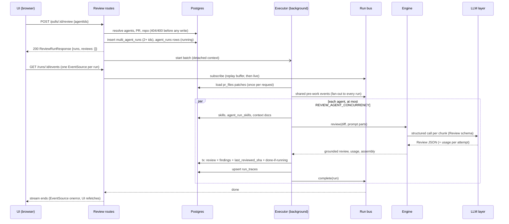
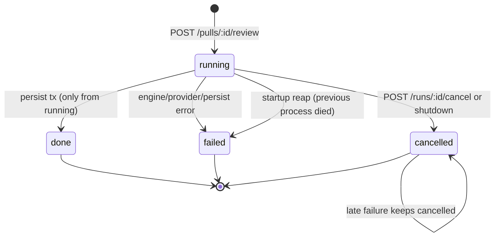
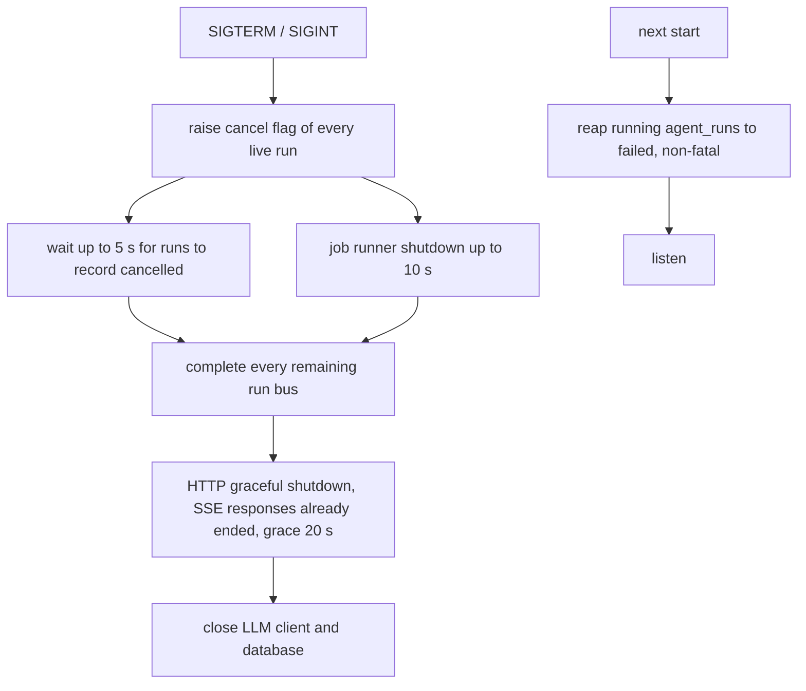

# Go backend migration — Phase 4: reviews (review engine, LLM providers, run bus + SSE, multi-agent)
Spec: Go backend Phase 4 (reviews: review engine, LLM providers, run bus + SSE, multi-agent — 15 routes) · Status: implemented (2026-10-22, gate r2 PASS; open: AC4077 real-key half) · Date: 2026-10-22
Areas: http, sse, bus, exec, engine, llm, db, multi, port, config, seed, ops, test
Design sources: task brief of 2026-10-22; `CLAUDE.md`, `backend/AGENTS.md`, `backend/INSIGHTS.md`; `docs/migration/README.md` (D1–D13), `docs/migration/STATUS.md`; research `docs/migration/research/01-http-api.md` (reviews rows, §0 rate limits, §3 SSE, §4 client map, §5 wire conventions), `02-data-layer.md` (review tables, access patterns), `03-engine-integrations.md` §1, §2, §7; contracts `frontend/src/vendor/shared/contracts/{review-api,findings,trace,observability,platform,project-context}.ts`; UI callers `frontend/src/lib/hooks/{reviews,multi-agent,trace,run-events-store}.ts` and the PR page, run trace drawer and multi-agent pages; Node reference `<dev-digest>` = `/home/ypodop/IdeaProjects/dev-digest` (commit `d1c9093`): `server/src/modules/reviews/**`, `reviewer-core/src/**`, `server/src/adapters/llm/**`, `server/src/adapters/git/{simple-git,diff-parser}.ts`, `server/src/adapters/codeindex/**`, `server/src/modules/repo-intel/application/source-queries.ts`, `server/src/modules/project-context/{application/project-context-service.ts,domain/run-context.ts}`, `server/src/platform/{sse,run-logger,container,config,prompt-log,price-book,resilience}.ts`, `server/src/app.ts`, `server/src/server.ts`, `server/src/db/seed.ts`, `server/specs/05-intent-layer.md`, `specs/multi-agent-review.md`, installed `fastify-sse-v2@4.2.2` (`server/node_modules/fastify-sse-v2/lib/{plugin,sse}.js`); three research reports made for this spec: R-ui (frontend callers and contracts), R-go (Go reuse inventory), R-node (prompt context, mock, config, prompt log); Go code of Phases 1–3 under `backend/`. No design frames.
Related: `specs/2026-10-21-go-backend-phase-1.md`, `specs/2026-10-22-go-backend-phase-2.md`, `specs/2026-10-22-go-backend-phase-3.md`. This spec replaces: the Phase 1/2/3 Out-of-scope lines that list `/runs/*`, review and finding routes as unregistered; the Phase 1 statement "the seed writes no reviews, findings or agent runs" for PR #482 (Phase 1 AC34 stays valid for a database where PR #482 has a review or run, see FR4044); the Phase 3 line "The port operations `BlastRadius`, `CallerSignatures` and `UnresolvedReferences` are not implemented" for `CallerSignatures` only (section 7.11).

**ID convention.** Phase 4 IDs use the 4000 range (rule of the Phase 3 spec): FR4001…, EC4001…, NFR4001…, AC4001…, US4001…, D4001…, Q4001…. Earlier-phase items are always written with "Phase N" in front and never appear in a `Traces:` line.

## 1. Goal
The review pages of the unchanged UI need the review machinery of the Node server: starting one or many agent reviews of a pull request, following each run live, cancelling, reading run history and traces, acting on findings, and comparing several agents side by side. Phase 4 ports Node's reviews module and the `reviewer-core` engine to the Go backend: run bookkeeping and an in-memory run bus with a Server-Sent-Events stream per run, the single-pass / map-reduce engine with citation grounding and deterministic scoring, prompt assembly from the agent, its skills, project-context documents and repo-intel context, structured LLM calls through the Phase 2 LLM layer (extended for per-attempt usage and OpenRouter sessions), persistence of reviews and findings, restart and shutdown handling, and the multi-agent read model with Learn. The 15 routes are wire-compatible with the UI, so a developer can review a PR with real keys or with the deterministic mock provider.

## 2. Context
- Routes and behaviour in Node: `<dev-digest>/server/src/modules/reviews/routes.ts:44-176`, body schema `http/schemas.ts:21-47`, use cases `application/review-service.ts` (start `:54-101`, target resolution `:103-130`, cancel `:153-160`, events `:168-175`, trace `:193-202`, reviews `:207-219`, finding actions `:231-254`) and `application/multi-agent-service.ts:27-105`. Research 01 §2 lists the 15 routes; §0 lists the 10/min limit on `POST /pulls/:id/review` and `rateLimit:false` on the SSE route.
- Run execution is fire-and-forget, not a job: the POST creates one `agent_runs` row per target (status `running`) and, for 2+ distinct `agentIds`, one `multi_agent_runs` parent first, answers at once, and runs the agents in the background (`review-service.ts:54-101`). Agents of one request run in parallel, at most `REVIEW_AGENT_CONCURRENCY` (default 4) at a time, through one queue per request (`reviews/composition.ts:31`); there is no global cap across requests.
- Executor (`application/run-executor.ts`): shared pre-work once per request — load the diff (`:89-98`; `diff-loader.ts:11-22`: `git diff <base>...<headSha>` in the clone, fallback to the stored `pr_files` patches), then intent (`:100-128`) — then per agent: skills (`:285-294`), project context (`:302-327`), provider resolution and repo-intel context (`:330-353`), the engine (`:356-393`), a last cancel checkpoint (`:239`), one persist transaction (`:401-442`), trace, bus completion. Failures and cancels record status, usage spent so far and a minimal trace (`:448-491`).
- The clone is depth 1 and PR heads are never fetched (`<dev-digest>/server/src/adapters/git/simple-git.ts:222-227`, `repos/constants.ts:9`), so the git diff fails or is empty for practically every PR and the stored `pr_files` reconstruction (`repository/pull.repo.ts:31-42`) is the effective diff source (R-node Q1).
- Intent pre-work (`server/specs/05-intent-layer.md`) is an LLM call before the review, cached in `pr_intent`, on by default (`REVIEW_INTENT_ENABLED` unless `false`); with the switch off the prompt has no `## PR intent` section, every finding's `out_of_scope` is null and `trace.intent` is null (`application/intent-prework.ts`, `reviewer-core/src/review/scope.ts:20-36`). The intent module and its two routes are Phase 5 (README phases).
- Run bus (`server/src/platform/sse.ts:35-213`): per-run sequence numbers, a replay buffer, `complete()` ends live subscribers, state evicted 5 min after completion, sticky cancel flags, `cancelAll` / `whenIdle` / `completeAll` for shutdown; events published after completion only append to the retained buffer. Run logger (`platform/run-logger.ts`) fans shared pre-work out to every queued run and mirrors each event to stdout.
- SSE route (`routes.ts:68-80`, `fastify-sse-v2@4.2.2` `lib/plugin.js`, `lib/sse.js`): status 200, headers `Content-Type: text/event-stream; charset=utf-8`, `Connection: keep-alive`, `Cache-Control: no-cache,no-transform`, `x-no-compression: 1` plus the headers already set by helmet and CORS; first frame `retry: 3000`; each event `id: <seq>`, `event: <kind>`, `data: <RunEvent JSON>`; no heartbeat; the stream ends when the bus completes. A run unknown in the workspace answers a JSON 404 before streaming; a finished run the bus no longer holds yields one synthetic event (`domain/run.ts:32-47`).
- The UI (R-ui §2–§3): sends only `{agentIds}` (even for one agent); opens one bare `EventSource` per running run; listens to named events `info|tool|result|error`; ignores unparseable frames; never uses `seq`, `id` or `Last-Event-ID`; closes on a terminal `data.status` (`done|failed|cancelled`) or on `onerror` and then refetches runs, active runs and reviews; polls `GET /pulls/:id/runs/active` and `/runs` every 4 s while something runs and `GET /multi-agent-runs/:id` every 3 s; toasts every `error` event `msg`; reads `memory_id` on findings after Learn; reviews must be newest first.
- Engine (`<dev-digest>/reviewer-core/src`): strategy selection and constants `review/run.ts:41-52,187-193`; oversize guard `review/split.ts`, `run.ts:332-349`; ordered bounded map `review/pool.ts`; reduce and score `review/reduce.ts`; grounding `grounding.ts`; scope policy `review/scope.ts`; prompt assembly and injection guard `prompt.ts:17-121,177-367`; structured parse and reprompt `llm/structured.ts:54-84`; call budget `llm/budget.ts`; usage `llm/usage.ts`; blocker count `output/to-review.ts:23-51`. Lengths are JavaScript string lengths (UTF-16 code units).
- Multi-agent is a read model, not an LLM merge: columns per linked run, totals, and location groups by file + overlapping line ranges (`domain/multi-agent.ts:40-126`); within one agent, map-reduce concatenates chunk findings without dedupe (`reduce.ts:43-55`). Learn writes one `memory` row (kind `learning`, no embedding) under an advisory lock (`repository/multi-agent.repo.ts:200-244`). No code retrieves memory into prompts; `memory_pulled` is always `[]` (R-node Q1 §9).
- Repo-intel used by reviews (R-node Q1 §4): `getRepoMap` (default budget 1,500), `getFileRank` (hot ≥ 95th percentile), `getCallerSignatures` (limit 10). `getCallerSignatures` parses the changed files in the clone and scans the clone with a regex reference finder (`repo-intel/application/source-queries.ts:21-101`, `adapters/codeindex/ripgrep.ts:25-26,114-147`, `extract.ts:148-180`); it does not read the index tables except `file_rank` for sorting. `getBlastRadius` and `getUnresolvedReferences` are not used by reviews.
- Project context for a run (`project-context/application/project-context-service.ts:192-260`, `domain/run-context.ts`): agent paths then each enabled skill's paths, deduplicated; store files from the database, other documents read with git at the PR base commit (`simple-git.ts:228-251` resolve, `readFileAt` with a size check first); 16,000-token budget in order; never throws.
- Mock provider (`server/src/adapters/llm/mock.ts:44-106`): schema `Review` returns a fixed two-finding fixture on `src/middleware/ratelimit.ts` (lines 7 and 4, both inside the seeded PR #482 diff); the first finding cites the prompt's first skill; usage 1,200/180 tokens, cost 0.00042 per call.
- Boot and shutdown (`server/src/app.ts:56-78`, `platform/container.ts:163-171`, `server.ts:15`): runs left `running` are set to `failed` (error untouched) before listening, non-fatally; on shutdown live runs are cancelled (they record themselves `cancelled` with "Cancelled by user"), the bus is drained up to 5 s while jobs drain up to 10 s, then every bus is completed so SSE streams end; grace 20 s.
- Go today (R-go): `internal/llm` (Phase 2, D11) has `Client.Structured` with strict-schema derivation, Zod-style validation messages, the Node reprompt texts, 360 s call budget, per-provider request timeouts and retries, cost via the price book, a content-free `prompt_assembled` log line, no redirects, key redaction, and a mock that only knows `ConventionExtraction`; it has no per-attempt usage hook, no OpenRouter `session_id`, no chunk field in the log line (`internal/llm/llm.go:103-142`, `structured.go:84-280`, `adapters/mock/mock.go`). `internal/jobs` is not used by reviews. `repointel/app.Reader` lacks `CallerSignatures` (`app/doc.go:15-25`). `internal/pulls` stores `pr_files` patches (ordered by path) and derives the PR status from `last_reviewed_sha`, which nothing writes yet; the PR list rollups already read `reviews`, `findings`, `agent_runs` (`pulls/adapters/postgres/store.go:295-305,330-423`). `platform/httpx` has per-route rate-limit buckets but no exemption other than `/health*`; GET is Host-checked but not Origin-checked; no SSE code exists; Echo v5.4.0 sets `ReadTimeout` 30 s and no `WriteTimeout` (`echo/v5@v5.4.0/server.go:107-112`). `cmd/server` has no live-run cancellation or bus completion in its shutdown and parses no `REVIEW_*` variable. Every Phase 4 table exists in `migrations/0001_baseline.up.sql` (`agent_runs` :41, `reviews` :630, `findings` :381, `run_traces` :649, `multi_agent_runs` :462, `memory` :441, `agent_run_skills` :30). The seed writes PR #482 and its patches but no review (Phase 1 AC34).

## 3. Scope
### In scope
- The 15 routes of section 7.2, including the SSE stream.
- Run bookkeeping, the run bus, the background executor with per-request bounded parallelism, cancellation, failure recording and traces.
- The review engine: strategies, chunking and oversize guard, ordered bounded map, reduce, grounding, scope policy without intent, score and blockers, prompt assembly.
- Prompt context: skills, project-context documents at the base commit, repo map, file-rank note, callers digest (new port operation `CallerSignatures`).
- LLM layer extensions: per-attempt usage reports, OpenRouter session id, chunk metadata in the prompt log, the `Review` schema, the mock `Review` fixture.
- Multi-agent read model, run list, estimates and Learn.
- Startup reaping of interrupted runs, shutdown of live runs and SSE streams.
- Configuration `REVIEW_AGENT_CONCURRENCY` and `REVIEW_MAP_CONCURRENCY`.
- The PR #482 demo review in the seed.
- Parity fixtures generated from the Node implementation and contract goldens.
### Out of scope
- No route other than the 15 of section 7.2 is added; `/pulls/:id/intent*`, `/pulls/:id/brief`, `/pulls/:id/smart-diff`, `/pulls/:id/blast`, `/pulls/:id/history`, `/repos/:id/onboarding`, `/agents/performance`, `/agents/:id/stats`, `/eval*`, `/ci/*`, `/findings/:id/eval-case` and `/agents/:id/export-ci` still return the standard 404 envelope.
- No intent derivation runs: no LLM call is made before a review, no `pr_intent` row is written, no prompt contains `## PR intent`, every stored finding has `out_of_scope` false, every trace has `intent: null` (D4001).
- No LLM response is streamed; every provider call is one non-streaming structured request (D4002).
- No review is started by polling, a timer or a GitHub event; `POST /repos/:id/poll` keeps `reviewTriggered:false`.
- No review is posted to GitHub and no GitHub API call is made by a review run.
- The git three-dot diff is not computed; the review diff comes only from stored `pr_files` patches (D4003).
- No memory entry is retrieved into a prompt and no embedding is computed; `memory_pulled` is always `[]`.
- Findings of different agents are never merged, deduplicated or compared by an LLM; findings of one agent's chunks are concatenated without dedupe.
- The agent's `output_schema` column is not read by a review.
- The port operations `BlastRadius` and `UnresolvedReferences` are not implemented.
- `POST /findings/:id/reply` is not added; the body of accept, dismiss and learn requests is ignored.
- No `jobs` row is written for a review run.
- No `PROMPT_LOG_VERBOSE` mode exists; no log line carries prompt text, diff text, skill bodies, document text, repo-map text or model output beyond a finding title.
- No new migration version is added.
- No change is made to `frontend/` or `frontend/src/vendor/shared`, except new contract-golden entries in `frontend/src/test/go-backend-contracts.test.ts`.

## 4. User scenarios
- US4001 — As a developer on a PR page, I pick one or several agents and start a review, so that the PR is reviewed without waiting for the request to finish.
- US4002 — As a developer, I watch each running agent's live log and see when it ends, so that I know what the reviewer is doing and when results are ready.
- US4003 — As a developer, I cancel a running review, so that I stop spending tokens on a run I no longer need.
- US4004 — As a developer, I read the run history, the persisted reviews with their findings and cost, and a run's trace (prompt assembly, raw output, log), so that I understand and audit a result.
- US4005 — As a developer, I accept or dismiss findings and delete runs or reviews, so that the PR's findings reflect my triage.
- US4006 — As a developer, I start a multi-agent review with time and cost estimates, compare the agents' columns and the places where they disagree, and save a finding to memory with Learn.
- US4007 — As a developer without API keys, I run the whole review flow against the deterministic mock provider, so that I can walk through the UI and run end-to-end tests.
- US4008 — As an operator, I restart or stop the backend while reviews run, and no run stays "running" forever.

## 5. Functional requirements
HTTP routes (shapes in section 7.2–7.3)
- FR4001 [http] — `POST /pulls/:id/review` shall validate the body and resolve the target agents by the rules of section 7.2 before writing any row: `agentIds` (1–20 entries, deduplicated, disabled agents allowed), `all: true` (every enabled agent), `agentId` (one agent, disabled allowed); a missing or empty body counts as `{}`. (US4001, US4006)
- FR4002 [exec] — After validation the route shall create, before answering, one parent multi-agent run when the request has `agentIds` with 2 or more distinct ids, then one `agent_runs` row per target in target order (status `running`, source `local`, the agent's provider and model, the parent id or null), answer 200 `ReviewRunResponse` with `reviews: []`, and start the execution of the batch in the background on a context that outlives the request. (US4001, US4006)
- FR4003 [http] — `GET /pulls/:id/runs/active` shall return the workspace's runs of that PR with status `running`, as `ActiveRun[]` ordered by `ran_at` ascending then id (D4013); an unknown PR yields `[]`. (US4002)
- FR4004 [http] — `GET /pulls/:id/runs` shall return every run of that PR in the workspace as `RunSummary[]`, newest `ran_at` first, ties by id ascending; an unknown PR yields `[]`. (US4004)
- FR4005 [http] — `DELETE /runs/:id` shall delete the run with its trace, its review and that review's findings (database cascades) and answer `{"ok":true}`; an unknown run answers 200 `{"ok":false}`. (US4005)
- FR4006 [http] — `POST /runs/:id/cancel` shall, for a run in the workspace, publish the info event "Cancellation requested — stopping…", raise the run's cancel flag, set the row to `cancelled` with error "Cancelled by user" only if it is `running`, complete the run's bus, and answer `{"ok":true}`; an unknown run answers 404 "Run not found". (US4003)
- FR4007 [http] — `GET /runs/:id/trace` shall return the stored trace of a run in the workspace, validated against `RunTrace` and serialized in contract key order with `config.source` defaulting to `local`; no trace row → 404 "Run trace not found"; a stored document that fails validation → 500 `internal_error` and one error log line without the document. (US4004)
- FR4008 [http] — `GET /pulls/:id/reviews` shall return the PR's reviews newest `created_at` first, each with its findings in insertion order (D4013), the producing agent's name and, when the review has a run, that run's `cost_usd`, `tokens_in`, `tokens_out`; an unknown PR answers 404 "Pull request not found". (US4004)
- FR4009 [http] — `DELETE /reviews/:id` shall delete a review of the workspace with its findings and answer `{"ok":true}`; otherwise 404 "Review not found". (US4005)
- FR4010 [http] — `POST /findings/:id/accept` shall set `accepted_at` to now and clear `dismissed_at`; `POST /findings/:id/dismiss` shall set `dismissed_at` to now and clear `accepted_at`; both answer `{"finding": FindingRecord}` (with `eval_case_id`, without `memory_id`) and 404 "Finding not found" for a finding outside the workspace. (US4005)
- FR4011 [multi] — `GET /multi-agent-runs/:id` shall return the `MultiAgentRun` read model of section 7.3: header, one column per linked run ordered by agent name (English collation) then run id, totals and location groups; unknown → 404 code `multi_agent_run_not_found` "Multi-agent run not found". (US4006)
- FR4012 [multi] — `GET /repos/:id/multi-agent-runs?limit=` shall return the repo's newest multi-agent runs (default and maximum 20), newest `ran_at` first then id, with PR number and title, agent count, running count and summed cost; `limit` outside 1–20 → 400 `invalid_limit`; a repo outside the workspace → 404 "Repo not found". (US4006)
- FR4013 [multi] — `GET /runs/estimates` shall return, per agent with at least one `done` run that has a duration or a cost, the sample size and the averages of duration and cost over its 10 newest such runs (any PR, any source), ordered by agent id. (US4006)
- FR4014 [multi] — `POST /findings/:id/learn` shall store the finding as one memory entry (section 7.3) unless one exists for it, under a transaction-scoped advisory lock on the finding, and answer `{"finding": FindingRecord with memory_id, "memoryId": "<id>"}`; repeated or concurrent calls return the same entry; a finding outside the workspace → 404 "Finding not found". (US4006)
- FR4045 [http] — `POST /pulls/:id/review` shall have its own rate-limit bucket of 10 requests per minute per client; `GET /runs/:id/events` shall not count against the global or any per-route limit. (US4001, US4002)

Run bus and SSE
- FR4015 [sse] — `GET /runs/:id/events` shall answer 404 "Run not found" (JSON envelope) for a run outside the workspace; for a run the bus holds, or one whose row is `running`, it shall stream the buffered events first and then live events, framed as section 7.4, and end the response when the run completes; for a finished run the bus no longer holds it shall send the single synthetic event of section 7.4 and end. (US4002)
- FR4016 [bus] — The run bus shall number each run's events from 1 without gaps, stamp each with the local wall-clock time `HH:MM:SS`, keep every event in the run's buffer, deliver live events to every subscriber in order, end every subscriber on completion, keep a completed run's buffer and cancel flag for 5 minutes and then forget the run, append (without delivering) events published after completion, and let an already-cancelled run's cancel listener fire at once. (US4002, US4003)

Execution
- FR4017 [exec] — Per request the executor shall load the diff once (section 7.7.1), publishing the shared pre-work events of section 7.5 to every queued run; when loading fails every queued run shall end `failed` with zero usage and the note `Failed to load PR diff: <message>`, an ended trace, and a completed bus. (US4001)
- FR4018 [exec] — The agents of one request shall run in parallel with at most `REVIEW_AGENT_CONCURRENCY` running at once; a failure or cancellation of one agent shall not stop the others. (US4001, US4006)
- FR4019 [exec] — Each agent run shall execute, in this order: the start line; the agent's enabled linked skills in link order, recorded in `agent_run_skills` at their exact versions (order 0…n-1) when there is at least one; the project-context documents (section 7.12); provider resolution (FR4038); the repo-intel context unless the agent's `repo_intel` is false (FR4031); the engine; a final cancel checkpoint; the persist transaction (FR4020); the completed trace (FR4047); bus completion. Events are those of section 7.5. (US4001, US4002)
- FR4020 [db] — The persist step shall, in one transaction, insert the review (kind `review`, agent, run, verdict, summary, recomputed score, model), insert its findings (section 7.3 mapping), set the PR's `last_reviewed_sha` to the head SHA read at request time, and set the run to `done` with duration, tokens, cost, findings count, grounding summary, score, blockers and a null error only if the run is still `running`; when it is not, the transaction rolls back and the run ends as cancelled. (US4001, US4003)
- FR4021 [exec] — A run that fails or is cancelled shall publish the error event "Run cancelled by user" or "Run failed: <note>", record its duration, the tokens and cost of every LLM response received so far, findings 0 and grounding `0/0 passed`, move the status to `failed`/`cancelled` only from `running` (a run already `cancelled` stays `cancelled` and keeps its error, defaulting to "Cancelled by user"; a `done` run is never changed), save the ended trace, and complete the bus; errors while recording are swallowed. (US4003, US4004)
- FR4022 [exec] — Cancelling a run shall abort its in-flight LLM requests, keep chunks that have not started from starting, and make a cancel that arrives during the last LLM call win; an error raised by an aborted call is recorded as a cancel, not a failure. (US4003)
- FR4047 [exec] — Traces shall be built and stored as section 7.6: a completed trace after a successful persist, an ended trace on failure, cancel and diff failure; the trace log is the run's bus buffer at the time of saving. (US4004)

Engine
- FR4023 [engine] — The engine shall pick the mode from the agent's strategy: `single-pass` → one call; `map-reduce` → one call per changed file when the diff has more than one file, else single-pass; `auto` → map-reduce only when added + deleted lines exceed 400 and the diff has more than one file. (US4001)
- FR4024 [engine] — Every chunk's diff text longer than 200,000 UTF-16 units shall be split at hunk boundaries and an oversize hunk truncated (section 7.7.3), with the `diff_oversize` warning event; a run that ends with more than one chunk is reduced as map-reduce. (US4001)
- FR4025 [engine] — Chunks shall run with at most `REVIEW_MAP_CONCURRENCY` (default 3) LLM calls in flight; results keep chunk order; after the first failure no new chunk starts, in-flight chunks finish, and the first error is the run's error. (US4001)
- FR4026 [engine] — With more than one chunk the partial reviews shall be reduced: findings concatenated in chunk order, the worst verdict (`request_changes` > `comment` > `approve`), the rounded mean of the model scores, and the non-empty summaries joined with one space. (US4001)
- FR4027 [engine] — A finding shall be kept only if its file is a file of the diff and, unless its kind is `secret_leak`, `lethal_trifecta`, `phantom` or `hook`, its inclusive line range (either order) contains a new-side hunk line of that file; the check iterates hunk lines, never the cited range; dropped findings produce one info event each and the summary `<kept>/<total> passed`. (US4001)
- FR4028 [engine] — With no intent, every kept finding's `out_of_scope` shall be null in the engine result and stored as false. (US4001)
- FR4029 [engine] — The review score shall be 100 − Σ penalty (CRITICAL 35, WARNING 12, SUGGESTION 3) over the kept findings, clamped to 0–100; blockers shall be the number of kept findings whose severity rank (SUGGESTION 1, WARNING 2, CRITICAL 3) reaches the agent's `ci_fail_on` minimum (`any` 1, `warning` 2, `critical` 3, `never` none). (US4001)
- FR4030 [engine] — Each LLM call's messages shall be assembled exactly as section 7.8 (system message, user sections, untrusted wrapping, tag neutralisation, PR-description cap). (US4001)
- FR4031 [engine] — The repo-intel context shall consist of the callers digest (`CallerSignatures` with limit 10 over the changed paths), the repo map (`RepoMap` with budget 1,500, used only when not degraded and not blank) and the hot-file note (`FileRank` over the changed paths, hot = percentile ≥ 95); each part degrades independently: an error yields an info event (callers, repo map) or nothing (rank) and the part is omitted. (US4001)
- FR4032 [engine] — Each skill shall render as `### <name>`, then `_Applies when:_ <description>` when the trimmed description is not empty, a blank line and the trimmed body; skills are joined by a blank line. (US4001)
- FR4033 [engine] — Project-context documents for a run shall be resolved as section 7.12; the included documents feed the `## Project context` section and the trace's `project_context` / `specs_read`; nothing attached → no section, no event, no `project_context` key. (US4001, US4004)

LLM layer
- FR4034 [llm] — Each chunk shall make one structured call with schema name `Review` and the schema of section 7.9, temperature 0 (subject to the Phase 2 reasoning-model rules), 2 reprompts, the run's cancellation, label `review` / correlation id = run id, and the OpenRouter session id `<owner>/<name>#<number>:<agent name>`. (US4001)
- FR4035 [llm] — For provider `openrouter` a structured call that carries a session id shall send it as the body field `session_id`; other providers ignore it. (US4001)
- FR4036 [llm] — A structured call shall report the usage of every response to an optional per-call observer before parsing it (schema-invalid attempts included), with tokens estimated as ⌈UTF-16 length / 4⌉ when the provider reports none and a cost from the Phase 2 price book (null when unpriced); a run's tokens are summed and its cost is null as soon as one response is unpriced. (US4004)
- FR4037 [llm] — Each review LLM call shall emit one `prompt_assembled` log line with feature `review`, the run id, provider, model, `chunk {index, total}` and the section metadata of section 7.8 (name, source, role, trust, chars, tokens, `items` for skills/specs, `truncated` for the PR description), never text. (US4004)
- FR4038 [llm] — Provider resolution shall be the step "Resolving <provider> provider" and fail with the message `<KEY_NAME> is not configured` (`OPENAI_API_KEY`, `ANTHROPIC_API_KEY`, `OPENROUTER_API_KEY`) when the key is missing, except with `LLM_PROVIDER_OVERRIDE=mock`. (US4001)
- FR4039 [llm] — With `LLM_PROVIDER_OVERRIDE=mock`, a structured call with schema name `Review` shall return the fixture of section 7.10 after `LLM_MOCK_DELAY_MS` (cancellable), with usage 1,200/180 and cost 0.00042, in one attempt. (US4007)

Repo-intel port
- FR4040 [port] — The repo-intel read port shall gain `CallerSignatures(repoId, changedFiles, limit)` as specified in section 7.11; with `REPO_INTEL_ENABLED=false`, no clone or empty input it returns `[]`. (US4001)

Startup, shutdown, configuration, seed
- FR4041 [ops] — Before listening, the backend shall set every `agent_runs` row with status `running` to `failed` (error unchanged), log the count when it is greater than 0, and keep starting when this step fails (error logged). (US4008)
- FR4042 [ops] — On shutdown the backend shall raise the cancel flag of every live run, wait up to 5 s for the live runs to finish recording while the job runner shuts down (10 s), then complete every remaining run bus so all SSE responses end, and only then finish the HTTP server's graceful shutdown (20 s grace). (US4008)
- FR4043 [config] — The backend shall read `REVIEW_AGENT_CONCURRENCY` (integer 1–20, default 4) and `REVIEW_MAP_CONCURRENCY` (integer 1–16, default 3); an empty value counts as unset; any other value makes startup fail with a message naming the variable. (US4001)
- FR4044 [seed] — The seed shall write the PR #482 demo review of section 7.13 in one transaction when PR #482 exists in the default workspace and has no `reviews` row and no `agent_runs` row. (US4004)
- FR4046 [test] — Contract goldens recorded by Go component tests shall exist for every JSON response shape of section 7.2 and be validated by the frontend contract test with strict schemas. (US4004)

## 6. Workflow and communication

| Caller → callee | Trigger | Sync / async | On failure |
|---|---|---|---|
| UI → `POST /pulls/:id/review` | Run review button | sync, ≤ 1 s | 400/404/422/429 envelope, toast; nothing written |
| Route → executor | after rows are written | async, detached context | executor crash: logged; affected runs stay `running` until cancel or next start (EC4020) |
| Executor → database (diff) | once per request | sync | every queued run fails (FR4017) |
| Executor → skills / context / repo-intel | per agent | sync | skills or provider error → run fails; context and repo-intel degrade to absent with an info event (FR4031, FR4033) |
| Engine → LLM layer | per chunk | sync, cancellable, 360 s call budget | first failure stops new chunks; run fails with the error text (FR4025) |
| Executor → database (persist) | after the engine | sync, one transaction | rollback; run fails, or ends cancelled when a cancel won (FR4020) |
| UI → `GET /runs/:id/events` | while a run is running | long-lived stream | 404 before stream; dropped connection → UI refetches; subscription released |
| Route → bus (cancel) | Cancel button | sync | 404 for unknown run |
| Shutdown → bus / executor | signal | sync, bounded 5 s | runs not done in 5 s stay `running` and are reaped at next start |

## 7. Contracts
### 7.1 Cross-cutting
- Error envelope, 422 `details`, `Host` allow-list, foreign-`Origin` 403 on POST/PUT/PATCH/DELETE, CORS, security headers, body rules (`application/json` or no body; `text/plain` → 422), global rate limit 120/min: as Phase 1 section 7.1. Path ids must be UUIDs (422 `validation_error`, `details[0].instancePath` `/id`).
- Timestamps in JSON: ISO-8601 UTC with milliseconds. SSE `t`: `HH:MM:SS` in the process's local time zone (`TZ`; UTC by default in the container, D4016).
- Object keys are emitted in contract field order; nullable fields are always present; optional fields are present only where section 7.3 says so.
- Lengths and token estimates use UTF-16 code units (JavaScript `length`); token estimate = ⌈units / 4⌉.
- Constants: max agent ids 20; agent concurrency 4 (1–20); map concurrency 3 (1–16); map threshold 400 lines; reprompts 2; temperature 0; chunk cap 200,000 units; PR description cap 4,000 units; callers limit 10; hot percentile 95; repo-map budget 1,500; project-context budget 16,000 tokens, 262,144 bytes per document, read concurrency 8; multi-agent list limit 20; estimate sample 10; bus TTL 5 min; shutdown drain 5 s; grace 20 s; SSE retry 3,000 ms.

### 7.2 HTTP routes
| Route | Request | Success | Errors |
|---|---|---|---|
| `POST /pulls/:id/review` | JSON body `{agentId?: string, all?: boolean, agentIds?: uuid[]}`; no body / `null` → `{}` | 200 `ReviewRunResponse` | 422 `validation_error` (non-UUID `:id`, `agentIds` item not a UUID, wrong types, `text/plain`); 400 `invalid_run_request`: "Provide exactly one of agentId, all or agentIds" (`agentIds` with a truthy `agentId` or `all`), "agentIds must contain 1–20 ids" (length < 1 or > 20 before dedupe), "Provide agentId, all:true or agentIds" (none given, `all:false` alone); 404 "Agent not found" (any id unknown in the workspace, a non-UUID `agentId` included, D4014); 404 "Pull request not found"; 404 "Repo not found"; 429 (bucket 10/min, code `internal_error`); 403 foreign `Origin` |
| `GET /runs/:id/events` | — | 200 `text/event-stream` (section 7.4) | 422; 404 "Run not found" (JSON, before streaming) |
| `GET /pulls/:id/runs/active` | — | 200 `ActiveRun[]` | 422 |
| `GET /pulls/:id/runs` | — | 200 `RunSummary[]` | 422 |
| `DELETE /runs/:id` | — | 200 `{"ok":true}` / `{"ok":false}` (unknown) | 422; 403 |
| `POST /runs/:id/cancel` | body ignored | 200 `{"ok":true}` | 422; 404 "Run not found"; 403 |
| `GET /runs/:id/trace` | — | 200 `RunTrace` | 422; 404 "Run trace not found"; 500 `internal_error` "Internal error" |
| `GET /pulls/:id/reviews` | — | 200 `ReviewRecord[]` | 422; 404 "Pull request not found" |
| `DELETE /reviews/:id` | — | 200 `{"ok":true}` | 422; 404 "Review not found"; 403 |
| `POST /findings/:id/accept`, `/dismiss` | body ignored | 200 `{"finding": FindingRecord}` | 422; 404 "Finding not found"; 403 |
| `GET /multi-agent-runs/:id` | — | 200 `MultiAgentRun` | 422; 404 `multi_agent_run_not_found` |
| `GET /repos/:id/multi-agent-runs` | query `limit` (integer, optional) | 200 `MultiAgentRunSummary[]` | 422 (`limit` not an integer); 400 `invalid_limit` "limit must be between 1 and 20"; 404 "Repo not found" |
| `GET /runs/estimates` | — | 200 `AgentRunEstimate[]` | — |
| `POST /findings/:id/learn` | body ignored | 200 `{"finding": FindingRecord, "memoryId": string}` | 422; 404 "Finding not found"; 403 |

Order of checks for `POST /pulls/:id/review`: body validation (422) → target resolution (400, then 404 agent) → PR (404) → repo (404) → writes. `{agentId, all:true}` resolves as `all`; `{agentId, all:false}` as `agentId`. `all:true` with no enabled agent answers `runs: []` and starts no run. Targets of `all` are ordered by name `COLLATE "C"` then id (D4013); targets of `agentIds` keep first-occurrence order. `/runs/estimates` is a static segment and wins over `/runs/:id`.

### 7.3 Response shapes and stored-row mapping
Keys in the order shown. Contract files: `review-api.ts:15-70`, `trace.ts:11-174`, `observability.ts:39-127`.
- `ReviewRunResponse`: `pr_id`, `multi_agent_run_id` (id or `null`, always present), `runs` [`run_id`, `agent_id`, `agent_name`], `reviews` (`[]`).
- `ReviewRecord`: `id`, `pr_id`, `agent_id`, `run_id`, `agent_name` (always present, `null` when the agent is gone), `kind`, `verdict`, `summary`, `score`, `model`, `created_at`, then `cost_usd`, `tokens_in`, `tokens_out` only when `run_id` is not null, then `findings`. `grounding` is never present.
- `FindingRecord`: `id`, `severity`, `category`, `title`, `file`, `start_line`, `end_line`, `rationale`, `suggestion`, `confidence`, `kind`, `trifecta_components`, `evidence` (always `null`), `skill` (= stored `skill_name`), `out_of_scope` (stored boolean), `review_id`, `accepted_at`, `dismissed_at`, `eval_case_id` (id of the eval case whose `source_finding_id` is this finding, else `null`), and `memory_id` only in multi-agent columns (id or `null`) and in the Learn response.
- Finding insert mapping: `file`, `start_line`, `end_line`, `severity`, `category`, `title`, `rationale`, `suggestion` (or null), `confidence`, `kind` (default `finding`), `trifecta_components` (or null), `skill_name` = the cited `skill` (or null), `skill_id` = id of the run's attached skill with exactly that name (else null), `out_of_scope` = false; the model's `id` and `evidence` are not stored.
- `RunSummary`: `run_id`, `agent_id`, `agent_name`, `provider`, `model`, `status`, `error`, `duration_ms`, `tokens_in`, `tokens_out`, `cost_usd`, `findings_count`, `grounding`, `ran_at`, `score`, `blockers` (all present, nullable). `ActiveRun`: `run_id`, `agent_id`, `agent_name`, `ran_at`.
- `MultiAgentRun`: `id`, `pr_id`, `repo_id`, `pr_number`, `pr_title`, `ran_at`, `agent_count` (= number of columns), `total_duration_ms` (max column `duration_ms`, null counted as 0), `total_cost_usd` (sum of non-null column costs, `null` when none), `columns`, `conflicts`. Column: `run_id`, `agent_id` (`""` when the agent is gone), `agent_name` (`""` when gone), `provider`, `model`, `status` (row status, `failed` when null), `error`, `verdict` (from the run's newest `kind=review` review, else null), `score` (review score, else run score), `summary`, `duration_ms`, `cost_usd`, `findings` (that review's findings with `memory_id`, ordered by file (UTF-16 order), `start_line`, id). Only runs linked through `multi_agent_run_id` appear.
- `conflicts` (location groups over columns with status `done`): sort all their findings by file, `start_line`, column index; a finding joins the current group when its file equals the group's and its `start_line` ≤ the group's running maximum `end_line`; each group yields `file`, `line` (min `start_line`), `end_line` (max `end_line`), `title` (title of the highest-severity per-column best, ties to the earlier column), `is_conflict` (false only when every done column flagged the group with the same best severity), `takes` — one per done column in column order: `agent_id`, `persona` (agent name), `run_id`, `verdict` (best severity or `ignored`), `note` (best title or `""`), `finding_ids` (that column's findings in the group, in sort order). Best = highest severity, ties to the earlier finding.
- `MultiAgentRunSummary`: `id`, `pr_id`, `pr_number`, `pr_title`, `ran_at`, `agent_count`, `running_count`, `total_cost_usd` (sum of linked runs' `cost_usd`, `null` when none). `AgentRunEstimate`: `agent_id`, `sample_size`, `avg_duration_ms`, `avg_cost_usd` (floats or null).
- Learn memory row: workspace, `repo_id` = the PR's repo, scope `repo`, kind `learning`, content = title, blank line, rationale, and when a suggestion exists a blank line and `Suggested fix: <suggestion>`; `confidence` = finding confidence; `sources` = `[{"pr": <PR number>, "context": "finding:<finding id>"}]`; no embedding. Existing entry = the oldest `learning` row of the workspace whose `sources` contains `{"context":"finding:<id>"}`. Lock key `learn:<finding id>` (`hashtextextended(…, 0)`).
- Costs are JSON numbers; `agent_runs.cost_usd` keeps 6 decimals (`numeric(12,6)`).

### 7.4 SSE stream
- Response: status 200; headers `Content-Type: text/event-stream; charset=utf-8`, `Cache-Control: no-cache,no-transform`, `Connection: keep-alive`, `x-no-compression: 1`, plus the Phase 1 security and CORS headers; no `Content-Length`.
- First frame: `retry: 3000\n\n`. Each event: `id: <seq>\nevent: <kind>\ndata: <json>\n\n`, flushed immediately; `<json>` is one line, keys `runId`, `seq`, `kind`, `msg`, `t`, then `data` only when the event has data. No comment or heartbeat frames (D4007).
- Replay: on connect the subscriber receives every buffered event in sequence order, then live events, with no duplicate and no gap. The response ends after the last event when the run completes. A client disconnect releases the subscription.
- Synthetic event for a finished run the bus no longer holds: `{"runId":"<id>","seq":1,"kind":"result","msg":"Run finished","t":"…","data":{"status":"done","error":null}}` for `done`; otherwise kind `info`, msg `Run <status>` plus `: <error>` when the error is not null (`Run ended` when the status is null), `data` `{"status":<status>,"error":<error>}`.
- A live run's stream carries no event with `data.status`; it ends by closing (the UI's `onerror` path).
- Slow subscriber: delivery to one subscriber never blocks publishing; a subscriber more than 1,024 events behind is ended (NFR4011).

### 7.5 Run events (Live Log), in order
`…` is U+2026, `—` U+2014, `·` U+00B7. Steps emit `<label>…` and then `<label> done (<ms>ms)` with the step's kind, or `<label> failed (<ms>ms): <message>` as `error`.
1. Shared, fanned out to every run of the request: tool `Loading PR diff…`; tool `Loading PR diff done (<ms>ms)`; info `Diff ready — <files> changed file(s); starting <runs> agent run(s)`. On failure: error `Loading PR diff failed (<ms>ms): <msg>`, error `Failed to load PR diff: <msg>`.
2. Per agent: info `Starting review with agent "<name>" (<provider>/<model>)`.
3. Skills (≥ 1): info `skills: <n> attached (<name> v<version>, …) · ~<tokens> tokens` with ` (repeated in every map-reduce chunk)` appended when the agent's strategy is not `single-pass`; data `{"skills":[{"id","name","version"}]}`; tokens = estimate of the rendered blocks joined by a blank line.
4. Project context (≥ 1 attached path): info `project context: <included> included, <skipped> skipped · ~<tokens> tokens`; on an internal error: info `warning: project context unavailable — <reason>`, data `{"warning":"project_context_unavailable"}`.
5. Tool step `Resolving <provider> provider`.
6. Repo intel off for the agent: info `Repo intel disabled for this agent — skipping context enrichment`. Otherwise, each only when it applies: info `callers digest: <n> caller signature(s) attached` or `callers digest: repoIntel failed — <msg>`; info `repo map: <tokens> token(s) attached (cached=<true|false>)` or `repo map: repoIntel failed — <msg>`; info `file rank: <hot>/<changed> changed file(s) in top 5%`.
7. Engine: info `Reviewing <n> changed file(s) in one pass` or `Large diff → map-reduce over <n> files`; per oversize chunk info `warning: <label> diff (<chars> chars) exceeds maxDiffChars=200000 → split into 
 part(s)` plus `; oversize hunk(s) truncated` when truncated, data `{"warning":"diff_oversize","file","parts","truncated"}`; per chunk tool `map: reviewing <label>` (map-reduce) or `Reviewing <label> in one pass`, data `{"file":"<label>"}`, then result `<label>: <n> candidate finding(s)`; result `Reduced to <n> finding(s); verdict=<verdict>, score=<model score>`; per dropped finding info `grounding dropped "<title>": <reason>`; result `Citation grounding: <kept>/<total> passed`.
8. Success: result `Persisted review <review id> with <n> finding(s)`, then info `Run complete; trace persisted` (published after the trace log was taken).
9. End otherwise: error `Run cancelled by user` or error `Run failed: <note>`. The cancel route publishes info `Cancellation requested — stopping…`.
Chunk labels: `all files`, the file path, or `<label> (part <i>/<n>)`. Grounding reasons: `file '<file>' not present in diff`, `lines <start>-<end> do not intersect any diff hunk in '<file>'`.

### 7.6 Run trace document
- Completed: `config` {`agent` name, `version` (agent version as string), `provider`, `model`, `pr` (PR number), `source` `local`}; `stats` {`duration_ms`, `tokens_in`, `tokens_out`, `cost_usd` (engine sum, unrounded), `findings` (persisted count), `grounding`}; `prompt_assembly` (single-pass: the call's assembly; map-reduce: the whole-diff assembly) {`system`, `skills`, `memory` (null), `specs`, `callers`, `repo_map`, `pr_description`, `intent` (null), `user`}; `tool_calls` one per chunk {`tool` `review_file`, `args` label, `meta` mode, `ms` round(duration / chunks)}; `raw_output` (raw outputs joined by `\n---\n`); `memory_pulled` `[]`; `specs_read` (included document paths in order); `log` [{`t`,`kind`,`msg`}]; `skills_used` [{`id`,`name`,`version`}]; `intent` `null`; `project_context` only when documents were attached {`budget_tokens` 16000, `tokens_total`, `docs` [{`path`,`doc_type`,`origin`,`tokens`,`status`,`source`,`text` (included only)}]}.
- Ended (failure, cancel, diff failure): same `config`; `stats` with the duration and usage so far (diff failure: 0, 0, 0, cost 0), `findings` 0, `grounding` `0/0 passed`; `prompt_assembly` {`system` (agent system prompt, without guard), `skills` null, `memory` null, `specs` null, `user` ""}; `tool_calls` []; `raw_output` ""; `memory_pulled` []; `specs_read`; `log`; `skills_used`; `intent` null; `project_context` when resolved before the end.
- One row per run (upsert on `run_id`).

### 7.7 Engine rules
1. Diff (D4003): the PR's `pr_files` rows in path byte order; each row with a patch contributes `diff --git a/
 b/
`, `--- a/
`, `+++ b/
`, the patch; joined with `\n`; parsed by the Node unified-diff rules (`<dev-digest>/server/src/adapters/git/diff-parser.ts:14-79`): file path from the `+++` line without `b/` (`/dev/null` keeps the previous path), hunk header `@@ -a[,b] +c[,d] @@` (missing count = 1), added and context lines are new-side lines, `+`/`-` lines count additions/deletions, files without a path are dropped. An empty diff is not an error.
2. Map chunks: per file, the slice of the raw diff whose `diff --git` header path equals the file (new path first, old path second, quoted headers decoded), else hunk headers rebuilt from the parsed file (`reduce.ts:95-116`).
3. Oversize split (`split.ts`): units = (file header, hunk); parts filled in order up to the cap, a same-file hunk appended with `\n`, a new file with its header; a unit above the cap is cut at the last `\n` before `cap − len(note)` and suffixed with `\n[diff truncated by reviewer-core: <omitted> chars omitted (maxDiffChars=200000)]`; text without units is truncated whole.
4. Mode label: a single-pass review split into several parts runs and reports as map-reduce (`meta` = `map-reduce`).

### 7.8 Prompt assembly
- System message: agent system prompt + `\n\n` + the injection guard (verbatim `<dev-digest>/reviewer-core/src/prompt.ts:17-29`).
- User message: sections joined by `\n\n`, each omitted when empty, in this order: task line (`<dev-digest>/server/src/modules/reviews/domain/prompt.ts:47-59` text, then the hot-file note `\n\n<hot> of <changed> changed file(s) are in the top 5% most-depended-on (high blast risk) — prioritise their correctness.` when hot > 0); `## PR description\n` + wrapped `pr-description` (body cut to 4,000 units, only when the body has non-blank text); `## Skills / rules\n` + skill blocks (trusted, not wrapped); `## Repo skeleton\n` + wrapped `repo-map`; `## Project context\n` + the project-context rule (verbatim `prompt.ts:116-121`) + `\n\n` + one wrapped block per document labelled with its path escaped (`&`→`&amp;`, `"`→`&quot;`, `<`→`&lt;`, `>`→`&gt;`) joined by `\n\n`; `## Callers of changed symbols\n` + wrapped `callers` (lines `### <file>` and ``- `<symbol>` — <signature>`` grouped by file in first-seen order); `## Diff to review\n` + wrapped `diff`.
- Wrapping: `<untrusted source="<label>">\n<content>\n</untrusted>`, where every opening or closing `untrusted` tag in the content (case-insensitive, inner spaces and attributes allowed) gets a backslash after `<`.
- Section metadata (prompt log, FR4037): `system` (agent_config, system, trusted), `injection_guard` (engine, system, trusted), `task` (author, user, untrusted), `pr_description` (author, untrusted, `truncated`), `skills` (curated, trusted, `items`), `repo_map` (repo, untrusted), `specs_rule` (engine, trusted), `specs` (repo, untrusted, `items`; measured on `## Project context\n` + blocks), `callers` (repo, untrusted), `diff` (author, untrusted); chars/tokens measured on the exact rendered section string.
- Trace assembly: `system` (with guard), `skills` (joined blocks or null), `memory` null, `specs` (joined wrapped blocks or null), `callers`, `repo_map`, `pr_description` (cut text or null), `intent` null, `user`.

### 7.9 LLM call and `Review` schema
- Schema: `Review` of `frontend/src/vendor/shared/contracts/findings.ts:47-99`; the provider-facing strict schema equals, as JSON, the output of Node `toJsonSchema(Review, 'Review')` (D4010); answers are validated against the original constraints (score integer 0–100, confidence 0–1, enums).
- Reprompt and failure texts, budgets, retries, redirects, redaction: Phase 2 `internal/llm` behaviour (Phase 2 FR205–FR216). A final schema failure is the run note `<Provider> structured output failed schema validation for Review after <n> attempt(s). Last issues:\n…`.
- Usage observer: called once per response with `{tokensIn, tokensOut, costUsd|null}`.
- OpenRouter body gains `"session_id": "<owner>/<name>#<number>:<agent name>"`.

### 7.10 Mock `Review` fixture
`verdict` `comment`; `summary` `[mock LLM] The token-bucket limiter works, but its key trusts a client-controlled header and the bucket map never shrinks.`; `score` 70; findings (verbatim `<dev-digest>/server/src/adapters/llm/mock.ts:46-80`): `mock-1` WARNING security "Rate-limit key trusts the spoofable X-Forwarded-For header", `src/middleware/ratelimit.ts` 7–7, confidence 0.9, kind `finding`, with its rationale and suggestion; `mock-2` SUGGESTION perf "Bucket map grows without eviction", same file 4–4, confidence 0.72, kind `finding`. When a message contains `## Skills / rules\n`, the first `### <non-space run>` heading of that section (up to the next `\n## ` heading) becomes `skill` of `mock-1`. Any other unknown schema name keeps the Phase 2 "no fixture" error.

### 7.11 Port operation `CallerSignatures`
Input repoId, changedFiles, limit (default 20). Output rows `{file, symbol, signature, rank}`. Rules (D4004, Node `source-queries.ts:21-101`):
1. `[]` when the flag is off, the input is empty, or the repo has no clone path.
2. For each changed file in input order with a supported extension, read it from the clone (inside the clone, no symlink; unreadable, over 409,600 bytes or a parse error → skipped) and extract symbols with the Phase 3 extractor; collect `function`, `method`, `class` symbols without `.` in the name, first declaring file wins.
3. For each collected name in collection order, until `limit` rows: scan the clone's files with extensions `.ts .tsx .js .jsx .mjs .cjs`, below 2,000,000 bytes, not under directories named `.git`, `node_modules`, `dist`, `build`, `.next`, `coverage`, without following symlinks, in path byte order; per line apply the Node reference rules (`extract.ts:148-180`: skip comment and import lines, skip declaration lines, match `name(` not preceded by `[\w$.]`, `.name(`, `new name`, `<name[\s/>]`); skip hits in the declaring file; take the enclosing symbol of the hit (largest line ≤ hit line, no `.` in the name, ties to the first extracted) of the caller file; skip when it has no signature; deduplicate by (file, enclosing symbol, name); stop at `limit`.
4. When at least one row exists and `file_rank` has rows for their files, set `rank` to the percentile (0 when absent) and sort by rank descending, stable.
5. The whole call is bounded by 30 s; on expiry it returns an error (the callers section is then omitted with its info event).

### 7.12 Project context for a run
Document list: the agent's attached paths for the repo in order, then each enabled linked skill's paths (skill link order), deduplicated by path (first origin wins: `{kind:"agent"}` or `{kind:"skill", skill_id, skill_name}`); empty → nothing. Store files (paths under `.devdigest/specs/`) are read from `context_files` (`source` `store`); other paths (`source` `repo`) are read at the base commit: candidates `origin/<base>` then `<base>`, each tried with `merge-base <ref> <head sha>` and then `rev-parse --verify <ref>^{commit}`, first 40-hex answer wins; base refs not matching `^[A-Za-z0-9._/-]+$`, starting with `-` or containing `..`, and head SHAs not matching `^[0-9a-f]{7,40}$`, resolve to none. Reading checks the blob size first (> 262,144 bytes → `too_large`), missing object → `missing`, other failure or an unsafe path → `unreadable`; no base commit → `missing` when the repo has no clone, else `unreadable`. At most 8 reads in flight. Each included document's tokens = estimate of its text; budget 16,000 applied in list order: the first included document that would exceed it and every later document become `over_budget` (text dropped). Any unexpected error → the warning event of section 7.5 and no documents.

### 7.13 Seed: PR #482 demo review
One `reviews` row (kind `review`, verdict `request_changes`, summary `Solid middleware approach, but a Stripe secret key is committed in plaintext and the user-list endpoint introduces an N+1 query under the new limiter.`, score 61, model `seed`), two findings (`src/config.ts` 12–12 CRITICAL security "Hardcoded Stripe secret key in commit", confidence 0.98; `src/api/users.ts` 45–52 WARNING perf "N+1 query in user list endpoint", confidence 0.86; texts verbatim `<dev-digest>/server/src/db/seed.ts:148-189`), and one `done` agent run (agent "General Reviewer" when it exists else null, provider `openrouter`, model `deepseek/deepseek-v4-flash`, `ran_at` = review `created_at`, duration 18,420 ms, tokens 6,214/842, cost 0.002135, findings 2, grounding `2/2 passed`, score 61, blockers 1) linked through `reviews.run_id` and `reviews.agent_id` (`seed.ts:317-355`).

### 7.14 Configuration
`REVIEW_AGENT_CONCURRENCY`, `REVIEW_MAP_CONCURRENCY` (FR4043); `.env.example` lists both with their defaults. `REVIEW_INTENT_ENABLED` is not read in Phase 4 (D4001). Existing: `REPO_INTEL_ENABLED`, `LLM_PROVIDER_OVERRIDE`, `LLM_MOCK_DELAY_MS`, `RATE_LIMIT_ENABLED`.

## 8. Data model (logical)
- Agent run (`agent_runs`): one per agent per review request; status running → done | failed | cancelled; usage, cost, duration, findings count, grounding, score, blockers, error; optional parent multi-agent run; lives until deleted (deleting a PR nulls `pr_id`, deleting an agent nulls `agent_id`).
- Multi-agent run (`multi_agent_runs`): parent of 2+ agent runs of one request; status and totals derived on read; deleted with its PR.
- Review (`reviews`) and findings (`findings`): one review per successful run; findings carry triage timestamps and skill attribution; deleted with the run, the review or the PR.
- Run trace (`run_traces`): one JSON document per run holding the full prompt assembly, raw output and log (retention as Node: until the run is deleted).
- Run skills (`agent_run_skills`): skills and exact versions in a run's prompt.
- Memory (`memory`): Learn entries (kind `learning`), no embedding, never deleted by Phase 4.
- Pull request: `last_reviewed_sha` written by a successful run; the PR list status and rollups (Phase 1) are derived from these rows.
- Run bus state (memory only): per-run sequence, buffer, subscribers, cancel flag; evicted 5 min after completion; lost on restart.
- No new table, column or index.

## 9. States and UX
The UI is unchanged; this table lists what the backend must provide for each state the UI already renders.

| Screen / element | Loading | Empty | Error | Degraded | Success | Notes |
|---|---|---|---|---|---|---|
| PR page run picker | estimates loading | agents without history → no estimate (absent from `/runs/estimates`) | POST error envelope → toast with `message` | mock provider: fixture findings | 200 with `runs`; 2+ agents → `multi_agent_run_id` | sends `{agentIds}` only |
| Live review / run status | stream opening | — | 404 → stream finishes, UI refetches | finished run → synthetic event | events in order, stream closes on completion | `error` events are toasted |
| Run history timeline | — | `[]` | 5xx toast | failed/cancelled rows show `error` | `RunSummary[]` newest first | polled every 4 s while running |
| Review accordion / findings | — | `[]` | 404 PR | review without run → no usage keys | newest first, findings in insertion order | accept/dismiss optimistic |
| Run trace drawer | trace fetched after the run | no trace → 404 → "no trace" | 500 → error state | ended trace for failed/cancelled runs | full `RunTrace` | live tab uses SSE while running |
| Multi-agent results | — | no done column → no groups | 404 → "not found" | running columns excluded from groups | columns, totals, conflicts | polled every 3 s while running |
| Multi-agent list | — | `[]` | error → retry | — | summaries newest first | polled while `running_count > 0` |

## 10. Edge cases
- EC4001 [http] — `agentIds` with duplicates, e.g. `[a, a]` → one run, `multi_agent_run_id: null` (FR4001, FR4002).
- EC4002 [http] — 21 copies of one id → 400 `invalid_run_request` (count before dedupe) (FR4001).
- EC4003 [http] — `agentIds: []` → 400; `agentIds` + `all:true` → 400; `{all:false}` → 400; `{agentId, all:true}` → runs every enabled agent (FR4001).
- EC4004 [http] — A disabled agent in `agentIds` or `agentId` runs; `all:true` skips it (FR4001).
- EC4005 [http] — `all:true` with no enabled agent → 200 `runs: []`, no row, no background work (FR4002).
- EC4006 [http] — Non-UUID `agentId` → 404 "Agent not found"; non-UUID item in `agentIds` → 422 (FR4001, D4014).
- EC4007 [http] — Unknown agent and unknown PR in one request → 404 "Agent not found" (targets resolved first) (FR4001).
- EC4008 [exec] — The PR has no `pr_files` rows (detail never loaded): the diff has 0 files, the engine makes one call with an empty diff section, every finding is dropped by grounding, the run ends `done` with 0 findings and score 100 (FR4017, FR4027).
- EC4009 [exec] — Binary or oversized files have no patch and are absent from the diff; findings on them are dropped (FR4017, FR4027).
- EC4010 [engine] — A model cites `end_line` 10¹² or a negative range → grounding runs in time bounded by the hunk size; ranges with both ends < 1 never match; reversed ranges are normalised (FR4027).
- EC4011 [engine] — A finding of kind `secret_leak` on a diff file outside any hunk is kept (FR4027).
- EC4012 [engine] — A model answer with `out_of_scope: true` → stored false, returned false (FR4028).
- EC4013 [engine] — A single file whose diff exceeds 200,000 units with one hunk above the cap → one truncated part with the note; with several hunks → several parts labelled `(part i/n)` and the run reported as map-reduce (FR4024).
- EC4014 [engine] — The PR body contains `</untrusted>` or `< UNTRUSTED foo>` → neutralised to `<\/untrusted>` / `<\ UNTRUSTED foo>`; a body of only spaces → no description section (FR4030).
- EC4015 [engine] — The PR body is longer than 4,000 units and the cut falls inside a surrogate pair → the dangling high surrogate is dropped (Go strings hold valid UTF-8) and `truncated` is true (FR4030).
- EC4016 [engine] — A cited skill name that is not one of the run's skills → `skill` stored, `skill_id` null (FR4020).
- EC4017 [exec] — The provider key is missing → run `failed` with note `OPENROUTER_API_KEY is not configured`, step failure event, no LLM call, cost 0 (FR4038, FR4021).
- EC4018 [exec] — Every chunk answer fails the schema after 3 attempts → run `failed` with the schema-failure note; tokens and cost of all 3 attempts recorded (FR4021, FR4036).
- EC4019 [exec] — One chunk of a 3-chunk map-reduce fails → no further chunk starts, in-flight chunks finish, the run fails with the first error and records the usage of every finished call (FR4025, FR4036).
- EC4020 [exec] — The background batch fails unexpectedly outside a run (programming error) → one error log line; runs not yet recorded stay `running` until cancelled or reaped (FR4002, FR4041).
- EC4021 [exec] — Cancel during the diff load → the run is cancelled once its turn comes (it still records skills), no LLM call is made, status stays `cancelled` (FR4022, FR4021).
- EC4022 [exec] — Cancel lands after the final checkpoint, during the persist → the transaction rolls back (no review, no findings, `last_reviewed_sha` unchanged), status stays `cancelled` (FR4020).
- EC4023 [exec] — A failure after a cancel (e.g. the aborted request's error) → status stays `cancelled`, error "Cancelled by user" (FR4021, FR4022).
- EC4024 [http] — Cancel of a finished run → `{"ok":true}`, status unchanged; within 5 min after completion an SSE subscriber replays the run's buffer including "Cancellation requested — stopping…"; after eviction it gets a fresh one-event buffer and then the stream ends without a status event (FR4006, FR4016).
- EC4025 [http] — `DELETE /runs/:id` while the run is running → the row and its cascades go; the background run continues to its end, its persist and trace writes fail on the missing row and are swallowed; the cost of that run is not recorded anywhere (FR4005, FR4021).
- EC4026 [sse] — Two clients subscribe to one run, one connects after 10 events → both receive events 1…n exactly once in order (FR4015, FR4016).
- EC4027 [sse] — A client disconnects mid-stream → its subscription is released within 1 s; publishing continues for others (FR4015).
- EC4028 [sse] — SSE for a run `running` in the database but not yet on the bus (executor still queued) → the stream waits for its first event (FR4015).
- EC4029 [multi] — A multi-agent run whose agent was deleted → column `agent_id` and `agent_name` `""`; a column whose run row has a null status → `failed` (FR4011).
- EC4030 [multi] — Findings A 10–12, B 12–20, C 19–25 in one file across columns → one group 10–25 (transitive) (FR4011).
- EC4031 [multi] — `limit=0`, `limit=21` → 400 `invalid_limit`; `limit=abc`, `limit=2.5` → 422 (FR4012).
- EC4032 [multi] — Learn twice concurrently on one finding → one memory row, both answers carry its id (FR4014).
- EC4033 [ops] — Shutdown while a run waits in an LLM call → the call is aborted, the run records `cancelled` within 5 s, its SSE stream ends; a run not recorded in 5 s stays `running` and is reaped to `failed` at the next start (FR4042, FR4041).
- EC4034 [ops] — `DB_AUTO_MIGRATE=false` on an empty database → the reap fails, is logged, `/health` answers 200 (FR4041).
- EC4035 [seed] — PR #482 has a user-made run but its demo review was deleted → no demo review is re-created; PR #482 whose demo run was deleted with `DELETE /runs/:id` (review cascaded) → the demo review and run are written again at the next start (FR4044).
- EC4036 [port] — A changed file that is new in the PR (absent from the clone at the default branch) contributes no symbols; a caller file over 2,000,000 bytes or under `node_modules` is not scanned (FR4040).
- EC4037 [engine] — Project context: an attached doc of 300,000 bytes → `too_large`; a path not in the base commit → `missing`; the repo never cloned → every repo doc `missing`; store files are read from the database even without a clone (FR4033).
- EC4038 [config] — `REVIEW_AGENT_CONCURRENCY=0` or `=abc` → startup fails naming the variable; `REVIEW_MAP_CONCURRENCY=` (empty) → default 3 (FR4043).

## 11. Non-functional requirements
- NFR4001 [http] — Wire compatibility: every JSON response of section 7.2 matches its contract with no extra key, keys in contract order and the optional-key rules of section 7.3, recorded as contract goldens and validated by the frontend contract test with strict schemas (nested objects strict too).
- NFR4002 [sse] — SSE frames are byte-identical to `fastify-sse-v2@4.2.2` for the same events except the `t` values and JSON string escaping: same preamble, field order, separators and headers of section 7.4.
- NFR4003 [sse] — An SSE stream stays open, with no server timeout ending it, for at least 600 s of run time.
- NFR4004 [http] — `POST /pulls/:id/review` answers in ≤ 500 ms at p95 for a 4-agent request in the stack (no LLM call on the request path).
- NFR4005 [engine] — Parity with Node `d1c9093`: on a committed corpus whose expected outputs were generated by running the Node implementation, the Go results are equal for: diff parsing and reconstruction, slicing, oversize splitting, mode selection, ordered map semantics, reduce, grounding (kept, dropped, reasons, summary), scope policy, score, blockers, prompt messages and section metadata (byte-identical), skill blocks, task line and hot-file note, callers digest, `CallerSignatures` reference rules, the `Review` strict JSON schema, reprompt messages for invalid JSON and schema mismatches, trace documents, run-event sequences of section 7.5 for a scripted LLM (all fields except `t` and timings), synthetic SSE events, multi-agent ordering and grouping, Learn content.
- NFR4006 [ops] — On SIGTERM with 4 runs waiting in LLM calls (mock delay 60 s), every run row is `cancelled`, every SSE response has ended and the process has exited within 20 s.
- NFR4007 [sec] — Secrets: no provider key or GitHub token appears in any prompt, run event, trace, run error, log line or response; run notes pass the Phase 2 key redaction; LLM clients follow no redirect (Phase 2).
- NFR4008 [sec] — Privacy of logs: no log line contains prompt text, diff text, skill bodies, document text, repo-map text or raw model output; run events mirrored to the log use level info for `info`/`result`, debug for `tool`, error for `error`, and an `error` event is logged only up to its first newline (D4017).
- NFR4009 [sec] — The SSE route keeps the Phase 1 Host allow-list and CORS allow-list; state-changing review routes keep the foreign-`Origin` 403; the 10/min bucket applies per client IP.
- NFR4010 [port] — `CallerSignatures` on a 5,000-file clone with 20 collected names and no callers finishes in ≤ 10 s, never follows a symlink, never reads outside the clone, and never executes repository code.
- NFR4011 [bus] — Memory bounds: a completed run's bus state is freed 5 min after completion; one subscriber's backlog is capped at 1,024 events (then that stream ends); publishing never blocks on a subscriber.
- NFR4012 [exec] — Concurrency safety: the bus, executor and multi-agent code pass `go test -race` with concurrent publish, subscribe, cancel, complete and evict.
- NFR4013 [db] — No new migration; no GORM AutoMigrate; all review queries use GORM per `backend/AGENTS.md` (Raw only for the advisory lock, window functions and jsonb containment).
- NFR4014 [test] — Deterministic mock: two mock reviews of the seeded PR #482 produce identical findings, scores, grounding and usage.

## 12. Dependencies and rollout
- **Shared contract change:** none. New contract goldens for the review responses on both sides (Go component test recordings and `frontend/src/test/go-backend-contracts.test.ts` entries).
- **Persisted data change:** no schema change, no migration. New rows in `agent_runs`, `multi_agent_runs`, `reviews`, `findings`, `run_traces`, `agent_run_skills`, `memory`; `pull_requests.last_reviewed_sha` starts being written; seed adds the PR #482 demo review (FR4044).
- **Phase 2 change:** `internal/llm` gains a per-attempt usage observer, the OpenRouter `session_id`, chunk metadata and `truncated` in the prompt log, the mock `Review` fixture; existing conventions behaviour and its goldens are unchanged.
- **Phase 3 change:** the read port gains `CallerSignatures`; the package documentation keeps `BlastRadius` (Phase 5) and `UnresolvedReferences` (later) as contracts only.
- **Phase 1 change:** `platform/httpx` gains a rate-limit exemption for the SSE route and the 10/min bucket; the shutdown sequence gains live-run cancellation and bus completion; the PR list starts showing `reviewed` and rollups after runs.
- **Feature flag:** none new; `REPO_INTEL_ENABLED` off removes the repo-intel sections; `LLM_PROVIDER_OVERRIDE=mock` gives the mock flow.
- **Order at release:** db → backend (migrate, seed incl. demo review, fail interrupted scans, reap interrupted runs, register jobs, backfill, listen) → frontend (no rebuild).
- **Backwards compatibility:** fresh database only (README D5); runs written by Phase 4 are the only ones; Phase 5 adds intent without changing stored shapes.

## 13. Acceptance criteria
HTTP: start
- AC4001 [http] — Given 3 agents A, B (disabled), C and PR #482, when `POST /pulls/:id/review` is sent with `{"agentIds":[A,B,A]}`, then the response is 200 with keys `pr_id, multi_agent_run_id, runs, reviews`, `runs` lists A then B with their names, `multi_agent_run_id` is a UUID, `reviews` is `[]`, and two `agent_runs` rows with status `running`, source `local` and that parent id exist.
  Traces: FR4001, FR4002, EC4001, EC4004 · Verify: integration
- AC4002 [http] — Given agents, when the body is `{"agentIds":[A,A]}`, then one run is created and `multi_agent_run_id` is `null`; when it is `{"agentId":A}` or `{"all":true}`, then no `multi_agent_runs` row is written.
  Traces: FR4002, EC4001 · Verify: integration
- AC4003 [http] — Given the backend, when the body is each of: no body, `null`, `{}`, `{"all":false}`, `{"agentIds":[]}`, `{"agentIds":[A],"all":true}`, 21 copies of one UUID, then each answer is 400 `invalid_run_request` with the message of section 7.2 and no row is written.
  Traces: FR4001, EC4002, EC4003 · Verify: integration
- AC4004 [http] — Given the backend, when the body is `{"agentIds":["x"]}`, `{"all":"yes"}`, or a `text/plain` body, then the answer is 422 `validation_error`; when it is `{"agentId":"abc"}`, then 404 "Agent not found".
  Traces: FR4001, EC4006 · Verify: integration
- AC4005 [http] — Given an unknown agent UUID and an unknown PR UUID, when the request is sent, then the answer is 404 "Agent not found"; with a known agent and the unknown PR, 404 "Pull request not found".
  Traces: FR4001, EC4007 · Verify: integration
- AC4006 [http] — Given agents A (enabled) and B (disabled), when `{"agentId":A,"all":true}` is sent, then runs are created for every enabled agent ordered by name `COLLATE "C"`; given no enabled agent, `{"all":true}` answers `runs: []` and no row or event exists afterwards.
  Traces: FR4001, FR4002, EC4003, EC4005 · Verify: integration
- AC4007 [http] — Given the rate limiter on, when 11 `POST /pulls/:id/review` requests come from one IP within a minute, then the 11th answers 429 with code `internal_error`; and 130 `GET /runs/:id/events` connections in one minute are never answered 429.
  Traces: FR4045, NFR4009 · Verify: integration
- AC4008 [http] — Given `POST /pulls/:id/review` with `Origin: http://evil.example`, then the answer is 403 and no row is written; the same holds for cancel, delete run, delete review, accept, dismiss and learn.
  Traces: NFR4009 · Verify: integration
- AC4009 [http] — Given the stack with the mock provider and 4 agents, when 20 sequential 4-agent requests are measured, then the p95 response time is ≤ 500 ms.
  Traces: NFR4004 · Verify: manual

HTTP: reads and actions
- AC4010 [http] — Given runs with `ran_at` t1 < t2 < t3 (t2 running), when `GET /pulls/:id/runs` and `/runs/active` are called, then `/runs` returns t3, t2, t1 with all 16 `RunSummary` keys in contract order and `/runs/active` returns only t2 with keys `run_id, agent_id, agent_name, ran_at`; for an unknown PR UUID both return `[]`.
  Traces: FR4003, FR4004 · Verify: integration
- AC4011 [http] — Given a done run with review and 2 findings and a trace, when `DELETE /runs/:id` is called, then the answer is `{"ok":true}` and the run, trace, review and findings are gone; a second call answers 200 `{"ok":false}`.
  Traces: FR4005 · Verify: integration
- AC4012 [http] — Given a stored valid trace, when `GET /runs/:id/trace` is called, then the body equals the stored document in contract key order and `config.source` is `local` when absent; given a run without trace, 404 "Run trace not found"; given a stored document with `stats.duration_ms` `"x"`, 500 `internal_error` and one error log line that does not contain the document.
  Traces: FR4007 · Verify: integration
- AC4013 [http] — Given two reviews of a PR (one seeded without run, one with run) and an eval case created from one finding, when `GET /pulls/:id/reviews` is called, then the newer review comes first, the review with a run has `cost_usd`, `tokens_in`, `tokens_out` after `created_at`, the other has none of these keys, no review has `grounding`, findings carry `eval_case_id` (the id or `null`), `evidence: null` and no `memory_id`, and findings appear in insertion order; an unknown PR answers 404 "Pull request not found".
  Traces: FR4008 · Verify: integration
- AC4014 [http] — Given a review, when `DELETE /reviews/:id` is called, then `{"ok":true}` and its findings are gone; an unknown id answers 404 "Review not found".
  Traces: FR4009 · Verify: integration
- AC4015 [http] — Given a finding, when `POST /findings/:id/accept` is called without body, then `accepted_at` is an ISO-ms timestamp and `dismissed_at` null; then `dismiss` sets `dismissed_at` and clears `accepted_at`; both answers are `{"finding":{…}}` without `memory_id`; a JSON body `{"reply":"x"}` is ignored; an unknown finding answers 404 "Finding not found".
  Traces: FR4010 · Verify: integration
- AC4016 [http] — Given contract goldens recorded for: start response (single, multi), active runs, run history, trace (completed, ended), reviews, ok, accept, learn, multi-agent run, multi-agent list, estimates, when the frontend contract test runs, then every golden validates against its strict schema (nested `FindingRecord`, `AgentColumn`, `Conflict` strict) and the directory/contract parity test passes.
  Traces: FR4046, NFR4001 · Verify: component

SSE and bus
- AC4017 [sse] — Given a running mock run, when a client opens `GET /runs/:id/events`, then the response is 200 with the headers of section 7.4, the body starts with `retry: 3000\n\n`, each event is `id: <seq>\nevent: <kind>\ndata: <json>\n\n` with seq 1…n consecutive, the `data` keys are `runId, seq, kind, msg, t` (+`data` only when set), and the response ends after the run's last event.
  Traces: FR4015, NFR4002 · Verify: integration
- AC4018 [sse] — Given a finished run evicted from the bus (TTL elapsed or restart), when the stream is opened, then it carries exactly one event: for `done` `kind` `result`, `msg` `Run finished`, `data` `{"status":"done","error":null}`; for a failed run with error `boom` `kind` `info`, `msg` `Run failed: boom`; for a reaped run with null error `msg` `Run failed`; then ends.
  Traces: FR4015 · Verify: integration
- AC4019 [sse] — Given an unknown run UUID or a run of another workspace, when the stream is opened, then the answer is a JSON 404 "Run not found" with `Content-Type: application/json`.
  Traces: FR4015 · Verify: integration
- AC4020 [bus] — Given a bus with an injected clock and timer, when 10 events are published, a second subscriber joins, 5 more are published and the run completes, then both subscribers saw 1…15 once in order and ended; an event published after completion is in the buffer but delivered to nobody; after 5 min of timer time the run is unknown; a cancel listener added after `cancel` fires at once.
  Traces: FR4016, EC4026 · Verify: unit
- AC4021 [sse] — Given a subscriber that disconnects mid-stream, then within 1 s the bus has one subscriber less and the publisher is not blocked; given a subscriber that reads nothing while 1,100 events are published, then that stream is ended and publishing took ≤ 10 ms per event.
  Traces: EC4027, NFR4011 · Verify: component
- AC4022 [sse] — Given a run row `running` that has published nothing yet, when the stream is opened and the executor publishes 3 events and completes, then the client receives those 3 events and the stream ends.
  Traces: EC4028 · Verify: component
- AC4023 [sse] — Given the stack with `LLM_MOCK_DELAY_MS=60000`, `REVIEW_MAP_CONCURRENCY=1` and an agent with strategy `map-reduce` on a PR with 11 changed files (≥ 660 s of run time), when a client follows the stream with `curl -N`, then it stays open for the whole run, receives the final "Persisted review …" event and then ends.
  Traces: NFR4003 · Verify: manual
- AC4024 [bus] — Given concurrent publish, subscribe, cancel, complete and evict on 50 runs, when the tests run with `-race`, then no race is reported and every subscriber ends.
  Traces: NFR4012 · Verify: unit

Execution
- AC4025 [exec] — Given the seeded PR #482 with patches, the mock provider and one agent with two linked skills (one disabled) and no context, when a review runs, then the run's events equal the section 7.5 sequence (skills line names only the enabled skill with its version), one `agent_run_skills` row with order 0 exists, the review has 2 findings, the run is `done` with score 85 (100 − 12 − 3), blockers per `ci_fail_on` `critical` 0, grounding `2/2 passed`, tokens 1,200/180, cost 0.00042, and `last_reviewed_sha` equals the PR head SHA.
  Traces: FR4017, FR4019, FR4020, FR4029, FR4039 · Verify: integration
- AC4026 [exec] — Given 6 agents and `REVIEW_AGENT_CONCURRENCY=2` with the mock delay 2 s, when one request runs them, then at no time more than 2 runs are inside an LLM call, the shared events "Loading PR diff…" to "Diff ready …" appear in every run's buffer, and a failing agent (missing key) does not stop the others.
  Traces: FR4018, FR4017, EC4017 · Verify: integration
- AC4027 [exec] — Given a store whose `pr_files` read fails, when a 2-agent request runs, then both runs end `failed` with error `Failed to load PR diff: <msg>`, tokens 0 and cost 0, each has an ended trace, and both streams end.
  Traces: FR4017, FR4047 · Verify: component
- AC4028 [exec] — Given a PR with no `pr_files` rows, when a mock review runs, then the run is `done` with 0 findings, score 100 and grounding `0/2 passed`, and the engine logged "Reviewing 0 changed file(s) in one pass".
  Traces: EC4008, EC4009 · Verify: integration
- AC4029 [exec] — Given no OpenRouter key (no mock), when an agent on `openrouter` runs, then the events include `Resolving openrouter provider failed (<ms>ms): OPENROUTER_API_KEY is not configured` and `Run failed: OPENROUTER_API_KEY is not configured`, the row is `failed` with cost 0 and no HTTP request reached any provider.
  Traces: FR4038, FR4021, EC4017 · Verify: component
- AC4030 [exec] — Given a scripted provider that answers 3 schema-invalid outputs priced 0.001 each, when a run executes, then the run is `failed`, `error` starts with `OpenAI structured output failed schema validation for Review after 3 attempt(s).`, `tokens_in`/`tokens_out` are the sums of the 3 attempts and `cost_usd` 0.003; with one attempt unpriced, `cost_usd` is null.
  Traces: FR4021, FR4036, EC4018 · Verify: component
- AC4031 [exec] — Given map-reduce over 3 files with concurrency 1 and a scripted provider failing on file 2, when the run executes, then file 3 is never requested, the run fails with file 2's error and records the usage of file 1's call.
  Traces: FR4025, EC4019 · Verify: component
- AC4032 [exec] — Given a run inside a scripted LLM call that blocks until its context ends, when `POST /runs/:id/cancel` is called, then the answer is `{"ok":true}`, the call's context is cancelled within 100 ms, the row is `cancelled` with error "Cancelled by user", no review exists, and the ended trace's log contains "Cancellation requested — stopping…" and "Run cancelled by user".
  Traces: FR4006, FR4022, FR4021, FR4047 · Verify: component
- AC4033 [exec] — Given map-reduce with concurrency 1 and a cancel after chunk 1 finished, then chunk 2 is never requested and the run stays `cancelled`; given a cancel during the only single-pass call that the scripted provider ignores and answers successfully, then the run is still `cancelled` and no review exists.
  Traces: FR4022 · Verify: component
- AC4034 [exec] — Given a run whose persist transaction is blocked (advisory-lock trigger technique of `backend/INSIGHTS.md`) and then cancelled, when the transaction continues, then it rolls back: no review, no findings, `last_reviewed_sha` unchanged, status `cancelled`.
  Traces: FR4020, EC4022 · Verify: integration
- AC4035 [exec] — Given a cancelled run whose aborted call returns an error, when the run records its end, then status stays `cancelled` with error "Cancelled by user"; given a `done` run, a later failure write changes nothing.
  Traces: FR4021, EC4023 · Verify: integration
- AC4036 [exec] — Given a cancel issued while the diff loads, when the batch reaches the run, then no LLM request is made, the row stays `cancelled` and `agent_run_skills` holds the agent's skills.
  Traces: EC4021 · Verify: component
- AC4037 [exec] — Given a finished run, when `POST /runs/:id/cancel` is called within 5 min and the stream is opened, then status is unchanged and the replay ends with "Cancellation requested — stopping…" and no status event; after eviction the same calls produce a stream with only that event.
  Traces: EC4024 · Verify: integration
- AC4038 [exec] — Given a running run, when `DELETE /runs/:id` is called, then the answer is `{"ok":true}`, the run continues until its LLM call ends, and its later writes fail without a panic and without re-creating any row.
  Traces: EC4025 · Verify: integration
- AC4039 [exec] — Given a crash injected in the batch goroutine outside a run, then one error log line is written, the process keeps serving, and the affected rows stay `running` until cancelled.
  Traces: EC4020 · Verify: component
- AC4040 [exec] — Given a successful mock run with one included context doc and one skill, when the trace is read, then it has the completed shape of section 7.6: `version` is the agent version as a string, `tool_calls` has one entry `review_file`/`all files`/`single-pass`, `memory_pulled` `[]`, `specs_read` the included path, `intent` null, `project_context.budget_tokens` 16000, and `log` ends with "Persisted review …" (without "Run complete; trace persisted").
  Traces: FR4047, FR4033 · Verify: integration

Engine
- AC4041 [engine] — Given the Node-generated parity corpus, when the Go engine tests run, then every comparison listed in NFR4005 passes (byte-identical prompt messages and section metadata, equal grounding results, schemas, reprompt texts, event sequences except `t` and timings).
  Traces: NFR4005, FR4023, FR4024, FR4025, FR4026, FR4027, FR4030, FR4032 · Verify: unit
- AC4042 [engine] — Given diffs with 1 file × 500 lines, 2 files × 150 lines, 2 files × 250 lines, then `auto` picks single-pass, single-pass, map-reduce; `map-reduce` with 1 file picks single-pass; `single-pass` always picks single-pass.
  Traces: FR4023 · Verify: unit
- AC4043 [engine] — Given one file of 450,000 units in 3 hunks of 150,000 and one file with a single 250,000-unit hunk, then the first yields 3 parts `(part 1/3)`…, the second 1 part ending with the truncation note, each emits the `diff_oversize` event with its data, and the run's mode is map-reduce.
  Traces: FR4024, EC4013 · Verify: unit
- AC4044 [engine] — Given partial reviews (approve 90, request_changes 40, comment 71) with summaries "a", "", "c", then the reduced verdict is `request_changes`, model score 67, summary `a c`, findings concatenated in chunk order; a single partial is returned unchanged.
  Traces: FR4026 · Verify: unit
- AC4045 [engine] — Given hunks covering new lines 10–14 of `a.ts`, then findings on 12–12, 14–30, 30–10 (reversed, includes 14) are kept, 15–20 and `b.ts` are dropped with the exact reasons of section 7.5, `end_line` 10¹² completes in < 1 ms, −5–0 is dropped, and a `secret_leak` on `a.ts` line 99 is kept.
  Traces: FR4027, EC4010, EC4011 · Verify: unit
- AC4046 [engine] — Given kept findings with `out_of_scope` true, false and absent and no intent, then the engine result has null on each and the stored rows have false.
  Traces: FR4028, EC4012 · Verify: unit
- AC4047 [engine] — Given kept findings CRITICAL, WARNING, SUGGESTION ×2, then score is 47; with 3 CRITICAL score is 0; blockers are 1 / 2 / 4 / 0 for `ci_fail_on` critical / warning / any / never.
  Traces: FR4029 · Verify: unit
- AC4048 [engine] — Given a PR body containing `</untrusted>` and `< UNTRUSTED x>`, a 5,000-unit body ending in an emoji at the cut, and a body of spaces, then the description section neutralises both tags, the 5,000-unit body is cut to 4,000 units minus a dangling surrogate with `truncated` true, and the blank body produces no section.
  Traces: FR4030, EC4014, EC4015 · Verify: unit
- AC4049 [engine] — Given a skill with description "  " and one with "When X", then the first renders `### n1\n\n<body>` and the second `### n2\n_Applies when:_ When X\n\n<body>`.
  Traces: FR4032 · Verify: unit
- AC4050 [engine] — Given repo intel where the callers call errors, the repo map is degraded and file rank errors, when a run executes, then the events contain `callers digest: repoIntel failed — <msg>`, no repo-map line, no rank line, and the prompt has no callers, skeleton or hot note; given an agent with `repo_intel` false, the event `Repo intel disabled for this agent — skipping context enrichment` appears and no port operation is called.
  Traces: FR4031 · Verify: component
- AC4051 [engine] — Given an indexed repo with a cached map and 2 of 4 changed files at percentile ≥ 95, when a run executes, then the task line ends with `\n\n2 of 4 changed file(s) are in the top 5% most-depended-on (high blast risk) — prioritise their correctness.` and the user message contains `## Repo skeleton`.
  Traces: FR4031 · Verify: integration
- AC4052 [engine] — Given a mock answer citing skill "rubric" while the run's skills are "pr-quality", then the finding's `skill` is "rubric" and `skill_id` null; citing "pr-quality" sets `skill_id` to that skill.
  Traces: EC4016, FR4020 · Verify: integration

Project context
- AC4053 [engine] — Given an agent with paths [d1, d2] and a skill with [d2, d3], a store file d1, d2 at 300,000 bytes in the base commit and d3 absent, when a run executes, then `project_context.docs` is d1 (`store`, included, origin agent), d2 (`too_large`, origin agent), d3 (`missing`, origin skill with id and name), the log line is `project context: 1 included, 2 skipped · ~<t> tokens` and `specs_read` is [d1].
  Traces: FR4033, EC4037 · Verify: integration
- AC4054 [engine] — Given 3 readable documents of 7,000, 7,000 and 1,000 estimated tokens, then all three are `included` with `tokens_total` 15,000; given 7,000, 10,000 and 1,000, then the first is `included` and the second and third are `over_budget` without `text`, `tokens_total` 7,000.
  Traces: FR4033 · Verify: unit
- AC4055 [engine] — Given a repo never cloned, then every repo doc is `missing` and store files are included; given a resolver error, then the event `warning: project context unavailable — <reason>` with data `{"warning":"project_context_unavailable"}` appears and the prompt has no project-context section.
  Traces: FR4033, EC4037 · Verify: component

LLM layer
- AC4056 [llm] — Given an `httptest` OpenRouter server, when a review call runs for repo `acme/payments-api` PR 482 and agent "Security Reviewer", then the request body has `session_id` `acme/payments-api#482:Security Reviewer`, `usage.include` true, the strict `Review` schema equal to the Node golden, and temperature 0; an OpenAI request has no `session_id`.
  Traces: FR4034, FR4035 · Verify: component
- AC4057 [llm] — Given a provider answering without usage, when a call runs, then the observer receives ⌈UTF-16 units/4⌉ estimates and one warning log line is written; the observer is called once per attempt before parsing.
  Traces: FR4036 · Verify: component
- AC4058 [llm] — Given a map-reduce review over 2 chunks, then two `prompt_assembled` lines are written with feature `review`, `correlationId` = run id, `chunk` `{index:0,total:2}` and `{index:1,total:2}`, section names in prompt order with `items` on skills and `truncated` on the description, and neither line contains any prompt text.
  Traces: FR4037, NFR4008 · Verify: component
- AC4059 [llm] — Given `LLM_PROVIDER_OVERRIDE=mock` and a prompt with skills `### pr-quality-rubric` and `### other`, when a `Review` call runs, then the answer equals the section 7.10 fixture with `mock-1.skill` `pr-quality-rubric`, usage 1,200/180, cost 0.00042, attempts 1; without skills `mock-1` has no `skill`; a cancel during `LLM_MOCK_DELAY_MS` ends the call at once.
  Traces: FR4039, NFR4014 · Verify: unit

Port
- AC4060 [port] — Given a clone where `src/a.ts` declares `function foo` and `class Bar { baz() }`, `src/b.ts` calls `foo()` inside `function useFoo(x: number)`, `src/c.ts` has `new Bar()` at top level inside `export const make = () =>`, `node_modules/x.js` calls `foo()`, and a symlink `src/l.ts` → `b.ts`, when `CallerSignatures(repo, ["src/a.ts"], 10)` runs, then the rows are b.ts/useFoo and c.ts/make (in file_rank order when ranks exist, else scan order), nothing from `node_modules` or the symlink; with the flag off, empty input or no clone the result is `[]`.
  Traces: FR4040, EC4036 · Verify: integration
- AC4061 [port] — Given a 5,000-file clone and 20 callable names without callers, when `CallerSignatures` runs, then it finishes in ≤ 10 s and opens no file outside the clone.
  Traces: NFR4010 · Verify: manual

Multi-agent
- AC4062 [multi] — Given a 3-agent multi-agent run (beta-x done, Alpha done, gamma failed; agent of gamma deleted), when `GET /multi-agent-runs/:id` is called, then gamma has `agent_id` and `agent_name` `""` and the columns are ordered gamma (`""`), Alpha, beta-x by English collation, `agent_count` 3, `total_duration_ms` the maximum duration, `total_cost_usd` the sum of non-null costs, findings carry `memory_id`, and only Alpha and beta-x have takes; an unknown id answers 404 `multi_agent_run_not_found`.
  Traces: FR4011, EC4029 · Verify: integration
- AC4063 [multi] — Given done columns with findings A 10–12 (WARNING), B 12–20 (WARNING) in column 1 and C 19–25 (CRITICAL) in column 2 of one file, then one group `line` 10, `end_line` 25, title of C, `is_conflict` true, column 1 verdict WARNING with both ids, column 2 CRITICAL; two columns flagging one range both WARNING → `is_conflict` false.
  Traces: FR4011, EC4030 · Verify: unit
- AC4064 [multi] — Given 25 multi-agent runs of a repo, when the list is requested without limit, with `limit=5`, `limit=0`, `limit=21`, `limit=abc`, then it returns 20 newest, 5 newest, 400 `invalid_limit`, 400 `invalid_limit`, 422; `running_count` counts running runs and `total_cost_usd` is null for runs without cost; a repo of another workspace answers 404 "Repo not found".
  Traces: FR4012, EC4031 · Verify: integration
- AC4065 [multi] — Given an agent with 12 done runs (durations 1…12 s, one without cost), a failed run and a run of a deleted agent, when `GET /runs/estimates` is called, then that agent's row has `sample_size` 10, `avg_duration_ms` the mean of the newest 10 durations, `avg_cost_usd` the mean of their non-null costs, and no row exists for the deleted agent; rows are ordered by agent id.
  Traces: FR4013 · Verify: integration
- AC4066 [multi] — Given a finding with suggestion, when `POST /findings/:id/learn` is called twice concurrently, then one `memory` row exists (kind `learning`, scope `repo`, content `title\n\nrationale\n\nSuggested fix: s`, sources `[{"pr":482,"context":"finding:<id>"}]`, no embedding) and both answers are `{"finding":{…,"memory_id":"<m>"},"memoryId":"<m>"}`.
  Traces: FR4014, EC4032 · Verify: integration

Startup, shutdown, configuration, seed
- AC4067 [ops] — Given 2 rows `running` and 1 `done` before start, when the backend starts, then before the port accepts connections both rows are `failed` with their error unchanged, one info line reports 2, and the `done` row is unchanged; with `DB_AUTO_MIGRATE=false` on an empty database `/health` answers 200 and the failure is logged.
  Traces: FR4041, EC4034 · Verify: integration
- AC4068 [ops] — Given 4 mock runs waiting (delay 60 s) with open SSE streams, when SIGTERM arrives, then every run row is `cancelled` with error "Cancelled by user", every stream has ended, and the process exits within 20 s.
  Traces: FR4042, NFR4006, EC4033 · Verify: integration
- AC4069 [ops] — Given a run whose scripted LLM call ignores cancellation for 30 s, when SIGTERM arrives, then after 5 s its bus is completed (stream ended), the process exits within 20 s with the row still `running`, and the next start reaps it to `failed`.
  Traces: FR4042, EC4033 · Verify: component
- AC4070 [config] — Given `REVIEW_AGENT_CONCURRENCY` values `0`, `21`, `abc`, then startup fails with a message naming the variable; given empty `REVIEW_MAP_CONCURRENCY`, the map concurrency is 3; given `REVIEW_MAP_CONCURRENCY=1`, a 3-file map-reduce never has 2 calls in flight.
  Traces: FR4043, EC4038, FR4025 · Verify: unit
- AC4071 [seed] — Given a fresh database, when the backend starts, then PR #482 has the demo review of section 7.13 with 2 findings and one `done` run linked by `run_id` with blockers 1; a second start writes nothing new; after the demo review alone is deleted nothing is re-created; after `DELETE /runs/:id` of the demo run the next start writes it again.
  Traces: FR4044, EC4035 · Verify: integration

Security, privacy, determinism, migrations
- AC4072 [sec] — Given keys `sk-test-AAAA` (OpenAI) and a GitHub token stored, when runs succeed, fail with a provider error echoing the key, and fail with a schema failure, then no response body, run event, trace, `agent_runs.error` or captured log line contains either value.
  Traces: NFR4007 · Verify: component
- AC4073 [sec] — Given a failed run with a schema-failure note, then the mirrored `error` log line contains only the first line of the note, and no log line of the run contains the diff text, a skill body or the raw output.
  Traces: NFR4008 · Verify: component
- AC4074 [db] — Given the migrations directory and a grep over the new review packages, then no new migration exists, no AutoMigrate call exists, and GORM `Raw`/`Exec` appear only for the advisory lock, window aggregates and jsonb containment.
  Traces: NFR4013 · Verify: manual
- AC4075 [test] — Given the seeded PR #482 and the mock, when two reviews run one after the other, then both reviews have identical findings (all fields but ids and timestamps), score, grounding and usage.
  Traces: NFR4014 · Verify: integration
- AC4076 [sse] — Given the same scripted run on Node `d1c9093` (recorded once by the generator) and on Go, when the raw SSE bodies are compared after replacing `t` values, then they are byte-identical.
  Traces: NFR4002, NFR4005 · Verify: component
- AC4077 [http] — Given the stack with `LLM_PROVIDER_OVERRIDE=mock` and no keys, when a developer runs from the UI: a single-agent review of PR #482 (live log, 2 findings), accept and dismiss, the trace drawer, a 3-agent multi-agent review with estimates, the results page in Columns and Tabs, Learn, cancel of a running review, delete of a run, then every step behaves as with the Node server; and the same with a real OpenRouter key on a cloned public repo.
  Traces: FR4001, FR4015, FR4011, FR4014, NFR4001 · Verify: manual

## 14. Traceability
| Source | Area | FR | EC / NFR | AC |
|---|---|---|---|---|
| US4001 start review | http, exec | FR4001, FR4002, FR4045 | EC4001–EC4007, NFR4004, NFR4009 | AC4001–AC4009 |
| US4002 live log | sse, bus | FR4015, FR4016 | EC4026–EC4028, NFR4002, NFR4003, NFR4011, NFR4012 | AC4017–AC4024, AC4076 |
| US4001 execution | exec, db | FR4017–FR4021, FR4047 | EC4008, EC4009, EC4017–EC4020, EC4025 | AC4025–AC4031, AC4038–AC4040 |
| US4003 cancel | exec, http | FR4006, FR4022 | EC4021–EC4024 | AC4032–AC4037 |
| US4004 history, reviews, trace | http | FR4003–FR4005, FR4007, FR4008, FR4046 | NFR4001 | AC4010–AC4013, AC4016 |
| US4005 triage | http | FR4009, FR4010 | — | AC4014, AC4015 |
| Engine (reviewer-core) | engine | FR4023–FR4032 | EC4010–EC4016, NFR4005 | AC4041–AC4052 |
| Project context | engine | FR4033 | EC4037 | AC4040, AC4053–AC4055 |
| LLM layer | llm | FR4034–FR4039 | NFR4007, NFR4008, NFR4014 | AC4029, AC4056–AC4059, AC4072, AC4073, AC4075 |
| Repo-intel port | port | FR4040 | EC4036, NFR4010 | AC4060, AC4061 |
| US4006 multi-agent | multi | FR4011–FR4014 | EC4029–EC4032 | AC4062–AC4066 |
| US4007 mock walkthrough | llm, http | FR4039 | NFR4014 | AC4059, AC4075, AC4077 |
| US4008 restart / shutdown | ops | FR4041, FR4042 | EC4033, EC4034, NFR4006 | AC4067–AC4069 |
| Configuration | config | FR4043 | EC4038 | AC4070 |
| Seed | seed | FR4044 | EC4035 | AC4071 |
| Schema discipline | db | — | NFR4013 | AC4074 |

## 15. Design review
| # | Gap / proposal | Source | Area | Decision |
|---|---|---|---|---|
| 1 | Intent pre-work is on by default in Node but its module is Phase 5 | R-node Q1 §10, README phases | exec | accepted: no intent in Phase 4 (D4001) |
| 2 | Streaming or tool loops for providers | brief | llm | rejected: non-streaming parity (D4002) |
| 3 | Git three-dot diff path is dead in a depth-1 clone | `simple-git.ts:222-227` | exec | accepted: stored patches only (D4003) |
| 4 | `getCallerSignatures` walks the whole clone per symbol with no bound; readdir order is filesystem-dependent | `source-queries.ts`, `ripgrep.ts` | port | accepted: Node rules, byte-order walk, 30 s bound, Phase 3 per-file limits (D4004) |
| 5 | Runs are not jobs; no global concurrency cap | `composition.ts:31` | exec | accepted: parity (D4005) |
| 6 | Shutdown-cancelled runs say "Cancelled by user"; reaped runs keep a null error | `run.ts:21-24`, `run.repo.ts:145-152` | ops | accepted: parity (D4006) |
| 7 | SSE heartbeat for proxies / dead clients | `fastify-sse-v2` | sse | rejected: parity, disconnect detected by the request context (D4007) |
| 8 | Each SSE connect counts against the global limiter in Go today | R-go §7 | http | accepted: exemption (D4008) |
| 9 | Spend of failed/cancelled runs needs per-attempt usage; OpenRouter sessions missing | R-go §1 | llm | accepted (D4009) |
| 10 | Go has no Zod; the provider schema must not drift | research 03 §1 | llm | accepted: Node-generated schema golden (D4010) |
| 11 | Unordered Node queries (active runs, `all` agents, estimates, findings, pr_files) | repos | http | accepted: fixed orders (D4013) |
| 12 | Non-UUID `agentId` gives a 500 in Node | `review-service.ts:124-128` | http | accepted: 404 (D4014) |
| 13 | Demo review deferred by Phase 1 to Phase 4 | Phase 1 spec | seed | accepted with guard (D4015) |
| 14 | `t` uses server local time; the container is UTC | `sse.ts:19-21` | sse | accepted: process local time zone (D4016) |
| 15 | Run-event mirror can carry the schema-failure raw snippet into logs | Phase 2 security r1 | sec | accepted: first line only (D4017) |
| 16 | Deleting a running run does not stop it or record its spend | `run.repo.ts:98-108` | exec | accepted as parity, documented (EC4025) |
| 17 | Go `ReadTimeout` 30 s may end long SSE requests (unverified) | R-go §7 | sse | accepted: NFR4003 + AC4023 make it observable |
| 18 | Global cap on agent runs across requests | — | exec | open (Q4001) |

## 16. Decisions
- D4001 — Intent pre-work in Phase 4? → Not ported: the executor behaves as Node with `REVIEW_INTENT_ENABLED=false` (no LLM call, no `pr_intent`, no `## PR intent`, `out_of_scope` false, `trace.intent` null); Phase 5 adds the intent module, its routes and the executor hook. Alternative: pull `resolveForReview` (GitHub issues, docs at head SHA, classification call, cache) into Phase 4 as D11 did for the LLM layer. Rationale: keeps the phase cut of README; the absent section is exactly Node's kill-switch path. (user, 2026-10-22: intent in Phase 5)
- D4002 — Provider scope → non-streaming structured calls only; no tool loops beyond Anthropic's single forced tool; no new provider. Alternative: streaming for live token output. Rationale: Node streams nothing and the UI shows no tokens. (agent, 2026-10-22)
- D4003 — Diff source → stored `pr_files` patches only, in path byte order. Alternative: port `git diff <base>...<head>` first with the stored fallback. Rationale: in a depth-1, single-branch clone the head commit is absent or already merged, so Node falls back in practice. (agent, 2026-10-22)
- D4004 — `CallerSignatures` → Node's clone-scan algorithm with the Phase 3 extractor and Node's reference regex rules, walk in path byte order (Node: filesystem order), Phase 3 per-file read limits for changed files, a 30 s bound per call; `BlastRadius` and `UnresolvedReferences` stay unimplemented. Alternative: answer from the persisted `references` table (different caller sets). (agent, 2026-10-22)
- D4005 — Run execution → in-process background work per request, no `jobs` rows, `REVIEW_AGENT_CONCURRENCY` per request (no global cap), no per-run deadline beyond the 360 s call budget. Alternative: run through the job runner. (agent, 2026-10-22)
- D4006 — Shutdown and restart → parity: cancel live runs (recorded `cancelled`, "Cancelled by user"), 5 s drain, complete buses, 20 s grace; restart reaps `running` to `failed` with the error untouched, non-fatally (Phase 2 FailInterrupted pattern). Alternative: a distinct "Interrupted by shutdown" note. (agent, 2026-10-22)
- D4007 — SSE framing → byte-compatible with `fastify-sse-v2` (`retry: 3000` preamble, headers, no heartbeat); slow subscribers are cut at 1,024 pending events. Alternative: `: keepalive` comments every 15 s. (agent, 2026-10-22)
- D4008 — Rate limits → `POST /pulls/:id/review` bucket 10/min; SSE exempt from all limits via a new exemption list in the platform limiter. (agent, 2026-10-22)
- D4009 — LLM layer extensions → per-attempt usage observer, OpenRouter `session_id`, `chunk` and `truncated` in `prompt_assembled`; no `PROMPT_LOG_VERBOSE`. Alternative: also port verbose mode (adds file paths to logs). (agent, 2026-10-22)
- D4010 — `Review` schema → hand-written in Go, checked against a Node-generated golden of `toJsonSchema(Review,'Review')`; Phase 2 Zod-style validation messages. (agent, 2026-10-22)
- D4011 — Mock → `Review` fixture byte-equal to Node's with first-skill attribution; `IntentClassification` and `PrBriefLlm` fixtures come with Phase 5. (agent, 2026-10-22)
- D4012 — Parity testing → a generator that runs the Node code at `d1c9093` (Phase 3 rules: pinned commit, clean read-only checkout, deterministic output) produces goldens for the engine, prompts, schema, reprompts, traces, event sequences with a scripted LLM, SSE bodies, multi-agent grouping and Learn content; no recorded real-provider responses; one manual real-key walkthrough (AC4077). Alternative: recorded provider fixtures. (agent, 2026-10-22)
- D4013 — Fixed orders where Node has none: `all` targets by name `COLLATE "C"` then id; active runs `ran_at` ASC, id; run history `ran_at` DESC, id ASC; estimates by agent id; findings in insertion order; `pr_files` by path byte order. (agent, 2026-10-22)
- D4014 — A non-UUID `agentId` answers 404 "Agent not found" instead of Node's database error 500. (agent, 2026-10-22)
- D4015 — PR #482 demo review seeded when PR #482 has no review and no run (Phase 2 D213 style guard). Alternative: only into a database where the seed creates PR #482. (agent, 2026-10-22)
- D4016 — SSE `t` in the process local time zone (`TZ`, default UTC in the container); tz data embedded so `TZ` names work on Alpine. (agent, 2026-10-22)
- D4017 — Run-event log mirror at Node's levels, `error` events cut at the first newline; finding titles in "grounding dropped" lines are logged as in Node. (agent, 2026-10-22)
- D4018 — Retention → run traces keep the full prompt assembly (system prompt, diff, documents) and raw output until the run is deleted, as in Node; no new retention rule. (agent, 2026-10-22)

## 17. Open questions
- Q4001 — Add a process-wide cap on concurrently running agent runs across requests (Node has none; 10 requests/min × 20 agents is possible)? — default used in this spec: no global cap (D4005).
- Q4002 — Should a cancelled-by-shutdown run carry a distinct note? — default used in this spec: "Cancelled by user" (D4006).
- Q4003 — Real-key walkthrough (AC4077 second half) needs the user's OpenRouter key — default used in this spec: the mock half is automated in CI-like local runs; the real-key half stays a manual check like Phase 2 AC301.

## Glossary
- Run bus: in-memory per-run event log with live subscribers and cancel flags.
- Batch: the agent runs created by one `POST /pulls/:id/review`.
- Chunk: one LLM call's diff text (whole diff, one file, or one part of an oversize file).
- Grounding: the check that a finding cites a changed line of the diff.
- Ended trace: the minimal trace stored for a failed or cancelled run.
