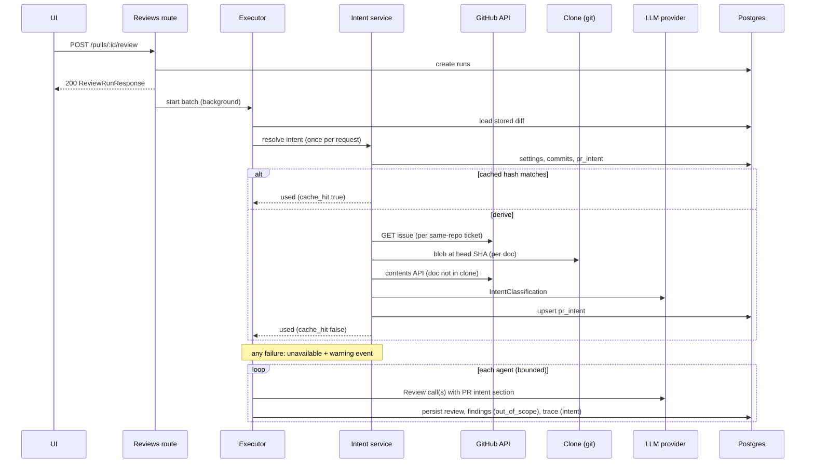
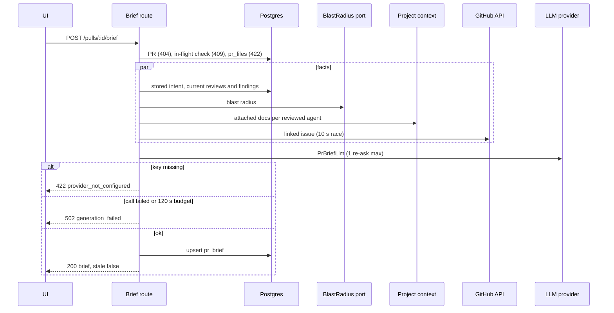
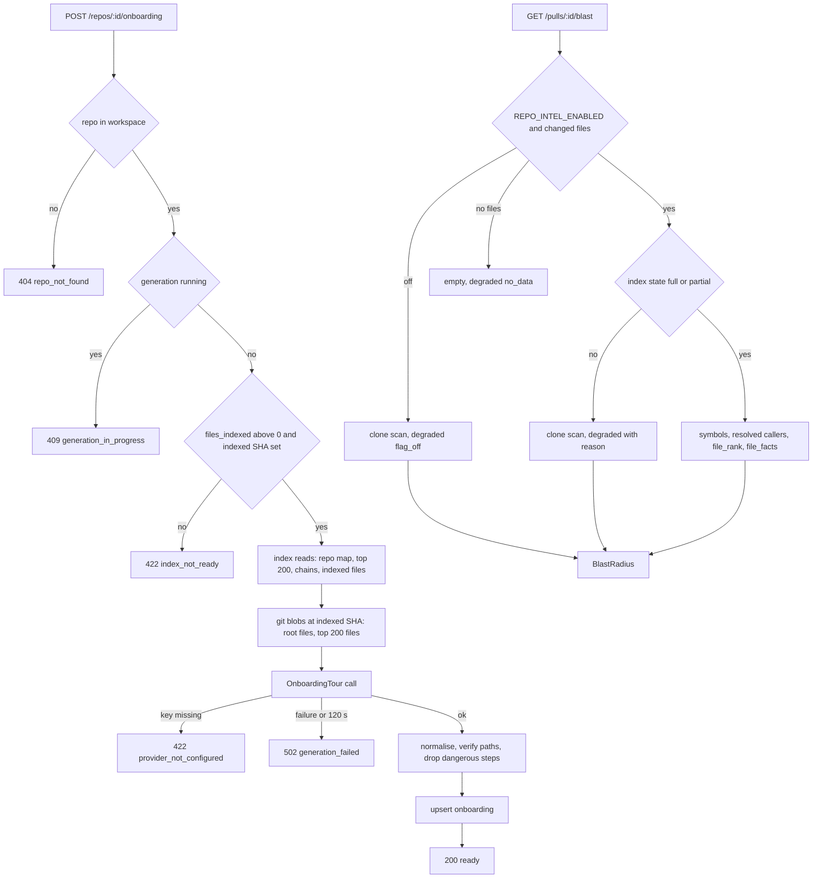

# Go backend migration — Phase 5: intent, smart-diff, blast, brief, onboarding, performance
Spec: Go backend Phase 5 (PR intent + review intent hook, smart diff, blast radius + prior PRs, PR brief, onboarding tour, agent performance — 11 routes) · Status: ready-for-planning · Date: 2026-10-22
Areas: http, intent, exec, engine, smart, blast, hist, brief, onb, perf, llm, gh, port, config, db, ops, test
Design sources: task brief of 2026-10-22; `CLAUDE.md`, `backend/AGENTS.md`, `backend/INSIGHTS.md`; `docs/migration/README.md` (D1–D15), `docs/migration/STATUS.md`; research `docs/migration/research/01-http-api.md` (§0 rate limits, §2 single-feature modules, §4 client map, §5 wire conventions), `02-data-layer.md` (pr_intent, pr_brief, onboarding, access patterns), `03-engine-integrations.md`; contracts `frontend/src/vendor/shared/contracts/{brief,review-api,onboarding,observability,productionize,trace}.ts`, `frontend/src/vendor/shared/constants/onboarding.ts`; Node reference `<dev-digest>` = `/home/ypodop/IdeaProjects/dev-digest` at `d1c9093`: `server/src/modules/{intent,smart-diff,blast,brief,onboarding,performance}/**`, `server/src/modules/reviews/application/{intent-prework,run-executor}.ts`, `server/src/modules/repo-intel/{service,types}.ts`, `application/blast-radius.ts`, `infrastructure/read-repository.ts`, `domain/rules.ts`, `server/src/adapters/codeindex/{ripgrep,extract}.ts`, `server/src/adapters/github/octokit.ts`, `server/src/adapters/git/simple-git.ts`, `server/src/adapters/llm/mock.ts`, `server/src/platform/{container,errors,prompt-log,config}.ts`, `server/src/http/error-handler.ts`, `reviewer-core/src/{prompt.ts,review/scope.ts,review/run.ts}`, `server/src/vendor/shared/constants/feature-models.ts`; two research reports made for this spec: R-ui (frontend callers of the 11 routes) and R-go (Go integration inventory at `c7de1c0`); Go code of Phases 1–4 under `backend/`. No design frames.
Related: `specs/2026-10-21-go-backend-phase-1.md`, `specs/2026-10-22-go-backend-phase-2.md`, `specs/2026-10-22-go-backend-phase-3.md`, `specs/2026-10-22-go-backend-phase-4.md`. This spec replaces: the Phase 4 Out-of-scope lines that list the 11 routes as unregistered, that forbid intent derivation (no LLM call before a review, no `pr_intent` row, no `## PR intent`, `out_of_scope` always false, `trace.intent` always null) and that leave `BlastRadius` unimplemented; Phase 4 FR4028 and the "`intent` null" parts of Phase 4 sections 7.3, 7.6 and 7.8, which from now on hold only when `REVIEW_INTENT_ENABLED=false` (section 7.5). It completes README decision D14.

**ID convention.** Phase 5 IDs use the 5000 range: FR5001…, EC5001…, NFR5001…, AC5001…, US5001…, D5001…, Q5001…. Earlier-phase items are written with "Phase N" in front and never appear in a `Traces:` line.

## 1. Goal
The PR page, the onboarding page and the agent-performance pages of the unchanged UI read eleven routes the Go backend does not serve yet: the derived PR intent and its refresh, the role-grouped diff, the blast radius and prior PRs, the PR brief, the per-repo onboarding tour, and the agent performance dashboard and stats. Phase 5 ports these six Node modules and the intent pre-work that Phase 4 left out (D4001): before the agents of a review run, the backend derives (or reuses) the PR's intent once, adds a `## PR intent` section to every review prompt, keeps the model's out-of-scope judgment on findings, and records the intent in the run trace. The routes are wire-compatible with the UI, three new structured LLM calls go through the Phase 2/4 LLM layer, the GitHub client gains the reads the features need, and the repo-intel read port gains `BlastRadius`. A developer can use all of it with real keys, or (except the onboarding tour, as in Node) with the deterministic mock provider.

## 2. Context
- Node routes: intent `<dev-digest>/server/src/modules/intent/http/routes.ts:18-37` (refresh limited by `REFRESH_RATE_LIMIT` 10/min, `domain/constants.ts:47`); smart-diff `smart-diff/http/routes.ts:16-23`; blast `blast/http/routes.ts:18-34`; brief `brief/http/routes.ts:20-36`; onboarding `onboarding/http/routes.ts:20-36`; performance `performance/http/routes.ts:19-35` with `PeriodQuery` (`http/schemas.ts:10-41`). Research 01 §2 lists them; §0 lists the refresh limit as the only per-route bucket among them.
- Error mapping (`server/src/http/error-handler.ts:25-36`, `platform/errors.ts`): `NotFoundError` 404 `not_found` (or an explicit code), `ConflictError` 409, `ValidationError` 422, `ExternalServiceError` 502; `details` omitted when undefined.
- Intent (`intent/application/intent-service.ts`): a cheap cache key (feature model, title, body, branch, head SHA, ticket numbers, doc paths, prompt version 2) is hashed before any fetch (`:290-311`); a stored row with the same hash is reused (`:158-164`); otherwise one shared, single-flight derivation per `prId:hash` (`:165-237`) fetches same-repo GitHub issues and linked docs at the head SHA (`:399-450`, `infrastructure/{ticket-source,doc-source}.ts`), adds commits/branch/changed files only when the PR text is thin (`:452-468`), makes one classification call (`domain/classification.ts`, `infrastructure/llm-model.ts`), clamps the output, sets confidence by code (`domain/intent.ts:57-60`) and upserts `pr_intent` (`infrastructure/repository.ts:25-51`). Link extraction is pure (`domain/links.ts`). Budget 120 s (`domain/constants.ts:34`).
- Review hook (`reviews/application/run-executor.ts:100-133`, `intent-prework.ts`): after "Diff ready" and before the agents, once per request, never failing the review; aborted only when every queued run is cancelled. Wired only when `REVIEW_INTENT_ENABLED` is not `false` (`reviews/composition.ts:37-38`, `platform/config.ts:188`). The engine renders the intent (`reviewer-core/src/prompt.ts:42-59`), adds `## PR intent` with `INTENT_SCOPE_RULE` after the PR description (`prompt.ts:101-109,297-306`), applies the scope policy and emits a scope event (`review/scope.ts:21-37`, `review/run.ts:300-305`); traces carry the `IntentTrace` (`reviews/domain/trace.ts:63-64,91,108-131`).
- Smart diff (`smart-diff/domain/{classify,constants,smart-diff}.ts`): glob roles, five groups in fixed order, finding lines of each agent's newest review; no model call.
- Blast (`blast/application/blast-service.ts`, `blast/domain/{blast-radius,history}.ts`): one repo-intel read (`repo-intel/application/blast-radius.ts:42-206`) — persistent index path with `MAX_CALLERS_PER_SYMBOL` 20 (`repo-intel/constants.ts:30`), or a degraded scan of the clone with the regex extractor (`adapters/codeindex/ripgrep.ts:95-147`, `extract.ts:72-121`); prior PRs from GitHub (`adapters/github/octokit.ts:135-180`), `[]` on any failure.
- Brief (`brief/application/brief-service.ts`, `brief/domain/{input,normalize,prompt}.ts`): one structured call (plus at most one re-ask) over pre-computed facts, grounding of every path and line, `pr_brief.json` upsert, one generation per PR at a time.
- Onboarding (`onboarding/application/onboarding-service.ts`, `onboarding/domain/{input,prompt,tour,redact,command-safety}.ts`): one structured call over the repo-intel index and a few root files read with git at the indexed commit; redaction, dangerous-command filter, path verification; `onboarding.json` upsert. `server/src/prompts/onboarding.system.md` is not referenced by code (research 03 §1; confirmed).
- Performance (`performance/domain/{metrics,period,trends,order}.ts`, `infrastructure/repository.ts`): read-only folds over counted runs (`done|failed|cancelled`, `local|ci`) of the window and the equally long window before it.
- Mock provider (`server/src/adapters/llm/mock.ts:111-167,239-256`): fixtures for `IntentClassification` and `PrBriefLlm`; none for `OnboardingTour`, which therefore fails under the mock.
- UI (R-ui): every POST goes without body and content type; nothing auto-generates (brief, intent refresh and onboarding POSTs are clicks); after a run ends the UI only re-reads `GET /pulls/:id/intent` (`frontend/src/lib/hooks/reviews.ts:25-35,220-227`); history has a 5-minute stale time; only the onboarding screen branches on error codes (`generation_in_progress`, `index_not_ready`, `provider_not_configured`); elsewhere the server `message` is shown; the stats tab branches on status 404; unguarded array fields must never be `null`; `brief.head_sha`, `degraded === true`, `reason`, `stale`, `stale_reason`, `status`, `agent_id: null` must be exact.
- Go today (R-go, `c7de1c0`): the executor's shared pre-work is `internal/reviews/app/executor/batch.go:24-58` (diff from stored `pr_files`, Phase 4 D4003); intent-off is hard-coded at `internal/reviewer/app/engine.go:116` (`ApplyScopePolicy(.., false)`), `internal/reviews/adapters/postgres/persist.go:79` (`OutOfScope: false`), `tracedoc.go:52,117` and `transport/http/trace.go:18,49` (intent always null); `AssemblePrompt` (`internal/reviewer/domain/prompt.go:82-139`) has no intent section; `REVIEW_INTENT_ENABLED` is not read. `internal/llm` has `Client.Structured` with per-attempt usage, reprompt count, max tokens, prompt-log sections and `ResolveFeatureModel` with the `review_intent`, `risk_brief`, `onboarding` defaults (`internal/llm/featuremodel.go:11`); the mock knows only `ConventionExtraction` and `Review` (`adapters/mock/mock.go:68-74`). `platform/github` has `GetIssue` (`pulls.go:274`) but no contents or merged-PR reads, no `Retry-After` handling. `gitcli` has `BlobAt` and `BaseCommit`, no `ReadFileAt`. `repointel/app.Reader` has `RepoMap`, `TopFilesByRank`, `CriticalPaths`, `ListIndexedFiles`, `CallerSignatures`; `BlastRadius` is announced for Phase 5 (`app/doc.go:24-31`); index state lives on `Service.IndexState` (never fails, synthesises `degraded`/`no_data`). The per-route rate-limit buckets are configured in `cmd/server/app.go:377-389`. Tables `pr_intent` (`migrations/0001_baseline.up.sql:515-540`), `pr_brief` (`:480-486`), `onboarding` (`:470-477`) exist; no Go code touches them. The Phase 4 parity goldens encode intent-off (`internal/reviews/parity/testdata/goldens/{engine,prompt,runs,grounding}.json`; `domain_test.go:339-341` skips the intent rows) and so do the contract goldens `cmd/server/testdata/contracts/review_trace_{completed,ended}.json`.

## 3. Scope
### In scope
- The 11 routes of section 7.2.
- The intent module: cache key, link extraction, source collection (GitHub issues, docs at the head SHA), classification call, persistence, single flight, budget, staleness.
- The review executor hook and its effect on reviews (events, `## PR intent`, scope policy, stored `out_of_scope`, traces), behind `REVIEW_INTENT_ENABLED`.
- Smart-diff classification and read model.
- The repo-intel port operation `BlastRadius` (persistent and degraded paths) and the blast read model; prior merged PRs from GitHub.
- PR brief and onboarding tour generation, storage and staleness.
- Agent performance dashboard and per-agent stats.
- Three structured LLM schemas (`IntentClassification`, `PrBriefLlm`, `OnboardingTour`) and the mock fixtures `IntentClassification` and `PrBriefLlm`.
- GitHub client reads: file contents at a ref, merged pull requests with their files.
- Parity goldens generated from the Node code, contract goldens for every new response shape.

### Out of scope
- No route other than the 11 of section 7.2 is added; `/eval*`, `/ci/*`, `/findings/:id/eval-case` and `/agents/:id/export-ci` still return the standard 404 envelope.
- No existing route changes its status codes, paths or JSON shape.
- No GET route of section 7.2 makes an LLM call; only `GET /pulls/:id/history` makes GitHub calls.
- No intent, brief or onboarding generation is started by a timer, a poll, a job, a page load or the end of a review; the review run derives intent only as its own pre-work (section 7.5).
- No Jira, Linear or other non-GitHub ticket is fetched; no issue or document of another repository is fetched; no URL other than the configured GitHub API base (default `https://api.github.com`) is requested by Phase 5 code.
- No link found inside a fetched ticket or document is followed.
- No diff hunk body is part of the brief prompt.
- The intent call's tokens and cost are never added to `agent_runs.cost_usd`, `agent_runs.tokens_*` or the trace `stats`.
- The port operation `UnresolvedReferences` is not implemented.
- No mock fixture exists for `OnboardingTour`.
- The prior-PR history is not cached.
- No new rate-limit bucket is added other than `POST /pulls/:id/intent/refresh` (10/min).
- `split_suggestion.too_big` is always `false` and `proposed_splits` always `[]`; `pseudocode_summary` is never present.
- `PrBrief.history` is never present.
- No memory entry is retrieved into a prompt; `memory_pulled` statistics read only what traces contain (always `[]` today).
- No new migration version is added.
- No module is added to `backend/go.mod`.
- No change is made to `frontend/` or `frontend/src/vendor/shared`, except new contract-golden entries in `frontend/src/test/go-backend-contracts.test.ts`.
- No `PROMPT_LOG_VERBOSE` mode exists; no log line carries PR, issue, document, repo-file or model text.

## 4. User scenarios
- US5001 — As a developer on a PR page, I read the PR's derived intent (scope, change type, confidence, sources) and refresh it, so that I know what the PR is meant to change.
- US5002 — As a developer, I start a review and the agents get the PR intent as a hint, findings outside the stated scope are marked, and the run trace shows the intent, so that triage is faster and auditable.
- US5003 — As a developer on the Files changed tab, I see the files grouped by role (core, tests, wiring, docs, boilerplate) with the flagged ones marked.
- US5004 — As a developer, I see the blast radius of the PR (changed symbols, their callers, affected endpoints and crons, degraded state) and prior merged PRs that touched the same files.
- US5005 — As a developer, I generate and read a PR brief (summary, risks with file references, review focus, missing inputs), and see when it is out of date.
- US5006 — As a newcomer, I generate and read an onboarding tour of a repository and see when it is out of date.
- US5007 — As a team lead, I compare agents' runs, accept rates and costs over a period, and open one agent's stats.
- US5008 — As a developer without API keys, I use intent and brief with the mock provider (the onboarding tour fails as in Node).
- US5009 — As an operator, I switch the review intent pre-work off with `REVIEW_INTENT_ENABLED=false`.

## 5. Functional requirements
HTTP routes (shapes and errors in sections 7.2–7.3)
- FR5001 [http] — `GET /pulls/:id/intent` shall answer `{"intent": <stored record or null>, "stale": <bool>}` for a PR of the workspace, with `stale` computed as section 7.4.8 and `false` when no record exists; it shall make no LLM and no GitHub call; an unknown PR answers 404 "Pull request not found". (US5001)
- FR5002 [http] — `POST /pulls/:id/intent/refresh` shall re-derive the intent ignoring the cached row (joining an in-flight derivation of the same key), answer `{"intent": <new record>, "stale": false}`, have its own rate-limit bucket of 10 requests per minute per client, ignore any request body, and work whatever `REVIEW_INTENT_ENABLED` is (D5002); errors per section 7.2. (US5001)
- FR5003 [http] — `GET /pulls/:id/smart-diff` shall answer the `SmartDiff` of section 7.6; an unknown PR answers 404 "Pull request not found". (US5003)
- FR5004 [http] — `GET /pulls/:id/blast` shall answer the `BlastRadius` built (section 7.7.3) from one `BlastRadius` port read over the PR's stored changed paths and write one info log line (section 7.15); an unknown PR answers 404. (US5004)
- FR5005 [http] — `GET /pulls/:id/history` shall answer `{"history": [...]}` per section 7.8 and answer 200 `{"history":[]}` when the PR has no stored files, no GitHub token is set, or any GitHub call fails; an unknown PR answers 404. (US5004)
- FR5006 [http] — `GET /pulls/:id/brief` shall answer `{"brief": <stored brief or null>, "stale": <bool>}` (section 7.9.6) and never call a model. (US5005)
- FR5007 [http] — `POST /pulls/:id/brief` shall generate, store and return a brief (section 7.9) as `{"brief": …, "stale": false}`, checking in this order: PR exists (404), no generation running for the PR (409), stored files exist (422 `no_changed_files`), then the model call (422 `provider_not_configured`, 502 `generation_failed`). (US5005)
- FR5008 [http] — `GET /repos/:id/onboarding` shall answer `{"status":"none"}` or `{"status":"ready","stale":…,["stale_reason":…,]"tour":…}` (section 7.10.6); a repo outside the workspace answers 404 code `repo_not_found` "Repo not found". (US5006)
- FR5009 [http] — `POST /repos/:id/onboarding` shall generate, store and return a tour (section 7.10) as `OnboardingTourReady` with `stale:false`, checking repo (404 `repo_not_found`), running generation (409), index readiness (422 `index_not_ready`), then the model call (422 `provider_not_configured`, 502 `generation_failed`). (US5006)
- FR5010 [http] — `GET /agents/performance` shall answer `AgentPerf` (section 7.11.4) for the validated period query (section 7.11.1). (US5007)
- FR5011 [http] — `GET /agents/:id/stats` shall answer `AgentStats` (section 7.11.5); an agent outside the workspace answers 404 "Agent not found"; the static path `/agents/performance` shall never be matched as `/agents/:id`. (US5007)

Intent derivation (section 7.4)
- FR5012 [intent] — The derivation key shall be computed as section 7.4.1 from the workspace's `review_intent` feature model, the PR fields, the PR's stored commits and the extracted ticket and doc references, before any ticket, doc or LLM request. (US5001, US5002)
- FR5013 [intent] — Unless forced, a stored record whose `input_hash` equals the key's hash shall be reused with no fetch and no LLM call; otherwise the intent shall be derived. (US5002)
- FR5014 [intent] — Ticket references shall be extracted from the title, body and commit messages by the rules of section 7.4.2 (same-repo issues only, closing keywords first, at most 3, the rest and foreign or Jira-style references recorded as skipped). (US5001)
- FR5015 [intent] — Document references shall be extracted from the title and body by the rules of section 7.4.2 (same-repo, documentation extensions, safe paths, priority order, at most 5). (US5001)
- FR5016 [intent] — Sources shall be collected in the order and with the limits of section 7.4.3; tickets through the GitHub issue read, documents from the clone at the head SHA with the GitHub contents fallback; a failed fetch becomes a `failed` source, never an error. (US5001)
- FR5017 [intent] — `derived_from`, the fallback sources and `confidence` shall be set by code as section 7.4.3. (US5001)
- FR5018 [intent] — The derivation shall make one structured call as section 7.4.4 and emit one content-free `prompt_assembled` line with feature `intent`. (US5001)
- FR5019 [intent] — The model output shall be clamped and the record upserted and mapped as section 7.4.5. (US5001)
- FR5020 [intent] — Concurrent derivations of one PR and key shall share one in-flight derivation bounded by 120 s and aborted only when every attached caller with a cancellation has cancelled (section 7.4.6). (US5002)
- FR5021 [intent] — The review path shall publish the intent events of section 7.4.7 and turn every failure into an `unavailable` result with a warning event, never an error. (US5002)

Review intent hook (section 7.5)
- FR5022 [config] — The backend shall read `REVIEW_INTENT_ENABLED` as section 7.14: on unless the trimmed value is exactly `false`. (US5009)
- FR5023 [exec] — With the switch on, each review request shall resolve the intent once, after the "Diff ready" event and before any agent run starts, with the inputs of section 7.5, publishing its events to every queued run. (US5002)
- FR5024 [engine] — With an intent, every LLM call of every agent run of the request shall contain the `## PR intent` section of section 7.5, the prompt log shall list `intent_rule` and `intent`, and the trace prompt assembly shall carry the rendered intent text. (US5002)
- FR5025 [engine] — With an intent, the scope policy shall keep every finding, coerce `out_of_scope` to a boolean, emit the scope event after the grounding result, and the stored finding's `out_of_scope` shall be that boolean. (US5002)
- FR5026 [exec] — Completed and ended traces shall carry `intent` = the `IntentTrace` of section 7.5 (used or unavailable); its tokens and cost shall not enter the run's usage. (US5002)
- FR5027 [exec] — With the switch off the review shall behave exactly as Phase 4 (no intent event, no section, `out_of_scope` false, `trace.intent` null); with the switch on and the intent unavailable the review shall have no section and store `out_of_scope` false. (US5009)

Smart diff (section 7.6)
- FR5028 [smart] — Each stored PR file shall be classified into one role by the glob rules of section 7.6. (US5003)
- FR5029 [smart] — The read model shall hold the five groups in fixed order, files sorted by path, `finding_lines` from every finding (dismissed included) of each agent's newest review, and the split suggestion of section 7.6. (US5003)

Blast radius and history (sections 7.7–7.8)
- FR5030 [port] — The repo-intel read port shall gain `BlastRadius(repoId, changedFiles)` whose persistent path follows section 7.7.1. (US5004)
- FR5031 [port] — When the index is unusable or the switch `REPO_INTEL_ENABLED` is off, `BlastRadius` shall answer from the bounded clone scan of section 7.7.2, tagged degraded with the reason. (US5004)
- FR5032 [blast] — The port result shall be mapped to `BlastRadius` by section 7.7.3 (grouping, dedupe, order, endpoints and crons, summary, flags). (US5004)
- FR5033 [hist] — Prior PRs shall be selected from the repository's recent merged PRs as section 7.8. (US5004)

PR brief (section 7.9)
- FR5034 [brief] — Generation shall gather the facts of section 7.9.1 (files and ranges, current findings, stored intent, blast radius, attached documents, linked issue). (US5005)
- FR5035 [brief] — `missing_inputs` shall list every absent or dropped input as section 7.9.2. (US5005)
- FR5036 [brief] — The prompt shall be built and trimmed to the input budget as section 7.9.3. (US5005)
- FR5037 [brief] — The model call, its error mapping and the 120 s budget shall follow section 7.9.4. (US5005)
- FR5038 [brief] — The model output shall be normalised and grounded as section 7.9.5 before storing. (US5005)
- FR5039 [brief] — The brief shall be stored, read, marked stale and limited to one generation per PR at a time as section 7.9.6; a failed generation keeps the previous brief. (US5005)
- FR5040 [brief] — Each generation shall write the log lines of section 7.15 (generation outcome, one line per model response, prompt assembly) without PR text. (US5005)

Onboarding tour (section 7.10)
- FR5041 [onb] — Generation shall require a ready index and gather the inputs of section 7.10.1 at the indexed commit. (US5006)
- FR5042 [onb] — README and compose excerpts shall be redacted, `.env.example` reduced to variable names, and the scripts, TODO and untested-file signals built as section 7.10.2. (US5006)
- FR5043 [onb] — The prompt shall be built and trimmed as section 7.10.3. (US5006)
- FR5044 [onb] — The model call and its error mapping shall follow section 7.10.4. (US5006)
- FR5045 [onb] — The model output shall be normalised (paths verified against the index, dangerous run steps dropped, limits and minimums applied) as section 7.10.5. (US5006)
- FR5046 [onb] — The tour shall be stored, read, marked stale and limited to one generation per repo at a time, with one outcome log line, as section 7.10.6. (US5006)

Performance (section 7.11)
- FR5047 [perf] — Both performance routes shall validate the period query as section 7.11.1 and answer 422 `validation_error` on a violation before any query runs. (US5007)
- FR5048 [perf] — The window and the previous window shall be resolved as section 7.11.2. (US5007)
- FR5049 [perf] — Per-agent metrics, rows, summaries, cost segments and trends shall be computed as section 7.11.3. (US5007)
- FR5050 [perf] — The dashboard shall contain one row per agent of the workspace (zero runs included) ordered by name, plus the deleted-agents row when the window has such runs (section 7.11.4). (US5007)
- FR5051 [perf] — The stats response shall be built as section 7.11.5, its metrics equal to the agent's dashboard row for the same period. (US5007)

LLM, GitHub, tests
- FR5052 [llm] — The three structured schemas shall equal, as JSON, Node's `toJsonSchema` output for `IntentClassification`, `PrBriefLlm` and `OnboardingTour`, and answers shall be validated against the original Zod constraints (section 7.12). (US5001, US5005, US5006)
- FR5053 [llm] — With `LLM_PROVIDER_OVERRIDE=mock`, the schema names `IntentClassification` and `PrBriefLlm` shall return the fixtures of section 7.12 with usage 1,200/180 and cost 0.00042 in one attempt; `OnboardingTour` shall fail with the "no fixture" error. (US5008)
- FR5054 [gh] — The GitHub client shall read a file's content at a ref through the contents API with the size check of section 7.13. (US5001)
- FR5055 [gh] — The GitHub client shall list a repository's recently closed pull requests and the files of each merged one as section 7.13. (US5004)
- FR5056 [test] — Contract goldens recorded by Go component tests shall exist for every JSON response shape of section 7.2 and for a review trace with intent, and be validated by the frontend contract test with strict schemas. (US5001–US5007)
- FR5057 [test] — Parity goldens shall be generated by running the Node code at `d1c9093` (Phase 3/4 generator rules) for every pure rule of sections 7.4–7.12; the Phase 4 goldens shall keep passing unchanged with `REVIEW_INTENT_ENABLED=false`. (US5002)

## 6. Workflow and communication

Review request with intent (switch on):

Brief generation:

Onboarding and blast flows:

Interactions (caller → callee, mode, on failure):
| Caller → callee | Trigger | Mode | On failure / timeout |
|---|---|---|---|
| Executor → intent service | each review request, switch on | sync, inside the background batch | unavailable result, warning event, review continues (FR5021) |
| Intent → settings / pr_commits / pr_intent | key computation | sync DB | review: unavailable; GET: `stale:false`; refresh: 502 `intent_unavailable` |
| Intent → GitHub issues | per same-repo ticket | sync HTTPS, 30 s per request, retries, inside the 120 s budget | `failed` source with the error text; never the token |
| Intent → clone blob / GitHub contents | per linked doc | sync git, then HTTPS | too large: `failed`, no fallback; other: `failed` "not found" |
| Intent → LLM (`review_intent` model) | cache miss or refresh | sync HTTPS (Phase 2 retries, 120 s derivation budget) | unavailable with the error text (key names, never key values) |
| Blast route → `BlastRadius` port | GET blast, brief generation | sync DB / bounded clone scan (30 s) | DB error: 500 on GET, `blast/degraded` in a brief; scan timeout: empty degraded result |
| History route → GitHub pulls | GET history | sync HTTPS, 1 + up to 30 requests, 5 in flight | warn log, `{"history":[]}` |
| Brief → intent, blast, project context, GitHub issue, LLM | POST brief | sync, facts in parallel | intent/blast read failure: missing input; issue: `fetch_failed`; LLM: 422/502; budget: 502 |
| Onboarding → index state, Reader, git blobs, LLM | POST onboarding | sync; blob reads ≤ 8 in flight per list | missing or oversize file: absent; LLM: 422/502; budget: 502 |
| Performance → Postgres | GET dashboard / stats | sync read-only | 500 `internal_error` |

## 7. Contracts
### 7.1 Cross-cutting
- Error envelope, 422 `details`, `Host` allow-list, foreign-`Origin` 403 on POST, CORS, security headers, global rate limit 120/min: as Phase 1 section 7.1. Path ids must be UUIDs (422 `validation_error`, `details[0].instancePath` `/id`). The three POST routes accept no body and no content type (the UI sends neither) and ignore any body they receive.
- Object keys are emitted in contract field order (section 7.3), also for documents read back from `jsonb` (whose stored key order differs); nullable fields are always present; optional fields only where section 7.3 says so; arrays are `[]`, never `null` (R-ui lists the arrays the UI dereferences unguarded).
- Timestamps: ISO-8601 UTC with milliseconds (`…Z`). Numbers: JSON numbers formatted as JavaScript does (Go `encoding/json` float formatting); `numeric(12,6)` columns are read as the nearest float64 of the stored decimal.
- Lengths, cuts and token estimates use UTF-16 code units (JavaScript `length`/`slice`); token estimate = ⌈units / 4⌉. "Cut(text, max)" means: trim with JavaScript `String.prototype.trim` semantics (`reviewer/domain.JSTrim`), return it when ≤ max units, else its first max − 1 units followed by `…` (U+2026); a cut that leaves a lone surrogate is encoded as U+FFFD when the text is stored or sent (Node's UTF-8 encoding).
- Text read from git or GitHub is decoded as UTF-8 with WHATWG replacement (`repointel/domain.DecodeText`).
- "English collation" = `golang.org/x/text/collate` with `language.English`, equal to Node `localeCompare` (INSIGHTS; Phase 4 multi-agent order). "Code-unit order" = JavaScript `<` on strings (UTF-16 code units).
- JavaScript regular expressions are ported with JavaScript semantics: `\w`, `\b`, `\d` are ASCII; `/i` without `u` never folds U+017F or U+212A (INSIGHTS: use explicit classes); look-behinds and back-references are hand-written (D5010). No new regex module is added.
- Error messages listed in section 7.2 are user-visible (R-ui) and must match byte for byte.

### 7.2 HTTP routes
| Route | Request | Success | Errors |
|---|---|---|---|
| `GET /pulls/:id/intent` | — | 200 `PrIntentResponse` | 422; 404 `not_found` "Pull request not found" |
| `POST /pulls/:id/intent/refresh` | body ignored; bucket 10/min | 200 `PrIntentResponse` (`stale:false`) | 422; 403 foreign `Origin`; 404 "Pull request not found"; 404 "Repo not found"; 502 `intent_unavailable` "Intent derivation failed: <warning>"; 429 (code `internal_error`) |
| `GET /pulls/:id/smart-diff` | — | 200 `SmartDiff` | 422; 404 "Pull request not found" |
| `GET /pulls/:id/blast` | — | 200 `BlastRadius` | 422; 404 "Pull request not found"; 500 `internal_error` on a database error |
| `GET /pulls/:id/history` | — | 200 `PrHistory` | 422; 404 "Pull request not found" (GitHub failures are 200 `{"history":[]}`) |
| `GET /pulls/:id/brief` | — | 200 `PrBriefResponse` | 422; 404 "Pull request not found" |
| `POST /pulls/:id/brief` | body ignored | 200 `PrBriefResponse` (`stale:false`) | 422; 403; 404 "Pull request not found"; 409 `generation_in_progress` "A brief is already being generated for this pull request"; 422 `no_changed_files` "The pull request has no changed files"; 422 `provider_not_configured` "The <provider> provider is not configured", `details` `{"provider":"<provider>"}`; 502 `generation_failed` "The model call failed" or "Generation timed out" |
| `GET /repos/:id/onboarding` | — | 200 `OnboardingTourState` | 422; 404 `repo_not_found` "Repo not found" |
| `POST /repos/:id/onboarding` | body ignored | 200 `OnboardingTourReady` (`stale:false`) | 422; 403; 404 `repo_not_found` "Repo not found"; 409 `generation_in_progress` "A tour is already being generated for this repository"; 422 `index_not_ready` "The repository index is not ready yet"; 422 `provider_not_configured` (as brief); 502 `generation_failed` "The model call failed" or "Generation timed out" |
| `GET /agents/performance` | query `period`, `from`, `to` (section 7.11.1) | 200 `AgentPerf` | 422 `validation_error` |
| `GET /agents/:id/stats` | same query | 200 `AgentStats` | 422; 404 `not_found` "Agent not found" |

`<provider>` is `openai`, `anthropic` or `openrouter`. `<warning>` is the message of the failure that made the derivation unavailable (section 7.4.7). Validation order for the stats route: `:id`, then the query. `/agents/performance` is a static route and wins over `/agents/:id` and `/agents/:id/*`.

### 7.3 Response shapes
Keys in the order shown. Contract files: `brief.ts`, `review-api.ts:73-101`, `onboarding.ts`, `observability.ts:135-262`, `productionize.ts:140-187`.
- `PrIntentResponse`: `intent` (record or `null`), `stale`. Record: `intent`, `in_scope`, `out_of_scope`, `change_type` (enum or `null`), `confidence` (enum or `null`), `derived_from`, `sources` [`kind`, `ref`, `status`, `detail` (string or `null`, always present)], `pr_id`, `head_sha`, `input_hash`, `prompt_version`, `provider`, `model`, `tokens_in`, `tokens_out`, `cost_usd` (number or `null`), `derived_at`. Row mapping: `head_sha`, `input_hash`, `provider`, `model` `""` when NULL; `prompt_version`, `tokens_*` 0 when NULL; a row with NULL `derived_at` counts as no record.
- `SmartDiff`: `groups` — always five, in order `core`, `tests`, `wiring`, `docs`, `boilerplate`, each `{role, files}` with files `{path, additions, deletions, finding_lines}`; `split_suggestion` `{too_big: false, total_lines, proposed_splits: []}`.
- `BlastRadius`: `changed_symbols` [`name`, `file`, `kind`], `downstream` [`symbol`, `callers` [`name`, `file`, `line`], `endpoints_affected`, `crons_affected`], `summary`, `degraded` (always present: `false` for a complete persistent answer, `true` otherwise), `reason` (present only when `degraded` is `true`).
- `PrHistory`: `history` [`pr_number`, `title`, `merged_at`, `author`, `files_overlap`, `notes` (`""`)].
- `PrBriefResponse`: `brief` (or `null`), `stale`. `PrBrief`: `summary`, `risks` `{risks: [kind, title, explanation, severity, file_refs]}`, `review_focus` [`file`, `line`, `reason`], `intent` (Intent snapshot or `null`: `intent`, `in_scope`, `out_of_scope`, `change_type`, `confidence`, `derived_from`, `sources`), `blast` (BlastRadius or `null`), `missing_inputs` [`input`, `reason`, `detail` only when set], `specs_used`, `head_sha`, `generated_at`, `prompt_version` (`"v1"`), `provider`, `model`, `tokens_in`, `tokens_out`, `cost_usd`, `model_requests` (1 or 2). `history` is never present.
- `OnboardingTourState`: `{"status":"none"}` or `OnboardingTourReady`: `status` `"ready"`, `stale`, `stale_reason` (only when `stale` is true), `tour`. Tour: `repo_id`, `generated_at`, `indexed_sha`, `files_indexed`, `provider`, `model`, `tokens_in`, `tokens_out`, `cost_usd`, `prompt_version` (1), `language` (`"en"`), `architecture` `{summary, nodes [id, label, kind], edges [from, to]}`, `critical_paths` [`path`, `reason`], `run_steps` [`command`, `comment` only when non-empty], `reading_path` [`path`, `reason`], `first_tasks` [`title`, `path`, `complexity`].
- `AgentPerf`: `period` `{key, from, to}`, `min_decisions` (5), `cost_basis` `"estimate"`, `summary`, `previous_summary`, `runs_trend` [`label`, `value`], `agents` (rows), `cost_by_agent`, `cost_by_model` [`key`, `label`, `value`, `runs`]. Summary: `runs`, `priced_runs`, `unpriced_runs`, `accepted`, `dismissed`, `pending`, `decisions`, `total_cost_usd`, `avg_accept_rate`, `most_active` (`{agent_id, agent_name, runs}` or `null`). Row: `agent_id` (or `null`), `agent_name`, `metrics`, `previous`, `runs_trend`. Metrics: `runs`, `runs_done`, `runs_failed`, `runs_cancelled`, `runs_local`, `runs_ci`, `priced_runs`, `unpriced_runs`, `total_cost_usd`, `avg_cost_usd`, `avg_duration_ms`, `last_run_at`, `findings_total`, `accepted`, `dismissed`, `pending`, `decisions`, `accept_rate`, `small_sample`.
- `AgentStats`: `agent_id`, `agent_name`, `period`, `min_decisions`, `cost_basis`, `metrics`, `previous`, `runs_trend`, `cost_by_model`, `skills_used` [`key`, `label`, `runs`], `memory_pulled` (same), `findings_by_severity` [`from`, `critical`, `warning`, `suggestion`], `findings_by_category` [`category`, `count`], `run_history` [`run_id`, `ran_at`, `status`, `source`, `pr` (`{id, repo_id, number}` or `null`), `tokens` (or `null`), `cost_usd`, `findings_count`, `has_trace`].
- A stored brief or tour is validated against its contract on read (limits included); one that fails reads as absent (`brief: null` / `status: none`), never as an error.

### 7.4 Intent derivation
#### 7.4.1 Key
- Resolved model = `llm.ResolveFeatureModel(settings, "review_intent")` (default `openrouter` / `deepseek/deepseek-v4-flash`).
- Commits = the PR's `pr_commits` ordered by `committed_at` ascending (NULL last), then `id` (D5009).
- Ticket and doc references per section 7.4.2 (tickets from title, body or `""`, then each commit message; docs from title and body).
- Key input (canonical JSON: keys sorted, no whitespace, JavaScript `JSON.stringify` escaping — no HTML escaping, U+2028/U+2029 not escaped): `body` (body or `""`), `branch`, `doc_paths` (sorted in code-unit order), `head_sha`, `model`, `prompt_version` (2), `provider`, `ticket_refs` (numbers ascending), `title`. `input_hash` = lowercase hex SHA-256 of its UTF-8 bytes.
- Any failure while computing the key (database error, malformed URI escape in a doc link) makes the derivation unavailable (section 7.4.7).

#### 7.4.2 Link extraction
Tickets (`intent/domain/links.ts:29-111`), per text in order, skipping empty texts:
1. Issue URLs `https?://github\.com/([A-Za-z0-9_.-]+)/([A-Za-z0-9_.-]+)/issues/(\d+)\b`; 2. `\b([A-Za-z0-9_.-]+)/([A-Za-z0-9_.-]+)#(\d+)\b`; 3. bare `#(\d+)\b` not preceded by `[A-Za-z0-9_]` or `/`; 4. Jira-style `\b([A-Z][A-Z0-9]{1,9}-\d{1,6})\b`.
- Kinds 1–2 with owner and name equal to the repo's (ASCII case-insensitive) and kind 3 yield a number (JavaScript `Number` of the digits); the number is marked closing when `\b(?:close[sd]?|fix(?:e[sd])?|resolve[sd]?)\b` (ASCII case-insensitive) matches the 24 units before the match start; a number seen again ORs its closing flag. Other owners give skipped `{ref: <whole match>, reason: "issue reference from a different repository (<owner>/<name>)"}`.
- Kind 4: ignored when the part before the first `-` is one of `UTF SHA ISO RFC CVE HTTP HTTPS TLS SSL AES RSA GPT ES ECMA IPV X`; otherwise skipped `{ref: <key>, reason: "Jira/Linear-style keys are not supported (server/specs/05-intent-layer.md)"}`.
- Skipped entries are deduplicated by (ref, reason), first kept. Numbers are ordered closing first, then first-seen (stable); the first 3 are the refs; each further number becomes skipped `{ref: "#<n>", reason: "ticket limit reached (max 3)"}`. A ref's string form is the JavaScript `String(number)`.

Docs (`links.ts:113-220`), per text (title, body):
1. Markdown links `\[[^\]]*\]\(([^)\s]+)\)`: a target starting with `http://` or `https://` (case-insensitive) must match `https?://github\.com/([A-Za-z0-9_.-]+)/([A-Za-z0-9_.-]+)/(?:blob|tree)/[^/]+/([^\s)]+)` — no match: skipped `{target, "non-GitHub or non-blob/tree URL (no arbitrary URL fetch)"}`; another repo: skipped `{target, "doc link points outside this repo (<owner>/<name>)"}`; else consider `decodeURIComponent(path)`. Other targets are considered as written.
2. Every blob/tree URL in the text: another repo → skipped `{whole match, "doc link points outside this repo (<owner>/<name>)"}`; else consider the decoded path.
3. Prose: replace every markdown link match, then every `https?://\S+` match, by the same number of spaces (UTF-16 units); every match of `\b((?:[\w-]+/)*[\w.-]+\.(?:md|mdx|markdown|txt))\b` (extension case-insensitive) is considered.
- Consider(raw): remove one leading `./`, then a trailing run of `)`, `]`, `}`, `,`, `.`; ignore it silently unless it ends (case-insensitively) with `.md`, `.mdx`, `.markdown` or `.txt`; a path starting with `/` or containing `..`, `\` or NUL → skipped `{path, "unsafe path"}`; else a candidate (set).
- `decodeURIComponent` follows JavaScript: an invalid escape fails with the message `URI malformed`.
- Candidates are ordered by priority (`docs/plans/…` 0; containing `/specs/` or starting `specs/` 1; starting `docs/` 2; other 3), then English collation; the first 5 are the refs; the rest skipped `{path, "doc limit reached (max 5)"}`.

#### 7.4.3 Sources
Collected in this order (`intent-service.ts:399-468`), each `{kind, ref, status, detail}` plus prompt content:
1. `title` / `"title"` / `used`, content Cut(title, 300).
2. When the body is non-empty: `body` / `"body"` / `used` or `truncated` (Cut(body, 6,000) shortened it), that content.
3. Per ticket ref in order: GitHub issue read (section 7.13) → content Cut(`<issue title>\n\n<issue body or "">`, 3,000), status `used`/`truncated`, ref = the number's string; failure → `failed` with `detail` = the error text (D5006). Then every skipped ticket as `skipped` with its reason.
4. Docs with a budget of 20,000 units: when the budget is ≤ 0 the doc is `skipped` "doc total budget reached"; else read (below); failure → `failed` with the reason; success → content Cut(text, min(8,000, budget)), budget −= its length, status `truncated` when cut or when the read was truncated, else `used`. Then every skipped doc as `skipped`.
- Doc read (`infrastructure/doc-source.ts`): not a doc extension → `unsupported file type '<path>'`; unsafe (empty, starts with `/` or `-`, contains `..`, `\` or NUL, or any segment `.git`) → `unsafe path`; then the blob `<head SHA>:<path>` from the clone (Phase 1 `gitcli.BlobAt`, head SHA must match `^[0-9a-f]{7,40}$` case-insensitively) with a 65,536-byte cap checked before reading: over the cap → failed `File '<path>' at <sha> is too large (<size> bytes > 65536)` with no GitHub call; any other clone failure → GitHub contents read at the head SHA (section 7.13) with the same cap: absent, not a file, no content, over the cap or any GitHub error → failed `not found`. Content longer than 65,536 units is cut to its first 65,536 units and marked truncated.
- `derived_from` = `explicit` when the body is substantive or a ticket or doc source is `used`/`truncated`, else `inferred`. Substantive: remove `<!--[\s\S]*?-->`, split at `\n`, drop lines matching `^\s{0,3}#{1,6}\s+\S.*$` (JavaScript: `.` does not match `\r`, so a heading line ending in `\r` is kept), join with `\n`, trim; ≥ 40 units.
- Inferred only, appended: `commits` / `"commits"` / `used` with the first 30 commit messages each Cut(…, 200) joined by `\n` (only with ≥ 1 commit); `branch` / `"branch"` / `used`, Cut(branch, 120); `diff` / `"changed-files"` / `used` with the non-empty parts of [`Changed files:\n` + the first 100 changed paths joined by `\n` (when any), Cut(diff excerpt, 6,000) (when given)] joined by `\n\n`, only when non-empty.
- `confidence`: `inferred` → `low`; `explicit` → `medium` when any ticket or doc source is `skipped` or `failed`, else `high`.

#### 7.4.4 Classification call
- Sources block: for each source whose content has non-blank text, `<heading>\n<wrapped>`, joined by `\n\n`; headings `### PR title`, `### PR description`, `### Linked ticket #<ref>`, `### Linked doc: <ref>`, `### Commit messages`, `### Branch name`, `### Changed files`; wrapped = `<untrusted source="<label>">\n<content>\n</untrusted>` with Phase 4 tag neutralisation, label = `intent-<kind>-<ref>` with every run of characters outside `[a-zA-Z0-9-]` replaced by `-`, lower-cased.
- Messages: system = Node `CLASSIFICATION_SYSTEM_PROMPT` verbatim (`intent/domain/classification.ts:24-33`); user = `Classify the intent of this pull request from the material below.` + `\n\n` + block + `\n\n` + `Return the classification as structured output.`
- Call: resolved provider and model, schema `IntentClassification` (section 7.12), temperature 0 (Phase 2 reasoning-model rules apply), max output tokens 5,000, 1 reprompt, no session id, cancelled by the derivation context.
- Prompt log: feature `intent`, correlation id `intent:<pr id>:<first 12 hex of the hash>`, sections `system` (engine, trusted, system prompt), `task` (engine, trusted, prefix + `\n\n` + suffix), `intent_sources` (repo, untrusted, the block, `items` = number of sources); role `system` for `system`, else `user`.

#### 7.4.5 Result and persistence
- Clamps: `intent` = Cut(…, 500); `in_scope`, `out_of_scope` = the first 10 items, each Cut(…, 240), empty results removed; `change_type` as returned.
- Upsert `pr_intent` on `pr_id` with every column: texts and lists, `change_type`, `confidence`, `derived_from`, `sources` (`detail` `null` when none), `head_sha`, `input_hash`, `prompt_version` 2, `provider`, `model`, `tokens_in`, `tokens_out`, `cost_usd` (the call's totals over its attempts, Phase 2 `Result`; `null` when unpriced), `derived_at` = now. The answered record is the stored row (cost rounded to 6 decimals by the column).

#### 7.4.6 Single flight and budget
- One in-flight derivation per `<pr id>:<hash>` in the process; a caller with the same key joins it and receives its events from then on. Forced calls skip only the cache check.
- The derivation ends with an error when 120 s have passed since it started (`intent derivation exceeded its 120000ms budget`) or when every joined caller that has a cancellation has cancelled (message of that cancellation; the review executor's is `This operation was aborted`); ticket and doc reads and the LLM call honour it. A caller that cancels stops waiting at once. The entry is removed when the derivation ends.

#### 7.4.7 Events and failure (review path)
- Cache hit: info `PR intent ready (cached, confidence=<confidence>)` (`null` when the row has none).
- Derived: info `PR intent sources: <used+truncated> used, <skipped> skipped, <failed> failed`, then (after the upsert) result `PR intent derived (confidence=<c>, <tokens_in>+<tokens_out> tok, $<cost to 4 decimals>)`, the cost part only when the cost is not null (JavaScript `toFixed(4)` rounding, from the call result, not the rounded row).
- Failure (any error of sections 7.4.1–7.4.6): info `warning: intent unavailable — <message>` with data `{"warning":"intent_unavailable"}`; the result is `unavailable` with that message. LLM error messages are the Phase 2 texts (provider keys redacted), e.g. `OPENROUTER_API_KEY is not configured`.

#### 7.4.8 Stale
`stale` = the key computed now (current settings, PR, commits) has a hash different from the stored `input_hash`; `false` when the key cannot be computed. Ticket and doc bodies are not part of the key.

### 7.5 Review intent hook
- When: after `Diff ready — …`, before the first agent run, once per request, only with `REVIEW_INTENT_ENABLED` on.
- Inputs: the PR (id, repo, number, title, body, branch, head SHA as read at request time), the repo (owner, name), changed files = the parsed stored diff's file paths in diff order (Phase 4 section 7.7.1), diff excerpt = the raw stored diff text (Phase 4 D4003; D5003). Not forced.
- Cancellation: the derivation is cancelled only when every run of the request has been cancelled; a single cancel does not stop it.
- Result `used` → the `Intent` (texts, lists, change type, confidence, derived_from, sources) feeds every agent run; `trace.intent` = `{status:"used", cache_hit, confidence, derived_from, change_type, provider, model, tokens_in, tokens_out, cost_usd, sources}` from the stored row. Result `unavailable` → no intent; `trace.intent` = `{status:"unavailable", warning}`. Key order on read: `status`, `cache_hit`, `confidence`, `derived_from`, `change_type`, `provider`, `model`, `tokens_in`, `tokens_out`, `cost_usd`, `sources`, `warning` (present keys only).
- Prompt (`reviewer-core/src/prompt.ts:42-59,297-306`): rendered intent = lines [intent text; `Change type: <t>` when set; when confidence is set, `Confidence: <c>` followed, when `derived_from` is `inferred`, by ` (inferred — no substantive PR description or linked ticket/doc; guessed from commits/branch/changed paths)`; `In scope:` + `- <item>` lines when non-empty; `Out of scope:` + `- <item>` lines when non-empty] joined by `\n`. When it has non-blank text, the user message gets, right after the PR description section (Phase 4 section 7.8), `## PR intent\n` + `INTENT_SCOPE_RULE` (verbatim `prompt.ts:101-109`) + `\n\n` + wrapped `pr-intent`. Every chunk of a map-reduce run carries it. Prompt-log sections after `pr_description`: `intent_rule` (engine, user, trusted, the rule) and `intent` (model_derived, user, untrusted, `## PR intent\n` + wrapped). Trace assembly `intent` = the rendered text (null without intent).
- Engine: after the result `Citation grounding: …`, info `scope: <n> out-of-scope finding(s) kept (<c> critical)` (n = findings with `out_of_scope` true, c = those with severity CRITICAL); findings are never dropped or re-scored. Stored `out_of_scope` = the coerced boolean; without intent false (Phase 4).
- Ended traces (failure, cancel, diff failure after the hook) carry the same `intent` value when the hook ran; a diff failure ends before the hook (`intent` null).
- With the switch off nothing of this section happens (Phase 4 behaviour, D5017).

### 7.6 Smart diff
- Classification (`smart-diff/domain/classify.ts`, `constants.ts`): path with `\` → `/` and one leading `./` removed; roles tried in order `boilerplate`, `tests`, `wiring`, `docs`; first matching glob wins; else `core`. Globs: boilerplate `*.lock`, `pnpm-lock.yaml`, `package-lock.json`, `yarn.lock`, `dist/**`, `build/**`, `**/__snapshots__/**`, `*.snap`, `*.generated.*`, `*.min.js`; tests `**/*.test.ts`, `**/*.test.tsx`, `**/*.it.test.ts`, `**/*.spec.ts`, `**/test/**`, `**/tests/**`, `**/__tests__/**`, `e2e/**`; wiring `index.ts`, `index.js`, `*.config.*`, `tsconfig*.json`, `.eslintrc*`, `.env*`, `docker-compose*.yml`, `.github/**`, `.claude/**`; docs `*.md`, `docs/**`, `README*`, `CHANGELOG*`, `LICENSE`. Glob semantics: a leading `**/` matches at any depth; otherwise a pattern with `/` is anchored at the root and one without `/` matches the base name at any depth; `*` = one segment (`[^/]*`), `**` elsewhere = anything; the whole path must match; matching is case-sensitive.
- Build: files = the PR's `pr_files` (path, additions, deletions) sorted by path in English collation; findings = every finding (dismissed included) of the newest `kind='review'` review of each agent of the PR (reviews with a NULL agent form one group; newest by `created_at`, ties by id — D5009); `finding_lines` = the distinct `start_line`s of findings whose `file` equals the path, ascending; findings on other files are ignored; `total_lines` = Σ(additions + deletions) over all files.

### 7.7 Blast radius
#### 7.7.1 Port operation `BlastRadius` — persistent path
Input repoId, changedFiles (the PR's stored paths). Output `{changedSymbols [{file, name, kind}], callers [{file, symbol, viaSymbol, line, rank}], factsByFile?, degraded, reason?}` (Node `repo-intel/application/blast-radius.ts:42-144`).
1. Switch off → degraded path with reason `flag_off`; empty changedFiles → degraded path with `no_data`.
2. Index state row (a read error counts as none): none → degraded path `no_data`; status `failed` → `index_failed`; status `degraded` → the row's `stats.degradedReason`, else `index_failed`.
3. Flags of a usable (`full`/`partial`) index: `stats.bounded` > 0 → degraded `repo_too_large`; `partial` → degraded `index_partial`; else `degraded:false`.
4. Changed symbols: `symbols` rows of the changed files ordered by path, line, name (byte order, D5009); names containing `.` skipped; deduplicated by (name, path), first kept; their names form the name set. Empty set → result with these symbols, no callers, the flags.
5. Caller rows: `references` of the repo with `decl_file` in changedFiles and `to_symbol` in the name set, joined with `file_rank` of `from_path` (rows without a rank row excluded), ordered rank descending, `from_path`, `line`, `to_symbol` (D5009).
6. Enclosing symbol of a row: among the caller file's `symbols` rows with no `.` in the name and line ≤ the reference line, the one with the largest line (ties: the first by name byte order); none → the base name of `from_path`.
7. Deduplicate by (from_path, enclosing, to_symbol), first kept; then keep at most 20 rows per `to_symbol` in rank order.
8. `factsByFile` = `file_facts` (endpoints, crons, stored order) of the kept caller files.

#### 7.7.2 Degraded path (clone scan)
Node `blast-radius.ts:146-206` over the regex code index (`adapters/codeindex/ripgrep.ts:95-147`):
1. No repo, no clone path or no changed files → `{changedSymbols:[], callers:[], degraded:true, reason}`.
2. Walk the clone with the Phase 4 caller-scan rules (Phase 4 section 7.11 step 3: extensions `.ts .tsx .js .jsx .mjs .cjs`, files below 2,000,000 bytes, directories `.git node_modules dist build .next coverage` skipped, no symbolic link followed, path byte order, at most 100,000 files).
3. Symbols of every walked file with Node's regex extractor `extractSymbols` (`extract.ts:72-146`: comment-line skip with brace counting, the six declaration patterns, `KEYWORDS`, class-body methods emitted as `<Class>.<method>` and `<method>`, dedupe by name/kind/line) — ported as is (D5008).
4. Changed symbols = symbols of changed files, in walk then extraction order, deduplicated by (name, path).
5. For each changed symbol (at most 1,000 names): every walked file's reference lines by the Phase 4 `ReferenceLines` rules, skipping the symbol's own file; enclosing = among that file's extracted symbols without `.` and line ≤ the hit line, the largest line (ties: first extracted), else the base name; deduplicate by (file, enclosing, name); rank 0.
6. Bounds: the whole call ends after 30 s with the step-1 empty result (same reason); collection stops at 5,000 caller rows (D5008).
7. Output `degraded:true` with the reason; no `factsByFile` (Node's impacted endpoints of this path never reach the response and are not computed).

#### 7.7.3 Mapping to `BlastRadius`
(`blast/domain/blast-radius.ts`)
- Drop callers whose (viaSymbol, file) equals a changed symbol's (name, file). Group by viaSymbol in first-seen order; inside a group drop duplicates of (symbol, file, line).
- Callers sorted by rank descending, then name, then file (English collation), then line ascending. Groups sorted by their highest rank descending, then symbol (English collation).
- `endpoints_affected` / `crons_affected`: union over the group's distinct caller files (in sorted caller order) of `factsByFile[file]`, first occurrence kept; `[]` without facts.
- `summary` = `<n> changed symbol(s)` · `<callers>` · `<endpoints>` · `<crons>` joined by ` · ` (U+00B7), each `1 changed symbol` / `<n> changed symbols`, `caller(s)`, `endpoint(s)`, `cron(s)` likewise; callers counted distinct by (file, name, line), endpoints and crons distinct over all groups.
- `degraded` and `reason` copied from the port result.

### 7.8 Prior PR history
- PR without stored files → `{"history":[]}` without a GitHub call.
- Otherwise list merged PRs (section 7.13, limit 30); for each candidate other than this PR's number: overlap = the distinct candidate files that are this PR's stored paths, sorted in code-unit order; skip an empty overlap; item `{pr_number, title, merged_at (as GitHub sent it), author (login or "unknown"), files_overlap, notes: ""}`.
- Order by the parsed `merged_at` descending (unparseable → 0), then number descending; first 10.
- Any GitHub error (no token included) → warn log `prior PR history unavailable; returning an empty list` with `repoId` and the error, response `{"history":[]}`.

### 7.9 PR brief
#### 7.9.1 Facts
- PR of the workspace with repo owner and name, title, body, base, head SHA.
- Files: `pr_files` ordered by path in the database default collation (as Node's `ORDER BY path`), ties by id; ranges from each patch's lines matching `^@@ -\d+(?:,\d+)? \+(\d+)(?:,(\d+))? @@`: start = max(1, c), count = d or 1, end = start when count ≤ 1 else start + count − 1. No file → 422 `no_changed_files`.
- Current reviews: the newest `kind='review'` review per agent (NULL agents one group, ties by id), newest first; their findings (dismissed included) ordered by file (database default collation), `start_line`, id. Finding facts = reviews in order, each review's findings in order.
- Linked issue number: the first match of `#(\d+)` in the body (no boundary), when it is a safe integer > 0.
- In parallel: stored intent (the record's Intent fields; a read error → none plus warn log `pr brief: intent read failed`); blast radius (sections 7.7, including its info log; error → none plus warn `pr brief: blast read failed`); documents: for each current review with an agent, that agent's enabled linked skills in link order and the Phase 4 project-context run resolution (Phase 4 section 7.12, repo, base, head SHA), merged in review order, first path wins; issue: GitHub issue read raced against 10 s, any failure or timeout → none.
- After gathering, an elapsed 120 s budget → 502 "Generation timed out".
- Usable blast = the blast unless `degraded` is true. Listed files: stable sort by additions + deletions descending, first 100, each with its first 20 ranges and its smart-diff role; more = total − listed. Description = Cut(body, 4,000) when the body is non-empty, else none. Findings: stable sort CRITICAL, WARNING, SUGGESTION, first 30, title Cut(…, 120). Prompt blast = summary, all changed symbols, callers distinct by `<file>:<line>:<name>` across downstream groups in order, first 30. Issue = `{number, title, body Cut(…, 3,000) or none}`. Specs = included documents with text, in merged order.

#### 7.9.2 Missing inputs
In order (`brief/domain/input.ts:162-180`): description empty or blank → `{description, empty}`; no stored intent → `{intent, not_derived}`; blast read failed → `{blast, degraded}`, blast degraded → `{blast, degraded, detail: <reason>}` (detail only when a reason exists); no current review → `{specs, no_review_run}`, else no attached document → `{specs, none_attached}`, else over-budget > 0 → `{specs, over_budget, "<n> of <attached>"}` and unreadable > 0 → `{specs, unreadable, "<n> of <attached>"}` (unreadable = status `missing`, `too_large`, `unreadable`; over-budget = status `over_budget` plus documents dropped by the trim); issue not linked → `{linked_issue, not_linked}`, fetch failed → `{linked_issue, fetch_failed}`.

#### 7.9.3 Prompt and budget
- System = Node `BRIEF_SYSTEM_PROMPT` verbatim with its numbers (`brief/domain/prompt.ts:56-72`).
- Sources (non-blank only), each `### <heading>\n` + wrapped `<label>`: `Pull request` / `pr-meta` (`<title>\nHead commit: <head SHA>`); `Description` / `description`; `Changed files (most changed lines first)` / `changed_files` (per file `<path> [<role>] +<add> -<del>` + ` changed lines <r>,<r>` when ranges exist, a range `<s>` or `<s>-<e>`; then `<more> more files not listed` when more > 0; joined by `\n`); `Derived intent` / `intent` (rendered as section 7.5); `Blast radius` / `blast` (summary; `Changed symbols:` + `- <name> (<kind>) in <file>`; `Callers:` + `- <name> at <file>:<line>`); `Current review findings (CRITICAL first)` / `findings` (`<severity> <file>:<start> <title>` per line); `Linked issue` / `linked_issue` (`#<n> <title>\n<body or "">`); per document `Project spec document` / `spec` (`<path>\n<text>`). User message = blocks + `Write the PR brief as structured output.` joined by `\n\n`.
- Estimate = ⌈system / 4⌉ + ⌈user / 4⌉. While > 8,000 and documents remain: drop the last document. Then while > 8,000 and files remain: drop the last listed file and add 1 to more. The final estimate may stay above the budget.

#### 7.9.4 Model call
- Feature model `risk_brief` (default `openai` / `gpt-4.1`); schema `PrBriefLlm`; temperature 0.2; max output tokens 8,000; 1 reprompt; per-response usage observer; cancelled by the 120 s budget.
- Prompt log before the call: feature `brief`, correlation id `brief:<pr id>:<first 12 of head SHA>`, sections `system` (engine, trusted) then, in first-occurrence order of the sources, `pr_description` (pr-meta and description, author), `changed_files` (author), `intent` (model_derived), `callers` (blast, repo), `findings` (model_derived), `linked_issue` (author), `specs` (repo) — untrusted, measured on the source texts joined by `\n`, `items` = their count.
- Missing key for the provider (Phase 2 config error) → 422 `provider_not_configured`; any other failure (provider error, schema failure after the reprompt, cancellation) → 502 `generation_failed` "The model call failed"; budget expiry during or right after the call → 502 "Generation timed out". Provider texts never reach the response.

#### 7.9.5 Normalisation and grounding
(`brief/domain/normalize.ts`)
- Path normalisation: trim, remove leading `./` repeatedly, then leading `/`s.
- Known files: every PR file (ranges), every changed symbol file and every caller file of the usable blast (caller lines); findings add their ranges to known files only.
- A line is grounded when it lies in a range of the file, in a finding range of the file, or equals a caller line. Grounding of a requested line: grounded → kept; else the smallest range start (PR file) or the smallest caller line (blast-only file); else the requested line when ≥ 1, else 1.
- Risks: each `file_refs` entry parsed by `^(.*?):(\d+)(?:-(\d+))?$` on the trimmed text (no match → path only); unknown path → removed; ref = `<path>:<line>-<end>` when the line was kept and end > line, else `<path>:<line>`, deduplicated; a risk without refs or with an empty title (Cut 120) is dropped; `kind` = Cut(…, 60) or `other` when empty; `explanation` = Cut(…, 600); first 6 risks.
- Focus: unknown path or empty reason (Cut 160) dropped; line = grounded line of the truncated number (non-finite → none); deduplicated by `<path>:<line>`; first 8.
- `summary` = Cut(…, 600). Dropped counts (risks, review_focus, risk_refs) go to the log.

#### 7.9.6 Storage and staleness
- Brief = `summary`, `risks`, `review_focus`, `intent`, `blast` (usable or null), `missing_inputs`, `specs_used` (paths of the trimmed documents), `head_sha`, `generated_at` (now), `prompt_version` `v1`, `provider`, `model`, `tokens_in`, `tokens_out`, `cost_usd` (call totals; null when unpriced; not rounded), `model_requests` (2 when the call took ≥ 2 attempts, else 1); upsert `pr_brief(pr_id, json)`.
- `stale` = stored `head_sha` ≠ the PR's head SHA, or stored `prompt_version` ≠ `v1`; `false` without a brief.
- One generation per PR in the process: a second POST while one runs → 409; the marker is released on every outcome. A failed generation writes nothing.

### 7.10 Onboarding tour
#### 7.10.1 Readiness and inputs
- Repo of the workspace (404 `repo_not_found`), running-generation check (409), index state (Phase 3 `Service.IndexState`): `files_indexed` 0 or empty `last_indexed_sha` → 422 `index_not_ready`. SHA = `last_indexed_sha`; 120 s budget starts; feature model `onboarding` (default `openrouter` / `deepseek/deepseek-v4-flash`).
- In parallel: `RepoMap(repo, 1,500)` text (`""` when degraded), `TopFilesByRank(repo, 200)`, `CriticalPaths(repo)`, `ListIndexedFiles(repo)` (Phase 3 Reader; empty with `REPO_INTEL_ENABLED` off).
- Blob reads at the SHA (`gitcli.BlobAt`, cap 524,288 bytes; missing, oversize, unsafe or failing → absent), at most 8 in flight per list, the two lists in parallel, no new read after the budget expired: root list `README.md`, `README`, `readme.md`, `package.json`, `docker-compose.yml`, `docker-compose.yaml`, `compose.yml`, `compose.yaml`, `.env.example`; scan list = the 200 ranked paths. After the reads an elapsed budget → 502 "Generation timed out".

#### 7.10.2 Excerpts and signals
(`onboarding/domain/input.ts`, `redact.ts`)
- README = the first existing of the three README candidates → redact, trim, empty → none, first 16,384 units. Compose = first existing compose candidate → redact, trim, first 8,192 units. Package scripts: parse `package.json` as JSON (`JSON.parse` semantics); `scripts` must be a non-array object; keep string values in JavaScript object key order (array-index keys ascending first, then first-insertion order; a repeated key keeps its first position and last value); none → absent; render as `JSON.stringify(…, null, 2)`, first 4,000 units. Env names: per line (split at `\r?\n`) `^\s*(?:export\s+)?([A-Za-z_][A-Za-z0-9_]*)\s*=`, unique, at most 100; values never kept.
- Redaction = Node `redactSecrets` exactly (`redact.ts:14-144`): URL userinfo passwords, the seven token patterns, key-value lines and embedded pairs whose key segments are secret (`classifyKey`: strong words and suffixes, `token` unless a benign segment, `key` after a listed prefix), block-scalar bodies, replacement `<redacted>`, `\r` preserved.
- TODO lines: per scanned file in rank order, lines (split at `\r?\n`) matching `\b(?:TODO|FIXME)\b` → `{path, line (1-based), text: Cut(line, 160)}`; first 20 overall.
- Untested files: test paths match `(?:[._-](?:test|spec)\.[^/]+$)|(?:(?:^|/)(?:__tests__|tests?)/)` (ASCII case-insensitive); test names = lower-cased base names of indexed test paths; for each ranked non-test path, base = lower-cased file name without its last extension (a leading-dot name keeps its dot); skip an empty base or one contained in a test name; first 10.

#### 7.10.3 Prompt and budget
- System = Node `ONBOARDING_SYSTEM_PROMPT` verbatim with the limits (`onboarding/domain/prompt.ts:76-92`).
- Sources (non-blank only), `### <heading>\n` + wrapped `<label>`: `Repository` / `repo-meta` (`<full name> (default branch: <branch>)`); `Repo map (most important files first)` / `repo-map`; `Top files by importance` / `top-files` (first 40 ranked, `\n`); `Dependency chains from the most central files` / `dependency-chains` (each chain joined by ` -> `, chains by `\n`); `README (excerpt)` / `readme`; `package.json scripts` / `package-scripts`; `Compose file (excerpt)` / `compose`; `.env.example variable names` / `env-names`; `TODO/FIXME lines (first-task signals)` / `todo-lines` (`<path>:<line>: <text>`); `Central files without tests (first-task signals)` / `untested-files`. User message = blocks + `Write the onboarding tour as structured output.` joined by `\n\n`.
- Trim to 24,000 estimated tokens: over = estimate − 24,000; when over > 0 shrink the README to its first len − (over × 4 + 64) units (none when ≤ 0), recompute; same for compose; then drop TODO lines from the end while over; then while over and the repo map is non-empty: keep its first len − (over × 4 + 64) units, cut back to before the last `\n` when that index is > 0 (empty when ≤ 0).

#### 7.10.4 Model call
Schema `OnboardingTour`; temperature 0.2; max output tokens 4,000; 1 reprompt; cancelled by the budget; error mapping as section 7.9.4 (`provider_not_configured` / `generation_failed`), except the budget: onboarding answers "Generation timed out" only for an expiry after the blob reads (section 7.10.3); an expiry during the model call is 502 "The model call failed" (amendment 2026-10-22, from the Node goldens `onboarding.json` `generate_budget_expiry_during_the_call_*`). The Phase 2 client writes its content-free `prompt_assembled` line with feature `onboarding` (one section per message; Node writes none — D5011).

#### 7.10.5 Normalisation
(`onboarding/domain/tour.ts`, `command-safety.ts`; limits `constants/onboarding.ts`)
- Path normalisation: trim, remove leading `./` repeatedly, leading `/`s and trailing `/`s. Known files = indexed paths; folders = every ancestor folder of an indexed path.
- Architecture: node id = trimmed, first 64 units; label = Cut(…, 60); empty or duplicate id dropped; first 12; fewer than 2 → nodes and edges `[]` (summary kept); edges with clamped ids both among kept nodes, deduplicated, first 20; summary Cut(…, 800).
- Critical paths (3–6) and reading path (3–7): path normalised, non-empty, ≤ 512 units, a known file, not seen before; first max; reason Cut(…, 120); fewer than min → `[]`.
- Run steps (1–8): command trimmed, 1–200 units, not dangerous; comment Cut(…, 120), kept only when non-empty; first 8; fewer than 1 → `[]`. Dangerous = Node `isDangerousCommand` exactly (the ten patterns of `command-safety.ts:167-186` and the download-then-run tokenizer check `:188-294`).
- First tasks: path a known file or folder (rules as above); title Cut(…, 80), empty dropped; first 3.

#### 7.10.6 Storage, staleness, log
- Tour = `repo_id`, `generated_at` (now), `indexed_sha`, `files_indexed`, `provider`, `model`, `tokens_in`, `tokens_out`, `cost_usd` (call totals; null when unpriced), `prompt_version` 1, `language` `en`, then the five sections; upsert `onboarding(repo_id, json, generated_at)`.
- GET: stored tour (or none); stale reason with current SHA = `last_indexed_sha` (empty → none): SHA ≠ stored `indexed_sha` → `index_changed`; else stored `prompt_version` ≠ 1 → `prompt_changed`; else not stale.
- One generation per repo in the process (409 while running); released on every outcome; a failed generation writes nothing. Log line in section 7.15.

### 7.11 Performance
#### 7.11.1 Period query
- `period` ∈ {`1d`, `30d`, `custom`}, default `30d`; `from`, `to` optional strings accepted exactly as zod 3.25.76 `z.string().datetime({offset:true})` (e.g. `2026-01-01T00:00Z`, `…:00.123456789Z`, `+05:30`, `+0530`; not `+05`, not a date only, not lower-case `t`/`z`, not an impossible date). Unknown query keys are ignored; a repeated key is a type error.
- Type or format errors are reported first (Phase 1 422 `details`, `instancePath` `/period`, `/from`, `/to`); only a type or enum error of `period` (or a repeated key) stops the custom checks — a `from`/`to` format error does not, so it is reported together with the custom issues, which then use V8 `Date.parse` semantics on the raw strings (amendment 2026-10-22, from the Node goldens `performance.json` `period.queries`). Offsets zod accepts but `Date` cannot parse (`+24:00`, `+99:99`, `+05:60`) answer 500 `internal_error`, as Node's RangeError does. Custom issues (`keyword` `custom`): with a preset, each of `from`, `to` present → `<key> is only allowed with period=custom` (path that key); with `custom`, each missing → `<key> is required with period=custom`; with both: span = parsed `to` − parsed `from` (milliseconds); span ≤ 0 → `to must be after from` (path `to`); span > 366 days → `The range can be at most 366 days` (path `to`).

#### 7.11.2 Windows
Presets: `[now − 24 h, now]` / `[now − 720 h, now]`, both ends inclusive. Custom: `[from, to)`. Previous window: the same span ending at `from`, end exclusive. `period` echo: `key`, `from`, `to` as ISO.

#### 7.11.3 Folds
(`performance/domain/{metrics,trends}.ts`, `infrastructure/repository.ts`)
- Counted runs: workspace, status `done|failed|cancelled`, source `local|ci`, `ran_at` in the window, optionally one agent. Runs whose agent id is NULL or not an agent of the workspace belong to the deleted-agents key.
- Finding counts per run agent: total, accepted (`accepted_at` not null), dismissed (`dismissed_at` not null and `accepted_at` null), over findings of reviews of counted runs.
- Metrics: counts per status and source; priced = runs with a cost; `total_cost_usd` = running sum rounded to 6 decimals after each addition (null when none priced); `avg_cost_usd` = rounded total / priced; `avg_duration_ms` = round(mean duration of `done` runs with a duration) or null; `last_run_at` = max `ran_at` or null; decisions = accepted + dismissed; pending = total − decisions; `accept_rate` = accepted / decisions or null; `small_sample` = 0 < decisions < 5. Rounding is `Math.round` semantics on non-negative values (Go `math.Round`), computed with runtime float64 operations (INSIGHTS: no constant folding or fused multiply-add).
- Trend slices: hourly when the span ≤ 48 h, else daily; count = max(2, ⌈span / unit⌉); width = span / count (fractional milliseconds allowed); slice index = ⌊(t − from) / width⌋ clamped to [0, count − 1]; label = ISO of the truncated millisecond `from + i × width`. Severity buckets: 6 equal slices, same indexing, counts of CRITICAL, WARNING, SUGGESTION.
- Categories: summed counts, non-zero, count descending then category in code-unit order. Top skills (runs that had the skill, distinct runs) and top memories (texts of `trace.memory_pulled` entries, once per run, blank or non-string skipped): runs > 0, runs descending then label in code-unit order, first 5.
- Cost segments: per row (key agent id or null, label name or null) with value = the row's total (0 when null) and runs = priced runs; by model: priced runs grouped by the run's `model` (null key and label for null), value summed with rounding; zero values dropped; value descending, then key in code-unit order with null last.
- Summary: sums over rows; `total_cost_usd` rounded running sum of non-null row totals (null when no priced run); `avg_accept_rate` = Σaccepted / Σdecisions or null; `most_active` = among rows with an agent and runs > 0: most runs, then later `last_run_at`, then name in code-unit order; null when none.

#### 7.11.4 Dashboard
Agents of the workspace sorted by name in code-unit order, one row each (current-window facts, previous-window facts as `previous`, `runs_trend` of the agent's runs); then the deleted-agents row (`agent_id` null, `agent_name` `Deleted agents`) when the current window has such runs. `summary` over these rows; `previous_summary` over rows built from previous-window facts for every agent plus the deleted-agents row when the previous window has such runs; `runs_trend` over all counted runs; `cost_by_agent` over the rows; `cost_by_model` over all current runs.

#### 7.11.5 Stats
Agent of the workspace (404 otherwise). `metrics`, `previous`, `runs_trend` as the agent's dashboard row; `cost_by_model` over its runs; `skills_used` from `agent_run_skills` of its counted runs; `memory_pulled` from `run_traces.trace -> 'memory_pulled'` of its counted runs; severity buckets and categories from its findings grouped per run; `run_history` = its 20 newest counted runs (`ran_at` descending, id descending): `pr` when the PR still exists, `tokens` = in + out (null when both null, a null side counted 0), `cost_usd`, `findings_count`, `has_trace` = a trace row exists.

### 7.12 LLM calls, schemas and mock fixtures
| Feature | Schema name | Feature model (default) | Temperature | Max output tokens | Reprompts | Budget |
|---|---|---|---|---|---|---|
| intent | `IntentClassification` | `review_intent` (openrouter, deepseek/deepseek-v4-flash) | 0 | 5,000 | 1 | derivation 120 s |
| brief | `PrBriefLlm` | `risk_brief` (openai, gpt-4.1) | 0.2 | 8,000 | 1 | generation 120 s |
| onboarding | `OnboardingTour` | `onboarding` (openrouter, deepseek/deepseek-v4-flash) | 0.2 | 4,000 | 1 | generation 120 s |
- Schemas: Zod sources `intent/domain/classification.ts:10-21`, `brief/domain/prompt.ts:29-53`, `onboarding/domain/prompt.ts:20-73`; the provider-facing schema equals Node `toJsonSchema(<schema>, <name>)` as JSON (golden); answers are validated with the Phase 2/4 Zod-mirroring validator (enum values, required keys, `line` any number, `comment` optional) and a failure reprompts once, then fails with the Phase 2 text.
- Feature models resolve from the settings bag at call time (`llm.ResolveFeatureModel`); the Phase 2 call budget, retries, timeouts, redirect rule and key redaction apply.
- Mock fixtures (verbatim `server/src/adapters/llm/mock.ts:121-167`): `IntentClassification` → `{"intent":"[mock LLM] Add rate limiting to public API endpoints to prevent abuse from unauthenticated clients.","in_scope":["Add a rate-limiting middleware","Apply it to public, unauthenticated API endpoints"],"out_of_scope":["Authentication or session changes","Internal or admin-only endpoints"],"change_type":"feature"}`; `PrBriefLlm` → the summary `[mock LLM] Adds a token-bucket rate limiter in front of the public webhook endpoints and moves its limits into the config.`, three risks (security/high `src/middleware/ratelimit.ts:6-9`, perf/medium `src/api/users.ts:45-50`, data/low `src/config.ts:12`) and four focus items (`src/middleware/ratelimit.ts` 7, `src/api/public/webhooks.ts` 4, `src/api/users.ts` 46, `src/config.ts` 12) with the exact texts of the Node file. Usage 1,200 / 180 tokens, cost 0.00042, one attempt, after `LLM_MOCK_DELAY_MS`. `OnboardingTour` → `Mock LLM provider has no fixture for structured output 'OnboardingTour'` (→ 502 `generation_failed`).

### 7.13 GitHub operations
All through `internal/platform/github`: token read per call from the secrets store (empty → `GITHUB_TOKEN is not configured`), base URL from options, Phase 1 retry policy for reads, 30 s per request, error texts carry GitHub's message with the token redacted (≤ 1,000 bytes).
- Issue (exists): `GET /repos/{owner}/{name}/issues/{n}` → number, title, body.
- File content (new): `GET /repos/{owner}/{name}/contents/{path}?ref={sha}`; 404 → absent; an array, a non-`file` type or no content → absent; reported `size` above the caller's cap → absent before decoding; content base64-decoded (else taken as text) and UTF-8 decoded.
- Merged PRs (new): `GET /repos/{owner}/{name}/pulls?state=closed&sort=updated&direction=desc&per_page=<min(max(limit,1),100)>` (one page); keep entries with `merged_at`; for them, in batches of 5 concurrent requests, `GET /repos/{owner}/{name}/pulls/{n}/files?per_page=100` (first page only); result `{number, title, author (user login or "unknown"), merged_at, files (distinct filenames, first-seen order)}`; any failure fails the whole read.

### 7.14 Configuration
`REVIEW_INTENT_ENABLED`: on unless the trimmed value is exactly `false` (same parser as `REPO_INTEL_ENABLED`); empty or unset → on. Documented in `.env.example` with the default. No other new variable.

### 7.15 Log lines
Content-free (ids, counts, enum labels, numbers only):
- Blast: info `blast radius read from index` `{repoId, changedFiles, degraded, reason, callers}` (callers = port caller rows).
- History failure: warn `prior PR history unavailable; returning an empty list` `{repoId, err}` (token redacted).
- Brief: per model response info `pr brief model request` `{evt:"brief_model_request", feature:"brief", prId, attempt, model, estTokensIn, tokensIn, tokensOut, outcome: invalid_output|ok|failed}`; per generation info `pr brief generated` / warn `pr brief generation failed` `{evt:"brief_generated", prId, provider, model, modelRequests, tokensIn, tokensOut, costUsd, estTokensIn, dropped{risks,review_focus,risk_refs}, missingInputs ["<input>/<reason>"], outcome (ok, the error code, or internal_error), durationMs}` (fields null when not reached).
- Onboarding: info `onboarding tour generated` / warn `onboarding tour generation failed` `{repoId, provider, model, tokensIn, tokensOut, costUsd, dropped{nodes,edges,critical_paths,run_steps,reading_path,first_tasks}, outcome, durationMs}`.
- `prompt_assembled` lines of sections 7.4.4, 7.9.4, 7.10.4; run events of section 7.5 are mirrored to stdout as Phase 4 events.

## 8. Data model (logical)
- PR intent (1:1 with a PR, `pr_intent`): derived text, scope lists, change type, confidence, derived-from, sources, cache key material, usage. Written by refresh or a review's pre-work; deleted with the PR (cascade). Persisted.
- PR brief (1:1 with a PR, `pr_brief.json`): the whole brief document, including snapshots of intent and blast. Written by POST brief; deleted with the PR. Persisted.
- Onboarding tour (1:1 with a repo, `onboarding.json` + `generated_at`): the tour document. Written by POST onboarding; deleted with the repo. Persisted.
- Findings gain real `out_of_scope` values (column exists). Traces gain `intent` objects (column exists).
- Derived per request, never stored: smart diff, blast radius, prior PRs, performance aggregates, staleness flags, missing inputs.
- In-process only: intent flights, brief and onboarding in-flight markers (lost on restart; a restart ends running generations).
- No new table, column or index (D5012); retention = until the PR or repo is deleted (D5016).

## 9. States and UX
| Screen / element | Loading | Empty | Error | Degraded | Success | Notes |
|---|---|---|---|---|---|---|
| Intent card | skeleton | `intent:null` → "Derive now" CTA | GET error → message + retry; refresh error → toast of `message` | `stale:true` hint; inferred hint | intent, scope, sources, model, cost | UI refetches GET after a run ends |
| Files changed groups | silent | five empty groups | silent (5xx toast) | — | grouped, flagged files | uses `path`, `finding_lines` only |
| Blast card | skeleton | "no downstream callers" / "No symbols declared" | message + retry | `degraded:true` badge + reason text + Resync | tree / graph | `summary` unused by the UI |
| Prior PRs | nothing | hidden | hidden | — | accordion with count | 200 `[]` on GitHub failure |
| Brief card | skeleton | `brief:null` → "Generate brief" | GET error + retry; POST error "Could not generate the brief: <message>" | stale note when `stale` or head moved | banner, risks, focus, missing inputs | POST 404/409/422/502 messages visible |
| Onboarding page | skeleton sections | `status:none` → Generate (disabled when not indexed) | code-mapped toasts (409/422/other) | `stale_reason` notice | five sections | mock → 502 "could not be generated" |
| Performance dashboard | skeletons | no agents and no runs → link to /agents | message + retry | — | summary, table, cost donuts | null costs render "—" |
| Agent stats tab | skeletons | `runs:0` → "No runs in …" | 404 → load error; other → retry | — | charts, history | `has_trace` gates "View trace" |

## 10. Edge cases
- EC5001 [intent] — A PR body written with CRLF line ends whose heading lines end in `\r` → those lines are not removed by the substantive check (Node quirk kept), so such a body can count as explicit. (FR5017)
- EC5002 [intent] — A blob URL with a malformed `%` escape in the title or body → key computation fails with `URI malformed`: review → warning event and unavailable intent; refresh → 502 "Intent derivation failed: URI malformed"; GET → `stale:false`. (FR5012, FR5015)
- EC5003 [intent] — No GitHub token → each ticket source `failed` with detail `GITHUB_TOKEN is not configured`; a doc missing from the clone → `failed` "not found"; an explicit intent becomes confidence `medium`. (FR5016, FR5017)
- EC5004 [intent] — The `review_intent` provider has no key (no mock) → review: warning `warning: intent unavailable — OPENROUTER_API_KEY is not configured`, review proceeds; refresh: 502 with that text; no row written. (FR5021, FR5002)
- EC5005 [intent] — Derivation exceeds 120 s → warning `intent derivation exceeded its 120000ms budget`; the review proceeds without intent. (FR5020)
- EC5006 [exec] — All runs of a request are cancelled during the pre-work → the derivation is aborted and no row is written; with one of two runs cancelled it continues and the other run gets the intent. (FR5023, FR5020)
- EC5007 [intent] — A refresh and a review (or two reviews) with the same key at the same time → one LLM call; all receive the same record. (FR5020)
- EC5008 [intent] — Title, body, branch, head SHA, commits adding a ticket reference, or a newly linked doc change → `stale:true`; an edited issue or doc body → `stale:false` until refreshed. (FR5001, FR5012)
- EC5009 [intent] — The `review_intent` feature model is changed in Settings → `stale:true` and the next review re-derives. (FR5012, FR5013)
- EC5010 [intent] — `Fixes #12, see UTF-8 and ABC-123, closes #3 #4 #5` → refs 12, 3, 4 (closing first, then first-seen); `#5` skipped (limit); `ABC-123` skipped; `UTF-8` ignored. (FR5014)
- EC5011 [intent] — Doc references to `../x.md`, another repo's blob URL, a non-GitHub URL → skipped with their reasons and never fetched; a doc above 65,536 bytes in the clone → `failed` with the size message and no GitHub call. (FR5015, FR5016)
- EC5012 [intent] — The model returns an intent longer than 500 units, 15 scope items or blank items → cut to 500 with `…`, 10 items, blanks removed. (FR5019)
- EC5013 [smart] — A PR with no stored files → five empty groups, `total_lines` 0; a finding on a file outside the PR → ignored; dismissed findings → counted; an agent's older review → ignored; reviews of deleted agents → only the newest of them counts. (FR5029)
- EC5014 [blast] — `REPO_INTEL_ENABLED=false` → clone-scan answer with `degraded:true`, `reason:"flag_off"`; no clone → empty lists with that flag. (FR5031)
- EC5015 [blast] — A `partial` index or one with `stats.bounded` > 0 → index data with `degraded:true` and `index_partial` / `repo_too_large`. (FR5030)
- EC5016 [blast] — A PR without stored files → empty lists, `degraded:true`, `reason:"no_data"`, summary `0 changed symbols · 0 callers · 0 endpoints · 0 crons`. (FR5030, FR5032)
- EC5017 [blast] — A hostile clone (100,000+ files, files near 2,000,000 bytes, thousands of declared names) on the degraded path → the call ends within 31 s with an empty degraded result or ≤ 5,000 callers. (FR5031)
- EC5018 [hist] — GitHub answers 5xx, times out, or no token is set → 200 `{"history":[]}` and one warn line. (FR5005, FR5033)
- EC5019 [brief] — A second POST brief for the same PR while one runs → 409 `generation_in_progress`; a POST for another PR proceeds. (FR5039)
- EC5020 [brief] — The model cites unknown paths, lines outside ranges or risks without valid refs → refs removed or re-grounded, such risks dropped; a brief with zero risks and zero focus items is valid and stored. (FR5038)
- EC5021 [brief] — A stored brief that no longer passes the contract → GET answers `brief:null`, `stale:false`. (FR5039)
- EC5022 [brief] — The linked issue read takes more than 10 s → `linked_issue`/`fetch_failed`; generation continues. (FR5034)
- EC5023 [brief] — Blast read fails → `{blast, degraded}` without detail and `blast:null`; blast degraded → `{blast, degraded, detail:<reason>}` and `blast:null`. (FR5035)
- EC5024 [brief] — The 120 s budget runs out → 502 "Generation timed out"; the previous brief stays. (FR5037, FR5039)
- EC5025 [onb] — No index row (synthesised `degraded`) or `files_indexed` 0 → 422 `index_not_ready`. (FR5041)
- EC5026 [onb] — README or compose text with `password: hunter2`, `postgres://u:p@h`, `sk-…` keys → `<redacted>` in the prompt; `.env.example` values never sent. (FR5042)
- EC5027 [onb] — The model proposes `curl … | sh`, `sudo …`, `rm -rf /` → dropped from `run_steps`. (FR5045)
- EC5028 [onb] — `LLM_PROVIDER_OVERRIDE=mock` → POST onboarding answers 502 `generation_failed` (no fixture). (FR5053, FR5044)
- EC5029 [onb] — The model cites paths that are not indexed, or fewer than 3 valid critical paths → those items dropped, a section below its minimum stored as `[]`. (FR5045)
- EC5030 [perf] — `period=7d`, `period=1d&from=…`, `period=custom` without `to`, `to` ≤ `from`, a 367-day range, `from=2026-01-01` → 422 with the issues of section 7.11.1. (FR5047)
- EC5031 [perf] — Runs of a deleted agent in the current window → a `Deleted agents` row with `agent_id:null`; only in the previous window → no row, but included in `previous_summary`. (FR5050)
- EC5032 [perf] — A workspace with agents but no runs → one zero row per agent, summary zeros, cost and rate fields null, empty segment and history arrays. (FR5050, FR5051)
- EC5033 [http] — A non-UUID `:id` → 422; a POST with a foreign `Origin` → 403; a POST with a JSON or text body → the body is ignored. (FR5002, FR5007, FR5009)
- EC5034 [exec] — A map-reduce review with intent → every chunk prompt has the section; the scope event appears once, after reduce and grounding. (FR5024, FR5025)
- EC5035 [onb] — A second POST onboarding for the same repo while one runs → 409. (FR5046)
- EC5036 [perf] — A run at exactly `now` (preset) is counted; a run at exactly `to` (custom) is not; a run at `from` is in the current, not the previous window. (FR5048)

## 11. Non-functional requirements
- NFR5001 [test] — Every pure rule of sections 7.4–7.12 (link extraction, key hash, sources block and messages, clamps, rendered intent, smart-diff classification, blast mapping, brief inputs/prompt/trim/normalisation, onboarding excerpts/redaction/command safety/prompt/trim/normalisation, performance folds, period validation, schemas, mock fixtures) gives output byte-identical to the Node goldens.
- NFR5002 [security] — Every PR-, issue-, document-, repo- or model-derived text reaches a model only inside `<untrusted …>` wrappers with tag neutralisation; no log line carries such text (only the fields of section 7.15).
- NFR5003 [security] — The GitHub token never appears in a log line, an error message, a response, a stored intent source `detail` or a trace; Phase 5 GitHub requests go only to the configured API base for the PR's own repository.
- NFR5004 [security] — Document reads accept only same-repo, documentation-extension, safe paths and a hex head SHA, check the 65,536-byte cap before reading, never check out or write the clone, and run git only through `internal/platform/gitcli`.
- NFR5005 [security] — Onboarding sends README and compose text only after redaction, `.env.example` only as variable names, and never stores a run step that `isDangerousCommand` flags.
- NFR5006 [security] — Hostile-clone bounds: the degraded blast scan ends within 31 s, reads only files below 2,000,000 bytes, at most 100,000 files, 1,000 names and 5,000 caller rows; an onboarding generation reads at most 209 blobs of at most 524,288 bytes each, 16 in flight, and its extra heap stays below 64 MiB when all 200 ranked files are at the cap.
- NFR5007 [perf] — p95 latency on the dev stack: GET intent, smart-diff, brief, onboarding ≤ 100 ms (PR with 300 files); GET blast on a full 5,000-file index ≤ 500 ms; GET dashboard and stats ≤ 500 ms with 10,000 runs and 50,000 findings in the workspace.
- NFR5008 [llm] — Cost: with the switch off no intent call is made; a cache hit makes no call; concurrent callers of one key make one call; the intent call's usage is recorded only on `pr_intent` and `trace.intent`; brief and onboarding make one call (two requests at most) per POST.
- NFR5009 [exec] — An intent failure never changes a run's status, findings, score, cost or persisted review relative to the same run without intent; the pre-work delays the agents by at most 120 s plus 1 s.
- NFR5010 [ops] — On shutdown, in-flight intent derivations, brief and onboarding generations are cancelled with the request contexts within the 20 s HTTP grace; review pre-work is cancelled by the Phase 4 executor shutdown; no flight or in-flight marker survives its request.
- NFR5011 [ops] — The log lines of section 7.15 carry exactly the listed field names (Node parity), so log tooling written for Node keeps working.
- NFR5012 [compat] — Responses validate against the vendored Zod contracts with `.strict()`; arrays are never `null`; key order is the contract order.
- NFR5013 [compat] — No migration version and no `go.mod` module are added; Echo stays in transports/`httpx`/`cmd`, GORM in `adapters/postgres`/`platform/postgres`/`cmd`, contexts meet only through consumer-side ports wired in `cmd/server`.
- NFR5014 [security] — Brief and onboarding responses never echo provider error text (generic messages only); intent warnings and the refresh 502 message carry provider texts only after Phase 2 key redaction.

## 12. Dependencies and rollout
- Shared contract change: none; the vendored contracts already define every shape. The frontend contract test gains entries only.
- Persisted data change: none to the schema (D5012). New rows in `pr_intent`, `pr_brief`, `onboarding`; findings start storing `out_of_scope` true; traces start carrying `intent` objects (the Phase 4 trace reader already accepts them, R-go).
- Port changes (consumer-side, wired in `cmd/server`): repo-intel `Reader.BlastRadius`; an index-state port for onboarding over `repointel/app.Service`; an intent port for the reviews executor; GitHub reads (issue, contents, merged PRs) for intent, brief and history; the Phase 4 project-context run resolution reused by brief.
- Feature switch: `REVIEW_INTENT_ENABLED` (default on, D5001). Turning it on in a running stack changes review prompts and adds one LLM call per review on a cache miss. Setting `false` restores Phase 4 behaviour exactly.
- Phase 4 goldens: kept as the switch-off case (component tests run with the switch off by default, as `RepoIntelEnabled` in INSIGHTS); new goldens cover the switch-on case (D5017). The Phase 4 parity rows skipped for intent (`domain_test.go:339-341`) become active.
- Order inside the phase: GitHub reads and the `BlastRadius` port before brief; intent module before the executor hook and before brief (brief reads the stored intent); schemas and mock fixtures before the routes that call them.
- Rollback: one image rebuild; no data migration to undo; stored intent, brief and tour rows are harmless to an older backend (it does not read them).

## 13. Acceptance criteria
HTTP routes
- AC5001 [http] — Given a PR without a `pr_intent` row, when `GET /pulls/:id/intent` is called, then the response is 200 `{"intent":null,"stale":false}` and the fake LLM and fake GitHub record zero requests; for an unknown PR id the response is 404 "Pull request not found".
  Traces: FR5001 · Verify: component
- AC5002 [http] — Given a derived intent, when the PR is unchanged / its title is edited / the `review_intent` model is changed in settings / the settings read fails, then `GET /pulls/:id/intent` answers `stale` false / true / true / false, and the record keys are in section 7.3 order with `sources[].detail` present.
  Traces: FR5001, FR5012, EC5008, EC5009 · Verify: component
- AC5003 [http] — Given `LLM_PROVIDER_OVERRIDE=mock` and the seeded PR #482, when `POST /pulls/:id/intent/refresh` is called with no body, then the response is 200 with `stale:false`, `intent.intent` = the fixture text, `change_type` `feature`, `tokens_in` 1200, `tokens_out` 180, `cost_usd` 0.00042, `prompt_version` 2, `provider` `openrouter`, `input_hash` 64 hex characters, and one `pr_intent` row with the same values exists.
  Traces: FR5002, FR5019, FR5053 · Verify: component
- AC5004 [http] — Given no OpenRouter key and no mock, when refresh is called, then the response is 502 code `intent_unavailable` message `Intent derivation failed: OPENROUTER_API_KEY is not configured` and no `pr_intent` row exists; with a non-UUID id it is 422; with a foreign `Origin` 403.
  Traces: FR5002, EC5004, EC5033 · Verify: component
- AC5005 [http] — Given rate limiting on, when refresh is called 11 times in one minute from one client, then the 11th answers 429 while `GET /pulls/:id/intent` still answers 200; with `REVIEW_INTENT_ENABLED=false` refresh still derives.
  Traces: FR5002 · Verify: component
- AC5006 [http] — Given a PR with files in all five roles, two agents' reviews (one re-run) and a dismissed finding, when `GET /pulls/:id/smart-diff` is called, then the body equals the recorded golden (five groups in order, English-collation file order, finding lines from the newest review per agent only, `split_suggestion` `{too_big:false, total_lines:<sum>, proposed_splits:[]}`, no `pseudocode_summary`); a PR with no files gives five empty groups.
  Traces: FR5003, FR5029, EC5013 · Verify: component
- AC5007 [http] — Given a repo with a full index fixture, when `GET /pulls/:id/blast` is called, then the body equals the recorded golden with `"degraded":false` and no `reason` key, and one info line `blast radius read from index` with `repoId`, `changedFiles`, `degraded`, `reason`, `callers` is logged.
  Traces: FR5004, FR5032 · Verify: integration
- AC5008 [http] — Given a stub GitHub returning 3 closed PRs (2 merged, one touching this PR's files, one equal to this PR's number), when `GET /pulls/:id/history` is called, then the body is the golden with one item (`notes:""`, sorted overlap), the stub saw one list request with `state=closed&sort=updated&direction=desc&per_page=30` and one files request per merged PR; with no token, or the stub answering 500, the body is 200 `{"history":[]}` and one warn line is logged.
  Traces: FR5005, FR5033, FR5055, EC5018 · Verify: component
- AC5009 [http] — Given no brief, when `GET /pulls/:id/brief` is called, then it answers `{"brief":null,"stale":false}`; after a successful POST it answers the same brief with `stale:false`; after the PR's head SHA changes it answers `stale:true`; no model request is made by the GETs.
  Traces: FR5006, FR5039 · Verify: component
- AC5010 [http] — Given the mock provider and the seeded PR #482 with its demo review, when `POST /pulls/:id/brief` is called, then the response equals the recorded golden (grounded risks and focus from the fixture, `missing_inputs`, `prompt_version` `v1`, `model_requests` 1, `tokens_in` 1200, `cost_usd` 0.00042, no `history` key) and `pr_brief` holds the same document.
  Traces: FR5007, FR5034, FR5036, FR5053 · Verify: component
- AC5011 [http] — Given respectively a PR without files, no OpenAI key (no mock), a provider stub answering 500, and a generation held open by a gated fake, when POST brief is called, then the answers are 422 `no_changed_files`, 422 `provider_not_configured` with `details` `{"provider":"openai"}`, 502 `generation_failed` "The model call failed", and 409 `generation_in_progress` for the second concurrent POST; after each failure the previously stored brief is unchanged.
  Traces: FR5007, FR5037, FR5039, EC5019 · Verify: component
- AC5012 [http] — Given a repo without a tour, with a tour for the current indexed SHA, with a tour for an older SHA, and with a stored `prompt_version` 0, when `GET /repos/:id/onboarding` is called, then the answers are `{"status":"none"}`, `ready` with `stale:false` and no `stale_reason` key, `stale_reason` `index_changed`, and `prompt_changed`; an unknown repo answers 404 `repo_not_found`.
  Traces: FR5008, FR5046 · Verify: component
- AC5013 [http] — Given an indexed repo fixture and a scripted LLM returning a fixed `OnboardingTour` answer, when `POST /repos/:id/onboarding` is called, then the response equals the recorded golden (`status` `ready`, `stale:false`, normalised sections, `language` `en`, `prompt_version` 1) and the `onboarding` row holds the tour with `generated_at` equal to the tour's.
  Traces: FR5009, FR5041, FR5045 · Verify: component
- AC5014 [http] — Given respectively an unknown repo, a repo with no index row, a running generation, a missing OpenRouter key, and `LLM_PROVIDER_OVERRIDE=mock`, when POST onboarding is called, then the answers are 404 `repo_not_found`, 422 `index_not_ready`, 409 `generation_in_progress`, 422 `provider_not_configured`, and 502 `generation_failed`.
  Traces: FR5009, FR5044, EC5025, EC5028, EC5035 · Verify: component
- AC5015 [http] — Given seeded runs (two agents, a deleted agent's runs, CI and local, priced and unpriced, accepted, dismissed and pending findings) and a fixed clock, when `GET /agents/performance?period=30d` is called, then the body equals the recorded golden, including a `Deleted agents` row with `agent_id:null` last and `cost_by_agent` / `cost_by_model` ordered by value.
  Traces: FR5010, FR5050, EC5031 · Verify: component
- AC5016 [http] — Given the same data, when `GET /agents/<id>/stats?period=30d` is called, then the body equals the golden and its `metrics` equal that agent's dashboard row; an unknown agent answers 404 "Agent not found"; `GET /agents/performance` is not answered as an agent id (no 422).
  Traces: FR5011, FR5051 · Verify: component
- AC5017 [http] — Given the queries of EC5030 and a valid custom 7-day range, when both performance routes are called, then each invalid query answers 422 `validation_error` with the `details` items of section 7.11.1 (keyword, instancePath, message), and the valid one echoes `period` `{key:"custom", from, to}` as ISO with milliseconds.
  Traces: FR5047, FR5048, EC5030 · Verify: component
- AC5018 [http] — Given a workspace with two agents and no runs, when the dashboard and one stats tab are requested, then every row has zero counts, null cost and rate fields, `small_sample:false`, every array is `[]` (not null), and `most_active` is null.
  Traces: EC5032, NFR5012 · Verify: component

Intent derivation
- AC5019 [intent] — Given the ticket corpus (closing keywords, cross-repo, issue URLs, Jira keys, standards prefixes, > 3 refs, `css#fff`, large numbers), when refs are extracted, then refs and skipped entries equal the Node golden, including EC5010's example.
  Traces: FR5014, EC5010, NFR5001 · Verify: unit
- AC5020 [intent] — Given the doc corpus (markdown links, blob/tree URLs, prose paths, unsafe and foreign paths, priority ties, > 5 docs, malformed `%` escapes), when refs are extracted, then refs, skipped entries and the `URI malformed` failure equal the Node golden.
  Traces: FR5015, EC5002, EC5011, NFR5001 · Verify: unit
- AC5021 [intent] — Given the key corpus (non-ASCII text, `<>&`, U+2028, unsorted refs and paths), when the key is computed, then the canonical JSON and `input_hash` equal the Node golden.
  Traces: FR5012, NFR5001 · Verify: unit
- AC5022 [intent] — Given the source corpus (explicit and inferred PRs, CRLF heading bodies, ticket ok/failed/skipped, docs used/truncated/over budget, diff excerpt), when sources, `derived_from`, `confidence`, the sources block and both messages are built, then they equal the Node golden byte for byte.
  Traces: FR5016, FR5017, FR5018, EC5001, NFR5001 · Verify: unit
- AC5023 [intent] — Given a cloned repo fixture and a stub GitHub, when docs are read for: a file in the clone, a 70,000-byte file, a path only on GitHub, a path absent everywhere, and `docs/../x.md`, then the results are used, failed with `File 'docs/big.md' at <sha> is too large (70000 bytes > 65536)` and no GitHub request, used via the contents API, failed `not found`, and skipped as unsafe with no git or GitHub request.
  Traces: FR5016, FR5054, EC5011, NFR5004 · Verify: integration
- AC5024 [intent] — Given a stub issue endpoint, when tickets are read for an existing issue, a 404 and with no token, then the sources are `used` (or `truncated` above 3,000 units), `failed` with GitHub's message, and `failed` with `GITHUB_TOKEN is not configured`; no stored detail and no log line contains the configured token.
  Traces: FR5016, EC5003, NFR5003 · Verify: component
- AC5025 [intent] — Given model answers with a 600-unit intent, 15 scope items and blank items, when clamped, then the result equals the Node golden (500 units ending in `…`, 10 items, blanks removed).
  Traces: FR5019, EC5012, NFR5001 · Verify: unit
- AC5026 [intent] — Given a stored intent whose hash matches, when a second review of the unchanged PR runs, then no intent LLM request is made, every run's log has `PR intent ready (cached, confidence=<c>)`, and `trace.intent.cache_hit` is true with the row's tokens and cost.
  Traces: FR5013, FR5021, NFR5008 · Verify: component
- AC5027 [intent] — Given a gated fake LLM, when a refresh and a review of the same PR start together, then exactly one intent LLM request is made and both use the same record.
  Traces: FR5020, EC5007 · Verify: component
- AC5028 [intent] — Given a fake LLM that never answers and a fake clock, when the derivation runs past 120 s, then the review run logs `warning: intent unavailable — intent derivation exceeded its 120000ms budget` and continues; the flight entry is gone afterwards.
  Traces: FR5020, EC5005, NFR5009 · Verify: unit
- AC5029 [intent] — Given a gated intent call and a two-agent review, when both runs are cancelled during the pre-work, then the intent request is cancelled and no `pr_intent` row is written; when only one is cancelled, the other run gets the intent.
  Traces: FR5023, EC5006 · Verify: component

Review intent hook
- AC5030 [exec] — Given the mock provider, the switch on and PR #482, when one agent reviews it, then the run's event sequence equals the Node golden (diff events, `PR intent sources: …`, `PR intent derived (confidence=…, 1200+180 tok, $0.0004)`, agent events, `scope: 0 out-of-scope finding(s) kept (0 critical)` after `Citation grounding`), the review prompt's `## PR intent` section equals the Node golden byte for byte, stored findings have `out_of_scope` false, `trace.intent` has `status` `used`, `cache_hit` false and cost 0.00042, and the run's `cost_usd` equals the review call's cost only.
  Traces: FR5023, FR5024, FR5025, FR5026, NFR5008 · Verify: component
- AC5031 [exec] — Given the switch on and a scripted review answer with `out_of_scope:true` on one WARNING finding, when the run ends, then that stored finding has `out_of_scope` true, the others false, and the log has `scope: 1 out-of-scope finding(s) kept (0 critical)`.
  Traces: FR5025 · Verify: component
- AC5032 [exec] — Given `REVIEW_INTENT_ENABLED=false`, when the Phase 4 parity suites and contract tests run, then all Phase 4 goldens pass unchanged, no intent event appears, `trace.intent` is null and no intent request is made.
  Traces: FR5027, FR5057, NFR5008 · Verify: component
- AC5033 [exec] — Given the switch on and no key for the intent model, when a review with the mock-free review provider stub runs, then the run ends `done` with the same findings and score as with the switch off, its log has the warning event, the prompt has no `## PR intent`, and `trace.intent` is `{"status":"unavailable","warning":"OPENROUTER_API_KEY is not configured"}`.
  Traces: FR5021, FR5027, EC5004, NFR5009 · Verify: component
- AC5034 [exec] — Given the switch on and a 3-file diff forced to map-reduce, when the review runs, then each of the 3 chunk prompts contains the identical `## PR intent` section and the scope event appears once.
  Traces: FR5024, EC5034 · Verify: component
- AC5035 [exec] — Given an intent was resolved, when a run then fails (provider error) or is cancelled, then its ended trace carries the same `intent` object; a run whose diff failed has `intent` null.
  Traces: FR5026 · Verify: component
- AC5036 [config] — Given `REVIEW_INTENT_ENABLED` unset, `""`, `true`, `FALSE`, ` false `, `false`, when the config loads, then the switch is on, on, on, on, off, off.
  Traces: FR5022 · Verify: unit
- AC5037 [exec] — Given the switch on, when the prompt log of a review call is captured, then it lists `intent_rule` (engine, trusted) and `intent` (model_derived, untrusted) after `pr_description`, and the trace's `prompt_assembly.intent` equals the rendered intent text.
  Traces: FR5024, NFR5002 · Verify: component

Blast radius and smart diff
- AC5038 [port] — Given the persistent-path corpus (index rows with qualified names, ambiguous refs, > 20 callers of one symbol, rank ties, missing `file_rank` rows, facts), when `BlastRadius` runs, then the port result and the mapped `BlastRadius` equal the Node golden.
  Traces: FR5030, FR5032, NFR5001 · Verify: integration
- AC5039 [port] — Given the clone-scan corpus, when `BlastRadius` runs with the switch off, with no index row and with a `failed` index, then the results equal the Node golden with reasons `flag_off`, `no_data`, `index_failed`; a repo without a clone gives empty lists; a PR without files gives EC5016's summary.
  Traces: FR5031, EC5014, EC5016 · Verify: integration
- AC5040 [port] — Given a `partial` index and an index with `stats.bounded` 3, when `BlastRadius` runs, then the index data is returned with `degraded:true` and `index_partial` / `repo_too_large`.
  Traces: FR5030, EC5015 · Verify: integration
- AC5041 [port] — Given a hostile clone (120,000 files, 50 files of 1,900,000 bytes of identifiers, 3,000 declared names), when the degraded path runs, then it returns within 31 s with ≤ 5,000 callers or the empty degraded result, and memory stays below 256 MiB.
  Traces: EC5017, NFR5006 · Verify: integration
- AC5042 [blast] — Given the mapping corpus (callers in declaring files, duplicate callers, facts union, plural forms), when mapped, then `BlastRadius` equals the Node golden.
  Traces: FR5032, NFR5001 · Verify: unit
- AC5043 [smart] — Given the classification corpus (the three contested cases of Node's tests, Windows separators, `./` prefixes, nested `test/` dirs, `.env.local`, `README.de.md`), when classified, then every role equals the Node golden.
  Traces: FR5028, NFR5001 · Verify: unit

PR brief
- AC5044 [brief] — Given the brief corpus (hunk headers incl. `+c,0`, > 100 files, > 30 findings, duplicate callers, `#N` variants, every missing-input combination, prompt sources, over-budget documents and files, model answers with unknown paths, ungrounded lines, duplicates, over-long texts), when the brief functions run, then ranges, selections, missing inputs, messages, trim results and the normalised brief equal the Node golden.
  Traces: FR5034, FR5035, FR5036, FR5038, EC5020, NFR5001 · Verify: unit
- AC5045 [brief] — Given an issue stub that answers after 11 s (fake clock), when a brief is generated, then `missing_inputs` contains `{"input":"linked_issue","reason":"fetch_failed"}` and the brief is stored.
  Traces: FR5034, EC5022 · Verify: component
- AC5046 [brief] — Given the blast port failing, and then returning a degraded result with reason `flag_off`, when a brief is generated, then `missing_inputs` contains `{"input":"blast","reason":"degraded"}` and then `{"input":"blast","reason":"degraded","detail":"flag_off"}`, and `blast` is null both times.
  Traces: FR5035, EC5023 · Verify: component
- AC5047 [brief] — Given a model fake that answers after the budget (fake clock), when a brief is generated, then the answer is 502 `generation_failed` "Generation timed out" and the stored brief is unchanged.
  Traces: FR5037, EC5024 · Verify: component
- AC5048 [brief] — Given a `pr_brief` row whose JSON violates the contract (summary of 700 characters), when GET brief is called, then it answers `{"brief":null,"stale":false}`.
  Traces: FR5039, EC5021 · Verify: integration
- AC5049 [brief] — Given a generation with one schema-invalid answer then a valid one, when it ends, then the log holds two `brief_model_request` lines (`invalid_output`, `ok`), one `brief_generated` line with the section 7.15 fields and `modelRequests` 2, one `prompt_assembled` line with feature `brief`, the stored `model_requests` is 2, and no line contains the PR title, body or any file path.
  Traces: FR5040, NFR5011, NFR5002 · Verify: component

Onboarding
- AC5050 [onb] — Given the redaction corpus (Node's tests plus YAML block scalars, CRLF, embedded JSON pairs, env references, benign `max_tokens`), when redacted, then the output equals the Node golden.
  Traces: FR5042, EC5026, NFR5005 · Verify: unit
- AC5051 [onb] — Given the command corpus (pipes into shells and interpreters, `sudo`, `rm -rf ~/`, `dd if=`, fork bomb, base64 into a shell, download-then-run, benign commands), when checked, then every verdict equals the Node golden.
  Traces: FR5045, EC5027, NFR5005 · Verify: unit
- AC5052 [onb] — Given the onboarding corpus (README candidates, package scripts with numeric keys and duplicates, env files, TODO lines with CRLF, untested-file detection, over-budget inputs, model answers with unknown paths, folders, duplicate node ids, below-minimum sections), when the onboarding functions run, then excerpts, signals, messages, trim results, the normalised tour and staleness equal the Node golden.
  Traces: FR5041, FR5042, FR5043, FR5045, FR5046, EC5029, NFR5001 · Verify: unit
- AC5053 [onb] — Given a cloned repo whose 200 top-ranked files are each 600 KiB and a README of 40 KiB, when a tour is generated with a scripted LLM, then the oversize files count as absent, the README excerpt is 16,384 units, the generation succeeds, and the extra heap measured during it stays below 64 MiB.
  Traces: FR5041, NFR5006 · Verify: integration
- AC5054 [onb] — Given a successful and a failed generation, when they end, then exactly one `onboarding tour generated` (info) and one `onboarding tour generation failed` (warn) line exist with the section 7.15 fields and `outcome` `ok` / the error code.
  Traces: FR5046, NFR5011 · Verify: component

Performance
- AC5055 [perf] — Given the folds corpus (money rounding, ties in most-active, fractional slice widths, 48 h boundary, null models, malformed memory entries), when the performance folds run, then every result equals the Node golden.
  Traces: FR5049, NFR5001 · Verify: unit
- AC5056 [perf] — Given database fixtures (runs in every status and source, a run at `now`, at `to` and at `from`, findings both accepted and dismissed, skills, traces), when the readers run, then counted runs, finding counts (accepted wins), skill usage, memory arrays and the run history order equal the expected values.
  Traces: FR5049, FR5051, EC5036 · Verify: integration

LLM and GitHub
- AC5057 [llm] — Given the generator's `toJsonSchema` goldens, when the Go provider-facing schemas for `IntentClassification`, `PrBriefLlm` and `OnboardingTour` are built, then each equals its golden as JSON, and the validator's issues for a corpus of invalid answers equal the Node golden.
  Traces: FR5052, NFR5001 · Verify: unit
- AC5058 [llm] — Given the mock adapter, when called with `IntentClassification`, `PrBriefLlm` and `OnboardingTour`, then the first two return JSON equal to the Node fixtures with usage 1200/180/0.00042 and 1 attempt, and the third fails with `Mock LLM provider has no fixture for structured output 'OnboardingTour'`.
  Traces: FR5053 · Verify: unit
- AC5059 [intent] — Given a refresh, when the log is captured, then one `prompt_assembled` line has feature `intent`, correlation id `intent:<pr id>:<12 hex>`, sections `system`, `task`, `intent_sources` with chars, tokens and items, and no PR text.
  Traces: FR5018, NFR5002 · Verify: component
- AC5060 [gh] — Given a stub GitHub, when file content is read for a file of 70,000 reported bytes with cap 65,536, a 404, a directory, and a base64 file, then the results are absent (without decoding), absent, absent and the decoded text, each request carrying the token header and none following a redirect.
  Traces: FR5054, NFR5003 · Verify: unit
- AC5061 [gh] — Given a stub GitHub with 12 merged PRs, when merged PRs are listed with limit 30, then one list request and 12 files requests are made with at most 5 in flight, filenames are de-duplicated, a missing user becomes `unknown`, and a failing files request fails the whole read.
  Traces: FR5055 · Verify: unit

Tests, security, operations
- AC5062 [test] — Given the new contract goldens (`intent_none`, `intent_refresh`, `smart_diff`, `blast_full`, `blast_degraded`, `history`, `history_empty`, `brief_none`, `brief_generated`, `onboarding_none`, `onboarding_ready`, `onboarding_stale`, `agents_performance`, `agent_stats`, `review_trace_with_intent`), when `pnpm exec vitest run src/test/go-backend-contracts.test.ts` runs, then every golden parses with its strict Zod contract and the recording/contract sets match.
  Traces: FR5056, NFR5012 · Verify: component
- AC5063 [test] — Given a clean `<dev-digest>` at `d1c9093`, when the Phase 5 golden generator runs twice, then both runs are byte-identical and `git status` of `<dev-digest>` stays clean.
  Traces: FR5057 · Verify: manual
- AC5064 [ops] — Given the dev stack with the fixtures of NFR5007, when each listed GET is called 200 times, then the p95 latencies are within the NFR5007 limits.
  Traces: NFR5007 · Verify: manual
- AC5065 [security] — Given a `GITHUB_TOKEN` and provider keys set to marker values, when the full Phase 5 test suite runs, then no captured log line, response body, stored row or trace contains a marker.
  Traces: NFR5003, NFR5014 · Verify: integration
- AC5066 [ops] — Given a refresh, a brief and an onboarding generation each held open by gated fakes, when the backend shuts down, then each request ends (or the connection closes) within the 20 s grace, no goroutine of them survives (`goleak`-style check), and the flight and in-flight sets are empty.
  Traces: NFR5010 · Verify: component
- AC5067 [ops] — Given the Phase 5 diff, when `git diff --stat master -- backend/migrations backend/go.mod` and the architecture grep of Phase 4 AC are run, then no migration file and no `go.mod` require line is added, and Echo/GORM imports stay in their allowed packages.
  Traces: NFR5013 · Verify: manual
- AC5068 [security] — Given provider stubs whose error bodies contain PR text and a marker key, when brief and onboarding generations fail, then the responses are exactly the generic messages of section 7.2; when an intent refresh fails, the 502 message contains the provider text with the key redacted.
  Traces: NFR5014 · Verify: component
- AC5069 [db] — Given a PR with an intent and a brief and a repo with a tour, when the PR and then the repo are deleted through the API, then their `pr_intent`, `pr_brief` and `onboarding` rows are gone.
  Traces: FR5019, FR5039, FR5046 · Verify: integration
- AC5070 [ops] — Given real OpenRouter and OpenAI keys and a cloned public repo (user walkthrough), when the developer derives intent, runs a review, generates a brief and an onboarding tour in the UI, then each card renders without error, the review trace shows the intent, and the agent performance page shows the run.
  Traces: FR5002, FR5007, FR5009, FR5010 · Verify: manual
- AC5071 [security] — Given an intent derivation and a brief generation on a fixture PR, when the prompts sent to the fake LLM are captured, then every PR-, issue-, document- and finding-derived text lies inside an `<untrusted source=…>` block and an embedded `</untrusted>` in a PR body appears as `<\/untrusted>`.
  Traces: NFR5002 · Verify: component
- AC5072 [security] — Given the brief or onboarding flows on a fixture repo, when any request runs, then the git commands executed are only `cat-file` reads through `gitcli` and the clone's working tree and refs are unchanged (checksum before/after).
  Traces: NFR5004 · Verify: integration

## 14. Traceability
| Source | Area | FR | EC / NFR | AC |
|---|---|---|---|---|
| US5001 intent card, refresh | http, intent, gh, llm | FR5001, FR5002, FR5012–FR5019, FR5054 | EC5001–EC5004, EC5008–EC5012, EC5033, NFR5001, NFR5003, NFR5004 | AC5001–AC5005, AC5019–AC5025, AC5059, AC5060 |
| US5002 review with intent | exec, engine, intent | FR5013, FR5020, FR5021, FR5023–FR5026, FR5057 | EC5005–EC5007, EC5034, NFR5008, NFR5009 | AC5026–AC5031, AC5033–AC5035, AC5037 |
| US5009 switch | config, exec | FR5022, FR5027 | NFR5008 | AC5032, AC5036 |
| US5003 files changed | http, smart | FR5003, FR5028, FR5029 | EC5013 | AC5006, AC5043 |
| US5004 blast, prior PRs | http, port, blast, hist, gh | FR5004, FR5005, FR5030–FR5033, FR5055 | EC5014–EC5018, NFR5006 | AC5007, AC5008, AC5038–AC5042, AC5061 |
| US5005 brief | http, brief | FR5006, FR5007, FR5034–FR5040 | EC5019–EC5024, NFR5011, NFR5014 | AC5009–AC5011, AC5044–AC5049, AC5068 |
| US5006 onboarding | http, onb | FR5008, FR5009, FR5041–FR5046 | EC5025–EC5029, EC5035, NFR5005, NFR5006 | AC5012–AC5014, AC5050–AC5054 |
| US5007 performance | http, perf | FR5010, FR5011, FR5047–FR5051 | EC5030–EC5032, EC5036, NFR5007 | AC5015–AC5018, AC5055, AC5056, AC5064 |
| US5008 mock | llm | FR5052, FR5053 | EC5028 | AC5003, AC5057, AC5058 |
| Wire compatibility (D6) | test | FR5056 | NFR5012 | AC5018, AC5062 |
| Parity method (Phases 3–4) | test | FR5057 | NFR5001 | AC5063 |
| Security / ops / persistence | ops, db | FR5019, FR5039, FR5046 | NFR5002, NFR5010, NFR5013 | AC5065–AC5067, AC5069–AC5072 |

## 15. Design review
| # | Gap / proposal | Source | Area | Decision |
|---|---|---|---|---|
| 1 | Intent default on adds an LLM call per review on a cache miss and sends PR text, issues and docs to the `review_intent` provider | Node `config.ts:188` | exec | accepted as Node default (D5001, CRITICAL) |
| 2 | Intent routes independent of the switch | Node composition | http | accepted (D5002) |
| 3 | Review-time diff excerpt comes from stored patches, refresh has none | Phase 4 D4003 | intent | accepted (D5003) |
| 4 | GitHub contents fallback and merged-PR scan (up to 31 requests per uncached history read; no `Retry-After` handling) | Node octokit | gh | accepted as Node, no cache (D5004, CRITICAL) |
| 5 | Ticket failure `detail` cannot reproduce Octokit messages | Node ticket-source | intent | Go client text (D5006) |
| 6 | `UnresolvedReferences` has no consumer | Node repo-intel grep | port | not implemented (D5007) |
| 7 | Degraded blast scan is unbounded in Node (hostile clone) | Node `ripgrep.ts:127-146` | port | bounded port with caps (D5008) |
| 8 | Node relies on unordered SQL results (changed symbols, caller rows, commits, latest reviews, refresh file list) | Node repositories | port, intent, smart, brief | fixed orders (D5009) |
| 9 | JS regex features RE2 lacks (look-behind, back-references, case folding) | Node domain files | intent, onb | hand-ported, no new module (D5010) |
| 10 | No mock fixture for `OnboardingTour` (keyless walkthrough fails); Go client logs a `prompt_assembled` line Node does not | Node `mock.ts` | llm | parity kept (D5011); open Q5002 |
| 11 | Tables already exist; no index on `agent_runs.agent_id` | baseline migration | db | no migration (D5012); NFR5007 measures |
| 12 | In-flight markers are per process | Node services | brief, onb | accepted (D5013) |
| 13 | Brief and onboarding POSTs have no per-route limit although each costs an LLM call | Node routes | http | parity kept (D5014); open Q5004 |
| 14 | Brief and onboarding send PR/repo facts to the feature-model providers | Node services | llm | accepted as Node (D5015, CRITICAL) |
| 15 | Intent, brief, tour rows kept until the PR or repo is deleted | Node schema | db | accepted (D5016, CRITICAL) |
| 16 | Phase 4 goldens encode intent off | R-go | test | keep as switch-off case, add switch-on goldens (D5017) |
| 17 | Intent hash and `stale` depend on exact JSON.stringify output | Node intent | intent | exact canonical JSON (D5019) |
| 18 | `localeCompare` sorts in smart diff, blast, doc priority ties | Node domain | smart, blast, intent | English collation (D5009) |
| 19 | Onboarding readiness needs index state, which is not on the Reader | R-go §5 | onb | port over `Service.IndexState` (D5018) |
| 20 | Onboarding holds up to 200 file texts at once in Node | Node service | onb | bounded heap NFR5006 |
| 21 | Real-key walkthrough | — | ops | manual AC5070 (Q5001) |

## 16. Decisions
- D5001 — Review intent pre-work default? → On unless `REVIEW_INTENT_ENABLED` is exactly `false` (trimmed), as Node; every review on a cache miss makes one extra `review_intent` call and sends PR title, body, linked same-repo issues and docs (and, when thin, commits, branch, changed paths and up to 6,000 diff characters) to that provider. Alternative: default off in Go until the user opts in. Rationale: D4001 hands the hook to Phase 5 as Node behaves; the off switch restores Phase 4 exactly. (user, 2026-10-22: confirmed as written; CRITICAL)
- D5002 — Do the intent routes honour the switch? → No: GET and refresh always work (Node wires the switch only into reviews). Alternative: 404 or 409 when off. (agent, 2026-10-22)
- D5003 — Diff excerpt for intent → the raw stored-patch diff of the Phase 4 executor; refresh passes none (Node refresh does the same). Alternative: compute `git diff`. Rationale: Phase 4 D4003. (agent, 2026-10-22)
- D5004 — GitHub reads → extend `platform/github` with the contents read and the merged-PR scan exactly as Node (one page of 30 closed PRs plus one files request per merged PR, 5 in flight, 30 s per request, Phase 1 retries, no `Retry-After` handling, no caching); the doc fallback asks GitHub only for the PR's own repo at the head SHA. Alternative: cache history per PR for 5 minutes, or no contents fallback. Rationale: parity; the UI already caches history 5 minutes. (user, 2026-10-22: confirmed as written; CRITICAL)
- D5005 — Issue reads → reuse the existing `GetIssue`; tickets and the brief's linked issue share it. (agent, 2026-10-22)
- D5006 — Failure texts that came from Octokit (ticket `detail`, history warn) → the Go GitHub client's texts (GitHub's message, token redacted, ≤ 1,000 bytes; `GITHUB_TOKEN is not configured`); parity goldens normalise them. Alternative: imitate Octokit's `<message> - <documentation_url>`. (agent, 2026-10-22)
- D5007 — Repo-intel operations → implement `BlastRadius` on the Reader; `UnresolvedReferences` stays unimplemented (no consumer in Node outside repo-intel). (agent, 2026-10-22)
- D5008 — Degraded blast path → port Node's clone scan with Node's regex symbol extractor (`extract.ts:72-146`) and the Phase 4 reference rules, bounded like `CallerSignatures` (30 s, < 2,000,000 bytes, 100,000 files, 1,000 names) plus a 5,000-caller cap; impacted endpoints of this path are not computed (never in the response). Alternative: answer an empty degraded result without scanning, or scan with the tree-sitter extractor. Rationale: same answers as Node on real repos, bounded on hostile ones. (agent, 2026-10-22)
- D5009 — Fixed orders where Node has none → changed symbols by path, line, name; caller rows by rank desc, path, line, symbol; enclosing ties by name; commits by `committed_at` (NULL last), id; newest review per agent ties by id; refresh changed files by path `COLLATE "C"`; brief findings by file, start line (database default collation, as Node's `ORDER BY`), id; `localeCompare` → English collation; JavaScript `<` → code-unit order. (agent, 2026-10-22)
- D5010 — JavaScript regex semantics → hand-written matchers for look-behinds, back-references and `/i` without `u`, checked against Node on generated corpora (Phase 3 method); no regex module added. Alternative: add a backtracking regex library (new dependency). (agent, 2026-10-22)
- D5011 — Mock and logging parity → fixtures `IntentClassification` and `PrBriefLlm` verbatim; no `OnboardingTour` fixture (502 under the mock, as Node); the Phase 2 client's own content-free `prompt_assembled` line for onboarding is accepted although Node writes none. Alternative: add an onboarding fixture for keyless walkthroughs. (agent, 2026-10-22)
- D5012 — Persistence → no migration; the baseline tables are used as Node uses them; no index added for performance queries unless NFR5007 fails. (agent, 2026-10-22)
- D5013 — Generation concurrency → one in-process marker set per feature (PR for brief, repo for onboarding), one flight map for intent; a restart forgets them. Alternative: database locks. Rationale: one backend process (D1). (agent, 2026-10-22)
- D5014 — Rate limits → only `POST /pulls/:id/intent/refresh` gets a bucket (10/min); brief and onboarding POSTs stay under the global 120/min. Alternative: 10/min buckets for them too (deviation). (agent, 2026-10-22)
- D5015 — Data sent to LLM providers by brief and onboarding → as Node: brief sends title, description, changed paths and ranges, intent, blast symbols and callers, finding titles, attached documents and the linked issue to the `risk_brief` provider (default OpenAI); onboarding sends the repo map, file names, redacted README and compose excerpts, package scripts, env variable names and TODO lines to the `onboarding` provider (default OpenRouter). Alternative: extra redaction for brief. (user, 2026-10-22: confirmed as written; CRITICAL)
- D5016 — Retention → `pr_intent`, `pr_brief`, `onboarding` rows (with snapshots of intent and blast inside briefs) live until the PR or repo is deleted; no TTL. Alternative: expire after N days. (user, 2026-10-22: confirmed as written; CRITICAL)
- D5017 — Golden strategy → Phase 4 goldens stay as the switch-off case; component tests default to the switch off (zero value), switch-on behaviour gets new goldens (parity events, prompts, traces, `review_trace_with_intent`); the skipped intent rows of the Phase 4 grounding golden are enabled. (agent, 2026-10-22)
- D5018 — Onboarding index state → a consumer-side port over `repointel/app.Service.IndexState` (synthesised `degraded`/`no_data` counts as not ready). (agent, 2026-10-22)
- D5019 — Intent key → byte-exact JavaScript canonical JSON and SHA-256, so Go and Node hash the same input identically (needed for parity goldens; no Node rows are adopted, D5). (agent, 2026-10-22)
- D5020 — Brief documents → the Phase 4 project-context run resolution per reviewed agent (base commit reads, 16,000-token budget), as Node's `resolveForRun`. (agent, 2026-10-22)
- D5021 — Onboarding file reads → `gitcli.BlobAt` at the indexed SHA with the 524,288-byte cap, WHATWG decoding; Node's `readFileAt` equivalent. (agent, 2026-10-22)

## 17. Open questions
- Q5001 — The real-key walkthrough (AC5070) needs the user's OpenRouter and OpenAI keys and a GitHub token — default used in this spec: automated checks use stubs and the mock; the walkthrough stays a manual check like Phase 2 AC301 and Phase 4 AC4077.
- Q5002 — Add an `OnboardingTour` mock fixture so the tour can be walked through without keys (a deviation from Node)? — default used in this spec: no (D5011).
- Q5003 — Cache the prior-PR history to save GitHub requests? — default used in this spec: no (D5004).
- Q5004 — Add 10/min buckets for `POST /pulls/:id/brief` and `POST /repos/:id/onboarding`? — default used in this spec: no (D5014).
- Q5005 — Keep the intent pre-work on by default? — default used in this spec: on (D5001).

## Glossary
- Intent pre-work — the once-per-review-request derivation of the PR intent before the agents run.
- Flight — one in-progress intent derivation shared by every caller with the same PR and key.
- Counted run — an `agent_runs` row with status `done`, `failed` or `cancelled` and source `local` or `ci`.
- Degraded (blast) — the answer is incomplete or came from the clone scan; "unknown", never "no impact".
- Cut(text, n) — section 7.1 truncation rule.
