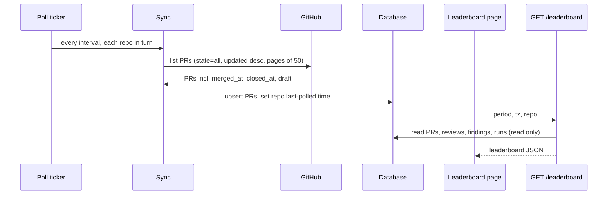

# PR Leaderboard
Spec: PR Leaderboard (global page, read API, merge timestamps, background PR poll) · Status: implemented (2026-10-24, 4ce720b; AC12 accepted with deviation D27) · Date: 2026-10-23
Areas: api, ui, sync, db
Design sources: two screenshots of a Claude Design mock-up supplied by the user on 2026-10-23 (page top: KPIs, awards,
leaderboard, needs attention; page bottom: rows 6–11, hot files, health by PR size, daily activity). The original design
file `../dev-digest/design/DevDigest Design (standalone).html` has no leaderboard screen. Code research of `backend/`
and `frontend/` on branch `feat/go-backend-phase-1` @ `3de8195`.
Related: none (new feature; not part of the Node → Go migration, so no Node parity applies to the new route).

ID convention: plain FR1…, EC1…, NFR1…, AC1…, US1…, D1…, Q1…; area tags `[api]` read endpoint, `[ui]` page,
`[sync]` GitHub PR sync and background poll, `[db]` schema.

## Resolved blocking questions
| # | Question | Answer | Decision |
|---|---|---|---|
| BQ1 | Merge time is not stored — how do merge metrics work? | New up/down migration + sync stores merge/close times | D1 |
| BQ2 | PR data is refreshed only when someone opens a PR list (50 newest per repo) | Add a background poll | D2 |
| BQ3 | What is "first review"? | First DevDigest review | D3 |
| BQ4 | This week / Last week / 30d | Calendar week Monday–Sunday in the viewer's time zone | D4 |

## 1. Goal
Give the team one page that shows how pull requests went over a period: how many were reviewed and merged, how
healthy they were, how long they took to get reviewed and merged, what the reviews cost, which PRs and files need attention, and which PRs stand
out. The page compares the period with the previous one and works across all repositories or one. Its data stays
fresh without anyone opening the PR list, because PRs are polled from GitHub in the background.

## 2. Context
- PR rows store `opened_at` (GitHub `created_at`), `updated_at`, `status` (`open|closed|merged`), `additions`,
  `deletions`, `files_count`, `head_sha`, `last_reviewed_sha`, `author` (login). GitHub `merged_at` is decoded and
  dropped; `closed_at` and `draft` are not read (`backend/internal/platform/github/pulls.go:77,119,139`;
  `backend/migrations/0001_baseline.up.sql:545-564`).
- PR sync runs only on GET `/repos/:id/pulls` and POST `/repos/:id/poll`: one page of 50 PRs, `state=all`, newest
  update first; no background job exists (`backend/internal/pulls/app/service.go:50,141`; `cmd/server/app.go:284-292`).
  The upsert updates only `title, head_sha, status, updated_at` (`pulls/adapters/postgres/store.go:175-205`).
- Diff stats are back-filled lazily, ≤ 10 PRs per list request; until then they are 0
  (`pulls/app/service.go:97`, `pulls/domain.NeedsDiffStats`).
- Review score per review = 100 − 35·CRITICAL − 12·WARNING − 3·SUGGESTION, clamped 0–100
  (`reviewer/domain/score.go:32`). Findings have no status column: accepted = `accepted_at` set, dismissed =
  `dismissed_at` set (`performance/adapters/postgres/read.go:31-36`). A finding's time is its review's `created_at`.
- "Current reviews" of a PR = newest review per agent (`pulls/domain/rollup.go:44`); the PR list's `score` is only the
  newest one of them, while `findings_counts` sums all of them (`frontend/INSIGHTS.md` 2026-10-02 entry).
- Derived status: merged/closed as stored; otherwise `needs_review` when `last_reviewed_sha ≠ head_sha`, `stale` when
  not updated for 7 days, else `reviewed` (`pulls/domain/pulls.go:33,153`).
- Review cost = Σ `agent_runs.cost_usd` by `pr_id`; CI-ingested runs have no `pr_id` (`ci/adapters/postgres/rows.go:147`).
- Agent Performance (`GET /agents/performance`) is the closest analog: period echo, summary + previous summary,
  422 `validation_error` for bad periods; it supports only rolling `1d|30d|custom` (`performance/domain/period.go:51`).
- The UI has a single active repo and no "all repos" concept (`frontend/src/lib/repo-context.tsx:26-61`). PR size
  buckets are S ≤ 100, M ≤ 400, L > 100 lines (`frontend/src/app/repos/[repoId]/pulls/constants.ts:30-31`).
- Sidebar items and icons live in vendored `frontend/src/vendor/ui/nav.ts` and `icons.tsx`; earlier global pages
  (Eval, Multi-Agent, CI Runs) were added there; no trophy icon exists today.

## 3. Scope
In scope:
- One read endpoint returning everything the page shows for a period and a repo filter.
- A global page "PR Leaderboard" with sidebar item, KPIs with deltas, awards, ranked table, needs-attention list, hot
  files, health by PR size, daily activity.
- Storing GitHub merge time, close time and draft flag for PRs, and keeping them updated by every sync.
- A background poll that syncs PRs of every repository on an interval.

Out of scope:
- No human GitHub reviews, review requests or review comments are fetched; "first review" means the first DevDigest review.
- No change to the PR list page (`/repos/:repoId/pulls`): its columns, S/M/L buckets and status labels stay as they are.
- No per-author or per-team ranking; rows are pull requests only (Health by author / repository, D28, are bar cards, not a ranking table).
- No new LLM calls, jobs or writes are triggered by opening the page or calling the read endpoint.
- No author avatar images are fetched; authors are shown with the existing initials avatar.
- No export (CSV/PDF) and no notifications.
- The existing routes GET `/repos/:id/pulls` and POST `/repos/:id/poll` keep their paths, status codes and JSON fields.

## 4. User scenarios
- US1 — A tech lead opens PR Leaderboard on Monday, sees this week vs last week across all repos, and spots that
  avg health dropped and open criticals rose.
- US2 — They switch to one repository and Last week to prepare a retro, and open the PR that won "Hottest PR".
- US3 — They work through "Needs attention": a merged PR with an open critical, an open PR with new commits since
  the last review.
- US4 — Without opening any PR list for a day, they still see PRs merged an hour ago (background poll).

## 5. Functional requirements
- FR1 [db] — The system shall store for each PR its GitHub merge time, close time and draft flag; existing PRs get
  empty values until their next sync. The schema change shall have an up and a down migration.
- FR2 [sync] — Every PR sync (list request, manual poll, background poll) shall write merge time, close time, draft
  flag, status and `updated_at` for every PR it receives, both on insert and on update.
- FR3 [sync] — The system shall poll every repository of every workspace in the background, on server start and
  then every `polling_interval_min` minutes of that workspace's Settings (default 5, read again before every cycle,
  clamped to 1–1,440), one repository at a time; a deployment switch turns the background poll off (D18).
- FR4 [sync] — A background poll of a repository shall page through PRs newest-update-first until it reaches a PR not
  updated since the start of the previous successful background poll of that repository in the running server, or
  62 days back on the first background poll after server start, capped at 10 pages of 50 PRs; it shall then set the
  repository's last-polled time. A manual poll or a PR-list request never moves the background-poll cutoff.
- FR5 [sync] — The background poll shall skip all repositories (one WARN per cycle) when no GitHub token is set, stop
  the cycle until the reset time when GitHub reports the rate limit exhausted, and log a failed repository and go on
  with the next one. It shall stop within 5 s of server shutdown.
- FR6 [api] — `GET /leaderboard` shall accept `period` (`week|last_week|30d`, default `week`), `tz` (IANA zone,
  default `UTC`) and `repo` (`all` or a repository id, default `all`) and answer the response in §7.
- FR7 [api] — Windows in zone `tz`: `week` = [Monday 00:00 of the current week, next Monday 00:00);
  `last_week` = the week before; `30d` = [00:00 of today − 29 days, 00:00 of tomorrow). `week` and `last_week` have
  a previous window, the week directly before; `30d` has none (D19). Data after "now" cannot exist, so `week` shows
  the week so far.
- FR8 [api] — Population: a PR is a row when at least one DevDigest review (kind `review`) of it was created in the window. The
  window snapshot of a row = the newest review per agent created in the window.
- FR9 [api] — Per row the API shall return: repo name, number, title, author, status (merged/closed as stored, else
  derived as the PR list does), additions, deletions, files, size bucket, health, risk, findings counts by severity,
  open critical count, rounds, time to first review, time to merge or open age, cost, and whether new commits exist
  since the last review.
- FR10 [api] — Metrics (health and size per D20): health = max(0, 100 − (10·CRITICAL + 3·WARNING + 1·SUGGESTION of
  non-dismissed snapshot findings) − 3·(rounds − 1)), null when rounds = 0; findings counts = Σ over snapshot findings
  (all statuses); open critical = snapshot CRITICAL findings with neither accepted nor dismissed time; rounds = the
  highest number of reviews any one agent wrote for the PR in the window; time to first review = first DevDigest
  review ever − opened time; time to merge = merge time − opened time; cost = Σ cost of the PR's runs (any status, unknown cost = 0) started in the
  window; size = additions + deletions: XS < 50, S < 200, M < 500, L < 1,000, XL ≥ 1,000; risk from Σ weights
  (35 CRITICAL, 12 WARNING, 3 SUGGESTION) of non-dismissed snapshot findings: low < 30, medium 30–69, high ≥ 70.
- FR11 [api] — KPIs for the window and, when it has one and it contains ≥ 1 row, the previous window (else
  `previous_summary` is null): PRs reviewed (row count), merged (PRs with merge time in
  the window, reviewed or not), avg health (mean of row health), time to first review (median over PRs whose first
  review is in the window), time to merge (median over PRs merged in the window), critical found (Σ row CRITICAL),
  open critical (Σ row open critical), review cost (Σ cost of runs with a PR started in the window).
- FR12 [api] — Awards over the rows: Cleanest PR (highest health), Hottest PR (most CRITICAL), Fastest Merge
  (shortest time to merge among rows merged in the window), Most Rounds, Monster PR (most lines changed), Priciest
  Review (highest cost). Ties: lower table rank wins. An award with no eligible row is null.
- FR13 [api] — Needs attention (D21) covers the PRs of the window — opened, reviewed or merged in it — judged on their
  current state: (a) merged with ≥ 1 open critical; (b) not merged with ≥ 1 open critical; (c) open with commits since
  the last review; (d) open non-draft with no DevDigest review; (e) open and stale or opened ≥ 5 days ago ("open Nd").
  Open critical counts the PR's current reviews. One item per PR with all its reasons in (a)–(e) order; items sorted by
  the number of critical reasons ((a), (b)) descending, then oldest opened first; ≤ 20 items plus the total count.
- FR14 [api] — Hot files: files with the most snapshot findings over the rows (dismissed excluded), with critical
  count, repository and PR numbers; top 6, ties by critical count, then path ascending.
- FR15 [api] — Health by size: for XS, S, M, L, XL — row count, mean health, mean findings per PR (C+W+S; null when no rows).
- FR15a [api] — Health by author / by repository (D28): one group per author / per repository id (label: repository name) over
  every row, same means as FR15 (mean health null when no row of the group has a health); worst mean health first (null last),
  then more rows, then the label. The UI shows the top 8 until "Show all N".
- FR16 [api] — Activity: for `week`/`last_week` one point per calendar day in `tz` (7); for `30d` one point per
  Monday-started week intersecting the window, clipped to it (D22). Each point: PRs opened, PRs merged, CRITICAL
  snapshot findings by their review's time; the critical sum equals the critical-found KPI.
- FR17 [ui] — A sidebar item "PR Leaderboard" (trophy icon) directly below "Pull Requests" opens the page at
  `/leaderboard`; it is also in the command palette.
- FR18 [ui] — Header: title, the window label ("Week of Sep 28 – Oct 4 · compared with Sep 21 – 27"; 30d:
  "Sep 5 – Oct 4", no comparison), a repo select (All + every repository) and a This week / Last week /
  30d toggle. Period and repo live in the URL; the browser zone is sent as `tz`.
- FR19 [ui] — Eight KPI tiles with value and delta vs the previous window (↑/↓ and amount, coloured good/bad per
  metric; "no change" when |Δ| < 0.05; no delta when `previous_summary` or either value is null). Open critical
  shows in red when > 0.
- FR20 [ui] — Six award cards with metric, `repo#number` linking to the PR detail page, and title.
- FR21 [ui] — Table ranked by health (ties: PR number ascending, then repo), showing top 10 with "Show all N" /
  "Show top 10"; sortable by size, health, findings, rounds, time, cost — first click descending (time: ascending),
  second flips, third returns to rank, plus "Reset to rank"; nulls last. Health rings: ≥ 85 ok, ≥ 60 warn, else crit;
  a health info tooltip explains the formula. The CRITICAL chip is outlined red when open critical > 0. Clicking a row
  opens the PR; the chevron expands it to up to 3 top findings — severity · title, file:line, agent, state
  (accepted / dismissed / open) — or "No notable findings recorded." (D23).
- FR22 [ui] — Side panels: Needs attention (count, reason badges — critical ones red —, PR link; empty: "Nothing
  needs you this week"), Hot files; bottom: Health by PR size bars ("Smaller PRs ship cleaner.") and Activity grouped
  bars (days, or "Wk of <date>" for 30d) with legend. A period without rows shows "No PRs were reviewed in this
  period" with a "Go to Pull Requests" button.
- FR23 [ui] — The page shows when each repository in the filter was last polled.
- FR24 [sync] — After the PR pages of a repository, the background poll shall fill the diff stats (additions,
  deletions, files) of up to 20 of its PRs that still have none, newest update first, among PRs updated in the last
  62 days, using the same stats source as the PR list backfill (D24).
- FR25 [ui] — The header shows "· compared with …" only when `previous_summary` is not null (D25).
- FR26 [ui] — Each PR number in a Hot files row links to that PR's detail page (D26).

## 6. Workflow and communication

Failure behaviour: GitHub 401/403/5xx/timeout → that repo is skipped and logged, last-polled time unchanged; rate limit
exhausted → cycle paused until reset; DB error during poll → repo skipped. API: bad query → 422; unknown repo id → 404;
DB error → 500 envelope. UI: request error → error state with Retry; the page never calls GitHub.

## 7. Contracts
`GET /leaderboard?period=week|last_week|30d&tz=<IANA>&repo=all|<uuid>` → 200:
```
{ period: { key, tz, from, to, previous_from|null, previous_to|null }, // ISO-8601 with offset, to exclusive
  repos: [{ id, full_name, last_polled_at|null }],                     // repos in the filter
  summary: Kpis, previous_summary: Kpis|null,
  awards: { cleanest, hottest, fastest_merge, most_rounds, monster, priciest }: Award|null,
  rows: Row[], needs_attention: { total, items: Attention[] },
  hot_files: HotFile[], health_by_size: SizeBucket[],
  health_by_author: { author, prs, avg_health|null, avg_findings|null }[],            // FR15a
  health_by_repo: { repo_id, repo, prs, avg_health|null, avg_findings|null }[],       // FR15a
  activity: { granularity: day|week, points: Point[] } }
Kpis = { prs_reviewed, merged, avg_health|null, time_to_first_review_s|null, time_to_merge_s|null,
         critical_found, open_critical, review_cost_usd }
Row = { pr_id, repo_id, repo, number, title, author, status, draft, additions, deletions, files_count,
        size: XS|S|M|L|XL|null, health|null, risk: low|medium|high, findings: {CRITICAL,WARNING,SUGGESTION}, open_critical,
        rounds, time_to_first_review_s|null, time_to_merge_s|null, open_age_s|null, cost_usd,
        new_commits_since_review, opened_at|null, merged_at|null,
        reviews: [{ review_id, agent_id, agent_name, score, findings: {CRITICAL,WARNING,SUGGESTION} }],
        top_findings: [{ finding_id, severity, title, file, start_line, agent_name, state: open|accepted|dismissed }] }  // ≤ 3
Award = { pr_id, repo_id, repo, number, title, value }                        // value: score | count | seconds | lines | usd
Attention = { pr_id, repo_id, repo, number, title, author, opened_at,
              reasons: [{ kind: merged_open_critical|open_critical|no_review|new_commits|open_long, count? , days? }] }
HotFile = { path, repo_id, repo, findings, critical, prs: [number] }
SizeBucket = { size, prs, avg_health|null, avg_findings|null }
Point = { from: YYYY-MM-DD, to: YYYY-MM-DD, opened, merged, critical }  // local dates, to inclusive
```
Errors (envelope `{"error":{"code","message","details?"}}`): 422 `validation_error` for unknown `period`, unknown `tz`,
`repo` neither `all` nor a UUID, or any other query key; 404 `not_found` for a repo id not in the workspace.
`period.from/to/previous_*` are local times of `tz` with offset and milliseconds (`2026-10-19T00:00:00.000+03:00`); every
other timestamp is UTC with milliseconds (`…Z`). Durations are whole seconds; money is a number rounded to 6 decimals. The UI's shared contract copy changes together
with the backend (repository rule). GET `/repos` keeps its shape and already returns `last_polled_at`.

## 8. Data model
- Pull request gains: merged at (time, nullable), closed at (time, nullable), draft (boolean, default false).
- Existing entities read: repository (last polled at), pull request, review (agent, score, created at), finding
  (severity, file, accepted/dismissed at), agent run (PR, started at, cost), agent (name).
- No new entity; leaderboard values are computed on read and never stored.

## 9. States and UX
| Screen/element | Loading | Empty | Error | Degraded | Success | Notes |
|---|---|---|---|---|---|---|
| Whole page | skeleton tiles, table rows | no repos: link to add a repo | error state + Retry | — | all sections | no digits while loading or on error |
| KPIs | skeleton | values 0 / "—", no deltas | — | 30d or previous window without rows → no deltas | value + delta | "—" for null |
| Awards | skeleton | card shows "—" | — | — | metric + PR link | |
| Table | skeleton rows | "No PRs were reviewed in this period" + "Go to Pull Requests" | — | diff stats 0 → size "—" | ranked rows | top 10 by default |
| Needs attention | skeleton | "Nothing needs you this week" | — | — | items + count | |
| Hot files / size / daily | skeleton | empty notes / "—" per bucket / zero bars | — | — | charts | text values next to colours |
| Repo sync note | — | "never polled" | — | poll disabled or no token → note | "synced 5 min ago" | |

## 10. Edge cases
- EC1 [api] — PR has no `opened_at` (seeded rows) → time to first review and open age null, excluded from medians (FR10, FR11).
- EC2 [api] — PR merged before it was ever reviewed → counts in Merged and daily merged, not a row (FR8, FR11).
- EC3 [api] — Merge time unknown for a merged PR not synced since the migration → not counted as merged in any window (FR1, FR11).
- EC4 [api] — A review created at exactly `to` belongs to the next window; at `from` to this one (FR7).
- EC5 [api] — DST change inside the window → days follow the zone's local midnights (23 h/25 h days) (FR7, FR16).
- EC6 [api] — Agent deleted → its reviews still count; agent name "Deleted agent" (FR9).
- EC7 [api] — Finding accepted and later dismissed → dismissed (accept/dismiss clear each other) (FR10).
- EC8 [api] — PR deleted from GitHub or repo removed → its stored data still counts while the repo exists; removed repos disappear (FR6).
- EC9 [api] — Diff stats still 0 → size null, row excluded from health-by-size and Monster PR (FR10, FR12, FR15).
- EC10 [sync] — Background poll overlaps a manual poll of the same repo → both upserts are idempotent; last write wins per field (FR2, FR3).
- EC11 [sync] — Poll cycle longer than the interval → the next cycle starts only after the current one ends (FR3).
- EC12 [ui] — Rapid period/repo changes → the last response wins (FR18).
- EC13 [ui] — Garbage `period`/`repo` in the URL → falls back to `week` / `all` without an error request (FR18).
- EC14 [ui] — Repo id in the URL no longer exists → falls back to `all` (FR18).
- EC15 [ui] — Long titles and paths → truncated with a native tooltip (FR21, FR22).

## 11. Non-functional requirements
- NFR1 [api] — p95 ≤ 500 ms for `GET /leaderboard` with 20 repos, 5,000 PRs, 20,000 reviews, 200,000 findings,
  30,000 runs, `period=30d`, `repo=all`.
- NFR2 [api] — The endpoint only reads: no writes, no LLM calls, no GitHub calls, no jobs.
- NFR3 [sync] — The background poll uses ≤ 1 concurrent GitHub request and ≤ 30 requests per repo per cycle (≤ 10
  list pages + ≤ 20 diff-stat fetches), and never logs the token.
- NFR4 [ui] — Sortable headers expose `aria-sort`; expandable rows `aria-expanded`; severity, risk and deltas carry
  text, not colour only; all copy goes through i18n.
- NFR5 [api] — The new route keeps the guards of every route (Host allow-list, foreign Origin, error envelope).

## 12. Dependencies and rollout
- Migration runs at startup like the existing ones; down drops the three columns.
- New configuration: poll interval (default 15 min, 0 disables), documented in `.env.example`.
- Existing data fills in on the first background poll (62-day horizon); until then merge metrics show "—".
- Needs a GitHub token for the poll; without it the page still works on stored data.

## 13. Acceptance criteria
- AC1 [db] — Given a migrated DB, when migrating down and up again, then the three PR columns are dropped and re-created and other tables are unchanged.
  Traces: FR1 · Verify: integration
- AC2 [sync] — Given a stub GitHub returning a PR merged at T, closed at T and draft=false, when any sync runs, then the stored PR has merge time T, close time T, draft false; a second sync with changed values updates them.
  Traces: FR2, EC10 · Verify: integration
- AC3 [sync] — Given `polling_interval_min` = 1 and two repos on a fake clock, when 3 min pass, then each repo was polled ≥ 3 times, never two at once, and last-polled times advanced; changing the setting to 2 takes effect on the next cycle; with the deployment switch off no poll happens.
  Traces: FR3, EC11, NFR3 · Verify: integration
- AC4 [sync] — Given a stub with 12 pages of PRs, when the first poll runs, then it stops at the 62-day horizon or after 10 pages; a later poll stops at the first PR not updated since the previous poll.
  Traces: FR4, NFR3 · Verify: integration
- AC5 [sync] — Given no token / a rate-limit response / a 500 for one repo, when a cycle runs, then respectively all repos are skipped with one WARN, the cycle pauses until reset, the other repo is still polled; no log line contains the token; shutdown completes within 5 s.
  Traces: FR5, NFR3 · Verify: integration
- AC6 [api] — Given `period=week&tz=Europe/Kyiv` on Thursday 2026-10-22 12:00 UTC, then `from`=2026-10-19T00:00+03:00, `to`=2026-10-26T00:00+02:00, previous window 2026-10-12…2026-10-19; `last_week` resolves per FR7; `30d` has null previous bounds.
  Traces: FR6, FR7, EC5 · Verify: unit
- AC7 [api] — Given unknown period, unknown tz, bad repo, extra query key → 422 `validation_error`; unknown repo UUID → 404 `not_found`.
  Traces: FR6 · Verify: component
- AC8 [api] — Given a fixture (3 repos, PRs reviewed by 2 agents with re-reviews, triaged findings, runs, merges inside and outside the window), then rows, snapshot, health, findings, open critical, rounds, sizes, risks, times and cost equal the hand-computed golden; after one repo is removed its PRs are gone from the response.
  Traces: FR8, FR9, FR10, EC1, EC6, EC7, EC8, EC9 · Verify: component
- AC9 [api] — Given the same fixture, then KPIs and previous KPIs equal the golden (`previous_summary` null for `30d` and for a previous week without rows); a PR merged unreviewed counts in merged only; a merged PR without merge time counts nowhere.
  Traces: FR11, EC2, EC3 · Verify: component
- AC10 [api] — Given the fixture, then awards, needs-attention items (reasons, order, cap 20, total) and hot files equal the golden; ties resolve per FR12/FR14.
  Traces: FR12, FR13, FR14 · Verify: component
- AC11 [api] — Given the fixture, then health-by-size has 5 buckets (XS–XL) with nulls for empty ones, and activity has 7 day points (week) or the clipped Monday weeks (30d) whose critical sum equals `critical_found`; a review at exactly `to` is excluded.
  Traces: FR15, FR16, EC4 · Verify: component
- AC12 [api] — Given NFR1 volume in a throwaway stack, when 200 requests run, then p95 ≤ 500 ms and DB statement log shows no writes.
  Traces: NFR1, NFR2 · Verify: manual
- AC13 [api] — Given a request with a foreign Host → 403/blocked as other routes; the response golden is checked against the UI contract.
  Traces: NFR5, FR6 · Verify: component
- AC14 [ui] — Given the app, then "PR Leaderboard" is directly below "Pull Requests" with a trophy icon, is active on `/leaderboard`, and appears in the command palette.
  Traces: FR17 · Verify: component
- AC15 [ui] — Given the page with a mocked response, when switching repo and period, then the URL updates, the request carries `period`, `tz`, `repo`, the header label matches FR18, and garbage/unknown URL values fall back without an error request.
  Traces: FR18, EC12, EC13, EC14 · Verify: component
- AC16 [ui] — Given the mocked response, then 8 KPI tiles show values and deltas (good/bad colour + arrow text, "no change" under 0.05, none when null or for 30d), and 6 award cards link to the PR detail.
  Traces: FR19, FR20 · Verify: component
- AC17 [ui] — Given 11 rows, then 10 show with "Show all 11"; each sortable column cycles desc → asc → rank (time asc first) and sets `aria-sort`, "Reset to rank" restores the order; a row click navigates to the PR; the chevron expands up to 3 top findings with state badges (or the empty text) and sets `aria-expanded`; health rings use the 85/60 bands; long titles are truncated with a tooltip.
  Traces: FR21, EC15, NFR4 · Verify: component
- AC18 [ui] — Given the mocked response, then needs attention, hot files, health-by-size and daily activity render their items with text values; empty arrays render the empty states of §9; loading shows no digits; error shows Retry.
  Traces: FR22, NFR4 · Verify: component
- AC19 [ui] — Given repos with and without a last-polled time, then each shows "synced … ago" or "never polled"; pseudo-messages test finds no hard-coded copy.
  Traces: FR23, NFR4 · Verify: component
- AC21 [sync] — Given a repo with 25 stored PRs without diff stats (updated within 62 days) and a stub GitHub, when one background cycle runs, then the 20 most recently updated get their stats, ≤ 30 GitHub requests were made, and a failed stats fetch is logged without stopping the cycle; the next cycle fills the remaining 5.
  Traces: FR24, NFR3 · Verify: integration
- AC22 [ui] — Given a response with `previous_summary` null for `week`, then the header shows only "Week of …" without "compared with"; with a non-null one it shows both. Given hot files, then each `#number` is a link to `/repos/<repo_id>/pulls/<number>`.
  Traces: FR25, FR26 · Verify: component
- AC20 [ui] — Given the running stack with seeded data, when a user opens the page and clicks through period, repo, sort, expand and an award link, then every view loads without console errors.
  Traces: FR17, FR18, FR21 · Verify: manual

## 14. Traceability
| Source | Area | FR | EC/NFR | AC |
|---|---|---|---|---|
| BQ1 / screenshot "Time to merge", "Fastest Merge", daily merged | db, sync | FR1, FR2 | EC3, EC10 | AC1, AC2, AC9 |
| BQ2 | sync | FR3–FR5 | EC11, NFR3 | AC3–AC5 |
| BQ4 / header "Week of …" | api, ui | FR6, FR7, FR18 | EC4, EC5, EC12–EC14 | AC6, AC7, AC15 |
| Screenshot leaderboard table | api, ui | FR8–FR10, FR21 | EC1, EC6–EC9, EC15 | AC8, AC17 |
| Screenshot KPI tiles | api, ui | FR11, FR19 | EC2 | AC9, AC16 |
| Screenshot award cards | api, ui | FR12, FR20 | — | AC10, AC16 |
| Screenshot needs attention / hot files | api, ui | FR13, FR14, FR22 | — | AC10, AC18 |
| Screenshot health by size / daily | api, ui | FR15, FR16, FR22 | EC4 | AC11, AC18 |
| Screenshot sidebar | ui | FR17 | — | AC14 |
| Repo freshness (BQ2) | ui | FR23 | — | AC19 |
| Gap review 2026-10-23 (user) | sync, ui | FR24–FR26 | NFR3 | AC21, AC22 |
| Repository rules | api | — | NFR1, NFR2, NFR4, NFR5 | AC12, AC13 |

## 15. Design review
| # | Gap | Source | Area | Decision |
|---|---|---|---|---|
| G1 | Mock-up sizes are inconsistent (179 lines = S, 460 = M) and add XL | screenshot | api | S ≤ 100, M ≤ 400 like the PR list, L ≤ 1,000, XL > 1,000 (D7) |
| G2 | Mock-up risk does not follow any one formula | screenshot | api | weighted non-dismissed findings, thresholds 30/70 (D8) |
| G3 | Health 18 for C5 W6 S5 is no formula | screenshot | api | mean of window snapshot scores (D9) |
| G4 | "Rounds" undefined | screenshot | api | most reviews by one agent in the window (D10) |
| G5 | Week-so-far compared with a full previous week | screenshot header | api | as the mock-up: full previous week (D11) |
| G6 | Expanded row content not shown | screenshot | ui | snapshot reviews per agent (D12) |
| G7 | "Show top 10" visible with 11 rows | screenshot | ui | default top 10, toggle both ways |
| G8 | Needs-attention rules not stated | screenshot | api | FR13 (a)–(e) |
| G9 | Sidebar position: mock-up puts it right below Pull Requests, before Onboarding Tour; today Project Context follows Pull Requests | screenshot, `nav.ts` | ui | directly below Pull Requests |
| G10 | Times shown as averages or medians? | screenshot | api | medians (D13) |

## 16. Decisions
- D1 — Merge time missing → store merge time, close time, draft via an up/down migration; every sync writes them (user, 2026-10-23).
- D2 — Data freshness → background poll of all repos (user, 2026-10-23).
- D3 — First review → first DevDigest review; no GitHub review data (user, 2026-10-23).
- D4 — Periods → calendar week Monday–Sunday in the viewer's zone; 30d = last 30 calendar days (user, 2026-10-23).
- D5 — The endpoint takes the IANA zone and resolves windows on the server clock, so daily buckets survive DST (spec author, 2026-10-23).
- D6 — Repo filter is page-local URL state, independent of the shell's active repo (spec author, 2026-10-23).
- D7 — Q1 Size buckets for the leaderboard → S ≤ 100, M ≤ 400, L ≤ 1,000, XL > 1,000 lines; PR list unchanged (user approved default, 2026-10-23).
- D8 — Q2 Risk formula → Σ 35/12/3 over non-dismissed snapshot findings; low < 30, medium 30–69, high ≥ 70 (user approved default, 2026-10-23).
- D9 — Q3 PR health → rounded mean of the newest per-agent review scores in the window (not the PR list's single newest score) (user approved default, 2026-10-23).
- D10 — Q4 Rounds → highest count of reviews by one agent on the PR in the window (user approved default, 2026-10-23).
- D11 — Q5 Compare "This week" (so far) with the full previous week, or with the same elapsed part of it → full previous week, as in the mock-up (user approved default, 2026-10-23).
- D12 — Q6 Expanded row content → per-agent snapshot reviews (agent, score, C/W/S) and a PR link (user approved default, 2026-10-23).
- D13 — Q7 Time KPIs: median or mean → median (user approved default, 2026-10-23).
- D14 — Q8 Poll interval and first-poll horizon → 15 min, 62 days, ≤ 10 pages per repo (user approved default, 2026-10-23).
- D15 — Q9 Are draft PRs excluded from "no review yet" only, or from the whole page → only from "no review yet" (user approved default, 2026-10-23).
- D16 — Q10 Closed (unmerged) PRs in the table → they appear when reviewed in the window, status "closed" (user approved default, 2026-10-23).
- D17 — Spec change requests of the planner accepted (2026-10-23): nullable `health`/`size`, review = kind `review`, run time = run start, `period.*` with offset, background-poll cutoff kept per server process (spec author, 2026-10-23).

- D18 — Background-poll interval comes from Settings `polling_interval_min` (shared with Automatic Reviews), not an env interval; env keeps only an on/off switch (user, 2026-10-23).
- D19 — Align with the user's prototype (`DevDigest — App prototype`, screen_leaderboard.jsx): `30d` has no comparison window (user, 2026-10-23).
- D20 — Health = max(0, 100 − (10·C + 3·W + 1·S) − 3·(rounds − 1)) over non-dismissed snapshot findings (the prototype's tooltip excludes dismissed ones); sizes XS/S/M/L/XL at 50/200/500/1,000 lines; supersedes D7 and D9 (user, 2026-10-23).
- D21 — Needs attention follows the prototype: PRs of the window, open ≥ 5 days or stale, sorted by critical reasons; supersedes the window-independent rules of the first FR13 (user, 2026-10-23).
- D22 — Activity is weekly for `30d` (prototype) (user, 2026-10-23).
- D23 — Table follows the prototype: ties by PR number, desc → asc → rank sorting, row click opens the PR, expanded row = top 3 findings; supersedes D12. "Spec completeness" is left out: conformance checks have no time column to pick the latest (user, 2026-10-23).
- D24 — The background poll backfills diff stats (≤ 20 per repo per cycle), so sizes, Health by size and Monster PR do not depend on someone opening the PR list (user, 2026-10-23).
- D25 — "compared with" follows `previous_summary`, not the existence of a previous window (user, 2026-10-23).
- D26 — Hot files PR numbers are links (user, 2026-10-23).
- D27 — AC12 accepted with a deviation after fix round r1 (SQL aggregation, output byte-identical): at NFR1 volume 30d/all p95 is 532 ms at host load 3–4 (4-shard build without a clean full-mix run), against the 500 ms limit. The other five variants pass (p95 36–270 ms). The remaining cost is ~4 µs of Postgres CPU per finding. Follow-ups: merge windowReviews into the shard statement, parallel JSON encoding (user, 2026-10-24).
- D28 — Two more cards next to Health by size: Health by author and Health by repository, computed by the API (FR15a), worst health first, top 8 + "Show all N"; the four bottom cards form a 2×2 grid (user, 2026-10-29).

## 17. Open questions
None — Q1–Q10 were resolved on 2026-10-23 by accepting their defaults (D7–D16).

## 18. Glossary
- Window snapshot — for one PR, the newest review per agent created inside the window.
- Open critical — a CRITICAL finding neither accepted nor dismissed.
- Row — a PR with at least one DevDigest review created in the window.
