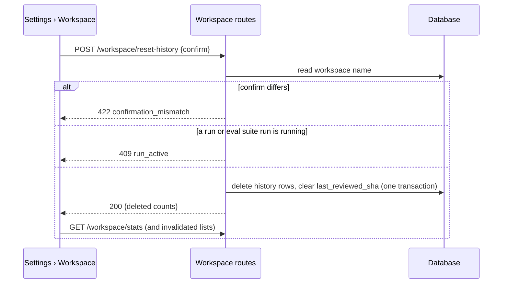
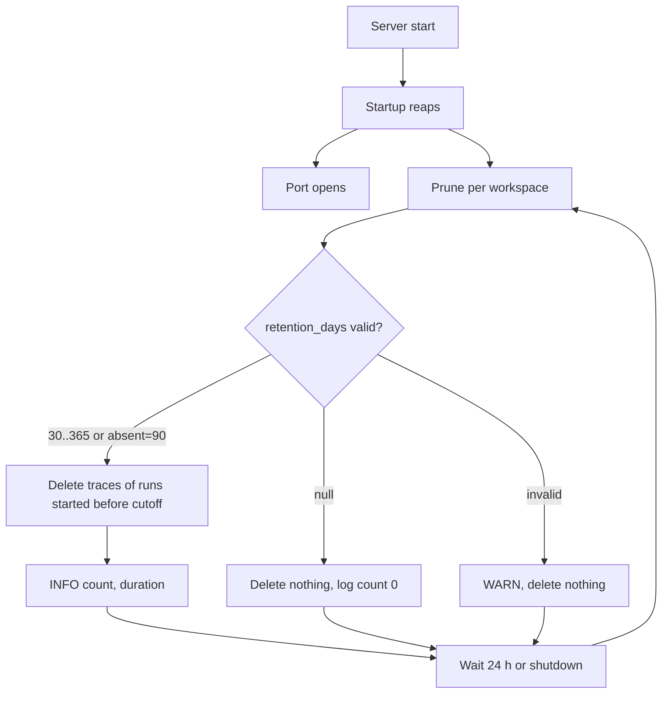

# Settings B — Workspace
Spec: Settings B — Workspace (name, data directory, retention prune, counts, export, reset run history) · Status: ready-for-planning · Date: 2026-10-23
Areas: api, prune, ui
Design sources: accepted design `docs/design/2026-10-23-settings-first-run.md` (§4 Slice B, §5, §7, §8 binding; Q4: reset
also deletes learnings); prototype extraction `proto-screens.md` §3.3 (Workspace) of the user's Claude Design bundle
"DevDigest — App prototype"; screenshot `images/6.png` (Settings › Workspace: name, data directory, retention "90 days",
tiles Agents 3 · Skills 6 · Eval cases 12 · Learnings 24, danger zone with "Export workspace" and "Reset run history").
Code read on branch `feat/go-backend-phase-1` @ `9ef3155`: `backend/internal/tenancy`, `backend/internal/seed`,
`backend/internal/repos/transport/http`, `backend/migrations/0001_baseline.up.sql`, `backend/cmd/server/app.go`,
`backend/internal/settings`, `frontend/src/vendor/shared/contracts/{productionize,platform,trace}.ts`.
Related: `docs/design/2026-10-23-settings-first-run.md` (parent design; Slices A, C, D get their own specs);
`specs/2026-10-23-pr-leaderboard.md` (its page and Agent Performance read the runs, reviews and findings that reset
deletes). Supersedes nothing.

ID convention: plain FR1…, EC1…, NFR1…, AC1…, US1…, D1…, Q1…; area tags `[api]` workspace routes and settings key,
`[prune]` retention prune at startup and daily, `[ui]` Settings › Workspace section and repo switcher.

## 1. Goal
Settings gets a Workspace section. In it the user can name the workspace and see where its local data lives. They can
also choose how long run traces are kept, see what the workspace holds, export its configuration as a portable bundle
and reset its run history. A local install grows traces without bound today. Retention keeps that in check, and nothing
is ever exported that could leak a key or a clone.

## 2. Context
- Single tenant: every request resolves the workspace **by name `"default"`** and the user `you@local`
  (`backend/internal/tenancy/tenancy.go:14,48`; lookup `WHERE name = ?`, oldest wins,
  `tenancy/adapters/postgres/store.go:41`). The startup seed ensures a workspace named `"default"` exists
  (`backend/internal/seed/seed.go:178`). `workspaces` has `id, name, created_at` only
  (`migrations/0001_baseline.up.sql:758-762`). So writing a new display name into `workspaces.name` as it is would make the
  next request or restart resolve or create another workspace (see Q1).
- GET `/workspace` returns `{workspaceId, cloneDir, repos:[{id, full_name, clone_path, last_polled_at, cloned}]}`
  (camelCase by contract) (`repos/transport/http/handler.go:51,93-97`); the UI never calls it
  (`docs/migration/research/01-http-api.md:104,285`). There is no shared contract schema for it.
- `DEVDIGEST_DATA_DIR` (absolute) holds `secrets.json` and the clone root `<DataDir>/workspace`
  (`backend/internal/config/config.go:45-46,181`). Agents, skills, eval cases and traces live in Postgres, not in files.
- Settings are rows `(workspace_id, user_id, key, value jsonb)` (`0001_baseline.up.sql:658-664`). GET `/settings`
  returns stored rows only, no defaults (`settings/app/settings.go:118-127`). PUT validates six known keys and stores
  **any other key unvalidated** (`settings/transport/http/validate.go:44-46`; known keys `platform.ts:35-43`).
  A nullable jsonb read needs explicit handling (`backend/INSIGHTS.md:87`).
- Run history tables and links (`0001_baseline.up.sql`): `agent_runs` (`ran_at` = start, `status` running|done|failed|
  cancelled, `source` local|ci; :41-63) → ON DELETE CASCADE `run_traces` (:1833), `agent_run_skills` (:1420), `reviews`
  via `run_id` (:1819) → `findings` (:1665); `reviews.run_id` is nullable (:641). `agent_runs.multi_agent_run_id` →
  `multi_agent_runs` SET NULL (:1441). `ci_runs.agent_run_id` SET NULL (:1504). `eval_suite_runs` (status running|
  completed|failed, :313-345) → `eval_runs` CASCADE (:1616); `eval_runs.run_id` is nullable (:299); `eval_runs.case_id` →
  `eval_cases` CASCADE (:1609). `eval_cases.source_finding_id/source_review_id/source_pr_id` have no FK (:277-279).
  `memory` (learnings) has `scope`, `kind`, `content`, `embedding`, `sources`, optional `repo_id` (:441-457).
  `pull_requests.last_reviewed_sha` marks a PR as reviewed (:555).
- `run_traces` = `(run_id, trace jsonb)` with **no timestamp** (:649-652). The run's Live Log is stored inside the trace
  document (`frontend/src/vendor/shared/contracts/trace.ts:8,129`). There is no separate run-log table. A missing trace
  reads as not found (`reviews/adapters/postgres/reads.go:231`). Agent Performance reads `memory_pulled` and "has trace"
  from traces (`performance/adapters/postgres/read.go:90,110`).
- GET `/ci/runs` inner-joins `agent_runs`, so a CI run without its agent run is invisible (`backend/INSIGHTS.md:96`;
  `ci/adapters/postgres/lists.go:36`).
- Startup reaps fail interrupted convention scans, review runs and eval runs before the port opens; each is non-fatal
  (`backend/cmd/server/app.go:211-226`).
- Plugin bundle contract (`contracts/productionize.ts`): `PluginManifest` (:70) has `name, version, format:
  'devdigest-plugin/v1', exported_at, description, counts{agents, skills, eval_cases, conventions}` and **no `kind`**.
  `PluginBundle` (:86) = `manifest, agents, skills, eval_cases, conventions`. `PluginSkill.source` (:26) lacks the DB's
  `imported_file`. `PluginAgent` (:34) lacks `strategy`, `ci_fail_on`, `repo_intel`. The bundle has no learnings,
  settings, skill versions or project-context files. Skill names are unique per workspace and agent names are not
  (`0001_baseline.up.sql:1112`).
- Settings UI: `/settings/[section]` with `api-keys` and `models` implemented
  (`frontend/src/app/settings/[section]/_components/SettingsView/constants.ts:2-6`). Slice A builds the full sub-nav.
  The repo switcher subtitle is `<default_branch> · <syncedLabel>` (`frontend/src/vendor/ui/shell/RepoSwitcher.tsx:66`).
  `src/vendor/ui` is composed, never edited (`frontend/AGENTS.md:33`), and its Modal has no Escape handling
  (`frontend/INSIGHTS.md:31`).

## 3. Scope
In scope:
- Rename the workspace; show the data directory read-only; show the name in the repo switcher subtitle.
- Setting `retention_days` and a prune of old run traces at startup and every 24 h.
- Read-only counts route; JSON export of the workspace configuration in the plugin-bundle envelope (`kind: "workspace"`).
- Reset run history with typed confirmation, refused while a run is active.
- The Settings › Workspace section that drives all of the above.

Out of scope:
- No route or UI changes `DEVDIGEST_DATA_DIR`; the data directory field is read-only.
- No new up/down schema migration is added by this slice.
- The retention prune never deletes or updates agent runs, reviews, findings, multi-agent runs, eval runs, eval suite runs, CI runs or learnings.
- The export never contains a secret, a setting outside the allow-list of FR14, a filesystem path, a database row id, or any run-history record (§7).
- No import of a workspace bundle in this slice; import is Slice D.
- Reset never deletes agents, agent versions, skills, skill versions, eval cases, conventions, convention scans, project-context files, repositories, pull requests, settings, secrets, CI installations or installed plugins.
- Reset never cancels a running run; it refuses with 409 instead.
- No create, switch or delete of workspaces; the app stays single-tenant.
- Neither reset nor prune touches files on disk (clones, `secrets.json`).
- The existing fields of GET `/workspace` keep their names, casing and meaning.

## 4. User scenarios
- US1 — As the local user, I rename the workspace to "acme · payments", so that I recognise it in the repo switcher.
- US2 — As the local user, I set retention to 30 days, so that old run traces stop filling my disk.
- US3 — As the local user, I see how many agents, skills, eval cases, learnings, repos and runs the workspace holds.
- US4 — As the local user, I export the workspace configuration to a file, so that I can keep or share it without keys.
- US5 — As the local user, I reset the run history after a trial period, so that metrics start fresh while my agents,
  skills and eval cases stay.

## 5. Functional requirements
- FR1 [api] — `PUT /workspace {name}` shall set the workspace name: leading/trailing whitespace trimmed, then 1–80
  Unicode characters, no control characters (U+0000–U+001F, U+007F). It answers the GET `/workspace` shape (FR3).
- FR2 [api] — Renaming shall not change which workspace requests resolve to. After a rename, a server restart (startup
  seed included) shall neither create a second workspace nor serve a different one, and all existing data stays
  reachable (D7).
- FR3 [api] — GET `/workspace` shall additionally return `name` (current name) and `dataDir` (the absolute data
  directory); existing fields are unchanged.
- FR4 [ui] — `/settings/workspace` shows the heading "Workspace" with the prototype sub-title. It has a "Workspace name" input
  that saves on Enter or blur when the value changed and is valid, with an inline error otherwise and a "Saved" note on success.
  It also shows "Data directory" read-only (mono, copyable) with a hint saying that the folder holds the local secrets file and
  repository clones and that changing it needs a restart (Q12).
- FR5 [ui] — The repo switcher subtitle shall show the workspace name after the branch and sync label
  (`main · synced 2m ago · acme · payments`); with no active repo it stays "Add a repo to begin" (Q6).
- FR6 [api] — Setting `retention_days` shall accept 30, 60, 90, 180, 365 or `null` (keep forever) via PUT `/settings`;
  any other value → 422 `validation_error`. Absent means 90. GET `/settings` returns a stored `null` as `null`, distinct
  from absent.
- FR7 [prune] — Prune rule: for each workspace whose effective retention N is not null, delete every run trace whose
  agent run started (`ran_at`) strictly before now − N × 24 h. The run's log goes with it (it lives in the trace).
  Nothing else is deleted or changed (Q15).
- FR8 [prune] — The prune shall run once at startup, after the startup reaps and without delaying the port opening, and
  then every 24 h while the server runs (Q14). It reads `retention_days` anew each time and stops within 5 s of shutdown.
- FR9 [prune] — Each prune shall log one INFO line per workspace with `retention_days`, the number of traces deleted
  (also 0) and the duration. A failure logs one ERROR line and the next scheduled prune runs as planned. A stored
  value outside FR6 logs one WARN line and deletes nothing.
- FR10 [ui] — "Retention" select with options 30 / 60 / 90 / 180 / 365 days and "Keep forever"; shows "90 days" when
  unset; saves on change; hint: "Run traces older than this are pruned on startup and once a day. Runs, reviews and
  findings are kept."
- FR11 [api] — `GET /workspace/stats` shall return counts of the workspace: `agents` (all), `skills` (all), `eval_cases`,
  `learnings` (all memory rows), `repos`, `runs` (agent runs of any source and status) (Q4).
- FR12 [ui] — Six stat tiles in the order Agents, Skills, Eval cases, Learnings, Repositories, Runs (Q5).
- FR13 [api] — `GET /workspace/export` shall return one JSON bundle (§7) in the plugin envelope with `manifest.kind =
  "workspace"`. It holds every agent (config, linked skill names in order), every skill with all its versions,
  every eval case (owner by name), every convention, every learning, every project-context file and the allow-listed
  settings. Repository-scoped items name their repository by `full_name`. Agent names are made unique within the
  bundle by suffixing ` (2)`, ` (3)`… in creation order, and references use the suffixed name.
- FR14 [api] — The export shall contain no secret, no setting other than `polling_interval_min`, `theme`, `density`,
  `sync_to_folder`, `automatic_reviews`, `feature_models`, `retention_days` and the settings Slices A/C/D define as
  exportable (`default_model`, `monthly_spend_cap_usd`) (Q8). It contains no filesystem path (data dir, clone paths), no
  database row id, no embedding, no learning `sources`, and nothing from runs, traces, reviews, findings, multi-agent
  runs, eval runs, eval suite runs, CI runs, CI installations, convention scans, pull requests, intents, briefs or
  onboarding tours (Q9).
- FR15 [api] — The export response shall be a download: `Content-Type: application/json`, `Content-Disposition:
  attachment; filename="devdigest-workspace-<slug>-<YYYY-MM-DD>.json"` (slug = name lower-cased, runs of characters
  outside `a-z0-9` → `-`, trimmed, ≤ 40 chars, `workspace` when empty; date in UTC) (Q7).
- FR16 [api] — `POST /workspace/reset-history {confirm}` shall, when `confirm` equals the current name exactly
  (case-sensitive, untrimmed), delete in one all-or-nothing operation every row of the workspace in: agent runs (all
  sources) with their run traces, run-skill links, reviews and findings; reviews without a run; multi-agent runs; eval
  suite runs with their eval runs; eval runs of the workspace's cases without a suite; CI runs of the workspace's
  installations; composed reviews of its PRs (Q2); learnings (all memory rows, design Q4). It clears
  `last_reviewed_sha` of the workspace's PRs (Q3). Every other table is kept (Out of scope, §8). It answers the counts deleted.
- FR17 [api] — Reset shall be refused with 409 `run_active` while the workspace has an agent run or an eval suite run in
  status `running`; the message names how many. Nothing is deleted.
- FR18 [ui] — A "Danger zone" card (prototype copy, plus "Run history includes reviews, findings and Agent Performance
  data.") with "Export workspace" (downloads the file under the server's file name) and "Reset run history".
- FR19 [ui] — "Reset run history" opens a dialog. It lists what is deleted, with the current `runs` and `learnings` counts,
  and what is kept. It states "Export does not include run history" and that this month's spend total will no longer
include the deleted runs (Q10). It has a labelled input "Type <name> to confirm" and a
  destructive "Reset run history" button that is enabled only on an exact match. A 409 or 422 shows the server message
  and the dialog stays open.
- FR20 [ui] — After a successful reset the dialog closes, a toast lists the deleted counts, and the stats tiles,
  run lists, PR lists, leaderboard, Agent Performance and Memory data are re-fetched without a page reload.
- FR21 [api] — The shared contracts shall change together with the backend (repository rule): Settings gains
  `retention_days`; the plugin bundle gains the optional fields of §7; new schemas for the workspace response, stats,
  rename and reset. Every existing plugin bundle stays valid.

## 6. Workflow and communication


Interactions and failure behaviour:
- UI → PUT `/workspace`, PUT `/settings`, GET `/workspace/stats`, GET `/workspace/export`, POST
  `/workspace/reset-history`: synchronous HTTP. UI on error: inline error (name, retention), "—" tiles + Retry (stats),
  error toast (export), message inside the dialog (reset). A DB error → 500 `internal_error` envelope, nothing partially
  deleted.
- Prune timer → database: asynchronous background task inside the server process. A DB error is logged and the next
  run comes 24 h later. Shutdown cancels it within 5 s.
- Reset vs run start: the active-run check and the deletes are one atomic step. A run that commits concurrently either
  makes the reset answer 409 or is created after it and is kept whole (EC5).

## 7. Contracts
All routes keep the global guards: Host allow-list, foreign `Origin` → 403 on PUT/POST, JSON body only as
`application/json` (other media types → 422 `validation_error`), error envelope `{"error":{"code","message","details?"}}`,
timestamps UTC with milliseconds.

`GET /workspace` → 200 `{ workspaceId, name, dataDir, cloneDir, repos:[{id, full_name, clone_path|null,
last_polled_at|null, cloned}] }` (new: `name`, `dataDir`; camelCase as the existing response).

`PUT /workspace` body `{ name: string }` (no other key) → 200 same shape as GET. 422 `validation_error` (details name the
field) for a missing/non-string/empty-after-trim/over-80-char/control-character name, an extra key or a non-object body.

`GET /workspace/stats` → 200 `{ agents, skills, eval_cases, learnings, repos, runs }` (non-negative integers).

`GET /workspace/export` → 200 file (FR15) whose body is a `PluginBundle`:
```
manifest: { name: <workspace name>, version: <server build version, "dev" when unset>, format: "devdigest-plugin/v1",
            kind: "workspace", exported_at: <UTC ms>, description: null,
            counts: { agents, skills, eval_cases, conventions, learnings, context_files } }
agents:      PluginAgent + strategy, ci_fail_on, repo_intel
skills:      PluginSkill (source may be "imported_file") + versions: [{ version, body, description|null, message|null, created_at }]
eval_cases:  PluginEvalCase (owner_ref = agent name after FR13 suffixing, or skill name)
conventions: PluginConvention (evidence_path/snippet from its first evidence entry, null when none) + repo, category, status
learnings:   [{ scope: repo|global|team, kind: decision|convention|preference|fact|learning, content, confidence|null, repo|null }]
context_files: [{ repo, path, content }]
settings:    { <allow-listed key>: <stored value> }   // FR14; absent keys omitted
```
Contract change (additive, `productionize.ts`): `PluginManifest.kind` optional enum `plugin|workspace` (absent =
`plugin`); `counts.learnings`, `counts.context_files` optional; `PluginSkill.source` adds `imported_file`;
`PluginSkill.versions`, `PluginAgent.strategy|ci_fail_on|repo_intel`, `PluginConvention.repo|category|status` optional;
`PluginBundle.learnings`, `.context_files`, `.settings` optional. Consumers: Slice D import (future), the frontend download.

`POST /workspace/reset-history` body `{ confirm: string }` (no other key) → 200
`{ deleted: { agent_runs, run_traces, reviews, findings, multi_agent_runs, eval_suite_runs, eval_runs, ci_runs,
composed_reviews, learnings }, prs_unmarked }` (integers). Errors: 422 `validation_error` (bad body); 422
`confirmation_mismatch` ("Type the workspace name exactly to confirm"); 409 `run_active` ("N runs are in progress — wait
for them to finish or cancel them"). Nothing is deleted on any error.

`PUT /settings` (existing): known key `retention_days`: `30|60|90|180|365|null`; other values → 422 `validation_error`.
`SettingsKnown` gains `retention_days` (nullable, default 90).

## 8. Data model (logical)
- Workspace: gains a user-chosen display name, persisted, 1–80 chars, stored separately from the lookup key. The lookup
  key (`workspaces.name` = `"default"`, used by request resolution and the startup seed) never changes (FR2, D7).
- Setting `retention_days`: per workspace, absent = 90, `null` = keep forever.
- Run trace: lifetime bounded by retention, measured from its run's start. Runs, reviews and findings are never aged out.
- Reset deletes (workspace-scoped): agent runs, run traces, run-skill links, reviews, findings, multi-agent runs, eval
  suite runs, eval runs, CI runs, composed reviews, memory (learnings); updates PRs' reviewed-SHA marker.
- Reset keeps: workspace, users, members, settings, agents, agent versions, agent skills, agent/skill context docs,
  skills, skill versions, eval cases, conventions, convention scans, context files, repos, repo index data, pull
  requests (other fields), PR files/commits, intents, briefs, onboarding tours, conformance checks, digests, jobs, CI
  installations, installed plugins, secrets file, clones.
- Stats and the export bundle are derived on read and never stored.

## 9. States and UX
| Screen / element | Loading | Empty | Error | Degraded | Success | Notes |
|---|---|---|---|---|---|---|
| Name input | skeleton field | — (always has a name) | inline error, value kept | — | "Saved" note | Enter or blur saves |
| Data directory | skeleton | — | "—" | — | absolute path, copy button | read-only |
| Retention select | skeleton | unset → "90 days" | inline error, previous value restored | invalid stored value → no option selected + note "Stored value is not valid — nothing is pruned until you choose one" | selected value | saves on change |
| Stat tiles | skeleton tiles, no digits | 0 values | "—" per tile + Retry | — | six counts | |
| Export button | spinner, disabled | empty workspace still exports | error toast with server message | — | browser download | |
| Reset dialog | button spinner, inputs disabled | 0 runs / 0 learnings shown as 0 | message in dialog (409/422/500) | — | dialog closes, toast with counts | Escape closes, focus returns |
| Repo switcher subtitle | — | no repo → "Add a repo to begin" | name request fails → subtitle without name | — | branch · synced · name | truncated with tooltip |

## 10. Edge cases
- EC1 [api] — Name with surrounding spaces → stored trimmed; only spaces → 422 (FR1).
- EC2 [api] — Name of 81 characters, or containing a newline or tab → 422, name unchanged (FR1).
- EC3 [api] — Rename, then restart with the seed on → same workspace id, its repos and agents still listed, still one workspace (FR2).
- EC4 [api] — `confirm` differs only in case, or holds the name before a rename made in another tab → 422 `confirmation_mismatch`, nothing deleted (FR16).
- EC5 [api] — A review run is created while reset runs → reset answers 409, or the run exists afterwards with all its rows intact; never a partly deleted run (FR16, FR17).
- EC6 [api] — An eval case created from a finding → kept; reading and running it still work after its source finding, review or PR link stops resolving (FR16).
- EC7 [api] — Reset twice in a row → second answers 200 with all counts 0 (FR16).
- EC8 [prune] — A run started exactly at the cutoff → its trace is kept; one second earlier → deleted (FR7).
- EC9 [prune] — `retention_days` null → nothing pruned; absent → 90 days applies (FR6, FR7).
- EC10 [prune] — Opening the trace of a pruned run → 404 `not_found` as for a run without trace; the run still shows in history with "no trace", and Agent Performance still counts it (FR7).
- EC11 [prune] — Prune and reset at the same time → both finish without error (FR7, FR16).
- EC12 [api] — Empty workspace (no agents, skills, cases, learnings, settings rows) → a valid bundle with empty arrays, `settings: {}` and zero counts (FR13).
- EC13 [api] — Two agents named "Reviewer" → exported as "Reviewer" and "Reviewer (2)" in creation order; their eval cases reference the matching name (FR13).
- EC14 [api] — A skill with source `imported_file` → exported with that source (FR13, FR21).
- EC15 [ui] — Stats request fails → tiles show "—" with Retry; the rest of the section works (FR12).
- EC16 [ui] — An 80-character name → subtitle truncated with a native tooltip; the field shows it whole (FR5).

## 11. Non-functional requirements
- NFR1 [api] — No secret value, `secrets.json` content or value of a non-allow-listed setting appears in any response
  of these routes, in the export, or in any log line they or the prune write; filesystem paths appear only in the
  `dataDir`, `cloneDir` and `clone_path` fields of the `/workspace` response, never in the export or in reset/stats responses.
- NFR2 [api] — PUT `/workspace` and POST `/workspace/reset-history` keep the JSON-only, foreign-Origin 403 and Host
  allow-list guards; the GET routes keep the Host allow-list; all errors use the envelope.
- NFR3 [api] — With 50 agents, 200 skills × 10 versions, 1,000 eval cases, 5,000 learnings, 200 context files (≤ 64 KiB
  each), 100,000 agent runs with traces, 50,000 reviews and 500,000 findings: stats p95 ≤ 200 ms; export ≤ 3 s;
  reset ≤ 30 s.
- NFR4 [prune] — The port opens before the startup prune finishes; while a prune deletes 100,000 traces, GET `/health`
  and GET `/runs/:id/trace` keep p95 ≤ 1 s.
- NFR5 [ui] — The reset dialog has `role="dialog"`, `aria-modal`, a labelled title and input; focus moves to the input
  on open, Escape closes it, focus returns to the trigger; the disabled button explains why (text, not colour only).
- NFR6 [ui] — All new copy is in `messages/en`; no hard-coded strings.
- NFR7 [api] — Reset writes one INFO log line with the deleted counts and `prs_unmarked`, never names, contents or ids of
  deleted rows.

## 12. Dependencies and rollout
- Shared-contract change: yes, additive (§7) — `platform.ts` Settings, `productionize.ts` bundle, new workspace
  schemas; changed together with the Go side and its goldens.
- Persisted data change: no migration. New setting key `retention_days`. Reset deletes data permanently, and the first
  prune after release deletes traces older than 90 days on installs that never set retention.
- Order: after Slice A (Settings sub-nav with "Workspace", `GET /about` version). Slice D consumes the `kind:
  "workspace"` bundle and decides how a `.json` bundle is uploaded (Q7). Slice C's auto-review idempotency rows are not
  touched by reset (Q13).
- Slice A's "used this month" total sums run costs. After a reset it no longer includes the deleted runs (Q10).
- No feature flag; no backwards-compatibility shim (GET `/workspace` has no UI consumer today).

## 13. Acceptance criteria
- AC1 [api] — Given the seeded workspace, when PUT `/workspace {"name":"  acme · payments "}`, then 200 with `name` "acme · payments", and GET `/workspace` returns `name`, an absolute `dataDir`, and `workspaceId`, `cloneDir`, `repos` unchanged.
  Traces: FR1, FR3, EC1 · Verify: component
- AC2 [api] — Given the workspace, when PUT `/workspace` with an empty, spaces-only, 81-char, newline-containing or non-string name, an extra key, or a `text/plain` body, then 422 `validation_error` and the name is unchanged.
  Traces: FR1, EC2 · Verify: component
- AC3 [api] — Given a renamed workspace with repos and agents, when the server restarts with the seed on, then exactly one workspace exists, with the same id, and GET `/repos` and GET `/agents` return the same rows.
  Traces: FR2, EC3 · Verify: integration
- AC4 [ui] — Given a mocked GET `/workspace`, when the user edits the name and presses Enter, then one PUT carries the new name and "Saved" shows; an 81-char value shows an inline error and sends no request; the data directory is read-only.
  Traces: FR4 · Verify: component
- AC5 [ui] — Given an active repo and the name "acme · payments", then the switcher subtitle reads "main · synced … · acme · payments"; an 80-char name is truncated with a title tooltip.
  Traces: FR5, EC16 · Verify: component
- AC6 [api] — Given PUT `/settings` with `retention_days` 30, 60, 90, 180, 365 and null, then each is stored and GET returns it (null as null; absent key absent); 45, 0, "90" → 422 `validation_error`.
  Traces: FR6, EC9 · Verify: component
- AC7 [prune] — Given runs with traces started 90 d − 1 s, exactly 90 d and 90 d + 1 s ago and retention unset, when the prune runs, then only the 90 d + 1 s trace is gone. Agent runs, reviews, findings, multi-agent runs, eval runs, CI runs and memory counts are unchanged. With `null` nothing is deleted; with 30 every trace older than 30 d is deleted.
  Traces: FR7, EC8, EC9 · Verify: integration
- AC8 [prune] — Given a fake clock, then a prune runs at startup after the reaps and again 24 h later, a setting change in between is applied, and each run logs one INFO line with the count. A DB error logs ERROR and the next run still happens. A stored 45 logs WARN and deletes nothing. Shutdown ends the task within 5 s.
  Traces: FR8, FR9 · Verify: integration
- AC9 [prune] — Given a pruned run, then GET `/runs/:id/trace` answers 404 `not_found`, the run appears in run history without a trace, and GET `/agents/performance` still counts it.
  Traces: EC10 · Verify: component
- AC10 [ui] — Given settings without `retention_days`, then the select shows "90 days" with six options; choosing "Keep forever" sends `{"retention_days":null}`; a failed save restores the previous value with an inline error; the hint text matches FR10.
  Traces: FR10 · Verify: component
- AC11 [api] — Given a fixture (3 agents incl. 1 disabled, 6 skills, 12 eval cases, 24 memory rows of mixed kinds, 2 repos, 7 runs of mixed source/status), then GET `/workspace/stats` returns exactly those numbers.
  Traces: FR11 · Verify: component
- AC12 [ui] — Given a mocked stats response, then six tiles show in FR12 order; loading shows no digits; a failed request shows "—" and Retry, and the name and retention fields still work.
  Traces: FR12, EC15 · Verify: component
- AC13 [api] — Given a fixture with duplicate agent names, a skill with 3 versions and source `imported_file`, eval cases of both owner kinds, conventions, learnings, context files and settings, then the export body equals the golden and parses with the updated `PluginBundle` in the frontend contract test (`kind` "workspace").
  Traces: FR13, FR21, EC13, EC14 · Verify: component
- AC14 [api] — Given secrets for all four providers, a token-like value under an unknown settings key, a cloned repo, runs, reviews and findings, then the export bytes contain none of: those secret values, the unknown key, the data or clone path, any row UUID of the database, and any run, review or finding text.
  Traces: FR14, NFR1 · Verify: integration
- AC15 [api] — Given the workspace "acme · payments" on 2026-10-23 UTC, then the export answers `application/json` with `attachment; filename="devdigest-workspace-acme-payments-2026-10-23.json"`; an empty workspace yields a valid bundle with zero counts and `settings: {}`.
  Traces: FR15, EC12 · Verify: component
- AC16 [api] — Given a fixture covering every FR16 kind (local and CI runs, traces, reviews with and without a run, findings, multi-agent runs, suite and suite-less eval runs, CI runs, composed reviews, memory, reviewed PRs) and every kept table, when reset with the exact name, then 200 with matching counts. Every deleted kind has 0 rows for the workspace, every kept table has its row count unchanged, `secrets.json` is byte-identical, `last_reviewed_sha` is null, an eval case built from a finding still reads and runs, and a second reset answers all zeros.
  Traces: FR16, EC6, EC7 · Verify: integration
- AC17 [api] — Given a bad body → 422 `validation_error`; a wrong-case or stale name → 422 `confirmation_mismatch`; a `running` agent run or eval suite run → 409 `run_active` naming the count. In each case all row counts are unchanged.
  Traces: FR16, FR17, EC4 · Verify: component
- AC18 [api] — Given a review run committed concurrently with a reset (barrier in the test), then either reset answers 409 or the run and its review rows exist intact afterwards; given a prune running concurrently with a reset, both complete without error.
  Traces: EC5, EC11 · Verify: integration
- AC19 [api] — Given a foreign `Origin` on PUT `/workspace` and POST `/workspace/reset-history` → 403 and nothing changes; a foreign `Host` on all four routes → refused like other routes; the reset log line holds only counts.
  Traces: NFR2, NFR7, NFR1 · Verify: component
- AC20 [ui] — Given a mocked export, when "Export workspace" is clicked, then the button is disabled while in flight and a download starts under the server's file name; a 500 shows an error toast with the server message.
  Traces: FR18 · Verify: component
- AC21 [ui] — Given stats with 120 runs and 24 learnings, when the reset dialog opens, then it lists deleted and kept items with those counts and the "Export does not include run history" note. The button stays disabled until the exact name is typed. A mocked 409 shows its message and the dialog stays open. A 200 closes it, shows a toast with the counts and re-fetches the stats, run, PR, leaderboard, performance and memory queries. Escape closes it and returns focus.
  Traces: FR19, FR20, NFR5 · Verify: component
- AC22 [ui] — Given the pseudo-locale test, then the Workspace section, dialog and toasts have no hard-coded copy; the dialog has `role="dialog"`, `aria-modal` and a labelled input.
  Traces: NFR5, NFR6 · Verify: component
- AC23 [api] — Given the NFR3 volume in a throwaway stack, then stats p95 ≤ 200 ms over 100 requests, export ≤ 3 s, reset ≤ 30 s; with 100,000 expired traces the port opens before the prune ends and `/health` and trace reads keep p95 ≤ 1 s during it.
  Traces: NFR3, NFR4 · Verify: manual
- AC24 [ui] — Given the running stack with seeded data, when the user renames, changes retention, exports, and resets with typed confirmation, then each step works without console errors and the switcher shows the new name.
  Traces: FR4, FR18, FR19, FR20 · Verify: manual

## 14. Traceability
| Source | Area | FR | EC / NFR | AC |
|---|---|---|---|---|
| Design §4 B name; screenshot "Workspace name" | api, ui | FR1–FR5 | EC1–EC3, EC16 | AC1–AC5 |
| Design §4 B data directory; screenshot | api, ui | FR3, FR4 | — | AC1, AC4 |
| Design §4 B retention, P5; screenshot "Retention 90 days" | api, prune, ui | FR6–FR10 | EC8–EC11, NFR4 | AC6–AC10, AC18, AC23 |
| Design §4 B counts; screenshot tiles | api, ui | FR11, FR12 | EC15, NFR3 | AC11, AC12, AC23 |
| Design §4 B export, P6; screenshot "Export workspace" | api, ui | FR13–FR15, FR18, FR21 | EC12–EC14, NFR1 | AC13–AC15, AC20 |
| Design §4 B reset, Q4; screenshot danger zone | api, ui | FR16, FR17, FR19, FR20 | EC4–EC7, EC11, NFR5, NFR7 | AC16–AC18, AC21, AC24 |
| Design §5 cross-cutting; repo rules | api, ui | FR21 | NFR1, NFR2, NFR6 | AC13, AC14, AC19, AC22 |

## 15. Design review
| # | Gap / proposal | Source | Area | Decision |
|---|---|---|---|---|
| G1 | Requests and the seed find the workspace by the name "default"; renaming `workspaces.name` alone breaks resolution and seeds a second workspace | `tenancy.go:48`, `seed.go:178` | api | open — FR2 states the behaviour, storage left to the plan (Q1) |
| G2 | Prototype hint "Agents, skills, eval cases and traces are plain files" is false here (Postgres) | proto §3.3, `config.go:45` | ui | open — accurate hint (Q12) |
| G3 | No confirmation dialog drawn | proto §3.3 | ui | accepted (design §4 B) — FR19 |
| G4 | Retention options not drawn | proto caveat | ui | accepted (design §4 B values) — FR10 |
| G5 | Prototype shows 4 tiles; design lists 6 counts | screenshot, design §4 B | ui | open — six tiles (Q5) |
| G6 | Users may take the export for a backup of what reset deletes | danger zone | ui | open — dialog note (FR19) |
| G7 | After reset PRs keep `last_reviewed_sha` and show "reviewed" with no reviews | `0001:555` | api | open — clear it (Q3) |
| G8 | Tables not named by the design: CI runs, composed reviews, convention scans, conformance, intents, briefs | schema | api | open (Q2) |
| G9 | CI runs vanish from GET `/ci/runs` once their agent run is gone | `INSIGHTS.md:96` | api | supports deleting them (Q2) |
| G10 | Bundle lacks `kind`, learnings, settings, versions, context files, `imported_file`, agent strategy fields | `productionize.ts` | api | accepted as additive changes (design P6, §5) — FR21 |
| G11 | `run_traces` has no timestamp | `0001:649` | prune | open — age = run start (Q15) |
| G12 | Reset lowers Slice A's month spend total | design §4 A | api | open (Q10) |
| G13 | Agent names are not unique; `owner_ref` is by name | `0001:1112` | api | open — suffixing (EC13) |
| G14 | Export is JSON; Slice D import takes `.zip` | design §4 B/D | api | open (Q7) |
| G15 | Unknown settings keys are stored unvalidated and could hold anything | `validate.go:44` | api | open — allow-list (Q8) |

## 16. Decisions
- D1 — Scope of Slice B = name, read-only data directory, retention prune, counts, export, reset (design §4 B, user, 2026-10-23).
- D2 — Does reset delete learnings? → yes, all memory rows (design Q4, user, 2026-10-23; confirmed by the user 2026-10-23).
- D3 — What does retention prune? → run traces (with their log) only; runs, reviews, findings stay (design P5, user, 2026-10-23).
- D4 — Export content → plugin envelope `devdigest-plugin/v1`, `kind: "workspace"`, never secrets, clones or history (design P6, user, 2026-10-23).
- D5 — Retention values → 30/60/90/180/365/null, default 90, at startup and daily (design §4 B, user, 2026-10-23).
- D6 — Reset while a run is active → 409; typed confirmation of the workspace name (design §4 B, §5, user, 2026-10-23).
- D7 — Q1 Name storage → keep the lookup key `workspaces.name` = `"default"` unchanged; store the display name
  separately (the plan picks the column or setting) (user, 2026-10-23).
- D8 — Q2 Tables the design does not name → delete CI runs and composed reviews; keep convention scans, conformance
  checks, intents, briefs, onboarding tours, digests and jobs (user approved default, 2026-10-23).
- D9 — Q3 Clear `last_reviewed_sha` on reset → yes (user approved default, 2026-10-23).
- D10 — Q4 `runs` counts agent runs only, all sources and statuses (user approved default, 2026-10-23).
- D11 — Q5 Six stat tiles (user approved default, 2026-10-23).
- D12 — Q6 Repo switcher subtitle `<branch> · <synced> · <name>` via the existing synced-label slot (user approved
  default, 2026-10-23).
- D13 — Q7 Export is a plain `.json`; Slice D's import accepts it (user approved default, 2026-10-23).
- D14 — Q8 Only the FR14 allow-list of settings is exported (user approved default, 2026-10-23).
- D15 — Q9 Context-doc links, agent versions, memory `sources` and embeddings are not exported (user approved default,
  2026-10-23).
- D16 — Q10 Reset lowers this month's spend total; the reset dialog says so (user approved default, 2026-10-23).
- D17 — Q11 The name saves on Enter or blur, no Save button (user approved default, 2026-10-23).
- D18 — Q12 Data directory hint: "Holds the local secrets file and repository clones. Changing it needs a restart."
  (user approved default, 2026-10-23).
- D19 — Q13 Slice C auto-review records are kept on reset (user approved default, 2026-10-23).
- D20 — Q14 Daily prune every 24 h after the previous one, not at a wall-clock time (user approved default, 2026-10-23).
- D21 — Q15 Trace age is measured from the run's `ran_at` (user approved default, 2026-10-23).
- D22 — Q4 confirmed: reset also deletes learnings (user, 2026-10-25).
- D23 — The workspace display name is stored as the settings row `workspace_name`; `workspaces.name` stays `default`
  (planner SCR1; no migration for it) (user pre-approved plan defaults, 2026-10-25).
- D24 — The repo switcher shows the name cut at 32 code points + "…", with no tooltip, because the vendored switcher takes a plain
  string and `vendor/ui` stays untouched. This supersedes the tooltip part of FR5/EC16/AC5 (planner SCR2, 2026-10-25).
- D25 — AC14 is scoped to text that exists only in run, review and finding rows. Eval cases built from findings
  legitimately carry their title and diff (planner SCR4, 2026-10-25).
- D26 — The export writes `automatic_reviews` without `agent_ids` and `enabled_at` (row ids and instance state), so
  the FR14 "no database row id" rule holds once Slice C extends the value (Slice C planner SCR1, 2026-10-25).
- D27 — If S19 measures reset > 30 s at NFR3 volume because `ci_runs.agent_run_id` has no index, one up/down
  migration may add that index (user pre-approved, 2026-10-25).

## 17. Open questions
None — Q1 was resolved by D7; Q2–Q15 were resolved on 2026-10-23 by accepting their defaults (D8–D21).

## Glossary
- Effective retention — `retention_days` of the workspace, 90 when absent, keep-forever when `null`.
- Active run — an agent run or eval suite run of the workspace with status `running`.
- Run history — the rows FR16 deletes.
