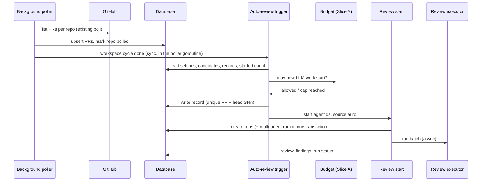

# Settings Slice C — Automatic Reviews
Spec: Settings Slice C — Automatic Reviews (settings object, auto-review trigger on the background poll, status, UI) · Status: implemented (2026-10-25, 2a7f422..0722f1a; D13–D18: fork guard, AC22 waived, NFR1 p95 ≤ 750 ms, interval within a tick, PR list pill) · Date: 2026-10-23
Areas: api, auto, db, ui
Design sources: accepted design `docs/design/2026-10-23-settings-first-run.md` (§4 Slice C, §5, §6, §7 P3/P7, §8 — binding);
prototype extraction `proto-screens.md` §3.4 (screen_settings.jsx "Automatic Reviews"); screenshot `images/7.png`
(Settings › Automatic Reviews, read once: toggle card ON, "Every 5 minutes" select, chips Security Reviewer ✓ /
Performance Reviewer ✓ / + Custom Mentor, both trigger checkboxes ticked, green "Active · last poll 2m ago · 7 PRs
tracked", info box about the GitHub Action); PR Leaderboard spec FR3–FR5, D18; code research of `backend/` and
`frontend/` on branch `feat/go-backend-phase-1` @ `9ef3155` plus working tree.
Related: `specs/2026-10-23-pr-leaderboard.md` (owns the background poll this slice consumes); the Slice A spec
(Settings shell, API Keys, spend cap — written in parallel; this spec depends on its spend cap and does not redefine it).

ID convention: plain FR1…, EC1…, NFR1…, AC1…, US1…, D1…, Q1…; area tags `[api]` settings and status routes, run-source
surfaces; `[auto]` the auto-review trigger; `[db]` schema; `[ui]` Settings › Automatic Reviews.

## 1. Goal
A team lead wants new pull requests and new pushes reviewed by chosen agents without anyone clicking "Review". When
Automatic Reviews is on, every background PR poll hands the PRs it keeps fresh to a trigger that starts the chosen
agents once per PR head commit, never floods old PRs, respects the monthly spend cap and a start rate limit. Settings ›
Automatic Reviews shows the switch, the poll interval, the agents, the trigger conditions and a live status line.

## 2. Context
- Settings are jsonb rows per (workspace, user, key); `automatic_reviews` is validated as a boolean and is read by no
  code; `polling_interval_min` is an integer ≥ 1 (`backend/internal/settings/transport/http/validate.go:30,58-65,140-156`;
  `frontend/src/vendor/shared/contracts/platform.ts:35-43`). Settings routes: GET/PUT `/settings`, GET
  `/settings/secrets-status`, POST `/settings/test-connection` (`settings/transport/http/handler.go:53-56`).
- The background poller polls each workspace's repos one at a time every `polling_interval_min` (clamped 1 min–24 h,
  default 5), per workspace, skips a cycle without a GitHub token, pauses on rate limit; `PR_POLL_ENABLED=false` turns it
  off (`pulls/app/poller.go:142-173`, `pulls/domain/poll.go:7-37`, `internal/config/config.go:59,119`). It is wired in
  `cmd/server/poll.go` (working tree), which reads the workspace's settings bag for the interval (`poll.go:22-50`).
- The upsert inserts new PRs and updates title, head SHA, status, updated/merged/closed time and draft; it reports
  nothing per PR today (`pulls/adapters/postgres/store.go:194-227`, `pulls/app/ports.go:82-86`). Manual polls and PR
  list requests use the same upsert (leaderboard spec §2). PR rows have `opened_at`, `head_sha`, `last_reviewed_sha`,
  `draft`, no first-seen time (`migrations/0001_baseline.up.sql` pull_requests, `0002_pr_merge_state.up.sql`).
- Review start: `RunRequest` = exactly one of `agentId` / `all` / `agentIds` (1–20); named agents may be disabled,
  `all` = enabled agents; 2+ agents create a multi-agent run; runs are created in one transaction and executed in the
  background (`reviews/app/start.go:14-117`, `contracts/platform.ts:255-262`). POST `/pulls/:id/review` has a
  10 requests/min HTTP bucket (`cmd/server/app.go:531`). An executor runs ≤ 4 agent runs of one request at once, with no
  cross-request cap (`reviews/app/executor/executor.go:25-27`).
- `agent_runs.source` ∈ {`local`, `ci`} by a CHECK constraint (`0001_baseline.up.sql:53,61`); review runs are created
  as `local` (`reviews/adapters/postgres/runs.go:22-32`). The source is exposed in the trace (`contracts/trace.ts:121`)
  and the agent Stats run history (`contracts/observability.ts:221`); Agent Performance counts only `local`/`ci` runs
  and splits them into `runs_local`/`runs_ci` (`performance/adapters/postgres/store.go:35`,
  `performance/domain/metrics.go:53`, `observability.ts:150-159`).
- Agents carry `enabled` (`contracts/knowledge.ts:418-433`). Settings UI today has only API Keys and Feature Models
  (`frontend/src/app/settings/[section]`); Slice A builds the full sub-nav.

## 3. Scope
### In scope
- `automatic_reviews` becomes an object with backward-compatible reading of the boolean.
- An auto-review trigger evaluated after each background-poll cycle, with a new idempotency record (up/down migration).
- Run source `auto` across schema, trace, agent stats and Agent Performance.
- A status route and the Settings › Automatic Reviews section.

### Out of scope
- No new GitHub call is made by the trigger; it only reads what the background poll stored.
- Manual polls (POST `/repos/:id/poll`) and PR list requests never start an automatic review.
- PRs opened before Automatic Reviews was last armed are never reviewed automatically, also not on new commits (P7).
- No webhook or GitHub Action trigger; the Integrations section is Slice D.
- The Repo Dashboard pill "Auto-review: ON · polling 5m · 2 agents" is not built (superseded by D18: the PR list pill is built).
- No per-repository selection: Automatic Reviews applies to every repository of the workspace.
- The spend cap value, its month total and the 402 `spend_cap_reached` answer are defined by Slice A and not changed here.
- POST `/pulls/:id/review` keeps its path, body, responses and its 10/min bucket; `polling_interval_min` keeps its validation.
- No notification (toast, email, badge) is sent when an automatic review starts or ends.

## 4. User scenarios
- US1 — As a tech lead, I switch Automatic Reviews on, pick two agents and both triggers, so that every PR opened from
  now on is reviewed without a click.
- US2 — As a developer, I push new commits to my PR, so that the chosen agents re-review the new head automatically.
- US3 — As a tech lead, I see at a glance whether automatic reviews are really running ("Active …") or why not
  (spend cap, no token, poll off, no agent).
- US4 — As an agent author, I tell automatic runs from manual and CI runs in the agent's run history.

## 5. Functional requirements
- FR1 [api] — GET `/settings` shall always return `automatic_reviews` as the object of §7.1 with defaults filled in; a
  stored boolean `b` reads as `{enabled: b, agent_ids: [], on_new_pr: true, on_new_commits: true, enabled_at: null}`;
  a missing value reads as the same with `enabled: false`.
- FR2 [api] — PUT `/settings` shall accept for `automatic_reviews` a boolean (= `{enabled: b}`) or an object with any
  subset of `enabled`, `agent_ids`, `on_new_pr`, `on_new_commits`; omitted fields keep the stored value; `enabled_at`
  and unknown fields in the input are dropped; the stored value is always the full object. The server sets
  `enabled_at` to the current time when an update makes the setting armed (glossary) from not armed, keeps it while it
  stays armed, and sets it to null when it becomes not armed.
- FR3 [auto] — When the setting is armed, the system shall evaluate automatic reviews of a workspace after every
  background-poll cycle of that workspace in which at least one repository was polled successfully, and at no other
  time.
- FR4 [auto] — Candidates are the workspace's stored PRs that are open, not draft, have a GitHub opened time at or
  after `enabled_at`, and have no auto-review record for their current head SHA.
- FR5 [auto] — A candidate is a "new PR" event when the PR has no auto-review record for any head SHA, else a "new
  commits" event. An event whose trigger condition is not ticked gets a record with outcome `skipped_trigger_off`.
- FR6 [auto] — For a ticked event the system shall apply, in order: (a) the PR has a running review run → no record,
  re-evaluated next cycle; (b) the PR's last reviewed SHA equals its head SHA → record `skipped_already_reviewed`;
  (c) effective agents (the selected ids, in setting order, that exist and are enabled) are empty → record
  `skipped_no_agents`; (d) the Slice A spend cap does not allow new LLM work → record `skipped_spend_cap`; (e) the
  rate limit of FR9 is used up → no record, re-evaluated next cycle; (f) otherwise start the review (FR7).
- FR7 [auto] — Starting shall use the same review start as POST `/pulls/:id/review` with `agentIds` = effective agents
  (2+ agents create a multi-agent run, as a manual multi-select does); every created run has source `auto`; the record
  gets outcome `started` and the number of runs. A start error records outcome `failed`, is logged and is not retried.
- FR8 [auto] — There shall be at most one auto-review record per (PR, head SHA), and a record is never re-decided: an
  automatic review starts at most once per (PR, head SHA) across overlapping evaluations and server restarts.
- FR9 [auto] — Per workspace at most 5 automatic review starts per evaluation and at most 20 per rolling 60 minutes,
  counted from stored `started` records; candidates are taken oldest PR update first (ties: PR id); automatic starts
  do not use the HTTP bucket of POST `/pulls/:id/review`.
- FR10 [db] — The system shall persist auto-review records (§8) and accept `auto` as a run source; the schema change
  has an up and a down migration.
- FR11 [api] — Run source `auto` shall appear in the run trace (`config.source`) and the agent Stats run history;
  Agent Performance counts `auto` runs in every metric and in `runs_local`; the CI Runs page does not list them.
- FR12 [api] — GET `/settings/automatic-reviews-status` shall answer the status of §7.2 with the state precedence
  `off` > `poll_disabled` > `no_github_token` > `no_agents` > `no_triggers` > `paused_spend_cap` > `active`.
- FR13 [ui] — Settings › Automatic Reviews (`/settings/automatic-reviews`) shall show title "Automatic Reviews",
  subtitle "Poll GitHub for new PRs and run agents without manual triggering." and a toggle card "Auto-run review on
  new PR detection" with subline "On for every repository in this workspace" (on) / "Off — start reviews from a pull
  request" (off).
- FR14 [ui] — "Polling interval" select with options Every minute (1), Every 2 minutes (2), Every 5 minutes (5),
  Every 10 minutes (10), Every 15 minutes (15), Every 30 minutes (30), Every hour (60), writing `polling_interval_min`;
  a stored value outside the list is shown as an extra "Every N minutes" option; hint "Also sets how often PRs are
  synced for PR Leaderboard."
- FR15 [ui] — "Agents to run" chips for every agent of the workspace in the agents list order: selected = check icon
  and accent outline, unselected = "+" icon; disabled agents are muted and not selectable, and a selected disabled
  agent shows "skipped — disabled"; at most 20 can be selected; ids of deleted agents are not shown and are dropped on
  the next save; with no agents: "No agents yet" and a "Create an agent" link to `/agents`.
- FR16 [ui] — "Trigger conditions" checkboxes "On new PR" (`on_new_pr`) and "On new commits to existing PR"
  (`on_new_commits`).
- FR17 [ui] — A status line under the triggers shows the status route's state (copy in §9), refreshed every 30 s
  while the section is open and after every save.
- FR18 [ui] — Info box: "Polling is the default. For instant triggers and CI execution, install the GitHub Action
  under Integrations." with "Integrations" linking to `/settings/integrations`.
- FR19 [ui] — The agent Stats run history labels `auto` runs "Auto".
- FR20 [ui] — Every control saves at once with PUT `/settings`; the control is disabled while saving; on failure it
  returns to the stored value and an error toast shows the API message.

## 6. Workflow and communication

| Caller → callee | Trigger | Sync | On failure |
|---|---|---|---|
| Poller → trigger | end of a workspace cycle with ≥ 1 repo polled | sync, same goroutine | trigger error is logged; the poller goes on; nothing retried |
| Trigger → database | evaluation | sync | read error → evaluation skipped this cycle (WARN); record conflict → candidate skipped |
| Trigger → budget | per candidate before start | sync | error → treated as not allowed this cycle, no record (WARN) |
| Trigger → review start | per allowed candidate | sync; runs async | error → record `failed` (WARN), next candidate |
| UI → status route | open section, every 30 s, after save | sync | error → "Status unavailable" + Retry |

## 7. Contracts
### 7.1 Settings value `automatic_reviews` (GET/PUT `/settings`, `contracts/platform.ts`)
```
AutomaticReviews = {
  enabled: boolean,            // default false
  agent_ids: string[],         // UUIDs, unique, 0–20, run order; default []
  on_new_pr: boolean,          // default true
  on_new_commits: boolean,     // default true
  enabled_at: string | null    // server-set, ISO-8601 UTC with ms; null when not armed
}
PUT input: boolean | Partial<Omit<AutomaticReviews, "enabled_at">>
```
PUT errors (422 `validation_error`, Zod-style `details` issues with path `["automatic_reviews", …]`): value neither
boolean nor object (`invalid_type`); `enabled`/`on_new_pr`/`on_new_commits` not boolean (`invalid_type`); `agent_ids`
not an array of strings (`invalid_type`); an element not a UUID (`invalid_string`); more than 20 ids after removing
duplicates (`too_big`). Duplicate ids are removed keeping the first. The response is the full stored bag (unchanged
behaviour). Consumers: the Settings UI only (no backend code reads the boolean today).

### 7.2 `GET /settings/automatic-reviews-status` → 200
```
{ state: "off" | "poll_disabled" | "no_github_token" | "no_agents" | "no_triggers" | "paused_spend_cap" | "active",
  last_poll_at: string | null,   // newest last-polled time of the workspace's repos, ISO UTC ms
  prs_tracked: number,           // stored open PRs of the workspace (drafts included)
  poll_interval_min: number }    // effective interval after clamping to 1–1,440
```
States: `off` = `enabled` false; `poll_disabled` = background poll switched off for the deployment; `no_github_token`
= no GitHub token stored; `no_agents` = effective agents empty; `no_triggers` = both triggers off;
`paused_spend_cap` = Slice A's cap does not allow new LLM work; `active` otherwise. Errors: 500 `internal_error`
envelope. Unknown query keys are ignored. No secret value appears in the response.

### 7.3 Run source
`agent_runs.source`, `RunTrace.config.source` (`contracts/trace.ts`) and `RunHistoryItem.source`
(`contracts/observability.ts`) gain the value `auto`. `AgentPerformance` keeps its fields; the invariant
`runs = runs_local + runs_ci` holds with `auto` runs counted in `runs_local`. Shared contract copies change together
with the backend (repository rule).

## 8. Data model (logical)
- Auto-review record (new, persisted): workspace, PR, head SHA, event (`new_pr` | `new_commits`), outcome (`started` |
  `skipped_trigger_off` | `skipped_already_reviewed` | `skipped_no_agents` | `skipped_spend_cap` | `failed`), number
  of runs started, decided at. Unique per (PR, head SHA). Deleted with its PR (and so with its repository); not run
  history: kept by retention pruning and by "Reset run history" (Slice B).
- Agent run: source gains `auto`.
- Settings value `automatic_reviews`: object of §7.1 (jsonb, no schema change).
- Status values are derived on read, never stored.

## 9. States and UX
| Screen / element | Loading | Empty | Error | Degraded | Success | Notes |
|---|---|---|---|---|---|---|
| Section | skeleton for toggle, select, chips | — | settings load error + Retry | — | all controls | URL `/settings/automatic-reviews` |
| Toggle | disabled skeleton | — | save fails → reverts + toast | — | on/off sublines (FR13) | role switch |
| Interval select | skeleton | — | as toggle | stored value not in list → extra option | 7 options | |
| Agent chips | 3 skeleton chips | "No agents yet" + "Create an agent" | agents load error + Retry | disabled agents muted; selected disabled "skipped — disabled" | chips | max 20 |
| Trigger checkboxes | disabled | — | as toggle | — | ticked state | |
| Status line | "Checking status…" | — | "Status unavailable" + Retry | see states | per state | dot + text |

Status line copy: `active` (green pulsing dot) "**Active** · last poll {2m ago | never} · {n} PRs tracked"; `off`
(muted) "Off — PRs are reviewed only when you start a review"; `poll_disabled` (warn) "Paused — background poll is
off for this server (PR_POLL_ENABLED)"; `no_github_token` (warn) "Paused — no GitHub token" + link "GitHub
Integration"; `no_agents` (warn) "Paused — no enabled agent selected"; `no_triggers` (warn) "Paused — no trigger
condition selected"; `paused_spend_cap` (warn) "Paused — spend cap reached" + link "API Keys".

## 10. Edge cases
- EC1 [auto] — PR opened before `enabled_at` gets new commits after it → never reviewed automatically (FR4).
- EC2 [auto] — PR first stored after enabling but opened before (repo added later, 62-day first poll) → not reviewed (FR4).
- EC3 [auto] — Draft PR → not a candidate; when marked ready, its current head is a "new PR" event (FR4, FR5).
- EC4 [auto] — PR closed or merged before the evaluation → not a candidate (FR4).
- EC5 [auto] — PR first stored by a manual poll or a PR list request → still a candidate at the next background cycle (FR3, FR4).
- EC6 [auto] — Head changes twice between two cycles → only the newest head is reviewed (FR4, FR8).
- EC7 [auto] — Server restarts after records were written → no record is re-decided; a stop between record and run
  creation leaves that head unreviewed rather than reviewed twice (FR8).
- EC8 [auto] — Two evaluations overlap on the same candidate → exactly one record and at most one start (FR8).
- EC9 [auto] — Some selected agents disabled or deleted → only the enabled existing ones run; none left → `skipped_no_agents` (FR6).
- EC10 [ui] — Setting holds ids of deleted agents → they are not shown and the next save drops them (FR15).
- EC11 [auto] — Spend cap reached → `skipped_spend_cap`; those heads are not reviewed after the cap lifts (FR6).
- EC12 [auto] — A manual review of the PR is running → no record this cycle; after it finishes on the same head → `skipped_already_reviewed` (FR6).
- EC13 [auto] — More candidates than the rate limit → the rest wait for later cycles, oldest update first (FR9).
- EC14 [auto] — Disabling while automatic runs are in flight → they finish; nothing new starts (FR3).
- EC15 [api] — Re-arming after a pause → `enabled_at` is the new time; PRs opened in between are not reviewed (FR2, FR4).
- EC16 [api] — Stored legacy `true` → enabled with no agents (`enabled_at` null, state `no_agents`); picking agents arms it (FR1, FR2).
- EC17 [auto] — The agent's provider has no key → the run fails exactly as a manual run does; the record says `started` (FR7).
- EC18 [ui] — A save or the status request fails → the control reverts with a toast / the status shows "Status unavailable" + Retry (FR17, FR20).
- EC19 [ui] — More than 20 agents clicked → the 21st is refused with "Up to 20 agents" (FR15).

## 11. Non-functional requirements
- NFR1 [auto] — One evaluation over 1,000 stored open PRs and 10,000 records takes ≤ 500 ms of database time
  (relaxed to p95 ≤ 750 ms for a steady evaluation, see D16).
- NFR2 [auto] — The evaluation itself makes no GitHub and no LLM call; only the started review runs do, as manual runs.
- NFR3 [auto] — One INFO log line per decision with workspace_id, pr_id, repo, number, head SHA (first 12), event,
  outcome, run count; no token, key or prompt text is logged.
- NFR4 [auto] — At-most-once per (PR, head SHA) is enforced by the stored uniqueness, not by in-memory state.
- NFR5 [auto] — On shutdown an evaluation returns within 5 s; started runs follow the review executor's shutdown.
- NFR6 [ui] — Toggle has role switch and a label; chips are buttons with `aria-pressed`; checkboxes are labelled; the
  status carries text, not colour only; all copy is in `messages/en`.
- NFR7 [api] — PUT `/settings` and the new GET route keep the Host allow-list, the foreign-Origin 403 for PUT, JSON-only
  bodies and the error envelope.

## 12. Dependencies and rollout
- Shared contract change: yes — `SettingsKnown.automatic_reviews` (object), new status schema, `auto` in `RunTrace` and
  `RunHistoryItem` source enums (backend and `frontend/src/vendor/shared` together).
- Persisted data change: yes — new auto-review record entity; `agent_runs.source` accepts `auto`. Down migration drops
  the records and turns `auto` runs into `local` before restoring the old source rule (lossy, documented).
- Needs merged: the leaderboard background poller wiring in `cmd/server` (S16′/P8′, `PR_POLL_ENABLED`; uncommitted on the branch today), and Slice A
  (settings sub-nav, spend-cap decision). Slice B's retention prune and reset must keep auto-review records.
- No feature flag: Automatic Reviews is off until a user arms it; existing installs read `false`/`true` per FR1.

## 13. Acceptance criteria
- AC1 [api] — Given no stored value, a stored `true` and a stored `false`, when GET `/settings` runs, then
  `automatic_reviews` is the full object with defaults; `true` → enabled with `agent_ids: []`, both triggers true, `enabled_at: null`.
  Traces: FR1, EC16 · Verify: component
- AC2 [api] — Given a stored setting, when PUT sends `false`, `{agent_ids:[a]}`, `{enabled:true, enabled_at:"x"}` in
  turn on a fake clock, then omitted fields are kept, `enabled_at` from input is ignored, it is set when the value
  becomes armed, unchanged on a later armed edit, and null when unarmed.
  Traces: FR2, EC15, EC16 · Verify: component
- AC3 [api] — Given PUT bodies with `automatic_reviews` = `"on"`, `{enabled:1}`, `{agent_ids:"a"}`, `{agent_ids:["x"]}`,
  21 distinct UUIDs, and 2 duplicate UUIDs, then the first five answer 422 `validation_error` with the issue codes of
  §7.1 and path `["automatic_reviews",…]`, the last stores one id.
  Traces: FR2 · Verify: component
- AC4 [db] — Given a migrated DB, when migrating down and up, then the record table is dropped and re-created, an
  `auto` run is stored after up and becomes `local` after down, other tables are unchanged; deleting a repo removes
  its PRs' records.
  Traces: FR10 · Verify: integration
- AC5 [auto] — Given armed at T and PRs A (opened after T), B (opened before T, new head after T), C (draft), D
  (closed), E (opened after T, first stored by a manual poll), when a background cycle ends, then reviews start for A
  and E only, and none for B after its head changes; a manual poll alone starts nothing.
  Traces: FR3, FR4, EC1, EC2, EC4, EC5 · Verify: integration
- AC6 [auto] — Given `on_new_pr` false, when a new PR is evaluated, then it gets `skipped_trigger_off` and a later
  head starts as `new_commits`; with `on_new_commits` false a second head gets `skipped_trigger_off`; a draft marked
  ready starts as `new_pr`; two head changes between cycles start only the newest head.
  Traces: FR5, EC3, EC6 · Verify: integration
- AC7 [auto] — Given candidates with a running manual run, with last reviewed SHA = head, with selected agents
  {enabled, disabled, deleted}, with only unavailable agents, and with a budget fake answering "cap reached", then
  respectively: no record (and `skipped_already_reviewed` once the run ends on that head), runs for the enabled agent
  only, `skipped_no_agents`, `skipped_spend_cap` with no run.
  Traces: FR6, EC9, EC11, EC12 · Verify: integration
- AC8 [auto] — Given 2 effective agents, then one multi-agent run with 2 runs of source `auto` is created and the
  record says `started` with 2; with 1 agent, one run and no multi-agent run; an agent whose provider has no key
  yields a failed run and a `started` record; a start error yields `failed` and no retry next cycle.
  Traces: FR7, EC17 · Verify: integration
- AC9 [auto] — Given two evaluations running at the same time over the same candidates, then each (PR, head) has
  exactly one record and at most one start; after a restart (new trigger instance, same DB) no new start happens.
  Traces: FR8, EC7, EC8, NFR4 · Verify: integration
- AC10 [auto] — Given 8 candidates, then 5 start in the first evaluation (oldest update first) and 3 in the next; given
  20 `started` records in the last 60 min, none start until one ages out; the HTTP review bucket count is unchanged.
  Traces: FR9, EC13 · Verify: integration
- AC11 [auto] — Given not armed (disabled, no agent ids, or no triggers) or `PR_POLL_ENABLED=false`, then no record and
  no run appear; disabling during an automatic run lets it finish and starts nothing more; cancelling the poller
  during an evaluation returns within 5 s.
  Traces: FR3, EC14, NFR5 · Verify: integration
- AC12 [api] — Given an automatic run, then its trace has `config.source` `auto`, GET `/agents/:id/stats` lists it with
  source `auto`, Agent Performance counts it in `runs` and `runs_local`, and GET `/ci/runs` does not list it.
  Traces: FR11 · Verify: component
- AC13 [api] — Given fixtures for each state (and combinations), when GET `/settings/automatic-reviews-status` runs,
  then `state` follows the FR12 precedence, `last_poll_at` is the newest repo poll time, `prs_tracked` counts open PRs,
  `poll_interval_min` is clamped, and the body contains no stored secret.
  Traces: FR12, NFR7 · Verify: component
- AC14 [auto] — Given captured logs of AC5–AC8, then each decision has one INFO line with the NFR3 fields and no line
  contains the GitHub token or a provider key.
  Traces: NFR3 · Verify: integration
- AC15 [api] — Given PUT `/settings` with a foreign Origin → 403; with `text/plain` → 422 `validation_error` as on the sibling routes (D14); the status
  route with a foreign Host is refused; Go goldens match the UI contract.
  Traces: NFR7 · Verify: component
- AC16 [auto] — Given 1,000 open PRs and 10,000 records in a throwaway database, when 50 evaluations run, then p95
  database time ≤ 500 ms and no GitHub or LLM fake receives a call from the evaluation.
  Traces: NFR1, NFR2 · Verify: manual
- AC17 [ui] — Given a mocked API, then the section shows title, subtitle, the toggle (role switch) with both sublines,
  the 7 interval options (plus "Every 7 minutes" when 7 is stored) and the hint; changing them sends PUT with the new value.
  Traces: FR13, FR14 · Verify: component
- AC18 [ui] — Given agents {enabled selected, enabled unselected, disabled selected} and one deleted id, then chips
  show check/+ with `aria-pressed`, the disabled one muted with "skipped — disabled", the deleted id hidden and absent
  from the next PUT; a 21st selection shows "Up to 20 agents"; with no agents "Create an agent" links to `/agents`.
  Traces: FR15, EC10, EC19 · Verify: component
- AC19 [ui] — Given the checkboxes, when ticked/unticked, then PUT carries `on_new_pr`/`on_new_commits`; when a PUT
  fails, the control returns to the stored value and a toast shows the message; controls are disabled while saving.
  Traces: FR16, FR20, EC18 · Verify: component
- AC20 [ui] — Given each status state mocked, then the line shows the §9 copy with text; it refetches every 30 s (fake
  timers) and after a save; a failed request shows "Status unavailable" + Retry; loading shows "Checking status…".
  Traces: FR17, EC18, NFR6 · Verify: component
- AC21 [ui] — Given the section and the agent Stats tab with an `auto` run, then the info box links "Integrations" to
  `/settings/integrations`, the run shows "Auto", and the pseudo-messages test finds no hard-coded copy.
  Traces: FR18, FR19, NFR6 · Verify: component
- AC22 [ui] — Given the running stack, a GitHub token, a test repo and one enabled agent, when the user arms Automatic
  Reviews with a 1-minute interval and opens a PR, then within 2 minutes an "Auto" run appears on the PR; a push starts
  a second one; the status line reads "Active".
  Traces: FR3, FR7, FR17 · Verify: manual

## 14. Traceability
| Source | Area | FR | EC / NFR | AC |
|---|---|---|---|---|
| Design §4 C settings object | api | FR1, FR2 | EC15, EC16 | AC1–AC3 |
| Design §4 C detection, P7, Q-poll | auto | FR3, FR4 | EC1–EC5, EC14 | AC5, AC11 |
| Design §4 C trigger rules | auto | FR5, FR6 | EC3, EC6, EC9, EC11, EC12 | AC6, AC7 |
| Design §4 C start, source `auto` | auto, api | FR7, FR11 | EC17 | AC8, AC12 |
| Design §4 C / §5 idempotency migration | auto, db | FR8, FR10 | EC7, EC8, NFR4 | AC4, AC9 |
| Request: rate limits | auto | FR9 | EC13 | AC10 |
| Design §4 C status | api, ui | FR12, FR17 | EC18 | AC13, AC20 |
| Screenshot 7 / proto §3.4 | ui | FR13–FR16, FR18, FR20 | EC10, EC18, EC19 | AC17–AC19, AC21 |
| US4 | ui | FR19 | — | AC21 |
| Repository rules | auto, api, ui | — | NFR1–NFR3, NFR5–NFR7 | AC11, AC13–AC16, AC20, AC21 |
| End-to-end | all | FR3, FR7, FR17 | — | AC22 |

## 15. Design review
| # | Gap / proposal | Source | Area | Decision |
|---|---|---|---|---|
| G1 | Upsert-reported events (inserted / head changed) miss PRs first stored by a manual poll or a PR list, and lose deferred events | design §4 C, `store.go:194` | auto | candidates evaluated from stored state after each cycle (FR3, FR4) — resolved, D4 |
| G2 | No first-seen time stored; repo added after enabling would flood | schema | auto | eligibility = GitHub opened time ≥ `enabled_at` (stricter than "first seen") — resolved, D5 |
| G3 | "On new commits" for PRs opened before enabling | design P7 vs prototype copy | auto | not reviewed (Out of scope line 3) — resolved, D6 |
| G4 | No cross-request run cap; a burst could start many batches | `executor.go:25` | auto | 5 per evaluation, 20 per hour (FR9) — resolved, D7 |
| G5 | Spend-capped heads: wait or skip? | design §4 C | auto | skip and record (EC11) — resolved, D8 |
| G6 | Manual review of the same head | — | auto | skip when running or already reviewed (FR6 a, b) — accepted |
| G7 | States "no agents" / "no triggers" not in the design | design §4 C | api, ui | added (FR12) — accepted |
| G8 | Interval options not in the prototype | proto caveat | ui | 1, 2, 5, 10, 15, 30, 60 min (FR14) — resolved, D9 |
| G9 | `auto` breaks the source CHECK and the local/CI split | schema, performance | db, api | migration + counted as local (FR10, FR11) — resolved, D10 |
| G10 | Dashboard pill "Auto-review: ON …" | proto §1 | ui | out of scope — accepted; superseded by D18 (PR list pill built) |
| G11 | Toggle subline "Currently active" lies when paused | screenshot | ui | neutral sublines; status line tells the truth (FR13) — accepted |

## 16. Decisions
- D1 — Design `docs/design/2026-10-23-settings-first-run.md` §4 C, §7 P3/P7, §8 are binding (user, 2026-10-23).
- D2 — The spend cap comes from Slice A; this spec only consumes its allow/deny decision (user brief, 2026-10-23).
- D3 — `polling_interval_min` is shared with the leaderboard background poll (leaderboard D18; user, 2026-10-23).
- D4 — Q1 Triggers come from stored state after each background-poll cycle, not from upsert events (FR3, FR4) (user approved default, 2026-10-23).
- D5 — Q2 A PR is new when it was opened on GitHub at or after `enabled_at` (user approved default, 2026-10-23).
- D6 — Q3 New commits on PRs opened before enabling never trigger a review (design P7) (user approved default, 2026-10-23).
- D7 — Q4 Rate limits: 5 starts per evaluation and 20 per rolling hour, per workspace (user approved default, 2026-10-23).
- D8 — Q5 Heads blocked by the spend cap are recorded `skipped_spend_cap` and never reviewed later (user approved default, 2026-10-23).
- D9 — Q6 Interval options: 1, 2, 5, 10, 15, 30, 60 minutes (user approved default, 2026-10-23).
- D10 — Q7 `auto` runs count in Agent Performance `runs_local`; no new field (user approved default, 2026-10-23).
- D11 — Q8 Settings section key `automatic-reviews` (user approved default, 2026-10-23).
- D12 — Q9 `prs_tracked` counts every stored open PR, drafts included (user approved default, 2026-10-23).
- D13 — Automatic reviews start only for PRs whose head branch is in the same repository (no forks). A fork PR is recorded
  `skipped_fork` and can still be reviewed manually. Poll stores the PR's head repository; migration 0007 (security r1 M1;
  user, 2026-10-25). A PR whose head repository is not known yet (NULL, e.g. stored before 0007) gets no record and no start
  until a poll stores the value; a deleted fork (`head.repo` null in GitHub's payload) counts as a fork (user, 2026-10-25,
  accepting the fix-round reading: a recorded skip is permanent).
- D14 — AC15 wording: `text/plain` on PUT /settings answers 422 `validation_error`, as on the sibling routes (W4 finding).
- D15 — AC22 (manual end-to-end walk with a real GitHub repo, PR and push) is waived; the flow is covered by the
  cmd/server automatic-review flow tests against a GitHub stub (user, 2026-10-25).
- D16 — NFR1/AC16 bound, relaxed: a steady evaluation (about 120 undecided candidates among the 1,000 PRs) takes
  p95 ≤ 750 ms of database time, measured on pgtest (fsync off; a durable Postgres is slower, unmeasured). Measured
  p95 360–372 ms (implementer), 528–589 ms under host load ~8 (verifier r2), 423–550 ms (orchestrator re-run). A burst (700 undecided PRs in one
  evaluation) is measured but not bound (p95 1.4–2.8 s, linear in per-record INSERT commits); only its candidates read
  is bound by the 750 ms limit (p95 144–208 ms). Batching record-only decisions into one INSERT is a follow-up (user, 2026-10-25).
- D17 — Interval changes apply within one poll tick (stand finding, 2026-10-25): the poller computes a workspace's
  due time on every tick as its last cycle start + the CURRENT `polling_interval_min`, so lowering 60 → 1 polls within
  a minute (it used to wait out the old 60-minute due time; leaderboard AC3 "takes effect on the next cycle" is
  tightened accordingly). A rate-limit resume time still wins over the interval (user, 2026-10-25).
- D18 — The PR list pill "Auto-review: ON/OFF" is built (G10 reversed; it was hard-coded OFF): ON when
  GET /settings/automatic-reviews-status answers `active`, with the detail "polling <N>m" from `poll_interval_min`;
  OFF otherwise; it links to `/settings/automatic-reviews` (user, 2026-10-25).

## 17. Open questions
None — Q1–Q9 were resolved on 2026-10-23 by accepting their defaults (D4–D12).

## Glossary
- Armed — `enabled` is true, `agent_ids` is not empty and at least one trigger condition is ticked.
- Effective agents — selected ids, in setting order, of agents that exist and are enabled.
- Auto-review record — the stored decision for one (PR, head SHA).
