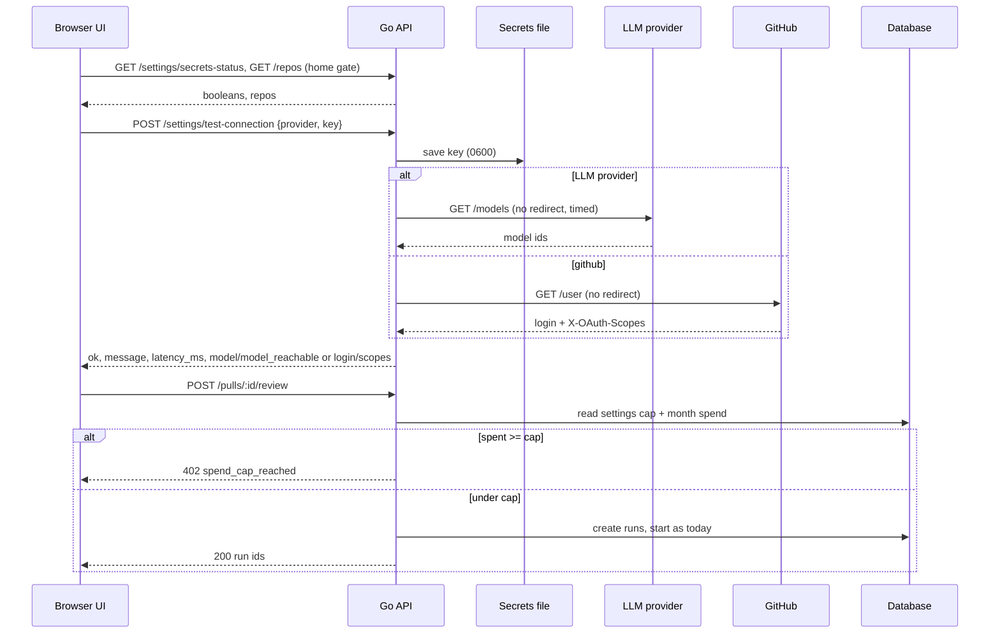

# Settings shell, API Keys, GitHub Integration, About and First-run setup
Spec: Settings slice A (settings shell, API Keys with default model and spend cap, GitHub Integration, About, first-run setup) · Status: implemented (2026-10-25, merged ac69763; AC23 accepted D26; AC25 PASS incl. real keys) · Date: 2026-10-23
Areas: api, ui
Design sources: `docs/design/2026-10-23-settings-first-run.md` (accepted by the user on 2026-10-23, slice A, decisions
P1–P8, answers Q1–Q4); the user's Claude Design prototype "DevDigest — App prototype". The screenshots read were
`images/3.png` (first-run setup step 1), `4.png` (Settings → API Keys), `5.png` (GitHub Integration) and `9.png`
(About). The decoded bundle extraction covered `screen_settings.jsx` and `screen_onboarding.jsx`. Code research of
`backend/` and `frontend/` was done on branch `feat/go-backend-phase-1` @ `9ef3155`.
Related: the design doc above. Sibling slice specs: `specs/2026-10-23-settings-b-workspace.md`,
`specs/2026-10-23-settings-c-automatic-reviews.md`; slice D Integrations gets its own spec. Supersedes nothing.

ID convention: plain FR1…, EC1…, NFR1…, AC1…, US1…, D1…, Q1…. Area tags: `[api]` = Go backend, `[ui]` = Next.js app.

## 1. Goal
This slice makes Settings the full surface from the prototype and gives a fresh install a guided start. A new user
connects a model provider and a GitHub token, adds a first repository, and reaches the PR list without first finding
Settings. An existing user gets three things:
- a connection test that proves the key works and that their model is reachable;
- one default model for new agents and for features without their own model;
- a monthly spend cap that stops new LLM work once it is reached.

Keys stay on the machine. The API keeps its no-auth guards.

## 2. Context
- Settings has two sections, `api-keys` and `models`. Any other key renders an "A6 finalizes…" empty state
  (`frontend/src/vendor/ui/nav.ts:58-61`, `SettingsView.tsx:18,35-43`, `messages/en/settings.json:4`).
- API Keys shows four rows (OpenAI, Anthropic, OpenRouter, GitHub), and its badge reads "Configured"
  (`SettingsApiKeys/constants.ts:10-15`, `messages/en/settings.json:20`).
- Settings is a flat jsonb bag per workspace. PUT validates the known keys and passes unknown keys through
  (`backend/internal/settings/transport/http/validate.go:26-34,338-381`). Known keys include `polling_interval_min`,
  `automatic_reviews` (bool) and `feature_models` (`frontend/src/vendor/shared/contracts/platform.ts:35-44`).
- Secrets live in `$DEVDIGEST_DATA_DIR/secrets.json` (mode 0600, environment fallback; default dir `~/.devdigest`).
  No response ever carries a key value. `GET /settings/secrets-status` returns one boolean per provider
  (`backend/internal/platform/secrets/secrets.go:1-80`, `internal/config/config.go:124-133`,
  `settings/app/settings.go:58-64,140-145`).
- `POST /settings/test-connection {provider, key?}` saves the key first and keeps it even when the test fails. It then
  answers `{provider, ok, message}`:
  - GitHub: "Connected as @login", from GET /user.
  - LLM providers: "OK — N models available", from one model-list call.

  It never makes a completion call. Its rate limit is 20/min per IP (`settings/app/settings.go:147-180`,
  `settings/transport/http/handler.go:17-24`, `settings/adapters/providers/providers.go:115-143`). The provider
  clients and the GitHub client never follow redirects (`providers.go:68-76`, `platform/github/client.go:133-139`).
  GitHub scopes are never read.
- Feature models: `llm.ResolveFeatureModel` uses the stored `feature_models` choice when one exists. Otherwise it uses
  a hard-coded default: onboarding and review_intent → openrouter `deepseek/deepseek-v4-flash`; risk_brief and
  conformance → openai `gpt-4.1`; conventions → openai `gpt-5.4` (`backend/internal/llm/featuremodel.go:6-39`).
  Agents store their own provider and model (NOT NULL). The create-agent form prefills a constant
  provider and model (`CreateAgentModal.tsx:22-31`).
- Model lists: `GET /providers/:id/models` returns `[]` when listing fails (`agents/app/service.go:228-242`).
- LLM entry points (research report, 2026-10-23):

  | Route | How it runs |
  |---|---|
  | POST `/pulls/:id/review` (single, multi-agent, `all`) | async |
  | POST `/agents/:id/eval-runs` | async |
  | POST `/skills/:id/eval-runs` | async |
  | POST `/eval-runs/run-all` | async |
  | POST `/repos/:id/conventions/extract` | job |
  | POST `/pulls/:id/intent/refresh` | sync |
  | POST `/pulls/:id/brief` | sync |
  | POST `/repos/:id/onboarding` | sync |

  No GET route generates. The server starts no LLM work by itself today.
- Cost records (`backend/migrations/0001_baseline.up.sql`):

  | Record | Time column | Notes |
  |---|---|---|
  | `agent_runs.cost_usd` | `ran_at` | local and CI runs |
  | `ci_runs.cost_usd` | — | mirror of the CI `agent_runs` rows |
  | `eval_runs.cost_usd` | `ran_at` | |
  | `eval_suite_runs.cost_usd` | — | sum of its `eval_runs` |
  | `convention_scans.cost_usd` | `started_at` | |
  | `pr_intent.cost_usd` | `derived_at` | one row per PR, overwritten |

  Brief and onboarding keep `cost_usd` only inside their stored document, one per PR or per repo, also overwritten.
  The cost of an unpriced model is NULL.
- `/` sends the user to the first repo's PRs, or shows an empty state whose CTA opens `/onboarding`
  (`frontend/src/app/_components/HomeView/HomeView.tsx:16-47`). `/onboarding` is the add-repository form; on success
  it goes to `/repos/:id/pulls` (`AddRepoView.tsx:20-40`).
- Repos: GET `/repos`, POST `/repos`, DELETE `/repos/:id`, GET `/repos/:id/index-state` (whose `updatedAt` is the last
  index time) (`repos/transport/http/handler.go:47-50`, `repointel/transport/http/handler.go:40`, `platform.ts:236-252`).
- `GET /health` = `{status:"ok"}`. The CI runner version is "2" (`ci/runner/domain/artifact.go:13`).
  `DEVDIGEST_BUILD_ID` stamps the runner. The plugin bundle format literal is `devdigest-plugin/v1`
  (`contracts/productionize.ts:73`).

## 3. Scope
### In scope
- Settings sub-nav with seven sections. API Keys, GitHub Integration, Feature Models (existing) and About are fully
  implemented. Workspace, Automatic Reviews and Integrations are placeholders until slices B–D.
- Richer connection test (latency, model reachability, GitHub login and scopes).
- Settings `default_model` and `monthly_spend_cap_usd`, a month-spend read route, and spend-cap enforcement at every
  LLM entry route.
- `GET /about`.
- First-run setup at `/setup` (3 steps), the home gate on `/`, and the `/onboarding` redirect.

### Out of scope
- No GitHub App and no selectable comment identity: comments keep posting as the token's user.
- No key value, partial key or key hint is ever returned by any route.
- No completion or generation call is made by a connection test.
- No new database table or column; this slice adds no migration.
- Running work is never stopped by the spend cap.
- Existing agents' provider and model are not changed by setting `default_model`.
- The Workspace, Automatic Reviews and Integrations sections get no forms in this slice.
- Changing `DEVDIGEST_DATA_DIR` from the UI is not possible.
- `/setup` is not added to the sidebar or the command palette.
- Existing routes keep their paths, status codes and current JSON fields:
  - GET/PUT `/settings`, GET `/settings/secrets-status`, POST `/settings/test-connection`;
  - `/repos*`, `/providers/:id/models`.

  New fields are additive only.

## 4. User scenarios
- US1 — A new user opens the app. They are taken to setup, where they connect OpenRouter, add a GitHub token and add a
  repository. Finish opens that repository's PRs.
- US2 — A user opens Settings → API Keys and tests their OpenRouter key. They see "Connection verified ·
  anthropic/claude-sonnet-4 reachable · 142ms" and pick that model as the default.
- US3 — A user sets a $50 monthly cap. When spending reaches it, starting a review shows that the cap is reached and
  how much was spent; a review that was already running finishes.
- US4 — A user checks GitHub Integration and learns which account comments are posted as and which scopes the token
  has. They remove a repository after confirming.
- US5 — A user reads About to report the version and build to a teammate.

## 5. Functional requirements
Settings shell
- FR1 [ui] — The Settings sub-nav shall list, in this order:

  | Section | Key |
  |---|---|
  | API Keys | `api-keys` |
  | GitHub Integration | `github` |
  | Workspace | `workspace` |
  | Automatic Reviews | `automatic-reviews` |
  | Integrations | `integrations` |
  | Feature Models | `models` |
  | About | `about` |

  URL `/settings/<key>`. An unknown key shall replace the URL with `/settings/api-keys`. Workspace, Automatic Reviews
  and Integrations shall show an empty state "This section is coming in a later release." (D9).

API Keys
- FR2 [ui] — API Keys shall show the rows OpenRouter (first), OpenAI and Anthropic. The GitHub row moves to GitHub
  Integration. Each row has:
  - its label;
  - a "Where to get your key" link that opens the provider's key page in a new tab;
  - a key field with a show/hide toggle;
  - a status badge;
  - a "Test connection" button.

  The OpenAI row is labelled "Optional" with the helper "Used only when an agent or feature uses an OpenAI model."
- FR3 [ui] — While hidden, a typed key shall show as `•` × min(28, max(0, length − 4)) followed by its last 4
  characters. A stored key is never sent to the UI. A row with a configured key and an empty field shows the
  placeholder "Key saved — paste a new key to replace it" (D10).
- FR4 [ui] — Badge: "Not connected" when no key is configured; "Connected" when a key is configured and no test failed
  in this page view; "Failed" after a failed test in this page view, until the next successful test (D11). While a
  test runs, the button reads "Testing…" and is disabled.
- FR5 [api] — For `openai`, `anthropic` and `openrouter`, a test shall make one authenticated model-list call
  (existing retry policy, no completion). A successful test also returns:
  - `latency_ms` — wall time of the check, as an integer;
  - `model` — the checked model id (rule below);
  - `model_reachable` — whether that id is in the provider's full list.

  The checked model is `default_model.model` when `default_model.provider` is the tested provider. Otherwise it is the
  provider's reference model: openrouter `deepseek/deepseek-v4-flash`, openai `gpt-4.1`, and for anthropic the first
  listed model (D12).
- FR6 [ui] — A test result shall show one of:
  - reachable: success banner "Connection verified · <model> reachable · <latency>ms";
  - not listed: warning "Connected · <model> is not listed by <provider>";
  - failure: an error banner with the returned message.
- FR7 [api] — Setting `default_model` = `{provider: openai|anthropic|openrouter, model: non-empty string}` or `null`
  (clears it). It is validated like a `feature_models` choice; an invalid value → 422 `validation_error`.
- FR8 [ui] — API Keys shall offer "Default model":
  - a provider select and a model picker filled from `GET /providers/<provider>/models`;
  - a free-text fallback when that list is empty;
  - the hint "New agents and features without their own model use this one.";
  - a warning "No <provider> key configured" when that provider has no key.
- FR9 [api] — When `default_model` is set, every feature without a `feature_models` choice shall use it instead of its
  hard-coded default. When it is unset, the current behaviour is unchanged.
- FR10 [ui] — The create-agent form shall prefill provider and model from `default_model` when it is set. Otherwise
  it keeps today's defaults. Feature Models shall show "Default model (<provider>/<model>)" for features without an
  override when `default_model` is set.
- FR11 [api] — Setting `monthly_spend_cap_usd` = `null` (no cap) or a number from 0 to 1,000,000 with at most 2
  decimals. Anything else → 422 `validation_error`. A cap of 0 blocks all new LLM work.
- FR12 [api] — `GET /settings/spend` shall return the spend of the current calendar month in UTC (from 00:00 UTC on
  the 1st), the cap and whether the cap is reached (spent ≥ cap). Spent is the sum of the following, with NULL counted
  as 0:
  - `agent_runs.cost_usd` by `ran_at` (local and CI runs);
  - `eval_runs.cost_usd` by `ran_at`;
  - `convention_scans.cost_usd` by `started_at`;
  - `pr_intent.cost_usd` by `derived_at`;
  - the stored cost of each PR brief and repository onboarding tour by its generation time.

  `ci_runs` and `eval_suite_runs` are excluded, because they mirror records that are already counted (D13).
- FR13 [api] — Before any other side effect, each of these routes shall check the cap and answer 402
  `spend_cap_reached` when it is reached:
  - POST `/pulls/:id/review` (every body form);
  - POST `/agents/:id/eval-runs`, POST `/skills/:id/eval-runs`, POST `/eval-runs/run-all`;
  - POST `/repos/:id/conventions/extract`;
  - POST `/pulls/:id/intent/refresh`;
  - POST `/pulls/:id/brief`;
  - POST `/repos/:id/onboarding`.

  Check order: 422 and 404 checks first, then the cap (402), then the conflict checks (409). On a 402 no run, job or
  row is created. One check per request, so run-all and multi-agent starts are all-or-nothing. Work that is already
  running is not stopped (P3).
- FR14 [ui] — "Monthly spend cap":
  - a dollar field (empty = no cap) saved through PUT `/settings`;
  - the hint "New LLM work is blocked once the cap is reached. $<spent> used this month.";
  - a warning banner when the cap is reached.

  Any 402 `spend_cap_reached` from an LLM action anywhere in the app shall show its message with a link to
  `/settings/api-keys`.
- FR15 [ui] — API Keys shall show an info box: "Keys live in <secrets_file> on this machine. For CI, add the same key
  as a repository secret — see GitHub Integration." The path comes from `GET /about`.

GitHub Integration
- FR16 [api] — For `github`, a successful test shall also return `login`, `latency_ms` and `scopes`:
  - `scopes` is the `X-OAuth-Scopes` list of GET /user (`[]` when the header is present and empty);
  - `scopes` is `null` when the header is absent (fine-grained token).

  The message stays "Connected as @<login>".
- FR17 [ui] — GitHub Integration shall show:
  - a "Personal access token" row (same field, badge and test as FR2–FR4) with the link "Create a token";
  - after a successful test, "Connected as @<login>" plus the scopes text, or "Fine-grained token — scopes are not
    reported by GitHub";
  - a non-blocking warning when a classic token lacks `repo`.

  On opening the section with a configured token, the UI runs one test without a key (P4).
- FR18 [ui] — "Comment identity" shall be read-only text. After a successful test it reads "Comments are posted as
  @<login>". Before one it reads "Comments are posted as the token's owner." (P4, Q2).
- FR19 [ui] — "Connected repositories" shall list the repos from GET `/repos`. Each row shows:
  - the full name and the default branch;
  - "indexed <relative time> ago" from the index state's `updatedAt`, or "not indexed yet";
  - "Remove", which opens a confirm dialog naming the repo; confirming calls DELETE `/repos/:id`.

  "Add repository" opens the add-repository form without leaving Settings; the list refreshes on success. An info
  note says: "Blocking merges is branch protection, not a DevDigest setting — mark the CI check required in the repo's
  rules."

About
- FR20 [api] — `GET /about` shall return the fields in §7:
  - `version`: build-time value, default `dev`;
  - `build_id`: `DEVDIGEST_BUILD_ID` or `dev`;
  - `runner`: `{kind: "go", version: "2"}`;
  - `config_format`: `devdigest-plugin/v1`;
  - `data_dir`, `secrets_file`: absolute paths.
- FR21 [ui] — About shall show the key/value rows Version, Build, Runner ("Go runner v<version>"), Config format and
  Data directory, plus a "Run setup again" link to `/setup?step=model` (D14).

First-run setup
- FR22 [ui] — `/setup?step=model|github|repo` shall show a centred card with the brand, a 3-step stepper ("Model
  provider", "GitHub token", "Repository") and the footer "Step <n> of 3 · You can change keys later in Settings".
  - Step states: done (check), current (number, highlighted), future (muted), with `aria-current="step"` on the
    current step.
  - A missing or invalid `step` → the first incomplete step.
  - A requested step after the first incomplete step → the first incomplete step.
  - All complete and no `step` → step `repo`.
  - Step state comes from `GET /settings/secrets-status` and GET `/repos`; nothing new is stored.
- FR23 [ui] — Step "Model provider":
  - title "Connect a model provider" and the sub "DevDigest uses your own key for every model call. Nothing runs
    through our servers.";
  - a provider choice: OpenRouter (default), OpenAI, Anthropic (Q1);
  - the key field (FR3), the helper "Stored locally on your machine — never uploaded.", Test and the result
    banner (FR6).

  Continue is enabled after a successful test of the chosen provider, or when that provider already has a key ("Already
  connected"). Changing the provider resets this.
- FR24 [ui] — Step "GitHub token":
  - the PAT field, Test, and the login and scopes result (FR17);
  - Continue enabled after a successful test or when a token already exists.

  A missing `repo` scope shows the warning and does not block.
- FR25 [ui] — Step "Repository": the add-repository form (GitHub URL). After a successful add, the step shows the
  repo's indexing status from GET `/repos/:id/index-state` (refreshed every 3 s until it has a status, at most 5 min).
  Finish is enabled once the repo is added and opens `/repos/<id>/pulls`. When repos already exist, the step lists
  them and Finish opens the first one.
- FR26 [ui] — Steps 2 and 3 have Back to the previous step. Step 1 has no Back (D15). Step changes update the URL.
- FR27 [ui] — Home gate on `/`. After secrets-status and repos load:
  - no model key (none of openai, anthropic, openrouter) → `/setup?step=model`;
  - else no GitHub token → `/setup?step=github`;
  - else no repository → `/setup?step=repo`;
  - else today's redirect to the first repo's PRs.

  While loading, it shows the existing skeleton. When either request fails, it shows an error state with Retry and
  does not redirect.
- FR28 [ui] — `/onboarding` shall redirect to `/setup?step=repo`, subject to the FR22 step rules.

## 6. Workflow and communication

Failure behaviour:

| Interaction | On failure |
|---|---|
| Provider or GitHub call (timeout, 4xx/5xx, 3xx) | 200 with `ok:false`, a scrubbed message, null extras; the key stays saved (existing). |
| Secrets file write | `ok:false` "Could not save the key". |
| Spend read at an entry route | 500 envelope; no work starts (fail closed, D16). |
| GET `/settings/spend`, GET `/about` | 500 envelope. |
| UI: any request | Error state with Retry; the home gate never redirects on an error. |

## 7. Contracts
All routes keep the guards of every route: Host allow-list; PUT/POST with a foreign `Origin` → 403; JSON bodies only
as `application/json`; error envelope `{"error":{"code","message","details?"}}`.

POST `/settings/test-connection` (request unchanged) → 200 `ConnTestResult`:
```
{ provider, ok: boolean, message: string, detail?: unknown,         // unchanged
  latency_ms?: integer|null,                                         // new; null when ok=false
  model?: string|null, model_reachable?: boolean|null,               // new; LLM providers only, null when ok=false
  login?: string|null, scopes?: string[]|null }                      // new; github only; scopes null = not reported
```
GET/PUT `/settings`: new known keys. Absent keys mean their default.
```
default_model: { provider: "openai"|"anthropic"|"openrouter", model: string(min 1) } | null   // default null
monthly_spend_cap_usd: number (0..1000000, ≤ 2 decimals) | null                              // default null
```
PUT errors: 422 `validation_error` with Zod-style `details` and `path` (e.g. `["monthly_spend_cap_usd"]`).

GET `/settings/spend` → 200:
```
{ month_start: "2026-10-01T00:00:00.000Z", spent_usd: number, cap_usd: number|null,
  remaining_usd: number|null, cap_reached: boolean }               // money rounded to 6 decimals
```
402 on the FR13 routes:
```
{"error":{"code":"spend_cap_reached",
  "message":"Monthly spend cap of $50.00 reached: $50.12 used since 2026-10-01 (UTC).",
  "details":{"cap_usd":50,"spent_usd":50.12,"month_start":"2026-10-01T00:00:00.000Z"}}}
```
GET `/about` → 200:
```
{ version: string, build_id: string, runner: { kind: "go", version: string },
  config_format: string, data_dir: string, secrets_file: string }
```
Shared contract: `frontend/src/vendor/shared/contracts/platform.ts` changes together with the backend:
- `ConnTestResult`, `SettingsKnown` and the new `SpendStatus`, `About` and error code.

Every new route and shape gets a Go golden checked by `frontend/src/test/go-backend-contracts.test.ts`. Existing
consumers keep working, because every addition is optional or a new route.

## 8. Data model (logical)
- Settings (existing bag) gains two values: default model (provider + model, optional) and monthly spend cap (USD,
  optional).
- Month spend is derived on read from the existing cost records (FR12) and never stored.
- About values come from build-time and runtime configuration and are never stored.
- Setup progress is derived from the configured keys and the repositories and never stored.

## 9. States and UX
| Screen / element | Loading | Empty | Error | Degraded | Success | Notes |
|---|---|---|---|---|---|---|
| Settings sub-nav | — | — | — | future sections → "coming in a later release" | active section highlighted | unknown key → api-keys |
| Key row | badge skeleton | "Not connected", empty field | "Failed" + error banner | model not listed → warning | "Connected", verified banner | stored key never shown |
| Default model | picker skeleton | "Not set — features use their built-in defaults" | list failed → free-text field | provider has no key → warning | selected model | |
| Spend cap | "$… used" skeleton | no cap: "No cap · $X used this month" | spend read failed → "Spend unavailable" + Retry | — | cap + used | cap reached → warning banner |
| GitHub token | as key row | "Not connected" | "Failed" + message | fine-grained → scopes note; classic without `repo` → warning | login + scopes | |
| Connected repos | row skeletons | "No repositories yet" + Add | list error + Retry | index state missing → "not indexed yet" | rows | Remove asks for confirmation |
| About | row skeletons | — | error + Retry | `dev` values shown as is | table | |
| Setup step | button "Testing…"/"Adding…" | empty field, Continue disabled | error banner, Continue disabled | indexing still running → Finish still enabled | verified banner, Continue enabled | Back on steps 2–3 |
| Home `/` | skeleton | — (redirects) | error + Retry, no redirect | — | redirect | |

## 10. Edge cases
- EC1 [api] — Provider timeout, 5xx or redirect → `ok:false`, `latency_ms`/`model`/`model_reachable` null, message
  without the key; the key is not sent to any other host (FR5).
- EC2 [api] — The default model is no longer listed by the provider → `ok:true`, `model_reachable:false` (FR5, FR6).
- EC3 [api] — Classic token with no scopes (`X-OAuth-Scopes` present but empty) → `scopes: []`; header absent →
  `scopes: null` (FR16).
- EC4 [api] — A cost record with NULL cost (unpriced model) counts as 0 (FR12).
- EC5 [api] — A record at exactly 00:00:00.000 UTC on the 1st belongs to the new month; one at 23:59:59.999 on the
  last day belongs to the old one (FR12).
- EC6 [api] — Two starts arrive together just under the cap → both may pass; the cap is checked at start only, so
  spending can exceed the cap by the cost of work already admitted (FR13).
- EC7 [api] — The cap is lowered below the amount already spent → the next FR13 request gets 402; GET
  `/settings/spend` shows `cap_reached: true` and `remaining_usd: 0` (FR11, FR12).
- EC8 [api] — The spend read fails at an entry route → 500, and no run, job or row is created (FR13).
- EC9 [api] — The cap is reached and the request is also invalid or targets an unknown PR → 422 or 404 wins; the cap
  is reached and a brief is already generating → 402 wins over 409 (FR13).
- EC10 [api] — `default_model: null` in PUT → the stored value becomes null and features fall back to their
  hard-coded defaults (FR7, FR9).
- EC11 [ui] — A key comes only from the environment → secrets-status reports it configured; setup treats the step as
  done (FR22, FR27).
- EC12 [ui] — The user tests one provider in step 1, then switches provider → Continue is disabled again until the new
  provider is tested or already configured (FR23).
- EC13 [ui] — The user removes the last repository → the next visit to `/` opens `/setup?step=repo` (FR19, FR27).
- EC14 [ui] — `/setup?step=repo` without a GitHub token → step `github` (FR22, FR28).
- EC15 [ui] — Adding a repo fails (bad URL, 409 duplicate, clone error) → the API message shows in the form and Finish
  stays disabled (FR25).
- EC16 [ui] — Indexing has no state after 5 min → polling stops and "Indexing continues in the background" shows;
  Finish stays enabled (FR25).
- EC17 [ui] — Double click on Test or Remove → one request; the button stays disabled while it runs (FR4, FR19).
- EC18 [ui] — A spend cap input such as "$50", "50.5" or "abc" → "$" and spaces are stripped before saving; anything
  non-numeric or with 3 decimals shows an inline error and is not saved (FR14).

## 11. Non-functional requirements
- NFR1 [api] — No key value or part of one appears in any response, log line or error. This covers test-connection,
  `/settings*`, `/about` and every 402. Tests assert it with a recognisable key.
- NFR2 [api] — A connection test makes no completion or generation call. It makes only the model-list call
  (LLM providers) or GET /user (GitHub), never following a redirect.
- NFR3 [api] — Test-connection keeps its 20/min per-IP bucket. `GET /about` and `GET /settings/spend` use the global
  limit.
- NFR4 [api] — The cap check adds ≤ 50 ms p95 to an FR13 route, and `GET /settings/spend` has p95 ≤ 200 ms. Measured
  with 100,000 agent runs, 50,000 eval runs, 2,000 convention scans and 5,000 intent rows in the month table range.
- NFR5 [api] — New routes keep the Host allow-list, the foreign-Origin 403 on PUT/POST and the error envelope.
- NFR6 [api] — Each 402 logs one INFO line with route, cap and spent. Each test logs provider, ok and latency.
  Neither line contains a key.
- NFR7 [ui] — Accessibility:
  - key fields have labels;
  - the show/hide toggle has `aria-label` and `aria-pressed`;
  - result banners use `role="status"` (success) or `role="alert"` (error);
  - the stepper marks the current step with `aria-current="step"`;
  - the confirm dialog traps focus and returns it on close;
  - the badge, scopes and spend states carry text, not colour only.
- NFR8 [ui] — All new copy is in `messages/en/*.json`; the pseudo-messages test finds no hard-coded copy.
- NFR9 [api] — Compatibility: the existing `ConnTestResult`, Settings and route goldens still pass unchanged apart
  from the added optional fields.

## 12. Dependencies and rollout
- Shared-contract change: yes — `platform.ts` (`ConnTestResult`, `SettingsKnown`, new `SpendStatus`, `About`). It is
  shipped with the backend in one change.
- Persisted data change: no migration; two new settings values in the existing bag.
- No feature flag. The home gate affects every install. An install that already has a model key, a token and a repo
  sees no change.
- Build: a build-time `version` value is added, defaulting to `dev`; `DEVDIGEST_BUILD_ID` is reused.
- Order: this slice comes first. Slice C (automatic reviews) reuses the FR13 cap check. The wizard and slice B depend
  on nothing new here beyond FR1.

## 13. Acceptance criteria
- AC1 [ui] — Given `/settings/<key>` for each of the 7 keys, then the sub-nav shows the FR1 order with that item
  active, and workspace, automatic-reviews and integrations show the "coming in a later release" empty state; given
  `/settings/nope`, then the URL becomes `/settings/api-keys`.
  Traces: FR1 · Verify: component
- AC2 [ui] — Given secrets-status `{openrouter:true, openai:false, anthropic:false}`, then API Keys shows rows
  OpenRouter, OpenAI ("Optional"), Anthropic, with badges Connected, Not connected, Not connected and no GitHub row.
  Typing `sk-or-v1-abcdefgh1234` shows 17 dots plus `1234`, and the toggle reveals it. A configured row shows the
  "Key saved" placeholder.
  Traces: FR2, FR3, FR4, NFR7 · Verify: component
- AC3 [ui] — Given a mocked test result `ok:true, model:"anthropic/claude-sonnet-4", model_reachable:true,
  latency_ms:142`, then the banner reads "Connection verified · anthropic/claude-sonnet-4 reachable · 142ms". With
  `model_reachable:false` the not-listed warning shows. With `ok:false` the error banner and badge "Failed" show.
  While pending, the button reads "Testing…", is disabled, and a double click sends one request.
  Traces: FR4, FR6, EC17 · Verify: component
- AC4 [api] — Given a stub provider listing `["a/x","deepseek/deepseek-v4-flash"]` and `default_model` unset, when
  testing openrouter, then `ok:true`, `model:"deepseek/deepseek-v4-flash"`, `model_reachable:true`, `latency_ms ≥ 0`.
  With `default_model={openrouter,"a/y"}` it returns `model:"a/y"`, `model_reachable:false`. The stub saw exactly one
  GET /models per attempt and no other path.
  Traces: FR5, EC2, NFR2 · Verify: integration
- AC5 [api] — Given a stub provider answering 302 to another host, a 500, or a delay past the timeout, then each test
  answers 200 `ok:false` with null extras. The other host receives no request. Neither the response nor the logs
  contain the key.
  Traces: EC1, NFR1, NFR2 · Verify: integration
- AC6 [api] — Given a stub GitHub GET /user returning login `ann`:
  - with `X-OAuth-Scopes: repo, read:org` → `login:"ann"`, `scopes:["repo","read:org"]`, message "Connected as @ann";
  - with the header empty → `scopes:[]`;
  - without the header → `scopes:null`.
  Traces: FR16, EC3 · Verify: integration
- AC7 [api] — Given PUT `/settings` with `default_model` `{provider:"openrouter",model:"a/x"}`, then GET returns it.
  `null` clears it. `{provider:"foo"}` or a missing model → 422 `validation_error` with path `["default_model",…]`.
  `monthly_spend_cap_usd` 50, 0 and null are stored. -1, 1000000.01, 1.234 and "50" → 422 with path
  `["monthly_spend_cap_usd"]`.
  Traces: FR7, FR11, EC10 · Verify: component
- AC8 [api] — Given `default_model={openrouter,"a/x"}` and no `feature_models` choice for conventions, when a
  conventions scan, intent, brief and onboarding run on the fake LLM, then each call uses openrouter `a/x`. A feature
  with its own choice keeps it. With `default_model` unset, each call uses its hard-coded default.
  Traces: FR9, EC10 · Verify: integration
- AC9 [api] — Given a fixture month (fake clock 2026-10-23) with costs in all six FR12 sources, the mirrored `ci_runs`
  and `eval_suite_runs` rows, NULL costs and records at the month boundaries, then `GET /settings/spend` equals the
  hand-computed total. `month_start` is 2026-10-01T00:00:00.000Z, and `remaining_usd`/`cap_reached` match the cap.
  Traces: FR12, EC4, EC5, EC7 · Verify: integration
- AC10 [api] — Given the cap set below the month spend, when each FR13 route is called with a valid target, then
  each answers 402 `spend_cap_reached` with the §7 body. No agent run, eval run, scan, job, intent, brief or tour row
  is created, and one INFO log line is written per 402. Given the cap above the spend, the same calls behave as today.
  Traces: FR13, NFR6 · Verify: integration
- AC11 [api] — Given a reached cap, then an invalid body → 422 and an unknown PR → 404 (not 402); a brief already
  generating → 402 (not 409). Given a spend read error injected at a route, then 500 and no work starts. Given a
  review running when the cap is crossed, then it completes with status done. Given spend $0.01 below the cap, when
  two review starts arrive concurrently, then both answer 200 (start-time check only).
  Traces: FR13, EC6, EC8, EC9 · Verify: integration
- AC12 [ui] — Given a mocked spend `{spent_usd:18.4, cap_usd:50}`, then the hint shows "$18.40 used this month".
  Saving "$60" sends `monthly_spend_cap_usd: 60`, and "abc" shows an inline error without a request. With
  `cap_reached:true` the warning banner shows. A 402 from "Run review" shows the message with a link to
  `/settings/api-keys`.
  Traces: FR14, EC18 · Verify: component
- AC13 [ui] — Given models for openrouter, then the Default model picker lists them, saves `{provider, model}`, and
  warns when the provider has no key. Given an empty list, then a free-text field shows. Given `default_model` set,
  then the create-agent form opens prefilled with it, and Feature Models shows "Default model (<provider>/<model>)"
  for features without an override.
  Traces: FR8, FR10 · Verify: component
- AC14 [api] — Given the server built with no version value, then GET `/about` returns `version:"dev"`, `build_id`
  equal to `DEVDIGEST_BUILD_ID` or "dev", and `runner:{kind:"go",version:"2"}`. It also returns
  `config_format:"devdigest-plugin/v1"` and `data_dir`/`secrets_file` equal to the configured absolute paths. The
  golden passes the UI contract test, and a foreign Host is refused like on other routes.
  Traces: FR20, NFR5, NFR9 · Verify: component
- AC15 [ui] — Given a mocked `/about`, then the About table shows Version, Build, Runner "Go runner v2", Config
  format and Data directory, plus a "Run setup again" link to `/setup?step=model`. API Keys' info box shows
  `secrets_file`.
  Traces: FR21, FR15 · Verify: component
- AC16 [ui] — Given a configured token, when GitHub Integration opens, then one test request without a key is sent.
  A result with `scopes:["repo"]` shows "Connected as @ann" and "Comments are posted as @ann". `scopes:["read:org"]`
  shows the missing-repo warning, and `scopes:null` shows the fine-grained note. Before any result, the identity reads
  "Comments are posted as the token's owner."
  Traces: FR17, FR18 · Verify: component
- AC17 [ui] — Given two repos, one with index state and one with none, then the rows show branch, "indexed 2 min ago"
  and "not indexed yet". Remove opens a dialog that traps focus; Cancel sends nothing; Confirm sends one DELETE
  `/repos/:id` and the row disappears. Add repository opens the form in place, and a successful add refreshes the
  list.
  Traces: FR19, EC17, NFR7 · Verify: component
- AC18 [ui] — Given secrets-status and repos mocks, when `/` loads, then it redirects to step model, then github, then
  repo as each prerequisite is missing, and with all present to the first repo's PRs. Given either request failing,
  then an error with Retry shows and no redirect happens. Given only an env-provided key, the step counts as done.
  Traces: FR27, EC11, EC13 · Verify: component
- AC19 [ui] — Given `/setup` with no keys:
  - step model shows "Step 1 of 3", the stepper with `aria-current="step"` on step 1, no Back, OpenRouter selected
    and Continue disabled;
  - a successful test enables Continue;
  - switching to OpenAI disables it again;
  - a configured provider shows "Already connected".
  Given `?step=repo` without a token, then step github shows.
  Traces: FR22, FR23, FR26, EC12, EC14 · Verify: component
- AC20 [ui] — Given step github, when the test returns `login:"ann"`, then the login and scopes show and Continue is
  enabled, and a classic token without `repo` shows the warning while Continue stays enabled. Given step repo, when an
  add succeeds, then indexing status shows and Finish opens `/repos/<id>/pulls`. An add error shows its message and
  keeps Finish disabled. Back returns to the previous step and updates the URL.
  Traces: FR24, FR25, FR26, EC15, EC16 · Verify: component
- AC21 [ui] — Given `/onboarding`, then the browser ends on `/setup?step=repo`, or on an earlier step when one is
  missing.
  Traces: FR28 · Verify: component
- AC22 [ui] — Given the new Settings, About and setup components rendered with pseudo messages, then no hard-coded
  copy is found. Badges, scopes and spend states have text equivalents.
  Traces: NFR7, NFR8 · Verify: component
- AC23 [api] — Given NFR4 volumes in a throwaway stack, when 200 requests each hit GET `/settings/spend` and POST
  `/pulls/:id/review` (cap reached), then their p95 are ≤ 200 ms and ≤ 50 ms above the same route without a cap.
  Traces: NFR4 · Verify: manual
- AC24 [api] — Given the test-connection route, when 21 POSTs arrive from one IP within a minute, then the 21st gets
  429. GET `/about` and GET `/settings/spend` are not limited by that bucket.
  Traces: NFR3 · Verify: component
- AC25 [ui] — Given a fresh stack (empty data dir, seeded DB without repos) and real keys, when a user follows `/` →
  setup → Finish, then they reach the PR list. Settings sections, Test connection, default model, spend cap and About
  work without console errors, and the secrets file holds the keys with mode 0600.
  Traces: FR22, FR23, FR24, FR25, FR27, NFR1 · Verify: manual

## 14. Traceability
| Source | Area | FR | EC / NFR | AC |
|---|---|---|---|---|
| Design §3 IA, prototype sub-nav | ui | FR1 | — | AC1 |
| Screenshot 4 API Keys rows, masking, badge | ui | FR2–FR4 | EC17, NFR7 | AC2, AC3 |
| Screenshot 4/3 verified banner, P2 | api, ui | FR5, FR6 | EC1, EC2, NFR2 | AC3, AC4, AC5 |
| Screenshot 4 Default model | api, ui | FR7–FR10 | EC10 | AC7, AC8, AC13 |
| Screenshot 4 Monthly spend cap, P3/Q3 | api, ui | FR11–FR14 | EC4–EC9, EC18, NFR4, NFR6 | AC7, AC9–AC12, AC23 |
| Screenshot 4 info box | ui | FR15 | — | AC15 |
| Screenshot 5 GitHub Integration, P4/Q2 | api, ui | FR16–FR19 | EC3, EC13, EC17 | AC6, AC16, AC17 |
| Screenshot 9 About | api, ui | FR20, FR21 | NFR5, NFR9 | AC14, AC15 |
| Screenshot 3 first-run, P8/Q1 | ui | FR22–FR28 | EC11–EC16 | AC18–AC21, AC25 |
| Repository rules (no secrets, guards, i18n) | api, ui | — | NFR1, NFR3, NFR5, NFR8 | AC5, AC14, AC22, AC24, AC25 |

## 15. Design review
| # | Gap / proposal | Source | Area | Decision |
|---|---|---|---|---|
| G1 | Prototype masks a stored key with its last 4 characters; the API never returns key material | screenshot 4/5 | api, ui | accepted default: placeholder "Key saved", no hint (D10, Q1) |
| G2 | "Connected" badge without any test is misleading | screenshot 4 | ui | accepted default: view-local Failed state (D11, Q2) |
| G3 | "Runs stop when the cap is reached" contradicts "running work finishes" (P3) | screenshot 4 | ui | copy changed to "New LLM work is blocked…" (FR14) |
| G4 | "Agents without an explicit model fall back" is not true: every agent stores a model | screenshot 4 | ui | copy changed (FR8) |
| G5 | Info box path `~/.devdigest/credentials` is wrong | screenshot 4 | ui | real `secrets_file` from `/about` (FR15) |
| G6 | GitHub row has no Test button in the prototype | screenshot 5 | ui | Test kept, auto-test on open (FR17) |
| G7 | Comment identity select `devdigest-bot` | screenshot 5 | ui | read-only text (P4, FR18) |
| G8 | About "Runner runner.mjs · node 22" and "Updated" row | screenshot 9 | api, ui | Go runner; "Updated" row dropped (D14, Q4) |
| G9 | Only wizard step 1 is designed; no error, loading or empty states | screenshot 3 | ui | FR22–FR26, §9 |
| G10 | Wizard step 1 shows Back with nothing before it | screenshot 3 | ui | no Back on step 1 (D15) |
| G11 | Stepper label "OpenAI key" vs provider choice | screenshot 3, Q1 | ui | "Model provider" (FR22) |
| G12 | Brief, onboarding and intent costs are overwritten, so the month total under-counts refreshes | code | api | accepted limitation, open (Q3) |
| G13 | Cap is checked only at start, so concurrent starts can overshoot | analysis | api | accepted (EC6) |
| G14 | A "Skip setup" link for users who want to look around first | UX | ui | open, default no (Q5) |
| G15 | The wizard could store the verified model as `default_model` | UX | ui | open, default no (Q6) |

## 16. Decisions
- D1 — Scope = slice A of the design: Settings shell, API Keys, GitHub Integration, About, first-run setup (user,
  2026-10-23).
- D2 — P1 Keep Anthropic in API Keys and Feature Models although the prototype omits them (user, 2026-10-23).
- D3 — P2 Test connection never spends: reachable = listed by the provider (user, 2026-10-23).
- D4 — P3/Q3 Spend cap blocks new LLM work with 402 `spend_cap_reached`; running work finishes; month = calendar
  month in UTC (user, 2026-10-23).
- D5 — P4/Q2 Comment identity is read-only (token user); GitHub App out of scope (user, 2026-10-23).
- D6 — P8 `/setup` is gated from `/`, not in the sidebar; `/onboarding` redirects to step 3 (user, 2026-10-23).
- D7 — Q1 Step 1 = "Connect a model provider", OpenRouter by default, OpenAI or Anthropic selectable (user,
  2026-10-23).
- D8 — `default_model` is stored as `{provider, model}`, the same shape as a feature-model choice, so a
  non-OpenRouter default is possible (spec author, 2026-10-23).
- D9 — Sections of slices B–D are listed now with a placeholder (spec author, 2026-10-23).
- D10 — No key hint is returned; stored keys show a "Key saved" placeholder (spec author default, see Q1).
- D11 — Badge Failed is view-local; nothing about tests is stored (spec author default, see Q2).
- D12 — The checked model when no default applies: openrouter `deepseek/deepseek-v4-flash`, openai `gpt-4.1`,
  anthropic first listed (spec author, 2026-10-23).
- D13 — Month spend sources per FR12; `ci_runs` and `eval_suite_runs` excluded as mirrors (spec author, 2026-10-23).
- D14 — About shows build id and data directory instead of "Updated"; `config_format` = `devdigest-plugin/v1` (spec
  author default, see Q4).
- D15 — Step 1 has no Back (spec author, 2026-10-23).
- D16 — The spend check fails closed (500, no work) when the spend cannot be read (spec author, 2026-10-23).
- D17 — Q1 Return the last 4 characters of a stored key → no; "Key saved" placeholder (user approved default, 2026-10-23).
- D18 — Q2 Store the last test outcome so "Failed" survives a reload → no, view-local (user approved default, 2026-10-23).
- D19 — Q3 Spend ledger table → no; derived month total per FR12, CI runs counted (user approved default, 2026-10-23).
- D20 — Q4 Build date ("Updated") on About → dropped; Version, Build, Runner, Config format, Data directory (user
  approved default, 2026-10-23).
- D21 — Q5 "Skip setup" link → no; only `/` is gated (user approved default, 2026-10-23).
- D22 — Q6 A successful step 1 test sets `default_model` → no; setup stores nothing new (user approved default,
  2026-10-23).
- D23 — AC2 example corrected from 16 to 17 dots: the 21-character key gives 17 under FR3 (planner SCR1, user
  approved 2026-10-24).
- D24 — AC23/NFR4 failed at NFR4 volume (GET /settings/spend p95 412–543 ms; the cap check added ~430 ms p95 to each
  FR13 route, even without a cap). Fix: Admit skips the spend read when no cap is set, and ONE new up/down migration
  may add the time indexes the spend query needs (supersedes "no migrations" for slice A). No wire change; AC23 is
  re-measured (user, 2026-10-24).
- D25 — Runs on models with no known price store a NULL cost and count as $0 (FR12 unchanged). Follow-up: show
  "N runs with unknown cost this month" next to the spend (security r1 S2; user, 2026-10-24).
- D26 — AC23 accepted with a deviation after fix r3 (Admit skips the spend read without a cap; migration 0003 adds
  agent_runs(workspace_id, ran_at) and eval_runs(ran_at) covering indexes; the brief json is detoasted once): at NFR4
  volume GET /settings/spend p95 169 ms (PASS) and the no-cap route path ≈ baseline (PASS); with a cap set, the check
  adds ~165 ms p95 per FR13 start (limit +50). The floor is ~90 ms of DB time. Follow-up: a stored month rollup
  (would revise D19) (user, 2026-10-24).

## 17. Open questions
None — Q1–Q6 were resolved on 2026-10-23 by accepting their defaults (D17–D22).

## Glossary
- Month spend — the sum of LLM cost records from 00:00 UTC on the 1st of the current month (FR12).
- Checked model — the model id whose presence in the provider's list a connection test reports (FR5).
- Home gate — the redirect logic of `/` (FR27).
