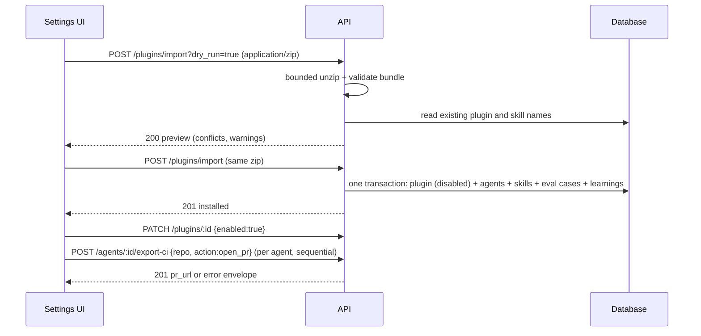

# Settings — Integrations (GitHub Action card, plugin export and import)
Spec: Settings Integrations (Slice D) · Status: implemented (2026-10-26, ebaceb5..4a31756; D19–D22: vanished-agent runs end done, learnings scope kept, remove-dialog history line, security hardening of plugin import) · Date: 2026-10-23
Areas: api, ui, db
Design sources: `docs/design/2026-10-23-settings-first-run.md` §4 Slice D, §5, §7 (P6), §8 (Q5); prototype
"DevDigest — App prototype" `screen_settings.jsx` §3.5 Integrations (decoded extraction, read-only) and the screenshot
of Settings › Integrations (GitHub Action card with 2 repos, Plugin Export card with last export, Plugin Import drop
zone with one enabled and one disabled plugin); code research of `backend/` and `frontend/` @ `9ef3155`.
Related: design doc above (parent); sibling specs `specs/2026-10-23-settings-first-run-setup.md` (Slice A: settings
shell with an `integrations` placeholder, its D9), `specs/2026-10-23-settings-b-workspace.md` (Slice B: workspace export
in the plugin envelope, `kind: "workspace"`, its FR13–FR15 and §7), `specs/2026-10-23-settings-c-automatic-reviews.md`.
Supersedes nothing.

ID convention: FR…, EC…, NFR…, AC…, US…, D…, Q…; area tags `[api]` HTTP routes and run gating, `[ui]` Settings ›
Integrations, `[db]` schema.

## 1. Goal
Give Settings an Integrations section where a user (1) sees in which repositories the DevDigest GitHub Action is
installed and how its last CI run went, and installs it in another repository; (2) exports agents, skills, eval cases
and learnings as a portable plugin `.zip`; (3) imports such a plugin, reviews it before installing, and enables,
disables or removes it as one unit. Imported content is foreign instructions: it never runs until the user enables
the plugin, and disabling or removing the plugin takes all of it out of runs.

## 2. Context
- Shared contracts for plugins already exist with no server or UI code: `PluginBundle` (manifest
  `format: 'devdigest-plugin/v1'`, agents, skills, eval_cases, conventions), `PluginExportRequest`,
  `PluginImportRequest {bundle, mode}`, `InstalledPlugin`, `PluginImportResult`
  (`frontend/src/vendor/shared/contracts/productionize.ts:21-133`); nothing in `frontend/src` or `backend/internal`
  uses them (research report "runs/skills", finding 21). `PluginSkill.source` lacks `imported_file`
  (`productionize.ts:26`) although skills store it (`backend/migrations/0001_baseline.up.sql:711`).
- Table `installed_plugins(id, workspace_id, name, version, source, installed_at, enabled)` exists with no unique name
  and no link to agents or skills (`0001_baseline.up.sql:409-417`).
- CI routes: `POST /agents/:id/export-ci` (200 for `files`, 201 for `open_pr`; body `repo` required, `target` default
  `gha`, `action` default `open_pr`), `GET /agents/:id/ci-installations` (`{installations}` each with `last_run`),
  `GET /ci/runs`, `POST /ci/refresh` (`backend/internal/ci/transport/http/routes.go:31-42`,
  `dto.go:41-60,343-356`). No route lists installations across agents. CI run statuses: `succeeded`, `no_findings`,
  `failed`, `running` (`ci/domain/model.go:144-149`). CI export supports OpenRouter agents only (422
  `unsupported_provider`, `ci/app/export.go:74-77`); an unknown agent is 404 `agent_not_found` (`export.go:63-70`);
  only enabled skills are exported (`ci/adapters/peers/directories.go:67`).
- Run selection today: review start with `all:true` takes enabled agents; a named agent runs even when disabled
  (`reviews/app/start.go:81-109`, spec phase 4 EC4004). Eval run-all includes disabled agents
  (`evals/app/runall.go:10-31`, phase 6 FR6027). Review and eval runs load only enabled skills
  (`reviews/adapters/postgres/reads.go:84-100`, `evals/adapters/postgres/snapshots.go:37-74`).
- Trust: skill bodies and agent system prompts are injected as trusted, unwrapped text; only PR and repo content is
  wrapped as untrusted (`reviewer/domain/prompt.go:88-130`, `reviewer/domain/wrap.go:12-23`). The only protection for
  foreign skills is that every non-manual skill is stored disabled (`skills/domain/skill.go:171-179`).
- Skills: name unique per workspace, kebab-case 1–64 chars, body ≤ 20,000 units, description ≤ 300
  (`skills/transport/http/parse.go:22-32`, `0001_baseline.up.sql:1112`); a duplicate is 409 `conflict`. Agent names
  are not unique (`0001_baseline.up.sql`, no agents unique constraint). Deleting an agent cascades to versions, skill
  links, CI installations and its eval cases; past runs and reviews keep a null agent
  (`agents/adapters/postgres/store.go:207-228`). Deleting a skill cascades to links, versions and run-skill records
  (`skills/adapters/postgres/store.go:255-276`).
- Learnings are `memory` rows of kind `learning`, written only by "Learn" with a repo; no run reads memory today
  (`reviews/adapters/postgres/learn.go:79-94`, `reviewer/domain/prompt.go:5-6`). Conventions are repo-scoped
  (`conventions.repo_id NOT NULL`, `0001_baseline.up.sql:230-246`).
- HTTP rules: request bodies are JSON only; any other media type is 415, default limit 1 MiB with per-route raises
  (`platform/httpx/body.go:14-35`); state-changing requests with a foreign Origin get 403 (`httpx/guard.go:83-107`);
  per-route rate buckets exist (`httpx/ratelimit.go:19-50`, used by `settings/transport/http/handler.go:21-23`).
  Skill zip import already caps entries at 500 and inflates through a bounded reader
  (`skills/domain/zipimport.go:16-24,232-265`; `backend/INSIGHTS.md:86`).
- Settings pages: `/settings/[section]` renders API Keys and Feature Models; other keys show an empty state (design
  doc §2). The agent editor has a `ci` tab (`frontend/src/app/agents/[id]/_components/AgentEditorView/constants.ts:2`).

## 3. Scope
### In scope
- A workspace-wide read of GitHub Action installations with the last CI run per repository.
- An "Install in a repo" dialog that drives the existing per-agent CI export.
- Plugin export as a `.zip` download; plugin import with a dry-run preview; install, enable, disable, remove.
- Plugin ownership of the agents, skills and learnings it installed; a disabled plugin's items are kept out of runs.
- The Integrations section of Settings.

### Out of scope
- No install from a URL, registry or marketplace; the only source is an uploaded `.zip`.
- No plugin signing or signature check.
- No in-place plugin upgrade: installing a plugin whose name is already installed is refused (remove it first).
- Conventions are never installed from a bundle and never exported (the `conventions` array is always empty).
- No CI target other than GitHub Actions (`target_type = gha`) is listed on the GitHub Action card.
- No removal of a workflow from a GitHub repository; removing a plugin does not touch GitHub.
- Workflows already exported to GitHub are not changed when a plugin is disabled or removed.
- The existing routes `POST /agents/:id/export-ci`, `GET /agents/:id/ci-installations`, `GET /ci/runs` keep their
  paths, request fields, status codes and response fields.
- No secret, saved key, token, repository, clone, run, review, finding, trace or setting is ever written into a bundle.
- No LLM or GitHub call is made by export, import, enable, disable or remove.

## 4. User scenarios
- US1 — As a tech lead, I open Settings › Integrations and see which repositories run the GitHub Action and whether
  their last CI run succeeded, so that I know where CI review is live.
- US2 — As a tech lead, I install the Action in another connected repository for two agents, so that their reviews
  run in CI.
- US3 — As a team member, I export our skills and agents as a plugin `.zip`, so that a colleague can install them.
- US4 — As a colleague, I drop that `.zip`, review what it contains, install it, try it, then enable or remove it.
- US5 — As a user, I disable a plugin and know none of its agents or skills will run until I enable it again.

## 5. Functional requirements
- FR1 [api] — `GET /ci/installations` shall list, per repository, the workspace's GitHub Action installations
  (agent id and name, slug, installed time) and the newest CI run of any of them (status, time, link), repositories
  ordered by name (byte order).
- FR2 [ui] — The GitHub Action card shall show "N repos" (count of listed repositories), one row per repository with
  "<status> <relative time>" of the last run (or "no runs yet") and "Manage", which opens the agent editor's CI tab of
  the repository's single agent, or a menu of agent names when the repository has several.
- FR3 [ui] — "Install in a repo" shall open a dialog to pick one connected repository and ≥ 1 agents; agents whose
  provider is not OpenRouter are shown unselectable with the reason. Install shall call the existing CI export with
  `action: "open_pr"` once per agent, one at a time, and show per agent the PR link or the error message; failed agents
  can be retried alone. The card refreshes after the dialog closes.
- FR4 [api] — `POST /plugins/export` shall return a `.zip` holding one entry `devdigest-plugin.json` (a
  `PluginBundle`, `manifest.kind = "plugin"`). Selection: no ids → all agents and all skills; `agent_ids` → those agents
  plus every skill linked to them; `skill_ids` → those skills; both → the union. Eval cases owned by exported agents
  and skills are included when `include_eval_cases` (default true); the workspace's learnings when
  `include_learnings` (default false). Skills keep their `enabled` flag; agents keep provider, model, system prompt,
  output schema, strategy, CI fail-on, repo intelligence flag, enabled flag and linked skill names in link order.
  Agent names are made unique within the bundle by suffixing ` (2)`, ` (3)`… in creation order, and references use
  the suffixed name (same rule as Slice B FR13).
- FR5 [api] — Export shall record the last export (file name, time, counts) and `GET /plugins` shall return it.
- FR6 [api] — `POST /plugins/import?dry_run=true` with a `.zip` body, or a bundle `.json` body (Slice B's workspace
  export file), shall validate it (limits in §7) and return a
  preview — manifest, kind, counts, agents with their skill names, skills, conflicts, ignored parts, warnings — and
  store nothing.
- FR7 [api] — `POST /plugins/import` (no dry run) shall run the same validation and then, all or nothing, create the
  installed plugin (disabled) and every agent, skill, eval case and learning of the bundle, owned by the plugin. Agent
  and skill `enabled` flags are taken from the bundle. Learnings are stored without a repository. It shall refuse
  with 409 when any conflict exists.
- FR8 [api] — Conflicts: a plugin of the same name is installed; a bundle skill name equals an existing skill name of
  the workspace. Agent names never conflict.
- FR9 [api] — A bundle of `manifest.kind = "workspace"` (Slice B export) shall be accepted like a plugin: its agents,
  skills (current body; `versions` ignored), eval cases and learnings are installed; `conventions`, `context_files`,
  `settings` and any other section are ignored with a warning.
- FR10 [api] — `GET /plugins` shall list installed plugins, newest first, each with name, version, description,
  source file name, installed time, enabled flag and counts of owned agents, skills, eval cases and learnings.
- FR11 [api] — `PATCH /plugins/:id {enabled}` shall enable or disable a plugin.
- FR12 [api] — `DELETE /plugins/:id {confirm}` with `confirm` equal to the plugin name shall delete every agent,
  skill and learning the plugin owns (with what deleting them deletes today), then the plugin, and report the counts.
- FR13 [api] — While a plugin is disabled, none of its agents and skills shall be used by a new run:
  (a) review start with `all:true` skips its agents; naming one (`agentId`/`agentIds`) is refused with 409
  `plugin_disabled` and no run of the request starts; (b) review and eval runs of any agent leave its skills out, as
  they do disabled skills; (c) eval start for its agent or skill is refused with 409 `plugin_disabled`, eval run-all
  skips its agents; (d) CI export of its agent is refused with 409 `plugin_disabled` and CI export of any other agent
  leaves its skills out. Runs already started finish.
- FR14 [api] — Agent and skill responses (`GET /agents`, `GET /agents/:id`, `GET /skills`, `GET /skills/:id`) shall
  carry `plugin: {id, name, enabled} | null`.
- FR15 [ui] — The Plugin Export card shall show "Export workspace as plugin", which opens a dialog (name, agents and
  skills multi-select defaulting to all, "Include eval cases" on, "Include learnings" off) and downloads the file; the
  card shows "Last export: <file> · N skills · M agents" or nothing when none.
- FR16 [ui] — The Plugin Import card shall accept a `.zip` or a bundle `.json` by drop or "browse files…", show the preview (counts,
  agent and skill names, conflicts, warnings) with Install disabled while a conflict exists, and after install list the
  plugin as disabled with a hint "Enable to let its agents and skills run".
- FR17 [ui] — Each installed plugin row shall show name, version, an enabled/disabled badge, counts, Enable or
  Disable, and Remove; Remove opens a dialog that names what will be deleted (counts, CI installations of its agents)
  and requires typing the plugin name.
- FR18 [ui] — Agent and skill lists and editors shall label plugin items "From plugin <name>" and, when the plugin is
  disabled, "plugin disabled"; the run-review picker, multi-agent configure, skill-eval host picker and the install
  dialog of FR3 shall not offer agents of a disabled plugin.
- FR19 [ui] — Settings shall have an "Integrations" section at `/settings/integrations` with the three cards in the
  prototype order: GitHub Action, Plugin Export, Plugin Import.

## 6. Workflow and communication

Interactions (all synchronous HTTP, UI → API; the API calls no external service for plugins):
- Import preview/install — on 413/415/422 the UI shows the message and keeps the drop zone; on 409 it shows the
  conflicts; on network error or 5xx "Import failed — try again", nothing is installed (transaction).
- Export — on 4xx the dialog shows the message; on 5xx or network error "Export failed — try again"; no partial file
  is saved.
- Install in a repo — each export-ci call is independent; a failure does not stop the next agent; already opened PRs
  stay.
- Enable/Disable/Remove — on failure the row keeps its previous state and shows the message.
- Run gating (FR13) is checked when a run is requested; a plugin disabled afterwards does not stop a started run.

## 7. Contracts
All errors use `{"error":{"code","message","details?"}}`. Timestamps UTC ISO-8601 with milliseconds.

`GET /ci/installations` → 200
`{ repos: [{ repo: "owner/name", installations: [{ id, agent_id, agent_name, slug|null, installed_at }],
   last_run: { status: succeeded|no_findings|failed|running|null, ran_at|null, github_url|null, agent_id|null }|null }] }`
Only `target_type = gha`, only agents of the workspace. 500 on DB error.

`POST /plugins/export` — JSON body:
`{ name?: string 1–64 kebab-case (default "devdigest-" + kebab-cased workspace name), description?: string ≤ 300,
   agent_ids?: uuid[] 1–200, skill_ids?: uuid[] 1–500, include_eval_cases?: boolean = true,
   include_learnings?: boolean = false }`
→ 200 `Content-Type: application/zip`, `Content-Disposition: attachment; filename="<name>-<YYYY-MM-DD>.zip"`; zip entry
`devdigest-plugin.json` = `PluginBundle`. Errors: 422 `validation_error` (bad body, unknown key);
404 `not_found` (`details.ids`: unknown agent or skill ids); 422 `nothing_to_export` (0 agents and 0 skills);
422 `export_too_large` (bundle JSON > 20 MiB).

Bundle (`PluginBundle`): the additive changes of Slice B §7 (`manifest.kind?: "plugin"|"workspace"`, absent = plugin;
`counts.learnings?`; `PluginSkill.source` gains `imported_file`; `PluginAgent.strategy|ci_fail_on|repo_intel?`;
`learnings?: [{ scope, kind, content, confidence|null, repo|null }]`; `versions`, `context_files`, `settings`
optional). Plugin export writes learnings with `repo` = repository full name or null, `conventions: []`, and no
`versions`, `context_files` or `settings`. Content ≤ 20,000 chars per learning.

`POST /plugins/import?dry_run=true|false&filename=<1–255 chars>` — body either `Content-Type: application/zip`, ≤ 5 MiB
(the only non-JSON body the API accepts), or `application/json` = the bundle itself, ≤ 20 MiB. Archive rules: ≤ 500 entries; Σ inflated ≤ 20 MiB, inflation stops at the cap;
no absolute, `..`, backslash or drive-letter paths; no encrypted entries; Store or Deflate only; exactly one
`devdigest-plugin.json` at the root or inside a single top folder (other entries ignored and listed); UTF-8 JSON
matching `PluginBundle` with `format = "devdigest-plugin/v1"`. Bundle rules: plugin name (`manifest.name`) 1–80 chars
after trimming, no control characters, version ≤ 64;
≤ 100 agents, ≤ 200 skills, ≤ 1,000 eval cases, ≤ 5,000 learnings; skill fields per the skill create rules; skill names
unique in the bundle; agent provider `openai|anthropic|openrouter`, name and model 1–200, system prompt
1–100,000 chars; every agent skill name and eval case `owner_ref` resolves inside the bundle.
- dry run → 200 `{ manifest, kind, counts: {agents, skills, eval_cases, conventions, learnings},
  agents: [{name, provider, model, enabled, skills: [name]}], skills: [{name, type, description, enabled}],
  conflicts: { plugin: boolean, skills: [name] }, ignored: [{ path_or_section, reason }], warnings: [string] }`
- install → 201 `PluginImportResult` = `{ installed: InstalledPlugin, created: {agents, skills, eval_cases,
  conventions: 0, learnings} }`
- Errors: 413 (zip > 5 MiB or JSON > 20 MiB); 415 (neither `application/zip` nor `application/json`); 422 `invalid_plugin` (message names the first broken rule,
  `details.issues` lists up to 20); 409 `plugin_conflict` (`details: {plugin: boolean, skills: [name]}`); 429 when the
  bucket (10 per minute per client) is spent. `PluginImportRequest {bundle, mode}` is replaced by this route.

`GET /plugins` → 200 `{ plugins: [InstalledPlugin & { description|null, counts: {agents, skills, eval_cases,
learnings} }], last_export: { file_name, exported_at, counts: {agents, skills, eval_cases, learnings} } | null }`

`PATCH /plugins/:id` body `{ enabled: boolean }` → 200 the plugin row as in `GET /plugins`. 404 `not_found`;
422 `validation_error`.

`DELETE /plugins/:id` body `{ confirm: string }` → 200 `{ ok: true, removed: {agents, skills, eval_cases,
learnings, ci_installations} }`. 404 `not_found`; 422 `confirmation_mismatch` (confirm ≠ plugin name).

Changed existing routes: `POST /pulls/:id/review`, `POST /agents/:id/eval-runs`, `POST /skills/:id/eval-runs`,
`POST /agents/:id/export-ci` gain 409 `plugin_disabled` (message names the plugin) per FR13. `GET /agents`,
`GET /agents/:id`, `GET /skills`, `GET /skills/:id` gain the field `plugin` (FR14). All other fields unchanged.

## 8. Data model (logical)
- Installed plugin: name (unique within a workspace), version, description, source file name, installed at,
  enabled (false on install). Owns 0..n agents, skills and learnings; eval cases come with their owning agent or skill.
- Agent, skill, learning: optional owner plugin. A user-created item has none. Editing an owned item keeps the owner.
- Effective availability for runs = the item's own enabled flag AND (no owner OR owner enabled).
- Last plugin export: one workspace setting value (file name, time, counts). Bundles and uploads are never stored.

## 9. States and UX
| Screen / element | Loading | Empty | Error | Degraded | Success | Notes |
|---|---|---|---|---|---|---|
| GitHub Action card | skeleton rows | "Not installed in any repository yet" + Install | message + Retry | run without time → "no runs yet" | rows + "N repos" | status text, not colour only |
| Install dialog | spinner per agent while running | no connected repos → link "Add repository" | per-agent message, Retry failed | non-OpenRouter agents unselectable with reason | per-agent PR link | Install disabled until repo + ≥ 1 agent |
| Plugin Export card | button busy "Exporting…" | no agents and skills → button disabled + hint | dialog message | — | file downloads; last export line | |
| Import drop zone | "Checking…" | idle drop zone | message, zone stays | warnings listed | preview | non-`.zip` refused before upload |
| Import preview | — | — | 409 conflicts listed, Install disabled | ignored parts listed | Install → row appears disabled | |
| Installed plugins | skeleton | "No plugins installed" | message + Retry | — | rows with badges | Remove needs typed name |

## 10. Edge cases
- EC1 [api] — Zip that inflates past 20 MiB (zip bomb) → 422 `invalid_plugin`; inflation stops at the cap (FR6).
- EC2 [api] — Entry with `../`, an absolute path or a backslash → 422 `invalid_plugin`; nothing written to disk (FR6).
- EC3 [api] — Two `devdigest-plugin.json` candidates, none, invalid JSON, invalid UTF-8 or an unknown `format` →
  422 `invalid_plugin` (FR6).
- EC4 [api] — Agent names a skill not in the bundle, or an eval case owner is missing → 422 `invalid_plugin` (FR6).
- EC5 [api] — Two installs of the same plugin at once (double click, two tabs) → exactly one 201, the other 409
  `plugin_conflict` (FR7, FR8).
- EC6 [api] — Failure while installing (DB error midway) → nothing of the plugin remains (FR7).
- EC7 [api] — Remove while a run of a plugin agent is running → the run finishes; its run and review records stay
  with no agent, as for a deleted agent (FR12, FR13).
- EC8 [api] — A user's own agent links a plugin skill → while the plugin is disabled its runs leave that skill out;
  after Remove the link is gone and the agent stays (FR12, FR13).
- EC9 [api] — `agentIds` mixes enabled agents and one of a disabled plugin → 409 `plugin_disabled`, no run starts
  (FR13).
- EC10 [api] — Export selection includes a disabled skill or a plugin-owned item → exported with its enabled flag;
  owner is not exported (FR4).
- EC11 [api] — Learnings selected but the workspace has none → `learnings: []`, count 0 (FR4).
- EC12 [api] — Repository has installations whose CI runs never reported → `last_run: null` (FR1).
- EC13 [ui] — Install in a repo: the second of three agents fails → first PR link kept, third still attempted,
  Retry only for the failed one (FR3).
- EC14 [ui] — A `.tar`, `.md` or other non-`.zip`/`.json` file is dropped → "Choose a .zip or .json plugin file"
  without a request (FR16).
- EC15 [ui] — Long plugin, repo and file names → truncated with a native tooltip (FR2, FR15, FR17).

## 11. Non-functional requirements
- NFR1 [api] — Import never executes, extracts to disk or follows anything in the archive; total inflated bytes read
  ≤ 20 MiB + 1 per request.
- NFR2 [api] — Export output, import previews, responses and logs never contain a saved key, token or secrets-file
  content; logs of import, enable, disable and remove carry plugin id, name and counts only, never bundle text.
- NFR3 [api] — The import route accepts only `application/zip` and `application/json` (neither is a CORS-simple
  type, so a cross-site page cannot send them without a preflight), keeps the foreign-Origin 403 and Host allow-list, and has its own rate bucket of 10
  requests per minute per client; export has one of 10 per minute.
- NFR4 [api] — Export of 100 agents, 200 skills, 1,000 eval cases and 5,000 learnings answers in ≤ 3 s p95; dry-run
  import of a 5 MiB archive in ≤ 2 s p95 on the dev stack.
- NFR5 [ui] — Drop zone and dialogs work by keyboard (browse button focusable, Escape closes, focus returns to the
  trigger); badges and run statuses carry text; all copy goes through `messages/en`.
- NFR6 [db] — Schema changes (plugin ownership, unique plugin name per workspace) have an up and a down migration.

## 12. Dependencies and rollout
- Shared-contract change: yes — `productionize.ts` (additive bundle fields, new preview, list and CI installations
  shapes, `PluginImportRequest` replaced) and the agent/skill contracts (`plugin` field). Changed together with the
  backend (repo rule); Go goldens and the UI contract test cover each new route.
- Persisted data change: yes — ownership links and the unique plugin name; existing rows get no owner.
- Behaviour change of existing routes: new 409 `plugin_disabled` on review, eval and CI export starts (amends phase 4
  EC4004 and phase 6 FR6027 for plugin items only; agents' own disabled flag keeps today's behaviour).
- Order: after Slice A, whose sub-nav already lists `integrations` with a placeholder (Slice A D9); this slice
  replaces the placeholder. The bundle contract changes are the ones Slice B §7 defines; whichever slice ships first
  adds them, the other reuses them.
- No feature flag.

## 13. Acceptance criteria
- AC1 [api] — Given two agents installed (gha) in repo X with CI runs at T1 < T2 and one agent in repo Y with no runs,
  when `GET /ci/installations` is called, then it returns X (2 installations, last run = the T2 run) and Y
  (`last_run: null`), X before Y, and no `circle` installation.
  Traces: FR1, EC12 · Verify: component
- AC2 [ui] — Given a mocked installations response with one single-agent and one two-agent repository, then the card
  shows "2 repos", status text with relative time, "no runs yet" where null, Manage links to `/agents/<id>` CI tab for
  the first and a menu of two agent names for the second.
  Traces: FR2, FR19 · Verify: component
- AC3 [ui] — Given the install dialog with three OpenRouter agents and one Anthropic agent and mocked export-ci
  answering 201, 422, 201, when the user installs the three OpenRouter agents, then the calls run one at a time with
  `action: "open_pr"`, two PR links and one error show per agent, the Anthropic agent is unselectable with its reason,
  and Retry resends only the failed agent.
  Traces: FR3, EC13 · Verify: component
- AC4 [api] — Given agents A (skills s1, s2 with s2 disabled) and B, eval cases of A, and two learnings, when exporting
  `{agent_ids:[A], include_learnings:true}`, then the zip holds only `devdigest-plugin.json` with agent A (all FR4
  fields), skills s1 and s2 (s2 `enabled:false`), A's eval cases, two learnings, `conventions: []`, matching counts,
  and the `Content-Disposition` file name; `GET /plugins` then shows it as `last_export`.
  Traces: FR4, FR5, EC10, EC11 · Verify: component
- AC5 [api] — Given an export body with an unknown id, or a selection with no agents and skills, then respectively
  404 `not_found` with `details.ids` and 422 `nothing_to_export`; given two selected agents both named "Reviewer",
  the bundle names them "Reviewer" and "Reviewer (2)" in creation order and their eval cases' `owner_ref` follow.
  Traces: FR4 · Verify: component
- AC6 [api] — Given a workspace with saved provider keys and a GitHub token, when exporting everything, then neither
  the archive bytes nor the server log of the request contain any of those secret values.
  Traces: NFR2 · Verify: component
- AC7 [api] — Given a valid bundle whose plugin name is installed and one skill name exists, when dry-run importing,
  then 200 with `conflicts.plugin = true`, the skill name listed, counts and names as in the bundle, and no row is
  written; installing the same zip gives 409 `plugin_conflict` with the same details.
  Traces: FR6, FR8 · Verify: component
- AC8 [api] — Given a valid bundle with no conflict, when installing, then 201; the plugin is disabled; every agent,
  skill, eval case and learning exists, owned by it, with the bundle's enabled flags; learnings have no repository;
  `GET /plugins` shows the counts; a forced DB failure on the last insert leaves no plugin rows.
  Traces: FR7, FR10, EC6 · Verify: integration
- AC9 [api] — Given archives that (a) inflate past 20 MiB, (b) hold `../x`, (c) have no or two bundle files, (d) hold
  invalid JSON, (e) carry `format: "devdigest-plugin/v2"`, (f) reference a missing skill, (g) exceed 500 entries,
  then each answers 422 `invalid_plugin` naming the rule, the process heap grows < 64 MiB for (a), and nothing is
  stored.
  Traces: FR6, EC1, EC2, EC3, EC4, NFR1 · Verify: component
- AC10 [api] — Given a 6 MiB zip body → 413; a `text/plain` or `multipart/form-data` body → 415; a foreign Origin → 403; the
  11th import within one minute → 429.
  Traces: FR6, NFR3 · Verify: component
- AC11 [api] — Given Slice B's workspace export golden sent as `application/json` (name "acme · payments",
  conventions, skill versions, context files, settings), when dry-run and then installing, then the plugin is named
  "acme · payments", agents, skills (current bodies), eval cases and learnings are created, and the preview listed
  conventions, versions, context files and settings as ignored with a warning.
  Traces: FR9 · Verify: component
- AC12 [api] — Given two concurrent installs of the same new plugin, then exactly one answers 201 and the other 409
  `plugin_conflict`, and one plugin row exists.
  Traces: EC5 · Verify: integration
- AC13 [api] — Given a disabled plugin owning agent P and skill ps, and a user agent U linking ps, then `all:true`
  review starts U only and U's run has no ps; `agentIds:[U,P]` → 409 `plugin_disabled`, no run; eval start for P or ps
  → 409; eval run-all skips P; CI export of P → 409 and of U leaves ps out; after enabling the plugin all of these
  include P and ps.
  Traces: FR13, EC8, EC9 · Verify: integration
- AC14 [api] — Given a run of plugin agent P is running, when the plugin is disabled and then removed, then the run
  finishes with status done and its run record stays with a null agent.
  Traces: FR13, EC7 · Verify: integration
- AC15 [api] — Given an installed plugin, when `PATCH {enabled:true}` then `{enabled:false}`, then the row reflects
  each; an unknown id → 404; a non-boolean → 422.
  Traces: FR11 · Verify: component
- AC16 [api] — Given a plugin owning 2 agents (one with a CI installation), 3 skills, eval cases and learnings, plus a
  user agent linking one of its skills, when `DELETE` with the wrong name → 422 `confirmation_mismatch` and nothing
  changes; with the right name → 200 with exact `removed` counts, the owned items and the plugin are gone, the user
  agent remains without the link.
  Traces: FR12, EC8 · Verify: integration
- AC17 [api] — Given a plugin agent and a user agent, then `GET /agents`, `GET /agents/:id`, `GET /skills`,
  `GET /skills/:id` carry `plugin: {id, name, enabled}` and `plugin: null` respectively; response goldens match the UI
  contract.
  Traces: FR14 · Verify: component
- AC18 [ui] — Given the export dialog with mocked agents and skills, when the user exports with defaults, then the
  request carries no ids, `include_eval_cases: true`, `include_learnings: false`, a file download is triggered, and
  the card shows "Last export: <file> · N skills · M agents".
  Traces: FR15 · Verify: component
- AC19 [ui] — Given a mocked preview with a conflict, then Install is disabled and the conflict is named; with no
  conflict Install posts the same file and the new row shows "disabled" with the enable hint; a `.json` file is sent
  as `application/json`; dropping a `.tar` file shows "Choose a .zip or .json plugin file" and sends no request.
  Traces: FR16, EC14 · Verify: component
- AC20 [ui] — Given installed plugins, then each row shows badge text, counts, Enable/Disable and Remove; Remove's
  dialog lists the counts and CI installations and enables its button only after the exact name is typed.
  Traces: FR17, EC15 · Verify: component
- AC21 [ui] — Given agents of an enabled and a disabled plugin, then lists show "From plugin <name>" and
  "plugin disabled", and the run-review picker, multi-agent configure, skill-eval host picker and install dialog do
  not offer the disabled plugin's agent.
  Traces: FR18 · Verify: component
- AC22 [ui] — Given the Settings page, then "Integrations" is in the sub-nav, `/settings/integrations` shows the three
  cards in order, the drop zone's browse button is reachable by Tab, Escape closes each dialog and returns focus, and
  the pseudo-messages test finds no hard-coded copy.
  Traces: FR19, NFR5 · Verify: component
- AC23 [api] — Given the NFR4 volume on the dev stack, when exporting 20 times and dry-run importing a 5 MiB archive
  20 times, then p95 ≤ 3 s and ≤ 2 s respectively.
  Traces: NFR4 · Verify: manual
- AC24 [db] — Given a migrated DB, when migrating down and up again, then the ownership links and the unique plugin
  name are dropped and re-created and other tables are unchanged.
  Traces: NFR6 · Verify: integration
- AC25 [ui] — Given the running stack, when a user exports a plugin, imports the file into a second, empty
  database, enables it and starts a review with its agent, then the run starts and the logs show no bundle
  text.
  Traces: FR4, FR7, FR11, NFR2 · Verify: manual

## 14. Traceability
| Source | Area | FR | EC / NFR | AC |
|---|---|---|---|---|
| Prototype GitHub Action card | api, ui | FR1–FR3 | EC12, EC13 | AC1–AC3 |
| Design D "Plugin export", prototype export card | api, ui | FR4, FR5, FR15 | EC10, EC11, NFR2, NFR4 | AC4–AC6, AC18, AC23 |
| Design D "Plugin import", prototype drop zone | api, ui | FR6–FR9, FR16 | EC1–EC6, EC14, NFR1, NFR3 | AC7–AC12, AC19 |
| Design Q5 ownership; prototype installed rows | api, ui | FR10–FR14, FR17, FR18 | EC7–EC9, EC15 | AC13–AC17, AC20, AC21 |
| Settings sub-nav | ui | FR19 | NFR5 | AC22 |
| Migration rule | db | — | NFR6 | AC24 |
| End-to-end | api, ui | FR4, FR7, FR11 | NFR2 | AC25 |

## 15. Design review
| # | Gap / proposal | Source | Area | Decision |
|---|---|---|---|---|
| G1 | Design says imported items "go through the existing prompt-wrapping"; skill bodies and system prompts are trusted, unwrapped text (`prompt.go:88-130`), so wrapping them would not work | design D vs code | api | resolved — D6 |
| G2 | Skill trust gate forces non-manual skills disabled; with a plugin-level gate this would leave enabled plugins with dead skills | `skill.go:171-179` | api | resolved — D6 |
| G3 | Explicitly named disabled agents run today; "hide from runs" needs a rule for named plugin agents | `start.go:81-109`, EC4004 | api | resolved — D7 |
| G4 | Name clash on import (skills unique, agents not) and re-install of the same plugin | schema | api | resolved — D8 |
| G5 | Conventions are repo-scoped; bundle conventions have no repo | schema, contract | api | resolved — D9 |
| G6 | Eval case `owner_ref` by name is ambiguous with duplicate agent names | contract | api | accepted — suffix rule shared with Slice B FR13 (D4) |
| G12 | Slice B exports a `.json` file, not a `.zip`; its workspace names are free text up to 80 chars | Slice B FR1, FR15 | api | accepted — import also takes `application/json`; plugin names 1–80 chars (D5) |
| G7 | Preview then install: one non-JSON route with `dry_run` instead of a JSON install body | design "one route" | api | resolved — D10 |
| G8 | Prototype shows Disable only on enabled rows and Remove only on disabled rows | screenshot | ui | resolved — D11 |
| G9 | Prototype has no export options; design request has selection + include flags | design vs prototype | ui | resolved — D12 |
| G10 | Install dialog, conflict, loading, error and empty states not drawn | screenshot | ui | accepted as §9 defaults |
| G11 | Bundle lacks learnings, kind, agent strategy/CI fields and `imported_file` source | `productionize.ts` | api | accepted as additive contract change |

## 16. Decisions
- D1 — Scope: Slice D, one spec (user, 2026-10-23, design doc §8).
- D2 — A plugin owns what it installed: Disable hides its skills and agents from runs, Remove deletes them; ownership
  needs a migration (user, 2026-10-23, design Q5).
- D3 — Workspace export is the plugin bundle with `kind: workspace`, no secrets, no history, re-importable here
  (user, 2026-10-23, design P6).
- D4 — Duplicate agent names in an export get the ` (2)`, ` (3)` suffixes of Slice B FR13, so both exports behave
  alike (spec author, 2026-10-23).
- D5 — To keep Slice B's `.json` export re-importable (P6), the import route also accepts the bundle as
  `application/json` (≤ 20 MiB) and plugin names follow the workspace-name rule (1–80 chars) (spec author, 2026-10-23).
- D6 — Q1 Trust model: the plugin is the trust gate. It installs disabled; its agents and skills keep the bundle's
  `enabled` flags (the non-manual-skill rule does not apply to plugin items); skill bodies and system prompts are not
  wrapped; the preview lists every agent and skill before install. Once enabled, plugin prompts run fully trusted (user approved default, 2026-10-23).
- D7 — Q2 Naming an agent of a disabled plugin in a run request → 409 `plugin_disabled`; the request starts nothing (user approved default, 2026-10-23).
- D8 — Q3 Install refused with 409 while the plugin name or any skill name exists; no rename, no upgrade (user approved default, 2026-10-23).
- D9 — Q4 Conventions are never exported and are ignored on import with a warning (user approved default, 2026-10-23).
- D10 — Q6 One import route (`application/zip` or `application/json`), `dry_run=true` for the preview (user approved default, 2026-10-23).
- D11 — Q7 Every installed-plugin row has Enable or Disable plus Remove (user approved default, 2026-10-23).
- D12 — Q8 Export dialog: name, agent and skill selection (all by default), eval cases on, learnings off (user approved default, 2026-10-23).
- D13 — Q9 Imported learnings are stored as workspace learnings without a repository (user approved default, 2026-10-23).
- D14 — Q10 Limits: 5 MiB upload, 20 MiB inflated, 500 entries, ≤ 100 agents, ≤ 200 skills, ≤ 1,000 eval cases,
  ≤ 5,000 learnings, system prompt ≤ 100,000 chars, 10 requests per minute for import and export (user approved default, 2026-10-23).
- D15 — CR1 accepted: the down migration is lossy (plugin ownership and descriptions dropped), documented in the down
  file (user, 2026-10-25).
- D16 — CR2 accepted: plugin import is the only route with a raw (non-JSON) body; route-scoped httpx rules, 415 for
  text/plain and multipart there, every other route unchanged, Origin/Host guards kept, 10/min (user, 2026-10-25).
- D17 — CR3 accepted: an enabled plugin runs fully trusted; plugins install disabled and the enabled check guards all 7 run
  entry points, each tested (user, 2026-10-25).
- D18 — Planner defaults SCR1–SCR8 and A0–A14 accepted; the migration number is 0008 (Slice C took 0007 for D13)
  (user pre-approval, 2026-10-25).
- D19 — AC14/EC7: a review run whose agent is deleted mid-run (plugin Remove or `DELETE /agents/:id`) stores its
  review with a null agent and ends `done`; findings that cite a deleted skill keep the skill name with a null skill.
  This also changes ordinary agent deletion mid-run, which failed before (accepted Node-parity difference in that race)
  (user, 2026-10-26).
- D20 — Imported learnings keep the bundle's `scope` with no repository, including `repo`; they are not remapped to the
  workspace (user, 2026-10-26).
- D21 — The remove dialog also says that past runs and reviews of the plugin's agents stay in the history (EC7)
  (user, 2026-10-26).
- D22 — Security L2/N2: at install, plugin skill bodies, skill descriptions and agent system prompts get the hidden-text
  rules of skill import (HTML comments, zero-width and bidi characters); the preview warns per item, and a body or
  prompt with no visible text left is refused with 422 `invalid_plugin`. The bundle JSON is checked against a value,
  depth and item budget before it is decoded (security M1), and unpaired surrogate escapes are refused (L1)
  (user, 2026-10-26).

## 17. Open questions
None — Q5 was resolved by D4; Q1–Q4 and Q6–Q10 were resolved on 2026-10-23 by accepting their defaults (D6–D14).

## Glossary
- Owned item — an agent, skill or learning created by a plugin install; it carries the plugin as owner.
- Plugin-disabled — an owned item whose plugin is disabled; no new run uses it.
- Bundle — the `devdigest-plugin.json` document inside the plugin `.zip`.
