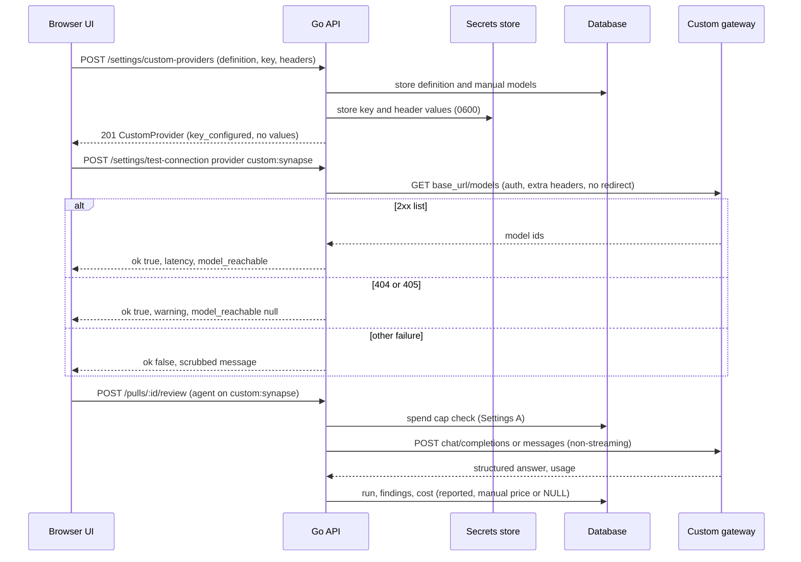
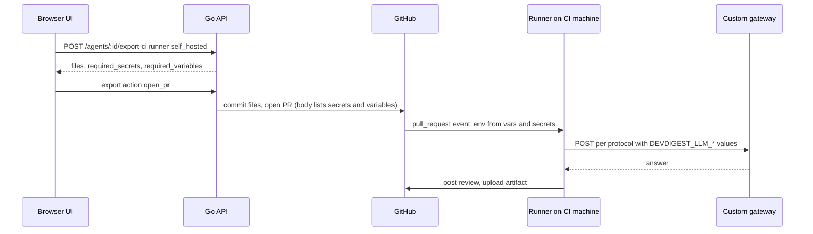

# Custom model providers (OpenAI- and Anthropic-compatible gateways)
Spec: Custom model providers · Status: ready-for-planning · Date: 2026-10-24
Areas: api, ui, ci
Design sources: the user's request of 2026-10-24 (translated): "Support custom model routers like OpenRouter — in our
company we use e.g. Synapse — I want to be able to connect any external model provider and use it." The user's answers
of 2026-10-24 to the blocking questions Q1–Q5 of the first spec-creator run and to the open questions Q1–Q10 of the
draft (D15–D24) and to the revision's open questions Q11–Q12 (D28, D29), and the first run's research report (code
evidence at `feat/go-backend-phase-1` @ `4ce720b`; Settings A contracts at worktree `../dev-digest-go-settings-a` @
`fd9f82b`). No design frames or screenshots were provided.
Related: `specs/2026-10-23-settings-first-run-setup.md` (Settings A — extended, see §12),
`specs/2026-10-23-settings-b-workspace.md` (Settings B — extended), `specs/2026-10-23-settings-c-automatic-reviews.md`
(Settings C — unchanged, uses agents as they are), `specs/2026-10-23-settings-integrations.md` (Settings D — extended),
`specs/2026-10-23-go-backend-phase-6.md` (Phase 6 — two Out-of-scope lines superseded, see §12). Follow-up dependency:
the GitLab specs `specs/2026-10-24-gitlab-*.md` (in writing) own GitLab CI. Supersedes nothing else.

ID convention: plain FR1…, EC1…, NFR1…, AC1…, US1…, D1…, Q1…. Area tags: `[api]` = Go backend (studio API, LLM
client, settings, bundles), `[ui]` = Next.js app, `[ci]` = CI export, generated workflow, manifest and the CI runner.

## 1. Goal
Teams that reach models through their own gateway (an LLM router such as OpenRouter, or a company gateway such as
Synapse) cannot use it today: DevDigest knows exactly three providers with fixed addresses. This feature lets a user
define any number of custom providers — each speaking either the OpenAI-compatible or the Anthropic-compatible API at a
base URL of their choice, with their own auth — and use them everywhere a model is chosen: agents, feature models, the
default model, reviews, evals, automatic reviews, plugin and workspace bundles, and the GitHub Actions CI export and
runner. Keys stay on the machine, costs stay visible, and the API keeps its no-auth guards.

## 2. Context
- The provider is a closed set `openai | anthropic | openrouter` in about eight Go places and the shared contracts:
  `backend/internal/llm/llm.go:23-74`, `settings/transport/http/validate.go:25,240`, `agents/domain/agent.go:29`,
  `ci/domain/manifest.go:13`, `ci/runner/app/manifest.go:41`; DB constraint `agents_provider_chk`
  (`backend/migrations/0001_baseline.up.sql:107`); `frontend/src/vendor/shared/constants/feature-models.ts:8`
  (`PROVIDER_IDS`), `contracts/knowledge.ts:399` (`Provider`), `vendor/shared/adapters.ts:18` (`ModelInfo.provider`).
  Run, trace, brief and intent records already store `provider` as free text (research report).
- Base URLs are constants with no override: `llm/adapters/openaicompat/openaicompat.go:24-25`,
  `llm/adapters/anthropic/anthropic.go:19`, `settings/adapters/providers/providers.go:23-25`. Requests go to
  `<base>/chat/completions` (`openaicompat.go:185`), `<base>/messages` (`anthropic.go:142`) and `<base>/models`
  (`openaicompat.go:239`, `anthropic.go:173`). The provider picks the adapter and the model id is sent verbatim
  (`llm/structured.go:147-150`).
- Calls are non-streaming JSON with a 16 MiB body cap; structured output is `json_schema strict` for OpenAI-compatible
  and a forced tool for Anthropic (research report: `wire.go:59-101`, `openaicompat.go:152-158`,
  `anthropic.go:117-127`). Every structured answer is extracted (the trimmed text when it is valid JSON, else the
  first fenced block, else the first balanced `{…}`/`[…]`; `llm/extract.go:42-45`), validated against the schema and
  re-prompted with the issues up to 2 times by default (`llm/structured.go:90-202`, `DefaultReprompts = 2` at
  `llm/llm.go:95`), all within one 360 s budget. Timeouts: OpenAI 120 s per request, 30 s listing, 3 retries (`openaicompat.go:30-36`);
  Anthropic the same plus `anthropic-version: 2023-06-01` (`anthropic.go:21-27`). No client follows a redirect
  (`openaicompat.go:290-304`), because a redirect would resend custom key headers (`backend/INSIGHTS.md:27`).
- A missing key fails with `config_error` "<KEY> is not configured" (`llm/structured.go:67-77`); an unknown provider is
  an internal error (`structured.go:55-64`).
- Keys live in the secrets store (`secrets.json`, mode 0600, env fallback) and are never returned
  (`platform/secrets/secrets.go`; Settings A §2). `GET /settings/secrets-status` is a fixed-key object checked with
  `.strict()` by `frontend/src/test/go-backend-contracts.test.ts:382`; `ModelInfo` is strict too (`:424-425`).
  `ConnTestProvider` is a closed enum (`contracts/platform.ts:54`).
- `GET /providers/:id/models` returns `[]` on any failure (`agents/app/service.go:226-242`).
- Prices: the price book is keyed by the bare model id (live OpenRouter prices, then a static table;
  `llm/pricebook.go:58-68`). A reported `usage.cost` is read only for OpenRouter (`openaicompat.go:213`). Unpriced
  usage is NULL and counts as 0 for the spend cap (Settings A EC4, FR12).
- CI (Phase 6): export accepts only `openrouter` agents (422 `unsupported_provider`, `ci/app/export.go:74-77`); the
  generated workflow runs on `ubuntu-24.04` (`ci/domain/workflow.go:13,79`) and references only `OPENROUTER_API_KEY`
  and `GITHUB_TOKEN` (`workflow.go:24,94-96`); `checkWorkflow` allows only those two secret names
  (`ci/domain/wfrules/rules.go:49,206-216`); the runner reads only those two secrets and only has an OpenRouter
  adapter with no price book (`cmd/devdigest-runner/main.go:77-108`); the PR body tells the user to add
  `OPENROUTER_API_KEY` (`ci/domain/prbody.go:20`); the wizard hard-codes `SECRET_KEYS` (`ExportWizard/constants.ts:29`).
  The runner calls OpenRouter with 180 s per request, 2 transport retries, 2 re-prompts and 360 s per structured
  call, and its cost is the sum of reported `usage.cost`, else `null` (no price book in the runner;
  `specs/2026-10-23-go-backend-phase-6.md:508`). The ingest stores every CI run's `agent_runs` row with provider
  `openrouter` (`specs/2026-10-23-go-backend-phase-6.md:469`). A CI installation stores agent, repository, target,
  install time, slug and manifest version and no provider (`backend/migrations/0001_baseline.up.sql:115-124`); `open_pr`
  upserts it on (agent, repository, target) setting slug and manifest version (Phase 6 §7.6.8,
  `specs/2026-10-23-go-backend-phase-6.md:457`). The manifest keys are `name`, `provider`, `model`, `system_prompt`,
  `skills`, `strategy`, `ci_fail_on`, `version` (Phase 6 §7.6.4, `:383-384`). No frontend file references `unsupported_provider`; it
  is produced only by `ci/app/export.go:18,74-77` and appears in the Node parity golden
  `backend/internal/parity/testdata/goldens/ci.json:6536`.
- Bundles: Settings D's import validates agent provider `openai|anthropic|openrouter`
  (`specs/2026-10-23-settings-integrations.md:211`); Settings B's export carries `feature_models` and `default_model`
  (`specs/2026-10-23-settings-b-workspace.md:133-134`).

## 3. Scope
### In scope
- A custom-provider entity per workspace (id, name, protocol, base URL, auth, extra headers, manual models with
  optional prices), its CRUD routes and its secrets.
- Custom providers in every provider choice: agents, `feature_models`, `default_model`; LLM calls for reviews, evals,
  conventions, intent, brief, onboarding and automatic reviews.
- Model listing (live + manual), connection test, cost and the spend hint for unpriced usage.
- One deploy-level extra CA bundle for outbound HTTPS.
- Plugin and workspace bundles carrying custom provider ids.
- GitHub Actions CI export and runner for agents on custom providers and on the built-in `openai` and `anthropic`
  providers, with a runner (runs-on) choice.
- A per-custom-provider structured-output mode (`strict`, `json_object`, `prompt_only`).
- The provider fixed at export time and stored with the CI installation, used by the ingest (D28).
- A price-book price written into the manifest of built-in `openai` / `anthropic` agents so the runner computes CI
  cost (D29).

### Out of scope
- No built-in provider's base URL becomes configurable; an OpenAI or OpenRouter proxy is added as a custom provider.
- No streaming request is sent to any provider.
- No connection test makes a completion or generation call.
- No route, log line, error, bundle, workspace export, manifest, generated workflow, PR body, CI artifact or posted
  comment contains a custom provider's key or an extra-header value.
- The studio never sends any provider key (built-in or custom) to GitHub; the user adds CI secrets themselves.
- No structured-output mode other than `strict` applies to a built-in provider.
- No call is retried in another structured-output mode than the provider's configured one (no automatic downgrade).
- No plugin or workspace bundle contains a custom provider definition.
- No per-provider option disables TLS certificate verification.
- No model id prefix selects a provider; the provider id alone selects the protocol and base URL.
- No built-in or live price-book price is applied to a call through a custom provider.
- No embedding call is made.
- The first-run setup step "Model provider" keeps exactly the three built-in choices (Settings A FR23).
- `GET /settings/secrets-status` keeps exactly its four keys.
- No CI export request answers 422 `unsupported_provider` (D26).
- The workflow, manifest and PR body generated for an `openrouter` agent with the default runner are byte-identical to
  Phase 6.
- The manifest of an `openrouter` agent contains no `pricing` key; its CI cost stays the provider-reported cost (D29).
- The runner has no price book; the only prices it uses are the ones written in the manifest.
- The `CiInstallation` response shape is unchanged; the stored export-time provider is not returned by any route (Q14).
- The ingest never reads the agent's current provider to label a CI run (D28).
- No GitLab CI file is generated; GitLab CI is owned by the GitLab specs.
- No runner binary is built for an operating system or architecture other than linux/amd64.
- The CI result artifact schema (`CiResultArtifact`) is unchanged.
- Existing routes keep their paths, status codes and JSON fields; additions are optional fields or new routes only.

## 4. User scenarios
- US1 — As a developer at a company with an internal gateway, I add "Synapse" (OpenAI-compatible,
  `https://synapse.corp.example/v1`, header `api-key`, extra header `X-Tenant`) in Settings, test it and see its models.
- US2 — As an agent author, I create an agent on Synapse model `gpt-4.1` and run a review on a PR.
- US3 — As a workspace owner, I set Synapse as the default model and as the model of the conventions feature.
- US4 — As a cost-aware user, I enter prices for Synapse models so the monthly cap keeps working, and I see a hint
  when some usage this month has no price.
- US5 — As an agent author, I export a Synapse agent to GitHub Actions on a self-hosted runner inside the company
  network, and the wizard tells me which secrets and variables to add.
- US6 — As a teammate, I import a plugin whose agents use `custom:synapse`; the dry run warns me that this provider is
  not configured here, and the import still succeeds.
- US7 — As an agent author, I export an agent on the built-in OpenAI or Anthropic provider to GitHub Actions and add
  only that provider's key as a repository secret.
- US8 — As a developer whose gateway does not support strict JSON schema output, I switch the provider's structured
  output to "JSON object" or "Prompt only" and my reviews work.

## 5. Functional requirements
Custom provider definition
- FR1 [api] — A custom provider shall have:
  - `id` = `custom:<slug>`, slug matching `^[a-z0-9-]{1,32}$`, unique per workspace, immutable after creation;
  - `name` — display name, 1–80 characters after trimming, no control characters, editable;
  - `protocol` — `openai` (chat completions + model list) or `anthropic` (Messages API + model list);
  - `base_url` (FR3), auth (FR4), up to 5 extra headers (FR4);
  - `structured_output` — `strict` (default when omitted, on POST and PUT), `json_object` or `prompt_only` (FR33);
    `json_object` is valid only with protocol `openai`; with `anthropic` it is a 422 `validation_error` at path
    `["structured_output"]` (D16);
  - `models` — an optional manual list of at most 200 entries: `id` 1–200 characters, unique within the provider,
    optional `label` ≤ 200 characters, optional `pricing` {`promptPerM`, `completionPerM`} in USD per 1M input and
    output tokens, each 0–10,000 with at most 6 decimals.

  A workspace has at most 20 custom providers (D3, D9).
- FR2 [api] — Routes (§7): GET `/settings/custom-providers` (list, sorted by `name` then `id`, byte order), POST
  (create → 201), PUT `/settings/custom-providers/:id` (replace every field except `id` → 200), DELETE
  `/settings/custom-providers/:id` (→ 200). `:id` is accepted raw (`custom:synapse`) and percent-encoded
  (`custom%3Asynapse`). Creating an existing id → 409 `custom_provider_exists`; an unknown id → 404
  `custom_provider_not_found`; a 21st provider → 422 `custom_provider_limit` (D12).
- FR3 [api] — `base_url` rules: scheme `http` or `https`; a host is present; no userinfo, query or fragment; ≤ 2,048
  characters; a trailing `/` is removed when stored. Loopback and private hosts (RFC 1918, IPv6 ULA) are allowed.
  Link-local addresses (169.254.0.0/16, fe80::/10) and unspecified addresses (`0.0.0.0`, `::`) are refused, both as a
  literal host (422 `validation_error`, path `["base_url"]`) and as the address a host name resolves to when a call
  connects (the call fails, EC3). The URL is the API root including any version segment; requests go to
  `<base_url>/chat/completions`, `<base_url>/messages` and `<base_url>/models`. Plain `http` to a host that is not
  loopback is allowed and reported as `plain_http: true` (D8).
- FR4 [api] — Auth:
  - `auth_mode` `bearer` (default for `openai`) sends `Authorization: Bearer <key>`;
  - `auth_mode` `header` (default for `anthropic`, default header `x-api-key`) sends `<auth_header>: <key>`;
  - the key is optional; without a key no auth header is sent (network-authenticated gateways);
  - `anthropic` protocol always sends `anthropic-version: 2023-06-01`, unless an extra header named
    `anthropic-version` is configured, which then wins;
  - extra headers: at most 5, names are HTTP tokens of 1–64 characters, unique case-insensitively, and not one of
    `Host`, `Content-Length`, `Content-Type`, `Transfer-Encoding`, `Connection`, `Authorization`, `Cookie` or the
    configured `auth_header`; values are 1–4,096 characters without CR, LF or NUL.

  Any broken rule → 422 `validation_error` with the field path (D4).
- FR5 [api] — The key and the extra-header values shall be stored only in the secrets store, never returned; responses
  carry `key_configured` and per header `value_configured`. On PUT: `api_key` omitted → kept, `null` → removed,
  string → replaced; an extra header listed without `value` keeps the stored value of the header with the same name
  (case-insensitive) and is a 422 when no such value exists; headers not listed are removed with their values.
  Deleting a provider removes its key and header values. Custom keys have no environment fallback (D22).
- FR6 [api] — DELETE of a provider that an agent (enabled or not), a `feature_models` entry or `default_model`
  references → 409 `provider_in_use` with `details` {`agents`: [{`id`, `name`}], `feature_models`: [feature id],
  `default_model`: boolean}; nothing is deleted. Existing run and trace records keep their provider string.

Use everywhere
- FR7 [api] — Wherever a provider is accepted — agent create and update, `default_model`, `feature_models` — the value
  shall be a built-in id or the id of a custom provider defined in the workspace. A well-formed but undefined custom id
  → 422 `validation_error` at the provider path with message "Custom provider custom:<slug> is not configured"; any
  other value → 422 as today. Stored agents can hold a custom id (the agent provider constraint accepts
  `custom:<slug>`). Bundles follow FR15 instead.
- FR8 [api] — A call through a custom provider shall use its protocol: `openai` → POST `<base_url>/chat/completions`;
  `anthropic` → POST `<base_url>/messages`; the structured-output part of the request follows the provider's
  `structured_output` mode (FR33; `strict` = `response_format` `json_schema` strict as built-in OpenAI, or the forced
  tool as built-in Anthropic). Requests are non-streaming; the model id is sent verbatim; auth and extra headers
  per FR4 go only to the configured origin; redirects are never followed; timeouts and retries per NFR4. A non-2xx
  answer fails like a built-in provider error (502 `external_service`, scrubbed message).
- FR9 [api] — A run, eval, scan or sync generation (intent, brief, onboarding) whose provider is an undefined custom id
  shall fail like a missing key does today: code `config_error`, message "Custom provider custom:<slug> is not
  configured", and no network request. A custom provider that needs a key it does not have is not an error: the call
  is sent without auth (FR4).
- FR10 [api] — `GET /providers/:id/models` for a custom id shall return the union of the live list (one GET
  `<base_url>/models`, `data[].id`) and the manual list, sorted by `id` (byte order), each item `ModelInfo` with
  `provider` = the custom id; for an id in both lists the manual `label` and `pricing` win. When listing fails (any
  status, timeout or unparsable body), the manual list alone is returned with 200. An undefined custom id → `[]`, as an
  unknown provider today. `pricing` comes only from the manual entry; prices a gateway lists are ignored (D23).
- FR11 [api] — `POST /settings/test-connection` shall accept a custom id. With `key`, the key is saved first (as
  today). The test is one model-list call, no completion (Settings A NFR2):
  - 2xx with a parsable list → `ok:true`, message "OK — N models available", `latency_ms`, `model`, `model_reachable`;
  - 404 or 405 → `ok:true`, `warning` "Model list not available; key not verified", `model_reachable:null`, `model` as
    below or null;
  - any other failure → `ok:false`, scrubbed message, null extras.

  The checked model is `default_model.model` when `default_model.provider` is this provider, else the first manual
  model, else the first listed model, else null. An undefined custom id → 404 `custom_provider_not_found`, nothing
  saved (D5).
- FR12 [api] — The cost of a custom-provider call shall be, per attempt: the provider-reported `usage.cost` when it is
  a finite number ≥ 0; else, when the model has a manual `pricing` and the response reports input and output tokens,
  `tokens_in × promptPerM / 1e6 + tokens_out × completionPerM / 1e6`; else NULL. The built-in and live price books are
  never consulted for custom providers. Prices are read at call time; existing cost records are never recomputed
  (D6).
- FR13 [api] — `GET /settings/spend` shall add `unpriced_count`: the number of month records counted by Settings A
  FR12 whose cost is NULL, from any provider. NULL keeps counting as 0 in `spent_usd` and for the cap (Settings A EC4).
- FR14 [api] — An optional deploy-level setting `DEVDIGEST_EXTRA_CA_FILE` (path to a PEM bundle) adds its
  certificates to the system trust store for every outbound HTTPS call of the backend. Unset → system store only. Set
  but unreadable or without any certificate → the backend does not start and logs one ERROR line naming the variable
  and the path, not the file content.

Bundles
- FR15 [api] — Plugin export and workspace export (Settings B FR13) shall keep each agent's provider string and the
  `default_model` / `feature_models` provider strings as they are, including `custom:<slug>`, and never include a
  custom provider definition (including its `structured_output` mode and manual models) or secret. Plugin import (Settings D) shall accept an agent provider that is a built-in id
  or a well-formed custom id. A well-formed custom id not defined in the target workspace is accepted; the dry run adds
  one warning per distinct id: "Provider custom:<slug> is not configured here". A malformed provider → 422
  `invalid_plugin`. The same rule applies to imported `default_model` and `feature_models` (D7).

UI
- FR16 [ui] — Settings → API Keys shall show a "Custom providers" block below the built-in rows: one row per provider
  with name, id, protocol ("OpenAI-compatible" / "Anthropic-compatible"), base URL host, a key badge ("Key saved" /
  "No key"), and Test, Edit and Delete buttons; "Add custom provider" opens the dialog; empty state "No custom
  providers yet". A provider with `plain_http:true` shows the persistent warning "Key is sent unencrypted over HTTP".
- FR17 [ui] — The add/edit dialog shall have: name; id slug (suggested from the name on add — lower-cased, runs of
  characters outside `a-z0-9` → `-`, trimmed, cut to 32 — editable on add, read-only on edit); protocol; base URL with
  the helper "API root including the version, e.g. https://gateway.example.com/v1"; auth mode and header name; key
  field (FR3 masking of Settings A, "Key saved — paste a new key to replace it" when configured, "Remove key"); up to 5
  extra headers (name + value, a stored value shows "Value saved"). Save sends POST or PUT; field errors from 422 show
  at their field; "Save and test" saves, then runs FR11.
- FR18 [ui] — The dialog's "Models" section shall let the user add, edit and remove manual models (id, optional label,
  optional input and output price per 1M tokens). The hint reads "Add models the gateway does not list, or prices so
  the spend cap counts them."
- FR19 [ui] — Every provider choice — create-agent form, agent config tab, Default model (Settings A FR8) and Feature
  Models — shall list the built-ins, then the custom providers by name; Feature Models shall offer a provider choice
  per feature with the model picker of that provider. A stored provider that is an undefined custom id shows as the
  raw id with "Not configured" and blocks Save until another provider is picked.
- FR20 [ui] — Where an agent, run or feature model shows its provider, a custom id shall show the provider's current
  name; an undefined custom id shows the raw id.
- FR21 [ui] — Home gate (Settings A FR27): "a model provider is connected" is also true when at least one custom
  provider exists, with or without a key and whether or not it was ever tested (D21); the gate loads GET `/settings/custom-providers` with the other two requests and shows the error
  state with Retry when it fails. The setup step "Model provider" shows a link "Use a custom provider" to
  `/settings/api-keys`.
- FR22 [ui] — The spend-cap hint (Settings A FR14) shall add "Unpriced usage this month is not included." when
  `unpriced_count` > 0.
- FR23 [ui] — A custom provider's Test shows the FR6 banners of Settings A and, for a result with `warning`, a warning
  banner with that text. Delete asks for confirmation naming the provider; a 409 `provider_in_use` shows "Used by:"
  with the agent names, feature names and "Default model" from `details`, and keeps the row.

CI export and runner (GitHub Actions)
- FR24 [ci] — `POST /agents/:id/export-ci` shall accept agents whose provider is `openrouter`, `openai`, `anthropic`
  or a defined custom id (D7, D15). Check order (Phase 6 §7.6.1) at the provider step: an undefined custom id → 422
  `provider_not_configured` "Custom provider custom:<slug> is not configured"; then the remaining checks as today.
  The export shall never answer 422 `unsupported_provider`: every provider value an agent can hold (FR7) is either
  exportable or an undefined custom id, so the code is unreachable and is no longer produced (D26).
- FR25 [ci] — The export body shall accept `runner`: `github_hosted` (default) → `runs-on: ubuntu-24.04`, or
  `self_hosted` → `runs-on: [self-hosted, linux, x64]`, for any exportable agent. Nothing else in the job changes.
- FR26 [ci] — For a custom-provider agent with provider `custom:<slug>`, let `<S>` = the slug upper-cased with `-` →
  `_`. The generated workflow's run-step `env` shall hold, instead of the `OPENROUTER_API_KEY` line and before
  `GITHUB_TOKEN`: `DEVDIGEST_LLM_BASE_URL: ${{ vars.DEVDIGEST_<S>_BASE_URL }}`, `DEVDIGEST_LLM_API_KEY: ${{
  secrets.DEVDIGEST_<S>_API_KEY }}` (always present; an absent secret expands to empty and no auth is sent), and one
  `DEVDIGEST_LLM_HEADER_<n>: ${{ secrets.DEVDIGEST_<S>_HEADER_<n> }}` per extra header, n = 1…5 in header order. No
  base URL, header name or other user text is written into the workflow. An `openrouter` agent with `github_hosted`
  gets exactly the Phase 6 §7.6.5 text.
- FR27 [ci] — The manifest of a custom-provider agent shall add, after `version`, the key `custom_provider` =
  {`protocol`, `auth_mode`, `auth_header` (null for bearer), `extra_headers` (names, in order), `structured_output`
  (the provider's mode, FR33), `pricing` (the manual pricing of the agent's model, or null)}, keys in that order. It
  never holds the base URL, the key or a header value. Built-in agents' manifests have no `custom_provider` key
  (D17).
- FR28 [ci] — `checkWorkflow`'s `secrets` rule shall allow `GITHUB_TOKEN` plus the secret names the generated workflow
  of this export references (for `openrouter`: `OPENROUTER_API_KEY`; for `openai`: `OPENAI_API_KEY`; for
  `anthropic`: `ANTHROPIC_API_KEY`; for `custom:<slug>`: `DEVDIGEST_<S>_API_KEY` and `DEVDIGEST_<S>_HEADER_1…5`),
  case as today. Every other rule is unchanged.
- FR29 [ci] — The export response shall add `required_secrets` (names the user must add; `GITHUB_TOKEN` excluded;
  `["OPENROUTER_API_KEY"]`, `["OPENAI_API_KEY"]` or `["ANTHROPIC_API_KEY"]` for the built-ins; for custom
  `DEVDIGEST_<S>_API_KEY` only when `key_configured`, plus every `DEVDIGEST_<S>_HEADER_<n>`) and
  `required_variables` (`["DEVDIGEST_<S>_BASE_URL"]` for custom; `[]` for the built-ins). The PR body's "Before
  merging" step 1 shall list each required secret and variable; for an `openrouter` agent the body is unchanged from
  Phase 6 §7.6.7; for `openai` / `anthropic` it is that body with `OPENROUTER_API_KEY` replaced by the agent's
  secret name (FR35).
- FR30 [ci] — The runner, for a manifest whose provider is `custom:<slug>`, shall: validate `custom_provider`; read
  `DEVDIGEST_LLM_BASE_URL`, `DEVDIGEST_LLM_API_KEY` and `DEVDIGEST_LLM_HEADER_1…n` (n = number of `extra_headers`) and
  not read `OPENROUTER_API_KEY`; apply the FR3 base URL rules (a plain-http non-loopback URL prints one warning line);
  call per FR4/FR8 and the manifest `structured_output` (FR33, including the strict-mode hint) with the timeouts of
  NFR4; compute cost per FR12 with the manifest `pricing`; and exit 1 with no
  artifact and nothing posted (Phase 6 FR6053) on an invalid block, an empty or invalid base URL (message names
  `DEVDIGEST_LLM_BASE_URL` and the CI variable `DEVDIGEST_<S>_BASE_URL`), an empty header value or a provider failure.
  An `openrouter` manifest behaves as today; `openai` and `anthropic` manifests follow FR36.
- FR31 [ui] — The export wizard shall show a "Runner" choice (GitHub-hosted / Self-hosted, linux x64), default
  Self-hosted for a custom-provider agent and GitHub-hosted for an `openrouter`, `openai` or `anthropic` agent (D18). For a custom-provider agent it shows the
  note "This agent uses <name> at <host>. GitHub-hosted runners reach only public addresses; if <host> is on a private
  network, use a self-hosted runner that can reach it." The install step lists `required_secrets` and
  `required_variables` from the response (replacing the fixed list), with the base URL as the value to set for the
  variable and a copy button. A loopback base URL host shows the warning "<base_url> points to this machine; set
  <variable> to an address the CI runner can reach."
- FR32 [ui] — Settings D's install dialog (Settings D FR3) shall make every agent selectable whose provider is
  exportable (FR24: `openrouter`, `openai`, `anthropic` or a defined custom id); only an agent on an undefined custom
  id stays unselectable, with the reason "Custom provider custom:<slug> is not configured". It offers the FR31 Runner
  choice once for the dialog, default Self-hosted when any selected agent uses a custom provider, else GitHub-hosted;
  each per-agent result lists that agent's required secrets and variables.

Structured-output mode (custom providers)
- FR33 [api] — A call through a custom provider shall shape its structured-output request by the provider's
  `structured_output` mode, read at call time (D16):
  - `strict` — as FR8: `response_format` `json_schema` strict (`openai`) or the forced tool (`anthropic`);
  - `json_object` (`openai` only) — `response_format` `{"type":"json_object"}`, no `json_schema`, and the schema in
    the prompt;
  - `prompt_only` — no `response_format`, no `tools`, no `tool_choice`, and the schema in the prompt; for `anthropic`
    the answer is the text content blocks joined in order.

  "Schema in the prompt" means the system instructions gain one block holding the call's JSON schema (the same schema
  text strict mode sends) and the instruction to answer with exactly one JSON object matching it and nothing else. In
  every mode the answer passes the existing JSON extraction, schema validation and re-prompt loop with the same
  re-prompt count and 360 s budget, and a final failure is reported as today. In `strict` mode only, a generation
  answered with HTTP 400 or 422 fails with the scrubbed gateway message followed by the hint "If this gateway does not
  support strict structured output, set Structured output of <name> to JSON object or Prompt only." (`anthropic`:
  "… to Prompt only."). The call is never repeated in another mode (D27).
- FR34 [ui] — The add/edit dialog shall have a "Structured output" choice: Strict (default), JSON object, Prompt only.
  JSON object is offered only for OpenAI-compatible; switching the protocol to Anthropic-compatible while JSON object
  is selected sets Strict and shows "JSON object is available only for OpenAI-compatible gateways; Structured output
  was set to Strict." The help text reads "How DevDigest asks the gateway for JSON. Strict: the gateway enforces the
  schema (recommended). JSON object: the gateway returns JSON and the schema is sent in the prompt. Prompt only: for
  gateways that support neither; the schema is sent in the prompt. Answers are always checked against the schema and
  re-asked when invalid." The provider row shows "Structured output: JSON object" or "Structured output: Prompt only"
  when the mode is not Strict.

Built-in providers in CI
- FR35 [ci] — For an `openai` or `anthropic` agent (D15), the export shall generate: the Phase 6 §7.6.5 workflow with
  the line `OPENROUTER_API_KEY: ${{ secrets.OPENROUTER_API_KEY }}` replaced by `OPENAI_API_KEY: ${{
  secrets.OPENAI_API_KEY }}` or `ANTHROPIC_API_KEY: ${{ secrets.ANTHROPIC_API_KEY }}` and the FR25 `runs-on`; the
  Phase 6 §7.6.4 manifest with `provider` `openai` or `anthropic`, no `custom_provider` key and, after `version`, the
  key `pricing` = {`promptPerM`, `completionPerM`} (USD per 1M input and output tokens; the same name and shape as
  `custom_provider.pricing`, D17) holding the price the server price book returns for the agent's model id at export
  time; when the price book has no price for that model, the `pricing` key is omitted (D29); the PR body of FR29.
  The secret names equal the studio's own key names for these providers. The manifest of an `openrouter` agent never
  has a `pricing` key and stays byte-identical to Phase 6 §7.6.4; a custom-provider manifest carries its price only in
  `custom_provider.pricing` (FR27).
- FR36 [ci] — The runner, for a manifest whose provider is `openai` or `anthropic`, shall read only `OPENAI_API_KEY`
  or `ANTHROPIC_API_KEY` respectively (plus `GITHUB_TOKEN`), never `OPENROUTER_API_KEY`; call the studio's built-in
  endpoints (`https://api.openai.com/v1/chat/completions` with `json_schema` strict and `Authorization: Bearer`, or
  `https://api.anthropic.com/v1/messages` with `x-api-key`, `anthropic-version: 2023-06-01` and the forced tool) with
  the Phase 6 runner limits (180 s per request, 2 transport retries, 2 re-prompts, 360 s per structured call, no
  redirects); fail at the first model call with exit 1, no artifact and nothing posted when the key is empty or the
  provider fails; and report cost, when the manifest has `pricing`, as the sum over all attempts that report input
  and output tokens of `tokens_in × promptPerM / 1e6 + tokens_out × completionPerM / 1e6` (`null` when no attempt
  reports both counts), and `null` (unpriced) when the manifest has no `pricing`; the runner has no price book (D29).
  For an `openrouter` manifest the cost stays the Phase 6 rule (sum of provider-reported `usage.cost`, else `null`)
  and the runner reads no `pricing` key. The runner's manifest `provider` accepts `openrouter`, `openai`, `anthropic`
  and `custom:<slug>`.
- FR37 [ci] — The provider of a CI installation shall be fixed at export time (D28):
  - `open_pr` (installation upsert, Phase 6 §7.6.8) stores the agent's provider (`openrouter`, `openai`, `anthropic`
    or the `custom:<slug>`) with the installation; a re-export (`open_pr` again for the same agent and repository)
    overwrites it with the agent's provider at that time; the `files` action changes nothing;
  - installations that exist before this change are given the provider `openrouter` (the only provider Phase 6 could
    export);
  - the ingest (Phase 6 §7.7.5) stores an ingested CI run's `agent_runs` row with the installation's stored provider
    instead of the fixed `openrouter`, never with the agent's current provider.

## 6. Workflow and communication


Failure behaviour:

| Interaction (caller → callee) | Trigger | On failure |
|---|---|---|
| API → gateway, model list (test) | Test connection | 200 `ok:false` + scrubbed message; 404/405 → `ok:true` + warning; key stays saved |
| API → gateway, model list (picker) | GET `/providers/:id/models` | manual list, 200 |
| API → gateway, generation | review, eval, scan, intent, brief, onboarding | as a built-in provider error: 502 `external_service` (sync) or failed run (async), scrubbed; `strict` mode + 400/422 → same, with the FR33 hint; no retry in another mode |
| API → gateway, invalid structured answer | any mode | existing re-prompt loop (2 re-prompts, 360 s budget), then failure as today |
| API → secrets store | create, update, delete | 500 envelope; the definition change is not applied (all or nothing) |
| API → DNS / connect | any gateway call | link-local or unspecified address → call fails, nothing sent |
| GitHub Actions → runner → gateway / OpenAI / Anthropic | PR event | exit 1, no artifact, nothing posted, check red with the runner's message |
| Export → price book | export of an `openai` / `anthropic` agent (`files`, `open_pr`) | no price for the model → `pricing` key omitted; the export never fails because of a missing price (FR35) |
| Export → database, installation upsert | `open_pr` | as Phase 6 §7.6.8; the stored provider is written in the same upsert, so a failed upsert leaves the old provider (FR37) |
| Ingest → database | CI refresh | as Phase 6 §7.7.5; provider = the installation's stored export-time provider (FR37) |
| UI → any route | — | error state with Retry; field errors at their field |

## 7. Contracts
All new routes keep the guards of every route: Host allow-list; PUT/POST/DELETE with a foreign `Origin` → 403; JSON
bodies only as `application/json` (415 otherwise); error envelope `{"error":{"code","message","details?"}}`; 422
`validation_error` with Zod-style `details` and `path`.

Provider value (shared): `Provider` = `"openai" | "anthropic" | "openrouter" | string matching
^custom:[a-z0-9-]{1,32}$`. Used by `Agent`, `FeatureModelChoice` (so `default_model` and `feature_models`),
`ModelInfo.provider`, `ConnTestProvider` (plus `github`), `AgentManifest.provider`, plugin bundle agents.

`CustomProvider` (response):
```
{ id: string,                          // "custom:<slug>"
  name: string, protocol: "openai"|"anthropic",
  base_url: string, plain_http: boolean,
  auth_mode: "bearer"|"header", auth_header: string|null,   // null for bearer
  structured_output: "strict"|"json_object"|"prompt_only",   // json_object only with protocol openai
  key_configured: boolean,
  extra_headers: [{ name: string, value_configured: boolean }],
  models: [{ id: string, label: string|null,
             pricing: { promptPerM: number, completionPerM: number } | null }],
  created_at: string, updated_at: string }                   // ISO 8601 UTC
```
`CustomProviderInput` (POST body; PUT body is the same without `id`):
```
{ id: string, name: string, protocol: "openai"|"anthropic", base_url: string,
  auth_mode?: "bearer"|"header",        // default by protocol (FR4)
  auth_header?: string|null,            // required for header mode; default "x-api-key" for anthropic
  structured_output?: "strict"|"json_object"|"prompt_only",   // default "strict"; json_object + anthropic → 422
  api_key?: string|null,                // write-only, 1–4096 chars; PUT: omitted = keep, null = remove
  extra_headers?: [{ name: string, value?: string }],   // ≤ 5; value write-only (FR5)
  models?: [{ id: string, label?: string|null,
              pricing?: { promptPerM: number, completionPerM: number } | null }] }   // ≤ 200
```

| Route | Success | Errors |
|---|---|---|
| GET `/settings/custom-providers` | 200 `CustomProvider[]` | 500 |
| POST `/settings/custom-providers` | 201 `CustomProvider` | 422 `validation_error` (incl. path `["structured_output"]`); 422 `custom_provider_limit` "At most 20 custom providers"; 409 `custom_provider_exists` "Custom provider custom:<slug> already exists"; 403; 415 |
| PUT `/settings/custom-providers/:id` | 200 `CustomProvider` | 404 `custom_provider_not_found`; 422 `validation_error`; 403; 415 |
| DELETE `/settings/custom-providers/:id` | 200 `{ deleted: string }` | 404 `custom_provider_not_found`; 409 `provider_in_use` (details FR6); 403 |
| GET `/providers/:id/models` | 200 `ModelInfo[]` (FR10) | unchanged |
| POST `/settings/test-connection` | 200 `ConnTestResult` + `warning?: string|null` | 404 `custom_provider_not_found` (custom id only); rest unchanged |
| GET `/settings/spend` | 200 `SpendStatus` + `unpriced_count: integer` | unchanged |
| PUT `/settings`, POST/PUT `/agents` | unchanged | 422 `validation_error` "Custom provider custom:<slug> is not configured" at the provider path |
| POST `/plugins/import?dry_run=true` | `warnings[]` gains "Provider custom:<slug> is not configured here" | 422 `invalid_plugin` for a malformed provider |

Limits: test-connection keeps its 20/min per-IP bucket; the other new routes use the global limit.

CI export (`frontend/src/vendor/shared/contracts/eval-ci.ts`):
```
CiExportInput  += runner?: "github_hosted"|"self_hosted"      // default "github_hosted"
CiExport       += required_secrets: string[], required_variables: string[]
AgentManifest.provider: "openrouter"|"openai"|"anthropic"|"custom:<slug>"   // was "openrouter"
AgentManifest  += custom_provider?: { protocol: "openai"|"anthropic", auth_mode: "bearer"|"header",
                                      auth_header: string|null, extra_headers: string[],
                                      structured_output: "strict"|"json_object"|"prompt_only",
                                      pricing: { promptPerM: number, completionPerM: number } | null }
AgentManifest  += pricing?: { promptPerM: number, completionPerM: number }   // after `version`; only for provider
                  // "openai"|"anthropic" with a price-book price at export time; never for "openrouter" or custom
CiInstallation: unchanged (the stored export-time provider is not returned, Q14)
new error: 422 provider_not_configured "Custom provider custom:<slug> is not configured"
removed:   422 unsupported_provider — no longer returned by any request (FR24, D26)
```
Secret names per export: `openrouter` → `OPENROUTER_API_KEY`; `openai` → `OPENAI_API_KEY`; `anthropic` →
`ANTHROPIC_API_KEY`; custom → the derived names below. `GITHUB_TOKEN` is always allowed and never listed.
Derived names (`<S>` = slug upper-cased, `-` → `_`; always match `^DEVDIGEST_[A-Z0-9_]{1,32}_(BASE_URL|API_KEY|HEADER_[1-5])$`):
variable `DEVDIGEST_<S>_BASE_URL`; secrets `DEVDIGEST_<S>_API_KEY`, `DEVDIGEST_<S>_HEADER_<n>`.

Runner environment (host-neutral; added to Phase 6 §7.8.3; each row is read only for the manifest provider named):

| Variable | Required | Use |
|---|---|---|
| `OPENAI_API_KEY` | yes for `openai` (empty fails at the first model call) | OpenAI credential |
| `ANTHROPIC_API_KEY` | yes for `anthropic` (empty fails at the first model call) | Anthropic credential |
| `DEVDIGEST_LLM_BASE_URL` | yes for custom | gateway API root (FR3 rules) |
| `DEVDIGEST_LLM_API_KEY` | no, custom only (empty = no auth header) | gateway credential |
| `DEVDIGEST_LLM_HEADER_<n>` | custom only, yes for n = 1…number of `extra_headers` | value of the n-th extra header |

Deploy configuration: `DEVDIGEST_EXTRA_CA_FILE` (optional path, FR14).

Shared-contract consumers: `knowledge.ts` (`Provider`), `feature-models.ts` (`PROVIDER_IDS` stays the built-in list),
`platform.ts` (`ConnTestProvider`, `ConnTestResult.warning`, `SpendStatus.unpriced_count`, new `CustomProvider`,
`CustomProviderInput`), `adapters.ts` (`ModelInfo.provider`), `eval-ci.ts`, `productionize.ts` (bundle agents). Each
change ships with the matching backend change; every new or changed shape gets a Go golden checked by
`go-backend-contracts.test.ts`. `SecretsStatus` and its strict golden stay unchanged.

## 8. Data model (logical)
- Custom provider (new, persisted, per workspace): id, name, protocol, base URL, auth mode, auth header name, ordered
  extra header names, structured-output mode, created/updated time. Lives until deleted; deletion is refused while referenced (FR6).
- Manual model (new, persisted, belongs to one custom provider): model id, optional label, optional input/output price
  per 1M tokens. Deleted with its provider.
- Custom provider secrets (secrets store, not the database): optional key and one value per extra header, keyed by
  provider id. Deleted with the provider.
- Agent, `default_model`, `feature_models`: the provider value may now be a custom id (a string reference, no foreign
  key; a dangling reference is possible after a bundle import and is handled by FR9, FR19, FR24).
- Merged model list, `plain_http`, `unpriced_count`, required secrets and variables: derived on read, never stored.
- CI installation (existing, Phase 6): gains one persisted attribute, the provider at export time (a built-in id or a
  `custom:<slug>` string, no foreign key); written by every `open_pr` upsert, overwritten by a re-export; existing
  installations get `openrouter`. Lives and is deleted with the installation (FR37, D28).
- Manifest `pricing` of a built-in `openai` / `anthropic` agent: derived from the price book at export time and
  stored only in the committed manifest file in the target repository, never in the database (FR35, D29).
- Run, trace and cost records: unchanged; they keep the provider string at the time of the run (for an ingested CI
  run: the installation's stored export-time provider, FR37).

## 9. States and UX
| Screen / element | Loading | Empty | Error | Degraded | Success | Notes |
|---|---|---|---|---|---|---|
| Custom providers block | row skeletons | "No custom providers yet" + Add | list error + Retry | `plain_http` → persistent warning | rows with key badge; non-strict mode label | Delete confirms; 409 shows "Used by:" |
| Add/edit dialog | Save/Test buttons "Saving…"/"Testing…", disabled | new: empty fields, Save disabled until required fields valid | field errors from 422; banner for others | test warning "Model list not available; key not verified" | dialog closes on Save; verified banner after Test | id read-only on edit; focus trap; JSON object hidden for Anthropic-compatible |
| Manual models section | — | "No manual models" | invalid price inline | — | rows | max 200 |
| Provider pickers | option skeleton | built-ins only | custom list failed → built-ins + error text with Retry | stored undefined custom id → "Not configured" | custom providers by name | Save blocked on "Not configured" |
| Model picker (custom) | skeleton | free-text field (Settings A FR8) | — | listing failed → manual list only | merged list | |
| Spend hint | as Settings A | as Settings A | as Settings A | `unpriced_count` > 0 → unpriced sentence | as Settings A | |
| Export wizard Runner + secrets | Preview loading as today | — | export error box as today (`provider_not_configured`) | loopback base URL → warning | lists secrets and variables | custom → self-hosted note; built-in → its one key secret |
| Install dialog (Settings D) | per agent spinner | as Settings D | per agent message | agent on undefined custom id unselectable | per agent PR link + secrets/variables | |
| Run / review error (strict rejected) | — | — | scrubbed gateway message + FR33 hint | — | — | no automatic retry in another mode |

## 10. Edge cases
- EC1 [api] — POST with an id that exists → 409 `custom_provider_exists`; two concurrent POSTs with the same new id →
  exactly one 201, the other 409 (FR2).
- EC2 [api] — Ids `custom:Syn`, `custom:`, `custom:` + 33 characters, `synapse`, `openai` and `custom:a_b` → 422
  `validation_error` path `["id"]` (FR1).
- EC3 [api] — Base URL `ftp://x`, `https://u:p@x/v1`, `https://x/v1?k=1`, `https://x/v1#f`, `http://169.254.169.254`,
  `http://[fe80::1]`, `http://0.0.0.0` → 422 path `["base_url"]`. A host name that resolves to a link-local or
  unspecified address at call time → the test answers `ok:false` "Base URL resolves to a forbidden address" and no
  request is sent; a generation call fails with the same message (FR3).
- EC4 [api] — The gateway answers 3xx → not followed; the test answers `ok:false`, a generation fails as a provider
  error; the `Location` host receives no request (FR8).
- EC5 [api] — `/models` answers 404 or 405 → test `ok:true` with the warning and `model_reachable:null`; GET
  `/providers/:id/models` returns the manual list (FR10, FR11).
- EC6 [api] — `/models` answers 401, 500, an HTML page or times out → test `ok:false`; GET `/providers/:id/models`
  returns the manual list with 200 (FR10, FR11).
- EC7 [api] — Delete of a provider used by a disabled agent and by `feature_models.conventions` → 409
  `provider_in_use` naming both; nothing deleted (FR6).
- EC8 [api] — An agent imported with `custom:ghost` (undefined) is reviewed → the run fails with `config_error`
  "Custom provider custom:ghost is not configured" and no outbound request (FR9).
- EC9 [api] — The answer has no `usage` and no cost → cost NULL; `usage.cost` negative, NaN or a string → ignored, then
  manual price or NULL (FR12).
- EC10 [api] — A manual price is changed after runs exist → those runs keep their cost; the next call uses the new
  price (FR12).
- EC11 [api] — Extra header named `content-type`, `Authorization`, the auth header name, a duplicate in other case,
  a sixth header, or a value with CR/LF → 422 at its path (FR4).
- EC12 [api] — PUT without `api_key` keeps the key; `api_key:null` removes it; a header listed without `value` keeps
  the stored value of the same name in any case; a new header name without `value` → 422 (FR5).
- EC13 [api] — A 21st provider → 422 `custom_provider_limit`; 201 manual models or a duplicate model id → 422 (FR1,
  FR2).
- EC14 [api] — `custom%3Asynapse` and `custom:synapse` in a path address the same provider on every route that takes
  a provider id (FR2, FR10).
- EC15 [api] — In `strict` mode the gateway rejects `json_schema` (or the forced tool) with 400 → 502
  `external_service` (sync) or a failed run (async) with the gateway message scrubbed of key and header values,
  followed by the FR33 hint; no request in another mode is sent (FR8, FR33).
- EC16 [api] — Bundle import with agents on `custom:ghost` twice and `custom:synapse` (defined) → one dry-run warning
  for `custom:ghost`; install creates the agents with those strings; provider `custom:Bad!` → 422 `invalid_plugin`
  (FR15).
- EC17 [ci] — Export of an agent on undefined `custom:ghost` → 422 `provider_not_configured`, no GitHub call; an
  `openai` or `anthropic` agent passes the provider step (D15) and no request answers `unsupported_provider` (FR24).
- EC18 [ci] — Runner with `DEVDIGEST_LLM_BASE_URL` empty, `ftp://x` or link-local → exit 1, no artifact, nothing
  posted, the message names both variable names (FR30).
- EC19 [ci] — Runner with an empty `DEVDIGEST_LLM_API_KEY` → no auth header is sent; the gateway's 401 → exit 1 per
  Phase 6 FR6053 (FR26, FR30).
- EC20 [ci] — A Preview-edited workflow of a custom-provider export that references `OPENROUTER_API_KEY` or
  `DEVDIGEST_OTHER_API_KEY` → 422 `workflow_insecure` rule `secrets` (FR28).
- EC21 [ui] — Base URL `http://localhost:8080/v1` in the wizard → loopback warning naming the variable (FR31).
- EC22 [ui] — A provider is renamed → pickers, agent views and run views show the new name; the agent's stored
  provider id is unchanged (FR20).
- EC23 [ui] — An agent whose provider is undefined `custom:ghost` → the config tab shows "custom:ghost · Not
  configured" and Save stays disabled until another provider is chosen (FR19).
- EC24 [api] — `http://gateway.corp/v1` → `plain_http:true`; `http://127.0.0.1:8080/v1`, `http://[::1]/v1` and
  `http://localhost/v1` → `plain_http:false` (FR3).
- EC25 [ci] — A provider with 5 extra headers → the workflow has HEADER_1…HEADER_5 lines in header order, the manifest
  lists the 5 names in the same order, and the runner sends each header with its value (FR26, FR27, FR30).
- EC26 [ci] — Slug `my-gw` → `DEVDIGEST_MY_GW_BASE_URL`, `DEVDIGEST_MY_GW_API_KEY`; slugs differing only in `-`
  positions never map to the same name, because `_` is not a slug character (FR26).
- EC27 [api] — `DEVDIGEST_EXTRA_CA_FILE` points to a missing file or a file without a certificate → the backend exits
  at start with the ERROR line; a valid file → a gateway with a certificate signed by that CA passes the test (FR14).
- EC28 [ci] — Export of an `openai` agent → the workflow has `OPENAI_API_KEY: ${{ secrets.OPENAI_API_KEY }}` and no
  `OPENROUTER_API_KEY`, `required_secrets` `["OPENAI_API_KEY"]`; a Preview-edited workflow of that export referencing
  `secrets.OPENROUTER_API_KEY` or `secrets.ANTHROPIC_API_KEY` → 422 `workflow_insecure` rule `secrets` (FR28, FR35).
- EC29 [ci] — Runner with an `anthropic` manifest, `ANTHROPIC_API_KEY` empty and `OPENROUTER_API_KEY` set → exit 1 at
  the first model call, no artifact, nothing posted, and the OpenRouter key is never read or sent (FR36).
- EC30 [api] — POST or PUT with protocol `anthropic` and `structured_output:"json_object"` → 422 path
  `["structured_output"]`; `structured_output` omitted → stored as `strict`; `"loose"` → 422 at the same path (FR1).
- EC31 [api] — In `json_object` or `prompt_only` mode the answer is prose around a fenced JSON block → the block is
  extracted and validated; an answer that fails validation → re-prompted with the issues; still invalid after 2
  re-prompts → the call fails as today with the schema-validation message (FR33).
- EC32 [api] — A gateway that rejects strict output passes the connection test (no completion is made, FR11); the
  first generation fails with the FR33 hint; after the user switches the mode, the next call uses the new mode (FR33).
- EC33 [ci] — An agent exported on `openai` is switched to `anthropic` in the studio without re-export → CI runs
  ingested afterwards still store `agent_runs.provider` `openai`; after a re-export (`open_pr`) every run ingested
  from then on stores `anthropic`, including a run executed before the re-export that was not ingested yet; rows
  already stored keep their provider; a `files` export after the switch changes nothing (FR37).
- EC35 [ci] — An installation created before this change (Phase 6, provider not stored) → after the migration its
  provider is `openrouter`, and its next ingested run stores `openrouter` whatever the agent's current provider is;
  the down migration removes the attribute and changes no other installation, run or agent data (FR37).
- EC36 [ci] — Export of an `openai` / `anthropic` agent whose model has no price in the price book → the manifest has
  no `pricing` key, the export succeeds, and the runner's artifact `cost_usd` is `null` (FR35, FR36).
- EC37 [ci] — The price-book price of an exported `openai` model changes after the export → CI runs keep using the
  price written in the committed manifest until the agent is re-exported; a `files` preview after the change shows
  the new price (FR35).
- EC34 [ui] — Settings D install dialog with an agent on undefined `custom:ghost` → that agent is unselectable with
  "Custom provider custom:ghost is not configured"; `openai` and `anthropic` agents are selectable (FR32).

## 11. Non-functional requirements
- NFR1 [api] — No key or extra-header value, or part of one, appears in any response, log line, error message,
  bundle, workspace export or contract golden. Redaction happens before any truncation (`backend/INSIGHTS.md:60`).
  Tests assert it with recognisable values of ≥ 8 characters.
- NFR2 [api] — Outbound safety: the key and extra headers are sent only to the configured scheme, host and port; no
  redirect is followed; link-local and unspecified addresses are refused at connect time; no request is made to a
  custom provider by any GET route other than `/providers/:id/models`.
- NFR3 [api] — Every new route keeps the Host allow-list, the foreign-Origin 403 on POST/PUT/DELETE, JSON-only bodies
  and the error envelope.
- NFR4 [api] — Custom-provider calls use the built-in OpenAI limits: 120 s per request, 30 s for a model list, 3
  retries, 360 s total budget per call, 16 MiB response cap.
- NFR5 [api] — GET `/settings/custom-providers` p95 ≤ 100 ms with 20 providers × 200 manual models; GET
  `/settings/spend` keeps p95 ≤ 200 ms at the Settings A NFR4 volume with `unpriced_count`.
- NFR6 [api] — Each custom-provider call logs one line with provider id, base URL host, operation, HTTP status (or
  error class), attempt and latency; never the key, a header value, the prompt or the answer body.
- NFR7 [ci] — The runner redacts `OPENAI_API_KEY`, `ANTHROPIC_API_KEY`, `DEVDIGEST_LLM_API_KEY` and every
  `DEVDIGEST_LLM_HEADER_<n>` value (≥ 8 characters) from every log line, failure message, artifact and posted
  comment, as it does for `OPENROUTER_API_KEY` today.
- NFR8 [ci] — No user-controlled text reaches the generated workflow: the only values interpolated for a custom
  provider are names matching the §7 derived-name pattern and the `runs-on` literals of FR25; for a built-in provider
  only its fixed secret name (§7) and the `runs-on` literals.
- NFR9 [ui] — Accessibility: every dialog field has a label; the dialog traps focus and returns it on close; field
  errors are linked with `aria-describedby`; warning and result banners use `role="status"` / `role="alert"`; the
  key badge and "Not configured" carry text, not colour only.
- NFR10 [ui] — All new copy is in `messages/en/*.json`; the pseudo-messages test finds no hard-coded copy.
- NFR11 [api] — Compatibility: with no custom provider defined, every existing golden (settings, secrets-status,
  test-connection, models, agents, bundles, CI export files, workflow, manifest, PR body) passes unchanged except the
  added optional fields `warning`, `unpriced_count`, `required_secrets` and `required_variables`, and except the one
  intended difference that an `openai` / `anthropic` agent export no longer answers `unsupported_provider` (Phase 6
  EC6023, AC6029 and the Node parity case at `parity/testdata/goldens/ci.json:6536`; D26). The `openai` /
  `anthropic` manifests with a `pricing` key (D29) are new goldens, not changes of existing ones; the `openrouter`
  manifest golden has no `pricing` key and is byte-identical; the CI ingest goldens of `openrouter` installations
  (stored provider `openrouter`, D28) and the `CiInstallation` goldens are unchanged.

## 12. Dependencies and rollout
- Shared-contract change: yes — `Provider` (knowledge.ts), `ModelInfo.provider` (adapters.ts), `platform.ts`
  (`ConnTestProvider`, `ConnTestResult.warning`, `SpendStatus.unpriced_count`, new `CustomProvider*` with
  `structured_output`), `eval-ci.ts` (`CiExportInput.runner`, `CiExport.required_*`, `AgentManifest.provider` widened,
  `AgentManifest.custom_provider`), `productionize.ts` (bundle agent provider). Shipped with the backend change in one
  change set; `SecretsStatus` unchanged; the error code `unsupported_provider` is no longer produced and no frontend
  code handles it (§2).
- Persisted data change: yes — new custom provider (including its structured-output mode) and manual model entities
  (versioned SQL migration with up and down), and the agent provider constraint widened to accept `custom:<slug>`. A down migration with agents on custom
  providers present must fail with a clear message rather than change agent rows. Secrets store gains per-provider
  entries. CI installation gains the export-time provider (constraint from the user, D28: a new column added by a
  versioned up/down SQL migration; the up migration sets `openrouter` on every existing installation, matching Phase 6;
  the down migration drops it). No other CI table changes; the manifest `pricing` is not persisted (D29).
- No feature flag: with no custom provider defined, behaviour is unchanged (NFR11).
- Deploy: `DEVDIGEST_EXTRA_CA_FILE` is documented in `.env.example` and needs the file mounted into the backend
  container.
- Order: planning starts only after Settings A passes its review gate (D2); this spec builds on Settings A's final
  contracts (`default_model`, `ConnTestResult`, `SpendStatus`, home gate). Settings B and D: whichever lands later
  adopts the widened `Provider` and FR15.
- Conflicts with related specs, stated explicitly (those specs are not edited):

  | Spec | Item | Relation |
  |---|---|---|
  | Settings A | FR5 (checked model), FR6 | extended for custom ids by FR11, FR23 |
  | Settings A | FR7, §7 `default_model` enum | extended by FR7 (widened `Provider`) |
  | Settings A | FR8, FR10 (pickers, prefill) | extended by FR19 |
  | Settings A | FR12/FR14 spend + hint, EC4 | kept; extended by FR13, FR22 |
  | Settings A | FR23 / D7 setup provider choice | kept; link added by FR21 |
  | Settings A | FR27 home gate | extended by FR21 |
  | Settings A | NFR2 (no completion in a test) | kept (FR11) |
  | Settings B | FR13/FR14 export | kept; custom ids exported as strings, no definitions (FR15) |
  | Settings D | FR3 install dialog "agents whose provider is not OpenRouter are shown unselectable" | superseded by FR32: only agents on an undefined custom id are unselectable (D15) |
  | Settings D | §7 import rule "agent provider `openai|anthropic|openrouter`" | superseded by FR15 |
  | Phase 6 | Out of scope "no agent provider other than `openrouter` can be exported" | superseded by FR24: `openai`, `anthropic` and defined custom ids are exportable (D15) |
  | Phase 6 | §7.6.1 provider step, `ci/app/export.go:74-77` 422 `unsupported_provider`, EC6023, AC6029 (openai case) | superseded by FR24: the code is no longer returned (D26) |
  | Phase 6 | Out of scope "the runner never reads a secret other than `OPENROUTER_API_KEY` and `GITHUB_TOKEN`" | superseded by FR30 (custom) and FR36 (`OPENAI_API_KEY` / `ANTHROPIC_API_KEY`); each manifest reads only its provider's secret |
  | Phase 6 | NFR6002 "the only secrets it references are `OPENROUTER_API_KEY` and `GITHUB_TOKEN`" | superseded per provider by FR28, FR35 |
  | Phase 6 | §7.6.4 manifest, §7.6.5 workflow, §7.6.6 `secrets` rule, §7.6.7 PR body, §7.8.3 inputs, §7.8.4 runner LLM call, runner manifest `provider` enum | extended by FR25–FR30, FR35, FR36; openrouter output byte-identical |
  | Phase 6 | §7.7.5 ingest "provider `openrouter`" | superseded by FR37: the installation's stored export-time provider (D28) |
  | Phase 6 | §7.6.8 installation upsert (slug, manifest version) | extended by FR37: also stores the agent's provider |
  | Phase 6 | §7.10 Data "No new table, column or index" | superseded for CI installations by FR37 (one new column, D28) |
  | Phase 6 | §7.6.4 manifest keys, §7.8.6 runner cost "sum of reported `usage.cost`, else `null`" | extended for `openai` / `anthropic` by FR35, FR36 (`pricing` key, D29); `openrouter` unchanged |
  | Contract test | `secrets_status` strict, `ModelInfo` strict, CI export goldens | `SecretsStatus` untouched; `ModelInfo.provider` widened; new goldens |
- GitLab CI: the manifest block (FR27), the runner environment (§7) and the derived names are host-neutral and meant to
  be reused by the GitLab specs; only the GitHub Actions workflow, `vars.`/`secrets.` references and the PR body are
  GitHub-specific here. GitLab CI support for custom providers is a follow-up of those specs.

## 13. Acceptance criteria
- AC1 [api] — Given an empty workspace, when POST `/settings/custom-providers` creates `custom:synapse` (openai,
  `https://synapse.test/v1/`, header `api-key`, key `sk-SYNAPSE-SECRET-1`, extra header `X-Tenant: TENANT-SECRET-9`,
  one manual model with pricing), then 201 returns `base_url` `https://synapse.test/v1`, `key_configured:true`,
  `extra_headers:[{name:"X-Tenant",value_configured:true}]` and the model; GET lists it; PUT renames it; DELETE
  answers `{deleted:"custom:synapse"}` and GET no longer lists it; the secrets store no longer holds either value; the
  same routes with `custom%3Asynapse` behave identically.
  Traces: FR1, FR2, FR5, EC14 · Verify: integration
- AC2 [api] — Given the ids, base URLs, header sets and limits of EC2, EC3 (literal hosts), EC11 and EC13, when each
  is POSTed, then each answers the listed 422 with its path (or `custom_provider_limit`), and nothing is stored; a
  duplicate id → 409 `custom_provider_exists`; two concurrent POSTs of one new id → one 201 and one 409.
  Traces: FR1, FR2, FR3, FR4, EC1, EC2, EC3, EC11, EC13 · Verify: component
- AC3 [api] — Given EC24's base URLs, then `plain_http` is true only for `http://gateway.corp/v1`.
  Traces: FR3, EC24 · Verify: unit
- AC4 [api] — Given a stub gateway, when a review runs on an openai-protocol provider in bearer mode and on an
  anthropic-protocol provider in header mode with two extra headers (both created without `structured_output`, so
  `strict`), then the stub saw POST `/v1/chat/completions`
  with `Authorization: Bearer <key>` and `response_format.type` `json_schema` strict, and POST `/v1/messages` with
  `api-key: <key>`, `anthropic-version: 2023-06-01`, both extra headers and a forced tool; neither request asked for
  streaming; with no key configured no auth header was sent; with an extra header `anthropic-version: 2024-01-01` that
  value was sent.
  Traces: FR4, FR8 · Verify: integration
- AC5 [api] — Given a stub gateway answering 302 to a second stub, 400 to `json_schema`, and a host name resolving to
  169.254.169.254, when a test and a brief run, then the second stub receives nothing, the brief answers 502
  `external_service`, the test answers `ok:false`, the forbidden-address case sends no request, and no response, log
  line or stored error contains the key or header values.
  Traces: FR3, FR8, EC3, EC4, EC15, NFR1, NFR2 · Verify: integration
- AC6 [api] — Given PUTs per EC12, then the key and header values are kept, removed or rejected as EC12 states, and
  GET reflects `key_configured`/`value_configured` after each.
  Traces: FR5, EC12 · Verify: component
- AC7 [api] — Given `custom:synapse` referenced by a disabled agent, `feature_models.conventions` and `default_model`,
  when DELETE is called, then 409 `provider_in_use` with `details` naming the agent, `["conventions"]` and
  `default_model:true`; the provider and its secrets remain.
  Traces: FR6, EC7 · Verify: integration
- AC8 [api] — Given `custom:synapse` defined, when an agent is created, `default_model` set and
  `feature_models.conventions` set with it, then each is stored; with `custom:ghost` each answers 422 with the
  provider path and "Custom provider custom:ghost is not configured"; with `custom:Bad` 422 as for any invalid value.
  Traces: FR7 · Verify: component
- AC9 [api] — Given an agent stored with undefined `custom:ghost`, when a review, an eval run and a brief start, then
  the run fails, the eval fails and the brief answers with code `config_error` "Custom provider custom:ghost is not
  configured", and the outbound request recorder saw no request.
  Traces: FR9, EC8 · Verify: integration
- AC10 [api] — Given a stub listing `["b","a"]` and manual models `a` (label "A", pricing) and `c`, then GET
  `/providers/custom:synapse/models` returns ids `a`,`b`,`c` in that order with `provider:"custom:synapse"`, `a`
  carrying the manual label and pricing; with the stub answering 500, 404, HTML or timing out it returns `a`,`c` with
  200; for `custom:ghost` it returns `[]`.
  Traces: FR10, EC5, EC6 · Verify: integration
- AC11 [api] — Given a stub, when test-connection runs for `custom:synapse` with a new key: list 2xx →
  `ok:true`, "OK — N models available", `model` = first manual model, `model_reachable` per the list; 404 and 405 →
  `ok:true`, `warning` "Model list not available; key not verified", `model_reachable:null`; 401 → `ok:false`; the key
  is saved in every case; the stub saw exactly one GET `/models` per attempt and no other path; `custom:ghost` → 404
  `custom_provider_not_found` and nothing saved.
  Traces: FR11, EC5, EC6 · Verify: integration
- AC12 [api] — Given answers with `usage.cost` 0.0123; with no cost and tokens 1,000,000/500,000 and manual pricing
  2/8; with `usage.cost:-1` and no manual price; with no usage at all, then the stored costs are 0.0123, 6.0, NULL
  and NULL; a model named `gpt-4.1` on a custom provider without price is NULL (no price-book price); after the price
  changes, the earlier run's cost is unchanged.
  Traces: FR12, EC9, EC10 · Verify: integration
- AC13 [api] — Given a month with 3 NULL-cost records (2 custom, 1 built-in) and priced records, then GET
  `/settings/spend` returns `unpriced_count:3` and the same `spent_usd` and `cap_reached` as without the field.
  Traces: FR13 · Verify: integration
- AC14 [api] — Given `DEVDIGEST_EXTRA_CA_FILE` unset, the backend starts. Given it pointing to a missing file or to a
  file without a certificate, the backend exits at start with one ERROR line naming the variable and the path and no
  file content. Given a CA file that signed a stub gateway's TLS certificate, the test against that gateway answers
  `ok:true`; without the variable it answers `ok:false`.
  Traces: FR14, EC27 · Verify: integration
- AC15 [api] — Given agents on `custom:synapse`, a `default_model` and `feature_models` on it, when plugin and
  workspace exports run, then the bundles contain `custom:synapse` strings and none of: the base URL, auth header name,
  key, header values or manual models. Given that bundle imported into a workspace without the provider, then the dry
  run has exactly one warning "Provider custom:synapse is not configured here" and the install creates the agents with
  that provider; a bundle with `custom:Bad!` → 422 `invalid_plugin`.
  Traces: FR15, EC16, NFR1 · Verify: integration
- AC16 [api] — Given each new route, when called with a foreign Host, a foreign Origin on POST/PUT/DELETE, or a
  `text/plain` body, then each is refused like the existing routes (403 or 415) with the envelope.
  Traces: NFR3 · Verify: component
- AC17 [api] — Given stub gateways that hang, return 500 three times then 200, and return a 17 MiB body, then the
  request times out at 120 s (listing 30 s), the call succeeds on the fourth attempt, and the large body fails as a
  provider error; a call never exceeds 360 s in total (fake clock).
  Traces: NFR4 · Verify: integration
- AC18 [api] — Given a run through a custom provider, then exactly one log line per attempt carries provider id,
  host, operation, status, attempt and latency, and no line contains the key, a header value, the prompt or the answer.
  Traces: NFR6, NFR1 · Verify: integration
- AC19 [api] — Given no custom provider defined, when the existing contract goldens and CI export goldens are
  generated, then they equal the committed ones except the four added optional fields, and `SecretsStatus` still has
  exactly four keys.
  Traces: NFR11 · Verify: integration
- AC20 [api] — Given 20 providers × 200 manual models and the Settings A NFR4 volume with NULL costs, when GET
  `/settings/custom-providers` and GET `/settings/spend` are called 200 times each on a throwaway stack, then p95 ≤
  100 ms and ≤ 200 ms.
  Traces: NFR5 · Verify: manual
- AC21 [ui] — Given a mocked list with one https provider (key saved) and one `plain_http` provider without key, then
  the block shows both rows with name, id, protocol label, host, badges "Key saved" and "No key", and the unencrypted
  warning on the second; given an empty list, "No custom providers yet" and Add; given a failed list, an error with
  Retry.
  Traces: FR16, NFR9 · Verify: component
- AC22 [ui] — Given the add dialog, when the name "Synapse Prod" is typed, then the slug suggestion is
  `synapse-prod`; Save sends POST with the fields; a mocked 422 at `["base_url"]` shows under Base URL; on edit the id
  is read-only, a stored key shows "Key saved — paste a new key to replace it", a stored header value shows "Value
  saved" and Save without touching them sends no `api_key` and no header `value`; "Save and test" sends the PUT then
  the test; the dialog traps focus and returns it on close.
  Traces: FR17, NFR9 · Verify: component
- AC23 [ui] — Given the Models section, when the user adds a model with prices 2 and 8 and removes another, then the
  saved body carries the list with `pricing:{promptPerM:2,completionPerM:8}`; a price "abc" or with 7 decimals shows an
  inline error and Save is disabled; the hint text shows.
  Traces: FR18 · Verify: component
- AC24 [ui] — Given custom providers Synapse and Lab, then the create-agent form, the config tab, Default model and
  each Feature Models row list OpenRouter, OpenAI, Anthropic, then Lab, Synapse by name, and picking Synapse loads
  `/providers/custom%3Asynapse/models`; given an agent on `custom:ghost`, then the config tab shows "custom:ghost · Not
  configured" and Save is disabled until another provider is chosen.
  Traces: FR19, EC23 · Verify: component
- AC25 [ui] — Given an agent and a run on `custom:synapse` named "Synapse", then both views show "Synapse"; after a
  mocked rename to "Synapse EU", both show "Synapse EU"; for `custom:ghost` they show the raw id.
  Traces: FR20, EC22 · Verify: component
- AC26 [ui] — Given secrets-status with no model key, a GitHub token, a repo and one custom provider, when `/` loads,
  then it redirects to the first repo's PRs; with no custom provider it redirects to `/setup?step=model`, which shows
  the "Use a custom provider" link to `/settings/api-keys`; a failed custom-provider request shows the error with Retry
  and no redirect.
  Traces: FR21 · Verify: component
- AC27 [ui] — Given a mocked spend with `unpriced_count:2`, then the hint ends with "Unpriced usage this month is not
  included."; with 0 it does not.
  Traces: FR22 · Verify: component
- AC28 [ui] — Given a test result with `warning`, then a warning banner shows that text; given Delete, then a
  confirmation names the provider, Cancel sends nothing, Confirm sends one DELETE, and a mocked 409 shows "Used by:"
  with the agent name, "Conventions" and "Default model" and keeps the row.
  Traces: FR23 · Verify: component
- AC29 [ui] — Given the new components rendered with pseudo messages, then no hard-coded copy is found.
  Traces: NFR10 · Verify: component
- AC30 [ci] — Given an agent on `custom:my-gw` (key configured, extra headers `X-Tenant`, `X-Project`, manual pricing
  for its model) and `runner:"self_hosted"`, when export `files` runs, then the workflow equals the golden: `runs-on:
  [self-hosted, linux, x64]`, env lines `DEVDIGEST_LLM_BASE_URL: ${{ vars.DEVDIGEST_MY_GW_BASE_URL }}`,
  `DEVDIGEST_LLM_API_KEY: ${{ secrets.DEVDIGEST_MY_GW_API_KEY }}`, `DEVDIGEST_LLM_HEADER_1`/`_2` from
  `DEVDIGEST_MY_GW_HEADER_1`/`_2`, no `OPENROUTER_API_KEY`; the manifest ends with `custom_provider` {openai, bearer,
  null, [X-Tenant, X-Project], pricing}; `required_secrets` = the three secret names, `required_variables` =
  `["DEVDIGEST_MY_GW_BASE_URL"]`; no file contains the base URL, key or header values; the workflow passes
  `checkWorkflow`.
  Traces: FR25, FR26, FR27, FR29, EC25, EC26, NFR8 · Verify: integration
- AC31 [ci] — Given an openrouter agent, when export `files` runs without `runner` and with `runner:"self_hosted"`,
  then the first equals the Phase 6 golden byte for byte with `required_secrets:["OPENROUTER_API_KEY"]` and
  `required_variables:[]`, and the second differs only in the `runs-on` line; the `open_pr` PR body for openrouter
  equals the Phase 6 golden, and for the custom agent of AC30 step 1 lists the three secrets and the variable.
  Traces: FR25, FR29, NFR11 · Verify: integration
- AC32 [ci] — Given an agent on undefined `custom:ghost`, and an `openai` and an `anthropic` agent each exported with
  `triggers:[]`, then `custom:ghost` → 422 `provider_not_configured` "Custom provider custom:ghost is not configured",
  the `openai` and `anthropic` exports → 422 `invalid_triggers` (they passed the provider step), each with zero GitHub
  requests, and no export in the whole CI test suite answers `unsupported_provider`.
  Traces: FR24, EC17 · Verify: integration
- AC33 [ci] — Given a custom-provider export with an edited workflow that references `secrets.OPENROUTER_API_KEY`,
  `secrets.DEVDIGEST_OTHER_API_KEY` or `secrets.DEVDIGEST_MY_GW_HEADER_3`, then each answers 422 `workflow_insecure`
  rule `secrets`; the unedited workflow passes; the Node parity corpus verdicts for openrouter are unchanged.
  Traces: FR28, EC20 · Verify: integration
- AC34 [ci] — Given the runner with the AC30 manifest, a stub gateway and a stub GitHub, and env
  `DEVDIGEST_LLM_BASE_URL` = the stub, `DEVDIGEST_LLM_API_KEY` = `sk-RUNNER-SECRET-7`, two header values, and no
  `OPENROUTER_API_KEY`, when it runs, then the stub saw the bearer key and both headers, the review is posted, the
  artifact cost equals the manual-price formula, and no job-log line, artifact or comment contains the key or header
  values; with an empty key no auth header was sent and the stub's 401 gives exit 1 with no artifact.
  Traces: FR30, EC19, NFR7 · Verify: integration
- AC35 [ci] — Given the runner with `DEVDIGEST_LLM_BASE_URL` empty, `ftp://x` or `http://169.254.169.254/v1`, or with
  `HEADER_2` empty, or a manifest whose `custom_provider` is missing, then each exits 1 with no artifact and nothing
  posted, and the base-URL messages name `DEVDIGEST_LLM_BASE_URL` and `DEVDIGEST_MY_GW_BASE_URL`; `http://gw.corp/v1`
  runs and prints one plain-http warning line.
  Traces: FR30, EC18 · Verify: integration
- AC36 [ui] — Given the wizard for a custom-provider agent, then Runner defaults to Self-hosted, the self-hosted note
  names the provider and host, and the install step lists the mocked `required_secrets` and `required_variables` with
  the base URL as the variable value and a copy button; for a base URL `http://localhost:8080/v1` the loopback warning
  shows; for an openrouter agent and for an `openai` agent Runner defaults to GitHub-hosted and no note shows, and the
  `openai` agent's install step lists the mocked `["OPENAI_API_KEY"]` and no variable; changing Runner re-requests the
  preview with the new `runner`.
  Traces: FR31, EC21 · Verify: component
- AC37 [ui] — Given the Settings D install dialog with an OpenRouter agent, a Synapse agent, an Anthropic agent and an
  agent on undefined `custom:ghost`, then the OpenRouter, Anthropic and Synapse agents are selectable, the
  `custom:ghost` agent is unselectable with "Custom provider custom:ghost is not configured", Runner starts at
  GitHub-hosted and selecting the Synapse agent sets it to Self-hosted, each export request carries the dialog's
  `runner`, and each per-agent result lists its secrets and variables.
  Traces: FR32, EC34 · Verify: component
- AC38 [ui] — Given a running stack and a real or stub OpenAI-compatible gateway, when a user adds it in Settings,
  tests it, creates an agent on it, runs a review, sets it as default model and exports the agent with Self-hosted,
  then each step works without console errors, the run shows the provider name and a cost or "—", and the generated
  files hold no secret.
  Traces: FR16, FR17, FR19, FR26, NFR1 · Verify: manual
- AC39 [api] — Given a stub gateway and an openai-protocol provider with `structured_output:"json_object"`, when a
  review runs, then the stub saw `response_format` `{"type":"json_object"}`, no `json_schema`, no `tools`, and a system
  message holding the review schema and the "exactly one JSON object" instruction; the stub's valid answer is stored
  as findings.
  Traces: FR33 · Verify: integration
- AC40 [api] — Given `structured_output:"prompt_only"` on an openai-protocol and on an anthropic-protocol provider, when
  a review runs, then neither request carries `response_format`, `tools` or `tool_choice`, both system prompts hold the
  schema; an anthropic answer split over two text blocks is joined and parsed; an answer of prose plus a fenced JSON
  block is extracted; a first answer missing a required field causes one re-prompt holding the issues and the second
  answer is stored; three invalid answers fail the run with the schema-validation message after 3 requests.
  Traces: FR33, EC31 · Verify: integration
- AC41 [api] — Given an openai-protocol provider "Synapse" in `strict` mode and a stub that answers 2xx to `/models` and
  400 to any `json_schema` request, when test-connection and then a review run, then the test answers `ok:true`, the
  review fails with the scrubbed gateway message followed by "If this gateway does not support strict structured
  output, set Structured output of Synapse to JSON object or Prompt only.", and the stub received no request without
  `json_schema`; for an anthropic-protocol provider the hint ends "… to Prompt only."; after a PUT to `json_object`
  the next review succeeds; in `json_object` mode a 400 carries no hint.
  Traces: FR33, EC15, EC32 · Verify: integration
- AC42 [api] — Given EC30's bodies on POST and PUT, then each answers as EC30 states and GET shows `structured_output`
  `strict` for the provider created without the field.
  Traces: FR1, EC30 · Verify: component
- AC43 [ui] — Given the add dialog, then "Structured output" shows Strict selected and the help text; with
  OpenAI-compatible the three options show; selecting JSON object and switching to Anthropic-compatible sets Strict
  and shows the note; with Anthropic-compatible only Strict and Prompt only show; Save sends the chosen
  `structured_output`; a row with `prompt_only` shows "Structured output: Prompt only" and a strict row shows no mode
  label.
  Traces: FR34, NFR9 · Verify: component
- AC44 [ci] — Given the AC30 agent with its provider in `json_object` mode, then the manifest's `custom_provider` holds
  `structured_output: json_object` before `pricing`; given the runner with that manifest and a stub gateway, then the
  stub saw `response_format` `{"type":"json_object"}`; with `prompt_only` it saw no `response_format`; with `strict` and
  a 400 answer the runner exits 1 with the FR33 hint and no artifact.
  Traces: FR27, FR30, FR33 · Verify: integration
- AC45 [ci] — Given a price book with fixed prices for the agents' models (`gpt-4.1` 2 / 8 USD per 1M tokens, the
  Anthropic model 3 / 15), when export `files` runs for an `openai` and an `anthropic` agent, then each workflow equals
  the Phase 6 golden with only the key line replaced (`OPENAI_API_KEY: ${{ secrets.OPENAI_API_KEY }}` /
  `ANTHROPIC_API_KEY: ${{ secrets.ANTHROPIC_API_KEY }}`), each manifest has `provider` `openai` / `anthropic`, no
  `custom_provider` and, as the last key after `version`, `pricing` {`promptPerM`: 2, `completionPerM`: 8} / {3, 15},
  `required_secrets` is `["OPENAI_API_KEY"]` / `["ANTHROPIC_API_KEY"]` and `required_variables` `[]`, both pass
  `checkWorkflow`, the `open_pr` PR body step 1 names the agent's secret, and the openrouter workflow, manifest (no
  `pricing` key, even though the price book prices its model) and PR body still equal the Phase 6 goldens byte for
  byte; the edited workflows of EC28 → 422 `workflow_insecure` rule `secrets`.
  Traces: FR24, FR28, FR29, FR35, EC28, NFR8, NFR11 · Verify: integration
- AC46 [ci] — Given the runner with an `openai` manifest, `OPENAI_API_KEY` = `sk-OPENAI-RUNNER-3`, `OPENROUTER_API_KEY`
  = `sk-OR-MARKER-5` and a stub standing in for `https://api.openai.com/v1`, then the stub saw POST
  `/v1/chat/completions` with `Authorization: Bearer sk-OPENAI-RUNNER-3` and `json_schema` strict, no request carried
  the OpenRouter marker, the review is posted, and with manifest `pricing` {2, 8} and the stub reporting 1,000,000 input
  and 500,000 output tokens over the attempts the artifact `cost_usd` is 6.0; given an `anthropic` manifest, the stub
  for `https://api.anthropic.com/v1` saw POST `/v1/messages` with `x-api-key`, `anthropic-version: 2023-06-01` and the
  forced tool; given the EC29 environment, exit 1 with no artifact and nothing posted; no job-log line, artifact or
  comment contains either key.
  Traces: FR36, EC29, NFR7 · Verify: integration
- AC47 [ci] — Given an agent exported (`open_pr`) on `openai`, a `custom:synapse` agent and an `openrouter` agent with
  one completed run each, when the `openai` agent is switched to `anthropic` in the studio and the ingest runs, then
  the three `agent_runs` rows carry `openai` (the export-time provider, not the current `anthropic`),
  `custom:synapse` and `openrouter`; when that agent is then exported with `files` and a second run is ingested, it
  still carries `openai`; when it is re-exported with `open_pr` and a third run is ingested, that row carries
  `anthropic` and the first two rows still carry `openai`.
  Traces: FR37, EC33 · Verify: integration
- AC48 [ci] — Given a database at the previous migration with two Phase 6 installations, when the up migration runs,
  then both installations have the stored provider `openrouter` and a run ingested for one of them stores
  `openrouter` although its agent's current provider is `openai`; when the down migration runs, the attribute is gone
  and every installation, CI run and agent row is otherwise unchanged; up again succeeds.
  Traces: FR37, EC35 · Verify: integration
- AC49 [ci] — Given a price book without a price for the model of an `openai` agent, when export `files` runs, then it
  answers 200 and the manifest equals the AC45 `openai` manifest without the `pricing` key; given the runner with that
  manifest and a stub reporting tokens but no `usage.cost`, then the artifact `cost_usd` is `null`.
  Traces: FR35, FR36, EC36 · Verify: integration
- AC50 [ci] — Given an `openai` agent exported with `open_pr` while the price book held 2 / 8, when the price book
  changes to 4 / 16 and `files` runs, then the preview manifest holds `pricing` {4, 16} and the committed manifest of
  the earlier `open_pr` (recorded by the stub GitHub) holds {2, 8}.
  Traces: FR35, EC37 · Verify: integration

## 14. Traceability
| Source (request / decision / US) | Area | FR | EC / NFR | AC |
|---|---|---|---|---|
| Request "connect any provider"; D1, D3 (Q1A); US1 | api, ui | FR1, FR2, FR16, FR17 | EC1, EC2, EC13, EC14, NFR3, NFR9 | AC1, AC2, AC16, AC21, AC22 |
| D8, D9 base URL and outbound rules | api | FR3, FR8 | EC3, EC4, EC15, EC24, NFR2, NFR4, NFR6 | AC3, AC4, AC5, AC17, AC18 |
| D4 (Q2A) auth and headers | api | FR4, FR5 | EC11, EC12, NFR1 | AC2, AC4, AC6, AC18 |
| D9 delete and missing provider | api, ui | FR6, FR9, FR23 | EC7, EC8 | AC7, AC9, AC28 |
| D7 (Q5C) use everywhere; US2, US3 | api, ui | FR7, FR19, FR20, FR21 | EC22, EC23 | AC8, AC24, AC25, AC26 |
| D5 (Q3A) models and test; US1 | api, ui | FR10, FR11, FR18, FR23 | EC5, EC6 | AC10, AC11, AC23, AC28 |
| D6 (Q4A) prices and cap; US4 | api, ui | FR12, FR13, FR18, FR22 | EC9, EC10 | AC12, AC13, AC23, AC27 |
| D9 corporate CA | api | FR14 | EC27 | AC14 |
| D7 bundle rule; US6 | api | FR15 | EC16, NFR1 | AC15 |
| D7 (Q5C) CI export and runner; D17–D20; US5 | ci, ui | FR24–FR32 | EC17–EC21, EC25, EC26, EC34, NFR7, NFR8 | AC30–AC37 |
| D15, D26 built-in `openai` / `anthropic` in CI; US7 | ci, ui | FR24, FR28, FR29, FR31, FR32, FR35, FR36 | EC17, EC28, EC29, NFR7, NFR8 | AC32, AC36, AC37, AC45, AC46 |
| D16, D27 structured-output mode; US8 | api, ui, ci | FR1, FR8, FR27, FR30, FR33, FR34 | EC15, EC30, EC31, EC32 | AC39–AC44 |
| D28 CI provider fixed at export time | ci | FR37 | EC33, EC35 | AC47, AC48 |
| D29 price-book price in built-in CI manifests | ci | FR35, FR36 | EC36, EC37, NFR11 | AC45, AC46, AC49, AC50 |
| Repository rules (guards, compatibility, i18n, perf) | api, ui | — | NFR3, NFR5, NFR10, NFR11 | AC16, AC19, AC20, AC29, AC31 |
| End-to-end | api, ui, ci | FR16, FR17, FR19, FR26 | NFR1 | AC38 |

## 15. Design review
| # | Gap / proposal | Source | Area | Decision |
|---|---|---|---|---|
| G1 | Fixed-key `SecretsStatus` is checked strictly; adding custom keys would break it | contract test | api | accepted: status lives on `CustomProvider.key_configured` (D14) |
| G2 | `/providers/custom/...` would collide with `/providers/:id/models` | routing | api | accepted: routes under `/settings/custom-providers` (D12) |
| G3 | A host name can resolve to a cloud-metadata address after validation | security | api | accepted: refuse at connect time (FR3, NFR2) |
| G4 | User text (base URL, header names) in the workflow would be an injection path | security | ci | accepted: only derived names, values via `vars`/`secrets` (D13, NFR8) |
| G5 | GitHub-hosted runners cannot reach intranet gateways | analysis | ci, ui | accepted: Runner choice + note (FR25, FR31); Self-hosted default for custom agents (D18) |
| G6 | A network-auth gateway has no key, so "key configured" cannot gate setup | Settings A FR27, D18 | ui | accepted: any custom provider counts (D21) |
| G7 | Unpriced usage silently weakens the cap | D6 | api, ui | accepted: `unpriced_count` + hint (FR13, FR22) |
| G8 | CI cost would always be NULL for custom gateways without reported cost | analysis | ci | accepted: manifest carries the model price (D17) |
| G9 | Extra headers in CI need values | D4 + D7 | ci | accepted: one secret per header (D20) |
| G10 | Gateways without `json_schema` support fail every structured call | analysis | api | accepted: per-provider structured-output mode (FR33, FR34; D16) |
| G11 | Built-in OpenAI/Anthropic agents could also run in CI once the runner has both protocols | analysis | ci | accepted: exportable (FR35, FR36; D15) |
| G12 | A loopback base URL in the studio is meaningless in CI | analysis | ui | accepted: wizard warning (FR31, EC21) |
| G13 | Custom `runs-on` labels | analysis | ci | rejected: no custom labels; editable in Preview (D19) |
| G14 | With every provider exportable, `unsupported_provider` can no longer be produced | analysis of D15 | ci | accepted: code removed from the export (FR24, D26) |
| G15 | Automatic downgrade from `strict` when a gateway rejects it | D16 | api | rejected: explicit hint instead (FR33, D27) |
| G16 | The connection test cannot detect a mode the gateway rejects (no completion) | Settings A NFR2 | api | accepted: first generation shows the hint (EC32) |
| G17 | The ingest stores every CI run with provider `openrouter` | Phase 6 §7.7.5 | ci | accepted: the provider fixed at export time and stored with the installation, backfilled `openrouter` (FR37, D28) |
| G18 | CI cost of built-in `openai` / `anthropic` agents is null (no reported cost, no runner price book) | Phase 6 §7.8.6 | ci | accepted: the export writes the price-book price into the manifest `pricing`; omitted when unpriced; `openrouter` unchanged (FR35, FR36, D29) |

## 16. Decisions
- D1 — Protocol per custom provider: OpenAI-compatible (chat completions + model list) or Anthropic-compatible
  (Messages API) (user, 2026-10-24).
- D2 — Spec now; planning only after Settings slice A passes its review gate (user, 2026-10-24).
- D3 — Q1 → A: many custom providers; immutable user-chosen id `custom:<slug>` (slug `[a-z0-9-]{1,32}`, unique per
  workspace); editable display name (user, 2026-10-24).
- D4 — Q2 → A: auth mode `bearer` or `header` with a custom header name; up to 5 extra static headers whose values are
  secrets and never returned; key optional for network-auth gateways (user, 2026-10-24).
- D5 — Q3 → A: optional manual model list merged with the live list; listing failure → manual list; test-connection
  stays one model-list call with no completion (Settings A NFR2 kept); `/models` 404/405 → `ok:true` with warning
  "Model list not available; key not verified", `model_reachable:null` (user, 2026-10-24).
- D6 — Q4 → A: optional user-entered prices per model (USD per 1M input/output tokens); provider-reported
  `usage.cost` used when present; otherwise cost NULL; custom providers never use the built-in or live price book;
  NULL counts as 0 for the cap with the hint "Unpriced usage this month is not included" (user, 2026-10-24).
- D7 — Q5 → C (not the recommended A): custom providers usable everywhere including CI export and runner — agents,
  feature models, `default_model`, reviews, evals, auto-reviews, plugin/workspace bundles, and CI export with a
  base-URL env var and a secret name per provider; bundles carry the `custom:<slug>` string but never the definition or
  secrets; an unknown custom id on import is accepted with a dry-run warning (user, 2026-10-24).
- D8 — Plain `http` to a non-loopback host is allowed with a persistent "key is sent unencrypted" warning (user,
  2026-10-24).
- D9 — All other non-blocking assumptions of the research report are accepted as written: base URL rules, no
  redirects, scrubbing, secrets store, delete → 409 `provider_in_use`, missing provider at run → `config_error`, no
  streaming, structured output per protocol, corporate CA via one deploy-level bundle, built-in base URLs fixed,
  limits (20 providers, 200 models) and timeouts, UI placement in Settings → API Keys (user, 2026-10-24).
- D10 — CI is specified concretely for GitHub Actions only and kept host-neutral where cheap; GitLab CI is a
  dependency/follow-up of the GitLab specs (user, 2026-10-24).
- ~~D11 — Whether built-in OpenAI/Anthropic agents become exportable to CI is not decided in this spec; it is Q1 (user,
  2026-10-24).~~ Superseded by D15.
- D12 — Custom-provider routes live under `/settings/custom-providers` to avoid a path collision with
  `/providers/:id/models`; `custom_provider_limit` is a 422 (spec author, 2026-10-24).
- D13 — The workflow maps per-provider GitHub names (`vars.DEVDIGEST_<S>_BASE_URL`, `secrets.DEVDIGEST_<S>_*`) to fixed
  runner env names `DEVDIGEST_LLM_*`, so no user text reaches the YAML and the runner stays host-neutral; the key line
  is always present (spec author, 2026-10-24).
- D14 — `SecretsStatus` stays unchanged; key status of custom providers is on `CustomProvider` (spec author,
  2026-10-24).
- D15 — Q1 → yes (changes the draft default): built-in `openai` and `anthropic` agents are exportable to CI; each uses
  its own repository secret `OPENAI_API_KEY` / `ANTHROPIC_API_KEY` (the Phase 6 naming scheme); the runner gains both
  built-in protocols; an `openrouter` agent's workflow, manifest and PR body stay byte-identical to Phase 6 (FR24,
  FR28, FR29, FR35, FR36) (user, 2026-10-24).
- D16 — Q2 → yes (changes the draft default): per-custom-provider `structured_output` mode `strict` (default),
  `json_object` (OpenAI-compatible only) or `prompt_only`, all validated by the existing schema validation and
  re-prompt loop; the mode travels to CI in the manifest's `custom_provider` block and is never in bundles (FR1, FR15,
  FR27, FR33, FR34) (user, 2026-10-24).
- D17 — Q3 → yes: the CI manifest carries the agent model's manual price (FR27) (user, 2026-10-24).
- D18 — Q4 → yes: wizard Runner default Self-hosted for custom-provider agents, GitHub-hosted for built-in providers
  (FR31, FR32) (user, 2026-10-24).
- D19 — Q5 → no: no custom `runs-on` labels in the export body; the user can edit `runs-on` in Preview (FR25) (user,
  2026-10-24).
- D20 — Q6 → yes: one CI secret per extra header, `DEVDIGEST_<S>_HEADER_<n>` (FR26) (user, 2026-10-24).
- D21 — Q7 → yes: any defined custom provider counts as "a model provider is connected" for the home gate (FR21) (user,
  2026-10-24).
- D22 — Q8 → no: custom keys have no environment fallback (FR5) (user, 2026-10-24).
- D23 — Q9 → no: prices a gateway reports in its model list are not used (FR10, FR12) (user, 2026-10-24).
- D24 — Q10 → no: the runner's informational version string stays "2" (user, 2026-10-24).
- D25 — The user approved the spec with D15–D24 applied; `Status: ready-for-planning`. Planning still waits for
  Settings A's review gate (D2) (user, 2026-10-24).
- D26 — `422 unsupported_provider` is unreachable after D15 (an agent's provider is a built-in, a defined custom id or
  an undefined custom id, which gets `provider_not_configured`), so the export no longer produces it; no frontend code
  handles it; the Phase 6 openai export case is the one intended golden difference (NFR11) (spec author, 2026-10-24).
- D27 — No automatic downgrade from `strict`: a silent fallback would weaken the output guarantee without the user
  knowing, add a paid call per attempt, make the same agent behave differently in the studio and CI, and a 400 does
  not prove the gateway lacks strict support; the error carries a hint naming the setting instead (FR33) (spec author,
  2026-10-24).
- D28 — Q11 → export-time provider (changes the draft default "agent's provider at ingest time"): the export stores
  the agent's provider (for custom providers the `custom:<slug>`) with the CI installation — a new column added by a
  versioned up/down SQL migration, existing installations backfilled with `openrouter` as in Phase 6; a re-export
  updates it; the ingest records the installation's stored provider, not the agent's current one (FR37, EC33, EC35,
  AC47, AC48) (user, 2026-10-24).
- D29 — Q12 → yes (changes the draft default "cost `null`"): for built-in `openai` / `anthropic` agents the export
  writes the model's price from the server price book into the manifest (`pricing`, the same shape as the manual price
  of custom providers, D17) so the runner computes CI cost; no price-book price → the key is omitted and the cost stays
  `null` (unpriced); `openrouter` keeps the Phase 6 behaviour byte-identical (provider-reported cost, no `pricing` key
  in its manifest) (FR35, FR36, NFR11, EC36, EC37, AC45, AC46, AC49, AC50) (user, 2026-10-24).

- D30 — Planner defaults accepted (user pre-approval, 2026-10-26; plan `docs/plans/2026-10-26-custom-model-providers.md`):
  SCR1 FR13/FR22 are already shipped by the cost ledger, AC27 is checked against the ledger's hint; SCR2 FR15's rule for
  imported `default_model`/`feature_models` does not apply (Settings D never installs bundle settings); SCR3 a malformed
  provider id in `GET /providers/:id/models` keeps 422, a well-formed undefined custom id answers 200 `[]`; SCR4 the
  runner's FR33 hint names the provider id; SCR5 the stored export-time provider is also used for the ledger's `ci_run`
  entry; SCR6 one picker order everywhere (OpenRouter, OpenAI, Anthropic, custom by name); SCR7 estimated (unreported)
  tokens are never priced. Q13 and Q14 keep this spec's defaults. Custom-provider calls do not use HTTP(S)_PROXY (A3).
  The migration number is 0009.

## 17. Open questions
Q1–Q10 were answered by the user on 2026-10-24 (D15–D24), Q11–Q12 on 2026-10-24 (D28, D29). Two non-blocking
questions raised by applying D28/D29 remain:
- Q13 — Where does the built-in price live in the manifest: a top-level `pricing` key (built-ins only; custom
  providers keep `custom_provider.pricing`, FR27), or one top-level `pricing` key for every priced provider (moving it
  out of `custom_provider`, a change of D17's shape)? Default used in this spec: top-level `pricing` for `openai` /
  `anthropic` only, same name and shape, after `version` (FR35); FR27 unchanged.
- Q14 — Should `CiInstallation` responses expose the stored export-time provider (a new optional field)? Default used
  in this spec: no; the response shape and its goldens are unchanged (§7, NFR11).

## Glossary
- Custom provider — a user-defined model endpoint with id `custom:<slug>`, a protocol and a base URL (FR1).
- Manual model — a model id the user adds to a custom provider, optionally with prices (FR1, FR18).
- `<S>` — a custom provider's slug upper-cased with `-` → `_`, used in CI variable and secret names (FR26).
- Unpriced record — a month cost record whose cost is NULL (FR13).
- Structured-output mode — how a custom provider is asked for JSON: `strict`, `json_object` or `prompt_only` (FR33).
- Export-time provider — the agent's provider stored with a CI installation by its last `open_pr` export; the ingest
  labels CI runs with it (FR37).
