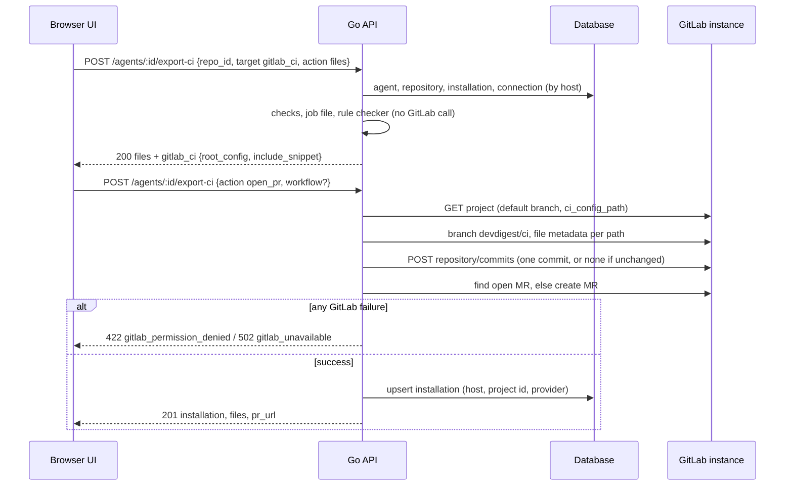
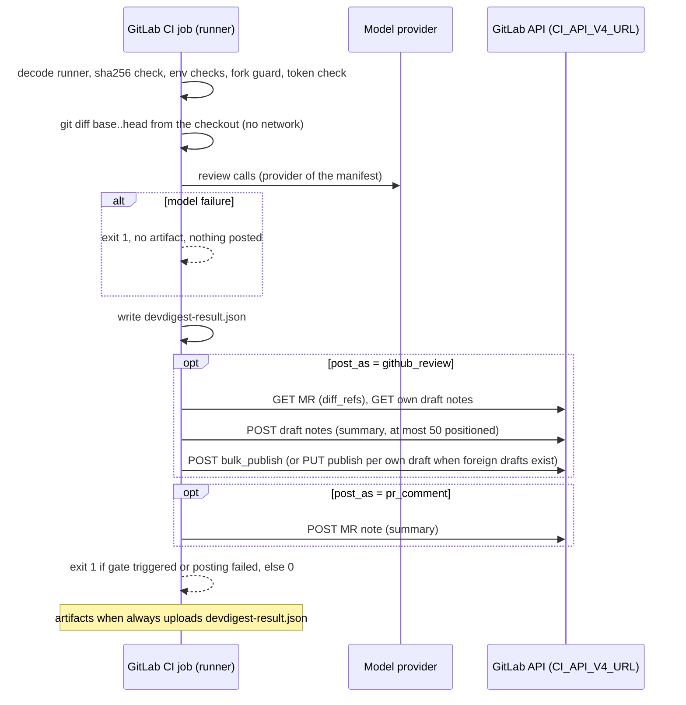
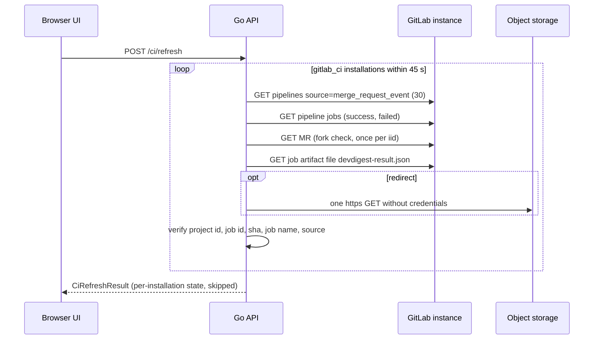

# GitLab C — GitLab CI export, runner and ingest
Spec: GitLab slice C (export target `gitlab_ci`, GitLab CI rule checker, the CI runner on GitLab CI, MR review posting from CI, ingest of GitLab job artifacts, host-aware CI UI) · Status: implemented (2026-10-27, e94f583..621ba72; D29–D37; AC37/AC48 live gitlab.com part pending the user) · Date: 2026-10-24
Areas: api, ci, runner, db, ui
Design sources: the user's request of 2026-10-24 (full GitLab parity, CI included) and the user's CI decisions of
2026-10-24 relayed with this run (D1–D12 below); the first spec-creator run's research and slicing report (facts 3, 5,
6, 7, research facts on CI, the "unverified" list); slice A `specs/2026-10-24-gitlab-a-connection-sync.md` (revised:
connection delete allowed, "not connected" repositories, sync by project id with path updates — its FR29, FR41,
FR47, FR48, NFR2) and the A run's hand-off notes; the custom model providers spec
`specs/2026-10-24-custom-model-providers.md` (ready-for-planning; FR24–FR37, §7 runner environment); Phase 6
`specs/2026-10-23-go-backend-phase-6.md` (§7.6–§7.8); Settings D `specs/2026-10-23-settings-integrations.md`; three
research reports of 2026-10-25 for this spec (R-cfg: GitLab CI configuration semantics; R-rest: GitLab REST for
commits, MRs, pipelines, jobs, artifacts; R-notes: draft notes, quick actions, mentions, limits) from docs.gitlab.com
and GitLab source at `v17.0.0-ee`; code at `feat/go-backend-phase-1` @ `4ce720b`. No design frames or screenshots.
Related: `specs/2026-10-24-gitlab-a-connection-sync.md` (GitLab A — prerequisite; its FR29 `unsupported_host` for CI
is superseded here), GitLab slice B `specs/2026-10-24-gitlab-b-comments-context.md` (owns MR comments from the studio
and the GitLab note body rules FR13–FR17 — this spec adopts those rules for every body the runner posts, FR38),
`specs/2026-10-24-custom-model-providers.md` (extended for GitLab CI, §12), `specs/2026-10-23-go-backend-phase-6.md`
(extended, §12), `specs/2026-10-23-settings-integrations.md` (Settings D — extended), `specs/2026-10-23-settings-first-run-setup.md`
(Settings A — one copy delta), `specs/2026-10-23-settings-c-automatic-reviews.md` (Settings C — one copy delta). None
of them is edited (D12). Supersedes nothing else.

ID convention: plain FR1…, EC1…, NFR1…, AC1…, US1…, D1…, Q1…. Area tags: `[api]` = Go HTTP routes and use cases
(export, publish to GitLab, refresh/ingest, lists), `[ci]` = generated GitLab CI files, manifest, MR description and
the GitLab CI rule checker, `[runner]` = the CI runner program running inside a GitLab CI job, `[db]` = schema and
migrations, `[ui]` = Next.js app (CI wizard, CI runs, Settings › Integrations).

## 1. Goal
GitHub users can export a DevDigest review agent to GitHub Actions: the studio commits a workflow, a manifest, the
skills and a self-contained runner into the repository, the runner reviews every pull request in CI with the user's
model key, posts the review, fails the check on blockers, and the studio later ingests the results. GitLab users have
none of this. This slice brings the same flow to GitLab repositories on gitlab.com and on self-hosted instances: an
export target "GitLab CI" that commits a merge-request-only job file and opens a merge request, a rule checker that
keeps a user-edited job file safe, the same runner reviewing merge requests inside GitLab CI and posting one summary
note plus inline threads as one batch (never approving, never requesting changes), a failed job as the merge-blocking
signal, and `POST /ci/refresh` ingesting GitLab job artifacts next to GitHub runs. Every model provider the GitHub
export supports (OpenRouter, OpenAI, Anthropic, custom gateways) is supported, with GitLab CI/CD variables instead of
GitHub secrets and runner tags instead of `runs-on`. Existing GitHub behaviour and wire shapes do not change.

## 2. Context
- Export today (Phase 6 §7.6, custom providers FR24–FR37): `POST /agents/:id/export-ci` checks agent → `target` = `gha`
  (else 422 `unsupported_target`) → provider → triggers → `repo` by exact `full_name` (404 `repo_not_found`) → slug →
  skill names → workflow + `checkWorkflow` → runner present → manifest; `files` makes no GitHub call and writes no row;
  `open_pr` publishes one Git Data commit to `devdigest/ci`, reuses or opens a PR and upserts the installation
  (Phase 6 §7.6.1–§7.6.8). Files: manifest `.devdigest/agents/<slug>.yaml`, skills `.devdigest/skills/<s>.md`,
  `.devdigest/memory.jsonl`, runner `.devdigest/runner/devdigest-runner-linux-amd64.gz.b64` + `.sha256`, workflow
  `.github/workflows/devdigest-review-<slug>.yml` (the only `editable:true` file) (Phase 6 §7.6.3).
- Slice A (revised): a GitLab repository is bound by host key to an installation-wide connection; with no connection it
  is "not connected" and every GitLab call answers 422 `repo_host_not_connected` (A FR48); slices B and C answer that
  code for their calls. Every GitLab request addresses the project by numeric id; each successful project fetch updates
  the stored path and web URL (A FR17, FR47). Links come from `Repo.provider` + `web_url`, never from response URLs
  (A FR41). Tokens go only to the connection's scheme, host, port and path prefix, no redirects, extra CA file
  `DEVDIGEST_EXTRA_CA_FILE` (A FR20, NFR2). Until this slice, export with a `repo` that matches only a GitLab repository
  answers 422 `unsupported_host` (A FR29, EC25).
- Contracts (`frontend/src/vendor/shared/contracts/eval-ci.ts:133-302`): `CiTarget` = `gha|circle|jenkins|cli`;
  `CiExportInput {repo, target='gha', action, post_as: github_review|pr_comment|none, triggers, base, workflow?}` (+
  `runner`, custom providers); `CiExport {installation, files, pr_url}` (+ `required_secrets`, `required_variables`);
  `CiRun` with wire names `github_url`, `source`, `repo`, `head_sha`; `CiInstallation {id, agent_id, repo, target_type,
  installed_at, slug, workflow_path, manifest_version, last_run}`; `CiResultArtifact` v2 with `repository_id`, `run_id`,
  `run_attempt`, `commit_sha`; `CiRefreshResult.installations[].error_code` = `github_permission_denied|github_rate_limited|github_unavailable`,
  `skipped[].github_run_id`. The Go DTOs match (`backend/internal/ci/transport/http/dto.go:331-399`).
- Schema (`backend/migrations/0001_baseline.up.sql:115-144,807-832`): `ci_installations(agent_id, repo text, target_type
  CHECK IN (gha, circle, jenkins, cli), slug, manifest_version)` unique (agent_id, repo, target_type) and (repo, slug);
  `ci_runs(github_url, source, github_run_id bigint, run_attempt, head_sha, …)` unique (github_run_id, run_attempt). A
  GitHub `acme/web` and a GitLab `acme/web` would collide on (repo, slug); job ids of two GitLab instances and GitHub run
  ids can collide on (github_run_id, run_attempt).
- Runner (Phase 6 §7.8; `backend/internal/ci/runner/**`, `cmd/devdigest-runner`): reads `GITHUB_*`, `PR_*`,
  `DEVDIGEST_*` from the environment, fetches the PR diff from the GitHub API, posts through `ghapi`, writes the
  artifact before posting, wraps its own output in `::stop-commands::` and caps FAILED lines at 1,200 bytes
  (`ci/runner/app/logtext.go:8-11`; `backend/INSIGHTS.md:40`). It does not sanitize posted text. The summary body lists
  every finding and the inline comments follow the engine's finding order with no sorting and no cap
  (`backend/internal/ci/runner/domain/payload.go:91-131`); the severity rank is CRITICAL 3, WARNING 2, SUGGESTION 1
  (Phase 6 §7.8.7). The runner may import only the `reviewer/*` context besides its own packages
  (`backend/AGENTS.md:71-72`; Phase 6 NFR6011).
- Ingest (Phase 6 §7.7): GitHub token missing → 500 `config_error`; per installation the newest 30 completed
  `pull_request` runs, artifact download with one credential-free `https` redirect (D6017; `backend/INSIGHTS.md:17`:
  a followed redirect resends auth, `*url.Error` embeds the signed URL), ZIP and size caps, verification of
  `commit_sha`, `repository_id` and workflow path, fork-PR runs never inspected (D6026(3), `backend/INSIGHTS.md:40`).
- UI: the wizard has one target card "GitHub Actions" and a repository select by `full_name`
  (`CiTab/_components/ExportWizard/_components/TargetStep/TargetStep.tsx:1-60`); the slug comes from
  `WORKFLOW_PATH_PATTERN = /^\.github\/workflows\/devdigest-review-(.+)\.yml$/` and the secrets list is fixed
  (`ExportWizard/constants.ts`); CI run PR links accept only a 2-segment `owner/name` and GitHub (`lib/ci-runs.ts:5-18`).
- GitLab facts (R-cfg, R-rest, R-notes; docs.gitlab.com and source `v17.0.0-ee`):
  - Included files are deep-merged into the root configuration before job rules are evaluated (source
    `config/external/processor.rb`); the includes page expects included jobs to be "configured to run for" MR pipelines.
    A docs note added on 2026-02-24 says rules "defined in `include:`" do not satisfy the MR-pipeline requirement; its MR
    (!224455) limits it to rules on the `include:` entry itself. Not tested live (D18, AC37). Root `workflow:rules` are evaluated
    before jobs: if they exclude `merge_request_event`, no MR pipeline exists and an included job cannot change that.
  - `include:local` files must be in the same repository and branch as the including file; MR pipelines run on the
    source branch's contents.
  - MR pipelines: `CI_PIPELINE_SOURCE=merge_request_event`, `CI_MERGE_REQUEST_IID`, `CI_MERGE_REQUEST_DIFF_BASE_SHA`
    (merge base of the pipeline's MR diff), `CI_MERGE_REQUEST_DIFF_ID`, `CI_MERGE_REQUEST_PROJECT_ID` (target),
    `CI_MERGE_REQUEST_SOURCE_PROJECT_ID`, `CI_MERGE_REQUEST_TITLE`, `CI_MERGE_REQUEST_DESCRIPTION` (first 2,700
    characters, 16.7+), `CI_MERGE_REQUEST_EVENT_TYPE` (`detached|merged_result|merge_train`), `CI_COMMIT_SHA`,
    `CI_PROJECT_ID`, `CI_PROJECT_PATH`, `CI_JOB_ID` (instance-unique), `CI_API_V4_URL`, `CI_SERVER_TLS_CA_FILE` (only
    with a runner `tls-ca-file`). `CI_MERGE_REQUEST_SOURCE_BRANCH_SHA` is empty except in merged-results pipelines,
    where `CI_COMMIT_SHA` is most likely the temporary merge commit.
  - New projects clone with depth 20; the base commit is not guaranteed in the clone; a job-level `GIT_DEPTH` overrides
    the project setting. `image: name@<digest>` is supported; Shell executors do not use `image`. A runner takes a job
    only if it has every job tag; untagged jobs on gitlab.com run on `saas-linux-small-amd64`.
  - `artifacts:when: always` uploads after a non-zero exit (not after a timeout); default expiry 30 days.
  - Job log: `\e[0Ksection_start:<ts>:<name>\r\e[0K` / `section_end:` markers; SGR sequences are rendered, other
    escape sequences dropped, a bare `\r` erases the line; masked values are replaced by `[MASKED]`.
  - Variables: masked values are single-line and at least 8 characters with a restricted character set (17.0: Base64
    alphabet plus `@ : . ~`; 18.0+: no spaces); "masked and hidden" from 17.4. Protected variables are not available
    to MR pipelines in 17.0–18.0, and from 18.1 only with an opt-in setting when both branches are protected. Fork MR
    pipelines run in the fork without the parent's variables; a parent-project member can run a fork MR pipeline in the
    parent project, where all variables are available and the fork's configuration is used.
  - "Pipelines must succeed" (Settings › Merge requests › Merge checks) is available on Free and requires a successful
    pipeline; with branch and MR pipelines only MR pipelines are checked.
  - Commits API `POST /projects/:id/repository/commits` (`branch`, `start_branch`, `commit_message`, `actions[]`
    create|update with `encoding`); `create` of an existing file and `update` of a missing one answer 400; from 18.7 a
    300 MB request limit (413) and 3 requests per 30 s above 20 MB; scope `api` required (`write_repository` cannot use
    the API); Developer role pushes to a new branch and creates an MR. An open MR for the same source branch → 409 on
    create (source only). MR pipelines have `ref` `refs/merge-requests/<iid>/head` in the target project; the API has no
    fork flag — the MR's `source_project_id` tells it.
  - `GET /projects/:id/pipelines?source=merge_request_event`, `GET /projects/:id/pipelines/:pid/jobs?scope[]=…` (job:
    `id`, `name`, `status`, `pipeline{id, project_id, ref, sha}`, `artifacts_file.size`, `artifacts_expire_at`,
    `created_at`); offset pagination, `per_page` ≤ 100.
  - Artifacts: the whole archive endpoint redirects (302) to a pre-signed object-storage URL when proxy download is
    off; `GET /projects/:id/jobs/:job_id/artifacts/<path>` extracts one file and streams it through GitLab (no redirect
    in the 17.0 code path); missing or expired → 404.
  - `CI_JOB_TOKEN` cannot create notes, draft notes or commit statuses.
  - Draft notes (Free): create, list (the token user's drafts), delete, single publish, `bulk_publish`; positioned
    drafts from 16.3. `bulk_publish` publishes **all** pending drafts of the token's user on that MR, creates one review
    and one notification (204 on success); it takes no body parameters on 17.0; the optional `note`, `internal` and
    `reviewer_state` appear at about 19.2–19.3 (R-notes: 19.3; slice B §2, tag bisect: 19.2) — this spec never sends
    any of them; without `reviewer_state` no reviewer state changes. A draft with a bad position is accepted and may vanish or fail
    at publish. Positions need `base_sha`, `start_sha`, `head_sha` from the MR's `diff_refs` (no CI variable for
    `start_sha`); a context line needs `old_line` and `new_line`.
  - Quick actions run when a note is created through the Notes or Discussions API and when a draft is published, not
    when a draft is created. A command is a line starting at column 0 with `/` (root-level paragraphs only; ignored in
    code blocks, block quotes and HTML blocks); no documented escape. `@user`/`@group` notify; mentions inside code are
    not linked; raw HTML is sanitized by an allow-list. Note bodies ≤ 1,000,000 characters; `notes_create` limit (60/min
    on gitlab.com, 300/min self-managed default) applies to the Notes API, not to draft notes in 17.0.
  - Project and group access tokens need Premium/Ultimate on gitlab.com and work on every self-managed tier; their bot
    acts with the role chosen at creation.

## 3. Scope
### In scope
- Export target `gitlab_ci` for GitLab repositories: generated job file, root include file when none exists, manifest,
  skills, memory, runner files; one Commits-API commit to `devdigest/ci`; reuse or open an MR with install instructions;
  installation record keyed by host and project id.
- The GitLab CI rule checker for the generated and the user-edited job file.
- Every exportable provider of the custom providers spec (openrouter, openai, anthropic, defined `custom:<slug>`) with
  GitLab CI/CD variable names, masking guidance, and `runner` mapped to GitLab runner tags.
- The CI runner on GitLab CI: environment, git-based diff, review, gate, artifact, posting per `post_as` (draft notes +
  bulk publish, or one note, or nothing), at most 50 inline threads per run with the rest listed in the summary,
  slice B's note body rules on every posted body, GitLab job-log hardening.
- Ingest of GitLab MR pipelines through `POST /ci/refresh`: job selection, artifact download, verification, fork skip,
  storage; CI runs and installations lists for GitLab.
- Data: `gitlab_ci` target, host-qualified installation identity, host-qualified run uniqueness; one up/down migration.
- UI: the CI wizard target "GitLab CI", host-aware CI runs links, Settings › Integrations card and install dialog for
  GitLab repositories.

### Out of scope
- No GitLab merge request is approved, unapproved or marked "requested changes" by the runner or the studio, and no
  `reviewer_state` is ever sent.
- No commit status, external status check or pipeline is created through the API by the runner or the studio.
- No existing `.gitlab-ci.yml` (or custom CI configuration file) is created over, modified or deleted by the export.
- No CI runner image is built or published to a registry; the job uses a public base image pinned by digest.
- No runner binary is built for an operating system or architecture other than linux/amd64.
- No GitLab webhook, pipeline trigger token or pipeline schedule is created or used; CI results are pulled only by
  `POST /ci/refresh`.
- No `include:remote`, `include:project`, `include:component` or `include:template` is generated.
- No GitHub behaviour changes: the `gha` export, its workflow, manifest, PR body, `checkWorkflow` rules, runner
  behaviour in GitHub Actions, ingest of `gha` installations, status codes and JSON fields stay byte-identical;
  additions are new optional fields, new enum values and new codes only.
- The wire names `github_url`, `github_run_id`, `run_attempt` and the enum values `github_review`, `pr_comment`, `none`
  are not renamed.
- The runner in GitLab mode never reads `GITHUB_TOKEN`, `CI_JOB_TOKEN` or any CI/CD variable not named in §7.5.
- The studio never stores, receives or sends a model key or `DEVDIGEST_GITLAB_TOKEN` for CI.
- No merge request from a fork is reviewed by the generated job, and no fork MR pipeline is ingested.
- No user-provided text (agent name, provider base URL, header names, repository path, branch names) is written into
  the generated job file.
- No GitLab instance older than 17.0 is refused; the features used exist from 16.3.
- No inline-thread cap and no change to the summary body apply to the runner in GitHub Actions (the cap of FR48 is
  GitLab mode only).
- The runner chooses no token role at run time: the recommended role (Reporter, or Developer under the D14 fallback)
  appears only in copy.

## 4. User scenarios
- US1 — As a developer with a GitLab project, I export my review agent to GitLab CI from the agent's CI tab, see the
  files, edit the job file, and DevDigest opens a merge request that adds the job.
- US2 — As a maintainer whose project already has a `.gitlab-ci.yml`, I get the job file and a one-line include snippet
  to add myself; my pipeline file is never touched.
- US3 — As a team lead, I set the CI/CD variables listed in the MR, enable "Pipelines must succeed", and from then on
  every merge request gets one DevDigest review (summary plus inline threads) and a failed job when it has blockers.
- US4 — As a company on a self-hosted GitLab with an intranet model gateway, I export an agent on a custom provider to
  run on our tagged self-managed runner that can reach the gateway and trusts our CA.
- US5 — As a user, I press Refresh on CI runs and see GitLab CI runs next to GitHub runs, with links to the job and the
  merge request.
- US6 — As a security-minded maintainer, I rely on DevDigest never letting an MR author steer the bot into running
  quick actions, pinging people, or forging a CI result from a fork.

## 5. Functional requirements
Export — request and checks
- FR1 [api] — `CiTarget` shall gain `gitlab_ci`. `POST /agents/:id/export-ci` shall accept the optional body field
  `repo_id` (UUID of a repository of the workspace). Repository resolution: `repo_id` present → that repository (absent
  from the workspace → 404 `repo_not_found`; `repo` is then ignored); else `repo` = a `full_name`: a GitHub repository
  with that `full_name` wins (A EC25 unchanged); else exactly one GitLab repository with that `full_name` → it; several
  GitLab repositories with that `full_name` on different hosts → 422 `repo_ambiguous` "<full_name> exists on several
  hosts; choose the repository by id" with `details` {`repo_ids`}; none → 404 `repo_not_found`. A's 422
  `unsupported_host` is no longer produced (supersedes A FR29's CI bullet).
- FR2 [api] — Target and host: `target` omitted → `gha` for a GitHub repository and `gitlab_ci` for a GitLab
  repository; `circle`, `jenkins`, `cli` → 422 `unsupported_target` as today; `gha` with a GitLab repository → 422
  `unsupported_target` "GitHub Actions export needs a GitHub repository"; `gitlab_ci` with a GitHub repository → 422
  `unsupported_target` "GitLab CI export needs a GitLab repository". A not-connected GitLab repository (A FR48) → 422
  `repo_host_not_connected` with `details` {`host`, `repo_id`}, for both actions, before any later check.
- FR3 [api] — For `gitlab_ci` the check order shall be: agent (404) → target value (FR2, unsupported values) → provider
  (custom providers FR24) → triggers (Phase 6 rule) → repository (FR1) → target/host match and connection (FR2) →
  slug (Phase 6 §7.6.2, owned by another agent for the same repository identity → 409 `ci_slug_conflict`) → skill file
  names (422 `skill_slug_conflict`) → job file = body `workflow` when present (an empty string fails `invalid_yaml`),
  else generated (FR6), checked by FR14 (422 `workflow_insecure` with `details.rule`) → runner present (500
  `runner_bundle_missing`) → manifest valid (422 `manifest_invalid`) → `files`: answer; `open_pr`: connection token
  present (else 500 `config_error` "GitLab connection <name> has no token"), publish (FR10–FR12), installation upsert
  (FR13). The `gha` check order is unchanged. `base` is ignored as today.
- FR4 [api] — `triggers` for `gitlab_ci` shall be validated as for `gha` and stored nowhere in the job file: a GitLab MR
  pipeline runs on MR creation and on every push to its source branch, which covers `opened`, `synchronize` and
  `reopened`; the response and the MR description state "GitLab runs merge request pipelines on every push; trigger
  choices do not apply" when the triggers differ from all three.
- FR5 [api] — `files` for `gitlab_ci` shall make no GitLab request and write no row. Whether the root include file is
  part of the answer is decided from the repository's local clone of the default branch: no clone or no
  `.gitlab-ci.yml` in it → the root include file is listed (`root_config: "create"`); a clone with `.gitlab-ci.yml` →
  not listed (`root_config: "keep_existing"`). `open_pr` decides again against GitLab (FR11) and answers the files it
  committed.

Export — files
- FR6 [ci] — For `gitlab_ci` the files shall be, in this order, all `editable:false` except the job file:
  1. `.devdigest/agents/<slug>.yaml` — the manifest of Phase 6 §7.6.4 with the custom providers additions (FR27, FR35);
     byte-identical to the `gha` manifest of the same agent;
  2. `.devdigest/skills/<skill-slug>.md` per enabled linked skill in link order;
  3. `.devdigest/memory.jsonl` — empty;
  4. `.devdigest/runner/devdigest-runner-linux-amd64.gz.b64` and 5. `.devdigest/runner/devdigest-runner-linux-amd64.sha256`
     — identical to the `gha` export (Phase 6 §7.8.2, D6008);
  6. `.gitlab/devdigest/review-<slug>.yml` — the job file (§7.3), `editable:true`;
  7. `.gitlab-ci.yml` — the root include file (§7.3), only when FR5/FR11 decide `create`.
- FR7 [ci] — The generated job file shall be the text of §7.3: one job named `devdigest-review-<slug>`, stage `test`,
  the pinned image (FR8), `inherit` of no root defaults or global variables, the merge-request-and-same-project rule,
  `interruptible: true`, the variables of §7.3 (including `GIT_DEPTH: "0"`), a script that decodes the runner, verifies
  its SHA-256 and runs it, and artifacts `devdigest-result.json` uploaded `when: always`. It passes FR14.
- FR8 [ci] — The job image shall be one public image reference fixed per DevDigest build, written as
  `<name>[:<tag>]@sha256:<64 hex>`: an official Docker Hub image for linux/amd64 that contains `sh`, `git`, `base64`,
  `gzip`, `sha256sum` and CA certificates (D19: `buildpack-deps:<Debian stable codename>-scm`). The digest changes only with a DevDigest code change.
- FR9 [ci] — `runner` (custom providers FR25) shall map for `gitlab_ci`: `github_hosted` (default; labelled "GitLab
  shared runners") → no `tags` key (instance runners that run untagged jobs; on gitlab.com `saas-linux-small-amd64`);
  `self_hosted` (labelled "Self-managed runner") → `tags: [devdigest]` (D20). The default per agent follows custom
  providers FR31 (Self-managed for a custom-provider agent).
- FR10 [ci] — Provider variables in the job file (custom providers §7 derived names, `<S>` = slug upper-cased, `-` →
  `_`): for `openrouter`, `openai`, `anthropic` the job file maps nothing — GitLab exports project CI/CD variables to
  the job, and the runner reads `OPENROUTER_API_KEY`, `OPENAI_API_KEY` or `ANTHROPIC_API_KEY` directly; for
  `custom:<slug>` the job `variables` add `DEVDIGEST_LLM_BASE_URL: $DEVDIGEST_<S>_BASE_URL`,
  `DEVDIGEST_LLM_API_KEY: $DEVDIGEST_<S>_API_KEY` and one `DEVDIGEST_LLM_HEADER_<n>: $DEVDIGEST_<S>_HEADER_<n>` per
  extra header (n = 1…5, header order). An undefined variable expands to empty (no auth header, custom providers FR26).

Export — publish (`open_pr`)
- FR11 [api] — Publish shall, with the connection's token and the repository's project id, in this order:
  1. fetch the project (A FR47 applies: path and web URL updated); take `default_branch` and `ci_config_path`;
  2. root decision: `ci_config_path` empty or `.gitlab-ci.yml` → `.gitlab-ci.yml` exists on the default branch →
     `keep_existing`, else `create`; any other `ci_config_path` → `custom_path` (no root file; the snippet names that
     path);
  3. parent: the head of branch `devdigest/ci` when it exists, else the default branch head;
  4. for each file, its existence and content SHA-256 at the parent: absent → `create`; present with other content →
     `update`; byte-identical → left out;
  5. when at least one action remains: one Commits-API commit to `devdigest/ci` (with `start_branch` = default branch
     when the branch does not exist), message `Add DevDigest CI review`, all files as text; when none remains, no commit.
  Files of the parent that are not part of the export are kept. The whole sequence is retried once on a transient
  failure (Phase 6 §7.9 rule); single writes are not retried.
- FR12 [api] — Then the open MR with source `devdigest/ci` and target the default branch (first result) is reused;
  else one is created with title `Add DevDigest CI review`, `remove_source_branch: true` and the description of §7.4. A
  409 on create (an MR opened meanwhile) → list again and reuse it. `pr_url` = `<repo web_url>/-/merge_requests/<iid>`
  built from the connection and the stored path, never from a response URL (A FR41).
- FR13 [api] — The installation upsert (Phase 6 §7.6.8, custom providers FR37) shall be keyed for `gitlab_ci` on
  (agent, host, project id, target) and store the slug, manifest version, export-time provider, host, project id and
  `repo` = the repository's current `full_name`; slug uniqueness is per (host, project id). A lost race → 409
  `ci_slug_conflict`. A failure after the commit leaves branch and MR on GitLab; re-export is idempotent. Publish
  failures map as §7.2: 401, 403, 404 → 422 `gitlab_permission_denied`; anything else (other status, 429, timeout,
  transport) → 502 `gitlab_unavailable`; one error log line `ci export: GitLab write failed` {`repo_id`, `host`,
  `status`, `step`}.

GitLab CI rule checker
- FR14 [ci] — Every `gitlab_ci` job file, generated or edited, shall pass the Phase 6 size, YAML syntax, single-document,
  duplicate-key and alias-limit checks (→ `invalid_yaml`) and then these rules in order, first broken rule answering 422
  `workflow_insecure` with `details.rule`:
  1. `structure` — the root is a mapping with exactly one key, `devdigest-review-<slug>` of this export, whose value is
     a mapping using only the keys `stage`, `image`, `tags`, `inherit`, `rules`, `interruptible`, `timeout`,
     `variables`, `script`, `artifacts`; `inherit` is exactly `{default: false, variables: false}`; `artifacts` is
     exactly `when: always`, `name: devdigest-result-<slug>`, `paths: [devdigest-result.json]` plus an optional
     `expire_in`; `tags` is a list of 1–10 strings matching `^[A-Za-z0-9_.:-]{1,64}$`; `stage` matches
     `^[A-Za-z0-9_.-][A-Za-z0-9_. -]{0,63}$`; `script` is a non-empty list of strings;
  2. `include` — no `include`, `extends`, `!reference` or other YAML tag, `trigger`, `needs`, `services`,
     `before_script`, `after_script`, `secrets`, `id_tokens`, `cache`, `hooks` key or tag anywhere, and no `when` key
     outside `artifacts`;
  3. `forbidden_trigger` — `rules` is a list of exactly one mapping with the single key `if`, whose value with
     whitespace runs collapsed to one space equals the rule of §7.3 (merge request event and source project = MR
     project);
  4. `unpinned_image` — `image` is a string or a mapping with `name` and an optional `entrypoint`, the name matches
     `^[a-z0-9][a-z0-9._/-]*(:[A-Za-z0-9._-]{1,128})?@sha256:[0-9a-f]{64}$` and contains no `$`;
  5. `variables` — `variables` is a mapping whose keys are only `GIT_DEPTH` (digits), `DEVDIGEST_PLATFORM`
     (= `gitlab_ci`), `DEVDIGEST_AGENT` (= the slug), `DEVDIGEST_POST_AS` (`github_review|pr_comment|none`) and, for a
     custom-provider export, `DEVDIGEST_LLM_BASE_URL`, `DEVDIGEST_LLM_API_KEY`, `DEVDIGEST_LLM_HEADER_1…5`, each
     exactly the reference of FR10 for this export's derived names;
  6. `untrusted_variable` — every variable reference in any string scalar (`$NAME`, `${NAME}`, `%NAME%`,
     `$env:NAME`; `$$` is a literal) names one of `CI_PROJECT_DIR`, `CI_JOB_ID`, `CI_PIPELINE_SOURCE`,
     `CI_MERGE_REQUEST_SOURCE_PROJECT_ID`, `CI_MERGE_REQUEST_PROJECT_ID` or, inside `variables` values, the derived
     names of rule 5. Every other name — in particular `CI_MERGE_REQUEST_TITLE`, `CI_MERGE_REQUEST_DESCRIPTION`,
     `CI_MERGE_REQUEST_SOURCE_BRANCH_NAME`, `CI_MERGE_REQUEST_LABELS`, `CI_COMMIT_MESSAGE`, `CI_COMMIT_TITLE`,
     `CI_COMMIT_DESCRIPTION`, `CI_COMMIT_REF_NAME`, `CI_COMMIT_BRANCH`, `CI_COMMIT_AUTHOR`, `GITLAB_USER_*` and every
     model key or token — is refused.
  Scalars follow the YAML 1.2 core schema; only string scalars are inspected for rule 6; keys are matched exactly.
  The generated job file of §7.3 passes every rule for every exportable provider and both runner modes.
- FR15 [ci] — The root include file (§7.3) is generated text, never user-edited through the API, and contains only the
  one `include: - local:` entry for the job file.

Runner on GitLab CI
- FR16 [runner] — The runner shall run in GitLab mode when `DEVDIGEST_PLATFORM` = `gitlab_ci`; it then requires
  `GITLAB_CI` = `true` and `CI_PIPELINE_SOURCE` = `merge_request_event`, else a hard failure "This job must run in a
  GitLab merge request pipeline". Without `DEVDIGEST_PLATFORM` (or with any other value) it behaves exactly as Phase 6
  and the custom providers spec define for GitHub Actions.
- FR17 [runner] — In GitLab mode the runner shall read only the variables of §7.5: the MR (`CI_MERGE_REQUEST_IID`,
  positive integer), the project (`CI_PROJECT_ID`, `CI_PROJECT_PATH`, `CI_MERGE_REQUEST_PROJECT_ID`,
  `CI_MERGE_REQUEST_SOURCE_PROJECT_ID`), the commits (`CI_MERGE_REQUEST_DIFF_BASE_SHA`, `CI_COMMIT_SHA`,
  `CI_MERGE_REQUEST_SOURCE_BRANCH_SHA`), the job (`CI_JOB_ID`, `CI_PROJECT_DIR`), the API (`CI_API_V4_URL`,
  `CI_SERVER_TLS_CA_FILE`), title and description (`CI_MERGE_REQUEST_TITLE`, `CI_MERGE_REQUEST_DESCRIPTION`), the
  DevDigest variables of Phase 6 §7.8.3 (`DEVDIGEST_DIR`, `DEVDIGEST_RESULT_PATH`, `DEVDIGEST_POST_AS`,
  `DEVDIGEST_AGENT`), the provider variables of custom providers §7 for the manifest's provider, and
  `DEVDIGEST_GITLAB_TOKEN`. Integers and SHAs are validated (digits; 40 or 64 lower-case hex); an invalid required value
  is a hard failure naming the variable.
- FR18 [runner] — Fork guard: `CI_MERGE_REQUEST_SOURCE_PROJECT_ID` ≠ `CI_MERGE_REQUEST_PROJECT_ID`, or `CI_PROJECT_ID`
  ≠ `CI_MERGE_REQUEST_PROJECT_ID` → hard failure "Merge requests from forks are not reviewed" before the diff, with no
  artifact and nothing posted.
- FR19 [runner] — Token check: `DEVDIGEST_POST_AS` ≠ `none` and `DEVDIGEST_GITLAB_TOKEN` empty or unset → hard failure
  "DEVDIGEST_GITLAB_TOKEN is not set: add it as a masked, not protected CI/CD variable (scope api), or set post_as to
  none" before the diff; `CI_API_V4_URL` not an `https` URL without userinfo, query or fragment → hard failure naming
  the variable. With `post_as` = `none` no GitLab token is read and no GitLab request is made.
- FR20 [runner] — Diff: head = `CI_MERGE_REQUEST_SOURCE_BRANCH_SHA` when non-empty, else `CI_COMMIT_SHA`; base =
  `CI_MERGE_REQUEST_DIFF_BASE_SHA`. The runner computes the unified diff from base to head from the job's checkout with
  the image's `git` (rename detection on, no colour, no external diff or text conversion program, binary files without
  content) with no network request and no token; a base or head commit missing from the checkout → hard failure "Base
  commit <sha> is not in the job's clone; keep GIT_DEPTH: \"0\" in the job". The diff is capped at 64 MiB (Phase 6).
  Sections whose ` b/<path>` starts with `.devdigest/` or `.gitlab/devdigest/` are stripped, then the Phase 6 runner
  diff rule parses it (D6011).
- FR21 [runner] — Review, gate and payload shall follow Phase 6 §7.8.6–§7.8.7 and the custom providers runner rules
  (FR30, FR33, FR36) unchanged, with task `Review PR #<iid>: <title>` (title = `CI_MERGE_REQUEST_TITLE`, missing → `""`)
  and the PR description = `CI_MERGE_REQUEST_DESCRIPTION` when non-blank (GitLab passes at most 2,700 characters).
- FR22 [runner] — The artifact (Phase 6 §7.8.8, `CiResultArtifact` v2, same keys and order) shall be written before
  posting, with `pr_number` = the MR iid, `commit_sha` = `CI_COMMIT_SHA`, `repository` = `CI_PROJECT_PATH`,
  `repository_id` = `CI_PROJECT_ID`, `run_id` = `CI_JOB_ID`, `run_attempt` = `1`.
- FR23 [runner] — Exit codes and the hard-failure rule shall be Phase 6 §7.8.9: exit 1 when the gate triggers or on any
  failure; a failure before the artifact writes no artifact and posts nothing; a posting failure after the artifact
  keeps the artifact and exits 1. The failed job is DevDigest's merge-blocking signal on GitLab (with "Pipelines must
  succeed").

Runner posting
- FR24 [runner] — `post_as` on GitLab (enum values unchanged, labelled per host, D7): `github_review` = "MR review" —
  one summary note plus one inline thread per inline comment, at most 50 (FR48), published as one batch (FR25–FR27);
  `pr_comment` = "MR comment" — one note `POST /projects/:id/merge_requests/:iid/notes` with the Phase 6 summary body
  (every finding listed, no cap section, FR48); `none` = nothing. Every
  request goes to `CI_API_V4_URL` with header `PRIVATE-TOKEN: <DEVDIGEST_GITLAB_TOKEN>`, addresses the project by
  `CI_PROJECT_ID`, follows no redirect and never sends `reviewer_state`, an approval or a `/` command of its own.
- FR25 [runner] — MR review, preparation: `GET /projects/:id/merge_requests/:iid` for `diff_refs`. When `diff_refs` is
  null or its `head_sha` ≠ the reviewed head, inline threads are not created (summary only, without the FR48 cap
  section) and one line
  `[agent-runner] inline comments skipped: the merge request changed since this pipeline started` is printed. Then the
  token user's pending drafts on the MR are listed (first page of 100): any existing draft → "foreign drafts" (FR27).
- FR26 [runner] — MR review, drafts: one draft note with the summary body (no position; with the FR48 cap section when
  the cap applies), then one positioned draft per inline comment selected by FR48, in the FR48 order: `position_type: text`, `base_sha`/`start_sha`/`head_sha` from `diff_refs`,
  `new_path` = the file, `old_path` = the file's old path in the diff (renames) else the file, `new_line` = the chosen
  new-side line, and `old_line` as well when that line is a context line. A positioned draft answered with 400 → the
  runner deletes every draft it created in this run, creates the summary draft again alone (without the FR48 cap
  section) and publishes it (one retry, the Phase 6 "retry without comments" rule).
- FR27 [runner] — MR review, publish: without foreign drafts → `POST …/draft_notes/bulk_publish` with no body (one
  review, one notification); with foreign drafts → each draft created in this run is published with
  `PUT …/draft_notes/:id/publish` (summary first, then in the FR48 order), so drafts the token user wrote elsewhere stay
  unpublished. On any failure after the first draft was created, the runner deletes the drafts of this run that are
  still unpublished (best effort), prints the failure and exits 1.
- FR28 [runner] — Every posted body shall be the Phase 6 §7.8.7 text (summary body, plus the FR48 cap section when it
  applies; inline body), with the whole assembled body then passed through the FR38 rules; posting errors print `GitLab API error posting MR review|MR comment (<path>): <status> <body cut to
  1,000 bytes, token redacted>` where `<path>` is the request path without host or query.

Runner job log
- FR29 [runner] — In GitLab mode the runner shall not print `::stop-commands::` wrapping. Every printed text that comes
  from untrusted input (model output, error bodies from GitLab or a model provider, file paths, variable values) shall
  have ESC (0x1B) sequences, every C0 control character, DEL and C1 controls removed, line breaks replaced by `↵`, and
  every occurrence of `section_start:` and `section_end:` removed; the FAILED line cap of 1,200 bytes and the trace and
  result lines of Phase 6 §7.8.9 are kept (backend INSIGHTS L40).
- FR30 [runner] — The runner shall redact from every log line, failure message, artifact and posted body the values of
  `DEVDIGEST_GITLAB_TOKEN` and of every provider secret it read (custom providers NFR7), before any truncation.

Ingest
- FR31 [api] — `POST /ci/refresh` shall walk the in-scope installations of both targets newest `installed_at` first
  under the one 45 s budget (Phase 6 §7.7.1). A missing GitHub token answers 500 `config_error` only when at least one
  in-scope installation is `gha`; a workspace with only `gitlab_ci` installations needs no GitHub token. A `gitlab_ci`
  installation whose host has no connection → state `error`, `error_code` `repo_host_not_connected`; a connection
  without token → `error`, `gitlab_token_missing`; neither sends a request.
- FR32 [api] — Per `gitlab_ci` installation, with the connection token and the installation's project id:
  `GET /projects/:id/pipelines?source=merge_request_event&order_by=id&sort=desc&per_page=30`; for each pipeline whose
  `project_id` is the installation's project and whose `ref` is `refs/merge-requests/<iid>/head` or `/merge`, the
  pipeline's jobs with `scope[]=success&scope[]=failed` (first page of 100) and among them the job named
  `devdigest-review-<slug>` (none → the pipeline is not counted). Jobs already stored (host, job id, attempt 1) are
  skipped. 404 on the pipelines list → `not_installed`. Errors map: 429 → `gitlab_rate_limited`; 401/403 →
  `gitlab_permission_denied`; anything else → `gitlab_unavailable`; one log line `ci refresh: installation failed`
  {`installation_id`, `repo`, `code`, `status`}.
- FR33 [api] — Fork skip: for each candidate job the MR of its iid is read once per refresh
  (`GET /projects/:id/merge_requests/:iid`); `source_project_id` ≠ the installation's project id → the job is never
  inspected or stored; WARN `ci refresh: run not inspected` {`installation_id`, `repo`, `github_run_id`, `reason`:
  `source_project_differs`} (Phase 6 D6026(3) for GitLab).
- FR34 [api] — Artifact: no `artifacts_file` on the job → a failed run is stored (Phase 6 §7.7.5 "no result artifact");
  `artifacts_expire_at` in the past → skip `artifact_expired`; `artifacts_file.size` > 1,048,576 → skip
  `artifact_too_large`; else `GET /projects/:id/jobs/:job_id/artifacts/devdigest-result.json` with the token, no
  automatic redirect; a 302/303/307 with an `https` `Location` is fetched once with no token and no other credential
  (D6017 rule); another redirect, a non-https or missing `Location` → `gitlab_unavailable`; 404 → skip `artifact_invalid`
  (the archive has no result file, or it expired); a body over 65,536 bytes (read with a cap of limit + 1) → skip
  `artifact_too_large`. No ZIP is read on this path.
- FR35 [api] — Verify (else skip `artifact_mismatch`): the bytes satisfy `CiResultArtifact` (Phase 6 §7.7.4 parse and
  storable-value rules, else `artifact_invalid`); `repository_id` = the installation's project id = the pipeline's
  `project_id`; `run_id` = the job id; `commit_sha` = the pipeline `sha`; the job name = `devdigest-review-<slug>`; the
  pipeline `source` = `merge_request_event`. The path in the artifact's `repository` is not compared (D10).
- FR36 [api] — Store (Phase 6 §7.7.5 with these values): `github_run_id` = the GitLab job id, `run_attempt` = 1,
  `source` = `gitlab_ci`, host = the installation's host, `github_url` = `<base_url>/<repo full_name>/-/jobs/<job id>`
  built from the connection and the stored path, `head_sha` = artifact `commit_sha` (the job's pipeline sha for a failed
  run without artifact), `pr_number` = artifact `pr_number`, else the iid of the pipeline `ref`, `ran_at` = job
  `created_at`, `agent_runs` provider = the installation's stored provider (custom providers FR37); idempotent on
  (host, job id, attempt).
- FR37 [api] — Lists: `GET /agents/:id/ci-installations` and `GET /ci/runs` shall include `gitlab_ci` installations and
  their runs. `CiInstallation.repo` = the current `full_name` of the installation's project (the stored text, refreshed
  from the bound repository when one with that host and project id exists in the workspace), `workflow_path` =
  `.gitlab/devdigest/review-<slug>.yml`; each `CiInstallation` and `CiRun` adds `provider` (`github`|`gitlab`) and
  `host`; `CiRun` adds `pr_url` (GitLab: `<web_url>/-/merge_requests/<n>` from the connection and stored path; null for
  GitHub, whose link the UI builds as today, and null when the host is not connected).

Note-body safety
- FR38 [runner] — Every body the runner sends to GitLab — the summary draft, every positioned draft, the summary draft
  re-created by FR26 and the single note of `pr_comment` — shall pass slice B's GitLab note body rules FR13–FR17
  (`specs/2026-10-24-gitlab-b-comments-context.md`, FR13–FR17; adopted by reference, B's text is authoritative where
  this restatement differs), applied to the whole assembled body, in B's order FR14, FR15, FR16, before the draft or
  note is created. Draft notes need the rules too because GitLab runs quick actions when a draft is published. Restated
  so this spec reads on its own (`{ZWSP}` = U+200B):
  1. normalisation and code regions (B FR14): CR LF and a lone CR become LF first; a code region is a run of N backticks
     and everything up to the next run of exactly N backticks; a run with no closing run is not code; tilde fences and
     indented code are not code regions;
  2. quick actions, everywhere including code regions (B FR15): on every line, skip a leading prefix of any mix of
     spaces, tabs, U+FEFF, U+00A0, `>` and list markers (`-`, `*` or `+` followed by a space or tab, or 1–9 digits
     followed by `.` or `)` and a space or tab); when the next character is `/`, insert `{ZWSP}` directly before it;
  3. outside code regions (B FR16): every `@` not already followed by U+200B gets `{ZWSP}` after it; `<` becomes `&lt;`
     and `>` becomes `&gt;` except on B's two allowed line forms (a line `<sub>DevDigest · <1–3 digits>% confidence</sub>`
     and a last non-empty line `<!-- devdigest-finding:<id> -->`); `![` becomes `!{ZWSP}[`;
  4. idempotent; the rendered text changes only by invisible U+200B and by escaped HTML and image syntax shown as text
     (B FR17).
  `&`, links, `#<n>`, `!<n>` and `group/project#<n>` references are not changed (B FR16, D22). The parts of B FR13 that
  are server request handling (validation, the 1,000,000-character length check, B's HTTP error codes) do not apply; a
  body GitLab refuses is a posting failure (FR23, FR27). The Phase 6 §7.8.7 template text and the FR48 cap section
  contain no `@`, `<`, `>`, `![` and no line whose first character after the rule-2 prefix is `/`, so the rules change
  only untrusted text inside them. The runner's import closure excludes slice B's server code (§2), so where the one
  rule and its test corpus live is left to the planner.

Data
- FR39 [db] — One versioned SQL migration with an up and a down shall: add `gitlab_ci` to the installation target
  check; add to CI installations a host (existing rows `github.com`) and a project id (required for `gitlab_ci`,
  empty for `gha`) and make installation identity (agent, host, repository identity, target) and slug uniqueness
  (host, repository identity, slug), where the repository identity is `repo` for GitHub and the project id for GitLab;
  add to CI runs a host (existing rows `github.com`) and replace the uniqueness (run id, attempt) with (host, run id,
  attempt). The down migration refuses with a clear message while any `gitlab_ci` installation or GitLab CI run
  exists, and otherwise restores the previous schema. It is independent of the custom providers migration (D28 there).

UI
- FR40 [ui] — Wizard target step: the repository select lists every repository of the workspace with its host label
  (A FR44), keyed by repository id; the target cards "GitHub Actions" and "GitLab CI" follow the selected repository's
  provider (the other card is disabled with "Needs a GitHub repository" / "Needs a GitLab repository"); a not-connected
  GitLab repository is listed disabled with "Not connected — add a GitLab connection for <host>". Requests send
  `repo_id` and `target`.
- FR41 [ui] — Wizard preview for GitLab: the editable file is `.gitlab/devdigest/review-<slug>.yml` (slug from
  `^\.gitlab/devdigest/review-(.+)\.yml$`), the runner file is shown read-only as for GitHub, and when
  `gitlab_ci.root_config` is `keep_existing` or `custom_path` a box shows "Your project already has <config_path>. Add
  this include to it:" with `include_snippet` and a copy button.
- FR42 [ui] — Wizard configure step for GitLab: "Post results as" labels "MR review (summary + inline threads)"
  (recommended), "MR comment (summary only)", "Don't post"; the Runner choice labels "GitLab shared runners" /
  "Self-managed runner (tag devdigest)"; the trigger checkboxes are replaced by the FR4 note.
- FR43 [ui] — Wizard install step for GitLab: "Open merge request" (method `pr`) and "Download zip"; on success "View
  merge request" (`pr_url`) and the next steps of §7.4 rendered from the response: each `required_secrets` name as a
  masked, not protected CI/CD variable, each `required_variables` name as a visible variable with its value hint,
  `DEVDIGEST_GITLAB_TOKEN` (when `post_as` ≠ `none`) with "scope api; a project access token with the Reporter role is
  recommended (on gitlab.com project access tokens need Premium or Ultimate; otherwise use a personal access token of a
  dedicated user)", the include snippet when needed, and "Enable Settings › Merge requests › Pipelines must succeed to
  block merges on blockers". Documented fallback (D14): if AC48 fails, the recommended role in this install-step copy
  (also used by the Integrations install dialog, FR45) and in the §7.4 MR description is "Developer" instead of
  "Reporter" — a spec change before release, not a runtime switch. The studio's own connection token keeps the §7.2
  Developer requirement either way.
- FR44 [ui] — CI runs: a GitLab run links its MR with `pr_url` and its job with `github_url` (http(s) only, as today),
  shows `!<n>` instead of `#<n>` and the host label; GitHub runs are unchanged.
- FR45 [ui] — Settings › Integrations (Settings D): the card lists GitHub Actions and GitLab CI installations
  (`GET /ci/installations`, FR46); its title is "GitHub Action" while the workspace has no GitLab repository and "CI
  reviews" otherwise; GitLab rows show the host label, "GitLab CI" and `!<n>`-style run links; "Install in a repo"
  lists GitHub and GitLab repositories (not-connected ones disabled with the FR40 reason), offers the FR9 Runner labels
  per host and calls the export with `repo_id` and the host's target.
- FR46 [api] — `GET /ci/installations` (Settings D FR1) shall include `gitlab_ci` installations; each `repos[]` entry
  adds `provider`, `host` and `target_type`; entries are grouped by repository identity (host + `repo` for GitHub, host
  + project id for GitLab) and ordered by `repo`, then `host` (byte order).
- FR47 [ui] — Copy deltas when the workspace has at least one GitLab repository: Settings A FR15 info box "For CI, add
  the same key as a repository secret or GitLab CI/CD variable — see Integrations."; Settings C FR18 "…install the
  GitHub Action or GitLab CI review under Integrations."

Runner posting — inline-thread cap (D15, added 2026-10-25)
- FR48 [runner] — In GitLab mode with `post_as` = `github_review`, the runner shall create at most 50 positioned
  drafts per CI run. Selection: the inline comments of the Phase 6 payload (findings that have an anchor line) are
  ordered by severity rank descending (CRITICAL, WARNING, SUGGESTION, any other severity last), then file path (byte
  order), then start line ascending, then the engine's finding order; the first 50 become positioned drafts, created
  and published in that order. When more than 50 exist, the summary body gains the cap section of §7.7 listing the
  remaining N = total − 50 in the same order, and the runner prints `[agent-runner] inline comments capped: posted=50
  not_posted=<N>`. With 50 or fewer inline comments the order rule still applies and no cap section is added. Findings
  without an anchor line stay in the summary bullets only (Phase 6) and are not counted in N. The summary bullets keep
  the Phase 6 order and list every finding. The cap section is left out when no inline thread is published (FR25
  summary-only, FR26 retry) and never appears with `pr_comment` (one note, no threads) or `none`. Rate limit: the
  summary draft counts together with the threads — one run creates at most 51 drafts (50 + the summary; 52 with the
  FR26 re-created summary) and sends 1 bulk publish or at most 51 single publishes, so creates plus publishes stay ≤ 53,
  under gitlab.com's 60/min `notes_create` limit even on a version that counts draft creates or publishes against it
  (17.0 does not, §2). A 429 on a write is a posting failure (FR27; writes are not retried).

## 6. Workflow and communication



Interactions and failure behaviour:
- UI → API export (sync): failures as §7.2; `files` never calls GitLab.
- API → GitLab publish (sync, token of the bound connection, A NFR2 origin rule, no redirects, 30 s per call): any
  failure → §7.2 mapping; commit made but MR failed → re-export reuses the branch and opens the MR.
- Runner → model provider (sync): Phase 6 / custom providers limits; failure → exit 1, no artifact.
- Runner → GitLab API (sync, `DEVDIGEST_GITLAB_TOKEN`, 30 s per call, GETs retried twice on transient errors, writes not
  retried): failure → drafts of this run cleaned up best effort, exit 1, artifact kept.
- GitLab → artifact upload (GitLab runner, `when: always`): a missing artifact makes the ingest store a failed run.
- UI → API refresh (sync, 45 s budget): per-installation errors do not fail the refresh; a database error → 500.
- API → GitLab ingest (sync): no redirect except the one credential-free `https` artifact leg.

## 7. Contracts
### 7.1 HTTP (all routes keep the Host allow-list, foreign-Origin 403, JSON-only bodies, error envelope)
`eval-ci.ts` changes (additive; shipped with the backend change):
```
CiTarget        += "gitlab_ci"
CiExportInput   += repo_id?: string (uuid)          // wins over repo
                   // target omitted → by repository host (FR2); runner and post_as unchanged enums
CiExport        += gitlab_ci?: {                    // present (non-null) only for target gitlab_ci
                     job_file: string,              // ".gitlab/devdigest/review-<slug>.yml"
                     root_config: "create" | "keep_existing" | "custom_path",
                     config_path: string,           // ".gitlab-ci.yml" or the project's ci_config_path
                     include_snippet: string,       // "include:\n  - local: .gitlab/devdigest/review-<slug>.yml\n"
                     triggers_note: string|null     // FR4 text or null
                   } | null
                   // required_secrets (gitlab_ci) = provider secret names (+ "DEVDIGEST_GITLAB_TOKEN" when post_as ≠ none)
                   // required_variables (gitlab_ci) = ["DEVDIGEST_<S>_BASE_URL"] for custom, else []
CiInstallation  += provider?: "github"|"gitlab", host?: string        // always sent by the Go API
CiRun           += provider?: "github"|"gitlab", host?: string, pr_url?: string|null
CiRefreshResult.installations[] += host?: string
CiRefreshResult.installations[].error_code += "gitlab_permission_denied" | "gitlab_rate_limited"
                   | "gitlab_unavailable" | "repo_host_not_connected" | "gitlab_token_missing"
```
GitLab meaning of existing wire names: `CiRun.github_run_id`/`skipped[].github_run_id` = GitLab job id;
`run_attempt` = 1; `github_url` = job web URL (server-built); `source` = `gitlab_ci`; `repo` = project path
(`path_with_namespace`); `head_sha` = pipeline sha. `CiResultArtifact` is unchanged; on GitLab `repository_id` =
project id, `run_id` = job id, `run_attempt` = 1.

### 7.2 Errors added or changed for `POST /agents/:id/export-ci`
| Status / code | When |
|---|---|
| 404 `repo_not_found` | `repo_id` not a repository of the workspace; `repo` matches nothing |
| 422 `repo_ambiguous` `details` {`repo_ids`} | `repo` matches GitLab repositories on several hosts and no GitHub one |
| 422 `unsupported_target` | `circle`/`jenkins`/`cli`; `gha` with a GitLab repository; `gitlab_ci` with a GitHub one |
| 422 `repo_host_not_connected` `details` {`host`, `repo_id`} | GitLab repository without connection (A FR48) |
| 422 `workflow_insecure` `details` {`rule`} | FR14 rules: `structure`, `include`, `forbidden_trigger`, `unpinned_image`, `variables`, `untrusted_variable`; `invalid_yaml` as today |
| 500 `config_error` "GitLab connection <name> has no token" | `open_pr` without a token |
| 422 `gitlab_permission_denied` "GitLab refused the write. The connection token needs the api scope and at least the Developer role in <full_name>." | publish 401/403/404 |
| 502 `gitlab_unavailable` "GitLab is unavailable, try again later" | publish: any other failure |
| — `unsupported_host` | no longer produced (A FR29 superseded) |

`POST /ci/refresh`: 500 `config_error` only per FR31; per-installation codes of §7.1.

### 7.3 Generated GitLab CI files
Job file `.gitlab/devdigest/review-<slug>.yml` (`<image>` = FR8 reference; `<tags>` line only for `self_hosted`;
`<llm vars>` only for custom providers, FR10; `<post_as>` validated enum):
```
# DevDigest Review · <slug> — generated by DevDigest; included from the root CI configuration.
devdigest-review-<slug>:
  stage: test
  image:
    name: <image>
    entrypoint: [""]
  tags: [devdigest]
  inherit:
    default: false
    variables: false
  rules:
    - if: $CI_PIPELINE_SOURCE == "merge_request_event" && $CI_MERGE_REQUEST_SOURCE_PROJECT_ID == $CI_MERGE_REQUEST_PROJECT_ID
  interruptible: true
  variables:
    GIT_DEPTH: "0"
    DEVDIGEST_PLATFORM: gitlab_ci
    DEVDIGEST_AGENT: <slug>
    DEVDIGEST_POST_AS: <post_as>
    DEVDIGEST_LLM_BASE_URL: $DEVDIGEST_<S>_BASE_URL
    DEVDIGEST_LLM_API_KEY: $DEVDIGEST_<S>_API_KEY
    DEVDIGEST_LLM_HEADER_1: $DEVDIGEST_<S>_HEADER_1
  script:
    - mkdir -p "/tmp/devdigest-$CI_JOB_ID"
    - base64 -d "$CI_PROJECT_DIR/.devdigest/runner/devdigest-runner-linux-amd64.gz.b64" > "/tmp/devdigest-$CI_JOB_ID/devdigest-runner.gz"
    - gzip -dc "/tmp/devdigest-$CI_JOB_ID/devdigest-runner.gz" > "/tmp/devdigest-$CI_JOB_ID/devdigest-runner"
    - cd "/tmp/devdigest-$CI_JOB_ID" && sha256sum -c "$CI_PROJECT_DIR/.devdigest/runner/devdigest-runner-linux-amd64.sha256"
    - chmod +x "/tmp/devdigest-$CI_JOB_ID/devdigest-runner"
    - cd "$CI_PROJECT_DIR" && "/tmp/devdigest-$CI_JOB_ID/devdigest-runner"
  artifacts:
    when: always
    name: devdigest-result-<slug>
    paths:
      - devdigest-result.json
    expire_in: 30 days
```
Each script line is a separate command: GitLab stops the job at the first failing line, so a failed decode or
checksum stops before the runner starts. Root include file `.gitlab-ci.yml` (only when `root_config` = `create`):
```
# Added by DevDigest. Add your own jobs below or in other included files.
include:
  - local: .gitlab/devdigest/review-<slug>.yml
```

### 7.4 MR description (open_pr)
```
Adds the DevDigest review agent `<slug>` to this project's GitLab CI.

### Files
- `<path>`

### Before merging
1. Add these CI/CD variables (Settings > CI/CD > Variables), each **masked** and **not protected**
   (merge request pipelines cannot read protected variables):
   - `<required secret>`
   - `DEVDIGEST_GITLAB_TOKEN` — an access token with the `api` scope that DevDigest posts as
     (a project access token with the Reporter role is recommended; on gitlab.com project access tokens need
     Premium or Ultimate, otherwise use a personal access token of a dedicated user).
   And as a visible variable: `<required variable>` = the gateway base URL.
   This merge request runs the review job on itself, so its pipeline fails until the variables exist.
2. <only when root_config ≠ create> Add this to `<config_path>`:
   include:
     - local: .gitlab/devdigest/review-<slug>.yml
3. Merge this merge request.
4. To block merges on blockers, enable "Pipelines must succeed" (Settings > Merge requests > Merge checks).

### Runner
`.devdigest/runner/devdigest-runner-linux-amd64.gz.b64` is the DevDigest CI runner (linux/amd64), built from DevDigest
source `<build id>`. SHA-256 of the decoded binary: `<sha256>`. The job checks it before running.

Branch: `devdigest/ci`. Generated by DevDigest.
```
(one `- \`<path>\`` line per committed or kept file in file order; the `DEVDIGEST_GITLAB_TOKEN` item only when
`post_as` ≠ `none`; the visible-variable sentence only when `required_variables` is non-empty; step 2 only when
needed, steps renumbered; the FR4 triggers note as an extra line after step 4 when it applies. "Reporter" becomes
"Developer" only under the D14 fallback, as a spec change.)

### 7.5 Runner environment in GitLab mode (added to Phase 6 §7.8.3)
| Variable | Required | Use |
|---|---|---|
| `DEVDIGEST_PLATFORM` | yes = `gitlab_ci` | selects GitLab mode (FR16) |
| `GITLAB_CI`, `CI_PIPELINE_SOURCE` | yes (`true`, `merge_request_event`) | mode check |
| `CI_MERGE_REQUEST_IID` | yes | MR iid, artifact `pr_number` |
| `CI_PROJECT_ID`, `CI_MERGE_REQUEST_PROJECT_ID`, `CI_MERGE_REQUEST_SOURCE_PROJECT_ID` | yes | fork guard, API project, `repository_id` |
| `CI_PROJECT_PATH` | yes | artifact `repository` |
| `CI_MERGE_REQUEST_DIFF_BASE_SHA` | yes | diff base |
| `CI_COMMIT_SHA` | yes | head fallback, artifact `commit_sha` |
| `CI_MERGE_REQUEST_SOURCE_BRANCH_SHA` | no | head in merged-results pipelines |
| `CI_JOB_ID` | yes | artifact `run_id` |
| `CI_PROJECT_DIR` | no (default cwd) | checkout for git |
| `CI_API_V4_URL` | when `post_as` ≠ `none` | API root (https) |
| `CI_SERVER_TLS_CA_FILE` | no | extra CA for GitLab API calls |
| `CI_MERGE_REQUEST_TITLE`, `CI_MERGE_REQUEST_DESCRIPTION` | no | task line, PR description |
| `DEVDIGEST_GITLAB_TOKEN` | when `post_as` ≠ `none` | posting token |
| `DEVDIGEST_DIR`, `DEVDIGEST_RESULT_PATH`, `DEVDIGEST_POST_AS`, `DEVDIGEST_AGENT` | as Phase 6 | as Phase 6 |
| provider variables | per manifest provider (custom providers §7) | model calls |

GitLab endpoints used by the runner: `GET /projects/:id/merge_requests/:iid`; `GET|POST
/projects/:id/merge_requests/:iid/draft_notes`; `DELETE …/draft_notes/:id`; `PUT …/draft_notes/:id/publish`;
`POST …/draft_notes/bulk_publish` (no body); `POST /projects/:id/merge_requests/:iid/notes {body}`.
GitLab endpoints used by the backend (connection token, `PRIVATE-TOKEN`): `GET /projects/:id`; `GET
/projects/:id/repository/branches/:branch`; file metadata `/projects/:id/repository/files/:path?ref=`; `POST
/projects/:id/repository/commits`; `GET|POST /projects/:id/merge_requests`; `GET /projects/:id/merge_requests/:iid`;
`GET /projects/:id/pipelines`; `GET /projects/:id/pipelines/:pid/jobs`; `GET
/projects/:id/jobs/:job_id/artifacts/devdigest-result.json`.

### 7.6 Log lines (content-free)
`ci export: GitLab write failed` {`repo_id`, `host`, `status`, `step`}; `ci refresh: installation failed`
{`installation_id`, `repo`, `code`, `status`}; warn `ci refresh: run skipped` {`installation_id`, `repo`,
`github_run_id`, `reason`}; warn `ci refresh: run not inspected` {…, `reason`: `source_project_differs`}.

### 7.7 Runner note bodies on GitLab (GitLab mode only)
- Body rules: every body of §7.5's draft-note and note requests has passed slice B FR13–FR17 as adopted by FR38.
- Inline cap (FR48): at most 50 positioned drafts per run, in the order severity rank descending, file path (byte
  order), start line, engine order. Over the cap, the summary body (Phase 6 §7.8.7) gets this cap section inserted
  between the last finding bullet and `_Posted via DevDigest._`, separated by one blank line on each side:
  ```
  _<N> more findings not posted inline (limit: 50 inline threads per run):_
  - <emoji> **<title>** (<severity lower>) — `<file>:<start>[-<end>]`
  ```
  one bullet per finding not posted inline, in the FR48 order; `<emoji>` as in the Phase 6 bullets; for N = 1 the
  first line reads `_1 more finding not posted inline (limit: 50 inline threads per run):_`.
- Runner log line: `[agent-runner] inline comments capped: posted=50 not_posted=<N>` (content-free; only when the cap
  applies).
- Requests per run (`github_review`): ≤ 1 MR read, 1 drafts list, ≤ 52 draft creates (50 positioned, the summary, and
  the summary re-created by the FR26 retry), 1 bulk publish or ≤ 51 single publishes, ≤ 51 deletes on cleanup; draft
  creates plus publishes stay ≤ 53, below gitlab.com's 60/min `notes_create` limit.

## 8. Data model (logical)
- CI installation (existing): gains host and, for GitLab, project id; identity = (agent, host, repository identity,
  target), slug unique per (host, repository identity); repository identity = path for GitHub, project id for GitLab;
  `repo` text keeps the last known path. Stores the export-time provider (custom providers FR37). Lives until its
  agent is deleted (cascade, unchanged).
- CI run (existing): gains host; unique on (host, run id, attempt); for GitLab, run id = job id and attempt = 1.
- Agent run (existing, source `ci`): unchanged.
- Derived, never stored: `pr_url`, `provider`, the root-config decision, include snippet, required variables.
- On GitLab (not in the database): branch `devdigest/ci`, the export commit, the install MR; in CI the job artifact
  `devdigest-result.json` (30 days by default) and the posted notes.

## 9. States and UX
| Screen / element | Loading | Empty | Error | Degraded | Success | Notes |
|---|---|---|---|---|---|---|
| Wizard target step | repo select skeleton | no repositories → "Connect a repository first" | repos load error + Retry | not-connected GitLab repo disabled with reason | target card follows repo host | host labels |
| Wizard preview | file list skeleton | — | error box (`code`, `message`, `details.rule`) | include-snippet box when a root config exists | files, editable job file | options locked after edit |
| Wizard configure | — | — | — | triggers note on GitLab | per-host post_as / runner labels | |
| Wizard install | "Opening merge request…" | — | error box; Retry | — | "View merge request", next steps with variables and snippet | zip alternative |
| CI runs list | skeleton | "No CI runs yet" | refresh error message | per-installation error / not checked rows | GitLab rows with `!<n>`, job link, host | refresh shows ingested count |
| Integrations card | skeleton rows | "Not installed in any repository yet" | message + Retry | run without time → "no runs yet" | rows with host + target | title per FR45 |
| Install dialog | spinner per agent | no repositories → "Add repository" | per-agent message, Retry | not-connected repo disabled | per-agent MR link | |

## 10. Edge cases
- EC1 [api] — `repo: "acme/web"` with a GitHub and a GitLab `acme/web` → GitHub one; with GitLab `acme/web` on
  gitlab.com and on git.corp.example only → 422 `repo_ambiguous` listing both ids; `repo_id` of the second → exported
  there (FR1).
- EC2 [api] — `target: "gha"` with a GitLab repository, `target: "gitlab_ci"` with a GitHub repository → 422
  `unsupported_target` with the FR2 messages; `target` omitted with a GitLab repository → `gitlab_ci` (FR2).
- EC3 [api] — The repository's host connection was deleted → 422 `repo_host_not_connected` for `files` and `open_pr`,
  no request; a refresh shows that installation `error` `repo_host_not_connected` and the others ingested (FR2, FR31).
- EC4 [api] — The default branch already has `.gitlab-ci.yml` → no root file committed, `root_config:
  "keep_existing"`, MR description step 2 with the snippet; the file on GitLab is byte-identical afterwards (FR11).
- EC5 [api] — The project's `ci_config_path` is `ci/main.yml` → `root_config: "custom_path"`, `config_path:
  "ci/main.yml"`, nothing written to either root file (FR11).
- EC6 [api] — Preview said `create` (stale clone) but GitLab has `.gitlab-ci.yml` at publish → no root file committed,
  the response says `keep_existing` and lists the committed files only (FR5, FR11).
- EC7 [api] — Re-export with identical content → no commit, the open MR reused, 201 with the installation; re-export
  after a skill change → one commit with only the changed and new files as actions (FR11, FR12).
- EC8 [api] — Branch `devdigest/ci` exists from an earlier export and its MR was closed → commit on the branch, a new MR
  is opened; an MR opened by someone else meanwhile (409 on create) → reused (FR12).
- EC9 [api] — Connection token is read-only (`read_api`) → GitLab 403 on the commit → 422 `gitlab_permission_denied`,
  nothing stored; a 5xx or timeout → 502 `gitlab_unavailable` after one sequence retry (FR13).
- EC10 [api] — The project was renamed on GitLab since it was added → publish updates the stored path (A FR47), the
  installation `repo` and `pr_url` use the new path, the project id is unchanged (FR11, FR13).
- EC11 [ci] — An edited job file adds `include: - remote: https://x/y.yml` → `include`; `image: alpine:3.20` →
  `unpinned_image`; `rules: - when: always` → `forbidden_trigger`; `script: - echo "$CI_MERGE_REQUEST_TITLE"` or
  `${CI_COMMIT_MESSAGE}` → `untrusted_variable`; `variables: {FOO: bar}` → `variables`; a second job → `structure`;
  `before_script` → `include` (FR14).
- EC12 [ci] — `$$CI_MERGE_REQUEST_TITLE` (escaped dollar) passes `untrusted_variable`; `echo $OPENROUTER_API_KEY`
  fails it; a custom-provider job whose `DEVDIGEST_LLM_API_KEY` references `$OPENROUTER_API_KEY` fails `variables`
  (FR14).
- EC13 [ci] — A job file of 65,537 bytes, two YAML documents, duplicate keys or an alias bomb → `invalid_yaml` before
  any rule (FR14).
- EC14 [ci] — An existing root config with `workflow:rules` that exclude `merge_request_event` → no MR pipeline; the
  MR description and wizard snippet box say "If your workflow:rules exclude merge request pipelines, the review job
  cannot run" (FR11, §7.4).
- EC15 [ci] — An existing root config whose `stages` has no `test` → adding the include makes GitLab reject the
  configuration; the snippet box says "Your stages must include test, or change the job's stage" (FR7, FR41).
- EC16 [runner] — `DEVDIGEST_PLATFORM` unset in GitHub Actions → Phase 6 behaviour byte-identical; set to `gitlab_ci`
  outside GitLab (`GITLAB_CI` unset) or in a branch pipeline → hard failure, exit 1, no artifact (FR16).
- EC17 [runner] — A fork MR pipeline run in the parent project with `CI_MERGE_REQUEST_SOURCE_PROJECT_ID` ≠ project → no
  diff, no model call, no artifact, nothing posted, exit 1 (FR18).
- EC18 [runner] — `post_as=github_review` and `DEVDIGEST_GITLAB_TOKEN` unset (for example because it was created as
  protected) → the FR19 message before the diff; `post_as=none` without it → review runs, no GitLab request (FR19).
- EC19 [runner] — Shallow clone without the base commit (job edited to `GIT_DEPTH: "20"`) → the FR20 failure message,
  exit 1, no artifact (FR20).
- EC20 [runner] — Merged-results pipeline (`CI_MERGE_REQUEST_SOURCE_BRANCH_SHA` set) → the diff uses that head; the
  artifact `commit_sha` is `CI_COMMIT_SHA` (FR20, FR22).
- EC21 [runner] — A push lands while the job runs (MR `diff_refs.head_sha` ≠ reviewed head) → summary only, the skipped
  line printed, exit code per gate (FR25).
- EC22 [runner] — The token user has 2 pending drafts written by hand on the MR → the runner's drafts are published one
  by one; the 2 hand-written drafts are still pending afterwards (FR27).
- EC23 [runner] — One positioned draft answered 400 → all drafts of this run deleted, the summary alone published, exit
  per gate; `bulk_publish` answers 500 → unpublished drafts of this run deleted, exit 1, artifact kept (FR26, FR27).
- EC24 [runner] — A finding rationale "Fix it.\n/approve\n  /merge\n\t> - /close\n/label ~x\n 1) /assign @me"
  with a fenced block containing `/merge` and `@bob`, and title "cc @alice  " →
  U+200B before every one of those `/` (inside the fence too), `@` + U+200B outside code only (`@bob` in the fence
  kept), `&lt;img src=x&gt;`, `!{ZWSP}[p]`; in the summary, the positioned drafts and a `pr_comment` note alike; the
  MR is not approved, merged, closed, labelled or assigned and @alice gets no notification (FR38, B FR14–FR16).
- EC25 [runner] — An error body from GitLab or the model containing `\e[31m`, `\r`, `section_start:1:x\r\e[0K` → the
  printed line has none of them and is ≤ 1,200 bytes (FR29).
- EC26 [runner] — A model provider key or `DEVDIGEST_GITLAB_TOKEN` echoed in a GitLab error body → redacted in the
  printed line before cutting (FR30).
- EC27 [api] — A refresh sees a job `canceled`, `skipped` or `running` → not stored; a later refresh stores it once it
  is `success`/`failed`; the same job seen twice → stored once (FR32, FR36).
- EC28 [api] — The artifact has `repository_id` of another project, `run_id` ≠ job id or `commit_sha` ≠ pipeline sha →
  skip `artifact_mismatch`, nothing stored (FR35).
- EC29 [api] — Artifact file 70 KB → `artifact_too_large`; archive size 2 MB → skipped without download; artifact
  answered by a 302 to `https://storage…` → fetched once without `PRIVATE-TOKEN`; a 302 to `http://…` →
  `gitlab_unavailable`; 404 → `artifact_invalid`; expired → `artifact_expired` (FR34).
- EC30 [api] — A GitLab job id equal to a stored GitHub run id → both stored (host differs) (FR36, FR39).
- EC31 [api] — A fork MR pipeline in the parent project (MR `source_project_id` ≠ project) → never inspected, WARN line,
  not in `skipped` (FR33).
- EC32 [api] — A workspace with only GitLab installations and no GitHub token → refresh 200; with one `gha` and one
  `gitlab_ci` installation and no GitHub token → 500 `config_error` (FR31, D21).
- EC33 [db] — The down migration with a `gitlab_ci` installation present → fails naming the GitLab CI data, nothing
  changed; with only GitHub data → previous schema restored (FR39).
- EC34 [ui] — A GitLab CI run of a not-connected host → no MR link (`pr_url` null), the job link is still shown
  (http(s) check), `!<n>` and the host label are shown (FR37, FR44).
- EC35 [runner] — 73 findings, all with an anchor line, `post_as=github_review` → 50 positioned drafts (all critical
  before warnings before suggestions, then by file and line) + 1 summary draft whose cap section starts
  `_23 more findings not posted inline (limit: 50 inline threads per run):_` with 23 bullets in the FR48 order; the
  summary's finding bullets still list all 73; one bulk publish; the capped log line `posted=50 not_posted=23` (FR48).
- EC36 [runner] — Boundaries of the cap: exactly 50 inline comments → 50 drafts, no cap section; 51 → 50 drafts and
  `_1 more finding not posted inline …:_`; 60 findings of which 15 have no anchor line → 45 drafts, no cap section;
  73 findings with `pr_comment` → one note, no cap section; 73 with the MR head changed (FR25) or a positioned draft
  answered 400 (FR26) → summary only, no cap section; a second run under the same token within the minute answered
  429 on a write → posting failure, drafts of the run cleaned up, exit 1, artifact kept (FR48, FR27).

## 11. Non-functional requirements
- NFR1 [api] — Token safety (A NFR1, NFR2 applied): the connection token is sent only to its connection's scheme, host,
  port and path prefix; no GitLab API call of export or ingest follows a redirect, except the artifact leg of FR34
  (one `https` hop with no credentials); the token, a signed URL or a part of either never appears in a response, log
  line or error message (`*url.Error` unwrapped; backend INSIGHTS L17).
- NFR2 [runner] — Runner secrets: in GitLab mode the runner reads only the §7.5 variables; it sends
  `DEVDIGEST_GITLAB_TOKEN` only to the `CI_API_V4_URL` origin and path prefix, over `https`, with no redirect, trusting
  the system store plus `CI_SERVER_TLS_CA_FILE`; no secret value appears in the artifact, a log line or a posted body.
- NFR3 [runner] — Note-body safety: every body the runner sends to GitLab equals the output of slice B's rules FR14–FR16
  for the assembled body (so no line has `/` right after the B FR15 prefix, no `@` outside code is directly followed by
  a name character, no raw `<`/`>` outside code except B's two allowed line forms, no `![` outside code), and applying
  the rules again changes nothing (B FR17); checked against slice B's EC15 corpus plus the EC24 cases and once live on
  gitlab.com (AC37).
- NFR4 [ci] — The generated job file passes FR14 for every exportable provider × runner mode × `post_as`; it
  interpolates only the validated slug, `post_as` enum, the fixed image reference, the fixed tag and derived names
  matching `^DEVDIGEST_[A-Z0-9_]{1,32}_(BASE_URL|API_KEY|HEADER_[1-5])$`; no secret value appears in any generated
  file, MR description, response, stored row or log line.
- NFR5 [ci] — Checker bounds: the Phase 6 hostile-input bounds (65,536 bytes, alias and visit budget, duplicate keys;
  backend INSIGHTS L70, L74) apply; one check takes ≤ 50 ms for a 64 KiB file.
- NFR6 [api] — Request budget: `files` makes 0 GitLab requests and answers within 1 s after the first call of the
  process (Phase 6 NFR6007); publish makes at most 1 project + 1 branch + 1 file-metadata request per exported file + 1 commit + 2 MR requests
  (+ one repeat of the sequence); refresh makes per `gitlab_ci` installation at most 1 pipelines + 30 job lists + 30 MR
  reads + 30 artifact downloads, within the 45 s budget with at most one call in flight.
- NFR7 [runner] — Runner requests: at most 1 MR read, 1 drafts list, 1 + n draft creates (+ 1 for the FR26 re-created
  summary), 1 bulk publish or 1 + n single publishes, and n + 1 deletes on cleanup, for n = min(inline comments, 50)
  (FR48), so at most 53 draft creates and publishes per run; 30 s per request; GETs retried at most twice on transient
  errors; no POST, PUT or DELETE retried.
- NFR8 [api] — Compatibility: with no GitLab repository, every existing CI golden (export files, workflow, manifest, PR
  body, workflow rules, ingest, installations, runs, refresh) passes unchanged apart from the added fields of §7.1
  (`provider`, `host`, `pr_url` and `gitlab_ci: null`); a Node- or Go-runner artifact of a `gha` run is ingested as
  before; the runner without `DEVDIGEST_PLATFORM` produces byte-identical requests, artifact and log lines to today.
- NFR9 [runner] — Version floor: every GitLab endpoint and parameter the runner and backend use exists in GitLab 17.0;
  `bulk_publish` is called without parameters on every version (its optional `note`, `internal`, `reviewer_state`
  appear at about 19.2–19.3 and are never sent, §2).
- NFR10 [runner] — The runner stays linux/amd64, cgo off, ≤ 16 MiB, encoded ≤ 8 MiB (Phase 6 NFR6006); GitLab mode adds
  no network call for the diff and runs only the `git` program of the job image besides itself.
- NFR11 [ui] — Accessibility: target cards and selects have labels; disabled options carry their reason as text; the
  snippet box copy button has an accessible name; status text, not colour only (Settings D NFR5 applies).
- NFR12 [ui] — All new copy is in `messages/en/*.json`; the pseudo-messages test finds no hard-coded copy.

## 12. Dependencies and rollout
- Shared-contract change: yes — `eval-ci.ts` (`CiTarget`, `CiExportInput.repo_id`, `CiExport.gitlab_ci`,
  `CiInstallation`/`CiRun` `provider`/`host`/`pr_url`, `CiRefreshResult` codes and `host`) and the Settings D
  `GET /ci/installations` shape (`provider`, `host`, `target_type`); one change set with the backend; new Go goldens
  registered in `frontend/src/test/go-backend-contracts.test.ts`.
- Persisted data change: yes — FR39 migration (up and down).
- No feature flag: without GitLab repositories nothing changes (NFR8).
- Order: after slice A (connections, repo host, project id, FR47/FR48) and after the custom providers CI work (provider
  column, `runner`, `required_*`), whichever lands later adopts the other; FR38 adopts slice B's note body rules
  FR13–FR17: whichever of B and C lands first brings the rules and slice B's EC15 corpus, the other reuses them, and
  both produce the same text for the same body (D16). Planning waits for the Settings A review gate (D28).
- External effects: `open_pr` writes a branch, a commit and an MR to the user's GitLab project; the job runs in the
  user's CI with the user's model key and posts with the user's `DEVDIGEST_GITLAB_TOKEN`.
- Conflicts with related specs, stated explicitly (not edited, D12):

  | Spec | Item | Relation |
  |---|---|---|
  | GitLab A | FR29 CI bullet, EC25, §7 `unsupported_host` | superseded by FR1–FR3 (`unsupported_host` no longer produced; EC25's GitHub precedence kept) |
  | GitLab A | Out of scope "No GitLab CI export, runner, ingest or Integrations card entry"; NFR3 read-only | superseded for CI by this spec (writes only by `open_pr` and the runner) |
  | GitLab A | FR48 not connected | applied to export and refresh (FR2, FR31) |
  | GitLab B | FR13–FR17 note body rules; §12 forward reference "the rules apply to every body the runner posts" | adopted by FR38 for every runner body incl. draft notes; B's server-only request handling (validation, length check, error codes) not adopted |
  | GitLab B | §2 `reviewer_state` on `bulk_publish` from about 19.2 | reconciled with R-notes (19.3): about 19.2–19.3, never sent (§2, NFR9, D17) |
  | Phase 6 | Out of scope "No target other than `gha`" | superseded by FR1–FR3 |
  | Phase 6 | §7.6.1 check order, §7.6.3 files, §7.6.5, §7.6.6, §7.6.7, §7.6.8 | extended by FR3, FR6–FR15 for `gitlab_ci`; `gha` unchanged |
  | Phase 6 | §7.7.1–§7.7.6 ingest (token rule, runs, artifact, ZIP, verify, store, lists) | extended by FR31–FR37 |
  | Phase 6 | §7.8.3 inputs, §7.8.5 diff via API, §7.8.9 posting and log hardening, D6026(3) fork rule | extended by FR16–FR30, FR38 for GitLab mode |
  | Phase 6 | §7.8.7 payload (every finding inline, engine order) | extended in GitLab `github_review` mode by FR48 (50-thread cap, order, summary cap section); GitHub unchanged |
  | Phase 6 | NFR6011 runner closure "no git package" | kept (no git library); GitLab mode runs the image's `git` program (NFR10) |
  | Phase 6 | §7.10 `ci_runs` unique (github_run_id, run_attempt); NFR6010 | superseded by FR39 (host-qualified); additive fields |
  | Custom providers | FR25 `runner`, FR26/FR28 secret mapping, FR29 `required_*` and PR body, FR31/FR32 UI | extended for GitLab by FR9, FR10, FR14 rule 5, §7.1, §7.4, FR42–FR45 |
  | Custom providers | FR27, FR35 manifest, FR30/FR36 runner provider rules, FR37 export-time provider, NFR7 | reused unchanged (FR6, FR21, FR13/FR36, FR30) |
  | Custom providers | §12 "GitLab CI support for custom providers is a follow-up of those specs" | fulfilled here |
  | Settings D | Out of scope `target_type = gha` only; FR1, FR2, FR3, §7 `GET /ci/installations`, §9 card | extended by FR45, FR46 |
  | Settings A | FR15 info box | copy delta FR47 |
  | Settings C | FR18 info box | copy delta FR47 |

## 13. Acceptance criteria
- AC1 [api] — Given a workspace with GitHub `acme/web`, GitLab `acme/web` on gitlab.com and GitLab `acme/web` on
  git.corp.example, when export `files` is sent with `repo:"acme/web"`, then the GitHub repository is used; after
  removing the GitHub one, the same request answers 422 `repo_ambiguous` with both ids; with `repo_id` of the
  git.corp.example repository it answers 200 with `gitlab_ci` files; with an unknown `repo_id` 404 `repo_not_found`.
  Traces: FR1, EC1 · Verify: component
- AC2 [api] — Given a GitLab repository, when `target` is omitted, `gha`, `gitlab_ci`, `circle`, then the answers are
  200 `gitlab_ci`, 422 `unsupported_target` "GitHub Actions export needs a GitHub repository", 200, 422
  `unsupported_target`; given a GitHub repository with `gitlab_ci` → 422 "GitLab CI export needs a GitLab repository";
  `unsupported_host` is never answered.
  Traces: FR2, EC2 · Verify: component
- AC3 [api] — Given a GitLab repository whose connection was deleted, when export `files` and `open_pr` and a refresh
  run, then export answers 422 `repo_host_not_connected` with `details.host` and `details.repo_id`, the refresh shows
  that installation `error` / `repo_host_not_connected` with no request on the stub, and a second installation on a
  connected host is ingested in the same refresh.
  Traces: FR2, FR31, EC3 · Verify: component
- AC4 [api] — Given each failing input of the check order (unknown agent, bad triggers, slug of another agent in the
  same project, duplicate skill names, insecure job file, no runner, invalid manifest, no token on `open_pr`), then
  the error of FR3 is answered, in that order of precedence, and the GitLab stub received no request.
  Traces: FR3 · Verify: component
- AC5 [api] — Given triggers `["opened"]`, when `files` runs for a GitLab repository, then 200 with
  `gitlab_ci.triggers_note` = the FR4 text, the job file has no trigger list; with all three triggers the note is null.
  Traces: FR4 · Verify: component
- AC6 [api] — Given a clone with `.gitlab-ci.yml`, a clone without it, and no clone, when `files` runs, then
  `root_config` is `keep_existing`, `create`, `create`, the root file is listed only in the last two, and the GitLab stub
  received 0 requests and no row was written.
  Traces: FR5, NFR6 · Verify: component
- AC7 [ci] — Given an openrouter agent with two skills, when `files` runs for `gitlab_ci`, then the files are exactly
  the FR6 paths in order, only the job file is `editable:true`, the manifest, skills, memory and runner files are
  byte-identical to a `gha` export of the same agent, and the job file equals the §7.3 text with no `tags` line and no
  `DEVDIGEST_LLM_*` lines (golden).
  Traces: FR6, FR7, FR15 · Verify: unit
- AC8 [ci] — Given the generated job file, then its image matches `@sha256:[0-9a-f]{64}$` and equals the build's fixed
  reference, and a test runs the §7.3 script lines in that image (or an equivalent shell with the same tools) against
  the export's runner files and reaches the runner; a runner file with one changed byte stops at the checksum line.
  Traces: FR8, FR7 · Verify: integration
- AC9 [ci] — Given `runner:"self_hosted"`, then the job file contains `tags: [devdigest]`; with `github_hosted` or
  omitted, no `tags` key; a custom-provider agent with 2 extra headers on slug `my-gw` gets exactly
  `DEVDIGEST_LLM_BASE_URL: $DEVDIGEST_MY_GW_BASE_URL`, `DEVDIGEST_LLM_API_KEY: $DEVDIGEST_MY_GW_API_KEY`,
  `DEVDIGEST_LLM_HEADER_1/2` lines; `openai` and `anthropic` agents get no provider lines; `required_secrets` lists the
  provider secret names plus `DEVDIGEST_GITLAB_TOKEN` (absent for `post_as:"none"`), `required_variables`
  `["DEVDIGEST_MY_GW_BASE_URL"]` for the custom agent.
  Traces: FR9, FR10, NFR4 · Verify: unit
- AC10 [api] — Given a GitLab stub project without `devdigest/ci` and without `.gitlab-ci.yml`, when `open_pr` runs,
  then the stub receives in order: project, branch lookup, file metadata per path, one commit with `branch`
  `devdigest/ci`, `start_branch` = default, message `Add DevDigest CI review`, one `create` action per file
  including `.gitlab-ci.yml`, then MR lookup and MR create with the §7.4 description (golden); the answer is 201 with `pr_url` =
  `<web_url>/-/merge_requests/<iid>` and the installation with `target_type` `gitlab_ci`, `workflow_path`
  `.gitlab/devdigest/review-<slug>.yml`; every request carried `PRIVATE-TOKEN` and went to the connection's REST root.
  Traces: FR11, FR12, FR13, NFR1 · Verify: component
- AC11 [api] — Given the default branch has `.gitlab-ci.yml`, then no action touches it, `root_config` is
  `keep_existing` and the description has step 2 with the snippet; given `ci_config_path` `ci/main.yml`, then
  `custom_path` with `config_path` `ci/main.yml`; given a stale clone that said `create` while GitLab has the file, then
  the answer says `keep_existing` and lists only committed files.
  Traces: FR11, EC4, EC5, EC6 · Verify: component
- AC12 [api] — Given a previous export on the stub, when `open_pr` is repeated with identical content, then no commit
  request is sent, the open MR is reused and 201 is answered; after a skill body change, one commit with exactly one
  `update` action; with the MR closed, a new MR is created; an MR create answered 409 → the MR is listed again and
  reused.
  Traces: FR11, FR12, EC7, EC8 · Verify: component
- AC13 [api] — Given the stub answers the commit with 403, 404, 401, 500, a timeout, then the export answers 422
  `gitlab_permission_denied` (first three) and 502 `gitlab_unavailable` (last two, after one repeat of the sequence),
  no installation row exists, and one `ci export: GitLab write failed` line with `status` and `step` and no token is
  logged.
  Traces: FR13, EC9 · Verify: component
- AC14 [api] — Given the project was renamed on the stub since it was added, when `open_pr` runs, then the repository's
  stored path is updated, the installation `repo` and `pr_url` use the new path, and the installation keeps its
  project id; two concurrent `open_pr` for the same agent and project give one installation.
  Traces: FR11, FR13, EC10 · Verify: component
- AC15 [ci] — Given a corpus of job files covering every EC11–EC13 case plus a valid edit (changed `stage`, added
  `timeout`, other tag), then each fails with exactly the listed `invalid_yaml` or `details.rule` value or passes, and
  the generated job file passes for every provider × runner × `post_as` combination; a 64 KiB file is checked in ≤ 50 ms.
  Traces: FR14, EC11, EC12, EC13, NFR4, NFR5 · Verify: unit
- AC16 [ci] — Given a root config whose `workflow:rules` exclude MR pipelines, or whose `stages` lack `test`, when the
  description and the wizard snippet box are rendered for `keep_existing`, then both warnings of EC14 and EC15 are
  present.
  Traces: EC14, EC15 · Verify: component
- AC17 [runner] — Given the runner with `DEVDIGEST_PLATFORM` unset and the Phase 6 GitHub parity fixtures, then
  requests, artifact and log lines are byte-identical to the current goldens; with `gitlab_ci` but `GITLAB_CI` unset or
  `CI_PIPELINE_SOURCE=push`, exit 1 with "This job must run in a GitLab merge request pipeline", no artifact.
  Traces: FR16, EC16, NFR8 · Verify: integration
- AC18 [runner] — Given a GitLab-mode environment with an invalid `CI_MERGE_REQUEST_IID` (`0`, `x`) or
  `CI_MERGE_REQUEST_DIFF_BASE_SHA` (`abc`), then exit 1 naming the variable before any model call; given
  `GITHUB_TOKEN`, `CI_JOB_TOKEN` and an unrelated `MY_SECRET` set, then none of their values is read into any request,
  line or artifact (marker values).
  Traces: FR17, NFR2 · Verify: integration
- AC19 [runner] — Given `CI_MERGE_REQUEST_SOURCE_PROJECT_ID` ≠ `CI_MERGE_REQUEST_PROJECT_ID`, or `CI_PROJECT_ID` ≠
  `CI_MERGE_REQUEST_PROJECT_ID`, then exit 1 with "Merge requests from forks are not reviewed", no git command, no model
  call, no artifact, no GitLab request.
  Traces: FR18, EC17 · Verify: integration
- AC20 [runner] — Given `post_as=github_review` and no `DEVDIGEST_GITLAB_TOKEN`, then exit 1 with the FR19 message before
  the diff; given `CI_API_V4_URL=http://gitlab.local/api/v4`, then exit 1 naming `CI_API_V4_URL`; given `post_as=none`
  without a token, then the review runs, the artifact is written and the GitLab stub receives no request.
  Traces: FR19, EC18 · Verify: integration
- AC21 [runner] — Given a git fixture repository with base and head commits (an added, a modified, a renamed and a
  binary file, plus `.devdigest/` and `.gitlab/devdigest/` changes), when the runner runs, then the reviewed diff equals
  the expected unified diff without the DevDigest sections and the parse equals the Phase 6 runner rule, no network
  request is made for it, and a `.gitattributes` naming a diff driver runs no program; with the base commit missing
  from a shallow clone, exit 1 with the FR20 message; with `CI_MERGE_REQUEST_SOURCE_BRANCH_SHA` set, that commit is the
  head and the artifact `commit_sha` is `CI_COMMIT_SHA`.
  Traces: FR20, FR22, EC19, EC20, NFR10 · Verify: integration
- AC22 [runner] — Given the mock model and a manifest per provider (openrouter, openai, anthropic, custom), then the
  model requests equal those of the GitHub runner for the same diff with task `Review PR #<iid>: <title>` and the
  description section from `CI_MERGE_REQUEST_DESCRIPTION`; the artifact has the v2 keys in order with `pr_number` = iid,
  `repository` = `CI_PROJECT_PATH`, `repository_id` = `CI_PROJECT_ID`, `run_id` = `CI_JOB_ID`, `run_attempt` = 1 and
  passes the Go ingest parser.
  Traces: FR21, FR22 · Verify: integration
- AC23 [runner] — Given a review whose gate triggers, then the artifact is written, posting happens and the exit code is
  1; given a model failure, then exit 1, no artifact, no GitLab request; given a posting failure, then exit 1 and the
  artifact exists.
  Traces: FR23 · Verify: integration
- AC24 [runner] — Given `post_as=github_review`, 3 inline comments (one on a context line, one in a renamed file) and no
  pending drafts on the stub, then the stub receives in order: MR read, drafts list, 1 summary draft without position,
  3 positioned drafts in the FR48 order (context line with `old_line` and `new_line`; renamed file with `old_path` ≠ `new_path`), one
  `bulk_publish` with an empty body; no request contains `reviewer_state`, `approve` or a `/` command; given
  `post_as=pr_comment`, one `POST …/notes` with the summary body; every request went to `CI_API_V4_URL` with
  `PRIVATE-TOKEN` and the numeric project id.
  Traces: FR24, FR26, FR27, FR28, NFR7, NFR9 · Verify: integration
- AC25 [runner] — Given the stub MR has `diff_refs` null or `head_sha` ≠ the reviewed head, then only the summary draft is
  created and published and the skipped line is printed; given 2 pending drafts on the stub before the run, then the
  runner publishes its own drafts with single publishes (summary first) and the 2 drafts are still pending afterwards.
  Traces: FR25, FR27, EC21, EC22 · Verify: integration
- AC26 [runner] — Given the stub answers one positioned draft with 400, then all drafts of this run are deleted, the
  summary alone is created and published; given `bulk_publish` answers 500, then the run's unpublished drafts are
  deleted, the FR28 error line is printed with the path and no host, exit 1, the artifact kept.
  Traces: FR26, FR27, FR28, EC23 · Verify: integration
- AC27 [runner] — Given findings whose title, category, file, rationale and suggestion carry slice B's EC15 corpus and
  the EC24 cases (`/` after spaces, tabs, U+FEFF, U+00A0, `>` and list markers, also inside fences and code spans;
  `@alice`, `@group/sub`, `` `@user` ``; ``, `<!-- hide`; ``; CR LF and lone CR; an
  unclosed backtick run) and a manifest name `/close @bob`, when the runner builds the summary, every positioned draft
  and the `pr_comment` note, then each body equals slice B's FR14–FR16 output for the assembled body (U+200B before
  each such `/` everywhere; `@` + U+200B, `&lt;`/`&gt;` and `!{ZWSP}[` outside code only), applying the rules again
  changes nothing, and the Phase 6 template lines and the FR48 cap-section lines are unchanged apart from the
  untrusted text inside them.
  Traces: FR38, EC24, NFR3 · Verify: unit
- AC28 [runner] — Given GitLab and model error bodies containing ESC sequences, `\r`, C1 controls, line breaks and
  `section_start:1:x` / `section_end:1:x`, then every printed line contains none of them, FAILED lines are ≤ 1,200
  bytes, and no `::stop-commands::` line is printed in GitLab mode.
  Traces: FR29, EC25 · Verify: unit
- AC29 [runner] — Given marker values for `DEVDIGEST_GITLAB_TOKEN` and the provider key echoed back in a stub error
  body longer than 1,200 bytes, then the printed line, the artifact and every posted body contain neither marker nor a
  20-character part of one.
  Traces: FR30, EC26, NFR2 · Verify: integration
- AC30 [api] — Given only `gitlab_ci` installations and no GitHub token, then refresh answers 200 and ingests; given one
  `gha` and one `gitlab_ci` installation and no GitHub token, then 500 `config_error`; given a connection without token,
  then that installation is `error` / `gitlab_token_missing` with no request.
  Traces: FR31, EC32 · Verify: component
- AC31 [api] — Given a stub with 3 MR pipelines (one with the job `success`, one `failed` with artifact, one `canceled`),
  a branch pipeline and a job of another name, when refresh runs, then 2 runs are stored with `source` `gitlab_ci`,
  `github_run_id` = job id, `run_attempt` 1, `github_url` = `<base_url>/<path>/-/jobs/<id>`, `pr_number` = iid,
  `head_sha` = pipeline sha and the `agent_runs` provider = the installation's provider; a second refresh stores
  nothing new; the stub answering 429, 403, 500 gives `gitlab_rate_limited`, `gitlab_permission_denied`,
  `gitlab_unavailable`; a pipelines 404 gives `not_installed`.
  Traces: FR32, FR36, EC27 · Verify: component
- AC32 [api] — Given a candidate job whose MR has `source_project_id` ≠ the project, then no artifact request is sent,
  nothing is stored, it is not in `skipped`, and one WARN `ci refresh: run not inspected` with reason
  `source_project_differs` is logged.
  Traces: FR33, EC31 · Verify: component
- AC33 [api] — Given jobs with no artifact (failed), expired artifacts, archive size 2 MB, a 70 KB result file, a 404
  result file, a 302 to `https` storage and a 302 to `http`, then the outcomes are: failed run stored, `artifact_expired`,
  `artifact_too_large` without download, `artifact_too_large`, `artifact_invalid`, stored after one credential-free hop
  (the storage stub saw no `PRIVATE-TOKEN`, `Authorization` or cookie), installation `error` `gitlab_unavailable`; no
  log line contains the signed URL.
  Traces: FR34, EC29, NFR1 · Verify: component
- AC34 [api] — Given artifacts with another `repository_id`, `run_id` ≠ job id, `commit_sha` ≠ pipeline sha, a negative
  count or invalid JSON, then `artifact_mismatch` for the first three and `artifact_invalid` for the last two, nothing
  stored; an artifact whose `repository` path differs from the stored path but whose ids match is stored.
  Traces: FR35, EC28 · Verify: component
- AC35 [api] — Given stored GitHub and GitLab runs and installations, when `GET /agents/:id/ci-installations`,
  `GET /ci/runs` and `GET /ci/installations` run, then GitLab items carry `provider` `gitlab`, `host`, `workflow_path`,
  `pr_url` and the current path in `repo`, GitHub items carry `provider` `github`, host `github.com` and `pr_url` null,
  the `repos[]` entries are grouped per FR46 and ordered by `repo` then `host`; a not-connected host gives `pr_url`
  null; responses validate against the updated contracts (goldens).
  Traces: FR37, FR46, EC34 · Verify: component
- AC36 [db] — Given a database at the previous version with GitHub installations and runs, when the up migration runs,
  then rows keep their values with host `github.com`, a GitLab installation and run with an id equal to a GitHub run id
  can be inserted, and a duplicate (host, job id, attempt) is refused; the down migration with a `gitlab_ci` row fails
  with a message naming the GitLab CI data and changes nothing; without GitLab rows it restores the previous schema.
  Traces: FR39, EC30, EC33 · Verify: integration
- AC37 [runner] — Given a gitlab.com test project with an exported agent whose root `.gitlab-ci.yml` was created by the
  export, a masked not-protected `DEVDIGEST_GITLAB_TOKEN` (the recommended Reporter project access token when AC48
  passed, else per the D14 fallback) and an MR whose finding text contains `/approve`, `  - /close`, `/label ~x` and
  `@<test user>`, when the MR pipeline runs, then the job runs from the included file
  in an MR pipeline, one review with a summary and inline threads appears, the MR is not approved, closed or labelled, the test
  user gets no mention notification, the job fails when the gate triggers, "Pipelines must succeed" blocks the merge,
  and a later `POST /ci/refresh` stores the run.
  Traces: FR7, FR23, FR24, FR38, NFR3, NFR9 · Verify: manual
- AC38 [ui] — Given repositories on GitHub, gitlab.com and a not-connected host, when the wizard opens, then the select
  shows each with its host label, the not-connected one disabled with its reason, choosing the GitLab repository
  selects "GitLab CI" and disables "GitHub Actions" with "Needs a GitHub repository", and the request carries `repo_id`
  and `target:"gitlab_ci"`.
  Traces: FR40, NFR11 · Verify: component
- AC39 [ui] — Given a GitLab export answer with `root_config:"keep_existing"`, then the preview marks
  `.gitlab/devdigest/review-<slug>.yml` editable, derives the slug from it, and shows the include box with the snippet
  and a working copy button; with `create` no box is shown.
  Traces: FR41 · Verify: component
- AC40 [ui] — Given a GitLab repository, then the configure step shows the three GitLab `post_as` labels, the GitLab
  runner labels and the triggers note instead of trigger checkboxes; the install step after success shows "View merge
  request", every `required_secrets` and `required_variables` name, the `DEVDIGEST_GITLAB_TOKEN` hint (absent for "Don't
  post"), the snippet when needed and the "Pipelines must succeed" step.
  Traces: FR42, FR43 · Verify: component
- AC41 [ui] — Given CI runs of both hosts, then a GitLab row shows `!<n>` linking `pr_url`, the job link from
  `github_url`, and the host label; a GitHub row is unchanged; a GitLab row with `pr_url` null has no MR link.
  Traces: FR44, EC34 · Verify: component
- AC42 [ui] — Given a workspace without GitLab repositories, then the Integrations card title is "GitHub Action" and
  rows are as Settings D; with a GitLab repository, the title is "CI reviews", GitLab rows show host and "GitLab CI",
  and the install dialog lists GitLab repositories (not-connected disabled) and calls the export with `repo_id` and
  `gitlab_ci`; the API Keys and Automatic Reviews info boxes show the FR47 copy.
  Traces: FR45, FR47 · Verify: component
- AC43 [ui] — Given the messages test, then all new copy is in `messages/en/*.json`, and an axe check of the wizard
  steps and the install dialog reports no label or name violation.
  Traces: NFR11, NFR12 · Verify: component
- AC44 [api] — Given the publish and refresh stubs, then publish sends at most the NFR6 request counts, a refresh with
  30 MR pipelines per installation stays within 1 + 30 + 30 + 30 requests and stops at the 45 s budget with remaining
  installations `not_checked`; every GitLab request of export and refresh went to the connection's REST root and no
  response, log line or error contains the token.
  Traces: NFR6, NFR1 · Verify: component
- AC45 [api] — Given no GitLab repository, then every existing Phase 6, custom providers and Settings D CI golden passes
  with only the §7.1 additive fields changed, and a Node-runner v2 artifact of a `gha` run is ingested as before.
  Traces: NFR8 · Verify: component
- AC46 [runner] — Given `post_as=github_review`, the GitLab stub with no pending drafts and a mock model returning 73
  findings with anchor lines (20 critical, 25 warning, 28 suggestion in mixed engine order), when the runner runs, then
  the stub receives 1 summary draft and exactly 50 positioned drafts — the 20 critical, the 25 warning, then the first 5
  suggestions, each severity group ordered by file path (byte order) then start line — and one `bulk_publish`; the
  summary body lists all 73 finding bullets in engine order followed by the §7.7 cap section whose first line is
  `_23 more findings not posted inline (limit: 50 inline threads per run):_` and whose 23 bullets are the remaining
  suggestions in the FR48 order, then `_Posted via DevDigest._`; the job log has
  `[agent-runner] inline comments capped: posted=50 not_posted=23`; draft creates plus publishes ≤ 53.
  Traces: FR48, EC35, NFR7, FR26 · Verify: integration
- AC47 [runner] — Given the EC36 inputs, then: 50 inline comments → 50 positioned drafts and no cap section or capped
  line; 51 → 50 drafts and the cap line `_1 more finding not posted inline (limit: 50 inline threads per run):_` with
  one bullet; 60 findings with 15 unanchored → 45 drafts, no cap section; `pr_comment` with 73 findings → one note
  whose body has all 73 bullets and no cap section; the head changed (FR25) or a positioned draft answered 400 (FR26)
  → the published summary has no cap section; a 429 on a draft create → the drafts of this run deleted, exit 1,
  artifact kept; with `DEVDIGEST_PLATFORM` unset (GitHub mode) and 73 findings the GitHub review request carries all
  inline comments as today.
  Traces: FR48, EC36, FR24, FR27, NFR8 · Verify: integration
- AC48 [runner] — Given a gitlab.com test project in a Premium or Ultimate namespace (project access tokens need it), a
  project access token with the Reporter role and the `api` scope, and an open MR with a two-file diff, when that token
  creates one positioned draft note on a new-side line, one on a context line and one unpositioned draft, then calls
  `POST …/draft_notes/bulk_publish` with no body, then every create answers 201, the publish answers 204, and the MR
  shows one review with two diff threads and one note. If any step is refused (401/403/404), AC48 fails and the D14
  fallback applies: the FR43 and §7.4 copy recommends the Developer role, and AC48 is repeated with a Developer token.
  Traces: FR43, FR24, FR26, FR27, NFR9 · Verify: manual

## 14. Traceability
| Source | Area | FR | EC / NFR | AC |
|---|---|---|---|---|
| US1, D1 export target | api, ci | FR1–FR3, FR5, FR6, FR7 | EC1, EC2, EC3 | AC1–AC4, AC6, AC7 |
| US1 triggers | api | FR4 | — | AC5 |
| US1, D6 image | ci | FR8 | NFR10 | AC8 |
| US4, custom providers | ci | FR9, FR10 | NFR4 | AC9 |
| US1, D5 publish | api | FR11–FR13 | EC4–EC10, NFR1, NFR6 | AC10–AC14, AC44 |
| US6 checker | ci | FR14, FR15 | EC11–EC15, NFR4, NFR5 | AC15, AC16 |
| US3 runner | runner | FR16–FR23 | EC16–EC21, NFR2, NFR8, NFR10 | AC17–AC23 |
| US3, D2 posting | runner | FR24–FR28 | EC21–EC23, NFR7, NFR9 | AC24–AC26 |
| US3, D15 inline cap (Q11) | runner | FR48 | EC35, EC36, NFR7, NFR8 | AC46, AC47 |
| US6 note safety, D16 (B FR13–FR17) | runner | FR38 | EC24, NFR3 | AC27, AC37 |
| US6 job log | runner | FR29, FR30 | EC25, EC26 | AC28, AC29 |
| US5 ingest | api | FR31–FR36 | EC27–EC32, NFR1 | AC30–AC34 |
| US5 lists | api | FR37, FR46 | EC34 | AC35 |
| Data | db | FR39 | EC30, EC33 | AC36 |
| UI | ui | FR40–FR45, FR47 | EC34, NFR11, NFR12 | AC38–AC43 |
| US3, D14 posting token (Q4) | ui, runner | FR43 | NFR9 | AC40, AC48 |
| Compatibility | api | — | NFR8 | AC17, AC45 |

## 15. Design review
| # | Gap / proposal | Source | Area | Decision |
|---|---|---|---|---|
| G1 | `bulk_publish` publishes all of the token user's drafts — a human PAT would publish its owner's unrelated drafts | R-notes Q2 | runner | accepted as FR25/FR27 (single publish when foreign drafts exist) |
| G2 | Rules inside included files: an ambiguous 2026 docs note | R-cfg Q1 | ci | accepted default (D18): rules in the included job; live check AC37; fallback "put the job in the root file" |
| G3 | Base commit missing in shallow clones (depth 20) | R-cfg Q4 | ci, runner | accepted: `GIT_DEPTH: "0"` + clear failure (FR7, FR20) |
| G4 | Merged-results pipelines: `CI_COMMIT_SHA` is the merge commit | R-cfg Q3 | runner | accepted: source SHA as head, pipeline SHA in artifact (FR20, FR22) |
| G5 | Protected variables are not available to MR pipelines | R-cfg Q8 | ci, ui | accepted: "masked, not protected" in MR description and wizard (§7.4, FR43) |
| G6 | Parent-project pipelines for fork MRs get all variables and use the fork's config | R-cfg Q8, R-rest Q3 | ci, api, runner | accepted: rule guard + runner guard + ingest skip (FR14, FR18, FR33); residual risk documented (the fork controls that config) |
| G7 | The `api` posting token is visible to every job of the project | R-rest Q7 | ci | accepted (D14): recommend a Reporter-role project access token (§7.4, FR43), verified by AC48; Developer as the documented fallback |
| G8 | Root `workflow:rules` or custom `stages` can stop or break the included job | R-cfg Q2 | ci, ui | accepted: warnings (EC14, EC15) |
| G9 | Custom CI config path makes a created `.gitlab-ci.yml` useless | — | api | accepted: `custom_path` (FR11) |
| G10 | Bad draft positions vanish at publish | R-notes Q3 | runner | accepted: positions only from `diff_refs` and same head (FR25); no verification after publish (D23) |
| G11 | Masked values must be single-line, no spaces (header values may not qualify) | R-cfg Q8 | ui | accepted default (D24): copy still says "masked"; the runner redacts |
| G12 | Whole-archive download redirects to object storage | R-rest Q5 | api | accepted: single-file endpoint, D6017 hop rule kept defensively (FR34) |
| G13 | Job ids collide across instances and with GitHub run ids | §2 schema | db | accepted: host-qualified uniqueness (FR39) |
| G14 | Re-export with unchanged files may be refused as an empty commit | R-rest Q1 | api | accepted: unchanged files left out, no commit when none changes (FR11) |
| G15 | `#<n>`/`!<n>` references in findings create cross-reference notes | R-notes Q5 | runner | accepted default (D22): not neutralised (GitHub parity, same as slice B) |
| G16 | Install-dialog title copy for mixed workspaces | Settings D FR2 | ui | accepted: conditional title (FR45, D25) |
| G17 | A large review floods the MR with threads and can approach gitlab.com's 60/min notes limit | user answer to Q11 | runner | accepted (D15): 50-thread cap, rest listed in the summary (FR48, §7.7) |
| G18 | Studio (slice B) and runner bodies must neutralise the same way | slice B FR13–FR17 | runner | accepted (D16): FR38 adopts B's rules |

## 16. Decisions
- D1 — Full GitLab parity including CI is this slice (user, 2026-10-24).
- D2 — The runner posts a summary note plus inline threads as one batch through draft notes + bulk publish (Free
  tier); it never approves and never requests changes (user, 2026-10-24).
- D3 — The merge-blocking signal is the failed job together with GitLab's "Pipelines must succeed" (user, 2026-10-24).
- D4 — The posting token comes from the masked CI/CD variable `DEVDIGEST_GITLAB_TOKEN`; `post_as=none` needs no GitLab
  token (user, 2026-10-24).
- D5 — Export commits `.gitlab/devdigest/review-<slug>.yml`, creates a root `.gitlab-ci.yml` with only an `include:
  local` when none exists, never modifies an existing one; the MR description and the wizard show the one-line include
  snippet (user, 2026-10-24).
- D6 — The runner is the committed blob on a public base image pinned by digest, SHA-256 verified, Linux amd64, no
  registry (user, 2026-10-24).
- D7 — The existing `post_as` enum values are kept and labelled per host (user, 2026-10-24).
- D8 — Several GitLab instances: connections are installation-wide and a repository binds by host (user, 2026-10-24;
  slice A).
- D9 — https only, no redirects, the token only to its connection's origin and path prefix, a corporate CA file;
  minimum supported version 17.0 (user, 2026-10-24; slice A).
- D10 — Ingest trusts the project id, not the path; a not-connected repository answers `repo_host_not_connected`
  (user, 2026-10-24, A revision Q1/Q3).
- D11 — GitLab CI supports the same provider set as the GitHub export (openrouter, openai, anthropic, `custom:<slug>`)
  with CI/CD variables and runner tags (user, 2026-10-24).
- D12 — Reconcile with Settings D, Phase 6 and custom providers through the deltas named in §12; no other spec is
  edited (user, 2026-10-24).
- D13 — The unverified C items were checked against GitLab docs and source (R-cfg, R-rest, R-notes, 2026-10-25): none
  breaks D2–D6; the include design stands with the live check AC37 (agent, 2026-10-25).
- D14 — Q4 recommended posting token → a project access token with the Reporter role and the `api` scope (on gitlab.com
  project access tokens need Premium or Ultimate; otherwise a dedicated user's personal access token), verified by
  the manual AC48 on gitlab.com (positioned draft notes + `bulk_publish`). If AC48 fails, the documented fallback is
  "Developer role" in the wizard install step, the Integrations install dialog and the MR description (FR43, §7.4) —
  a spec change before release, not a runtime switch (user, 2026-10-25).
- D15 — Q11 inline-thread cap → changed from "none" to 50 inline threads per CI run in `github_review` mode; the rest
  are listed in a summary cap section with "N more findings not posted inline", ordered by severity, file, line, engine
  order; `pr_comment` and `none` unaffected; the summary draft counts with the threads toward the 60/min note limit
  (FR48, §7.7, EC35, EC36, AC46, AC47) (user, 2026-10-25).
- D16 — Q7 note-body neutralisation → FR38 adopts slice B's note body rules FR13–FR17 by reference (B authoritative,
  restated here), applied to every body the runner posts including draft notes; C's own rule is replaced; where the
  shared implementation lives is left to the planner (user, 2026-10-25).
- D17 — `reviewer_state` on `bulk_publish`: R-notes found 19.3, slice B's tag bisect found 19.2 → recorded as "about
  19.2–19.3, never sent" (§2, NFR9); nothing else depends on the exact version (user, 2026-10-25).
- D18 — Q1 rules inside an `include: local` file → the default stands: the job's own `rules` create MR pipelines;
  AC37 checks it on gitlab.com; if it fails, users are told to put the job in the root file (user, 2026-10-25).
- D19 — Q2 job image → the default stands: the official Docker Hub `buildpack-deps:<Debian stable codename>-scm`
  pinned by its linux/amd64 digest; the planner pins the digest (user, 2026-10-25).
- D20 — Q3 tag for `self_hosted` → the default stands: one fixed tag `devdigest` (user, 2026-10-25).
- D21 — Q5 missing GitHub token with mixed installations → the default stands: 500 `config_error` when any `gha`
  installation is in scope (FR31) (user, 2026-10-25).
- D22 — Q6 `#<n>`, `!<n>`, cross-project references → the default stands: not neutralised (GitHub parity; slice B
  FR16 agrees) (user, 2026-10-25).
- D23 — Q8 verify inline threads after publish → the default stands: no (user, 2026-10-25).
- D24 — Q9 header values GitLab cannot mask → the default stands: copy still says "masked"; the runner redacts them
  (custom providers NFR7) (user, 2026-10-25).
- D25 — Q10 Integrations card title → the default stands: "CI reviews" when any GitLab repository exists, else "GitHub
  Action" (FR45) (user, 2026-10-25).
- D26 — Q12 extra CA for model-provider calls → the default stands: system store (honouring `SSL_CERT_FILE` /
  `SSL_CERT_DIR`) for provider calls; `CI_SERVER_TLS_CA_FILE` only for GitLab API calls (user, 2026-10-25).
- D27 — Q13 `artifacts:expire_in` → the default stands: `30 days` (user, 2026-10-25).
- D28 — The user approved this spec with D14–D27; Status set to ready-for-planning; planning waits for the Settings A
  review gate (user, 2026-10-25).
- D29 — (SCR1, user 2026-10-27) The cost-ledger dedupe key of a GitLab CI run is `ci:<host key>:<job id>:<attempt>`;
  GitHub keys stay `ci:<run id>:<attempt>`; no migration. Every run-key read names its host (EC30).
- D30 — Plan SCRs adopted as planned (pre-approval): EC14/EC15 warnings are static text (SCR3); AC43 is checked with
  role/name assertions, no axe dependency (SCR4); FR47 links Integrations (SCR5); 409 `plugin_disabled` stays right
  after the agent check (SCR6); `DEVDIGEST_LLM_HEADER_n` only for n ≤ the provider's header count (SCR7); the strip
  set is exactly `.devdigest/` and `.gitlab/devdigest/` (SCR8); `repo` stays required beside `repo_id` (SCR10).
- D31 — (SCR9) `JobImage` = `buildpack-deps:trixie-scm@sha256:57c2de9a151180bf9ba8eea8bbebf8c546ccaa629f4fec8ea9b18330226af31b`
  (linux/amd64 manifest, read 2026-10-27).
- D32 — AC10's request order follows FR11: project, root `.gitlab-ci.yml` metadata at the default branch, branch
  lookup, then the other file metadata, commit, MR lookup/create.
- D33 — FR14 rule 6 is extended by a shell lint over `script` and `image.entrypoint` (security r1–r3): backslash-newline
  continuations are removed first; refused: `$(`, backticks, `$'`, `<(`, `>(`, brace expansion with `,`/`..`, the word
  `environ` (also when quoted/escaped), `$@`/`$*`, NUL, and the command words printenv, env, eval, declare, typeset,
  set, export, readonly, compgen, alias (also as an assignment value or a path basename); allowed: `set` with option
  flag clusters only (`set -e`, `-euo pipefail`, `+x`) and `export NAME[=value]` as the first word; comments are decided
  on the raw text. It is a lint on the user's own file, not a sandbox (globs, interpreters and concatenation through
  an allowed variable stay out of scope).
- D34 — §7.1 / NFR8 additive fields also include `CiRepoLastRun.pr_number` and `pr_url` (FR45's `!<n>` link; GitLab only
  gets a URL, from the stored `web_url` of a connected host).
- D35 — A lost first-commit race (GitLab answers 400 "branch already exists" to a commit with `start_branch`) repeats
  the publish sequence once; a race and a transient failure share the one repeat (≤ 2 sequences).
- D36 — Runner hardening found by the tests and reviews: the GitLab API client masks every §7.5 secret before cutting
  an error body (AC29); a client that cannot be built fails before the diff and the model call; in GitLab mode every
  line printed outside the use case (panic, extra-CA, model log) is redacted, log-sanitised and capped; the artifact's
  metadata strings are redacted (it never holds finding text).
- D37 — Accepted lane deviations: the export wizard picks a repository with a radio group (the Select has no disabled
  option); the triggers note is the static FR4 text; not-connected repos in the install dialog are listed below the
  Select; the fork check uses the "head is a fork" flag (same result as comparing source project ids); existing drafts of
  the token user are foreign and never deleted; the runner honours the environment proxy.

## 17. Open questions
None — Q1–Q13 were answered on 2026-10-25 (D14–D27). The two documented fallbacks (D14 if AC48 fails, D18 if AC37
fails) are spec changes, not open questions.

## Glossary
- Root include file — the generated `.gitlab-ci.yml` containing only the `include: local` of the job file.
- Job file — `.gitlab/devdigest/review-<slug>.yml`, the one editable export file for `gitlab_ci`.
- Foreign drafts — pending draft notes of the token user on the MR that this runner run did not create.
- Repository identity — path for GitHub, numeric project id for GitLab.
- GitLab mode — the runner with `DEVDIGEST_PLATFORM=gitlab_ci`.
- Note body rules — slice B's FR13–FR17 (quick actions, mentions, HTML, images), adopted for runner bodies by FR38.
- Inline cap — at most 50 positioned drafts per CI run (FR48); the cap section lists the findings beyond it.
