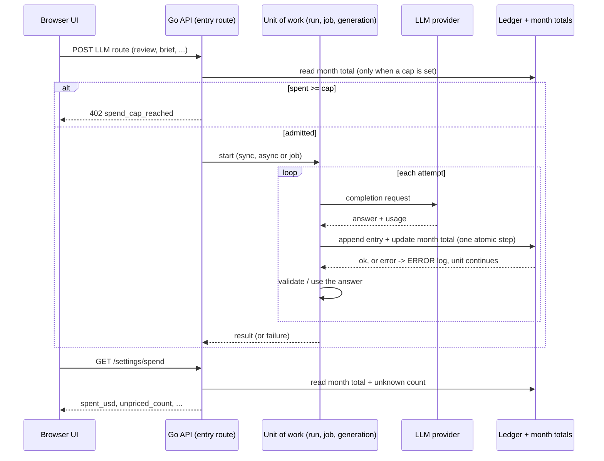

# Cost ledger for the monthly spend cap
Spec: Cost ledger (append-only per-call LLM cost record, month total, unknown-cost count) · Status: ready-for-planning · Date: 2026-10-25
Areas: api, ui
Design sources: the user's brief of 2026-10-25 (text; no frames or screenshots). Material read:
- `docs/migration/STATUS.md` (Settings section, follow-ups D26 rollup, S2, I7, spend under-count);
- the Settings A spec and plan: `specs/2026-10-23-settings-first-run-setup.md` (FR12, FR13, EC4, EC6, NFR4, D19, D24–D26),
  `docs/plans/2026-10-23-settings-first-run-setup.md`;
- the review reports `.sdd/review/2026-10-23-settings-first-run-setup/{fix-r3-ac23.md, security-r1.md, security-r2.md, ac25-real.md}`;
- `backend/INSIGHTS.md` (the 2026-10-25 spend entries) and `backend/AGENTS.md`;
- Settings C: `specs/2026-10-23-settings-c-automatic-reviews.md` and `docs/plans/2026-10-25-settings-c-automatic-reviews.md`;
- Settings B: `specs/2026-10-23-settings-b-workspace.md`;
- `specs/2026-10-24-custom-model-providers.md` (its FR13 `unpriced_count`, FR22);
- a repository research report (2026-10-25, commit `637e42f`) that lists every LLM call site with its cost handling.

Related: `specs/2026-10-23-settings-first-run-setup.md` (Settings A). This spec supersedes Settings A FR12 (the month
total derivation) and revises D19. It keeps FR11, FR13 and FR14 and extends them. It also changes Settings B
(reset/export/prune interaction, §12) and adopts the `unpriced_count` field of `specs/2026-10-24-custom-model-providers.md`
FR13 (§12). Settings C (`specs/2026-10-23-settings-c-automatic-reviews.md`) waits for this spec. No other spec of this
feature exists.

ID convention: plain FR1…, EC1…, NFR1…, AC1…, US1…, D1…, Q1…. Area tags: `[api]` = Go backend (including CI ingest),
`[ui]` = Next.js app.

## 1. Goal
The monthly spend cap of Settings A is the user's only guard against runaway LLM spend. Today its month total
under-counts. Regenerating an intent, brief or onboarding tour replaces the earlier cost. Failed or cancelled work often
loses the cost of calls that did answer. Deleting a run removes its cost. Calls on unpriced models are invisible.
Settings C will start reviews unattended, so the cap must be reliable first.

This spec adds an append-only record of every billed LLM call. The month total and the cap check read from it, and
regenerations add up. With a cap set, the cap check adds ≤ 50 ms p95. The user also sees how many calls
this month had no known price.

## 2. Context
- The month total is derived on every read from six tables, summed by one query:
  - agent runs by `ran_at`, eval runs by `ran_at` and convention scans by `started_at`;
  - intent rows by `derived_at`, the brief document by its `generated_at` string, onboarding by `generated_at`.

  CI runs and eval suite runs are excluded as mirrors (`backend/internal/spend/adapters/postgres/store.go:29-98`;
  Settings A FR12, D13). D19 rejected a stored ledger (Settings A spec, §16).
- The intent, brief and onboarding records keep one row per PR or repository. A regenerate is an upsert that replaces
  the earlier cost. On the real stand, an intent refresh that cost $0.00375 changed the month total by $0.000000
  (`ac25-real.md` part C, F1; `backend/INSIGHTS.md:36`; STATUS "spend under-count").
- A NULL cost (an unpriced model) counts as $0, so unpriced usage never reaches the cap (security r1 S2,
  `security-r1.md:27-30`; spec D25 follow-up: show "N runs with unknown cost").
- Latency with a cap set: the check adds about 165 ms p95 at Settings A NFR4 volume. Limit: +50 ms. The floor is about
  90 ms of database time to sum about 150,000 rows. A stored month rollup was named as the fix (`fix-r3-ac23.md`, option
  (b); spec D26). Without a cap, the check reads no spend (D24; `backend/AGENTS.md` spend paragraph).
- Call sites (research report, 2026-10-25):
  - One client entry point makes every costed LLM call. One call is 1–3 HTTP attempts, because invalid answers are
    re-prompted. A per-response usage hook reports each answered attempt
    (`internal/llm/structured.go:96,129-190,256-270`).
  - The cost per response is the OpenRouter-reported `usage.cost`, else the price-book estimate, else NULL (unknown
    model) (`openaicompat.go:213-214`, `pricebook.go`, `prices.go:50-58`).
  - The mock provider reports $0.00042 per response (`llm/adapters/mock/mock.go:18-22`).

  | Unit of work | Trigger, mode | Calls | Cost kept today | Lost today |
  |---|---|---|---|---|
  | Review agent run | POST `/pulls/:id/review` (Settings C: automatic), async | 1 per chunk × ≤ 3 attempts | `agent_runs` row, cost updated at the end | runs left `running` by a crash or an expired drain; run deletion |
  | Intent derivation in a review | review pre-work, not gated | 0 (cache hit) or 1 × ≤ 2 | `pr_intent` upsert | any failure; overwritten on re-derive |
  | Intent refresh | POST `/pulls/:id/intent/refresh`, sync | 1 × ≤ 2 | `pr_intent` upsert | any failure; overwritten |
  | Brief | POST `/pulls/:id/brief`, sync | 1 × ≤ 2 | brief document upsert | an output that fails validation, any failure; overwritten |
  | Onboarding tour | POST `/repos/:id/onboarding`, sync | 1 × ≤ 2 | tour upsert | any failure; overwritten |
  | Conventions scan | POST `/repos/:id/conventions/extract`, job | 1 × ≤ 2 | scan row, cost on completion | every failed scan |
  | Eval case | eval run starts, async | 1 per chunk × ≤ 3 | `eval_runs` row per case | a case aborted by shutdown; case deletion |
  | CI run | runs in GitHub Actions; the server ingests artifacts at POST `/ci/refresh` | in the runner | `agent_runs` (source `ci`) | runs without an artifact (cost NULL) |

  Evidence for the table: `reviewer/app/engine.go:64-104`, `reviews/app/executor/run.go:98-103,244-252`,
  `reviews/adapters/peers/intent.go`, `intent/app/flight.go:70-91`, `brief/app/service.go:224-263`,
  `onboarding/app/service.go:225-254`, `conventions/app/job.go:255-283`, `evals/app/executor/case.go:34-109`,
  `ci/adapters/postgres/ingest.go`, `ci/domain/ingest.go:104-131`.
- Model-list requests make no completion call and get no computed cost (connection test, `/providers/:id/models`, the
  price-book refresh; `settings/adapters/providers/providers.go:116-185`). There are no embedding, conformance or digest
  LLM calls (research report §I).
- `GET /settings/spend` returns `{month_start, spent_usd, cap_usd, remaining_usd, cap_reached}`. The UI schema is a
  non-strict object (`frontend/src/vendor/shared/contracts/platform.ts:105-114`), and the hint is shown in
  `SpendCapField`.
- Settings B (being implemented): reset deletes run history, and the reset dialog says that this month's spend total
  drops (B FR16, FR19, D16, §12). The export is allow-list based (B FR14). The retention prune deletes run traces only
  (B FR7, D3).

## 3. Scope
### In scope
- An append-only cost ledger, with one entry per answered LLM call at every costed call site, and CI-ingested runs.
- A stored per-workspace month total kept in step with the ledger. The month spend and the cap check read only this
  total.
- A one-time backfill of existing cost records at upgrade.
- An unknown-cost count in `GET /settings/spend`, shown in the spend hint.
- Rules for how the ledger interacts with Settings B reset, export and retention prune, and with deletions.
- The Settings B reset dialog sentence about the month spend, updated when this slice lands (FR16).

### Out of scope
- `GET /settings/spend` keeps every current field with the same meaning; the only change is one added field.
- The 402 `spend_cap_reached` status, code, message and `details` fields are unchanged.
- No route is added, and no route reads, edits or deletes individual ledger entries.
- The set of routes that check the cap is unchanged (Settings A FR13). The intent derivation inside a review stays
  ungated.
- The cap is still checked at start only. Running work is never stopped (Settings A EC6, P3).
- The UI shows no per-feature, per-model or per-day spend breakdown.
- The cost shown on runs, eval runs, scans, intents, briefs and tours keeps its current value and source.
- Existing cost records are never repriced after a price change.
- The CI runner (the program in GitHub Actions) is unchanged, and so is its artifact format.
- The workspace export never contains ledger entries or month totals.
- Model-list requests (connection test, model pickers, price-book refresh) create no ledger entry.

## 4. User scenarios
- US1 — As a user with a $5 cap, I regenerate a brief three times, so that each regeneration's cost counts toward the
  cap and the fourth attempt is refused once the cap is reached.
- US2 — As a user whose agent uses a model with no known price, I see "3 calls with unknown cost are not included." next
  to my month spend, so that I know the cap does not cover them.
- US3 — As a user who enables automatic reviews (Settings C), I rely on the cap stopping new unattended reviews at the
  real month spend, including failed and cancelled runs.
- US4 — As a user who deletes a run or resets run history, I still see the money already spent this month.

## 5. Functional requirements
Recording
- FR1 [api] — Each answered response of an LLM call shall append exactly one ledger entry. An answered response is an
  attempt that got a provider answer, including a re-prompted attempt and an answer without choices. This applies to
  these unit kinds:

  | Kind | Unit of work |
  |---|---|
  | `review_run` | an agent run, with any trigger: manual, multi-agent or automatic |
  | `review_intent` | the intent derivation inside a review |
  | `intent_refresh` | an intent refresh |
  | `brief` | a brief |
  | `onboarding` | an onboarding tour |
  | `conventions_scan` | a conventions scan |
  | `eval_case` | an eval case |

  An attempt that got no answer (connection error, timeout before any answer, cancel before any answer) appends nothing
  (D3).
- FR2 [api] — An entry shall hold:
  - the workspace;
  - the occurrence time: when the answer was received, server clock, UTC, milliseconds;
  - the kind (FR1, FR6);
  - the provider and model as used for the call;
  - input and output tokens when the call site knows them, else empty;
  - the cost: micro-USD, or unknown (FR3);
  - an informational reference to its unit of work: kind and id. The reference is never enforced, so the entry
    outlives the unit;
  - its origin: `live`, `ci_ingest` or `backfill`.

  It holds no prompt, output, diff, file path, PR title, repository name, key or header.
- FR3 [api] — An entry's cost shall be the cost the call site computes for that response today: the provider-reported
  cost, else the price-book estimate, else unknown. It is rounded to 6 decimals. A cost that is negative, not a number
  or infinite is stored as unknown. A stored cost is never recomputed.
- FR4 [api] — Entries are append-only. Nothing updates or deletes them: no route, job, prune or reset, and no deletion
  of the unit of work or of its agent, eval case, PR, repository or skill. The rollback of a unit's own writes does not
  remove its entries. The one exception is the schema downgrade (FR10).
- FR5 [api] — An entry shall be stored when its answer is received, before the unit of work processes that answer. It
  is stored whatever the unit's outcome: success, failure, output validation error, timeout, cancel, a shutdown abort
  after the answer, or a later crash.
- FR6 [api] — CI ingest shall append one entry, kind `ci_run`, origin `ci_ingest`, when it records a new CI run that
  has an artifact. The entry's cost is the artifact's reported total, or unknown when that total is null. Its
  occurrence time is the run time the ingest stores for the run today: the workflow run's creation time, else the
  ingest time. Ingesting the same CI run (same run id and attempt) again appends nothing. A CI run without an artifact
  appends nothing (D9).

Month total and cap
- FR7 [api] — For a workspace and a UTC calendar month:
  - the month spend is the sum of the known costs of its entries whose occurrence time is in that month;
  - the unknown-cost count is the number of those entries with an unknown cost.

  `spent_usd`, `remaining_usd` and `cap_reached` of `GET /settings/spend` and the 402 `details` use this month spend.
  This supersedes the derivation of Settings A FR12.
- FR8 [api] — The cap check of Settings A FR13 shall compare this month spend with the cap: spent ≥ cap → 402.
  Unknown-cost entries never block (D7). The check order, the fail-closed rule (D16) and the no-cap skip (D24) are
  unchanged. Settings C's `paused_spend_cap` and `skipped_spend_cap` use the same decision.
- FR9 [api] — The month spend and the unknown-cost count of each workspace and month shall be stored. They are updated
  in the same all-or-nothing step as each entry append, so at every moment they equal FR7 computed over the entries.
  The spend read and the cap check read only these stored totals, never the individual entries or the per-feature
  cost records.

Upgrade
- FR10 [api] — Backfill and downgrade:
  - The schema upgrade shall backfill the ledger once, before the server accepts requests. It creates one entry
    (origin `backfill`) for each existing record that Settings A FR12 counts and that has a known cost, with FR12's
    time and the record's workspace. Mirrors (CI runs, eval suite runs) are excluded, and a malformed brief or
    onboarding document is skipped, as FR12 does today. A backfilled agent run of source `ci` also counts as an
    ingested run for FR6, so a later re-ingest appends nothing.
  - The stored totals (FR9) are built from the backfilled entries.
  - The downgrade removes the ledger and the stored totals, and leaves every per-feature cost record as it was.
- FR11 [api] — Every per-feature cost value shall keep being written and returned exactly as today: run, eval run,
  scan, intent, brief and tour cost, plus tokens. None of them is read for the month spend any more.

Interaction with other features
- FR12 [api] — Interaction with Settings B:
  - Ledger entries and stored totals are not run history. Reset (B FR16) neither deletes nor changes them, so this
    month's spend is the same before and after a reset (D6).
  - The retention prune (B FR7) never deletes them.
  - The workspace export (B FR13–FR14) never includes them.

Wire and UI
- FR13 [api] — `GET /settings/spend` shall add `unpriced_count`: the unknown-cost count of the current month (FR7), an
  integer ≥ 0, always present (§7). It is the field that custom model providers FR13 names, with this definition.
- FR14 [ui] — When `unpriced_count` > 0, the spend-cap hint (Settings A FR14) shall add a sentence after the "used this
  month" text: "1 call with unknown cost is not included." or "<N> calls with unknown cost are not included." It shows
  whether or not a cap is set. A missing field or 0 adds nothing (D12).

- FR16 [ui] — When this slice lands, the Settings B reset dialog (B FR19) shall replace the sentence that this month's
  spend total will no longer include the deleted runs with "This month's spend total is kept." No other dialog text,
  count or behaviour changes (D6, D14).

Observability
- FR15 [api] — Logging:
  - A failed append logs one ERROR line with kind, provider, model, cost and workspace id, and the unit of work goes on
    (D8).
  - The backfill logs one INFO line with the entries created per kind, the records skipped as malformed and the
    duration.
  - Neither line holds prompt text, model output or a key.

## 6. Workflow and communication

CI ingest: UI → POST `/ci/refresh` → API reads artifacts from GitHub → for each new CI run, the CI run record and its
ledger entry (FR6) are stored. A re-ingested run adds nothing.

| Interaction | Caller → callee, mode | On failure |
|---|---|---|
| Append entry | unit of work → ledger, synchronous, after each answer | ERROR log, unit continues, that cost is missing from the total (D8) |
| Cap check | entry route → month total, synchronous | 500 envelope, no work starts (fail closed, D16) |
| Spend read | GET `/settings/spend` → month total | 500 envelope |
| Backfill | schema upgrade → ledger, once at startup before listen | upgrade fails as a whole; the server does not start, as for any failed migration |
| CI ingest entry | ingest → ledger, same step as recording the CI run | CI run not recorded either; next refresh retries (idempotent) |

## 7. Contracts
`GET /settings/spend` → 200 (guards unchanged: Host allow-list, error envelope):
```
{ month_start: "2026-10-01T00:00:00.000Z", spent_usd: number, cap_usd: number|null,
  remaining_usd: number|null, cap_reached: boolean,          // unchanged; spent_usd now from the ledger (FR7)
  unpriced_count: integer (>= 0) }                           // new, always present
```
Errors: 500 `internal_error` when the stored totals cannot be read (unchanged).

402 `spend_cap_reached` on the Settings A FR13 routes: body unchanged. `details.spent_usd` is the FR7 month spend.

Shared contract: `frontend/src/vendor/shared/contracts/platform.ts` `SpendStatus` gains `unpriced_count`, an optional
non-negative integer. It is optional so that a payload without it still parses; the Go backend always sends it. This
changes together with the backend, and the Go golden of `GET /settings/spend` is checked by
`frontend/src/test/go-backend-contracts.test.ts`. Consumers: `SpendCapField` (hint). Custom model providers FR13/FR22
use the same field.

No other route, status code or field changes.

## 8. Data model (logical)
- **Ledger entry** (new, persisted, append-only): FR2 fields. It belongs to one workspace. It references its unit of work
  for information only, so the entry outlives the unit. Lifetime: kept forever (D10). Volume: one entry per answered
  attempt, up to 3 per chunk for reviews and eval cases.
- **Month total** (new, persisted, derived): one per workspace and UTC month. It holds the known-cost sum (micro-USD),
  the unknown-cost count and the entry count. It is updated with each append (FR9). Invariant: equal to the aggregate
  of the entries of that workspace and month.
- The per-feature cost fields of agent runs, eval runs, eval suite runs, CI runs, scans, intents, briefs and tours stay
  as they are, for display. They are no longer a spend source.
- The settings value `monthly_spend_cap_usd` is unchanged.

## 9. States and UX
| Screen / element | Loading | Empty | Error | Degraded | Success | Notes |
|---|---|---|---|---|---|---|
| Spend hint (API Keys) | "$… used" skeleton (as Settings A) | no cap: "No cap · $X used this month" | "Spend unavailable" + Retry (as Settings A) | `unpriced_count` > 0 → the FR14 sentence | "$X used this month" | sentence carries text, not colour only |
| Reset dialog sentence (Settings B) | as B | as B | as B | — | "This month's spend total is kept." | only this sentence changes (FR16) |

## 10. Edge cases
- EC1 [api] — The same brief, onboarding tour or intent is regenerated twice in one month → three entries; the month
  spend rises by each cost (FR1, FR4).
- EC2 [api] — An intent refresh whose answer costs $0.00375 → the month spend rises by exactly $0.003750 (the AC25 C2
  repro) (FR1, FR7).
- EC3 [api] — A call on a model with no known price → an entry with unknown cost; the month spend is unchanged;
  `unpriced_count` rises by 1 per answered attempt; the cap check is unaffected (FR3, FR8, FR13).
- EC4 [api] — A review run is cancelled after 2 of 3 chunks answered → 2 entries remain and count; the run's own cost
  field behaves as today (FR5, FR11).
- EC5 [api] — An attempt is aborted before any answer (timeout, cancel, shutdown) → no entry. The provider may still
  bill it; this is a known limit (FR1).
- EC6 [api] — The first answer is invalid and the re-prompt succeeds → two entries (FR1).
- EC7 [api] — A brief, onboarding tour or conventions scan gets an answer whose output fails validation → its entry
  stays, the generation fails as today, and the month spend includes the cost (FR5).
- EC8 [api] — The same CI run is ingested on two refreshes → one entry (FR6).
- EC9 [api] — A CI artifact reports a null cost → one unknown-cost entry; a CI run without an artifact → no entry (FR6).
- EC10 [api] — A CI run created on 2026-09-30 is ingested on 2026-10-02 → its entry counts in September, not in the
  current month (FR6, FR7).
- EC11 [api] — An answer received at 00:00:00.000 UTC on the 1st belongs to the new month, and one at 23:59:59.999 on
  the last day to the old month. A run that started before midnight and gets answers after it splits across the two
  months (FR2, FR7).
- EC12 [api] — 50 answers of one workspace are appended concurrently → the stored total equals the exact sum, and
  another workspace's total is unchanged (FR9).
- EC13 [api] — A run, eval case, agent, PR or repository is deleted → the month spend and `unpriced_count` are unchanged
  (FR4).
- EC14 [api] — Reset run history (Settings B) → the month spend and `unpriced_count` are unchanged (FR12).
- EC15 [api] — The retention prune runs → no entry is removed (FR12).
- EC16 [api] — An append fails (database error) → one ERROR line; the unit goes on; that cost is missing from the total
  (FR15, D8).
- EC17 [api] — Backfill: a record with a NULL cost gets no backfilled entry, so `unpriced_count` counts only calls made
  after the upgrade. A cost that an earlier regenerate overwrote cannot be recovered (FR10).
- EC18 [api] — Upgrade, downgrade, upgrade again → the second backfill creates the same entries as the first, with no
  duplicates (FR10).
- EC19 [api] — A workspace with no entry this month → `spent_usd` 0 and `unpriced_count` 0 (FR7, FR13).
- EC20 [api] — The stored totals cannot be read at an entry route with a cap set → 500, and no work starts (FR8).
- EC21 [api] — An answer reports a cost that is negative, not a number or a string → the entry's cost is unknown
  (FR3).

## 11. Non-functional requirements
- NFR1 [api] — With a cap set, the cap check adds ≤ 50 ms p95 to a Settings A FR13 route. This is measured as the 402
  latency minus the 404 baseline, the method of `fix-r3-ac23.md`. Volume: 500,000 ledger entries in the current month
  and 2,000,000 in the 12 earlier months for the workspace, plus the Settings A NFR4 volumes in the per-feature tables.
- NFR2 [api] — `GET /settings/spend` p95 ≤ 50 ms at the NFR1 volume. The read time does not grow with the number of
  entries.
- NFR3 [api] — Appending an entry adds ≤ 50 ms p95 (D21; was 10 ms) to an LLM call, with 50 concurrent appends to one workspace.
- NFR4 [api] — Privacy: entries and the FR15 log lines contain no prompt, model output, diff, file path, PR title, key
  or header value. Tests check this with a canary string in the PR title and diff.
- NFR5 [api] — Exactness: amounts are whole micro-USD. The stored total equals the sum of the entries exactly, with no
  floating-point drift. For a completed review run, its entries sum to its stored cost within 1 micro-USD per entry.
- NFR6 [api] — Compatibility: the existing Settings A goldens and the UI contract test pass with only the added field;
  every other route's goldens are unchanged.
- NFR7 [api] — The upgrade, backfill included, completes in ≤ 60 s on a database with the Settings A NFR4 volumes. The
  backend is healthy ≤ 60 s after the database (Phase 1 AC95). The schema change is one new versioned migration with
  an up and a down.
- NFR8 [ui] — The new sentence is in `messages/en/*.json`, with plural forms. The pseudo-messages test finds no
  hard-coded copy.

## 12. Dependencies and rollout
- Shared-contract change: yes, additive. `platform.ts` `SpendStatus.unpriced_count`, changed with the backend in one
  change, with a new golden.
- Persisted data change: yes. A new ledger and new month totals are added by one up/down SQL migration. The migration
  number is the next free one when this lands, after Settings B's (B plan SCR3: 0004 if B adds one). Settings C then
  takes the number after it (C plan S0/A1).
- No feature flag. The switch happens at upgrade: the backfill makes the first month spend after the upgrade equal to
  the derived total before it.
- Order: after Settings A (merged). In parallel with Settings B; whichever lands later adapts. Before Settings C, whose
  plan is on hold for this spec. C's FR6(d), D8 and A2 rely on FR8 and need no change.
- Changes needed in other specs (not edited here; each needs the owner's change request):

  | Spec | Item | Change |
  |---|---|---|
  | Settings A | FR12, §8 "never stored", D19 | superseded by FR7–FR10 |
  | Settings A | NFR4 / AC23, D26 | met by NFR1, NFR2 / AC17 |
  | Settings B | FR19 dialog sentence, §12 "no longer includes the deleted runs", D16 (B Q10) | B ships unchanged: its sentence is true until the ledger lands, because spend is still derived from the run tables. **This ledger slice updates them when it lands** (FR16, D6, D14): the dialog says "This month's spend total is kept.", and B's FR19, §12 line and D16 get a change-request decision stating that reset no longer lowers the month spend. |
  | Settings B | FR14 export | unchanged; the ledger is outside the allow-list (FR12) |
  | Custom model providers | FR13 `unpriced_count` | same field; definition = ledger entries with unknown cost (FR7) |
  | Custom model providers | FR22 hint text | replaced by FR14's sentence (D12) |

## 13. Acceptance criteria
- AC1 [api] — Given the mock provider ($0.00042 per answer) and a fixed clock, when a single-agent review runs, a
  map-reduce review splits into 3 chunks, the intent pre-work runs, and an eval case, a conventions scan, an intent
  refresh, a brief and an onboarding tour each run, then:
  - each answered attempt has exactly one entry with the matching kind, workspace, provider, model and reference;
  - the month spend rises by $0.00042 × the number of answers.

  Traces: FR1, FR2, FR3, FR7 · Verify: integration
- AC2 [api] — Given a month with a known total, when an intent is refreshed twice, a brief generated twice and a tour
  generated twice, then `GET /settings/spend` `spent_usd` has risen by 6 × $0.00042, and with a cap 1 micro-USD above
  the old total (seed an old total just under a cent, as the cap takes at most 2 decimals) the next POST `/pulls/:id/brief` answers 402 `spend_cap_reached`.
  Traces: FR1, FR4, FR8, EC1, EC2 · Verify: integration
- AC3 [api] — Given a fake provider whose model has no price, when a review with 2 answers runs, then 2 unknown-cost
  entries exist, `spent_usd` is unchanged and `unpriced_count` is 2. With a cap set above the spend, the next review
  start is admitted. An answer reporting cost -1, NaN or "0.1" stores an unknown cost.
  Traces: FR3, FR8, FR13, EC3, EC21 · Verify: integration
- AC4 [api] — Given a fake provider, then each of these keeps one entry per answer and the month spend includes them:
  - a review cancelled after 2 of 3 chunks answered → 2 entries;
  - a first invalid answer then a valid re-prompt → 2 entries;
  - a brief, a tour and a conventions scan whose answer fails output validation → one entry per answered attempt
    (2 each with today's single re-prompt), while the generation fails as today;
  - an eval case aborted by shutdown after its answer → 1 entry.

  Traces: FR5, EC4, EC6, EC7 · Verify: integration
- AC5 [api] — Given a fake provider that never answers (timeout) or a cancel before the answer, then no entry is
  created and the month spend is unchanged.
  Traces: FR1, EC5 · Verify: integration
- AC6 [api] — Given CI artifacts, then CI ingest behaves as follows:
  - cost 0.12 for a run created today → one `ci_run` entry of $0.12 dated at the run's creation time;
  - a second refresh of the same run → no new entry;
  - a null-cost artifact → one unknown-cost entry;
  - a run without an artifact → no entry;
  - a run created on 2026-09-30 and ingested on 2026-10-02 → counted in September.

  Traces: FR6, EC8, EC9, EC10 · Verify: integration
- AC7 [api] — Given a fake clock, when answers arrive at 2026-10-31T23:59:59.999Z and 2026-11-01T00:00:00.000Z for one
  run, then October's and November's totals each hold one. `GET /settings/spend` on 2026-11-01 reports only the
  second, with `month_start` 2026-11-01T00:00:00.000Z.
  Traces: FR2, FR7, EC11 · Verify: integration
- AC8 [api] — Given entries for a run, an eval case, an agent's runs, a PR's intent and brief and a repository's tour,
  when the run, the eval case, the agent, the PR's repository and the repository are deleted through their routes,
  then `spent_usd` and `unpriced_count` are unchanged and every entry still exists.
  Traces: FR4, EC13 · Verify: integration
- AC9 [api] — Given entries this month, when Settings B reset runs with the exact name and the retention prune runs
  with 30 days, then `spent_usd`, `unpriced_count` and the entry count are unchanged. The workspace export bytes contain
  no entry id, kind value or month total.
  Traces: FR12, EC14, EC15 · Verify: integration
- AC10 [api] — Given two workspaces, when 50 appends to workspace 1 and 10 to workspace 2 run concurrently with mixed
  known and unknown costs, then each stored total equals the exact sum of its entries in micro-USD, and each unknown
  count equals its unknown entries.
  Traces: FR9, EC12, NFR5 · Verify: integration
- AC11 [api] — Given a cap equal to the month spend, then a review start answers 402. Given the stored totals made
  unreadable with a cap set, then each Settings A FR13 route answers 500 and no run, job or row is created. Given no
  cap, then the start does not read the totals.
  Traces: FR8, EC20 · Verify: integration
- AC12 [api] — Given an injected append error, when a review runs, then one ERROR line names kind, provider, model,
  cost and workspace, and the run completes with status done. The line contains no prompt text and no key.
  Traces: FR15, EC16, NFR4 · Verify: integration
- AC13 [api] — Given the Settings A AC9 fixture before the upgrade (all six sources, the mirrors, NULL costs, malformed
  brief documents, boundary records, two months, two workspaces), when the upgrade runs, then:
  - each month's spend per workspace equals the derived total before the upgrade;
  - `unpriced_count` is 0;
  - one INFO line reports the counts per kind and the skipped records;
  - a CI run backfilled from its agent run is not added again by a re-ingest;
  - down then up yields the same entries, with no duplicates.

  Traces: FR10, FR15, EC17, EC18 · Verify: integration
- AC14 [api] — Given a completed review run, a completed eval run and a successful brief on the mock provider, then
  their own cost fields and tokens equal today's values. The run's entries sum to its stored cost within 1 micro-USD
  per entry.
  Traces: FR11, NFR5 · Verify: integration
- AC15 [api] — Given a workspace with no entries this month, then `GET /settings/spend` returns every Settings A field
  plus `unpriced_count: 0`, and `spent_usd: 0`. The golden parses with the updated `SpendStatus` in the UI contract
  test, and every other golden is byte-identical.
  Traces: FR13, EC19, NFR6 · Verify: component
- AC16 [ui] — Given mocked spend responses, then `unpriced_count` 0 or absent shows no extra sentence; 1 shows "1 call
  with unknown cost is not included."; 3 shows "3 calls with unknown cost are not included.", both with and without a
  cap. The pseudo-messages render finds no hard-coded copy.
  Traces: FR14, NFR8 · Verify: component
- AC17 [api] — Given the NFR1 volume in a throwaway stack, when 200 requests each hit GET `/settings/spend` and POST
  `/pulls/:id/review` (cap reached), then GET p95 ≤ 50 ms and the 402 p95 is ≤ 50 ms above the 404 baseline. With 50
  concurrent appends, an append adds ≤ 10 ms p95.
  Traces: NFR1, NFR2, NFR3 · Verify: manual
- AC18 [api] — Given a PR whose title and diff contain the canary `CANARY-7f3a`, when a review, an intent refresh and a
  brief run, then no stored entry field and no log line of this feature contains the canary.
  Traces: FR2, NFR4 · Verify: integration
- AC19 [api] — Given a throwaway stack with the Settings A NFR4 volumes, when the new image starts on it, then the
  upgrade with backfill finishes in ≤ 60 s and the backend is healthy ≤ 60 s after the database. The migration
  up/down/up test passes.
  Traces: NFR7 · Verify: manual
- AC20 [ui] — Given the Settings B reset dialog with mocked stats, when it opens, then it shows "This month's spend total
  is kept." and no sentence saying the month spend drops. The deleted/kept lists, counts and typed confirmation are as
  in B AC21, and the pseudo-messages render finds no hard-coded copy.
  Traces: FR16, NFR8 · Verify: component

## 14. Traceability
| Source | Area | FR | EC / NFR | AC |
|---|---|---|---|---|
| Brief: per-call append-only record at every call site | api | FR1–FR5, FR11 | EC1, EC4–EC7, EC21, NFR4, NFR5 | AC1, AC2, AC4, AC5, AC14, AC18 |
| Brief: CI-ingested runs | api | FR6 | EC8–EC10 | AC6 |
| Brief: month total read from the ledger, rollup, ≤ 50 ms (D26) | api | FR7–FR9 | EC2, EC11, EC12, EC19, EC20, NFR1–NFR3 | AC2, AC7, AC10, AC11, AC17 |
| Brief: unknown-cost calls counted and surfaced (S2, D25) | api, ui | FR3, FR13, FR14 | EC3, NFR8 | AC3, AC15, AC16 |
| Brief: backfill without double counting | api | FR10 | EC17, EC18, NFR7 | AC13, AC19 |
| Brief: reset, retention prune, deletion | api | FR4, FR12 | EC13–EC15 | AC8, AC9 |
| Coordinator note on Q1 (B reset dialog copy) | ui | FR16 | NFR8 | AC20 |
| Brief: wire compatibility | api | FR13 | NFR6 | AC15 |
| Repository rules (logs without secrets) | api | FR15 | EC16, NFR4 | AC12, AC13 |

## 15. Design review
| # | Gap / proposal | Source | Area | Decision |
|---|---|---|---|---|
| G1 | Intent, brief and tour regenerates replace the earlier cost | `ac25-real.md` F1, INSIGHTS:36 | api | accepted: ledger entries (FR1, FR4) |
| G2 | Intent, brief, onboarding and conventions lose the cost of answered calls on failure; an eval case aborted by shutdown and a crashed run lose theirs | research report | api | accepted: record per answer, before processing (FR5) |
| G3 | Deleting runs, eval cases, PRs or repos lowers the month spend | research report | api | accepted: entries outlive their unit (FR4) |
| G4 | Reset is a cap bypass if the ledger counts as run history | Settings B D16 | api | accepted: kept (D6); B copy updated by this slice (FR16, D14) |
| G5 | Unknown-cost calls are invisible to the cap | security r1 S2, D25 | api, ui | accepted: count + show, never block (D7) |
| G6 | Cap check +165 ms p95 with a cap | D26 | api | accepted: stored month totals (FR9, NFR1) |
| G7 | The review pre-work intent derivation is ungated | research report | api | recorded (FR1), gating out of scope |
| G8 | Attempts aborted before an answer may still be billed by the provider | analysis | api | accepted limit (EC5) |
| G9 | Failed CI runs report no cost | `ci/domain/ingest.go` | api | accepted: no entry (D9) |
| G10 | Two specs define `unpriced_count` and its hint | custom providers FR13/FR22 | api, ui | accepted: one field, FR14 copy (D4, D12) |
| G11 | Stored totals could drift from entries | analysis | api | invariant + atomic update (FR9); no startup recompute (D13) |
| G12 | A per-feature spend breakdown in Settings | UX | ui | out of scope; a later spec can read the ledger |

## 16. Decisions
- D1 — Build a cost ledger so the cap is reliable before Settings C runs LLM work unattended. This revises Settings A
  D19 and closes the D26 rollup follow-up (user, 2026-10-25).
- D2 — Scope: an append-only per-call record at every costed call site, including CI-ingested runs; the month total
  from it at ≤ 50 ms p95 with a cap; the unknown-cost count surfaced; a backfill with no double counting; reset and
  prune interaction; additive wire change only (user brief, 2026-10-25).
- D3 — "Per call" means one entry per answered provider attempt, so re-prompts count separately. This matches what the
  provider bills (spec author, 2026-10-25).
- D4 — The new field reuses the name `unpriced_count` from custom model providers FR13, so that the two specs share one
  field (spec author, 2026-10-25).
- D5 — An entry's time is when its answer was received, not the unit's start (spec author, 2026-10-25). Exception: CI
  runs keep the run time (FR6), because the server sees no answer.
- D6 — Q1 Ledger entries and month totals are not run history: Settings B reset keeps them, so reset does not lower
  this month's spend (user, 2026-10-25).
- D7 — Q2 Unknown-cost calls are counted and shown, never blocked, also with a cap set (user, 2026-10-25).
- D8 — Q3 A failed append lets the unit of work go on, with one ERROR line (user, 2026-10-25).
- D9 — Q4 A CI run without an artifact gets no ledger entry (user, 2026-10-25).
- D10 — Q5 The ledger is kept forever; the retention prune never touches it (user, 2026-10-25).
- D11 — Q6 The backfill covers all months with a known cost (user, 2026-10-25).
- D12 — Q7 FR14's sentence with the count replaces custom model providers FR22's "Unpriced usage this month is not
  included." (user, 2026-10-25).
- D13 — Q8 No recompute of the stored month totals at startup (user, 2026-10-25).
- D14 — Settings B ships its reset-dialog sentence unchanged, because it stays true while spend is derived from the run
  tables. This ledger slice updates the dialog copy (FR16) and B's FR19, §12 line and D16 when it lands (user, via the
  coordinator, 2026-10-25).
- D15 — Backfilled entries are rounded half away from zero to 6 decimals; sources stored with more decimals (convention
  scans, brief/tour JSON) may differ by ≤ 1 micro-USD per entry from the pre-upgrade sum; AC13 equality is exact on
  fixtures with ≤ 6 decimals (planner SCR1; user pre-approved plan defaults, 2026-10-25).
- D16 — Entry references: review run → run, intent/brief → PR, onboarding → repo, conventions → scan, eval → eval case,
  CI → the CI agent run; CI entries carry a dedupe key (GitHub run id + attempt) so a re-ingest after a reset never counts
  twice (planner SCR3, A11; 2026-10-25).
- D17 — Tests for AC1 (onboarding) and AC3 (NaN / negative / string cost) use scripted adapters or provider stubs, not the
  mock provider (planner SCR2, SCR5; 2026-10-25).
- D18 — The startup seed's demo costs get no ledger entries; a fresh database shows $0 for the seed month (planner A5;
  2026-10-25).
- D19 — A CI-ingested run whose reported cost exceeds $10,000 is recorded with an unknown cost (counted in
  `unpriced_count`) and one WARN line, and the month totals use overflow-safe arithmetic. This stops a forged artifact
  from pinning the month at the cap or overflowing a total (security r1 L1/L2; orchestrator under the user's
  pre-approval, 2026-10-25).
- D20 — AC2 and AC4 wording aligned with D3 and with the 2-decimal cap input (W4 findings, 2026-10-25).
- D21 — NFR3 threshold relaxed by the user: an append adds ≤ 50 ms p95 at 50 concurrent calls (was 10 ms), pool wait
  included. A local noisy run measured 24–40 ms (user, 2026-10-25).

## 17. Open questions
None — Q1–Q8 were resolved on 2026-10-25 by accepting their defaults (D6–D13).

## Glossary
- Answered attempt — one HTTP attempt of an LLM call that received a provider answer (with or without usable output).
- Ledger entry — the append-only record of one answered attempt's cost (FR2).
- Month total — the stored per-workspace, per-UTC-month known-cost sum and unknown-cost count (FR9).
- Unknown cost — no provider-reported cost and no price for the model, or an invalid reported value (FR3).
